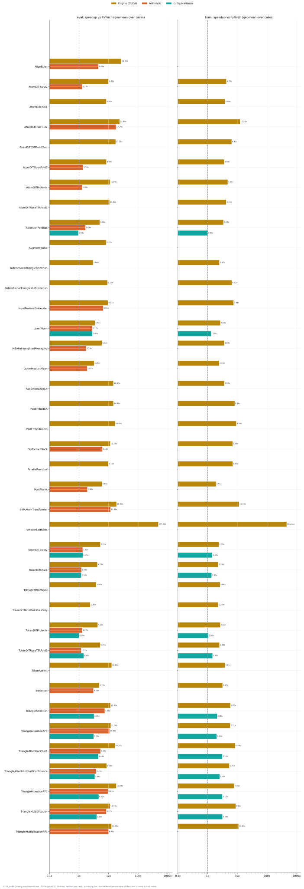
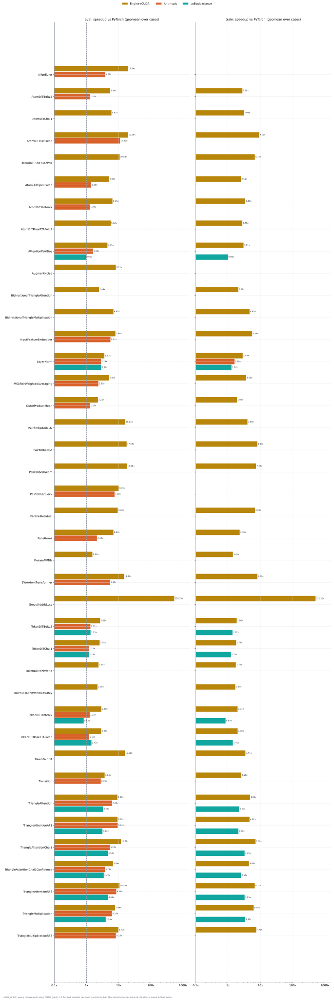

# foldjet-engine

GPU kernels for the building blocks of AlphaFold 3-style structure-prediction models: the pair stack (triangle multiplication and
attention, outer product mean, MSA pair-weighted averaging, transitions, layer norms), the token and atom diffusion transformers of
several model families, the diffusion sampler's glue, the smooth-lDDT loss, and ProteinMPNN. Each op is a PyTorch module with a
**PyTorch reference** and interchangeable backends: the engine's own hand-written **CUDA** kernels, its portable **Triton** kernels,
and two external baselines (Anthropic's released kernels, NVIDIA cuEquivariance). The repository also holds the tooling that says
what each module must serve (requirements tables), measures accuracy against a float64 gold and speed under CUDA graphs, and decides,
from human-managed version numbers, which results are current (the judge).

> **Renamed.** foldjet-engine 1.0.0 is miniworld-engine 3.0.12 under a new name: package `foldjet_engine` (`import miniworld_engine`
> still works and warns), PyPI `foldjet-engine` and `foldjet-engine-kernels-*`; the prebuilt kernels are the 3.0.12 files, unchanged.
> The environment variables are `FOLDJET_ENGINE_*` (the old `MINIWORLD_*` names are still read, with a warning) and the caches `~/.cache/foldjet_engine_{jit,headers}` (an existing `miniworld_engine_*` cache keeps being used). See [docs/release-notes/RELEASE_NOTES_1.0.0.md](docs/release-notes/RELEASE_NOTES_1.0.0.md).

## Install

```sh
pip install foldjet-engine
# torch for your driver's CUDA, e.g.:
pip install --extra-index-url https://download.pytorch.org/whl/cu129 foldjet-engine
```

Python >= 3.10, PyTorch >= 2.8, Triton >= 3.3, Linux x86-64. On CPython 3.12 with torch 2.13 / CUDA 12.9 the prebuilt kernels of all
four cards below come as dependency wheels and nothing compiles; elsewhere a CUDA kernel is compiled on first use (needs an `nvcc`
matching torch's CUDA). Extras: `baselines` (cuEquivariance, for the `cueq` backend), `flash` (FlashAttention-4), `dev`.
Details, offline header setup and troubleshooting: [docs/install.md](docs/install.md).

## Supported cards

| card | key | `cuda` backend | prebuilt kernels wheel | benchmarks |
|---|---|---|---|---|
| NVIDIA H100 | `h100_sm90` | sm_90a kernels (wgmma, TMA, CUTLASS / cuBLASDx where used) | `foldjet-engine-kernels-sm90-cu129` | [h100_sm90](benchmarks/h100_sm90/README.md) |
| NVIDIA A100 | `a100_sm80` | sm_80 kernels (mma.sync) | `foldjet-engine-kernels-sm80-cu129` | [a100_sm80](benchmarks/a100_sm80/README.md) |
| NVIDIA RTX 5090 | `5090_sm120` | the sm_80 kernels compiled for sm_120a | `foldjet-engine-kernels-sm120-cu129` | [5090_sm120](benchmarks/5090_sm120/README.md) |
| NVIDIA B200 | `b200_sm100` | sm_100a kernels (tcgen05, TMEM, TMA) | `foldjet-engine-kernels-sm100-cu129` + `-part2` (since 3.0.12; split for PyPI's 100 MiB limit) | — (development log: [docs/b200](docs/b200/README.md)) |
| other CUDA GPUs | — | refused (`BackendUnsupported`) | — | the `triton` and `pytorch` backends run |

Every requirement case of the four cards has a current judge result (accuracy / speed owed 0 / 0 at 1.0.0).

## Quick usage

```python
import torch
from foldjet_engine.modules import TriangleMultiplication, TokenDiT
from foldjet_engine.modules.primitives import BackendUnsupported

tri = TriangleMultiplication(128, backend="cuda").cuda()     # the card's kernels, picked from the input's device
ref = TriangleMultiplication(128).cuda()                     # backend="pytorch", the reference
ref.load_state_dict(tri.state_dict())                        # same parameter names for every backend
tri.set_backend("triton")                                    # switch later; ValueError if the class has no such backend

dit = TokenDiT(model="boltz2", ...)                          # selector: builds the model's own class (TokenDiTBoltz2)
```

Mixed precision as the models run it (`master` in the requirements): fp32 parameters, bf16 activations, forward under
`torch.autocast("cuda", torch.bfloat16)`; call `set_master_weights()` on a `MasterWeights` module after a bulk bf16 cast.

## Backends

| backend | what | accuracy rule |
|---|---|---|
| `pytorch` | the reference: the single source of truth of each op's math | the reference |
| `cuda` | the engine's hand-written kernels for the input's card | binding: GREEN = within `max(err_pytorch, fixed[dtype])` of the fp64 gold |
| `triton` | the engine's Triton kernels (no TMA), any CUDA card | binding |
| `anthropic` | Anthropic's [uplifting-biomolecular-modeling](https://github.com/anthropics/uplifting-biomolecular-modeling) release, connected as it ships (needs the release at `third_party/anthropic/upstream` or `FOLDJET_ENGINE_ANTHROPIC_ROOT`) | informational (baseline) |
| `cueq` | NVIDIA cuEquivariance 0.12 (`cuequivariance_torch`), connected as it ships | informational (baseline) |
| `engine-fp8` | opt-in: the `cuda` backend with the FP8 (e4m3) inference routes on; the default stays bf16 / fp16 ([docs/fp8.md](docs/fp8.md)) | none: outside the judge |

A call outside a backend's range raises `BackendUnsupported` with the reason; it is never run by another backend. A kernel that fails
to build raises `KernelBuildError`; there is no silent fallback anywhere. Which classes have which backends: the `backends` tuple of
each class ([docs/modules.md](docs/modules.md)).

## Modules and the models that use them

Every class is in `foldjet_engine.modules`. The models are the ones whose constructors produce the class's requirement rows
(`source` column of [requirements_module.csv](src/foldjet_engine/requirements/requirements_module.csv)): AF3-family models built by
FoldJet, and MiniWorld. `engine-own` rows are shapes the engine keeps although no current downstream constructor builds them.

| group | classes | used by (requirement `source`) |
|---|---|---|
| triangle multiplication | `TriangleMultiplication` | AF3, Boltz-2, Chai-1, ESMFold2, IntelliFold2, OpenDDE, OpenFold3, Protenix (v1, v2), RoseTTAFold3 |
| | `TriangleMultiplicationRF3` | RoseTTAFold3 |
| | `BidirectionalTriangleMultiplication` | MiniWorld; engine-own |
| triangle attention | `TriangleAttention` | Boltz-2, OpenDDE, OpenFold3-preview2, Protenix (v1, v2) |
| | `TriangleAttentionAF3` | AF3, IntelliFold2, OpenFold3 |
| | `TriangleAttentionRF3` | RoseTTAFold3 |
| | `TriangleAttentionChai1`, `TriangleAttentionChai1Confidence` | Chai-1 |
| | `BidirectionalTriangleAttention` | engine-own |
| MSA ops | `OuterProductMean`, `MSAPairWeightedAveraging` | AF3, Boltz-2, Chai-1, ESMFold2, IntelliFold2, OpenDDE, OpenFold3, Protenix, RoseTTAFold3, MiniWorld |
| transition, norms | `Transition`, `LayerNorm` | all of the above models and MiniWorld |
| attention with pair bias | `AttentionPairBias` | AF3, Boltz-2, Chai-1, ESMFold2, IntelliFold2, OpenDDE, OpenFold3, Protenix, RoseTTAFold3, MiniWorld |
| pairformer block | `PairformerBlock` | engine-own (MiniWorld block layout) |
| token diffusion transformer | `TokenDiTProtenix` (selector `TokenDiT(model=...)`) | AF3, ESMFold2, IntelliFold2, OpenDDE, OpenFold3, Protenix, MiniWorld |
| | `TokenDiTBoltz2`, `TokenDiTRoseTTAFold3`, `TokenDiTChai1` | Boltz-2, RoseTTAFold3, Chai-1 |
| | `TokenDiTMiniWorld`, `TokenDiTMiniWorldBiasOnly` | MiniWorld |
| atom diffusion transformer | `AtomDiTOpenFold3` (selector `AtomDiT(model=...)`) | AF3, IntelliFold2, OpenFold3 |
| | `AtomDiTProtenix` | OpenDDE, Protenix |
| | `AtomDiTBoltz2`, `AtomDiTRoseTTAFold3`, `AtomDiTChai1` | Boltz-2, RoseTTAFold3, Chai-1 |
| | `AtomDiTESMFold2` | ESMFold2 |
| | `SWAAtomTransformer`, `InputFeatureEmbedder` | MiniWorld |
| diffusion sampler, loss | `AugmentNoise`, `AlignEuler`, `PoolAtoms`, `SmoothLddtLoss` | engine-own (AF3-style sampler glue and smooth-lDDT loss) |
| La-Proteina pair embeddings | `PairEmbedAdaLN`, `PairEmbedGeom`, `PairEmbedCA`, `TokenPairInit` | engine-own |
| inverse folding | `ProteinMPNN` | engine-own |

38 classes, 146 requirement rows. "MiniWorld" covers its confidence, diffusion and distogram models.

## Results

Per-module speed, geometric mean over each class's requirement cases of the speedup vs the `pytorch` reference (the engine's
reference implementation, eager PyTorch kernels in the same CUDA graph, TF32 allowed, not `torch.compile`d), from the speed tokens.
Each card's README has the full table, the AF3-only table and per-class L / D sweeps.

| | H100 ([summary](benchmarks/h100_sm90/README.md)) | A100 ([summary](benchmarks/a100_sm80/README.md)) |
|---|---|---|
| all classes |  |  |

A few rows (eval / train, Engine CUDA vs PyTorch; in brackets the Anthropic and cuEquivariance eval speedups vs PyTorch):

| class | H100 eval | H100 train | A100 eval | A100 train |
|---|---|---|---|---|
| TriangleMultiplication | 9.76x (4.64x, 3.39x) | 8.67x | 7.63x (5.44x, 3.74x) | 6.21x |
| TriangleAttention | 12.57x (6.53x, 3.11x) | 6.59x | 10.36x (5.49x, 3.19x) | 5.85x |
| Transition | 4.37x (2.62x, —) | 3.14x | 3.56x (2.47x, —) | 2.52x |
| AttentionPairBias | 4.54x (1.55x, 0.93x) | 3.41x | 4.33x (1.57x, 0.94x) | 2.28x |
| TokenDiTProtenix | 3.56x (1.22x, 1.02x) | 2.50x | 2.54x (1.19x, 0.84x) | 1.73x |
| AtomDiTOpenFold3 | 5.29x (1.19x, —) | 2.78x | 4.74x (1.21x, —) | 2.82x |
| PairformerBlock | 12.83x (8.24x, —) | 7.84x | 9.57x (6.92x, —) | 6.19x |

These are module-level numbers on the requirement shapes, not end-to-end model speedups. Accuracy: every engine-backend accuracy token
of both cards is in `src/foldjet_engine/judge/tokens/<card>/` (`kind: accuracy`, `light`, `err_backend`, `err_pytorch`, `tol`).

## Documentation

[docs/README.md](docs/README.md) is the index. The main entry points:

| I want to ... | read |
|---|---|
| install, fix a build, set up headers offline | [docs/install.md](docs/install.md) |
| use a module, pick a backend, initialise parameters | [docs/modules.md](docs/modules.md), [docs/init.md](docs/init.md) |
| turn on FP8 | [docs/fp8.md](docs/fp8.md) ("The `engine-fp8` backend"), [docs/fp8_training.md](docs/fp8_training.md) |
| understand how the pieces fit | [docs/architecture.md](docs/architecture.md) |
| add or change a kernel, prebuild, tune | [docs/kernels.md](docs/kernels.md) |
| measure, issue judge tokens, know what must be re-measured | [docs/measure.md](docs/measure.md), [docs/judge.md](docs/judge.md) |
| see what changed in a release, or how a release is made | [docs/release-notes/](docs/release-notes/README.md) |

Every Python step of the developer workflow runs on a compute node: the measurers need a GPU of the card, the prebuilder and the judge
a CPU. Short form:

```sh
python -m foldjet_engine.kernels._prebuild --arch sm90a --list     # plan and what is missing (sm80, sm120a, sm100a likewise)
python -m foldjet_engine.judge --gpu h100_sm90 owed                # requirement cases without a current result
tools/slurm/cycle.sh PLAN_DIR                                       # one plan -> prebuild -> measure -> issue cycle on Slurm
tools/check.sh                                                      # the gate: ruff, pyright, CPU tests
```

## Repository layout

| path | what |
|---|---|
| `src/foldjet_engine/` | the package: `modules/` (the `BackendModule` classes), `kernels/` (kernel families, per-card integrations, build / prebuild / pretune), `requirements/` (what to serve), `measure/` (measurers, plotter), `judge/` (judge, tokens per card) |
| `src/miniworld_engine/` | the pre-1.0.0 import name: an alias of `foldjet_engine` that warns |
| `docs/` | documentation ([index](docs/README.md)); `h100/` design notes, `b200/` B200 development log, `release-notes/` |
| `benchmarks/` | generated per-card speed figures and tables, the paper's data, experiment records ([README](benchmarks/README.md)) |
| `tests/` | `cpu/` (anywhere) and `gpu/` (per card) pytest suites |
| `tools/` | the gate, the Slurm judge cycle, benchmark helpers ([README](tools/README.md)) |
| `third_party/` | pins and fetch scripts of the external baselines (upstream trees are not in git) ([README](third_party/README.md)) |
| `legacy/b200/` | B200 code removed by the 2.5.0 redesign, kept for reference; not imported |
| `licenses/` | third-party licence texts and notices |

## License

`MIT AND Apache-2.0 AND BSD-3-Clause`. The engine's own code is MIT (copyright 2026 Sanggeun Park, `LICENSE`); the code derived
from Anthropic's uplifting-biomolecular-modeling release, and any file whose header says `SPDX-License-Identifier: Apache-2.0`, is
Apache-2.0 (with Anthropic's `NOTICE`), and the FlashAttention-3 portions and the
CUTLASS-instantiated object code in the prebuilt kernels are BSD-3-Clause. Details, per-file attributions and the licence texts are in
[`licenses/THIRD_PARTY_NOTICES.md`](licenses/THIRD_PARTY_NOTICES.md). The external release used by the `anthropic` backends is cloned
locally under `third_party/anthropic/upstream/` (git-ignored, not redistributed).

## Citation

A paper describing the engine is in preparation. Until then, please cite the repository:

```bibtex
@software{foldjet_engine,
  author  = {Park, Sanggeun},
  title   = {foldjet-engine: GPU kernels for AlphaFold 3-style modules},
  year    = {2026},
  version = {1.0.0},
  note    = {TODO: replace with the paper reference}
}
```
