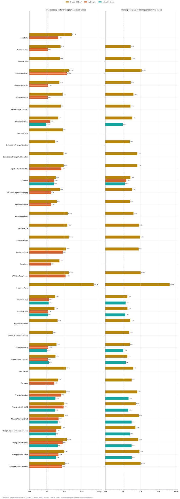
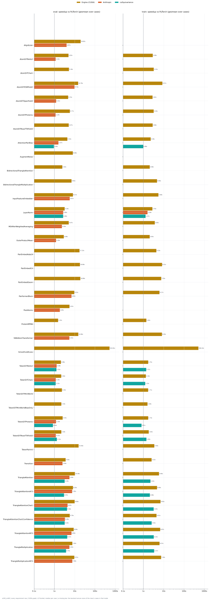

# miniworld-engine

GPU kernels for the building blocks of AlphaFold 3-style structure-prediction models: the pair stack (triangle multiplication and
attention, outer product mean, MSA pair-weighted averaging, transitions, layer norms), the token and atom diffusion transformers of
several model families, the diffusion sampler's glue, the smooth-lDDT loss, and ProteinMPNN. Each op is a PyTorch module with a
**PyTorch reference** and interchangeable backends: the engine's own hand-written **CUDA** kernels, its portable **Triton** kernels,
and two external baselines (Anthropic's released kernels, NVIDIA cuEquivariance). The repository also contains the tooling that
says what each module must serve (requirements tables), measures accuracy against a float64 gold and speed under CUDA graphs, and
decides, from human-managed version numbers, which results are current (the judge).

## Supported cards

| card | key | `cuda` backend | status |
|---|---|---|---|
| NVIDIA H100 | `h100_sm90` | sm_90a kernels (wgmma, TMA, CUTLASS / cuBLASDx where used) | supported: every requirement case has a current result (judge: 0 owed) ([benchmarks](benchmarks/h100_sm90/README.md)) |
| NVIDIA A100 | `a100_sm80` | sm_80 kernels (mma.sync) | supported: every requirement case has a current result (judge: 0 owed) ([benchmarks](benchmarks/a100_sm80/README.md)) |
| NVIDIA B200 | `b200_sm100` | sm_100a sources exist in the tree | **not supported**: almost every `cuda` backend refuses the card; no launch-config tables, tokens or benchmarks |
| other CUDA GPUs | — | refused (`BackendUnsupported`) | the `triton` and `pytorch` backends run; Triton launch configs are tuned only for H100 / A100 |

## Modules and the models that use them

Every class is in `miniworld_engine.modules`. The models are the ones whose constructors produce the class's requirement rows
(`source` column of [requirements_module.csv](src/miniworld_engine/requirements/requirements_module.csv)): AF3-family models built by
FoldForge, and MiniWorld. `engine-own` rows are shapes the engine keeps although no current downstream constructor builds them.

| group | classes | used by (requirement `source`) |
|---|---|---|
| triangle multiplication | `TriangleMultiplication` | AF3, Boltz-2, Chai-1, ESMFold2, IntelliFold2, OpenDDE, OpenFold3, Protenix (v1, v2), RoseTTAFold3 |
| | `TriangleMultiplicationRF3` | RoseTTAFold3 |
| | `BidirectionalTriangleMultiplication` | MiniWorld; engine-own |
| triangle attention | `TriangleAttention` | Boltz-2, OpenDDE, OpenFold3-preview2, Protenix (v1, v2) |
| | `TriangleAttentionAF3` | AF3, IntelliFold2, OpenFold3 |
| | `TriangleAttentionRF3` | RoseTTAFold3 |
| | `TriangleAttentionChai1`, `TriangleAttentionChai1Confidence` | Chai-1 |
| | `BidirectionalTriangleAttention` | engine-own |
| MSA ops | `OuterProductMean`, `MSAPairWeightedAveraging` | AF3, Boltz-2, Chai-1, ESMFold2, IntelliFold2, OpenDDE, OpenFold3, Protenix, RoseTTAFold3, MiniWorld |
| transition, norms | `Transition`, `LayerNorm` | all of the above models and MiniWorld |
| attention with pair bias | `AttentionPairBias` | AF3, Boltz-2, Chai-1, ESMFold2, IntelliFold2, OpenDDE, OpenFold3, Protenix, RoseTTAFold3, MiniWorld |
| pairformer block | `PairformerBlock` | engine-own (MiniWorld block layout) |
| token diffusion transformer | `TokenDiTProtenix` (selector `TokenDiT(model=...)`) | AF3, ESMFold2, IntelliFold2, OpenDDE, OpenFold3, Protenix, MiniWorld |
| | `TokenDiTBoltz2`, `TokenDiTRoseTTAFold3`, `TokenDiTChai1` | Boltz-2, RoseTTAFold3, Chai-1 |
| | `TokenDiTMiniWorld`, `TokenDiTMiniWorldBiasOnly` | MiniWorld |
| atom diffusion transformer | `AtomDiTOpenFold3` (selector `AtomDiT(model=...)`) | AF3, IntelliFold2, OpenFold3 |
| | `AtomDiTProtenix` | OpenDDE, Protenix |
| | `AtomDiTBoltz2`, `AtomDiTRoseTTAFold3`, `AtomDiTChai1` | Boltz-2, RoseTTAFold3, Chai-1 |
| | `AtomDiTESMFold2` | ESMFold2 |
| | `SWAAtomTransformer`, `InputFeatureEmbedder` | MiniWorld |
| diffusion sampler, loss | `AugmentNoise`, `AlignEuler`, `PoolAtoms`, `SmoothLddtLoss` | engine-own (AF3-style sampler glue and smooth-lDDT loss) |
| La-Proteina pair embeddings | `PairEmbedAdaLN`, `PairEmbedGeom`, `PairEmbedCA`, `TokenPairInit` | engine-own |
| inverse folding | `ProteinMPNN` | engine-own |

38 classes, 146 requirement rows. "MiniWorld" covers its confidence, diffusion and distogram models.


## Backends

| backend | what | accuracy rule |
|---|---|---|
| `pytorch` | the reference: the single source of truth of each op's math | the reference |
| `cuda` | the engine's hand-written kernels for the input's card (H100 or A100) | binding: GREEN = within `max(err_pytorch, fixed[dtype])` of the fp64 gold |
| `triton` | the engine's Triton kernels (no TMA), any CUDA card | binding |
| `anthropic` | Anthropic's [uplifting-biomolecular-modeling](https://github.com/anthropics/uplifting-biomolecular-modeling) release, connected as it ships | informational (baseline) |
| `cueq` | NVIDIA cuEquivariance 0.12 (`cuequivariance_torch`), connected as it ships | informational (baseline) |

A call outside a backend's range raises `BackendUnsupported` with the reason; it is never run by another backend. A kernel that fails
to build raises `KernelBuildError`; there is no silent fallback anywhere. Which classes have which backends: the `backends` tuple of
each class ([docs/modules.md](docs/modules.md)).

## Results

Per-module speed, geometric mean over each class's requirement cases of the speedup vs the `pytorch` reference (the engine's
reference implementation, eager PyTorch kernels in the same CUDA graph, TF32 allowed, not `torch.compile`d), from the speed tokens.
Each card's README has the full table, the AF3-only table and per-class L / D sweeps.

| | H100 ([summary](benchmarks/h100_sm90/README.md)) | A100 ([summary](benchmarks/a100_sm80/README.md)) |
|---|---|---|
| all classes |  |  |

A few rows (eval / train, Engine CUDA vs PyTorch; in brackets the Anthropic and cuEquivariance eval speedups vs PyTorch):

| class | H100 eval | H100 train | A100 eval | A100 train |
|---|---|---|---|---|
| TriangleMultiplication | 9.76x (4.64x, 3.39x) | 8.67x | 7.63x (5.44x, 3.74x) | 6.21x |
| TriangleAttention | 12.57x (6.53x, 3.11x) | 6.59x | 10.36x (5.49x, 3.19x) | 5.85x |
| Transition | 4.37x (2.62x, —) | 3.14x | 3.56x (2.47x, —) | 2.52x |
| AttentionPairBias | 4.54x (1.55x, 0.93x) | 3.41x | 4.33x (1.57x, 0.94x) | 2.28x |
| TokenDiTProtenix | 3.56x (1.22x, 1.02x) | 2.50x | 2.54x (1.19x, 0.84x) | 1.73x |
| AtomDiTOpenFold3 | 5.29x (1.19x, —) | 2.78x | 4.74x (1.21x, —) | 2.82x |
| PairformerBlock | 12.83x (8.24x, —) | 7.84x | 9.57x (6.92x, —) | 6.19x |

These are module-level numbers on the requirement shapes, not end-to-end model speedups. Accuracy: every engine-backend accuracy token
of both cards is in `src/miniworld_engine/judge/tokens/<card>/` (`kind: accuracy`, `light`, `err_backend`, `err_pytorch`, `tol`).

## Installation

See [docs/install.md](docs/install.md). In short:

1. Python >= 3.10 with PyTorch >= 2.8 and Triton >= 3.3; `pip install -e .` (the extra `baselines` adds cuEquivariance for `cueq`).
2. On Linux x86-64 with CPython 3.12 the prebuilt H100 kernels come as a dependency wheel; elsewhere each CUDA kernel is compiled on
   first use (needs an `nvcc` matching torch's CUDA and, for the CUTLASS kernels, `CUTLASS_PATH`) or ahead of time with the prebuilder.
3. The `anthropic` backend needs the Anthropic release at `third_party/anthropic/upstream` (revision in `third_party/anthropic/UPSTREAM.json`)
   or `MINIWORLD_ANTHROPIC_ROOT`.

## Quick usage

```python
import torch
from miniworld_engine.modules import TriangleMultiplication, TokenDiT
from miniworld_engine.modules.primitives import BackendUnsupported

tri = TriangleMultiplication(128, backend="cuda").cuda()     # H100 or A100 kernels, picked from the input's device
ref = TriangleMultiplication(128).cuda()                     # backend="pytorch", the reference
ref.load_state_dict(tri.state_dict())                        # same parameter names for every backend
tri.set_backend("triton")                                    # switch later; ValueError if the class has no such backend

dit = TokenDiT(model="boltz2", ...)                          # selector: builds the model's own class (TokenDiTBoltz2)
```

Mixed precision as the models run it (`master` in the requirements): fp32 parameters, bf16 activations, forward under
`torch.autocast("cuda", torch.bfloat16)`; call `set_master_weights()` on a `MasterWeights` module after a bulk bf16 cast.

## Building, measuring, judging

Every Python step below runs on a compute node (the measurers need a GPU of the card; the prebuilder and the judge run on a CPU).

```sh
# ahead-of-time CUDA builds for a card, planned from the code and the requirements
python -m miniworld_engine.kernels._prebuild --list                 # H100 (sm90a): plan and what is missing
python -m miniworld_engine.kernels._prebuild --arch sm80 --jobs 16 --cutlass $CUTLASS_PATH

# which requirement cases lack a current result, as Slurm work groups
python -m miniworld_engine.judge --gpu h100_sm90 owed --plan $DIR
# for each line "<kind> <Module> <cfg>" of $DIR/G<i>, on the card:
python -m miniworld_engine.measure.<kind> <cfg> --out $DIR/out/<kind>.<Module>.jsonl
python -m miniworld_engine.judge --gpu h100_sm90 issue $DIR/out   # records made by the current versions -> tokens
python -m miniworld_engine.judge --gpu h100_sm90 status

# figures and tables from the tokens (never measures)
python -m miniworld_engine.measure.plot --gpu a100_sm80
```

`tools/slurm/cycle.sh PLAN_DIR` runs one plan → prebuild → measure → issue cycle on a Slurm cluster (`CARD=a100_sm80 ARCH=sm80` for
A100). Details: [docs/judge.md](docs/judge.md), [docs/measure.md](docs/measure.md), [docs/kernels.md](docs/kernels.md).

## Repository layout

| path | what |
|---|---|
| `src/miniworld_engine/requirements/` | `requirements_module.csv` (what to serve), `requirements_kernel.csv` (which kernels serve it, with versions), the rules |
| `src/miniworld_engine/modules/` | the `BackendModule` classes, one file per op family; loaders of the external baselines |
| `src/miniworld_engine/kernels/` | ~40 kernel families (`cuda/`, `triton/`, `configs/` per card), `integrations/` (module-level compositions per card), the build, prebuild and pretune infrastructure |
| `src/miniworld_engine/measure/` | accuracy and speed measurers, their configs, the benchmark plotter |
| `src/miniworld_engine/judge/` | the judge, the tokens per card, the recorded answers |
| `benchmarks/<card>/` | generated speed figures and tables |
| `docs/` | documentation ([index](docs/README.md), [architecture](docs/architecture.md)); `docs/h100/` per-family H100 design notes |
| `tools/slurm/` | the measurement cycle script |
| `third_party/anthropic/` | provenance of the Anthropic release used by the `anthropic` backends |

Start with [docs/architecture.md](docs/architecture.md) for how a module call reaches the card's kernels and how the pieces fit.

## License

`MIT AND Apache-2.0 AND BSD-3-Clause`. MiniWorld Engine's own code is MIT (copyright 2026 Sanggeun Park, `LICENSE`); the code derived
from Anthropic's uplifting-biomolecular-modeling release, and any file whose header says `SPDX-License-Identifier: Apache-2.0`, is
Apache-2.0 (with Anthropic's `NOTICE`), and the FlashAttention-3 portions and the
CUTLASS-instantiated object code in the prebuilt kernels are BSD-3-Clause. Details, per-file attributions and the licence texts are in
[`licenses/THIRD_PARTY_NOTICES.md`](licenses/THIRD_PARTY_NOTICES.md). The external release used by the `anthropic` backends is cloned
locally under `third_party/anthropic/upstream/` (git-ignored, not redistributed).

## Citation

A paper describing the engine is in preparation. Until then, please cite the repository:

```bibtex
@software{miniworld_engine,
  author  = {Park, Sanggeun},
  title   = {miniworld-engine: GPU kernels for AlphaFold 3-style modules},
  year    = {2026},
  version = {2.5.5},
  note    = {TODO: replace with the paper reference}
}
```
