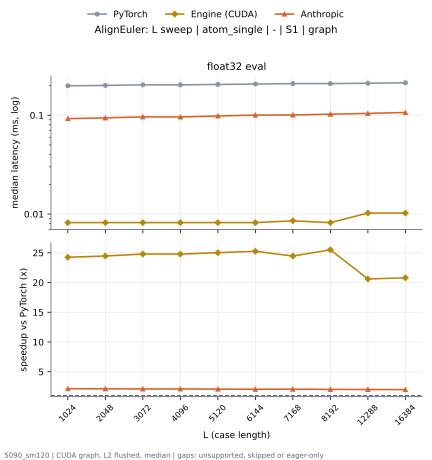

# AlignEuler on 5090_sm120

Generated by `python -m miniworld_engine.measure.plot` from speed tokens `judge/tokens/5090_sm120/`; do not edit.

### L sweep: atom_single | - | S1 | graph

**float32 eval** (median ms; x = speedup vs PyTorch)

| L | PyTorch | Engine (Triton) | Engine (CUDA) | Anthropic |
|---|---|---|---|---|
| 1024 | 0.1987 | 0.01421 (13.98x) | 0.008192 (24.25x) | 0.09242 (2.15x) |
| 2048 | 0.2004 | 0.01434 (13.98x) | 0.008192 (24.46x) | 0.094 (2.13x) |
| 3072 | 0.203 | 0.01434 (14.16x) | 0.008192 (24.78x) | 0.09626 (2.11x) |
| 4096 | 0.203 | 0.01434 (14.16x) | 0.008192 (24.78x) | 0.09603 (2.11x) |
| 5120 | 0.2049 | 0.01434 (14.30x) | 0.008192 (25.02x) | 0.0983 (2.08x) |
| 6144 | 0.2068 | 0.01434 (14.43x) | 0.008192 (25.25x) | 0.1004 (2.06x) |
| 7168 | 0.2089 | 0.01434 (14.57x) | 0.008544 (24.45x) | 0.1006 (2.08x) |
| 8192 | 0.2089 | 0.01266 (16.51x) | 0.008192 (25.50x) | 0.1025 (2.04x) |
| 12288 | 0.2109 | 0.01584 (13.31x) | 0.01024 (20.60x) | 0.1044 (2.02x) |
| 16384 | 0.213 | 0.01638 (13.00x) | 0.01024 (20.80x) | 0.1066 (2.00x) |

