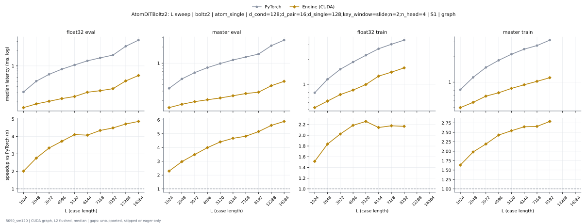
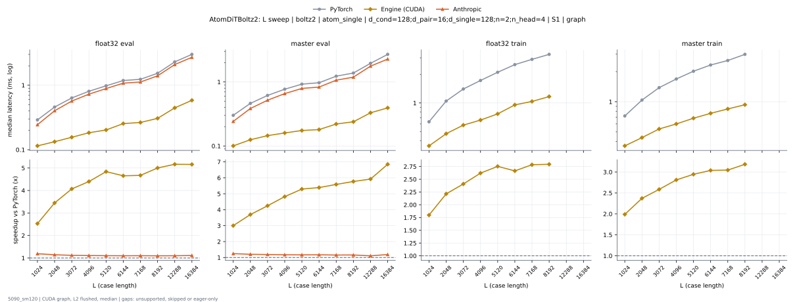
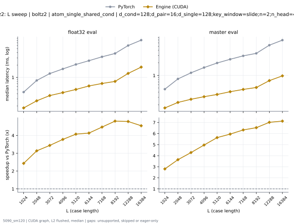
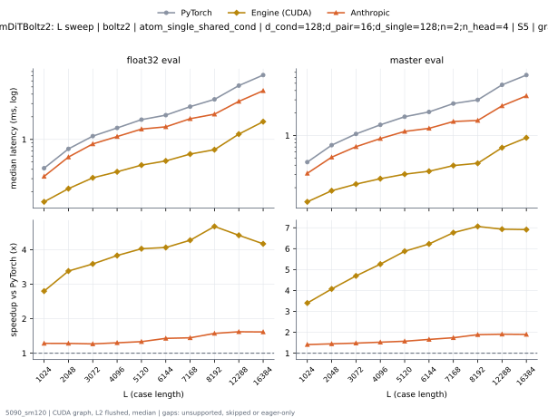

# AtomDiTBoltz2 on 5090_sm120

Generated by `python -m foldjet_engine.measure.plot` from speed tokens `judge/tokens/5090_sm120/`; do not edit.

### L sweep: boltz2 | atom_single | d_cond=128;d_pair=16;d_single=128;key_window=slide;n=2;n_head=4 | S1 | graph

**float32 eval** (median ms; x = speedup vs PyTorch)

| L | PyTorch | Engine (Triton) | Engine (CUDA) | Anthropic |
|---|---|---|---|---|
| 1024 | 0.3116 | 0.254 (1.23x) | 0.1546 (2.02x) | unsupported |
| 2048 | 0.5042 | 0.4231 (1.19x) | 0.1826 (2.76x) | unsupported |
| 3072 | 0.685 | 0.586 (1.17x) | 0.2051 (3.34x) | unsupported |
| 4096 | 0.8632 | 0.7416 (1.16x) | 0.2317 (3.73x) | unsupported |
| 5120 | 1.043 | 0.9036 (1.15x) | 0.254 (4.11x) | unsupported |
| 6144 | 1.253 | 1.099 (1.14x) | 0.3075 (4.08x) | unsupported |
| 7168 | 1.433 | 1.258 (1.14x) | 0.3297 (4.34x) | unsupported |
| 8192 | 1.619 | 1.414 (1.15x) | 0.3608 (4.49x) | unsupported |
| 12288 | 2.405 | 2.115 (1.14x) | 0.5102 (4.71x) | unsupported |
| 16384 | 3.164 | 2.709 (1.17x) | 0.6508 (4.86x) | unsupported |

**master eval** (median ms; x = speedup vs PyTorch)

| L | PyTorch | Engine (Triton) | Engine (CUDA) | Anthropic |
|---|---|---|---|---|
| 1024 | 0.3379 | 0.2744 (1.23x) | 0.1475 (2.29x) | unsupported |
| 2048 | 0.5071 | 0.4178 (1.21x) | 0.1703 (2.98x) | unsupported |
| 3072 | 0.6648 | 0.5564 (1.19x) | 0.1905 (3.49x) | unsupported |
| 4096 | 0.8253 | 0.6912 (1.19x) | 0.2068 (3.99x) | unsupported |
| 5120 | 0.983 | 0.8294 (1.19x) | 0.2232 (4.40x) | unsupported |
| 6144 | 1.147 | 0.9719 (1.18x) | 0.2458 (4.67x) | unsupported |
| 7168 | 1.302 | 1.108 (1.18x) | 0.2703 (4.82x) | unsupported |
| 8192 | 1.478 | 1.255 (1.18x) | 0.2867 (5.15x) | unsupported |
| 12288 | 2.123 | 1.823 (1.16x) | 0.3788 (5.60x) | unsupported |
| 16384 | 2.694 | 2.356 (1.14x) | 0.4574 (5.89x) | unsupported |

**float32 train** (median ms; x = speedup vs PyTorch)

| L | PyTorch | Engine (Triton) | Engine (CUDA) | Anthropic |
|---|---|---|---|---|
| 1024 | 0.7909 | 0.6452 (1.23x) | 0.5224 (1.51x) | unsupported |
| 2048 | 1.15 | 0.9513 (1.21x) | 0.6267 (1.84x) | unsupported |
| 3072 | 1.52 | 1.298 (1.17x) | 0.7516 (2.02x) | unsupported |
| 4096 | 1.86 | 1.591 (1.17x) | 0.8513 (2.19x) | unsupported |
| 5120 | 2.246 | 1.943 (1.16x) | 0.9945 (2.26x) | unsupported |
| 6144 | 2.694 | 2.351 (1.15x) | 1.256 (2.14x) | unsupported |
| 7168 | 3.054 | 2.654 (1.15x) | 1.403 (2.18x) | unsupported |
| 8192 | 3.425 | 2.992 (1.14x) | 1.581 (2.17x) | unsupported |
| 12288 |  |  |  |  |
| 16384 |  |  |  |  |

**master train** (median ms; x = speedup vs PyTorch)

| L | PyTorch | Engine (Triton) | Engine (CUDA) | Anthropic |
|---|---|---|---|---|
| 1024 | 0.8124 | 0.6636 (1.22x) | 0.4978 (1.63x) | unsupported |
| 2048 | 1.138 | 0.9441 (1.21x) | 0.5746 (1.98x) | unsupported |
| 3072 | 1.492 | 1.248 (1.20x) | 0.6809 (2.19x) | unsupported |
| 4096 | 1.814 | 1.528 (1.19x) | 0.7469 (2.43x) | unsupported |
| 5120 | 2.141 | 1.828 (1.17x) | 0.8417 (2.54x) | unsupported |
| 6144 | 2.461 | 2.107 (1.17x) | 0.9293 (2.65x) | unsupported |
| 7168 | 2.714 | 2.393 (1.13x) | 1.021 (2.66x) | unsupported |
| 8192 | 3.148 | 2.714 (1.16x) | 1.128 (2.79x) | unsupported |
| 12288 |  |  |  |  |
| 16384 |  |  |  |  |

### L sweep: boltz2 | atom_single | d_cond=128;d_pair=16;d_single=128;n=2;n_head=4 | S1 | graph

**float32 eval** (median ms; x = speedup vs PyTorch)

| L | PyTorch | Engine (Triton) | Engine (CUDA) | Anthropic |
|---|---|---|---|---|
| 1024 | 0.2899 | 0.256 (1.13x) | 0.1147 (2.53x) | 0.244 (1.19x) |
| 2048 | 0.4588 | 0.412 (1.11x) | 0.1331 (3.45x) | 0.4017 (1.14x) |
| 3072 | 0.635 | 0.5755 (1.10x) | 0.156 (4.07x) | 0.568 (1.12x) |
| 4096 | 0.806 | 0.7312 (1.10x) | 0.1833 (4.40x) | 0.727 (1.11x) |
| 5120 | 0.9789 | 0.8914 (1.10x) | 0.2024 (4.84x) | 0.8878 (1.10x) |
| 6144 | 1.183 | 1.087 (1.09x) | 0.2542 (4.65x) | 1.076 (1.10x) |
| 7168 | 1.235 | 1.188 (1.04x) | 0.2644 (4.67x) | 1.121 (1.10x) |
| 8192 | 1.532 | 1.402 (1.09x) | 0.3064 (5.00x) | 1.398 (1.10x) |
| 12288 | 2.301 | 2.037 (1.13x) | 0.4456 (5.16x) | 2.092 (1.10x) |
| 16384 | 3.011 | 2.635 (1.14x) | 0.5837 (5.16x) | 2.712 (1.11x) |

**master eval** (median ms; x = speedup vs PyTorch)

| L | PyTorch | Engine (Triton) | Engine (CUDA) | Anthropic |
|---|---|---|---|---|
| 1024 | 0.3011 | 0.2637 (1.14x) | 0.1004 (3.00x) | 0.2419 (1.24x) |
| 2048 | 0.4627 | 0.407 (1.14x) | 0.1252 (3.70x) | 0.385 (1.20x) |
| 3072 | 0.6154 | 0.5448 (1.13x) | 0.1449 (4.25x) | 0.5185 (1.19x) |
| 4096 | 0.7701 | 0.6801 (1.13x) | 0.1597 (4.82x) | 0.6571 (1.17x) |
| 5120 | 0.9236 | 0.8175 (1.13x) | 0.1744 (5.30x) | 0.7921 (1.17x) |
| 6144 | 0.9712 | 0.8637 (1.12x) | 0.1802 (5.39x) | 0.8308 (1.17x) |
| 7168 | 1.231 | 1.096 (1.12x) | 0.2203 (5.59x) | 1.065 (1.16x) |
| 8192 | 1.377 | 1.243 (1.11x) | 0.2386 (5.77x) | 1.188 (1.16x) |
| 12288 | 1.953 | 1.783 (1.10x) | 0.3297 (5.92x) | 1.765 (1.11x) |
| 16384 | 2.697 | 2.281 (1.18x) | 0.3936 (6.85x) | 2.274 (1.19x) |

**float32 train** (median ms; x = speedup vs PyTorch)

| L | PyTorch | Engine (Triton) | Engine (CUDA) | Anthropic |
|---|---|---|---|---|
| 1024 | 0.6328 | 0.5741 (1.10x) | 0.3519 (1.80x) | unsupported |
| 2048 | 1.048 | 0.9464 (1.11x) | 0.4732 (2.21x) | unsupported |
| 3072 | 1.405 | 1.286 (1.09x) | 0.5834 (2.41x) | unsupported |
| 4096 | 1.728 | 1.576 (1.10x) | 0.6595 (2.62x) | unsupported |
| 5120 | 2.11 | 1.934 (1.09x) | 0.7666 (2.75x) | unsupported |
| 6144 | 2.543 | 2.34 (1.09x) | 0.9544 (2.66x) | unsupported |
| 7168 | 2.891 | 2.644 (1.09x) | 1.038 (2.79x) | unsupported |
| 8192 | 3.264 | 2.983 (1.09x) | 1.168 (2.79x) | unsupported |
| 12288 |  |  |  |  |
| 16384 |  |  |  |  |

**master train** (median ms; x = speedup vs PyTorch)

| L | PyTorch | Engine (Triton) | Engine (CUDA) | Anthropic |
|---|---|---|---|---|
| 1024 | 0.721 | 0.6533 (1.10x) | 0.3624 (1.99x) | unsupported |
| 2048 | 1.04 | 0.9354 (1.11x) | 0.4383 (2.37x) | unsupported |
| 3072 | 1.382 | 1.23 (1.12x) | 0.5346 (2.59x) | unsupported |
| 4096 | 1.687 | 1.517 (1.11x) | 0.6002 (2.81x) | unsupported |
| 5120 | 2.017 | 1.818 (1.11x) | 0.6847 (2.95x) | unsupported |
| 6144 | 2.328 | 2.092 (1.11x) | 0.766 (3.04x) | unsupported |
| 7168 | 2.582 | 2.38 (1.08x) | 0.8475 (3.05x) | unsupported |
| 8192 | 2.973 | 2.704 (1.10x) | 0.9335 (3.18x) | unsupported |
| 12288 |  |  |  |  |
| 16384 |  |  |  |  |

### L sweep: boltz2 | atom_single_shared_cond | d_cond=128;d_pair=16;d_single=128;key_window=slide;n=2;n_head=4 | S5 | graph

**float32 eval** (median ms; x = speedup vs PyTorch)

| L | PyTorch | Engine (Triton) | Engine (CUDA) | Anthropic |
|---|---|---|---|---|
| 1024 | 0.4382 | 0.3338 (1.31x) | 0.1802 (2.43x) | unsupported |
| 2048 | 0.8421 | 0.596 (1.41x) | 0.2686 (3.14x) | unsupported |
| 3072 | 1.241 | 0.8788 (1.41x) | 0.3608 (3.44x) | unsupported |
| 4096 | 1.609 | 1.108 (1.45x) | 0.426 (3.78x) | unsupported |
| 5120 | 2.07 | 1.394 (1.48x) | 0.5082 (4.07x) | unsupported |
| 6144 | 2.556 | 1.644 (1.55x) | 0.6185 (4.13x) | unsupported |
| 7168 | 3.177 | 1.932 (1.64x) | 0.7109 (4.47x) | unsupported |
| 8192 | 3.835 | 2.213 (1.73x) | 0.7983 (4.80x) | unsupported |
| 12288 | 5.981 | 3.363 (1.78x) | 1.251 (4.78x) | unsupported |
| 16384 | 8.099 | 4.473 (1.81x) | 1.783 (4.54x) | unsupported |

**master eval** (median ms; x = speedup vs PyTorch)

| L | PyTorch | Engine (Triton) | Engine (CUDA) | Anthropic |
|---|---|---|---|---|
| 1024 | 0.471 | 0.3297 (1.43x) | 0.1679 (2.80x) | unsupported |
| 2048 | 0.8274 | 0.5637 (1.47x) | 0.2273 (3.64x) | unsupported |
| 3072 | 1.158 | 0.771 (1.50x) | 0.2703 (4.28x) | unsupported |
| 4096 | 1.545 | 0.9653 (1.60x) | 0.3113 (4.96x) | unsupported |
| 5120 | 1.986 | 1.197 (1.66x) | 0.3522 (5.64x) | unsupported |
| 6144 | 2.438 | 1.39 (1.75x) | 0.4096 (5.95x) | unsupported |
| 7168 | 2.942 | 1.598 (1.84x) | 0.4649 (6.33x) | unsupported |
| 8192 | 3.373 | 1.86 (1.81x) | 0.5161 (6.53x) | unsupported |
| 12288 | 5.291 | 2.785 (1.90x) | 0.7536 (7.02x) | unsupported |
| 16384 | 6.979 | 3.617 (1.93x) | 0.9789 (7.13x) | unsupported |

### L sweep: boltz2 | atom_single_shared_cond | d_cond=128;d_pair=16;d_single=128;n=2;n_head=4 | S5 | graph

**float32 eval** (median ms; x = speedup vs PyTorch)

| L | PyTorch | Engine (Triton) | Engine (CUDA) | Anthropic |
|---|---|---|---|---|
| 1024 | 0.4137 | 0.3359 (1.23x) | 0.1477 (2.80x) | 0.3218 (1.29x) |
| 2048 | 0.7479 | 0.5847 (1.28x) | 0.2212 (3.38x) | 0.5823 (1.28x) |
| 3072 | 1.106 | 0.8677 (1.27x) | 0.3082 (3.59x) | 0.8709 (1.27x) |
| 4096 | 1.42 | 1.096 (1.30x) | 0.3707 (3.83x) | 1.091 (1.30x) |
| 5120 | 1.832 | 1.381 (1.33x) | 0.4548 (4.03x) | 1.372 (1.34x) |
| 6144 | 2.102 | 1.484 (1.42x) | 0.5172 (4.06x) | 1.47 (1.43x) |
| 7168 | 2.727 | 1.888 (1.44x) | 0.638 (4.27x) | 1.885 (1.45x) |
| 8192 | 3.41 | 2.168 (1.57x) | 0.7295 (4.67x) | 2.166 (1.57x) |
| 12288 | 5.198 | 3.188 (1.63x) | 1.177 (4.42x) | 3.206 (1.62x) |
| 16384 | 7.18 | 4.46 (1.61x) | 1.722 (4.17x) | 4.443 (1.62x) |

**master eval** (median ms; x = speedup vs PyTorch)

| L | PyTorch | Engine (Triton) | Engine (CUDA) | Anthropic |
|---|---|---|---|---|
| 1024 | 0.4398 | 0.3399 (1.29x) | 0.1294 (3.40x) | 0.3113 (1.41x) |
| 2048 | 0.7413 | 0.5533 (1.34x) | 0.1821 (4.07x) | 0.512 (1.45x) |
| 3072 | 1.049 | 0.7608 (1.38x) | 0.2232 (4.70x) | 0.7076 (1.48x) |
| 4096 | 1.388 | 0.9548 (1.45x) | 0.2638 (5.26x) | 0.9089 (1.53x) |
| 5120 | 1.781 | 1.184 (1.50x) | 0.3031 (5.88x) | 1.132 (1.57x) |
| 6144 | 2.065 | 1.304 (1.58x) | 0.3318 (6.23x) | 1.245 (1.66x) |
| 7168 | 2.674 | 1.558 (1.72x) | 0.3953 (6.76x) | 1.537 (1.74x) |
| 8192 | 2.994 | 1.684 (1.78x) | 0.424 (7.06x) | 1.587 (1.89x) |
| 12288 | 4.756 | 2.672 (1.78x) | 0.6861 (6.93x) | 2.491 (1.91x) |
| 16384 | 6.433 | 3.612 (1.78x) | 0.9308 (6.91x) | 3.388 (1.90x) |

