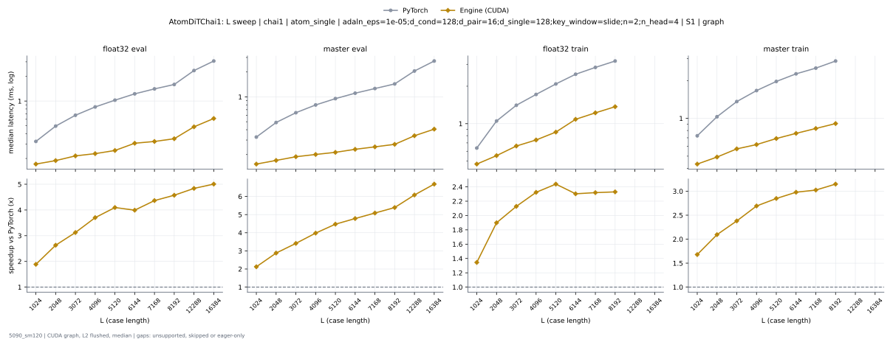
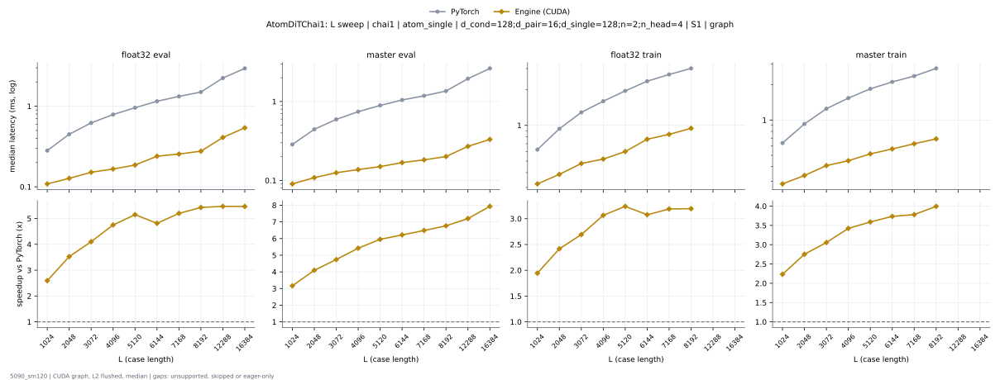
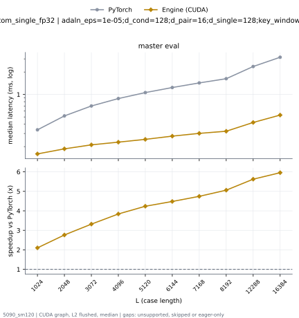
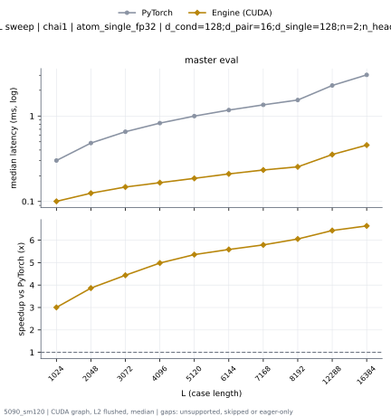
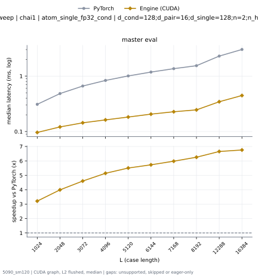
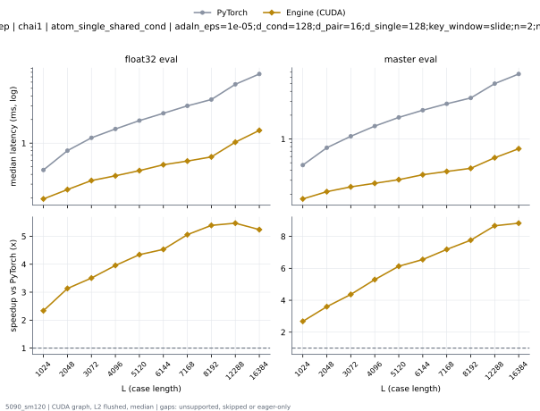
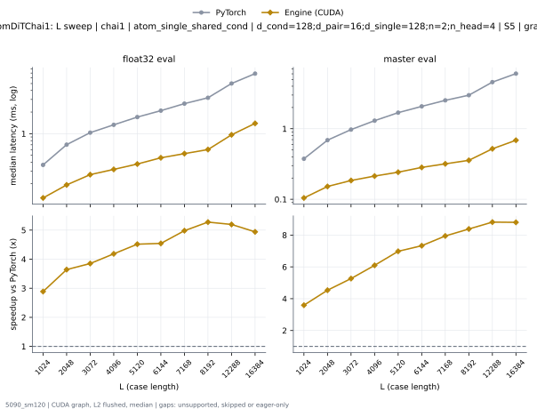

# AtomDiTChai1 on 5090_sm120

Generated by `python -m miniworld_engine.measure.plot` from speed tokens `judge/tokens/5090_sm120/`; do not edit.

### L sweep: chai1 | atom_single | adaln_eps=1e-05;d_cond=128;d_pair=16;d_single=128;key_window=slide;n=2;n_head=4 | S1 | graph

**float32 eval** (median ms; x = speedup vs PyTorch)

| L | PyTorch | Engine (Triton) | Engine (CUDA) |
|---|---|---|---|
| 1024 | 0.3226 | 0.2471 (1.31x) | 0.171 (1.89x) |
| 2048 | 0.4956 | 0.3994 (1.24x) | 0.1884 (2.63x) |
| 3072 | 0.6717 | 0.5582 (1.20x) | 0.215 (3.12x) |
| 4096 | 0.8477 | 0.7123 (1.19x) | 0.229 (3.70x) |
| 5120 | 1.025 | 0.8724 (1.17x) | 0.2502 (4.10x) |
| 6144 | 1.224 | 1.055 (1.16x) | 0.3065 (3.99x) |
| 7168 | 1.406 | 1.21 (1.16x) | 0.322 (4.36x) |
| 8192 | 1.59 | 1.364 (1.17x) | 0.3478 (4.57x) |
| 12288 | 2.35 | 2.014 (1.17x) | 0.4857 (4.84x) |
| 16384 | 3.069 | 2.677 (1.15x) | 0.6132 (5.01x) |

**master eval** (median ms; x = speedup vs PyTorch)

| L | PyTorch | Engine (Triton) | Engine (CUDA) |
|---|---|---|---|
| 1024 | 0.3261 | 0.2478 (1.32x) | 0.1536 (2.12x) |
| 2048 | 0.4895 | 0.3867 (1.27x) | 0.17 (2.88x) |
| 3072 | 0.6429 | 0.5214 (1.23x) | 0.1884 (3.41x) |
| 4096 | 0.7986 | 0.6512 (1.23x) | 0.2007 (3.98x) |
| 5120 | 0.9523 | 0.7846 (1.21x) | 0.213 (4.47x) |
| 6144 | 1.108 | 0.9226 (1.20x) | 0.2318 (4.78x) |
| 7168 | 1.262 | 1.056 (1.20x) | 0.2482 (5.09x) |
| 8192 | 1.435 | 1.2 (1.20x) | 0.2662 (5.39x) |
| 12288 | 2.057 | 1.75 (1.18x) | 0.3383 (6.08x) |
| 16384 | 2.718 | 2.287 (1.19x) | 0.4067 (6.68x) |

**float32 train** (median ms; x = speedup vs PyTorch)

| L | PyTorch | Engine (Triton) | Engine (CUDA) |
|---|---|---|---|
| 1024 | 0.6363 | 0.5612 (1.13x) | 0.4731 (1.35x) |
| 2048 | 1.05 | 0.8473 (1.24x) | 0.5531 (1.90x) |
| 3072 | 1.406 | 1.168 (1.20x) | 0.6606 (2.13x) |
| 4096 | 1.717 | 1.445 (1.19x) | 0.7391 (2.32x) |
| 5120 | 2.086 | 1.779 (1.17x) | 0.8552 (2.44x) |
| 6144 | 2.496 | 2.148 (1.16x) | 1.084 (2.30x) |
| 7168 | 2.833 | 2.44 (1.16x) | 1.221 (2.32x) |
| 8192 | 3.189 | 2.753 (1.16x) | 1.369 (2.33x) |
| 12288 |  |  |  |
| 16384 |  |  |  |

**master train** (median ms; x = speedup vs PyTorch)

| L | PyTorch | Engine (Triton) | Engine (CUDA) |
|---|---|---|---|
| 1024 | 0.726 | 0.5707 (1.27x) | 0.4324 (1.68x) |
| 2048 | 1.03 | 0.8294 (1.24x) | 0.4918 (2.09x) |
| 3072 | 1.36 | 1.109 (1.23x) | 0.5714 (2.38x) |
| 4096 | 1.664 | 1.37 (1.21x) | 0.618 (2.69x) |
| 5120 | 1.967 | 1.65 (1.19x) | 0.6906 (2.85x) |
| 6144 | 2.262 | 1.912 (1.18x) | 0.7593 (2.98x) |
| 7168 | 2.512 | 2.178 (1.15x) | 0.8304 (3.02x) |
| 8192 | 2.861 | 2.471 (1.16x) | 0.9086 (3.15x) |
| 12288 |  |  |  |
| 16384 |  |  |  |

### L sweep: chai1 | atom_single | d_cond=128;d_pair=16;d_single=128;n=2;n_head=4 | S1 | graph

**float32 eval** (median ms; x = speedup vs PyTorch)

| L | PyTorch | Engine (Triton) | Engine (CUDA) |
|---|---|---|---|
| 1024 | 0.2816 | 0.2355 (1.20x) | 0.1086 (2.59x) |
| 2048 | 0.4488 | 0.3889 (1.15x) | 0.1273 (3.52x) |
| 3072 | 0.6216 | 0.5471 (1.14x) | 0.1516 (4.10x) |
| 4096 | 0.7895 | 0.7017 (1.13x) | 0.1662 (4.75x) |
| 5120 | 0.9591 | 0.8603 (1.11x) | 0.1863 (5.15x) |
| 6144 | 1.153 | 1.043 (1.11x) | 0.2396 (4.81x) |
| 7168 | 1.325 | 1.197 (1.11x) | 0.2549 (5.20x) |
| 8192 | 1.502 | 1.352 (1.11x) | 0.2768 (5.43x) |
| 12288 | 2.24 | 2.024 (1.11x) | 0.4096 (5.47x) |
| 16384 | 2.951 | 2.582 (1.14x) | 0.54 (5.46x) |

**master eval** (median ms; x = speedup vs PyTorch)

| L | PyTorch | Engine (Triton) | Engine (CUDA) |
|---|---|---|---|
| 1024 | 0.2857 | 0.2376 (1.20x) | 0.09038 (3.16x) |
| 2048 | 0.4444 | 0.3768 (1.18x) | 0.1085 (4.09x) |
| 3072 | 0.5939 | 0.5099 (1.16x) | 0.1253 (4.74x) |
| 4096 | 0.7438 | 0.641 (1.16x) | 0.1372 (5.42x) |
| 5120 | 0.8917 | 0.7736 (1.15x) | 0.1498 (5.95x) |
| 6144 | 1.046 | 0.911 (1.15x) | 0.1683 (6.22x) |
| 7168 | 1.182 | 1.034 (1.14x) | 0.1823 (6.48x) |
| 8192 | 1.357 | 1.189 (1.14x) | 0.2007 (6.76x) |
| 12288 | 1.947 | 1.738 (1.12x) | 0.2703 (7.20x) |
| 16384 | 2.627 | 2.222 (1.18x) | 0.3312 (7.93x) |

**float32 train** (median ms; x = speedup vs PyTorch)

| L | PyTorch | Engine (Triton) | Engine (CUDA) |
|---|---|---|---|
| 1024 | 0.625 | 0.5509 (1.13x) | 0.3215 (1.94x) |
| 2048 | 0.9352 | 0.8356 (1.12x) | 0.3871 (2.42x) |
| 3072 | 1.285 | 1.157 (1.11x) | 0.4774 (2.69x) |
| 4096 | 1.594 | 1.43 (1.11x) | 0.5202 (3.06x) |
| 5120 | 1.949 | 1.766 (1.10x) | 0.6016 (3.24x) |
| 6144 | 2.35 | 2.136 (1.10x) | 0.7639 (3.08x) |
| 7168 | 2.678 | 2.43 (1.10x) | 0.8397 (3.19x) |
| 8192 | 3.012 | 2.741 (1.10x) | 0.9431 (3.19x) |
| 12288 |  |  |  |
| 16384 |  |  |  |

**master train** (median ms; x = speedup vs PyTorch)

| L | PyTorch | Engine (Triton) | Engine (CUDA) |
|---|---|---|---|
| 1024 | 0.6365 | 0.5594 (1.14x) | 0.285 (2.23x) |
| 2048 | 0.9257 | 0.8151 (1.14x) | 0.3364 (2.75x) |
| 3072 | 1.249 | 1.088 (1.15x) | 0.4084 (3.06x) |
| 4096 | 1.539 | 1.358 (1.13x) | 0.4495 (3.42x) |
| 5120 | 1.846 | 1.638 (1.13x) | 0.5141 (3.59x) |
| 6144 | 2.114 | 1.898 (1.11x) | 0.5662 (3.73x) |
| 7168 | 2.371 | 2.168 (1.09x) | 0.6272 (3.78x) |
| 8192 | 2.757 | 2.459 (1.12x) | 0.6902 (3.99x) |
| 12288 |  |  |  |
| 16384 |  |  |  |

### L sweep: chai1 | atom_single_fp32 | adaln_eps=1e-05;d_cond=128;d_pair=16;d_single=128;key_window=slide;n=2;n_head=4 | S1 | graph

**master eval** (median ms; x = speedup vs PyTorch)

| L | PyTorch | Engine (Triton) | Engine (CUDA) |
|---|---|---|---|
| 1024 | 0.3359 | 0.2601 (1.29x) | 0.1597 (2.10x) |
| 2048 | 0.5161 | 0.426 (1.21x) | 0.1867 (2.76x) |
| 3072 | 0.7014 | 0.5816 (1.21x) | 0.2113 (3.32x) |
| 4096 | 0.8816 | 0.735 (1.20x) | 0.2296 (3.84x) |
| 5120 | 1.06 | 0.8914 (1.19x) | 0.2502 (4.24x) |
| 6144 | 1.239 | 1.053 (1.18x) | 0.2765 (4.48x) |
| 7168 | 1.428 | 1.213 (1.18x) | 0.3011 (4.74x) |
| 8192 | 1.627 | 1.383 (1.18x) | 0.3215 (5.06x) |
| 12288 | 2.371 | 2.014 (1.18x) | 0.4215 (5.62x) |
| 16384 | 3.155 | 2.657 (1.19x) | 0.5296 (5.96x) |

### L sweep: chai1 | atom_single_fp32 | d_cond=128;d_pair=16;d_single=128;n=2;n_head=4 | S1 | graph

**master eval** (median ms; x = speedup vs PyTorch)

| L | PyTorch | Engine (Triton) | Engine (CUDA) |
|---|---|---|---|
| 1024 | 0.3014 | 0.2545 (1.18x) | 0.1004 (3.00x) |
| 2048 | 0.4828 | 0.4147 (1.16x) | 0.1249 (3.86x) |
| 3072 | 0.6549 | 0.5696 (1.15x) | 0.1476 (4.44x) |
| 4096 | 0.8263 | 0.724 (1.14x) | 0.1659 (4.98x) |
| 5120 | 0.9985 | 0.8789 (1.14x) | 0.1864 (5.36x) |
| 6144 | 1.174 | 1.041 (1.13x) | 0.2102 (5.59x) |
| 7168 | 1.352 | 1.201 (1.13x) | 0.2335 (5.79x) |
| 8192 | 1.539 | 1.371 (1.12x) | 0.2543 (6.05x) |
| 12288 | 2.278 | 1.995 (1.14x) | 0.3543 (6.43x) |
| 16384 | 3.032 | 2.624 (1.16x) | 0.4568 (6.64x) |

### L sweep: chai1 | atom_single_fp32_cond | adaln_eps=1e-05;d_cond=128;d_pair=16;d_single=128;key_window=slide;n=2;n_head=4 | S1 | graph

**master eval** (median ms; x = speedup vs PyTorch)

| L | PyTorch | Engine (Triton) | Engine (CUDA) |
|---|---|---|---|
| 1024 | 0.3445 | 0.2724 (1.26x) | 0.1594 (2.16x) |
| 2048 | 0.5354 | 0.4324 (1.24x) | 0.1843 (2.91x) |
| 3072 | 0.7086 | 0.5886 (1.20x) | 0.2072 (3.42x) |
| 4096 | 0.8888 | 0.7417 (1.20x) | 0.227 (3.92x) |
| 5120 | 1.066 | 0.8984 (1.19x) | 0.2465 (4.32x) |
| 6144 | 1.245 | 1.059 (1.18x) | 0.2703 (4.61x) |
| 7168 | 1.435 | 1.221 (1.18x) | 0.2934 (4.89x) |
| 8192 | 1.638 | 1.389 (1.18x) | 0.3137 (5.22x) |
| 12288 | 2.362 | 2.051 (1.15x) | 0.414 (5.71x) |
| 16384 | 3.145 | 2.708 (1.16x) | 0.5181 (6.07x) |

### L sweep: chai1 | atom_single_fp32_cond | d_cond=128;d_pair=16;d_single=128;n=2;n_head=4 | S1 | graph

**master eval** (median ms; x = speedup vs PyTorch)

| L | PyTorch | Engine (Triton) | Engine (CUDA) |
|---|---|---|---|
| 1024 | 0.3092 | 0.2582 (1.20x) | 0.09629 (3.21x) |
| 2048 | 0.4833 | 0.4219 (1.15x) | 0.1211 (3.99x) |
| 3072 | 0.661 | 0.5775 (1.14x) | 0.1436 (4.60x) |
| 4096 | 0.8335 | 0.7311 (1.14x) | 0.1621 (5.14x) |
| 5120 | 1.005 | 0.8858 (1.13x) | 0.1825 (5.51x) |
| 6144 | 1.18 | 1.046 (1.13x) | 0.2059 (5.73x) |
| 7168 | 1.359 | 1.208 (1.12x) | 0.2273 (5.98x) |
| 8192 | 1.537 | 1.379 (1.11x) | 0.2458 (6.26x) |
| 12288 | 2.291 | 2.038 (1.12x) | 0.3443 (6.65x) |
| 16384 | 3.015 | 2.694 (1.12x) | 0.4461 (6.76x) |

### L sweep: chai1 | atom_single_shared_cond | adaln_eps=1e-05;d_cond=128;d_pair=16;d_single=128;key_window=slide;n=2;n_head=4 | S5 | graph

**float32 eval** (median ms; x = speedup vs PyTorch)

| L | PyTorch | Engine (Triton) | Engine (CUDA) |
|---|---|---|---|
| 1024 | 0.4546 | 0.3216 (1.41x) | 0.1946 (2.34x) |
| 2048 | 0.802 | 0.5417 (1.48x) | 0.256 (3.13x) |
| 3072 | 1.17 | 0.7948 (1.47x) | 0.3336 (3.51x) |
| 4096 | 1.517 | 1.012 (1.50x) | 0.3833 (3.96x) |
| 5120 | 1.939 | 1.258 (1.54x) | 0.4465 (4.34x) |
| 6144 | 2.403 | 1.484 (1.62x) | 0.5304 (4.53x) |
| 7168 | 2.989 | 1.73 (1.73x) | 0.5911 (5.06x) |
| 8192 | 3.598 | 1.99 (1.81x) | 0.6677 (5.39x) |
| 12288 | 5.627 | 2.989 (1.88x) | 1.029 (5.47x) |
| 16384 | 7.617 | 3.99 (1.91x) | 1.454 (5.24x) |

**master eval** (median ms; x = speedup vs PyTorch)

| L | PyTorch | Engine (Triton) | Engine (CUDA) |
|---|---|---|---|
| 1024 | 0.4669 | 0.3055 (1.53x) | 0.1743 (2.68x) |
| 2048 | 0.7741 | 0.5029 (1.54x) | 0.2152 (3.60x) |
| 3072 | 1.081 | 0.6871 (1.57x) | 0.2478 (4.36x) |
| 4096 | 1.455 | 0.8721 (1.67x) | 0.2748 (5.29x) |
| 5120 | 1.874 | 1.084 (1.73x) | 0.3055 (6.13x) |
| 6144 | 2.31 | 1.271 (1.82x) | 0.3526 (6.55x) |
| 7168 | 2.786 | 1.464 (1.90x) | 0.3877 (7.19x) |
| 8192 | 3.299 | 1.668 (1.98x) | 0.425 (7.76x) |
| 12288 | 5.014 | 2.461 (2.04x) | 0.5786 (8.67x) |
| 16384 | 6.639 | 3.226 (2.06x) | 0.752 (8.83x) |

### L sweep: chai1 | atom_single_shared_cond | d_cond=128;d_pair=16;d_single=128;n=2;n_head=4 | S5 | graph

**float32 eval** (median ms; x = speedup vs PyTorch)

| L | PyTorch | Engine (Triton) | Engine (CUDA) |
|---|---|---|---|
| 1024 | 0.3666 | 0.2857 (1.28x) | 0.1269 (2.89x) |
| 2048 | 0.7024 | 0.5312 (1.32x) | 0.1929 (3.64x) |
| 3072 | 1.033 | 0.7844 (1.32x) | 0.2683 (3.85x) |
| 4096 | 1.328 | 1 (1.33x) | 0.3174 (4.18x) |
| 5120 | 1.703 | 1.247 (1.37x) | 0.3771 (4.52x) |
| 6144 | 2.093 | 1.455 (1.44x) | 0.4608 (4.54x) |
| 7168 | 2.622 | 1.711 (1.53x) | 0.5266 (4.98x) |
| 8192 | 3.166 | 1.981 (1.60x) | 0.6002 (5.28x) |
| 12288 | 5.005 | 3.034 (1.65x) | 0.9636 (5.19x) |
| 16384 | 6.873 | 4.033 (1.70x) | 1.391 (4.94x) |

**master eval** (median ms; x = speedup vs PyTorch)

| L | PyTorch | Engine (Triton) | Engine (CUDA) |
|---|---|---|---|
| 1024 | 0.3749 | 0.2665 (1.41x) | 0.1044 (3.59x) |
| 2048 | 0.6881 | 0.4915 (1.40x) | 0.1518 (4.53x) |
| 3072 | 0.972 | 0.6755 (1.44x) | 0.1846 (5.27x) |
| 4096 | 1.3 | 0.862 (1.51x) | 0.2132 (6.10x) |
| 5120 | 1.689 | 1.072 (1.58x) | 0.2419 (6.98x) |
| 6144 | 2.074 | 1.258 (1.65x) | 0.2829 (7.33x) |
| 7168 | 2.524 | 1.453 (1.74x) | 0.3178 (7.94x) |
| 8192 | 2.986 | 1.662 (1.80x) | 0.3563 (8.38x) |
| 12288 | 4.577 | 2.479 (1.85x) | 0.5193 (8.81x) |
| 16384 | 6.038 | 3.219 (1.88x) | 0.6862 (8.80x) |

