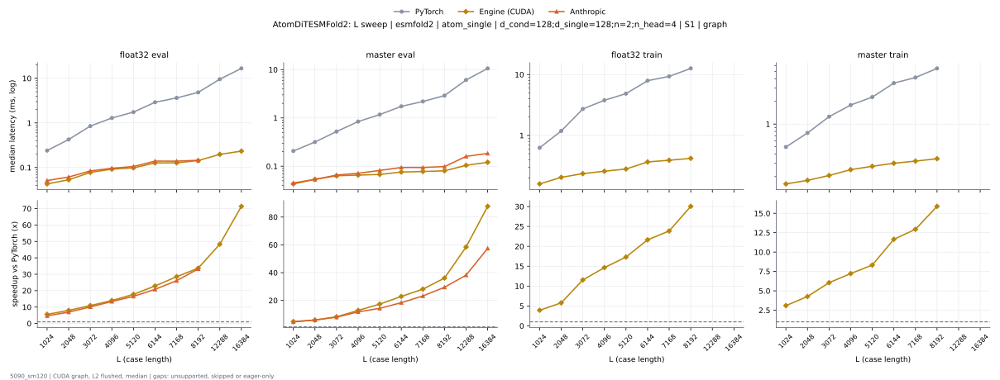

# AtomDiTESMFold2 on 5090_sm120

Generated by `python -m foldjet_engine.measure.plot` from speed tokens `judge/tokens/5090_sm120/`; do not edit.

### L sweep: esmfold2 | atom_single | d_cond=128;d_single=128;n=2;n_head=4 | S1 | graph

**float32 eval** (median ms; x = speedup vs PyTorch)

| L | PyTorch | Engine (Triton) | Engine (CUDA) | Anthropic |
|---|---|---|---|---|
| 1024 | 0.24 | 0.05734 (4.19x) | 0.04301 (5.58x) | 0.0512 (4.69x) |
| 2048 | 0.426 | 0.06554 (6.50x) | 0.05325 (8.00x) | 0.06144 (6.93x) |
| 3072 | 0.8489 | 0.1024 (8.29x) | 0.07782 (10.91x) | 0.08397 (10.11x) |
| 4096 | 1.291 | 0.1083 (11.92x) | 0.09216 (14.01x) | 0.09627 (13.41x) |
| 5120 | 1.746 | 0.1106 (15.79x) | 0.0983 (17.76x) | 0.1055 (16.55x) |
| 6144 | 2.903 | 0.1516 (19.16x) | 0.127 (22.86x) | 0.1395 (20.82x) |
| 7168 | 3.633 | 0.1475 (24.64x) | 0.1274 (28.52x) | 0.1392 (26.09x) |
| 8192 | 4.834 | 0.172 (28.10x) | 0.1434 (33.72x) | 0.1454 (33.26x) |
| 12288 | 9.554 | 0.213 (44.85x) | 0.1977 (48.32x) | failed |
| 16384 | 16.66 | 0.2802 (59.45x) | 0.2335 (71.35x) | failed |

**master eval** (median ms; x = speedup vs PyTorch)

| L | PyTorch | Engine (Triton) | Engine (CUDA) | Anthropic |
|---|---|---|---|---|
| 1024 | 0.2068 | 0.04944 (4.18x) | 0.04307 (4.80x) | 0.04504 (4.59x) |
| 2048 | 0.3172 | 0.05736 (5.53x) | 0.0535 (5.93x) | 0.05352 (5.93x) |
| 3072 | 0.5226 | 0.06154 (8.49x) | 0.06349 (8.23x) | 0.06554 (7.97x) |
| 4096 | 0.841 | 0.07194 (11.69x) | 0.06554 (12.83x) | 0.07142 (11.78x) |
| 5120 | 1.173 | 0.07398 (15.85x) | 0.06758 (17.35x) | 0.08189 (14.32x) |
| 6144 | 1.736 | 0.09805 (17.71x) | 0.07579 (22.90x) | 0.09427 (18.41x) |
| 7168 | 2.19 | 0.09626 (22.76x) | 0.07782 (28.14x) | 0.09426 (23.24x) |
| 8192 | 2.899 | 0.09446 (30.69x) | 0.0803 (36.10x) | 0.0983 (29.49x) |
| 12288 | 6.102 | 0.1229 (49.66x) | 0.1044 (58.44x) | 0.1597 (38.20x) |
| 16384 | 10.59 | 0.1495 (70.86x) | 0.1208 (87.68x) | 0.1844 (57.47x) |

**float32 train** (median ms; x = speedup vs PyTorch)

| L | PyTorch | Engine (Triton) | Engine (CUDA) | Anthropic |
|---|---|---|---|---|
| 1024 | 0.6267 | 0.168 (3.73x) | 0.1598 (3.92x) | 0.9557 (eager) |
| 2048 | 1.184 | 0.2092 (5.66x) | 0.2048 (5.78x) | 1.273 (eager) |
| 3072 | 2.721 | 0.3113 (8.74x) | 0.2358 (11.54x) | 1.944 (eager) |
| 4096 | 3.78 | 0.3095 (12.21x) | 0.258 (14.65x) | 2.388 (eager) |
| 5120 | 4.861 | 0.3223 (15.08x) | 0.2809 (17.30x) | 3.501 (eager) |
| 6144 | 7.926 | 0.4321 (18.34x) | 0.3665 (21.63x) | 3.872 (eager) |
| 7168 | 9.333 | 0.4505 (20.72x) | 0.3911 (23.86x) | 4.82 (eager) |
| 8192 | 12.62 | 0.514 (24.56x) | 0.4201 (30.05x) | 5.301 (eager) |
| 12288 |  |  |  |  |
| 16384 |  |  |  |  |

**master train** (median ms; x = speedup vs PyTorch)

| L | PyTorch | Engine (Triton) | Engine (CUDA) | Anthropic |
|---|---|---|---|---|
| 1024 | 0.4957 | 0.1393 (3.56x) | 0.16 (3.10x) | 1.143 (eager) |
| 2048 | 0.7619 | 0.1557 (4.89x) | 0.1784 (4.27x) | 1.005 (eager) |
| 3072 | 1.254 | 0.213 (5.89x) | 0.2071 (6.06x) | 1.301 (eager) |
| 4096 | 1.791 | 0.1986 (9.02x) | 0.2478 (7.23x) | 1.542 (eager) |
| 5120 | 2.285 | 0.209 (10.93x) | 0.2744 (8.32x) | 2.022 (eager) |
| 6144 | 3.508 | 0.2706 (12.96x) | 0.3011 (11.65x) | 2.109 (eager) |
| 7168 | 4.162 | 0.2702 (15.40x) | 0.3216 (12.94x) | 2.491 (eager) |
| 8192 | 5.501 | 0.2887 (19.05x) | 0.3461 (15.90x) | 2.792 (eager) |
| 12288 |  |  |  |  |
| 16384 |  |  |  |  |

