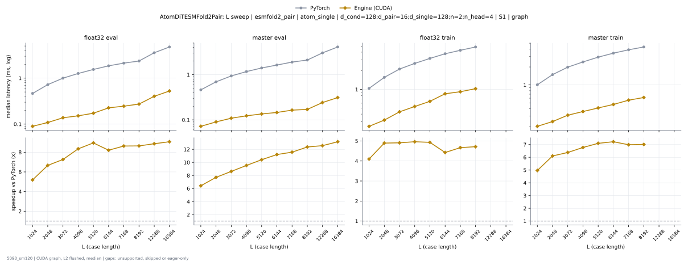
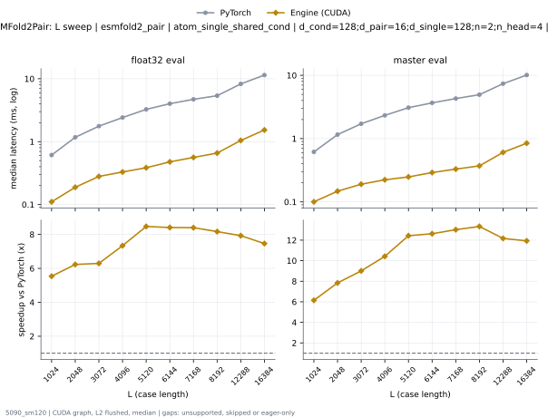

# AtomDiTESMFold2Pair on 5090_sm120

Generated by `python -m foldjet_engine.measure.plot` from speed tokens `judge/tokens/5090_sm120/`; do not edit.

### L sweep: esmfold2_pair | atom_single | d_cond=128;d_pair=16;d_single=128;n=2;n_head=4 | S1 | graph

**float32 eval** (median ms; x = speedup vs PyTorch)

| L | PyTorch | Engine (Triton) | Engine (CUDA) |
|---|---|---|---|
| 1024 | 0.4649 | 0.385 (1.21x) | 0.0896 (5.19x) |
| 2048 | 0.7229 | 0.6148 (1.18x) | 0.1085 (6.66x) |
| 3072 | 0.9994 | 0.8575 (1.17x) | 0.1376 (7.26x) |
| 4096 | 1.265 | 1.098 (1.15x) | 0.1515 (8.35x) |
| 5120 | 1.545 | 1.344 (1.15x) | 0.1727 (8.95x) |
| 6144 | 1.855 | 1.635 (1.13x) | 0.226 (8.20x) |
| 7168 | 2.121 | 1.867 (1.14x) | 0.2457 (8.63x) |
| 8192 | 2.359 | 2.074 (1.14x) | 0.2729 (8.64x) |
| 12288 | 3.569 | 2.989 (1.19x) | 0.4026 (8.86x) |
| 16384 | 4.764 | 3.889 (1.22x) | 0.5253 (9.07x) |

**master eval** (median ms; x = speedup vs PyTorch)

| L | PyTorch | Engine (Triton) | Engine (CUDA) |
|---|---|---|---|
| 1024 | 0.4615 | 0.3728 (1.24x) | 0.07194 (6.42x) |
| 2048 | 0.6943 | 0.5775 (1.20x) | 0.09008 (7.71x) |
| 3072 | 0.9373 | 0.7867 (1.19x) | 0.1088 (8.62x) |
| 4096 | 1.171 | 0.9929 (1.18x) | 0.1228 (9.53x) |
| 5120 | 1.407 | 1.195 (1.18x) | 0.1351 (10.41x) |
| 6144 | 1.632 | 1.407 (1.16x) | 0.1457 (11.20x) |
| 7168 | 1.899 | 1.593 (1.19x) | 0.1641 (11.57x) |
| 8192 | 2.105 | 1.811 (1.16x) | 0.1702 (12.36x) |
| 12288 | 3.036 | 2.546 (1.19x) | 0.2416 (12.57x) |
| 16384 | 4.099 | 3.245 (1.26x) | 0.3113 (13.17x) |

**float32 train** (median ms; x = speedup vs PyTorch)

| L | PyTorch | Engine (Triton) | Engine (CUDA) |
|---|---|---|---|
| 1024 | 1.041 | 0.8735 (1.19x) | 0.2539 (4.10x) |
| 2048 | 1.565 | 1.339 (1.17x) | 0.3199 (4.89x) |
| 3072 | 2.133 | 1.838 (1.16x) | 0.4348 (4.91x) |
| 4096 | 2.631 | 2.278 (1.15x) | 0.5304 (4.96x) |
| 5120 | 3.169 | 2.759 (1.15x) | 0.643 (4.93x) |
| 6144 | 3.768 | 3.334 (1.13x) | 0.8519 (4.42x) |
| 7168 | 4.285 | 3.686 (1.16x) | 0.9183 (4.67x) |
| 8192 | 4.846 | 4.095 (1.18x) | 1.028 (4.71x) |
| 12288 |  |  |  |
| 16384 |  |  |  |

**master train** (median ms; x = speedup vs PyTorch)

| L | PyTorch | Engine (Triton) | Engine (CUDA) |
|---|---|---|---|
| 1024 | 1.007 | 0.8227 (1.22x) | 0.2028 (4.97x) |
| 2048 | 1.488 | 1.209 (1.23x) | 0.2437 (6.11x) |
| 3072 | 1.986 | 1.656 (1.20x) | 0.3113 (6.38x) |
| 4096 | 2.428 | 2.043 (1.19x) | 0.3586 (6.77x) |
| 5120 | 2.92 | 2.467 (1.18x) | 0.4116 (7.09x) |
| 6144 | 3.403 | 2.815 (1.21x) | 0.4714 (7.22x) |
| 7168 | 3.877 | 3.271 (1.19x) | 0.555 (6.99x) |
| 8192 | 4.321 | 3.681 (1.17x) | 0.6164 (7.01x) |
| 12288 |  |  |  |
| 16384 |  |  |  |

### L sweep: esmfold2_pair | atom_single_shared_cond | d_cond=128;d_pair=16;d_single=128;n=2;n_head=4 | S5 | graph

**float32 eval** (median ms; x = speedup vs PyTorch)

| L | PyTorch | Engine (Triton) | Engine (CUDA) |
|---|---|---|---|
| 1024 | 0.6124 | 0.4342 (1.41x) | 0.1106 (5.54x) |
| 2048 | 1.174 | 0.803 (1.46x) | 0.1884 (6.23x) |
| 3072 | 1.764 | 1.174 (1.50x) | 0.2803 (6.29x) |
| 4096 | 2.419 | 1.527 (1.58x) | 0.3297 (7.34x) |
| 5120 | 3.262 | 1.856 (1.76x) | 0.385 (8.47x) |
| 6144 | 4.016 | 2.178 (1.84x) | 0.4776 (8.41x) |
| 7168 | 4.714 | 2.58 (1.83x) | 0.5613 (8.40x) |
| 8192 | 5.38 | 2.821 (1.91x) | 0.6585 (8.17x) |
| 12288 | 8.28 | 4.191 (1.98x) | 1.044 (7.93x) |
| 16384 | 11.46 | 5.965 (1.92x) | 1.535 (7.46x) |

**master eval** (median ms; x = speedup vs PyTorch)

| L | PyTorch | Engine (Triton) | Engine (CUDA) |
|---|---|---|---|
| 1024 | 0.6164 | 0.4527 (1.36x) | 0.1003 (6.15x) |
| 2048 | 1.157 | 0.7636 (1.52x) | 0.1476 (7.84x) |
| 3072 | 1.716 | 1.047 (1.64x) | 0.1904 (9.01x) |
| 4096 | 2.33 | 1.378 (1.69x) | 0.2235 (10.43x) |
| 5120 | 3.084 | 1.643 (1.88x) | 0.2481 (12.43x) |
| 6144 | 3.671 | 1.946 (1.89x) | 0.2908 (12.63x) |
| 7168 | 4.293 | 2.225 (1.93x) | 0.3297 (13.02x) |
| 8192 | 4.942 | 2.361 (2.09x) | 0.3707 (13.33x) |
| 12288 | 7.377 | 3.58 (2.06x) | 0.6062 (12.17x) |
| 16384 | 10.09 | 5.001 (2.02x) | 0.8461 (11.93x) |

