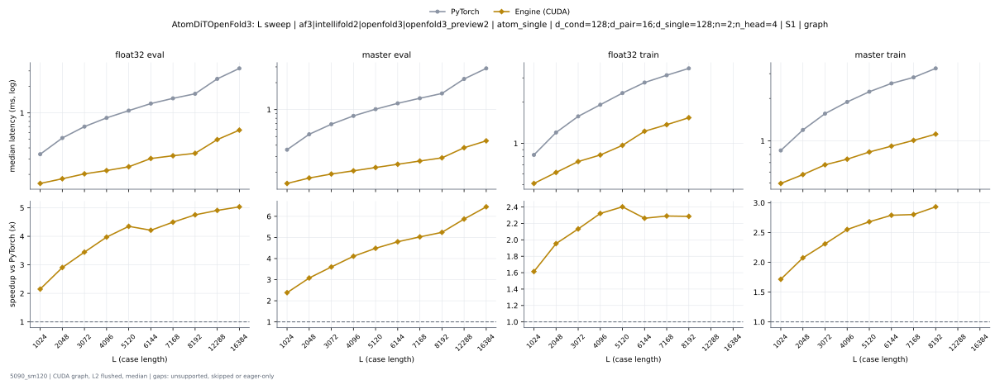
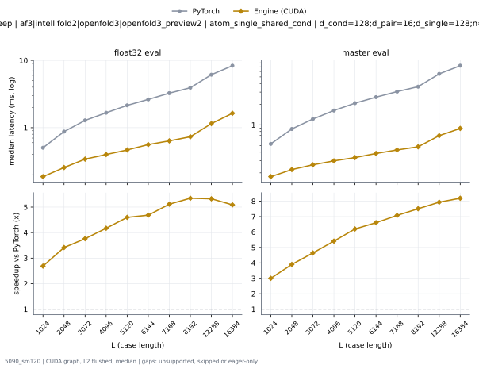
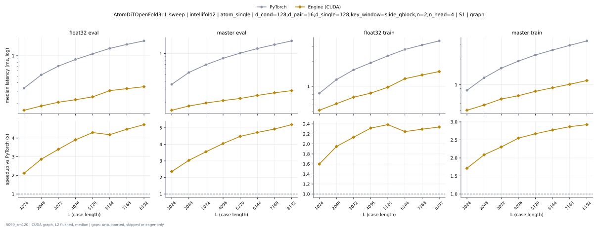
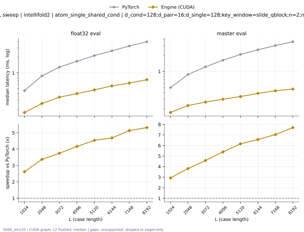

# AtomDiTOpenFold3 on 5090_sm120

Generated by `python -m foldjet_engine.measure.plot` from speed tokens `judge/tokens/5090_sm120/`; do not edit.

### L sweep: af3|intellifold2|openfold3|openfold3_preview2 | atom_single | d_cond=128;d_pair=16;d_single=128;n=2;n_head=4 | S1 | graph

**float32 eval** (median ms; x = speedup vs PyTorch)

| L | PyTorch | Engine (Triton) | Engine (CUDA) | Anthropic |
|---|---|---|---|---|
| 1024 | 0.3389 | 0.2768 (1.22x) | 0.1577 (2.15x) | failed |
| 2048 | 0.5181 | 0.4365 (1.19x) | 0.1783 (2.91x) | failed |
| 3072 | 0.6985 | 0.5995 (1.17x) | 0.2028 (3.45x) | failed |
| 4096 | 0.8777 | 0.7563 (1.16x) | 0.221 (3.97x) | failed |
| 5120 | 1.061 | 0.9221 (1.15x) | 0.244 (4.35x) | failed |
| 6144 | 1.277 | 1.119 (1.14x) | 0.3031 (4.21x) | failed |
| 7168 | 1.464 | 1.281 (1.14x) | 0.3256 (4.50x) | failed |
| 8192 | 1.65 | 1.439 (1.15x) | 0.3471 (4.75x) | failed |
| 12288 | 2.438 | 2.148 (1.14x) | 0.4969 (4.91x) | failed |
| 16384 | 3.207 | 2.819 (1.14x) | 0.6372 (5.03x) | failed |

**master eval** (median ms; x = speedup vs PyTorch)

| L | PyTorch | Engine (Triton) | Engine (CUDA) | Anthropic |
|---|---|---|---|---|
| 1024 | 0.3563 | 0.2912 (1.22x) | 0.1495 (2.38x) | failed |
| 2048 | 0.5298 | 0.4403 (1.20x) | 0.172 (3.08x) | failed |
| 3072 | 0.6861 | 0.5792 (1.18x) | 0.1905 (3.60x) | failed |
| 4096 | 0.8499 | 0.7168 (1.19x) | 0.2068 (4.11x) | failed |
| 5120 | 1.011 | 0.8581 (1.18x) | 0.2253 (4.49x) | failed |
| 6144 | 1.175 | 1 (1.17x) | 0.2449 (4.80x) | failed |
| 7168 | 1.338 | 1.143 (1.17x) | 0.2662 (5.03x) | failed |
| 8192 | 1.515 | 1.295 (1.17x) | 0.2889 (5.24x) | failed |
| 12288 | 2.201 | 1.877 (1.17x) | 0.3748 (5.87x) | failed |
| 16384 | 2.887 | 2.414 (1.20x) | 0.4475 (6.45x) | failed |

**float32 train** (median ms; x = speedup vs PyTorch)

| L | PyTorch | Engine (Triton) | Engine (CUDA) | Anthropic |
|---|---|---|---|---|
| 1024 | 0.8246 | 0.6792 (1.21x) | 0.511 (1.61x) | unsupported |
| 2048 | 1.2 | 1.002 (1.20x) | 0.6143 (1.95x) | unsupported |
| 3072 | 1.573 | 1.351 (1.16x) | 0.7376 (2.13x) | unsupported |
| 4096 | 1.912 | 1.642 (1.17x) | 0.8236 (2.32x) | unsupported |
| 5120 | 2.325 | 2.008 (1.16x) | 0.9676 (2.40x) | unsupported |
| 6144 | 2.774 | 2.428 (1.14x) | 1.226 (2.26x) | unsupported |
| 7168 | 3.135 | 2.747 (1.14x) | 1.369 (2.29x) | unsupported |
| 8192 | 3.517 | 3.03 (1.16x) | 1.538 (2.29x) | unsupported |
| 12288 |  |  |  |  |
| 16384 |  |  |  |  |

**master train** (median ms; x = speedup vs PyTorch)

| L | PyTorch | Engine (Triton) | Engine (CUDA) | Anthropic |
|---|---|---|---|---|
| 1024 | 0.8538 | 0.7094 (1.20x) | 0.4977 (1.72x) | unsupported |
| 2048 | 1.195 | 1.002 (1.19x) | 0.5755 (2.08x) | unsupported |
| 3072 | 1.56 | 1.312 (1.19x) | 0.6752 (2.31x) | unsupported |
| 4096 | 1.889 | 1.605 (1.18x) | 0.7403 (2.55x) | unsupported |
| 5120 | 2.233 | 1.914 (1.17x) | 0.8327 (2.68x) | unsupported |
| 6144 | 2.559 | 2.205 (1.16x) | 0.9166 (2.79x) | unsupported |
| 7168 | 2.823 | 2.501 (1.13x) | 1.007 (2.80x) | unsupported |
| 8192 | 3.272 | 2.838 (1.15x) | 1.115 (2.93x) | unsupported |
| 12288 |  |  |  |  |
| 16384 |  |  |  |  |

### L sweep: af3|intellifold2|openfold3|openfold3_preview2 | atom_single_shared_cond | d_cond=128;d_pair=16;d_single=128;n=2;n_head=4 | S5 | graph

**float32 eval** (median ms; x = speedup vs PyTorch)

| L | PyTorch | Engine (Triton) | Engine (CUDA) | Anthropic |
|---|---|---|---|---|
| 1024 | 0.5038 | 0.3717 (1.36x) | 0.1874 (2.69x) | failed |
| 2048 | 0.8744 | 0.6267 (1.40x) | 0.256 (3.42x) | failed |
| 3072 | 1.284 | 0.9232 (1.39x) | 0.3413 (3.76x) | failed |
| 4096 | 1.666 | 1.167 (1.43x) | 0.3994 (4.17x) | failed |
| 5120 | 2.147 | 1.469 (1.46x) | 0.4671 (4.60x) | failed |
| 6144 | 2.63 | 1.724 (1.53x) | 0.5614 (4.68x) | failed |
| 7168 | 3.258 | 2.025 (1.61x) | 0.6372 (5.11x) | failed |
| 8192 | 3.922 | 2.337 (1.68x) | 0.7333 (5.35x) | failed |
| 12288 | 6.125 | 3.529 (1.74x) | 1.15 (5.33x) | failed |
| 16384 | 8.33 | 4.727 (1.76x) | 1.637 (5.09x) | failed |

**master eval** (median ms; x = speedup vs PyTorch)

| L | PyTorch | Engine (Triton) | Engine (CUDA) | Anthropic |
|---|---|---|---|---|
| 1024 | 0.5284 | 0.3788 (1.39x) | 0.1761 (3.00x) | failed |
| 2048 | 0.8714 | 0.6108 (1.43x) | 0.2234 (3.90x) | failed |
| 3072 | 1.217 | 0.8274 (1.47x) | 0.2621 (4.64x) | failed |
| 4096 | 1.618 | 1.042 (1.55x) | 0.299 (5.41x) | failed |
| 5120 | 2.07 | 1.285 (1.61x) | 0.3338 (6.20x) | failed |
| 6144 | 2.532 | 1.507 (1.68x) | 0.3833 (6.61x) | failed |
| 7168 | 3.051 | 1.747 (1.75x) | 0.4311 (7.08x) | failed |
| 8192 | 3.6 | 1.975 (1.82x) | 0.4792 (7.51x) | failed |
| 12288 | 5.527 | 3.024 (1.83x) | 0.6963 (7.94x) | failed |
| 16384 | 7.272 | 3.849 (1.89x) | 0.8875 (8.19x) | failed |

### L sweep: intellifold2 | atom_single | d_cond=128;d_pair=16;d_single=128;key_window=slide_qblock;n=2;n_head=4 | S1 | graph

**float32 eval** (median ms; x = speedup vs PyTorch)

| L | PyTorch | Engine (Triton) | Engine (CUDA) | Anthropic |
|---|---|---|---|---|
| 1024 | 0.3338 | 0.2737 (1.22x) | 0.1577 (2.12x) | failed |
| 2048 | 0.5222 | 0.4403 (1.19x) | 0.1822 (2.87x) | failed |
| 3072 | 0.7028 | 0.6041 (1.16x) | 0.2068 (3.40x) | failed |
| 4096 | 0.8803 | 0.7601 (1.16x) | 0.2253 (3.91x) | failed |
| 5120 | 1.066 | 0.9277 (1.15x) | 0.2481 (4.30x) | failed |
| 6144 | 1.282 | 1.123 (1.14x) | 0.3064 (4.18x) | failed |
| 7168 | 1.467 | 1.284 (1.14x) | 0.3278 (4.48x) | failed |
| 8192 | 1.654 | 1.443 (1.15x) | 0.3502 (4.72x) | failed |

**master eval** (median ms; x = speedup vs PyTorch)

| L | PyTorch | Engine (Triton) | Engine (CUDA) | Anthropic |
|---|---|---|---|---|
| 1024 | 0.3604 | 0.2949 (1.22x) | 0.1531 (2.35x) | failed |
| 2048 | 0.534 | 0.4424 (1.21x) | 0.1761 (3.03x) | failed |
| 3072 | 0.6912 | 0.5837 (1.18x) | 0.1946 (3.55x) | failed |
| 4096 | 0.854 | 0.7214 (1.18x) | 0.2109 (4.05x) | failed |
| 5120 | 1.013 | 0.8622 (1.17x) | 0.226 (4.48x) | failed |
| 6144 | 1.179 | 1.005 (1.17x) | 0.2499 (4.72x) | failed |
| 7168 | 1.343 | 1.147 (1.17x) | 0.2728 (4.92x) | failed |
| 8192 | 1.52 | 1.298 (1.17x) | 0.2928 (5.19x) | failed |

**float32 train** (median ms; x = speedup vs PyTorch)

| L | PyTorch | Engine (Triton) | Engine (CUDA) | Anthropic |
|---|---|---|---|---|
| 1024 | 0.825 | 0.6842 (1.21x) | 0.516 (1.60x) | unsupported |
| 2048 | 1.205 | 1.005 (1.20x) | 0.6184 (1.95x) | unsupported |
| 3072 | 1.579 | 1.355 (1.17x) | 0.7401 (2.13x) | unsupported |
| 4096 | 1.919 | 1.644 (1.17x) | 0.8288 (2.32x) | unsupported |
| 5120 | 2.327 | 2.016 (1.15x) | 0.9758 (2.38x) | unsupported |
| 6144 | 2.778 | 2.434 (1.14x) | 1.237 (2.25x) | unsupported |
| 7168 | 3.142 | 2.757 (1.14x) | 1.369 (2.29x) | unsupported |
| 8192 | 3.522 | 3.102 (1.14x) | 1.507 (2.34x) | unsupported |

**master train** (median ms; x = speedup vs PyTorch)

| L | PyTorch | Engine (Triton) | Engine (CUDA) | Anthropic |
|---|---|---|---|---|
| 1024 | 0.8599 | 0.7144 (1.20x) | 0.5017 (1.71x) | unsupported |
| 2048 | 1.207 | 1.009 (1.20x) | 0.5781 (2.09x) | unsupported |
| 3072 | 1.566 | 1.313 (1.19x) | 0.6798 (2.30x) | unsupported |
| 4096 | 1.894 | 1.61 (1.18x) | 0.7432 (2.55x) | unsupported |
| 5120 | 2.238 | 1.92 (1.17x) | 0.8376 (2.67x) | unsupported |
| 6144 | 2.557 | 2.207 (1.16x) | 0.9217 (2.77x) | unsupported |
| 7168 | 2.903 | 2.504 (1.16x) | 1.013 (2.87x) | unsupported |
| 8192 | 3.277 | 2.844 (1.15x) | 1.121 (2.92x) | unsupported |

### L sweep: intellifold2 | atom_single_shared_cond | d_cond=128;d_pair=16;d_single=128;key_window=slide_qblock;n=2;n_head=4 | S5 | graph

**float32 eval** (median ms; x = speedup vs PyTorch)

| L | PyTorch | Engine (Triton) | Engine (CUDA) | Anthropic |
|---|---|---|---|---|
| 1024 | 0.4588 | 0.3526 (1.30x) | 0.1751 (2.62x) | failed |
| 2048 | 0.8769 | 0.6311 (1.39x) | 0.26 (3.37x) | failed |
| 3072 | 1.289 | 0.926 (1.39x) | 0.344 (3.75x) | failed |
| 4096 | 1.67 | 1.17 (1.43x) | 0.4014 (4.16x) | failed |
| 5120 | 2.145 | 1.474 (1.46x) | 0.4731 (4.53x) | failed |
| 6144 | 2.641 | 1.73 (1.53x) | 0.5643 (4.68x) | failed |
| 7168 | 3.272 | 2.033 (1.61x) | 0.638 (5.13x) | failed |
| 8192 | 3.938 | 2.336 (1.69x) | 0.7416 (5.31x) | failed |

**master eval** (median ms; x = speedup vs PyTorch)

| L | PyTorch | Engine (Triton) | Engine (CUDA) | Anthropic |
|---|---|---|---|---|
| 1024 | 0.4974 | 0.3563 (1.40x) | 0.17 (2.93x) | failed |
| 2048 | 0.8755 | 0.6163 (1.42x) | 0.2293 (3.82x) | failed |
| 3072 | 1.219 | 0.8315 (1.47x) | 0.2662 (4.58x) | failed |
| 4096 | 1.621 | 1.044 (1.55x) | 0.3007 (5.39x) | failed |
| 5120 | 2.08 | 1.287 (1.62x) | 0.3379 (6.15x) | failed |
| 6144 | 2.541 | 1.513 (1.68x) | 0.387 (6.56x) | failed |
| 7168 | 3.055 | 1.751 (1.75x) | 0.4342 (7.03x) | failed |
| 8192 | 3.593 | 1.934 (1.86x) | 0.4669 (7.69x) | failed |

### Single-length cases (no sweep)

- af3|openfold3|openfold3_preview2 | atom_single | d_cond=128;d_pair=16;d_single=128;mask_form=af3;n=2;n_head=4 | S1 | graph L128 float32 eval anthropic: failed
- af3|openfold3|openfold3_preview2 | atom_single | d_cond=128;d_pair=16;d_single=128;mask_form=af3;n=2;n_head=4 | S1 | graph L128 float32 eval cuda: 0.1449 ms
- af3|openfold3|openfold3_preview2 | atom_single | d_cond=128;d_pair=16;d_single=128;mask_form=af3;n=2;n_head=4 | S1 | graph L128 float32 eval pytorch: 0.1925 ms
- af3|openfold3|openfold3_preview2 | atom_single | d_cond=128;d_pair=16;d_single=128;mask_form=af3;n=2;n_head=4 | S1 | graph L128 float32 eval triton: 0.1416 ms
- af3|openfold3|openfold3_preview2 | atom_single | d_cond=128;d_pair=16;d_single=128;mask_form=af3;n=2;n_head=4 | S1 | graph L128 float32 train anthropic: unsupported
- af3|openfold3|openfold3_preview2 | atom_single | d_cond=128;d_pair=16;d_single=128;mask_form=af3;n=2;n_head=4 | S1 | graph L128 float32 train cuda: 0.4014 ms
- af3|openfold3|openfold3_preview2 | atom_single | d_cond=128;d_pair=16;d_single=128;mask_form=af3;n=2;n_head=4 | S1 | graph L128 float32 train pytorch: 0.5417 ms
- af3|openfold3|openfold3_preview2 | atom_single | d_cond=128;d_pair=16;d_single=128;mask_form=af3;n=2;n_head=4 | S1 | graph L128 float32 train triton: 0.4598 ms
- af3|openfold3|openfold3_preview2 | atom_single | d_cond=128;d_pair=16;d_single=128;mask_form=af3;n=2;n_head=4 | S1 | graph L128 master eval anthropic: failed
- af3|openfold3|openfold3_preview2 | atom_single | d_cond=128;d_pair=16;d_single=128;mask_form=af3;n=2;n_head=4 | S1 | graph L128 master eval cuda: 0.1393 ms
- af3|openfold3|openfold3_preview2 | atom_single | d_cond=128;d_pair=16;d_single=128;mask_form=af3;n=2;n_head=4 | S1 | graph L128 master eval pytorch: 0.2273 ms
- af3|openfold3|openfold3_preview2 | atom_single | d_cond=128;d_pair=16;d_single=128;mask_form=af3;n=2;n_head=4 | S1 | graph L128 master eval triton: 0.1761 ms
- af3|openfold3|openfold3_preview2 | atom_single | d_cond=128;d_pair=16;d_single=128;mask_form=af3;n=2;n_head=4 | S1 | graph L128 master train anthropic: unsupported
- af3|openfold3|openfold3_preview2 | atom_single | d_cond=128;d_pair=16;d_single=128;mask_form=af3;n=2;n_head=4 | S1 | graph L128 master train cuda: 0.3973 ms
- af3|openfold3|openfold3_preview2 | atom_single | d_cond=128;d_pair=16;d_single=128;mask_form=af3;n=2;n_head=4 | S1 | graph L128 master train pytorch: 0.5983 ms
- af3|openfold3|openfold3_preview2 | atom_single | d_cond=128;d_pair=16;d_single=128;mask_form=af3;n=2;n_head=4 | S1 | graph L128 master train triton: 0.512 ms
- af3|openfold3|openfold3_preview2 | atom_single_shared_cond | d_cond=128;d_pair=16;d_single=128;mask_form=af3;n=2;n_head=4 | S5 | graph L128 float32 eval anthropic: failed
- af3|openfold3|openfold3_preview2 | atom_single_shared_cond | d_cond=128;d_pair=16;d_single=128;mask_form=af3;n=2;n_head=4 | S5 | graph L128 float32 eval cuda: 0.1477 ms
- af3|openfold3|openfold3_preview2 | atom_single_shared_cond | d_cond=128;d_pair=16;d_single=128;mask_form=af3;n=2;n_head=4 | S5 | graph L128 float32 eval pytorch: 0.215 ms
- af3|openfold3|openfold3_preview2 | atom_single_shared_cond | d_cond=128;d_pair=16;d_single=128;mask_form=af3;n=2;n_head=4 | S5 | graph L128 float32 eval triton: 0.1556 ms
- af3|openfold3|openfold3_preview2 | atom_single_shared_cond | d_cond=128;d_pair=16;d_single=128;mask_form=af3;n=2;n_head=4 | S5 | graph L128 master eval anthropic: failed
- af3|openfold3|openfold3_preview2 | atom_single_shared_cond | d_cond=128;d_pair=16;d_single=128;mask_form=af3;n=2;n_head=4 | S5 | graph L128 master eval cuda: 0.1413 ms
- af3|openfold3|openfold3_preview2 | atom_single_shared_cond | d_cond=128;d_pair=16;d_single=128;mask_form=af3;n=2;n_head=4 | S5 | graph L128 master eval pytorch: 0.2458 ms
- af3|openfold3|openfold3_preview2 | atom_single_shared_cond | d_cond=128;d_pair=16;d_single=128;mask_form=af3;n=2;n_head=4 | S5 | graph L128 master eval triton: 0.1884 ms
