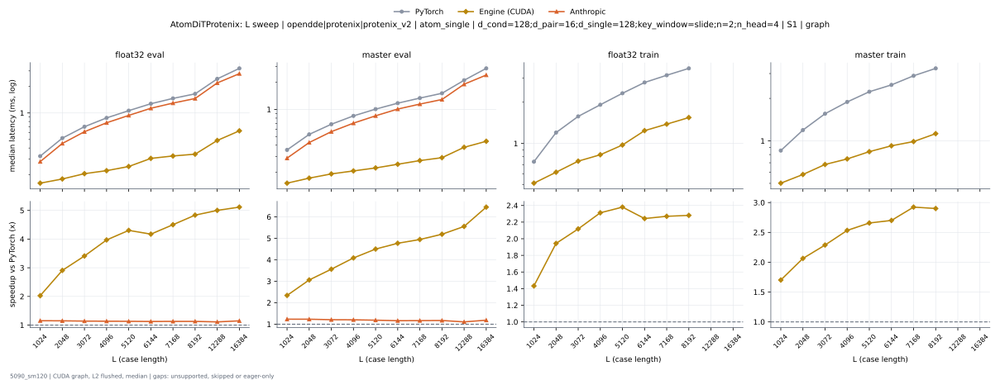
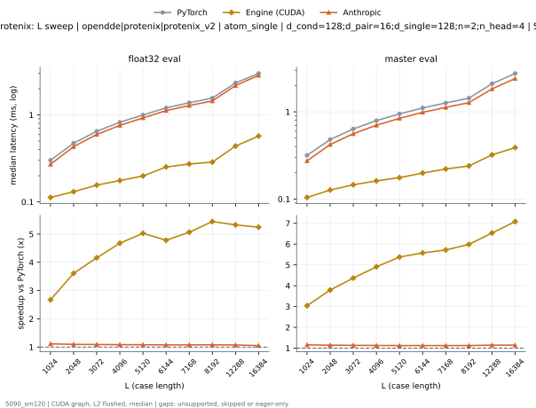
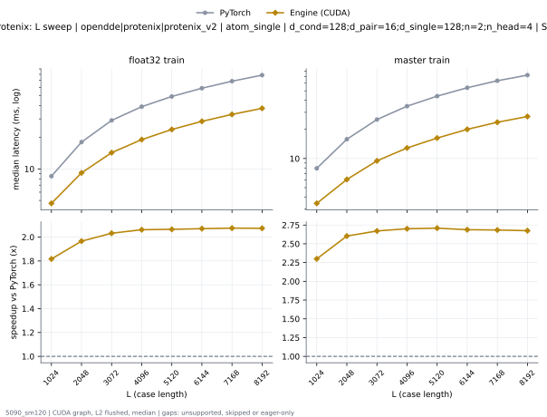
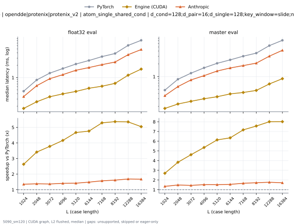
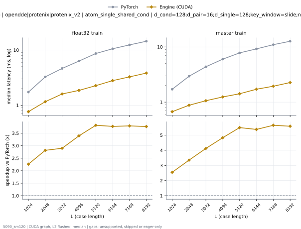
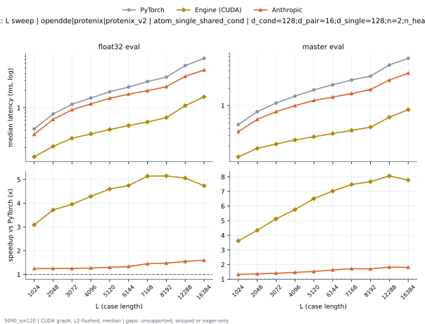
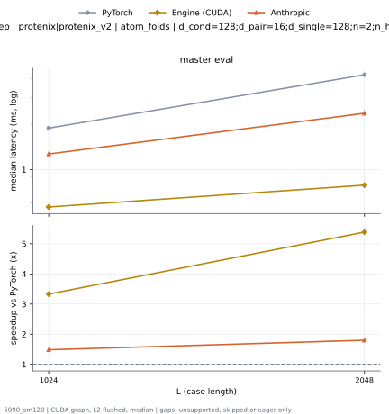
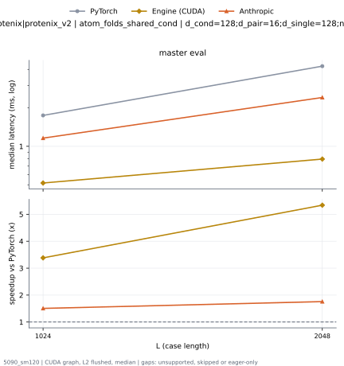

# AtomDiTProtenix on 5090_sm120

Generated by `python -m foldjet_engine.measure.plot` from speed tokens `judge/tokens/5090_sm120/`; do not edit.

### L sweep: opendde|protenix|protenix_v2 | atom_single | d_cond=128;d_pair=16;d_single=128;key_window=slide;n=2;n_head=4 | S1 | graph

**float32 eval** (median ms; x = speedup vs PyTorch)

| L | PyTorch | Engine (Triton) | Engine (CUDA) | Anthropic |
|---|---|---|---|---|
| 1024 | 0.3236 | 0.2767 (1.17x) | 0.1598 (2.03x) | 0.2806 (1.15x) |
| 2048 | 0.5181 | 0.4365 (1.19x) | 0.1782 (2.91x) | 0.4508 (1.15x) |
| 3072 | 0.6984 | 0.5993 (1.17x) | 0.2048 (3.41x) | 0.6127 (1.14x) |
| 4096 | 0.8791 | 0.7579 (1.16x) | 0.2214 (3.97x) | 0.7738 (1.14x) |
| 5120 | 1.063 | 0.9236 (1.15x) | 0.2469 (4.30x) | 0.9385 (1.13x) |
| 6144 | 1.273 | 1.119 (1.14x) | 0.3051 (4.17x) | 1.131 (1.13x) |
| 7168 | 1.463 | 1.28 (1.14x) | 0.3251 (4.50x) | 1.295 (1.13x) |
| 8192 | 1.648 | 1.4 (1.18x) | 0.3407 (4.84x) | 1.459 (1.13x) |
| 12288 | 2.437 | 2.09 (1.17x) | 0.4874 (5.00x) | 2.193 (1.11x) |
| 16384 | 3.207 | 2.718 (1.18x) | 0.627 (5.12x) | 2.793 (1.15x) |

**master eval** (median ms; x = speedup vs PyTorch)

| L | PyTorch | Engine (Triton) | Engine (CUDA) | Anthropic |
|---|---|---|---|---|
| 1024 | 0.3547 | 0.2903 (1.22x) | 0.1516 (2.34x) | 0.2875 (1.23x) |
| 2048 | 0.5277 | 0.4382 (1.20x) | 0.1724 (3.06x) | 0.4284 (1.23x) |
| 3072 | 0.684 | 0.5765 (1.19x) | 0.192 (3.56x) | 0.5659 (1.21x) |
| 4096 | 0.8468 | 0.7149 (1.18x) | 0.2072 (4.09x) | 0.7035 (1.20x) |
| 5120 | 1.007 | 0.8548 (1.18x) | 0.2237 (4.50x) | 0.8489 (1.19x) |
| 6144 | 1.172 | 0.997 (1.18x) | 0.2458 (4.77x) | 1.009 (1.16x) |
| 7168 | 1.335 | 1.14 (1.17x) | 0.27 (4.95x) | 1.145 (1.17x) |
| 8192 | 1.51 | 1.283 (1.18x) | 0.2908 (5.19x) | 1.288 (1.17x) |
| 12288 | 2.106 | 1.858 (1.13x) | 0.3792 (5.55x) | 1.904 (1.11x) |
| 16384 | 2.856 | 2.34 (1.22x) | 0.4423 (6.46x) | 2.407 (1.19x) |

**float32 train** (median ms; x = speedup vs PyTorch)

| L | PyTorch | Engine (Triton) | Engine (CUDA) | Anthropic |
|---|---|---|---|---|
| 1024 | 0.7364 | 0.6782 (1.09x) | 0.514 (1.43x) | unsupported |
| 2048 | 1.2 | 1.007 (1.19x) | 0.6175 (1.94x) | unsupported |
| 3072 | 1.574 | 1.352 (1.16x) | 0.7433 (2.12x) | unsupported |
| 4096 | 1.914 | 1.643 (1.16x) | 0.8277 (2.31x) | unsupported |
| 5120 | 2.32 | 2.012 (1.15x) | 0.9747 (2.38x) | unsupported |
| 6144 | 2.78 | 2.426 (1.15x) | 1.24 (2.24x) | unsupported |
| 7168 | 3.138 | 2.756 (1.14x) | 1.382 (2.27x) | unsupported |
| 8192 | 3.522 | 3.092 (1.14x) | 1.544 (2.28x) | unsupported |
| 12288 |  |  |  |  |
| 16384 |  |  |  |  |

**master train** (median ms; x = speedup vs PyTorch)

| L | PyTorch | Engine (Triton) | Engine (CUDA) | Anthropic |
|---|---|---|---|---|
| 1024 | 0.8541 | 0.7083 (1.21x) | 0.5019 (1.70x) | unsupported |
| 2048 | 1.193 | 1.001 (1.19x) | 0.5781 (2.06x) | unsupported |
| 3072 | 1.558 | 1.303 (1.20x) | 0.6807 (2.29x) | unsupported |
| 4096 | 1.888 | 1.602 (1.18x) | 0.7451 (2.53x) | unsupported |
| 5120 | 2.23 | 1.912 (1.17x) | 0.839 (2.66x) | unsupported |
| 6144 | 2.492 | 2.194 (1.14x) | 0.923 (2.70x) | unsupported |
| 7168 | 2.892 | 2.441 (1.18x) | 0.9892 (2.92x) | unsupported |
| 8192 | 3.264 | 2.828 (1.15x) | 1.125 (2.90x) | unsupported |
| 12288 |  |  |  |  |
| 16384 |  |  |  |  |

### L sweep: opendde|protenix|protenix_v2 | atom_single | d_cond=128;d_pair=16;d_single=128;n=2;n_head=4 | S1 | graph

**float32 eval** (median ms; x = speedup vs PyTorch)

| L | PyTorch | Engine (Triton) | Engine (CUDA) | Anthropic |
|---|---|---|---|---|
| 1024 | 0.3011 | 0.2667 (1.13x) | 0.1126 (2.67x) | 0.2705 (1.11x) |
| 2048 | 0.4731 | 0.426 (1.11x) | 0.1311 (3.61x) | 0.4319 (1.10x) |
| 3072 | 0.6492 | 0.5887 (1.10x) | 0.156 (4.16x) | 0.5961 (1.09x) |
| 4096 | 0.8236 | 0.7459 (1.10x) | 0.1761 (4.68x) | 0.7591 (1.09x) |
| 5120 | 0.999 | 0.9118 (1.10x) | 0.1987 (5.03x) | 0.9239 (1.08x) |
| 6144 | 1.205 | 1.109 (1.09x) | 0.2522 (4.78x) | 1.12 (1.08x) |
| 7168 | 1.381 | 1.269 (1.09x) | 0.2726 (5.07x) | 1.283 (1.08x) |
| 8192 | 1.561 | 1.39 (1.12x) | 0.2868 (5.44x) | 1.447 (1.08x) |
| 12288 | 2.334 | 2.094 (1.11x) | 0.4382 (5.33x) | 2.174 (1.07x) |
| 16384 | 2.997 | 2.708 (1.11x) | 0.5717 (5.24x) | 2.85 (1.05x) |

**master eval** (median ms; x = speedup vs PyTorch)

| L | PyTorch | Engine (Triton) | Engine (CUDA) | Anthropic |
|---|---|---|---|---|
| 1024 | 0.3174 | 0.2804 (1.13x) | 0.1044 (3.04x) | 0.2744 (1.16x) |
| 2048 | 0.4817 | 0.4262 (1.13x) | 0.127 (3.79x) | 0.4219 (1.14x) |
| 3072 | 0.6369 | 0.5652 (1.13x) | 0.1458 (4.37x) | 0.5615 (1.13x) |
| 4096 | 0.7932 | 0.7036 (1.13x) | 0.1616 (4.91x) | 0.7028 (1.13x) |
| 5120 | 0.9474 | 0.8429 (1.12x) | 0.1761 (5.38x) | 0.8428 (1.12x) |
| 6144 | 1.108 | 0.9871 (1.12x) | 0.1986 (5.58x) | 0.9869 (1.12x) |
| 7168 | 1.265 | 1.127 (1.12x) | 0.2212 (5.72x) | 1.125 (1.12x) |
| 8192 | 1.435 | 1.279 (1.12x) | 0.2396 (5.99x) | 1.276 (1.12x) |
| 12288 | 2.101 | 1.831 (1.15x) | 0.3216 (6.53x) | 1.834 (1.15x) |
| 16384 | 2.756 | 2.342 (1.18x) | 0.3891 (7.08x) | 2.41 (1.14x) |

### L sweep: opendde|protenix|protenix_v2 | atom_single | d_cond=128;d_pair=16;d_single=128;n=2;n_head=4 | S48 | graph

**float32 train** (median ms; x = speedup vs PyTorch)

| L | PyTorch | Engine (Triton) | Engine (CUDA) | Anthropic |
|---|---|---|---|---|
| 1024 | 8.519 | 5.048 (1.69x) | 4.69 (1.82x) | unsupported |
| 2048 | 18.02 | 10.71 (1.68x) | 9.167 (1.97x) | unsupported |
| 3072 | 29.04 | 17.64 (1.65x) | 14.29 (2.03x) | unsupported |
| 4096 | 39.27 | 24.06 (1.63x) | 19.04 (2.06x) | unsupported |
| 5120 | 49.13 | 30.22 (1.63x) | 23.79 (2.07x) | unsupported |
| 6144 | 58.91 | 36.54 (1.61x) | 28.45 (2.07x) | unsupported |
| 7168 | 68.75 | 42.49 (1.62x) | 33.13 (2.08x) | unsupported |
| 8192 | 78.52 | 48.23 (1.63x) | 37.86 (2.07x) | unsupported |

**master train** (median ms; x = speedup vs PyTorch)

| L | PyTorch | Engine (Triton) | Engine (CUDA) | Anthropic |
|---|---|---|---|---|
| 1024 | 7.922 | 4.194 (1.89x) | 3.446 (2.30x) | unsupported |
| 2048 | 15.83 | 8.392 (1.89x) | 6.08 (2.60x) | unsupported |
| 3072 | 25.29 | 13.98 (1.81x) | 9.468 (2.67x) | unsupported |
| 4096 | 34.74 | 19.57 (1.78x) | 12.86 (2.70x) | unsupported |
| 5120 | 44.12 | 25.25 (1.75x) | 16.29 (2.71x) | unsupported |
| 6144 | 53.83 | 31.59 (1.70x) | 20.03 (2.69x) | unsupported |
| 7168 | 63.62 | 37.31 (1.70x) | 23.7 (2.68x) | unsupported |
| 8192 | 72.67 | 42.03 (1.73x) | 27.17 (2.67x) | unsupported |

### L sweep: opendde|protenix|protenix_v2 | atom_single_shared_cond | d_cond=128;d_pair=16;d_single=128;key_window=slide;n=2;n_head=4 | S5 | graph

**float32 eval** (median ms; x = speedup vs PyTorch)

| L | PyTorch | Engine (Triton) | Engine (CUDA) | Anthropic |
|---|---|---|---|---|
| 1024 | 0.4649 | 0.341 (1.36x) | 0.1764 (2.64x) | 0.344 (1.35x) |
| 2048 | 0.8755 | 0.6274 (1.40x) | 0.2563 (3.42x) | 0.6328 (1.38x) |
| 3072 | 1.286 | 0.9226 (1.39x) | 0.3399 (3.78x) | 0.9392 (1.37x) |
| 4096 | 1.664 | 1.164 (1.43x) | 0.3996 (4.16x) | 1.179 (1.41x) |
| 5120 | 2.143 | 1.423 (1.51x) | 0.4588 (4.67x) | 1.509 (1.42x) |
| 6144 | 2.614 | 1.686 (1.55x) | 0.5489 (4.76x) | 1.759 (1.49x) |
| 7168 | 3.257 | 1.971 (1.65x) | 0.6154 (5.29x) | 2.072 (1.57x) |
| 8192 | 3.878 | 2.274 (1.71x) | 0.7222 (5.37x) | 2.398 (1.62x) |
| 12288 | 6.117 | 3.378 (1.81x) | 1.143 (5.35x) | 3.622 (1.69x) |
| 16384 | 8.14 | 4.618 (1.76x) | 1.613 (5.05x) | 4.854 (1.68x) |

**master eval** (median ms; x = speedup vs PyTorch)

| L | PyTorch | Engine (Triton) | Engine (CUDA) | Anthropic |
|---|---|---|---|---|
| 1024 | 0.4802 | 0.3768 (1.27x) | 0.1781 (2.70x) | 0.3564 (1.35x) |
| 2048 | 0.8667 | 0.6072 (1.43x) | 0.2263 (3.83x) | 0.5823 (1.49x) |
| 3072 | 1.207 | 0.8231 (1.47x) | 0.2621 (4.61x) | 0.8361 (1.44x) |
| 4096 | 1.611 | 1.035 (1.56x) | 0.301 (5.35x) | 1.054 (1.53x) |
| 5120 | 2.06 | 1.271 (1.62x) | 0.3358 (6.13x) | 1.355 (1.52x) |
| 6144 | 2.482 | 1.494 (1.66x) | 0.3912 (6.34x) | 1.598 (1.55x) |
| 7168 | 3.031 | 1.68 (1.80x) | 0.4229 (7.17x) | 1.82 (1.66x) |
| 8192 | 3.578 | 1.92 (1.86x) | 0.4731 (7.56x) | 2.078 (1.72x) |
| 12288 | 5.377 | 2.834 (1.90x) | 0.6717 (8.01x) | 3.035 (1.77x) |
| 16384 | 7.17 | 3.82 (1.88x) | 0.8948 (8.01x) | 4.179 (1.72x) |

### L sweep: opendde|protenix|protenix_v2 | atom_single_shared_cond | d_cond=128;d_pair=16;d_single=128;key_window=slide;n=2;n_head=4 | S8 | graph

**float32 train** (median ms; x = speedup vs PyTorch)

| L | PyTorch | Engine (Triton) | Engine (CUDA) | Anthropic |
|---|---|---|---|---|
| 1024 | 1.731 | 1.294 (1.34x) | 0.7654 (2.26x) | unsupported |
| 2048 | 3.267 | 2.391 (1.37x) | 1.16 (2.82x) | unsupported |
| 3072 | 4.643 | 3.226 (1.44x) | 1.602 (2.90x) | unsupported |
| 4096 | 6.314 | 4.102 (1.54x) | 1.86 (3.40x) | unsupported |
| 5120 | 8.653 | 5.228 (1.66x) | 2.266 (3.82x) | unsupported |
| 6144 | 10.55 | 6.284 (1.68x) | 2.797 (3.77x) | unsupported |
| 7168 | 12.4 | 7.499 (1.65x) | 3.268 (3.79x) | unsupported |
| 8192 | 14.42 | 8.719 (1.65x) | 3.828 (3.77x) | unsupported |

**master train** (median ms; x = speedup vs PyTorch)

| L | PyTorch | Engine (Triton) | Engine (CUDA) | Anthropic |
|---|---|---|---|---|
| 1024 | 1.711 | 1.255 (1.36x) | 0.6717 (2.55x) | unsupported |
| 2048 | 2.943 | 2.033 (1.45x) | 0.8786 (3.35x) | unsupported |
| 3072 | 4.375 | 2.857 (1.53x) | 1.061 (4.12x) | unsupported |
| 4096 | 6.003 | 3.851 (1.56x) | 1.242 (4.83x) | unsupported |
| 5120 | 7.802 | 4.638 (1.68x) | 1.418 (5.50x) | unsupported |
| 6144 | 9.217 | 5.346 (1.72x) | 1.713 (5.38x) | unsupported |
| 7168 | 10.98 | 6.207 (1.77x) | 1.942 (5.65x) | unsupported |
| 8192 | 12.67 | 7.089 (1.79x) | 2.266 (5.59x) | unsupported |

### L sweep: opendde|protenix|protenix_v2 | atom_single_shared_cond | d_cond=128;d_pair=16;d_single=128;n=2;n_head=4 | S5 | graph

**float32 eval** (median ms; x = speedup vs PyTorch)

| L | PyTorch | Engine (Triton) | Engine (CUDA) | Anthropic |
|---|---|---|---|---|
| 1024 | 0.4239 | 0.3461 (1.22x) | 0.1372 (3.09x) | 0.3402 (1.25x) |
| 2048 | 0.7762 | 0.6164 (1.26x) | 0.2089 (3.72x) | 0.6209 (1.25x) |
| 3072 | 1.15 | 0.9118 (1.26x) | 0.2908 (3.95x) | 0.9197 (1.25x) |
| 4096 | 1.48 | 1.154 (1.28x) | 0.3451 (4.29x) | 1.166 (1.27x) |
| 5120 | 1.904 | 1.455 (1.31x) | 0.414 (4.60x) | 1.467 (1.30x) |
| 6144 | 2.304 | 1.672 (1.38x) | 0.4857 (4.74x) | 1.727 (1.33x) |
| 7168 | 2.884 | 2 (1.44x) | 0.5612 (5.14x) | 1.988 (1.45x) |
| 8192 | 3.443 | 2.277 (1.51x) | 0.6687 (5.15x) | 2.336 (1.47x) |
| 12288 | 5.493 | 3.424 (1.60x) | 1.086 (5.06x) | 3.545 (1.55x) |
| 16384 | 7.365 | 4.611 (1.60x) | 1.555 (4.74x) | 4.609 (1.60x) |

**master eval** (median ms; x = speedup vs PyTorch)

| L | PyTorch | Engine (Triton) | Engine (CUDA) | Anthropic |
|---|---|---|---|---|
| 1024 | 0.4675 | 0.3652 (1.28x) | 0.129 (3.62x) | 0.3526 (1.33x) |
| 2048 | 0.7823 | 0.5963 (1.31x) | 0.1802 (4.34x) | 0.5744 (1.36x) |
| 3072 | 1.103 | 0.811 (1.36x) | 0.2152 (5.13x) | 0.7835 (1.41x) |
| 4096 | 1.457 | 1.025 (1.42x) | 0.2529 (5.76x) | 0.9953 (1.46x) |
| 5120 | 1.869 | 1.259 (1.48x) | 0.2871 (6.51x) | 1.225 (1.53x) |
| 6144 | 2.295 | 1.445 (1.59x) | 0.3266 (7.03x) | 1.4 (1.64x) |
| 7168 | 2.772 | 1.667 (1.66x) | 0.3707 (7.48x) | 1.613 (1.72x) |
| 8192 | 3.236 | 1.912 (1.69x) | 0.4219 (7.67x) | 1.898 (1.70x) |
| 12288 | 5.052 | 2.855 (1.77x) | 0.6267 (8.06x) | 2.764 (1.83x) |
| 16384 | 6.594 | 3.819 (1.73x) | 0.8479 (7.78x) | 3.646 (1.81x) |

### L sweep: protenix|protenix_v2 | atom_folds | d_cond=128;d_pair=16;d_single=128;n=2;n_head=4 | D5 | S5 | graph

**master eval** (median ms; x = speedup vs PyTorch)

| L | PyTorch | Engine (Triton) | Engine (CUDA) | Anthropic |
|---|---|---|---|---|
| 1024 | 1.883 | 1.279 (1.47x) | 0.5653 (3.33x) | 1.269 (1.48x) |
| 2048 | 4.25 | 2.466 (1.72x) | 0.7888 (5.39x) | 2.362 (1.80x) |

### L sweep: protenix|protenix_v2 | atom_folds_shared_cond | d_cond=128;d_pair=16;d_single=128;n=2;n_head=4 | D5 | S5 | graph

**master eval** (median ms; x = speedup vs PyTorch)

| L | PyTorch | Engine (Triton) | Engine (CUDA) | Anthropic |
|---|---|---|---|---|
| 1024 | 1.746 | 1.226 (1.42x) | 0.5162 (3.38x) | 1.159 (1.51x) |
| 2048 | 4.242 | 2.559 (1.66x) | 0.7946 (5.34x) | 2.412 (1.76x) |

