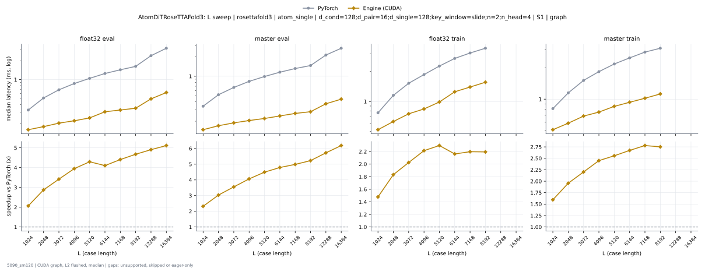
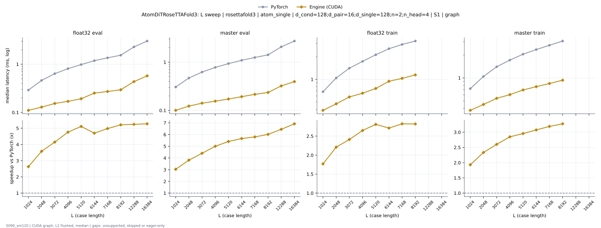
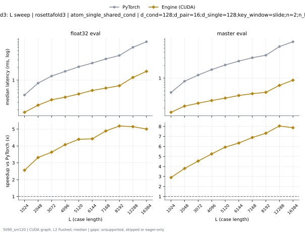
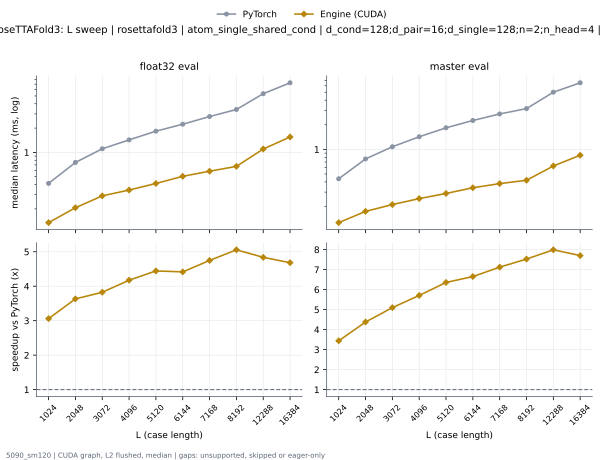

# AtomDiTRoseTTAFold3 on 5090_sm120

Generated by `python -m foldjet_engine.measure.plot` from speed tokens `judge/tokens/5090_sm120/`; do not edit.

### L sweep: rosettafold3 | atom_single | d_cond=128;d_pair=16;d_single=128;key_window=slide;n=2;n_head=4 | S1 | graph

**float32 eval** (median ms; x = speedup vs PyTorch)

| L | PyTorch | Engine (Triton) | Engine (CUDA) |
|---|---|---|---|
| 1024 | 0.3256 | 0.2662 (1.22x) | 0.1577 (2.06x) |
| 2048 | 0.5079 | 0.4251 (1.19x) | 0.1767 (2.87x) |
| 3072 | 0.6864 | 0.5878 (1.17x) | 0.2008 (3.42x) |
| 4096 | 0.8652 | 0.7438 (1.16x) | 0.2191 (3.95x) |
| 5120 | 1.046 | 0.9076 (1.15x) | 0.2437 (4.29x) |
| 6144 | 1.253 | 1.099 (1.14x) | 0.3054 (4.10x) |
| 7168 | 1.435 | 1.261 (1.14x) | 0.3256 (4.41x) |
| 8192 | 1.627 | 1.418 (1.15x) | 0.3481 (4.67x) |
| 12288 | 2.411 | 2.121 (1.14x) | 0.4915 (4.91x) |
| 16384 | 3.175 | 2.7 (1.18x) | 0.6208 (5.11x) |

**master eval** (median ms; x = speedup vs PyTorch)

| L | PyTorch | Engine (Triton) | Engine (CUDA) |
|---|---|---|---|
| 1024 | 0.342 | 0.2781 (1.23x) | 0.1475 (2.32x) |
| 2048 | 0.5156 | 0.4247 (1.21x) | 0.17 (3.03x) |
| 3072 | 0.6697 | 0.5618 (1.19x) | 0.1884 (3.55x) |
| 4096 | 0.8325 | 0.6989 (1.19x) | 0.2048 (4.07x) |
| 5120 | 0.9902 | 0.838 (1.18x) | 0.2204 (4.49x) |
| 6144 | 1.156 | 0.981 (1.18x) | 0.2413 (4.79x) |
| 7168 | 1.318 | 1.121 (1.18x) | 0.2642 (4.99x) |
| 8192 | 1.467 | 1.271 (1.15x) | 0.2806 (5.23x) |
| 12288 | 2.135 | 1.846 (1.16x) | 0.3731 (5.72x) |
| 16384 | 2.725 | 2.358 (1.16x) | 0.4403 (6.19x) |

**float32 train** (median ms; x = speedup vs PyTorch)

| L | PyTorch | Engine (Triton) | Engine (CUDA) |
|---|---|---|---|
| 1024 | 0.7693 | 0.6369 (1.21x) | 0.5206 (1.48x) |
| 2048 | 1.152 | 0.9502 (1.21x) | 0.6287 (1.83x) |
| 3072 | 1.522 | 1.301 (1.17x) | 0.7516 (2.03x) |
| 4096 | 1.863 | 1.597 (1.17x) | 0.8414 (2.21x) |
| 5120 | 2.267 | 1.956 (1.16x) | 0.9875 (2.30x) |
| 6144 | 2.705 | 2.358 (1.15x) | 1.251 (2.16x) |
| 7168 | 3.066 | 2.679 (1.14x) | 1.396 (2.20x) |
| 8192 | 3.422 | 3.025 (1.13x) | 1.56 (2.19x) |
| 12288 |  |  |  |
| 16384 |  |  |  |

**master train** (median ms; x = speedup vs PyTorch)

| L | PyTorch | Engine (Triton) | Engine (CUDA) |
|---|---|---|---|
| 1024 | 0.8111 | 0.6656 (1.22x) | 0.5086 (1.59x) |
| 2048 | 1.149 | 0.9543 (1.20x) | 0.5873 (1.96x) |
| 3072 | 1.514 | 1.262 (1.20x) | 0.6876 (2.20x) |
| 4096 | 1.84 | 1.554 (1.18x) | 0.7512 (2.45x) |
| 5120 | 2.18 | 1.862 (1.17x) | 0.8529 (2.56x) |
| 6144 | 2.496 | 2.143 (1.16x) | 0.9335 (2.67x) |
| 7168 | 2.838 | 2.438 (1.16x) | 1.021 (2.78x) |
| 8192 | 3.09 | 2.77 (1.12x) | 1.123 (2.75x) |
| 12288 |  |  |  |
| 16384 |  |  |  |

### L sweep: rosettafold3 | atom_single | d_cond=128;d_pair=16;d_single=128;n=2;n_head=4 | S1 | graph

**float32 eval** (median ms; x = speedup vs PyTorch)

| L | PyTorch | Engine (Triton) | Engine (CUDA) |
|---|---|---|---|
| 1024 | 0.2908 | 0.256 (1.14x) | 0.1106 (2.63x) |
| 2048 | 0.462 | 0.4157 (1.11x) | 0.129 (3.58x) |
| 3072 | 0.6369 | 0.5768 (1.10x) | 0.1536 (4.15x) |
| 4096 | 0.8089 | 0.7335 (1.10x) | 0.17 (4.76x) |
| 5120 | 0.984 | 0.8978 (1.10x) | 0.1925 (5.11x) |
| 6144 | 1.184 | 1.088 (1.09x) | 0.2522 (4.70x) |
| 7168 | 1.356 | 1.249 (1.09x) | 0.2724 (4.98x) |
| 8192 | 1.538 | 1.409 (1.09x) | 0.2952 (5.21x) |
| 12288 | 2.285 | 2.109 (1.08x) | 0.4359 (5.24x) |
| 16384 | 3.024 | 2.717 (1.11x) | 0.5734 (5.27x) |

**master eval** (median ms; x = speedup vs PyTorch)

| L | PyTorch | Engine (Triton) | Engine (CUDA) |
|---|---|---|---|
| 1024 | 0.3047 | 0.2676 (1.14x) | 0.1004 (3.04x) |
| 2048 | 0.469 | 0.4141 (1.13x) | 0.1229 (3.82x) |
| 3072 | 0.6226 | 0.5513 (1.13x) | 0.1413 (4.40x) |
| 4096 | 0.7782 | 0.6886 (1.13x) | 0.1556 (5.00x) |
| 5120 | 0.932 | 0.827 (1.13x) | 0.1723 (5.41x) |
| 6144 | 1.091 | 0.9707 (1.12x) | 0.1927 (5.66x) |
| 7168 | 1.249 | 1.11 (1.13x) | 0.2153 (5.80x) |
| 8192 | 1.417 | 1.26 (1.12x) | 0.2355 (6.02x) |
| 12288 | 2.074 | 1.807 (1.15x) | 0.3215 (6.45x) |
| 16384 | 2.735 | 2.36 (1.16x) | 0.3952 (6.92x) |

**float32 train** (median ms; x = speedup vs PyTorch)

| L | PyTorch | Engine (Triton) | Engine (CUDA) |
|---|---|---|---|
| 1024 | 0.6848 | 0.6247 (1.10x) | 0.3872 (1.77x) |
| 2048 | 1.044 | 0.9409 (1.11x) | 0.4727 (2.21x) |
| 3072 | 1.408 | 1.289 (1.09x) | 0.5836 (2.41x) |
| 4096 | 1.734 | 1.586 (1.09x) | 0.6545 (2.65x) |
| 5120 | 2.125 | 1.945 (1.09x) | 0.7563 (2.81x) |
| 6144 | 2.557 | 2.346 (1.09x) | 0.9428 (2.71x) |
| 7168 | 2.912 | 2.669 (1.09x) | 1.031 (2.82x) |
| 8192 | 3.234 | 3.01 (1.07x) | 1.147 (2.82x) |
| 12288 |  |  |  |
| 16384 |  |  |  |

**master train** (median ms; x = speedup vs PyTorch)

| L | PyTorch | Engine (Triton) | Engine (CUDA) |
|---|---|---|---|
| 1024 | 0.723 | 0.6536 (1.11x) | 0.3746 (1.93x) |
| 2048 | 1.046 | 0.9421 (1.11x) | 0.4479 (2.33x) |
| 3072 | 1.402 | 1.243 (1.13x) | 0.5389 (2.60x) |
| 4096 | 1.716 | 1.541 (1.11x) | 0.6028 (2.85x) |
| 5120 | 2.052 | 1.85 (1.11x) | 0.6943 (2.96x) |
| 6144 | 2.36 | 2.134 (1.11x) | 0.7678 (3.07x) |
| 7168 | 2.691 | 2.426 (1.11x) | 0.8436 (3.19x) |
| 8192 | 3.056 | 2.756 (1.11x) | 0.933 (3.28x) |
| 12288 |  |  |  |
| 16384 |  |  |  |

### L sweep: rosettafold3 | atom_single_shared_cond | d_cond=128;d_pair=16;d_single=128;key_window=slide;n=2;n_head=4 | S5 | graph

**float32 eval** (median ms; x = speedup vs PyTorch)

| L | PyTorch | Engine (Triton) | Engine (CUDA) |
|---|---|---|---|
| 1024 | 0.4454 | 0.3238 (1.38x) | 0.174 (2.56x) |
| 2048 | 0.849 | 0.6024 (1.41x) | 0.2561 (3.31x) |
| 3072 | 1.25 | 0.8827 (1.42x) | 0.344 (3.63x) |
| 4096 | 1.613 | 1.116 (1.44x) | 0.3954 (4.08x) |
| 5120 | 2.07 | 1.393 (1.49x) | 0.471 (4.39x) |
| 6144 | 2.529 | 1.648 (1.53x) | 0.5715 (4.42x) |
| 7168 | 3.165 | 1.904 (1.66x) | 0.6472 (4.89x) |
| 8192 | 3.825 | 2.192 (1.74x) | 0.7375 (5.19x) |
| 12288 | 5.957 | 3.326 (1.79x) | 1.157 (5.15x) |
| 16384 | 8.061 | 4.401 (1.83x) | 1.611 (5.00x) |

**master eval** (median ms; x = speedup vs PyTorch)

| L | PyTorch | Engine (Triton) | Engine (CUDA) |
|---|---|---|---|
| 1024 | 0.4628 | 0.3239 (1.43x) | 0.1597 (2.90x) |
| 2048 | 0.8468 | 0.5852 (1.45x) | 0.2227 (3.80x) |
| 3072 | 1.18 | 0.7966 (1.48x) | 0.2598 (4.54x) |
| 4096 | 1.582 | 1.003 (1.58x) | 0.301 (5.26x) |
| 5120 | 2.029 | 1.233 (1.65x) | 0.342 (5.93x) |
| 6144 | 2.494 | 1.437 (1.74x) | 0.3932 (6.34x) |
| 7168 | 2.994 | 1.66 (1.80x) | 0.4342 (6.90x) |
| 8192 | 3.419 | 1.87 (1.83x) | 0.4669 (7.32x) |
| 12288 | 5.453 | 2.839 (1.92x) | 0.6776 (8.05x) |
| 16384 | 7.061 | 3.709 (1.90x) | 0.897 (7.87x) |

### L sweep: rosettafold3 | atom_single_shared_cond | d_cond=128;d_pair=16;d_single=128;n=2;n_head=4 | S5 | graph

**float32 eval** (median ms; x = speedup vs PyTorch)

| L | PyTorch | Engine (Triton) | Engine (CUDA) |
|---|---|---|---|
| 1024 | 0.4137 | 0.3338 (1.24x) | 0.1352 (3.06x) |
| 2048 | 0.7514 | 0.5918 (1.27x) | 0.2068 (3.63x) |
| 3072 | 1.109 | 0.8731 (1.27x) | 0.2899 (3.83x) |
| 4096 | 1.429 | 1.105 (1.29x) | 0.3423 (4.18x) |
| 5120 | 1.834 | 1.381 (1.33x) | 0.4127 (4.44x) |
| 6144 | 2.235 | 1.621 (1.38x) | 0.5061 (4.42x) |
| 7168 | 2.781 | 1.934 (1.44x) | 0.5857 (4.75x) |
| 8192 | 3.398 | 2.158 (1.57x) | 0.672 (5.06x) |
| 12288 | 5.332 | 3.312 (1.61x) | 1.102 (4.84x) |
| 16384 | 7.275 | 4.391 (1.66x) | 1.554 (4.68x) |

**master eval** (median ms; x = speedup vs PyTorch)

| L | PyTorch | Engine (Triton) | Engine (CUDA) |
|---|---|---|---|
| 1024 | 0.4367 | 0.3488 (1.25x) | 0.1269 (3.44x) |
| 2048 | 0.7638 | 0.5738 (1.33x) | 0.1744 (4.38x) |
| 3072 | 1.077 | 0.7856 (1.37x) | 0.2112 (5.10x) |
| 4096 | 1.426 | 0.9922 (1.44x) | 0.2499 (5.71x) |
| 5120 | 1.836 | 1.223 (1.50x) | 0.2887 (6.36x) |
| 6144 | 2.256 | 1.439 (1.57x) | 0.3391 (6.65x) |
| 7168 | 2.714 | 1.664 (1.63x) | 0.3809 (7.12x) |
| 8192 | 3.153 | 1.873 (1.68x) | 0.4188 (7.53x) |
| 12288 | 5.007 | 2.822 (1.77x) | 0.6267 (7.99x) |
| 16384 | 6.525 | 3.7 (1.76x) | 0.8474 (7.70x) |

