# AttentionPairBias on 5090_sm120

Generated by `python -m miniworld_engine.measure.plot` from speed tokens `judge/tokens/5090_sm120/`; do not edit.

### L sweep: token_single | d_pair=128;d_single=384;n_head=12 | S1 | graph

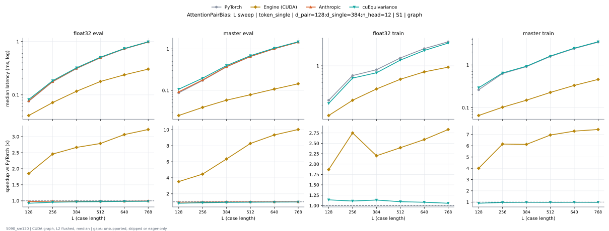

**float32 eval** (median ms; x = speedup vs PyTorch)

| L | PyTorch | Engine (Triton) | Engine (CUDA) | Anthropic | cuEquivariance |
|---|---|---|---|---|---|
| 128 | 0.07576 | 0.06374 (1.19x) | 0.04096 (1.85x) | 0.07758 (0.98x) | 0.08192 (0.92x) |
| 256 | 0.1761 | 0.1477 (1.19x) | 0.07168 (2.46x) | 0.1781 (0.99x) | 0.1841 (0.96x) |
| 384 | 0.3113 | 0.2721 (1.14x) | 0.1168 (2.66x) | 0.3154 (0.99x) | 0.3217 (0.97x) |
| 512 | 0.4968 | 0.4444 (1.12x) | 0.1783 (2.79x) | 0.5029 (0.99x) | 0.5096 (0.97x) |
| 640 | 0.7279 | 0.6573 (1.11x) | 0.2376 (3.06x) | 0.737 (0.99x) | 0.7402 (0.98x) |
| 768 | 0.9789 | 0.8817 (1.11x) | 0.3038 (3.22x) | 0.984 (0.99x) | 0.9925 (0.99x) |

**master eval** (median ms; x = speedup vs PyTorch)

| L | PyTorch | Engine (Triton) | Engine (CUDA) | Anthropic | cuEquivariance |
|---|---|---|---|---|---|
| 128 | 0.08746 | 0.07782 (1.12x) | 0.02483 (3.52x) | 0.09216 (0.95x) | 0.1068 (0.82x) |
| 256 | 0.1737 | 0.1597 (1.09x) | 0.03894 (4.46x) | 0.1782 (0.97x) | 0.1966 (0.88x) |
| 384 | 0.3686 | 0.3459 (1.07x) | 0.05808 (6.35x) | 0.3735 (0.99x) | 0.3956 (0.93x) |
| 512 | 0.6515 | 0.6226 (1.05x) | 0.07864 (8.28x) | 0.6574 (0.99x) | 0.6852 (0.95x) |
| 640 | 1.005 | 0.97 (1.04x) | 0.1075 (9.35x) | 1.013 (0.99x) | 1.042 (0.96x) |
| 768 | 1.448 | 1.383 (1.05x) | 0.1444 (10.03x) | 1.455 (1.00x) | 1.484 (0.98x) |

**float32 train** (median ms; x = speedup vs PyTorch)

| L | PyTorch | Engine (Triton) | Engine (CUDA) | Anthropic | cuEquivariance |
|---|---|---|---|---|---|
| 128 | 0.2437 | 0.2389 (1.02x) | 0.1305 (1.87x) | unsupported | 0.2143 (1.14x) |
| 256 | 0.6703 | 0.5997 (1.12x) | 0.2437 (2.75x) | unsupported | 0.6042 (1.11x) |
| 384 | 0.852 | 0.7404 (1.15x) | 0.3871 (2.20x) | unsupported | 0.7518 (1.13x) |
| 512 | 1.381 | 1.246 (1.11x) | 0.5765 (2.40x) | unsupported | 1.264 (1.09x) |
| 640 | 2.022 | 1.84 (1.10x) | 0.7803 (2.59x) | unsupported | 1.873 (1.08x) |
| 768 | 2.678 | 2.55 (1.05x) | 0.9452 (2.83x) | unsupported | 2.537 (1.06x) |

**master train** (median ms; x = speedup vs PyTorch)

| L | PyTorch | Engine (Triton) | Engine (CUDA) | Anthropic | cuEquivariance |
|---|---|---|---|---|---|
| 128 | 0.2621 | 0.2519 (1.04x) | 0.06554 (4.00x) | unsupported | 0.2928 (0.90x) |
| 256 | 0.6299 | 0.6021 (1.05x) | 0.1024 (6.15x) | unsupported | 0.6492 (0.97x) |
| 384 | 0.9156 | 0.8729 (1.05x) | 0.1495 (6.13x) | unsupported | 0.9327 (0.98x) |
| 512 | 1.582 | 1.521 (1.04x) | 0.2274 (6.96x) | unsupported | 1.619 (0.98x) |
| 640 | 2.423 | 2.352 (1.03x) | 0.3318 (7.30x) | unsupported | 2.469 (0.98x) |
| 768 | 3.416 | 3.289 (1.04x) | 0.4588 (7.45x) | unsupported | 3.493 (0.98x) |

### L sweep: token_single | d_pair=128;d_single=384;n_head=16 | S1 | graph

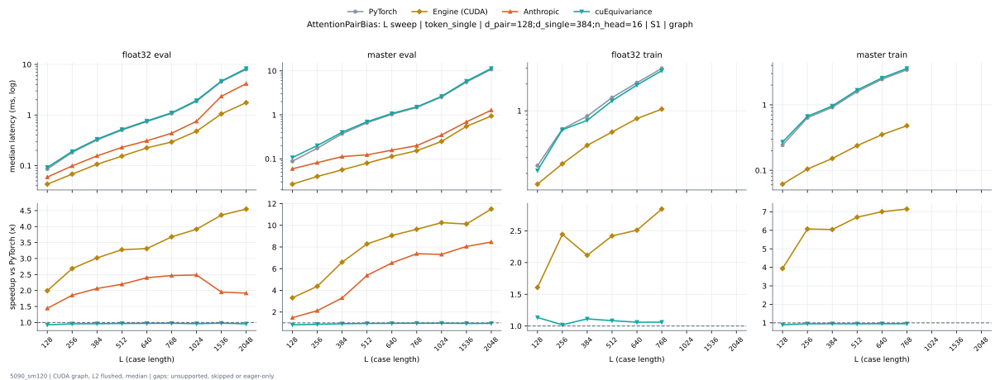

**float32 eval** (median ms; x = speedup vs PyTorch)

| L | PyTorch | Engine (Triton) | Engine (CUDA) | Anthropic | cuEquivariance |
|---|---|---|---|---|---|
| 128 | 0.08576 | 0.07168 (1.20x) | 0.04301 (1.99x) | 0.05939 (1.44x) | 0.09242 (0.93x) |
| 256 | 0.1826 | 0.1597 (1.14x) | 0.06795 (2.69x) | 0.09856 (1.85x) | 0.1908 (0.96x) |
| 384 | 0.3216 | 0.2857 (1.13x) | 0.1065 (3.02x) | 0.1559 (2.06x) | 0.3341 (0.96x) |
| 512 | 0.5039 | 0.4541 (1.11x) | 0.1537 (3.28x) | 0.2294 (2.20x) | 0.5202 (0.97x) |
| 640 | 0.7423 | 0.6769 (1.10x) | 0.2243 (3.31x) | 0.3093 (2.40x) | 0.7639 (0.97x) |
| 768 | 1.077 | 0.9617 (1.12x) | 0.2928 (3.68x) | 0.4365 (2.47x) | 1.105 (0.97x) |
| 1024 | 1.869 | 1.666 (1.12x) | 0.4772 (3.92x) | 0.7516 (2.49x) | 1.941 (0.96x) |
| 1536 | 4.583 | 4.114 (1.11x) | 1.052 (4.36x) | 2.348 (1.95x) | 4.683 (0.98x) |
| 2048 | 7.987 | 7.312 (1.09x) | 1.756 (4.55x) | 4.164 (1.92x) | 8.34 (0.96x) |

**master eval** (median ms; x = speedup vs PyTorch)

| L | PyTorch | Engine (Triton) | Engine (CUDA) | Anthropic | cuEquivariance |
|---|---|---|---|---|---|
| 128 | 0.08806 | 0.08016 (1.10x) | 0.02659 (3.31x) | 0.05939 (1.48x) | 0.1069 (0.82x) |
| 256 | 0.1742 | 0.1641 (1.06x) | 0.03982 (4.37x) | 0.08202 (2.12x) | 0.2007 (0.87x) |
| 384 | 0.3718 | 0.3564 (1.04x) | 0.05632 (6.60x) | 0.1126 (3.30x) | 0.4035 (0.92x) |
| 512 | 0.6615 | 0.6362 (1.04x) | 0.07987 (8.28x) | 0.123 (5.38x) | 0.6981 (0.95x) |
| 640 | 1.03 | 0.9994 (1.03x) | 0.1137 (9.06x) | 0.1577 (6.53x) | 1.075 (0.96x) |
| 768 | 1.474 | 1.424 (1.03x) | 0.153 (9.64x) | 0.1997 (7.38x) | 1.521 (0.97x) |
| 1024 | 2.55 | 2.457 (1.04x) | 0.2489 (10.25x) | 0.3484 (7.32x) | 2.63 (0.97x) |
| 1536 | 5.555 | 5.448 (1.02x) | 0.5487 (10.12x) | 0.6902 (8.05x) | 5.855 (0.95x) |
| 2048 | 10.82 | 10.58 (1.02x) | 0.9411 (11.50x) | 1.279 (8.46x) | 11.36 (0.95x) |

**float32 train** (median ms; x = speedup vs PyTorch)

| L | PyTorch | Engine (Triton) | Engine (CUDA) | Anthropic | cuEquivariance |
|---|---|---|---|---|---|
| 128 | 0.2441 | 0.2217 (1.10x) | 0.1518 (1.61x) | unsupported | 0.2151 (1.14x) |
| 256 | 0.6256 | 0.6165 (1.01x) | 0.256 (2.44x) | unsupported | 0.6136 (1.02x) |
| 384 | 0.8705 | 0.7731 (1.13x) | 0.4116 (2.11x) | unsupported | 0.7823 (1.11x) |
| 512 | 1.402 | 1.28 (1.09x) | 0.5792 (2.42x) | unsupported | 1.292 (1.08x) |
| 640 | 2.055 | 1.902 (1.08x) | 0.8185 (2.51x) | unsupported | 1.938 (1.06x) |
| 768 | 2.97 | 2.582 (1.15x) | 1.044 (2.84x) | unsupported | 2.801 (1.06x) |
| 1024 |  |  |  |  |  |
| 1536 |  |  |  |  |  |
| 2048 |  |  |  |  |  |

**master train** (median ms; x = speedup vs PyTorch)

| L | PyTorch | Engine (Triton) | Engine (CUDA) | Anthropic | cuEquivariance |
|---|---|---|---|---|---|
| 128 | 0.242 | 0.2355 (1.03x) | 0.06144 (3.94x) | unsupported | 0.2703 (0.90x) |
| 256 | 0.6341 | 0.6106 (1.04x) | 0.1045 (6.07x) | unsupported | 0.6676 (0.95x) |
| 384 | 0.9157 | 0.8827 (1.04x) | 0.1515 (6.04x) | unsupported | 0.9615 (0.95x) |
| 512 | 1.596 | 1.558 (1.02x) | 0.2379 (6.71x) | unsupported | 1.682 (0.95x) |
| 640 | 2.461 | 2.398 (1.03x) | 0.3512 (7.01x) | unsupported | 2.58 (0.95x) |
| 768 | 3.427 | 3.363 (1.02x) | 0.4793 (7.15x) | unsupported | 3.601 (0.95x) |
| 1024 |  |  |  |  |  |
| 1536 |  |  |  |  |  |
| 2048 |  |  |  |  |  |

### L sweep: token_single | d_pair=128;d_single=384;n_head=24 | S1 | graph

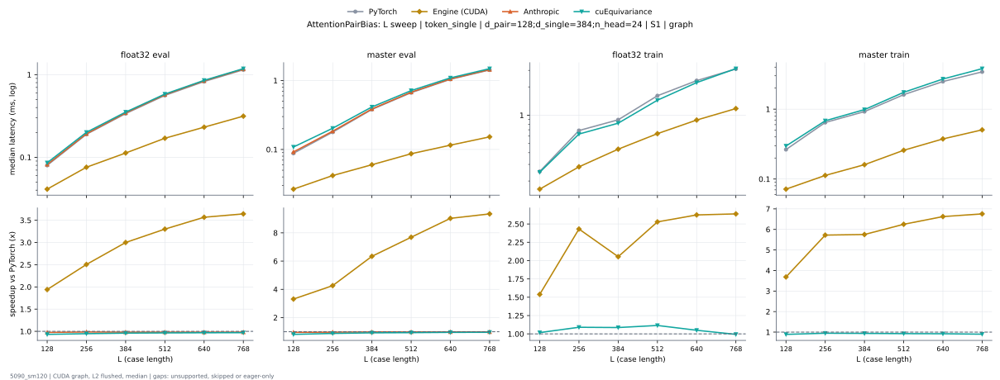

**float32 eval** (median ms; x = speedup vs PyTorch)

| L | PyTorch | Engine (Triton) | Engine (CUDA) | Anthropic | cuEquivariance |
|---|---|---|---|---|---|
| 128 | 0.07987 | 0.06554 (1.22x) | 0.04117 (1.94x) | 0.0819 (0.98x) | 0.08576 (0.93x) |
| 256 | 0.1898 | 0.1598 (1.19x) | 0.07578 (2.51x) | 0.1926 (0.99x) | 0.2004 (0.95x) |
| 384 | 0.338 | 0.2929 (1.15x) | 0.1127 (3.00x) | 0.3445 (0.98x) | 0.3523 (0.96x) |
| 512 | 0.5612 | 0.4711 (1.19x) | 0.17 (3.30x) | 0.5716 (0.98x) | 0.5819 (0.96x) |
| 640 | 0.8258 | 0.7138 (1.16x) | 0.2314 (3.57x) | 0.8418 (0.98x) | 0.853 (0.97x) |
| 768 | 1.146 | 0.9853 (1.16x) | 0.3145 (3.64x) | 1.166 (0.98x) | 1.182 (0.97x) |

**master eval** (median ms; x = speedup vs PyTorch)

| L | PyTorch | Engine (Triton) | Engine (CUDA) | Anthropic | cuEquivariance |
|---|---|---|---|---|---|
| 128 | 0.08806 | 0.07782 (1.13x) | 0.02659 (3.31x) | 0.09218 (0.96x) | 0.1085 (0.81x) |
| 256 | 0.1784 | 0.1618 (1.10x) | 0.04186 (4.26x) | 0.1843 (0.97x) | 0.2031 (0.88x) |
| 384 | 0.3808 | 0.3546 (1.07x) | 0.06008 (6.34x) | 0.3871 (0.98x) | 0.4137 (0.92x) |
| 512 | 0.6666 | 0.6331 (1.05x) | 0.0867 (7.69x) | 0.6779 (0.98x) | 0.7141 (0.93x) |
| 640 | 1.042 | 0.991 (1.05x) | 0.1154 (9.03x) | 1.054 (0.99x) | 1.092 (0.95x) |
| 768 | 1.424 | 1.369 (1.04x) | 0.1524 (9.34x) | 1.441 (0.99x) | 1.486 (0.96x) |

**float32 train** (median ms; x = speedup vs PyTorch)

| L | PyTorch | Engine (Triton) | Engine (CUDA) | Anthropic | cuEquivariance |
|---|---|---|---|---|---|
| 128 | 0.2522 | 0.2338 (1.08x) | 0.1638 (1.54x) | unsupported | 0.2478 (1.02x) |
| 256 | 0.6876 | 0.6003 (1.15x) | 0.2829 (2.43x) | unsupported | 0.6308 (1.09x) |
| 384 | 0.8944 | 0.775 (1.15x) | 0.4357 (2.05x) | unsupported | 0.8233 (1.09x) |
| 512 | 1.611 | 1.289 (1.25x) | 0.6371 (2.53x) | unsupported | 1.445 (1.11x) |
| 640 | 2.332 | 1.932 (1.21x) | 0.8888 (2.62x) | unsupported | 2.222 (1.05x) |
| 768 | 3.105 | 2.656 (1.17x) | 1.177 (2.64x) | unsupported | 3.126 (0.99x) |

**master train** (median ms; x = speedup vs PyTorch)

| L | PyTorch | Engine (Triton) | Engine (CUDA) | Anthropic | cuEquivariance |
|---|---|---|---|---|---|
| 128 | 0.2642 | 0.2529 (1.04x) | 0.0717 (3.68x) | unsupported | 0.2969 (0.89x) |
| 256 | 0.6447 | 0.6103 (1.06x) | 0.1126 (5.72x) | unsupported | 0.682 (0.95x) |
| 384 | 0.9232 | 0.8823 (1.05x) | 0.1605 (5.75x) | unsupported | 0.9854 (0.94x) |
| 512 | 1.613 | 1.556 (1.04x) | 0.258 (6.25x) | unsupported | 1.742 (0.93x) |
| 640 | 2.485 | 2.395 (1.04x) | 0.3751 (6.62x) | unsupported | 2.7 (0.92x) |
| 768 | 3.417 | 3.422 (1.00x) | 0.5058 (6.76x) | unsupported | 3.799 (0.90x) |

### L sweep: token_single | d_pair=128;d_single=512;n_head=16 | S1 | graph

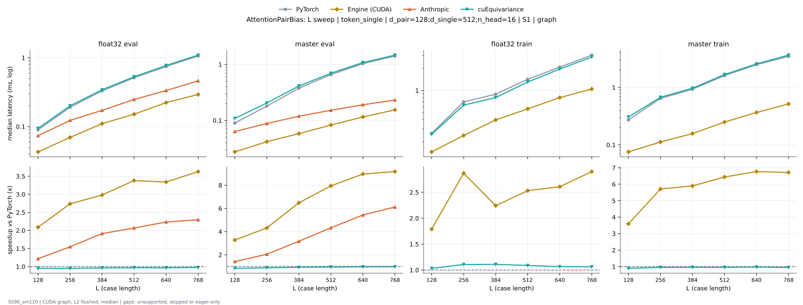

**float32 eval** (median ms; x = speedup vs PyTorch)

| L | PyTorch | Engine (Triton) | Engine (CUDA) | Anthropic | cuEquivariance |
|---|---|---|---|---|---|
| 128 | 0.08986 | 0.07578 (1.19x) | 0.04301 (2.09x) | 0.07382 (1.22x) | 0.0943 (0.95x) |
| 256 | 0.1906 | 0.1639 (1.16x) | 0.06963 (2.74x) | 0.1231 (1.55x) | 0.2007 (0.95x) |
| 384 | 0.3297 | 0.2908 (1.13x) | 0.1106 (2.98x) | 0.1723 (1.91x) | 0.343 (0.96x) |
| 512 | 0.5123 | 0.4588 (1.12x) | 0.1516 (3.38x) | 0.2478 (2.07x) | 0.5293 (0.97x) |
| 640 | 0.7457 | 0.684 (1.09x) | 0.2232 (3.34x) | 0.3338 (2.23x) | 0.7721 (0.97x) |
| 768 | 1.063 | 0.9421 (1.13x) | 0.2929 (3.63x) | 0.4628 (2.30x) | 1.091 (0.97x) |

**master eval** (median ms; x = speedup vs PyTorch)

| L | PyTorch | Engine (Triton) | Engine (CUDA) | Anthropic | cuEquivariance |
|---|---|---|---|---|---|
| 128 | 0.08974 | 0.0801 (1.12x) | 0.02742 (3.27x) | 0.06349 (1.41x) | 0.1086 (0.83x) |
| 256 | 0.1802 | 0.166 (1.09x) | 0.04174 (4.32x) | 0.08806 (2.05x) | 0.2052 (0.88x) |
| 384 | 0.3769 | 0.3564 (1.06x) | 0.05814 (6.48x) | 0.119 (3.17x) | 0.4113 (0.92x) |
| 512 | 0.6574 | 0.6291 (1.05x) | 0.08275 (7.94x) | 0.1518 (4.33x) | 0.6968 (0.94x) |
| 640 | 1.035 | 0.9943 (1.04x) | 0.1154 (8.97x) | 0.1904 (5.43x) | 1.079 (0.96x) |
| 768 | 1.416 | 1.369 (1.03x) | 0.1544 (9.18x) | 0.2314 (6.12x) | 1.468 (0.97x) |

**float32 train** (median ms; x = speedup vs PyTorch)

| L | PyTorch | Engine (Triton) | Engine (CUDA) | Anthropic | cuEquivariance |
|---|---|---|---|---|---|
| 128 | 0.2601 | 0.2468 (1.05x) | 0.1454 (1.79x) | unsupported | 0.252 (1.03x) |
| 256 | 0.6984 | 0.6257 (1.12x) | 0.2435 (2.87x) | unsupported | 0.6308 (1.11x) |
| 384 | 0.8895 | 0.7798 (1.14x) | 0.3967 (2.24x) | unsupported | 0.8016 (1.11x) |
| 512 | 1.421 | 1.277 (1.11x) | 0.5612 (2.53x) | unsupported | 1.306 (1.09x) |
| 640 | 2.084 | 1.912 (1.09x) | 0.7991 (2.61x) | unsupported | 1.957 (1.06x) |
| 768 | 3.036 | 2.627 (1.16x) | 1.047 (2.90x) | unsupported | 2.859 (1.06x) |

**master train** (median ms; x = speedup vs PyTorch)

| L | PyTorch | Engine (Triton) | Engine (CUDA) | Anthropic | cuEquivariance |
|---|---|---|---|---|---|
| 128 | 0.2724 | 0.2601 (1.05x) | 0.07578 (3.59x) | unsupported | 0.3051 (0.89x) |
| 256 | 0.6434 | 0.6167 (1.04x) | 0.1126 (5.71x) | unsupported | 0.6738 (0.95x) |
| 384 | 0.9303 | 0.8847 (1.05x) | 0.1577 (5.90x) | unsupported | 0.969 (0.96x) |
| 512 | 1.608 | 1.553 (1.04x) | 0.2499 (6.44x) | unsupported | 1.677 (0.96x) |
| 640 | 2.487 | 2.401 (1.04x) | 0.3676 (6.77x) | unsupported | 2.563 (0.97x) |
| 768 | 3.465 | 3.372 (1.03x) | 0.5161 (6.71x) | unsupported | 3.645 (0.95x) |

### L sweep: token_single | d_pair=256;d_single=384;gate_bias=1.0;n_head=16 | S1 | graph

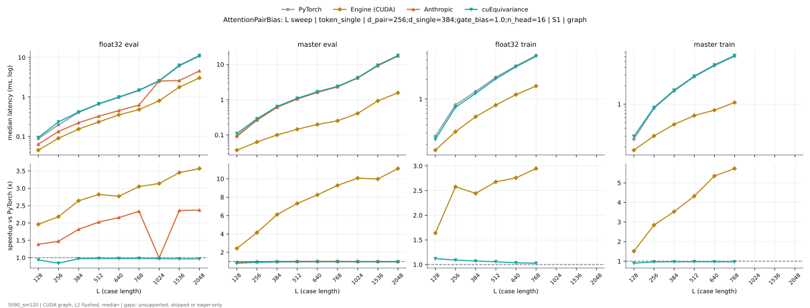

**float32 eval** (median ms; x = speedup vs PyTorch)

| L | PyTorch | Engine (Triton) | Engine (CUDA) | Anthropic | cuEquivariance |
|---|---|---|---|---|---|
| 128 | 0.08832 | 0.07645 (1.16x) | 0.04506 (1.96x) | 0.06374 (1.39x) | 0.09445 (0.94x) |
| 256 | 0.1967 | 0.2007 (0.98x) | 0.09011 (2.18x) | 0.1335 (1.47x) | 0.2339 (0.84x) |
| 384 | 0.4055 | 0.3686 (1.10x) | 0.1536 (2.64x) | 0.2232 (1.82x) | 0.4178 (0.97x) |
| 512 | 0.6592 | 0.6103 (1.08x) | 0.2336 (2.82x) | 0.3254 (2.03x) | 0.6747 (0.98x) |
| 640 | 0.9759 | 0.9472 (1.03x) | 0.3523 (2.77x) | 0.4526 (2.16x) | 0.9986 (0.98x) |
| 768 | 1.462 | 1.353 (1.08x) | 0.4792 (3.05x) | 0.6257 (2.34x) | 1.491 (0.98x) |
| 1024 | 2.512 | 2.354 (1.07x) | 0.8008 (3.14x) | 2.528 (0.99x) | 2.582 (0.97x) |
| 1536 | 6.125 | 5.814 (1.05x) | 1.775 (3.45x) | 2.598 (2.36x) | 6.34 (0.97x) |
| 2048 | 10.84 | 10.13 (1.07x) | 3.037 (3.57x) | 4.567 (2.37x) | 11.2 (0.97x) |

**master eval** (median ms; x = speedup vs PyTorch)

| L | PyTorch | Engine (Triton) | Engine (CUDA) | Anthropic | cuEquivariance |
|---|---|---|---|---|---|
| 128 | 0.09011 | 0.08419 (1.07x) | 0.03715 (2.43x) | 0.09616 (0.94x) | 0.1106 (0.81x) |
| 256 | 0.2622 | 0.2501 (1.05x) | 0.06323 (4.15x) | 0.2663 (0.98x) | 0.289 (0.91x) |
| 384 | 0.6124 | 0.5939 (1.03x) | 0.1003 (6.11x) | 0.6154 (1.00x) | 0.6429 (0.95x) |
| 512 | 1.064 | 1.038 (1.03x) | 0.1454 (7.31x) | 1.049 (1.01x) | 1.099 (0.97x) |
| 640 | 1.638 | 1.605 (1.02x) | 0.1987 (8.25x) | 1.621 (1.01x) | 1.678 (0.98x) |
| 768 | 2.338 | 2.295 (1.02x) | 0.2519 (9.28x) | 2.315 (1.01x) | 2.387 (0.98x) |
| 1024 | 4.118 | 4.065 (1.01x) | 0.409 (10.07x) | 4.133 (1.00x) | 4.207 (0.98x) |
| 1536 | 9.242 | 9.143 (1.01x) | 0.927 (9.97x) | 9.228 (1.00x) | 9.533 (0.97x) |
| 2048 | 17.37 | 17.11 (1.01x) | 1.563 (11.11x) | 17.46 (0.99x) | 17.9 (0.97x) |

**float32 train** (median ms; x = speedup vs PyTorch)

| L | PyTorch | Engine (Triton) | Engine (CUDA) | Anthropic | cuEquivariance |
|---|---|---|---|---|---|
| 128 | 0.2683 | 0.2478 (1.08x) | 0.1639 (1.64x) | unsupported | 0.2396 (1.12x) |
| 256 | 0.8131 | 0.7649 (1.06x) | 0.3156 (2.58x) | unsupported | 0.7455 (1.09x) |
| 384 | 1.306 | 1.233 (1.06x) | 0.5345 (2.44x) | unsupported | 1.22 (1.07x) |
| 512 | 2.158 | 2.053 (1.05x) | 0.8059 (2.68x) | unsupported | 2.041 (1.06x) |
| 640 | 3.226 | 3.077 (1.05x) | 1.17 (2.76x) | unsupported | 3.115 (1.04x) |
| 768 | 4.663 | 4.334 (1.08x) | 1.582 (2.95x) | unsupported | 4.541 (1.03x) |
| 1024 |  |  |  |  |  |
| 1536 |  |  |  |  |  |
| 2048 |  |  |  |  |  |

**master train** (median ms; x = speedup vs PyTorch)

| L | PyTorch | Engine (Triton) | Engine (CUDA) | Anthropic | cuEquivariance |
|---|---|---|---|---|---|
| 128 | 0.2665 | 0.2601 (1.02x) | 0.1761 (1.51x) | unsupported | 0.297 (0.90x) |
| 256 | 0.8563 | 0.8333 (1.03x) | 0.3012 (2.84x) | unsupported | 0.8857 (0.97x) |
| 384 | 1.644 | 1.611 (1.02x) | 0.4652 (3.53x) | unsupported | 1.695 (0.97x) |
| 512 | 2.811 | 2.752 (1.02x) | 0.6502 (4.32x) | unsupported | 2.878 (0.98x) |
| 640 | 4.26 | 4.231 (1.01x) | 0.7967 (5.35x) | unsupported | 4.397 (0.97x) |
| 768 | 6.095 | 6.035 (1.01x) | 1.064 (5.73x) | unsupported | 6.272 (0.97x) |
| 1024 |  |  |  |  |  |
| 1536 |  |  |  |  |  |
| 2048 |  |  |  |  |  |

### L sweep: token_single | d_pair=256;d_single=384;n_head=16 | S1 | graph

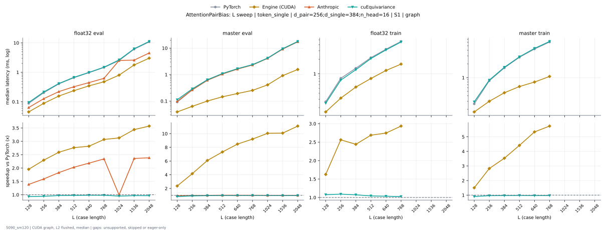

**float32 eval** (median ms; x = speedup vs PyTorch)

| L | PyTorch | Engine (Triton) | Engine (CUDA) | Anthropic | cuEquivariance |
|---|---|---|---|---|---|
| 128 | 0.08806 | 0.07987 (1.10x) | 0.04506 (1.95x) | 0.06349 (1.39x) | 0.09446 (0.93x) |
| 256 | 0.2022 | 0.2005 (1.01x) | 0.08806 (2.30x) | 0.127 (1.59x) | 0.2146 (0.94x) |
| 384 | 0.4042 | 0.3686 (1.10x) | 0.156 (2.59x) | 0.2209 (1.83x) | 0.4164 (0.97x) |
| 512 | 0.6576 | 0.6084 (1.08x) | 0.238 (2.76x) | 0.3237 (2.03x) | 0.6741 (0.98x) |
| 640 | 0.9751 | 0.9085 (1.07x) | 0.3461 (2.82x) | 0.4465 (2.18x) | 0.9931 (0.98x) |
| 768 | 1.464 | 1.356 (1.08x) | 0.4769 (3.07x) | 0.6249 (2.34x) | 1.493 (0.98x) |
| 1024 | 2.512 | 2.356 (1.07x) | 0.8028 (3.13x) | 2.528 (0.99x) | 2.643 (0.95x) |
| 1536 | 6.119 | 5.754 (1.06x) | 1.779 (3.44x) | 2.594 (2.36x) | 6.329 (0.97x) |
| 2048 | 10.83 | 10.13 (1.07x) | 3.032 (3.57x) | 4.541 (2.39x) | 11.21 (0.97x) |

**master eval** (median ms; x = speedup vs PyTorch)

| L | PyTorch | Engine (Triton) | Engine (CUDA) | Anthropic | cuEquivariance |
|---|---|---|---|---|---|
| 128 | 0.09216 | 0.08627 (1.07x) | 0.03901 (2.36x) | 0.09821 (0.94x) | 0.1126 (0.82x) |
| 256 | 0.2634 | 0.2516 (1.05x) | 0.06336 (4.16x) | 0.2661 (0.99x) | 0.2888 (0.91x) |
| 384 | 0.6103 | 0.5923 (1.03x) | 0.1004 (6.08x) | 0.6144 (0.99x) | 0.639 (0.96x) |
| 512 | 1.065 | 1.038 (1.03x) | 0.1454 (7.32x) | 1.05 (1.01x) | 1.097 (0.97x) |
| 640 | 1.637 | 1.603 (1.02x) | 0.1932 (8.48x) | 1.621 (1.01x) | 1.678 (0.98x) |
| 768 | 2.338 | 2.295 (1.02x) | 0.2539 (9.21x) | 2.315 (1.01x) | 2.383 (0.98x) |
| 1024 | 4.118 | 4.059 (1.01x) | 0.4096 (10.05x) | 4.135 (1.00x) | 4.2 (0.98x) |
| 1536 | 9.231 | 9.144 (1.01x) | 0.9162 (10.07x) | 9.227 (1.00x) | 9.523 (0.97x) |
| 2048 | 17.36 | 17.11 (1.01x) | 1.564 (11.10x) | 17.45 (1.00x) | 17.9 (0.97x) |

**float32 train** (median ms; x = speedup vs PyTorch)

| L | PyTorch | Engine (Triton) | Engine (CUDA) | Anthropic | cuEquivariance |
|---|---|---|---|---|---|
| 128 | 0.2662 | 0.2437 (1.09x) | 0.1638 (1.63x) | unsupported | 0.2474 (1.08x) |
| 256 | 0.8084 | 0.7615 (1.06x) | 0.3154 (2.56x) | unsupported | 0.7414 (1.09x) |
| 384 | 1.304 | 1.232 (1.06x) | 0.5342 (2.44x) | unsupported | 1.216 (1.07x) |
| 512 | 2.156 | 2.047 (1.05x) | 0.8018 (2.69x) | unsupported | 2.066 (1.04x) |
| 640 | 3.222 | 3.073 (1.05x) | 1.173 (2.75x) | unsupported | 3.115 (1.03x) |
| 768 | 4.662 | 4.329 (1.08x) | 1.588 (2.94x) | unsupported | 4.549 (1.02x) |
| 1024 |  |  |  |  |  |
| 1536 |  |  |  |  |  |
| 2048 |  |  |  |  |  |

**master train** (median ms; x = speedup vs PyTorch)

| L | PyTorch | Engine (Triton) | Engine (CUDA) | Anthropic | cuEquivariance |
|---|---|---|---|---|---|
| 128 | 0.2642 | 0.258 (1.02x) | 0.1757 (1.50x) | unsupported | 0.2929 (0.90x) |
| 256 | 0.8519 | 0.834 (1.02x) | 0.3014 (2.83x) | unsupported | 0.8831 (0.96x) |
| 384 | 1.641 | 1.607 (1.02x) | 0.4645 (3.53x) | unsupported | 1.692 (0.97x) |
| 512 | 2.809 | 2.749 (1.02x) | 0.6366 (4.41x) | unsupported | 2.872 (0.98x) |
| 640 | 4.262 | 4.229 (1.01x) | 0.7987 (5.34x) | unsupported | 4.399 (0.97x) |
| 768 | 6.091 | 6.028 (1.01x) | 1.062 (5.74x) | unsupported | 6.268 (0.97x) |
| 1024 |  |  |  |  |  |
| 1536 |  |  |  |  |  |
| 2048 |  |  |  |  |  |

### L sweep: token_single | d_pair=384;d_single=384;n_head=16 | S1 | graph

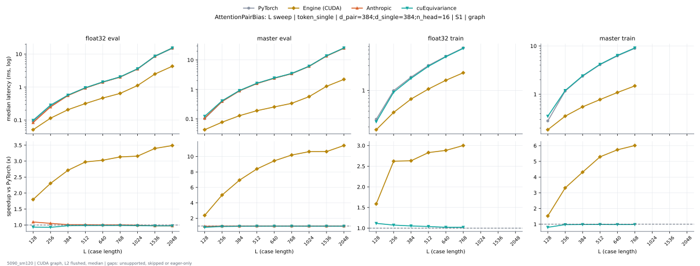

**float32 eval** (median ms; x = speedup vs PyTorch)

| L | PyTorch | Engine (Triton) | Engine (CUDA) | Anthropic | cuEquivariance |
|---|---|---|---|---|---|
| 128 | 0.09216 | 0.08163 (1.13x) | 0.05123 (1.80x) | 0.08422 (1.09x) | 0.09856 (0.94x) |
| 256 | 0.2642 | 0.2519 (1.05x) | 0.1147 (2.30x) | 0.2511 (1.05x) | 0.2848 (0.93x) |
| 384 | 0.5611 | 0.5245 (1.07x) | 0.2068 (2.71x) | 0.5549 (1.01x) | 0.5734 (0.98x) |
| 512 | 0.9439 | 0.8929 (1.06x) | 0.3174 (2.97x) | 0.9349 (1.01x) | 0.9596 (0.98x) |
| 640 | 1.414 | 1.353 (1.04x) | 0.4669 (3.03x) | 1.409 (1.00x) | 1.436 (0.98x) |
| 768 | 2.02 | 1.919 (1.05x) | 0.6451 (3.13x) | 2.012 (1.00x) | 2.049 (0.99x) |
| 1024 | 3.526 | 3.373 (1.05x) | 1.117 (3.16x) | 3.547 (0.99x) | 3.601 (0.98x) |
| 1536 | 8.465 | 8.098 (1.05x) | 2.491 (3.40x) | 8.685 (0.97x) | 8.675 (0.98x) |
| 2048 | 14.97 | 14.28 (1.05x) | 4.293 (3.49x) | 15.37 (0.97x) | 15.34 (0.98x) |

**master eval** (median ms; x = speedup vs PyTorch)

| L | PyTorch | Engine (Triton) | Engine (CUDA) | Anthropic | cuEquivariance |
|---|---|---|---|---|---|
| 128 | 0.1024 | 0.09626 (1.06x) | 0.04306 (2.38x) | 0.1073 (0.95x) | 0.1229 (0.83x) |
| 256 | 0.3887 | 0.3769 (1.03x) | 0.07754 (5.01x) | 0.3923 (0.99x) | 0.4137 (0.94x) |
| 384 | 0.895 | 0.8776 (1.02x) | 0.129 (6.94x) | 0.8992 (1.00x) | 0.9244 (0.97x) |
| 512 | 1.599 | 1.57 (1.02x) | 0.1904 (8.39x) | 1.585 (1.01x) | 1.629 (0.98x) |
| 640 | 2.412 | 2.383 (1.01x) | 0.2553 (9.45x) | 2.399 (1.01x) | 2.45 (0.98x) |
| 768 | 3.445 | 3.41 (1.01x) | 0.338 (10.19x) | 3.43 (1.00x) | 3.501 (0.98x) |
| 1024 | 6.067 | 6.01 (1.01x) | 0.5708 (10.63x) | 6.084 (1.00x) | 6.176 (0.98x) |
| 1536 | 13.6 | 13.51 (1.01x) | 1.278 (10.64x) | 13.6 (1.00x) | 13.9 (0.98x) |
| 2048 | 25.09 | 24.85 (1.01x) | 2.197 (11.42x) | 25.17 (1.00x) | 25.64 (0.98x) |

**float32 train** (median ms; x = speedup vs PyTorch)

| L | PyTorch | Engine (Triton) | Engine (CUDA) | Anthropic | cuEquivariance |
|---|---|---|---|---|---|
| 128 | 0.2788 | 0.2472 (1.13x) | 0.1757 (1.59x) | unsupported | 0.2501 (1.11x) |
| 256 | 0.9905 | 0.9267 (1.07x) | 0.3779 (2.62x) | unsupported | 0.9227 (1.07x) |
| 384 | 1.795 | 1.707 (1.05x) | 0.682 (2.63x) | unsupported | 1.704 (1.05x) |
| 512 | 3.012 | 2.877 (1.05x) | 1.064 (2.83x) | unsupported | 2.899 (1.04x) |
| 640 | 4.51 | 4.381 (1.03x) | 1.564 (2.88x) | unsupported | 4.42 (1.02x) |
| 768 | 6.538 | 6.209 (1.05x) | 2.178 (3.00x) | unsupported | 6.413 (1.02x) |
| 1024 |  |  |  |  |  |
| 1536 |  |  |  |  |  |
| 2048 |  |  |  |  |  |

**master train** (median ms; x = speedup vs PyTorch)

| L | PyTorch | Engine (Triton) | Engine (CUDA) | Anthropic | cuEquivariance |
|---|---|---|---|---|---|
| 128 | 0.2809 | 0.3096 (0.91x) | 0.1843 (1.52x) | unsupported | 0.3502 (0.80x) |
| 256 | 1.166 | 1.145 (1.02x) | 0.3523 (3.31x) | unsupported | 1.197 (0.97x) |
| 384 | 2.368 | 2.328 (1.02x) | 0.5488 (4.31x) | unsupported | 2.414 (0.98x) |
| 512 | 4.105 | 4.063 (1.01x) | 0.7762 (5.29x) | unsupported | 4.175 (0.98x) |
| 640 | 6.245 | 6.218 (1.00x) | 1.089 (5.74x) | unsupported | 6.381 (0.98x) |
| 768 | 8.956 | 8.897 (1.01x) | 1.49 (6.01x) | unsupported | 9.124 (0.98x) |
| 1024 |  |  |  |  |  |
| 1536 |  |  |  |  |  |
| 2048 |  |  |  |  |  |

### L sweep: token_single | d_pair=384;d_single=384;n_head=8 | S1 | graph

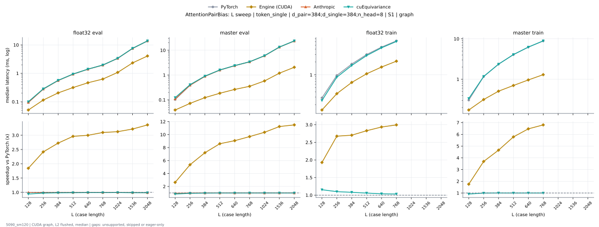

**float32 eval** (median ms; x = speedup vs PyTorch)

| L | PyTorch | Engine (Triton) | Engine (CUDA) | Anthropic | cuEquivariance |
|---|---|---|---|---|---|
| 128 | 0.09448 | 0.07962 (1.19x) | 0.05123 (1.84x) | 0.0949 (1.00x) | 0.1004 (0.94x) |
| 256 | 0.2771 | 0.2457 (1.13x) | 0.1147 (2.42x) | 0.2786 (0.99x) | 0.2847 (0.97x) |
| 384 | 0.558 | 0.5114 (1.09x) | 0.2048 (2.72x) | 0.5593 (1.00x) | 0.5673 (0.98x) |
| 512 | 0.934 | 0.8744 (1.07x) | 0.3154 (2.96x) | 0.937 (1.00x) | 0.9459 (0.99x) |
| 640 | 1.397 | 1.324 (1.05x) | 0.4659 (3.00x) | 1.4 (1.00x) | 1.409 (0.99x) |
| 768 | 1.947 | 1.867 (1.04x) | 0.6287 (3.10x) | 1.955 (1.00x) | 1.965 (0.99x) |
| 1024 | 3.37 | 3.263 (1.03x) | 1.079 (3.12x) | 3.383 (1.00x) | 3.395 (0.99x) |
| 1536 | 7.514 | 7.277 (1.03x) | 2.336 (3.22x) | 7.564 (0.99x) | 7.62 (0.99x) |
| 2048 | 13.73 | 13.34 (1.03x) | 4.084 (3.36x) | 13.9 (0.99x) | 13.92 (0.99x) |

**master eval** (median ms; x = speedup vs PyTorch)

| L | PyTorch | Engine (Triton) | Engine (CUDA) | Anthropic | cuEquivariance |
|---|---|---|---|---|---|
| 128 | 0.1024 | 0.1024 (1.00x) | 0.03891 (2.63x) | 0.1085 (0.94x) | 0.1228 (0.83x) |
| 256 | 0.385 | 0.3717 (1.04x) | 0.07194 (5.35x) | 0.3891 (0.99x) | 0.4096 (0.94x) |
| 384 | 0.8848 | 0.8632 (1.02x) | 0.1228 (7.21x) | 0.8872 (1.00x) | 0.909 (0.97x) |
| 512 | 1.584 | 1.551 (1.02x) | 0.1844 (8.59x) | 1.591 (1.00x) | 1.606 (0.99x) |
| 640 | 2.385 | 2.354 (1.01x) | 0.2631 (9.06x) | 2.389 (1.00x) | 2.412 (0.99x) |
| 768 | 3.404 | 3.367 (1.01x) | 0.3512 (9.69x) | 3.412 (1.00x) | 3.436 (0.99x) |
| 1024 | 5.985 | 5.936 (1.01x) | 0.5779 (10.36x) | 5.997 (1.00x) | 6.03 (0.99x) |
| 1536 | 13.38 | 13.3 (1.01x) | 1.19 (11.24x) | 13.39 (1.00x) | 13.5 (0.99x) |
| 2048 | 23.67 | 23.51 (1.01x) | 2.059 (11.50x) | 23.7 (1.00x) | 23.92 (0.99x) |

**float32 train** (median ms; x = speedup vs PyTorch)

| L | PyTorch | Engine (Triton) | Engine (CUDA) | Anthropic | cuEquivariance |
|---|---|---|---|---|---|
| 128 | 0.2888 | 0.2642 (1.09x) | 0.1498 (1.93x) | unsupported | 0.2503 (1.15x) |
| 256 | 0.9697 | 0.8888 (1.09x) | 0.3625 (2.68x) | unsupported | 0.8817 (1.10x) |
| 384 | 1.793 | 1.67 (1.07x) | 0.6635 (2.70x) | unsupported | 1.659 (1.08x) |
| 512 | 3 | 2.837 (1.06x) | 1.06 (2.83x) | unsupported | 2.831 (1.06x) |
| 640 | 4.475 | 4.313 (1.04x) | 1.525 (2.93x) | unsupported | 4.307 (1.04x) |
| 768 | 6.272 | 6.069 (1.03x) | 2.094 (3.00x) | unsupported | 6.076 (1.03x) |
| 1024 |  |  |  |  |  |
| 1536 |  |  |  |  |  |
| 2048 |  |  |  |  |  |

**master train** (median ms; x = speedup vs PyTorch)

| L | PyTorch | Engine (Triton) | Engine (CUDA) | Anthropic | cuEquivariance |
|---|---|---|---|---|---|
| 128 | 0.3052 | 0.297 (1.03x) | 0.1741 (1.75x) | unsupported | 0.3338 (0.91x) |
| 256 | 1.164 | 1.109 (1.05x) | 0.3154 (3.69x) | unsupported | 1.175 (0.99x) |
| 384 | 2.365 | 2.321 (1.02x) | 0.5079 (4.66x) | unsupported | 2.364 (1.00x) |
| 512 | 4.065 | 4.03 (1.01x) | 0.7024 (5.79x) | unsupported | 4.084 (1.00x) |
| 640 | 6.236 | 6.163 (1.01x) | 0.9632 (6.47x) | unsupported | 6.248 (1.00x) |
| 768 | 8.859 | 8.808 (1.01x) | 1.301 (6.81x) | unsupported | 8.902 (1.00x) |
| 1024 |  |  |  |  |  |
| 1536 |  |  |  |  |  |
| 2048 |  |  |  |  |  |

### L sweep: token_single | d_pair=512;d_single=384;n_head=16 | S1 | graph

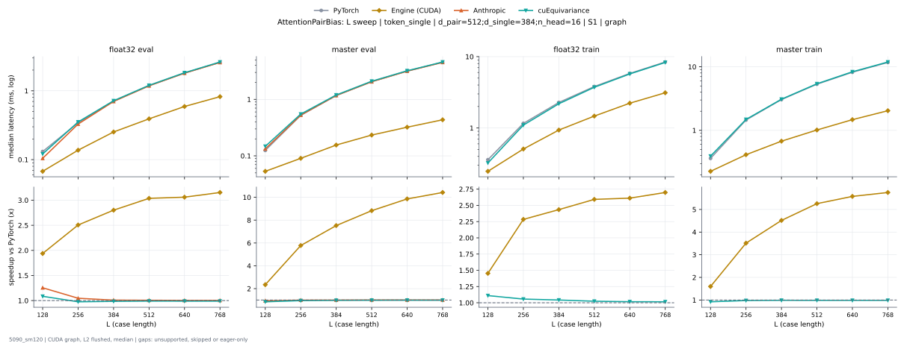

**float32 eval** (median ms; x = speedup vs PyTorch)

| L | PyTorch | Engine (Triton) | Engine (CUDA) | Anthropic | cuEquivariance |
|---|---|---|---|---|---|
| 128 | 0.1311 | 0.1004 (1.31x) | 0.06763 (1.94x) | 0.1044 (1.25x) | 0.1208 (1.08x) |
| 256 | 0.3438 | 0.3201 (1.07x) | 0.1372 (2.51x) | 0.3287 (1.05x) | 0.3524 (0.98x) |
| 384 | 0.7067 | 0.6698 (1.05x) | 0.2523 (2.80x) | 0.7004 (1.01x) | 0.7178 (0.98x) |
| 512 | 1.189 | 1.143 (1.04x) | 0.3914 (3.04x) | 1.182 (1.01x) | 1.201 (0.99x) |
| 640 | 1.811 | 1.753 (1.03x) | 0.5919 (3.06x) | 1.805 (1.00x) | 1.832 (0.99x) |
| 768 | 2.593 | 2.493 (1.04x) | 0.8223 (3.15x) | 2.584 (1.00x) | 2.623 (0.99x) |

**master eval** (median ms; x = speedup vs PyTorch)

| L | PyTorch | Engine (Triton) | Engine (CUDA) | Anthropic | cuEquivariance |
|---|---|---|---|---|---|
| 128 | 0.1249 | 0.1187 (1.05x) | 0.05325 (2.35x) | 0.133 (0.94x) | 0.1475 (0.85x) |
| 256 | 0.522 | 0.5102 (1.02x) | 0.09037 (5.78x) | 0.5261 (0.99x) | 0.5489 (0.95x) |
| 384 | 1.169 | 1.15 (1.02x) | 0.1554 (7.52x) | 1.173 (1.00x) | 1.196 (0.98x) |
| 512 | 2.062 | 2.041 (1.01x) | 0.2335 (8.83x) | 2.053 (1.00x) | 2.097 (0.98x) |
| 640 | 3.17 | 3.145 (1.01x) | 0.3216 (9.86x) | 3.159 (1.00x) | 3.211 (0.99x) |
| 768 | 4.536 | 4.5 (1.01x) | 0.4352 (10.42x) | 4.522 (1.00x) | 4.591 (0.99x) |

**float32 train** (median ms; x = speedup vs PyTorch)

| L | PyTorch | Engine (Triton) | Engine (CUDA) | Anthropic | cuEquivariance |
|---|---|---|---|---|---|
| 128 | 0.3592 | 0.3133 (1.15x) | 0.2473 (1.45x) | unsupported | 0.3236 (1.11x) |
| 256 | 1.16 | 1.095 (1.06x) | 0.5079 (2.28x) | unsupported | 1.098 (1.06x) |
| 384 | 2.279 | 2.182 (1.04x) | 0.9359 (2.43x) | unsupported | 2.187 (1.04x) |
| 512 | 3.809 | 3.704 (1.03x) | 1.469 (2.59x) | unsupported | 3.721 (1.02x) |
| 640 | 5.815 | 5.68 (1.02x) | 2.227 (2.61x) | unsupported | 5.723 (1.02x) |
| 768 | 8.413 | 8.077 (1.04x) | 3.117 (2.70x) | unsupported | 8.29 (1.01x) |

**master train** (median ms; x = speedup vs PyTorch)

| L | PyTorch | Engine (Triton) | Engine (CUDA) | Anthropic | cuEquivariance |
|---|---|---|---|---|---|
| 128 | 0.3625 | 0.3523 (1.03x) | 0.2268 (1.60x) | unsupported | 0.3932 (0.92x) |
| 256 | 1.453 | 1.428 (1.02x) | 0.4137 (3.51x) | unsupported | 1.485 (0.98x) |
| 384 | 3.052 | 3.021 (1.01x) | 0.6758 (4.52x) | unsupported | 3.09 (0.99x) |
| 512 | 5.326 | 5.272 (1.01x) | 1.013 (5.26x) | unsupported | 5.406 (0.99x) |
| 640 | 8.215 | 8.147 (1.01x) | 1.473 (5.58x) | unsupported | 8.344 (0.98x) |
| 768 | 11.71 | 11.65 (1.01x) | 2.037 (5.75x) | unsupported | 11.89 (0.98x) |

### L sweep: token_single_extra_bias | d_pair=384;d_single=384;n_head=8 | S1 | graph

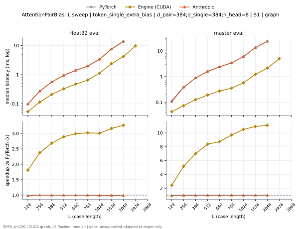

**float32 eval** (median ms; x = speedup vs PyTorch)

| L | PyTorch | Engine (Triton) | Engine (CUDA) | Anthropic | cuEquivariance |
|---|---|---|---|---|---|
| 128 | 0.09626 | 0.08218 (1.17x) | 0.05325 (1.81x) | 0.09821 (0.98x) | unsupported |
| 256 | 0.2725 | 0.244 (1.12x) | 0.1147 (2.38x) | 0.2724 (1.00x) | unsupported |
| 384 | 0.5612 | 0.5156 (1.09x) | 0.2089 (2.69x) | 0.5632 (1.00x) | unsupported |
| 512 | 0.9422 | 0.8839 (1.07x) | 0.3256 (2.89x) | 0.9443 (1.00x) | unsupported |
| 640 | 1.41 | 1.336 (1.05x) | 0.4711 (2.99x) | 1.412 (1.00x) | unsupported |
| 768 | 1.959 | 1.877 (1.04x) | 0.6484 (3.02x) | 1.967 (1.00x) | unsupported |
| 1024 | 3.382 | 3.274 (1.03x) | 1.125 (3.01x) | 3.403 (0.99x) | unsupported |
| 1536 | 7.571 | 7.323 (1.03x) | 2.393 (3.16x) | 7.655 (0.99x) | unsupported |
| 2048 | 13.84 | 13.45 (1.03x) | 4.239 (3.27x) | 14.11 (0.98x) | unsupported |
| 2976 | skipped | skipped | 9.755 | skipped | unsupported |
| 3968 | skipped | skipped | skipped | skipped | skipped |

**master eval** (median ms; x = speedup vs PyTorch)

| L | PyTorch | Engine (Triton) | Engine (CUDA) | Anthropic | cuEquivariance |
|---|---|---|---|---|---|
| 128 | 0.1044 | 0.1003 (1.04x) | 0.04301 (2.43x) | 0.1126 (0.93x) | unsupported |
| 256 | 0.383 | 0.3741 (1.02x) | 0.07373 (5.19x) | 0.3912 (0.98x) | unsupported |
| 384 | 0.8891 | 0.8686 (1.02x) | 0.1269 (7.01x) | 0.8912 (1.00x) | unsupported |
| 512 | 1.596 | 1.562 (1.02x) | 0.1909 (8.36x) | 1.601 (1.00x) | unsupported |
| 640 | 2.397 | 2.363 (1.01x) | 0.2744 (8.74x) | 2.401 (1.00x) | unsupported |
| 768 | 3.414 | 3.378 (1.01x) | 0.3522 (9.69x) | 3.418 (1.00x) | unsupported |
| 1024 | 5.999 | 5.949 (1.01x) | 0.5714 (10.50x) | 6.008 (1.00x) | unsupported |
| 1536 | 13.41 | 13.32 (1.01x) | 1.227 (10.93x) | 13.43 (1.00x) | unsupported |
| 2048 | 23.74 | 23.58 (1.01x) | 2.139 (11.10x) | 23.79 (1.00x) | unsupported |
| 2976 | skipped | skipped | 4.962 | skipped | unsupported |
| 3968 | skipped | skipped | skipped | skipped | skipped |

### d_pair sweep at L768: token_single | - | S1 | graph

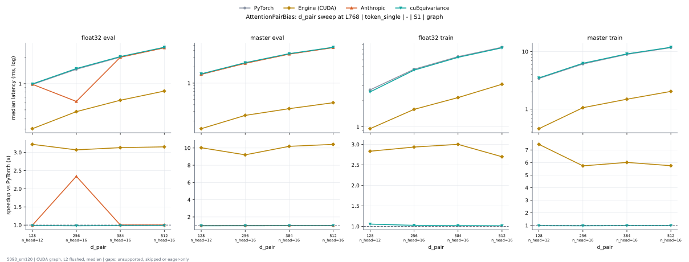

**float32 eval** (median ms; x = speedup vs PyTorch)

| d_pair | PyTorch | Engine (Triton) | Engine (CUDA) | Anthropic | cuEquivariance |
|---|---|---|---|---|---|
| 128 n_head=12 | 0.9789 | 0.8817 (1.11x) | 0.3038 (3.22x) | 0.984 (0.99x) | 0.9925 (0.99x) |
| 256 n_head=16 | 1.464 | 1.356 (1.08x) | 0.4769 (3.07x) | 0.6249 (2.34x) | 1.493 (0.98x) |
| 384 n_head=16 | 2.02 | 1.919 (1.05x) | 0.6451 (3.13x) | 2.012 (1.00x) | 2.049 (0.99x) |
| 512 n_head=16 | 2.593 | 2.493 (1.04x) | 0.8223 (3.15x) | 2.584 (1.00x) | 2.623 (0.99x) |

**master eval** (median ms; x = speedup vs PyTorch)

| d_pair | PyTorch | Engine (Triton) | Engine (CUDA) | Anthropic | cuEquivariance |
|---|---|---|---|---|---|
| 128 n_head=12 | 1.448 | 1.383 (1.05x) | 0.1444 (10.03x) | 1.455 (1.00x) | 1.484 (0.98x) |
| 256 n_head=16 | 2.338 | 2.295 (1.02x) | 0.2539 (9.21x) | 2.315 (1.01x) | 2.383 (0.98x) |
| 384 n_head=16 | 3.445 | 3.41 (1.01x) | 0.338 (10.19x) | 3.43 (1.00x) | 3.501 (0.98x) |
| 512 n_head=16 | 4.536 | 4.5 (1.01x) | 0.4352 (10.42x) | 4.522 (1.00x) | 4.591 (0.99x) |

**float32 train** (median ms; x = speedup vs PyTorch)

| d_pair | PyTorch | Engine (Triton) | Engine (CUDA) | Anthropic | cuEquivariance |
|---|---|---|---|---|---|
| 128 n_head=12 | 2.678 | 2.55 (1.05x) | 0.9452 (2.83x) | unsupported | 2.537 (1.06x) |
| 256 n_head=16 | 4.662 | 4.329 (1.08x) | 1.588 (2.94x) | unsupported | 4.549 (1.02x) |
| 384 n_head=16 | 6.538 | 6.209 (1.05x) | 2.178 (3.00x) | unsupported | 6.413 (1.02x) |
| 512 n_head=16 | 8.413 | 8.077 (1.04x) | 3.117 (2.70x) | unsupported | 8.29 (1.01x) |

**master train** (median ms; x = speedup vs PyTorch)

| d_pair | PyTorch | Engine (Triton) | Engine (CUDA) | Anthropic | cuEquivariance |
|---|---|---|---|---|---|
| 128 n_head=12 | 3.416 | 3.289 (1.04x) | 0.4588 (7.45x) | unsupported | 3.493 (0.98x) |
| 256 n_head=16 | 6.091 | 6.028 (1.01x) | 1.062 (5.74x) | unsupported | 6.268 (0.97x) |
| 384 n_head=16 | 8.956 | 8.897 (1.01x) | 1.49 (6.01x) | unsupported | 9.124 (0.98x) |
| 512 n_head=16 | 11.71 | 11.65 (1.01x) | 2.037 (5.75x) | unsupported | 11.89 (0.98x) |

### n_head sweep at L768: token_single | - | S1 | graph

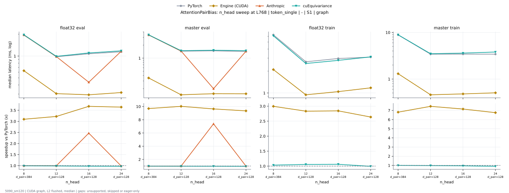

**float32 eval** (median ms; x = speedup vs PyTorch)

| n_head | PyTorch | Engine (Triton) | Engine (CUDA) | Anthropic | cuEquivariance |
|---|---|---|---|---|---|
| 8 d_pair=384 | 1.947 | 1.867 (1.04x) | 0.6287 (3.10x) | 1.955 (1.00x) | 1.965 (0.99x) |
| 12 d_pair=128 | 0.9789 | 0.8817 (1.11x) | 0.3038 (3.22x) | 0.984 (0.99x) | 0.9925 (0.99x) |
| 16 d_pair=128 | 1.077 | 0.9617 (1.12x) | 0.2928 (3.68x) | 0.4365 (2.47x) | 1.105 (0.97x) |
| 24 d_pair=128 | 1.146 | 0.9853 (1.16x) | 0.3145 (3.64x) | 1.166 (0.98x) | 1.182 (0.97x) |

**master eval** (median ms; x = speedup vs PyTorch)

| n_head | PyTorch | Engine (Triton) | Engine (CUDA) | Anthropic | cuEquivariance |
|---|---|---|---|---|---|
| 8 d_pair=384 | 3.404 | 3.367 (1.01x) | 0.3512 (9.69x) | 3.412 (1.00x) | 3.436 (0.99x) |
| 12 d_pair=128 | 1.448 | 1.383 (1.05x) | 0.1444 (10.03x) | 1.455 (1.00x) | 1.484 (0.98x) |
| 16 d_pair=128 | 1.474 | 1.424 (1.03x) | 0.153 (9.64x) | 0.1997 (7.38x) | 1.521 (0.97x) |
| 24 d_pair=128 | 1.424 | 1.369 (1.04x) | 0.1524 (9.34x) | 1.441 (0.99x) | 1.486 (0.96x) |

**float32 train** (median ms; x = speedup vs PyTorch)

| n_head | PyTorch | Engine (Triton) | Engine (CUDA) | Anthropic | cuEquivariance |
|---|---|---|---|---|---|
| 8 d_pair=384 | 6.272 | 6.069 (1.03x) | 2.094 (3.00x) | unsupported | 6.076 (1.03x) |
| 12 d_pair=128 | 2.678 | 2.55 (1.05x) | 0.9452 (2.83x) | unsupported | 2.537 (1.06x) |
| 16 d_pair=128 | 2.97 | 2.582 (1.15x) | 1.044 (2.84x) | unsupported | 2.801 (1.06x) |
| 24 d_pair=128 | 3.105 | 2.656 (1.17x) | 1.177 (2.64x) | unsupported | 3.126 (0.99x) |

**master train** (median ms; x = speedup vs PyTorch)

| n_head | PyTorch | Engine (Triton) | Engine (CUDA) | Anthropic | cuEquivariance |
|---|---|---|---|---|---|
| 8 d_pair=384 | 8.859 | 8.808 (1.01x) | 1.301 (6.81x) | unsupported | 8.902 (1.00x) |
| 12 d_pair=128 | 3.416 | 3.289 (1.04x) | 0.4588 (7.45x) | unsupported | 3.493 (0.98x) |
| 16 d_pair=128 | 3.427 | 3.363 (1.02x) | 0.4793 (7.15x) | unsupported | 3.601 (0.95x) |
| 24 d_pair=128 | 3.417 | 3.422 (1.00x) | 0.5058 (6.76x) | unsupported | 3.799 (0.90x) |

