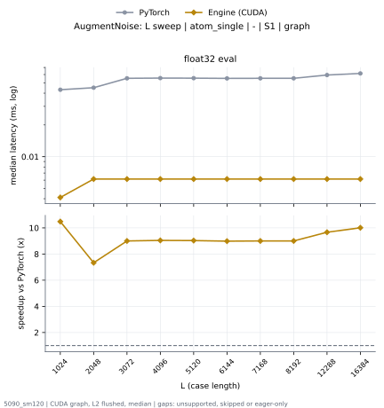
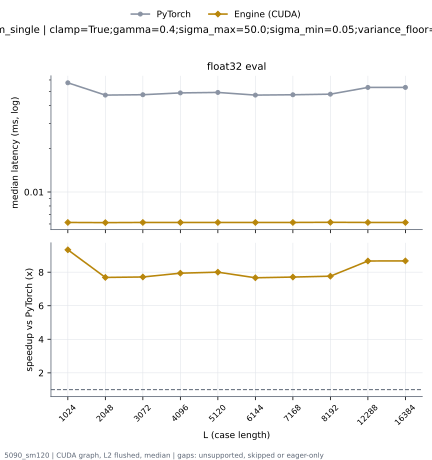

# AugmentNoise on 5090_sm120

Generated by `python -m miniworld_engine.measure.plot` from speed tokens `judge/tokens/5090_sm120/`; do not edit.

### L sweep: atom_single | - | S1 | graph

**float32 eval** (median ms; x = speedup vs PyTorch)

| L | PyTorch | Engine (Triton) | Engine (CUDA) |
|---|---|---|---|
| 1024 | 0.0431 | 0.006144 (7.02x) | 0.004112 (10.48x) |
| 2048 | 0.04506 | 0.006144 (7.33x) | 0.006144 (7.33x) |
| 3072 | 0.0553 | 0.006368 (8.68x) | 0.006144 (9.00x) |
| 4096 | 0.05555 | 0.008032 (6.92x) | 0.006144 (9.04x) |
| 5120 | 0.05547 | 0.008176 (6.78x) | 0.006144 (9.03x) |
| 6144 | 0.0552 | 0.008192 (6.74x) | 0.006144 (8.98x) |
| 7168 | 0.0553 | 0.008192 (6.75x) | 0.006144 (9.00x) |
| 8192 | 0.0553 | 0.008192 (6.75x) | 0.006144 (9.00x) |
| 12288 | 0.05939 | 0.008192 (7.25x) | 0.006144 (9.67x) |
| 16384 | 0.06149 | 0.008544 (7.20x) | 0.006144 (10.01x) |

### L sweep: atom_single | clamp=True;gamma=0.4;sigma_max=50.0;sigma_min=0.05;variance_floor=1e-06;window=1 | S1 | graph

**float32 eval** (median ms; x = speedup vs PyTorch)

| L | PyTorch | Engine (Triton) | Engine (CUDA) |
|---|---|---|---|
| 1024 | 0.05734 | 0.006176 (9.28x) | 0.006144 (9.33x) |
| 2048 | 0.0471 | 0.006144 (7.67x) | 0.006128 (7.69x) |
| 3072 | 0.04739 | 0.006144 (7.71x) | 0.006144 (7.71x) |
| 4096 | 0.04878 | 0.006144 (7.94x) | 0.006144 (7.94x) |
| 5120 | 0.04915 | 0.006144 (8.00x) | 0.006144 (8.00x) |
| 6144 | 0.0471 | 0.006144 (7.67x) | 0.006144 (7.67x) |
| 7168 | 0.04736 | 0.006144 (7.71x) | 0.006144 (7.71x) |
| 8192 | 0.04781 | 0.006144 (7.78x) | 0.00616 (7.76x) |
| 12288 | 0.05325 | 0.008192 (6.50x) | 0.006144 (8.67x) |
| 16384 | 0.05328 | 0.008192 (6.50x) | 0.006144 (8.67x) |

