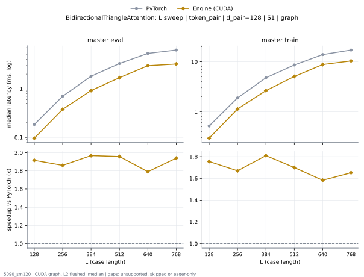

# BidirectionalTriangleAttention on 5090_sm120

Generated by `python -m foldjet_engine.measure.plot` from speed tokens `judge/tokens/5090_sm120/`; do not edit.

### L sweep: token_pair | d_pair=128 | S1 | graph

**master eval** (median ms; x = speedup vs PyTorch)

| L | PyTorch | Engine (CUDA) |
|---|---|---|
| 128 | 0.1843 | 0.09626 (1.91x) |
| 256 | 0.7027 | 0.3779 (1.86x) |
| 384 | 1.807 | 0.9189 (1.97x) |
| 512 | 3.3 | 1.686 (1.96x) |
| 640 | 5.33 | 2.977 (1.79x) |
| 768 | 6.254 | 3.226 (1.94x) |

**master train** (median ms; x = speedup vs PyTorch)

| L | PyTorch | Engine (CUDA) |
|---|---|---|
| 128 | 0.514 | 0.2928 (1.76x) |
| 256 | 1.879 | 1.125 (1.67x) |
| 384 | 4.763 | 2.632 (1.81x) |
| 512 | 8.593 | 5.055 (1.70x) |
| 640 | 13.9 | 8.78 (1.58x) |
| 768 | 17.14 | 10.37 (1.65x) |

