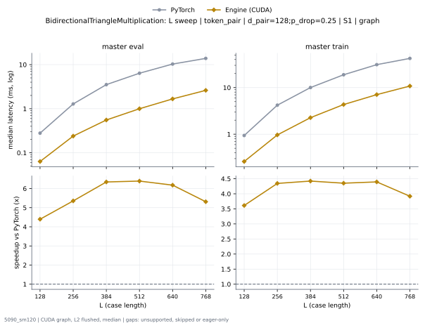
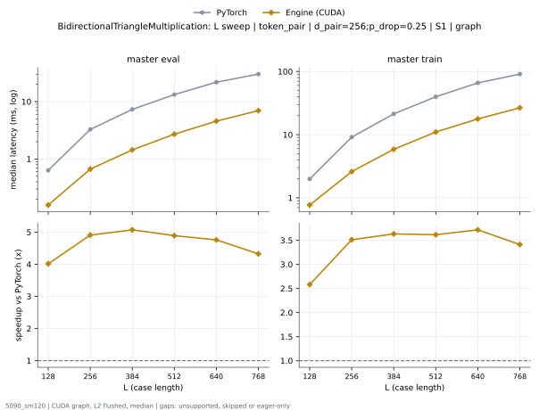
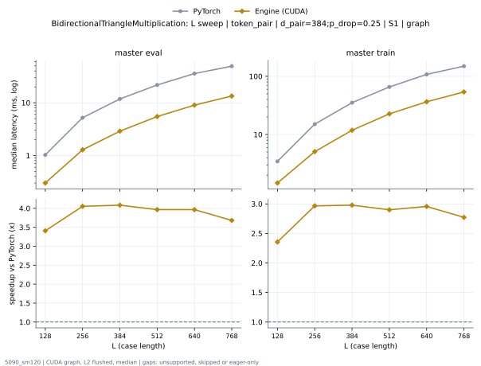
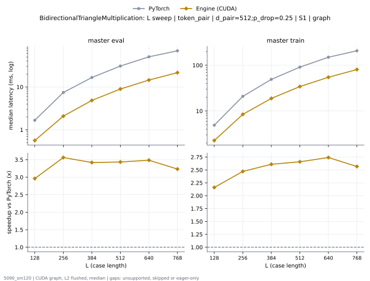
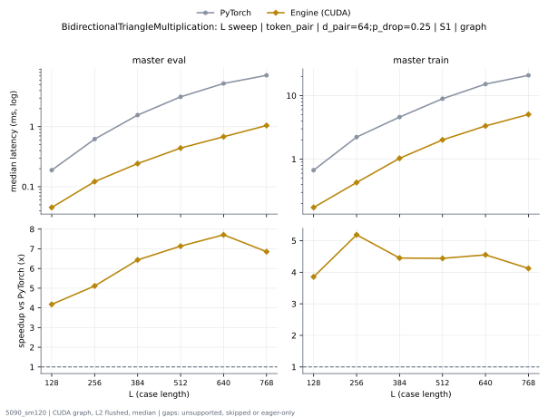
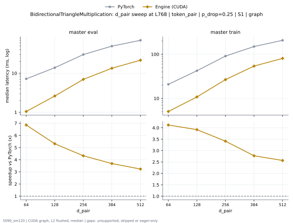

# BidirectionalTriangleMultiplication on 5090_sm120

Generated by `python -m foldjet_engine.measure.plot` from speed tokens `judge/tokens/5090_sm120/`; do not edit.

### L sweep: token_pair | d_pair=128;p_drop=0.25 | S1 | graph

**master eval** (median ms; x = speedup vs PyTorch)

| L | PyTorch | Engine (Triton) | Engine (CUDA) |
|---|---|---|---|
| 128 | 0.2791 | 0.09635 (2.90x) | 0.06349 (4.40x) |
| 256 | 1.283 | 0.3566 (3.60x) | 0.2396 (5.35x) |
| 384 | 3.521 | 0.8408 (4.19x) | 0.555 (6.34x) |
| 512 | 6.388 | 1.557 (4.10x) | 0.9996 (6.39x) |
| 640 | 10.31 | 2.753 (3.75x) | 1.67 (6.18x) |
| 768 | 13.86 | 2.849 (4.87x) | 2.61 (5.31x) |

**master train** (median ms; x = speedup vs PyTorch)

| L | PyTorch | Engine (Triton) | Engine (CUDA) |
|---|---|---|---|
| 128 | 0.9395 | 0.3604 (2.61x) | 0.2602 (3.61x) |
| 256 | 4.199 | 1.407 (2.98x) | 0.9666 (4.34x) |
| 384 | 10.02 | 3.408 (2.94x) | 2.266 (4.42x) |
| 512 | 18.85 | 6.758 (2.79x) | 4.331 (4.35x) |
| 640 | 31.05 | 12.06 (2.57x) | 7.066 (4.39x) |
| 768 | 42.3 | 13.98 (3.03x) | 10.8 (3.92x) |

### L sweep: token_pair | d_pair=256;p_drop=0.25 | S1 | graph

**master eval** (median ms; x = speedup vs PyTorch)

| L | PyTorch | Engine (Triton) | Engine (CUDA) |
|---|---|---|---|
| 128 | 0.6349 | 0.2419 (2.62x) | 0.1581 (4.02x) |
| 256 | 3.274 | 0.9774 (3.35x) | 0.6669 (4.91x) |
| 384 | 7.312 | 2.059 (3.55x) | 1.442 (5.07x) |
| 512 | 13.25 | 4.062 (3.26x) | 2.709 (4.89x) |
| 640 | 21.75 | 7.117 (3.06x) | 4.571 (4.76x) |
| 768 | 30.1 | 7.882 (3.82x) | 6.962 (4.32x) |

**master train** (median ms; x = speedup vs PyTorch)

| L | PyTorch | Engine (Triton) | Engine (CUDA) |
|---|---|---|---|
| 128 | 1.986 | 0.8554 (2.32x) | 0.7693 (2.58x) |
| 256 | 9.133 | 3.184 (2.87x) | 2.6 (3.51x) |
| 384 | 21.32 | 7.776 (2.74x) | 5.869 (3.63x) |
| 512 | 39.77 | 14.9 (2.67x) | 11 (3.62x) |
| 640 | 65.99 | 26.65 (2.48x) | 17.75 (3.72x) |
| 768 | 90.87 | 32.49 (2.80x) | 26.63 (3.41x) |

### L sweep: token_pair | d_pair=384;p_drop=0.25 | S1 | graph

**master eval** (median ms; x = speedup vs PyTorch)

| L | PyTorch | Engine (Triton) | Engine (CUDA) |
|---|---|---|---|
| 128 | 1.026 | 0.4547 (2.26x) | 0.3011 (3.41x) |
| 256 | 5.201 | 1.74 (2.99x) | 1.283 (4.05x) |
| 384 | 11.81 | 3.864 (3.06x) | 2.891 (4.08x) |
| 512 | 21.74 | 7.574 (2.87x) | 5.48 (3.97x) |
| 640 | 35.76 | 12.66 (2.83x) | 9.018 (3.97x) |
| 768 | 49.41 | 14.67 (3.37x) | 13.42 (3.68x) |

**master train** (median ms; x = speedup vs PyTorch)

| L | PyTorch | Engine (Triton) | Engine (CUDA) |
|---|---|---|---|
| 128 | 3.456 | 1.524 (2.27x) | 1.467 (2.36x) |
| 256 | 15.07 | 5.81 (2.59x) | 5.079 (2.97x) |
| 384 | 35.26 | 13.96 (2.53x) | 11.84 (2.98x) |
| 512 | 65.63 | 28.05 (2.34x) | 22.63 (2.90x) |
| 640 | 108 | 49.4 (2.19x) | 36.52 (2.96x) |
| 768 | 149.5 | 67.68 (2.21x) | 53.92 (2.77x) |

### L sweep: token_pair | d_pair=512;p_drop=0.25 | S1 | graph

**master eval** (median ms; x = speedup vs PyTorch)

| L | PyTorch | Engine (Triton) | Engine (CUDA) |
|---|---|---|---|
| 128 | 1.668 | 0.8499 (1.96x) | 0.5632 (2.96x) |
| 256 | 7.421 | 2.829 (2.62x) | 2.084 (3.56x) |
| 384 | 16.58 | 6.413 (2.59x) | 4.85 (3.42x) |
| 512 | 30.7 | 12.09 (2.54x) | 8.941 (3.43x) |
| 640 | 50.42 | 19.89 (2.54x) | 14.47 (3.48x) |
| 768 | 69.64 | 28.95 (2.41x) | 21.55 (3.23x) |

**master train** (median ms; x = speedup vs PyTorch)

| L | PyTorch | Engine (Triton) | Engine (CUDA) |
|---|---|---|---|
| 128 | 4.895 | 2.529 (1.94x) | 2.266 (2.16x) |
| 256 | 20.87 | 9.347 (2.23x) | 8.447 (2.47x) |
| 384 | 49.18 | 22.35 (2.20x) | 18.85 (2.61x) |
| 512 | 90.93 | 43.62 (2.08x) | 34.2 (2.66x) |
| 640 | 149.8 | 85.55 (1.75x) | 54.66 (2.74x) |
| 768 | 206.9 | 110.7 (1.87x) | 80.64 (2.57x) |

### L sweep: token_pair | d_pair=64;p_drop=0.25 | S1 | graph

**master eval** (median ms; x = speedup vs PyTorch)

| L | PyTorch | Engine (Triton) | Engine (CUDA) |
|---|---|---|---|
| 128 | 0.1884 | 0.06531 (2.88x) | 0.04509 (4.18x) |
| 256 | 0.6214 | 0.16 (3.88x) | 0.1215 (5.11x) |
| 384 | 1.562 | 0.3833 (4.07x) | 0.2427 (6.43x) |
| 512 | 3.142 | 0.7393 (4.25x) | 0.4403 (7.14x) |
| 640 | 5.243 | 1.246 (4.21x) | 0.68 (7.71x) |
| 768 | 7.172 | 1.21 (5.93x) | 1.047 (6.85x) |

**master train** (median ms; x = speedup vs PyTorch)

| L | PyTorch | Engine (Triton) | Engine (CUDA) |
|---|---|---|---|
| 128 | 0.6698 | 0.2151 (3.11x) | 0.1738 (3.85x) |
| 256 | 2.222 | 0.6657 (3.34x) | 0.4285 (5.19x) |
| 384 | 4.586 | 1.656 (2.77x) | 1.031 (4.45x) |
| 512 | 8.916 | 3.121 (2.86x) | 2.008 (4.44x) |
| 640 | 15.15 | 5.56 (2.72x) | 3.328 (4.55x) |
| 768 | 20.8 | 6.348 (3.28x) | 5.048 (4.12x) |

### d_pair sweep at L768: token_pair | p_drop=0.25 | S1 | graph

**master eval** (median ms; x = speedup vs PyTorch)

| d_pair | PyTorch | Engine (Triton) | Engine (CUDA) |
|---|---|---|---|
| 64 | 7.172 | 1.21 (5.93x) | 1.047 (6.85x) |
| 128 | 13.86 | 2.849 (4.87x) | 2.61 (5.31x) |
| 256 | 30.1 | 7.882 (3.82x) | 6.962 (4.32x) |
| 384 | 49.41 | 14.67 (3.37x) | 13.42 (3.68x) |
| 512 | 69.64 | 28.95 (2.41x) | 21.55 (3.23x) |

**master train** (median ms; x = speedup vs PyTorch)

| d_pair | PyTorch | Engine (Triton) | Engine (CUDA) |
|---|---|---|---|
| 64 | 20.8 | 6.348 (3.28x) | 5.048 (4.12x) |
| 128 | 42.3 | 13.98 (3.03x) | 10.8 (3.92x) |
| 256 | 90.87 | 32.49 (2.80x) | 26.63 (3.41x) |
| 384 | 149.5 | 67.68 (2.21x) | 53.92 (2.77x) |
| 512 | 206.9 | 110.7 (1.87x) | 80.64 (2.57x) |

