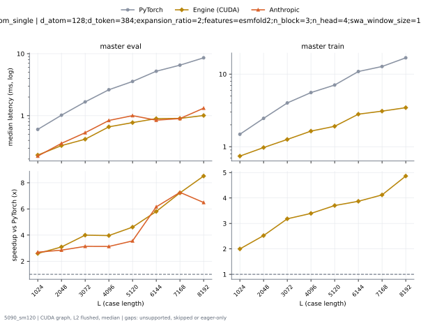
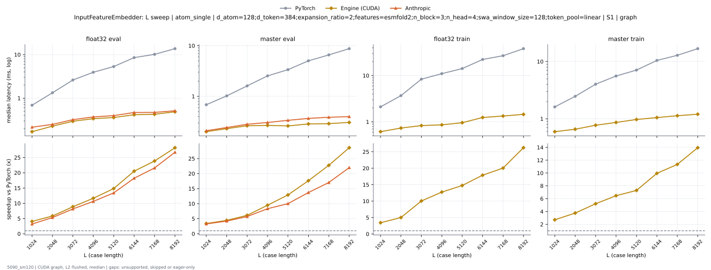
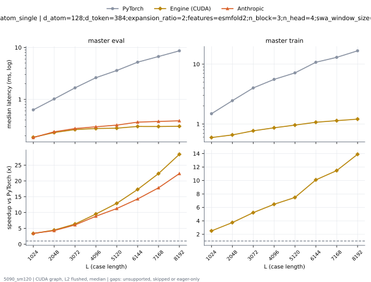
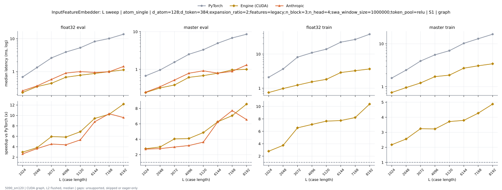
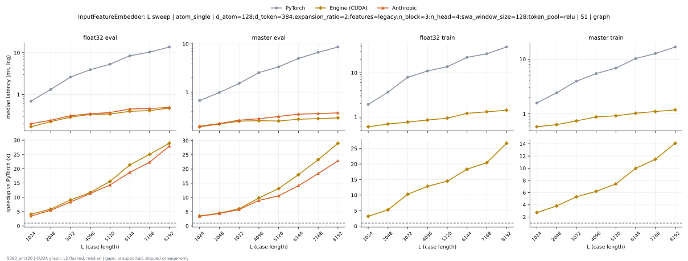

# InputFeatureEmbedder on 5090_sm120

Generated by `python -m foldjet_engine.measure.plot` from speed tokens `judge/tokens/5090_sm120/`; do not edit.

### L sweep: atom_single | d_atom=128;d_token=384;expansion_ratio=2;features=esmfold2;n_block=3;n_head=4;swa_window_size=1000000;token_pool=linear | S1 | graph

**master eval** (median ms; x = speedup vs PyTorch)

| L | PyTorch | Engine (Triton) | Engine (CUDA) | Anthropic |
|---|---|---|---|---|
| 1024 | 0.6842 | 0.2499 (2.74x) | 0.2498 (2.74x) | 0.256 (2.67x) |
| 2048 | 1.03 | 0.3482 (2.96x) | 0.3294 (3.13x) | 0.3644 (2.83x) |
| 3072 | 1.665 | 0.4171 (3.99x) | 0.4178 (3.98x) | 0.5381 (3.09x) |
| 4096 | 2.63 | 0.5 (5.26x) | 0.6615 (3.98x) | 0.8295 (3.17x) |
| 5120 | 3.539 | 0.5782 (6.12x) | 0.7721 (4.58x) | 1.008 (3.51x) |
| 6144 | 5.294 | 0.9154 (5.78x) | 0.8704 (6.08x) | 0.8556 (6.19x) |
| 7168 | 6.59 | 0.9574 (6.88x) | 0.9093 (7.25x) | 0.9163 (7.19x) |
| 8192 | 8.599 | 1.071 (8.03x) | 1.01 (8.52x) | 1.332 (6.45x) |

**master train** (median ms; x = speedup vs PyTorch)

| L | PyTorch | Engine (Triton) | Engine (CUDA) | Anthropic |
|---|---|---|---|---|
| 1024 | 1.613 | 0.6697 (2.41x) | 0.7458 (2.16x) | 4.769 (eager) |
| 2048 | 2.475 | 0.9181 (2.70x) | 0.974 (2.54x) | 4.843 (eager) |
| 3072 | 4.031 | 1.441 (2.80x) | 1.261 (3.20x) | 5.183 (eager) |
| 4096 | 5.607 | 1.646 (3.41x) | 1.643 (3.41x) | 6.378 (eager) |
| 5120 | 6.903 | 1.82 (3.79x) | 1.861 (3.71x) | 9.143 (eager) |
| 6144 | 10.82 | 2.792 (3.88x) | 2.79 (3.88x) | 12.35 (eager) |
| 7168 | 12.89 | 3.094 (4.17x) | 3.091 (4.17x) | 17.89 (eager) |
| 8192 | 16.79 | 4.019 (4.18x) | 3.449 (4.87x) | 21.4 (eager) |

### L sweep: atom_single | d_atom=128;d_token=384;expansion_ratio=2;features=esmfold2;n_block=3;n_head=4;swa_window_size=1000000;token_pool=relu | S1 | graph

**master eval** (median ms; x = speedup vs PyTorch)

| L | PyTorch | Engine (Triton) | Engine (CUDA) | Anthropic |
|---|---|---|---|---|
| 1024 | 0.6014 | 0.2482 (2.42x) | 0.2318 (2.59x) | 0.2232 (2.69x) |
| 2048 | 1.02 | 0.3484 (2.93x) | 0.3297 (3.09x) | 0.3579 (2.85x) |
| 3072 | 1.67 | 0.4178 (4.00x) | 0.4178 (4.00x) | 0.5321 (3.14x) |
| 4096 | 2.623 | 0.511 (5.13x) | 0.6615 (3.97x) | 0.8376 (3.13x) |
| 5120 | 3.566 | 0.5785 (6.16x) | 0.774 (4.61x) | 1.003 (3.56x) |
| 6144 | 5.215 | 0.9172 (5.69x) | 0.8981 (5.81x) | 0.8468 (6.16x) |
| 7168 | 6.534 | 0.9436 (6.92x) | 0.9042 (7.23x) | 0.8991 (7.27x) |
| 8192 | 8.581 | 1.041 (8.25x) | 1.008 (8.51x) | 1.322 (6.49x) |

**master train** (median ms; x = speedup vs PyTorch)

| L | PyTorch | Engine (Triton) | Engine (CUDA) | Anthropic |
|---|---|---|---|---|
| 1024 | 1.484 | 0.6671 (2.22x) | 0.7424 (2.00x) | 4.737 (eager) |
| 2048 | 2.457 | 0.9136 (2.69x) | 0.9735 (2.52x) | 4.775 (eager) |
| 3072 | 4.008 | 1.442 (2.78x) | 1.26 (3.18x) | 5.087 (eager) |
| 4096 | 5.57 | 1.644 (3.39x) | 1.641 (3.39x) | 6.415 (eager) |
| 5120 | 7.073 | 1.822 (3.88x) | 1.91 (3.70x) | 9.119 (eager) |
| 6144 | 10.86 | 2.76 (3.93x) | 2.806 (3.87x) | 12.33 (eager) |
| 7168 | 12.73 | 3.108 (4.10x) | 3.089 (4.12x) | 17.83 (eager) |
| 8192 | 16.77 | 4.011 (4.18x) | 3.448 (4.86x) | 21.37 (eager) |

### L sweep: atom_single | d_atom=128;d_token=384;expansion_ratio=2;features=esmfold2;n_block=3;n_head=4;swa_window_size=128;token_pool=linear | S1 | graph

**float32 eval** (median ms; x = speedup vs PyTorch)

| L | PyTorch | Engine (Triton) | Engine (CUDA) | Anthropic |
|---|---|---|---|---|
| 1024 | 0.6881 | 0.2296 (3.00x) | 0.17 (4.05x) | 0.2152 (3.20x) |
| 2048 | 1.33 | 0.2601 (5.11x) | 0.2277 (5.84x) | 0.2499 (5.32x) |
| 3072 | 2.615 | 0.3753 (6.97x) | 0.2949 (8.87x) | 0.3211 (8.14x) |
| 4096 | 3.937 | 0.398 (9.89x) | 0.3383 (11.64x) | 0.3707 (10.62x) |
| 5120 | 5.324 | 0.3973 (13.40x) | 0.3591 (14.83x) | 0.3973 (13.40x) |
| 6144 | 8.541 | 0.4895 (17.45x) | 0.416 (20.53x) | 0.469 (18.21x) |
| 7168 | 10.16 | 0.4875 (20.84x) | 0.426 (23.85x) | 0.4708 (21.58x) |
| 8192 | 13.72 | 0.5796 (23.68x) | 0.4864 (28.21x) | 0.5133 (26.73x) |

**master eval** (median ms; x = speedup vs PyTorch)

| L | PyTorch | Engine (Triton) | Engine (CUDA) | Anthropic |
|---|---|---|---|---|
| 1024 | 0.6824 | 0.2188 (3.12x) | 0.2005 (3.40x) | 0.2092 (3.26x) |
| 2048 | 1.02 | 0.2458 (4.15x) | 0.2302 (4.43x) | 0.242 (4.21x) |
| 3072 | 1.607 | 0.2625 (6.12x) | 0.2622 (6.13x) | 0.2806 (5.73x) |
| 4096 | 2.534 | 0.2975 (8.52x) | 0.2671 (9.49x) | 0.3044 (8.33x) |
| 5120 | 3.362 | 0.3052 (11.02x) | 0.2604 (12.91x) | 0.3359 (10.01x) |
| 6144 | 5.022 | 0.3625 (13.85x) | 0.2848 (17.63x) | 0.3664 (13.71x) |
| 7168 | 6.573 | 0.3707 (17.73x) | 0.2888 (22.76x) | 0.3858 (17.04x) |
| 8192 | 8.738 | 0.385 (22.70x) | 0.3054 (28.61x) | 0.3973 (21.99x) |

**float32 train** (median ms; x = speedup vs PyTorch)

| L | PyTorch | Engine (Triton) | Engine (CUDA) | Anthropic |
|---|---|---|---|---|
| 1024 | 2.111 | 0.6513 (3.24x) | 0.6145 (3.43x) | 3.86 (eager) |
| 2048 | 3.689 | 0.7476 (4.93x) | 0.7355 (5.02x) | 4.265 (eager) |
| 3072 | 8.357 | 1.032 (8.10x) | 0.8316 (10.05x) | 5.853 (eager) |
| 4096 | 10.99 | 0.9994 (11.00x) | 0.8622 (12.75x) | 6.914 (eager) |
| 5120 | 14.17 | 1.075 (13.18x) | 0.9596 (14.76x) | 9.964 (eager) |
| 6144 | 22.27 | 1.633 (13.63x) | 1.244 (17.89x) | 11.47 (eager) |
| 7168 | 26.83 | 1.625 (16.51x) | 1.338 (20.05x) | 14.68 (eager) |
| 8192 | 38.11 | 1.906 (20.00x) | 1.452 (26.24x) | 16.18 (eager) |

**master train** (median ms; x = speedup vs PyTorch)

| L | PyTorch | Engine (Triton) | Engine (CUDA) | Anthropic |
|---|---|---|---|---|
| 1024 | 1.613 | 0.5407 (2.98x) | 0.596 (2.71x) | 4.845 (eager) |
| 2048 | 2.471 | 0.598 (4.13x) | 0.6574 (3.76x) | 4.685 (eager) |
| 3072 | 4.02 | 0.789 (5.10x) | 0.7721 (5.21x) | 4.869 (eager) |
| 4096 | 5.584 | 0.7666 (7.28x) | 0.8636 (6.47x) | 5.308 (eager) |
| 5120 | 7.091 | 0.8322 (8.52x) | 0.9728 (7.29x) | 6.571 (eager) |
| 6144 | 10.45 | 1.076 (9.71x) | 1.05 (9.95x) | 6.881 (eager) |
| 7168 | 12.84 | 1.144 (11.23x) | 1.132 (11.35x) | 7.882 (eager) |
| 8192 | 16.78 | 1.08 (15.54x) | 1.203 (13.95x) | 8.68 (eager) |

### L sweep: atom_single | d_atom=128;d_token=384;expansion_ratio=2;features=esmfold2;n_block=3;n_head=4;swa_window_size=128;token_pool=relu | S1 | graph

**master eval** (median ms; x = speedup vs PyTorch)

| L | PyTorch | Engine (Triton) | Engine (CUDA) | Anthropic |
|---|---|---|---|---|
| 1024 | 0.6288 | 0.1925 (3.27x) | 0.1864 (3.37x) | 0.1843 (3.41x) |
| 2048 | 1.019 | 0.2458 (4.15x) | 0.2297 (4.44x) | 0.2376 (4.29x) |
| 3072 | 1.668 | 0.2624 (6.36x) | 0.2621 (6.36x) | 0.2744 (6.08x) |
| 4096 | 2.617 | 0.2953 (8.86x) | 0.2747 (9.53x) | 0.2966 (8.82x) |
| 5120 | 3.6 | 0.2997 (12.01x) | 0.2788 (12.91x) | 0.3195 (11.27x) |
| 6144 | 5.209 | 0.3707 (14.05x) | 0.3011 (17.30x) | 0.3645 (14.29x) |
| 7168 | 6.696 | 0.3768 (17.77x) | 0.3002 (22.31x) | 0.376 (17.81x) |
| 8192 | 8.623 | 0.3686 (23.39x) | 0.3034 (28.42x) | 0.3864 (22.32x) |

**master train** (median ms; x = speedup vs PyTorch)

| L | PyTorch | Engine (Triton) | Engine (CUDA) | Anthropic |
|---|---|---|---|---|
| 1024 | 1.484 | 0.5366 (2.77x) | 0.5931 (2.50x) | 4.739 (eager) |
| 2048 | 2.452 | 0.5949 (4.12x) | 0.6555 (3.74x) | 4.796 (eager) |
| 3072 | 4.006 | 0.7844 (5.11x) | 0.768 (5.22x) | 4.861 (eager) |
| 4096 | 5.57 | 0.765 (7.28x) | 0.8622 (6.46x) | 5.221 (eager) |
| 5120 | 7.155 | 0.8305 (8.61x) | 0.9574 (7.47x) | 6.52 (eager) |
| 6144 | 10.77 | 1.084 (9.93x) | 1.068 (10.09x) | 6.857 (eager) |
| 7168 | 13.02 | 1.11 (11.73x) | 1.135 (11.47x) | 7.874 (eager) |
| 8192 | 16.74 | 1.167 (14.34x) | 1.205 (13.89x) | 8.666 (eager) |

### L sweep: atom_single | d_atom=128;d_token=384;expansion_ratio=2;features=legacy;n_block=3;n_head=4;swa_window_size=1000000;token_pool=relu | S1 | graph

**float32 eval** (median ms; x = speedup vs PyTorch)

| L | PyTorch | Engine (Triton) | Engine (CUDA) | Anthropic |
|---|---|---|---|---|
| 1024 | 0.682 | 0.258 (2.64x) | 0.2296 (2.97x) | 0.2601 (2.62x) |
| 2048 | 1.33 | 0.3565 (3.73x) | 0.3477 (3.83x) | 0.3648 (3.65x) |
| 3072 | 2.606 | 0.5223 (4.99x) | 0.4383 (5.95x) | 0.5773 (4.51x) |
| 4096 | 3.933 | 0.5755 (6.83x) | 0.6721 (5.85x) | 0.8997 (4.37x) |
| 5120 | 5.313 | 0.6298 (8.44x) | 0.7726 (6.88x) | 0.9994 (5.32x) |
| 6144 | 8.258 | 1.03 (8.02x) | 0.8757 (9.43x) | 0.9405 (8.78x) |
| 7168 | 10.16 | 1.065 (9.54x) | 0.9936 (10.23x) | 0.9841 (10.32x) |
| 8192 | 13.72 | 1.246 (11.01x) | 1.126 (12.18x) | 1.43 (9.59x) |

**master eval** (median ms; x = speedup vs PyTorch)

| L | PyTorch | Engine (Triton) | Engine (CUDA) | Anthropic |
|---|---|---|---|---|
| 1024 | 0.6739 | 0.2437 (2.77x) | 0.2429 (2.77x) | 0.2478 (2.72x) |
| 2048 | 0.9646 | 0.3379 (2.85x) | 0.3215 (3.00x) | 0.3461 (2.79x) |
| 3072 | 1.558 | 0.4096 (3.80x) | 0.3851 (4.04x) | 0.5205 (2.99x) |
| 4096 | 2.52 | 0.4782 (5.27x) | 0.6144 (4.10x) | 0.7909 (3.19x) |
| 5120 | 3.325 | 0.5275 (6.30x) | 0.683 (4.87x) | 0.9166 (3.63x) |
| 6144 | 4.957 | 0.8343 (5.94x) | 0.7907 (6.27x) | 0.7926 (6.25x) |
| 7168 | 6.839 | 0.9342 (7.32x) | 0.9683 (7.06x) | 0.8858 (7.72x) |
| 8192 | 8.581 | 1.028 (8.35x) | 1.002 (8.57x) | 1.31 (6.55x) |

**float32 train** (median ms; x = speedup vs PyTorch)

| L | PyTorch | Engine (Triton) | Engine (CUDA) | Anthropic |
|---|---|---|---|---|
| 1024 | 2.096 | 0.7683 (2.73x) | 0.7496 (2.80x) | 3.867 (eager) |
| 2048 | 3.666 | 1.054 (3.48x) | 0.98 (3.74x) | 4.258 (eager) |
| 3072 | 8.109 | 1.602 (5.06x) | 1.236 (6.56x) | 8.563 (eager) |
| 4096 | 10.96 | 1.779 (6.16x) | 1.541 (7.11x) | 10.94 (eager) |
| 5120 | 13.92 | 2.07 (6.72x) | 1.821 (7.64x) | 16.39 (eager) |
| 6144 | 22.3 | 3.154 (7.07x) | 2.883 (7.73x) | 23.8 (eager) |
| 7168 | 26.8 | 3.566 (7.51x) | 3.261 (8.22x) | 31.98 (eager) |
| 8192 | 38.07 | 4.672 (8.15x) | 3.666 (10.39x) | 41.39 (eager) |

**master train** (median ms; x = speedup vs PyTorch)

| L | PyTorch | Engine (Triton) | Engine (CUDA) | Anthropic |
|---|---|---|---|---|
| 1024 | 1.59 | 0.6568 (2.42x) | 0.7312 (2.17x) | 4.493 (eager) |
| 2048 | 2.436 | 0.8955 (2.72x) | 0.9534 (2.56x) | 4.521 (eager) |
| 3072 | 3.966 | 1.417 (2.80x) | 1.223 (3.24x) | 5.226 (eager) |
| 4096 | 5.527 | 1.62 (3.41x) | 1.715 (3.22x) | 6.356 (eager) |
| 5120 | 6.906 | 1.791 (3.86x) | 1.859 (3.72x) | 9.052 (eager) |
| 6144 | 10.24 | 2.674 (3.83x) | 2.699 (3.80x) | 12.26 (eager) |
| 7168 | 13.12 | 3.225 (4.07x) | 3.069 (4.27x) | 17.77 (eager) |
| 8192 | 16.69 | 3.975 (4.20x) | 3.422 (4.88x) | 21.29 (eager) |

### L sweep: atom_single | d_atom=128;d_token=384;expansion_ratio=2;features=legacy;n_block=3;n_head=4;swa_window_size=128;token_pool=relu | S1 | graph

**float32 eval** (median ms; x = speedup vs PyTorch)

| L | PyTorch | Engine (Triton) | Engine (CUDA) | Anthropic |
|---|---|---|---|---|
| 1024 | 0.6943 | 0.2171 (3.20x) | 0.1689 (4.11x) | 0.2007 (3.46x) |
| 2048 | 1.326 | 0.256 (5.18x) | 0.2253 (5.89x) | 0.2419 (5.48x) |
| 3072 | 2.608 | 0.3686 (7.08x) | 0.2867 (9.10x) | 0.3117 (8.37x) |
| 4096 | 3.929 | 0.3778 (10.40x) | 0.3359 (11.70x) | 0.3458 (11.36x) |
| 5120 | 5.305 | 0.3871 (13.71x) | 0.3403 (15.59x) | 0.3707 (14.31x) |
| 6144 | 8.438 | 0.4756 (17.74x) | 0.3956 (21.33x) | 0.4503 (18.74x) |
| 7168 | 10.31 | 0.4911 (20.99x) | 0.4117 (25.04x) | 0.4627 (22.28x) |
| 8192 | 13.69 | 0.5655 (24.20x) | 0.4733 (28.91x) | 0.4905 (27.90x) |

**master eval** (median ms; x = speedup vs PyTorch)

| L | PyTorch | Engine (Triton) | Engine (CUDA) | Anthropic |
|---|---|---|---|---|
| 1024 | 0.6734 | 0.213 (3.16x) | 0.1931 (3.49x) | 0.1986 (3.39x) |
| 2048 | 0.9853 | 0.2359 (4.18x) | 0.2208 (4.46x) | 0.2253 (4.37x) |
| 3072 | 1.519 | 0.2543 (5.97x) | 0.2522 (6.02x) | 0.2642 (5.75x) |
| 4096 | 2.537 | 0.2888 (8.78x) | 0.2583 (9.82x) | 0.2833 (8.95x) |
| 5120 | 3.336 | 0.2953 (11.30x) | 0.2541 (13.13x) | 0.3157 (10.57x) |
| 6144 | 4.976 | 0.3594 (13.85x) | 0.2766 (17.99x) | 0.3526 (14.11x) |
| 7168 | 6.634 | 0.3584 (18.51x) | 0.2849 (23.28x) | 0.3604 (18.41x) |
| 8192 | 8.564 | 0.3584 (23.90x) | 0.2949 (29.04x) | 0.3748 (22.85x) |

**float32 train** (median ms; x = speedup vs PyTorch)

| L | PyTorch | Engine (Triton) | Engine (CUDA) | Anthropic |
|---|---|---|---|---|
| 1024 | 1.92 | 0.6391 (3.00x) | 0.6024 (3.19x) | 3.864 (eager) |
| 2048 | 3.66 | 0.7354 (4.98x) | 0.6963 (5.26x) | 4.24 (eager) |
| 3072 | 7.901 | 1.076 (7.34x) | 0.7693 (10.27x) | 5.787 (eager) |
| 4096 | 10.96 | 1.106 (9.91x) | 0.855 (12.82x) | 6.835 (eager) |
| 5120 | 13.67 | 1.175 (11.64x) | 0.9441 (14.48x) | 9.921 (eager) |
| 6144 | 22.19 | 1.42 (15.63x) | 1.211 (18.32x) | 11.44 (eager) |
| 7168 | 26.77 | 1.535 (17.44x) | 1.31 (20.43x) | 14.61 (eager) |
| 8192 | 38.04 | 1.761 (21.60x) | 1.426 (26.66x) | 16.09 (eager) |

**master train** (median ms; x = speedup vs PyTorch)

| L | PyTorch | Engine (Triton) | Engine (CUDA) | Anthropic |
|---|---|---|---|---|
| 1024 | 1.586 | 0.5264 (3.01x) | 0.5816 (2.73x) | 4.459 (eager) |
| 2048 | 2.428 | 0.5775 (4.20x) | 0.6364 (3.81x) | 4.519 (eager) |
| 3072 | 3.959 | 0.7629 (5.19x) | 0.7457 (5.31x) | 4.861 (eager) |
| 4096 | 5.466 | 0.7373 (7.41x) | 0.8796 (6.21x) | 5.229 (eager) |
| 5120 | 6.863 | 0.8059 (8.52x) | 0.9238 (7.43x) | 6.486 (eager) |
| 6144 | 10.27 | 1.053 (9.75x) | 1.028 (9.98x) | 6.856 (eager) |
| 7168 | 12.71 | 1.043 (12.18x) | 1.107 (11.48x) | 7.87 (eager) |
| 8192 | 16.69 | 1.038 (16.07x) | 1.183 (14.10x) | 8.597 (eager) |

