# LayerNorm on 5090_sm120

Generated by `python -m foldjet_engine.measure.plot` from speed tokens `judge/tokens/5090_sm120/`; do not edit.

### L sweep: atom_single | bias=False;elementwise_affine=True;normalized_shape=128 | S1 | graph

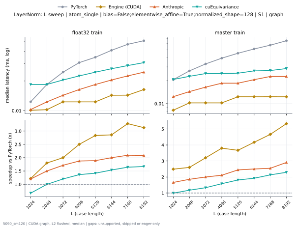

**float32 train** (median ms; x = speedup vs PyTorch)

| L | PyTorch | Engine (Triton) | Engine (CUDA) | Anthropic | cuEquivariance |
|---|---|---|---|---|---|
| 1024 | 0.01232 | 0.01021 (1.21x) | 0.01011 (1.22x) | 0.01027 (1.20x) | 0.01843 (0.67x) |
| 2048 | 0.01843 | 0.01229 (1.50x) | 0.01024 (1.80x) | 0.01229 (1.50x) | 0.01846 (1.00x) |
| 3072 | 0.02458 | 0.01226 (2.01x) | 0.01229 (2.00x) | 0.01434 (1.71x) | 0.02048 (1.20x) |
| 4096 | 0.03072 | 0.0143 (2.15x) | 0.01229 (2.50x) | 0.01638 (1.87x) | 0.02253 (1.36x) |
| 5120 | 0.03482 | 0.01434 (2.43x) | 0.01229 (2.83x) | 0.01843 (1.89x) | 0.02458 (1.42x) |
| 6144 | 0.04096 | 0.01638 (2.50x) | 0.01434 (2.86x) | 0.02048 (2.00x) | 0.02664 (1.54x) |
| 7168 | 0.0471 | 0.01638 (2.88x) | 0.01437 (3.28x) | 0.02253 (2.09x) | 0.02867 (1.64x) |
| 8192 | 0.05123 | 0.01642 (3.12x) | 0.01638 (3.13x) | 0.02458 (2.08x) | 0.03072 (1.67x) |

**master train** (median ms; x = speedup vs PyTorch)

| L | PyTorch | Engine (Triton) | Engine (CUDA) | Anthropic | cuEquivariance |
|---|---|---|---|---|---|
| 1024 | 0.02048 | 0.008192 (2.50x) | 0.008224 (2.49x) | 0.01232 (1.66x) | 0.02061 (0.99x) |
| 2048 | 0.02662 | 0.01024 (2.60x) | 0.01024 (2.60x) | 0.01434 (1.86x) | 0.02262 (1.18x) |
| 3072 | 0.03277 | 0.01229 (2.67x) | 0.01024 (3.20x) | 0.01638 (2.00x) | 0.02458 (1.33x) |
| 4096 | 0.03891 | 0.01229 (3.17x) | 0.01024 (3.80x) | 0.01843 (2.11x) | 0.02458 (1.58x) |
| 5120 | 0.04506 | 0.01229 (3.67x) | 0.01229 (3.67x) | 0.01843 (2.44x) | 0.02483 (1.81x) |
| 6144 | 0.0512 | 0.01229 (4.17x) | 0.01229 (4.17x) | 0.02048 (2.50x) | 0.02662 (1.92x) |
| 7168 | 0.05734 | 0.01434 (4.00x) | 0.0123 (4.66x) | 0.02253 (2.55x) | 0.02688 (2.13x) |
| 8192 | 0.0655 | 0.01434 (4.57x) | 0.01229 (5.33x) | 0.02253 (2.91x) | 0.02854 (2.29x) |

### L sweep: atom_single | bias=False;elementwise_affine=True;normalized_shape=128 | S5 | graph

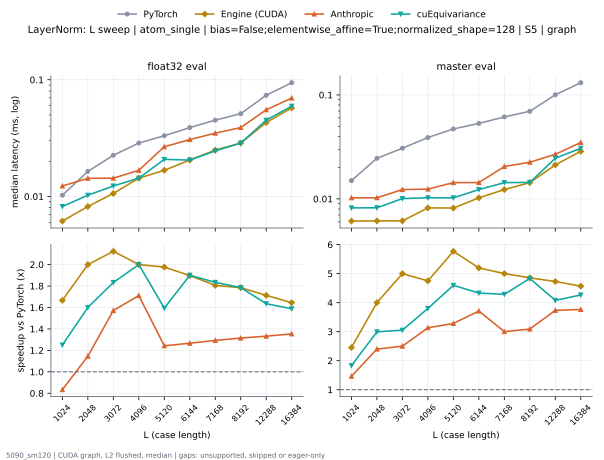

**float32 eval** (median ms; x = speedup vs PyTorch)

| L | PyTorch | Engine (Triton) | Engine (CUDA) | Anthropic | cuEquivariance |
|---|---|---|---|---|---|
| 1024 | 0.01024 | 0.00616 (1.66x) | 0.006144 (1.67x) | 0.01229 (0.83x) | 0.008192 (1.25x) |
| 2048 | 0.01638 | 0.008544 (1.92x) | 0.008192 (2.00x) | 0.0143 (1.15x) | 0.01024 (1.60x) |
| 3072 | 0.02253 | 0.01206 (1.87x) | 0.01061 (2.12x) | 0.01434 (1.57x) | 0.01229 (1.83x) |
| 4096 | 0.02867 | 0.01434 (2.00x) | 0.01434 (2.00x) | 0.01675 (1.71x) | 0.01434 (2.00x) |
| 5120 | 0.03312 | 0.02253 (1.47x) | 0.01675 (1.98x) | 0.02666 (1.24x) | 0.02078 (1.59x) |
| 6144 | 0.03891 | 0.02461 (1.58x) | 0.02051 (1.90x) | 0.03072 (1.27x) | 0.02048 (1.90x) |
| 7168 | 0.04506 | 0.02867 (1.57x) | 0.02494 (1.81x) | 0.03485 (1.29x) | 0.02456 (1.83x) |
| 8192 | 0.05117 | 0.03277 (1.56x) | 0.02867 (1.78x) | 0.03891 (1.31x) | 0.02866 (1.79x) |
| 12288 | 0.07368 | 0.04707 (1.57x) | 0.04301 (1.71x) | 0.0553 (1.33x) | 0.04506 (1.64x) |
| 16384 | 0.0943 | 0.05938 (1.59x) | 0.05734 (1.64x) | 0.06966 (1.35x) | 0.05939 (1.59x) |

**master eval** (median ms; x = speedup vs PyTorch)

| L | PyTorch | Engine (Triton) | Engine (CUDA) | Anthropic | cuEquivariance |
|---|---|---|---|---|---|
| 1024 | 0.01499 | 0.006112 (2.45x) | 0.006112 (2.45x) | 0.01024 (1.46x) | 0.008192 (1.83x) |
| 2048 | 0.02458 | 0.006144 (4.00x) | 0.006144 (4.00x) | 0.01024 (2.40x) | 0.008208 (2.99x) |
| 3072 | 0.03072 | 0.008192 (3.75x) | 0.006144 (5.00x) | 0.01229 (2.50x) | 0.01006 (3.05x) |
| 4096 | 0.03891 | 0.01024 (3.80x) | 0.008192 (4.75x) | 0.01242 (3.13x) | 0.01024 (3.80x) |
| 5120 | 0.04707 | 0.01024 (4.60x) | 0.00816 (5.77x) | 0.01434 (3.28x) | 0.01024 (4.60x) |
| 6144 | 0.05322 | 0.01232 (4.32x) | 0.01024 (5.20x) | 0.01434 (3.71x) | 0.01229 (4.33x) |
| 7168 | 0.06146 | 0.0167 (3.68x) | 0.01229 (5.00x) | 0.02048 (3.00x) | 0.01434 (4.29x) |
| 8192 | 0.0696 | 0.01846 (3.77x) | 0.01434 (4.85x) | 0.02253 (3.09x) | 0.0144 (4.83x) |
| 12288 | 0.1003 | 0.02458 (4.08x) | 0.02122 (4.73x) | 0.02686 (3.73x) | 0.02459 (4.08x) |
| 16384 | 0.131 | 0.0287 (4.57x) | 0.02869 (4.57x) | 0.03482 (3.76x) | 0.03072 (4.27x) |

### L sweep: atom_single | bias=True;elementwise_affine=True;normalized_shape=128 | S1 | graph

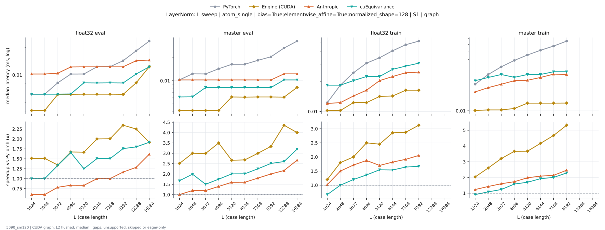

**float32 eval** (median ms; x = speedup vs PyTorch)

| L | PyTorch | Engine (Triton) | Engine (CUDA) | Anthropic | cuEquivariance |
|---|---|---|---|---|---|
| 1024 | 0.006144 | 0.004096 (1.50x) | 0.004064 (1.51x) | 0.01024 (0.60x) | 0.006144 (1.00x) |
| 2048 | 0.006144 | 0.006144 (1.00x) | 0.004064 (1.51x) | 0.01024 (0.60x) | 0.006144 (1.00x) |
| 3072 | 0.008192 | 0.006112 (1.34x) | 0.006096 (1.34x) | 0.01045 (0.78x) | 0.006144 (1.33x) |
| 4096 | 0.01022 | 0.006144 (1.66x) | 0.006112 (1.67x) | 0.01224 (0.84x) | 0.006176 (1.66x) |
| 5120 | 0.01024 | 0.006144 (1.67x) | 0.006144 (1.67x) | 0.01229 (0.83x) | 0.008192 (1.25x) |
| 6144 | 0.01229 | 0.006112 (2.01x) | 0.006144 (2.00x) | 0.01229 (1.00x) | 0.00816 (1.51x) |
| 7168 | 0.01232 | 0.006144 (2.01x) | 0.006144 (2.01x) | 0.01229 (1.00x) | 0.008192 (1.50x) |
| 8192 | 0.01434 | 0.008192 (1.75x) | 0.006112 (2.35x) | 0.01229 (1.17x) | 0.00816 (1.76x) |
| 12288 | 0.01843 | 0.01024 (1.80x) | 0.008192 (2.25x) | 0.01434 (1.29x) | 0.01024 (1.80x) |
| 16384 | 0.02355 | 0.01232 (1.91x) | 0.01229 (1.92x) | 0.01458 (1.62x) | 0.01229 (1.92x) |

**master eval** (median ms; x = speedup vs PyTorch)

| L | PyTorch | Engine (Triton) | Engine (CUDA) | Anthropic | cuEquivariance |
|---|---|---|---|---|---|
| 1024 | 0.01027 | 0.004096 (2.51x) | 0.004096 (2.51x) | 0.01024 (1.00x) | 0.006144 (1.67x) |
| 2048 | 0.01229 | 0.004096 (3.00x) | 0.004096 (3.00x) | 0.01024 (1.20x) | 0.006176 (1.99x) |
| 3072 | 0.01226 | 0.004096 (2.99x) | 0.004096 (2.99x) | 0.01024 (1.20x) | 0.00816 (1.50x) |
| 4096 | 0.01432 | 0.006144 (2.33x) | 0.004096 (3.50x) | 0.01024 (1.40x) | 0.008192 (1.75x) |
| 5120 | 0.01635 | 0.006176 (2.65x) | 0.006144 (2.66x) | 0.01024 (1.60x) | 0.00816 (2.00x) |
| 6144 | 0.01638 | 0.006144 (2.67x) | 0.006112 (2.68x) | 0.01024 (1.60x) | 0.00816 (2.01x) |
| 7168 | 0.01843 | 0.006112 (3.02x) | 0.006144 (3.00x) | 0.01024 (1.80x) | 0.008192 (2.25x) |
| 8192 | 0.02048 | 0.006112 (3.35x) | 0.006144 (3.33x) | 0.01024 (2.00x) | 0.00816 (2.51x) |
| 12288 | 0.02662 | 0.006144 (4.33x) | 0.006112 (4.36x) | 0.01229 (2.17x) | 0.01024 (2.60x) |
| 16384 | 0.03277 | 0.008192 (4.00x) | 0.008192 (4.00x) | 0.01229 (2.67x) | 0.01024 (3.20x) |

**float32 train** (median ms; x = speedup vs PyTorch)

| L | PyTorch | Engine (Triton) | Engine (CUDA) | Anthropic | cuEquivariance |
|---|---|---|---|---|---|
| 1024 | 0.01229 | 0.01024 (1.20x) | 0.01024 (1.20x) | 0.01206 (1.02x) | 0.01843 (0.67x) |
| 2048 | 0.01843 | 0.01229 (1.50x) | 0.01024 (1.80x) | 0.01229 (1.50x) | 0.01843 (1.00x) |
| 3072 | 0.02458 | 0.01226 (2.01x) | 0.01229 (2.00x) | 0.01434 (1.71x) | 0.02048 (1.20x) |
| 4096 | 0.03072 | 0.01229 (2.50x) | 0.01229 (2.50x) | 0.01638 (1.87x) | 0.02253 (1.36x) |
| 5120 | 0.03482 | 0.01434 (2.43x) | 0.01419 (2.45x) | 0.02048 (1.70x) | 0.02253 (1.55x) |
| 6144 | 0.04096 | 0.01632 (2.51x) | 0.01434 (2.86x) | 0.02253 (1.82x) | 0.02662 (1.54x) |
| 7168 | 0.0471 | 0.01638 (2.88x) | 0.01638 (2.88x) | 0.02458 (1.92x) | 0.02869 (1.64x) |
| 8192 | 0.0512 | 0.01638 (3.12x) | 0.01638 (3.12x) | 0.02493 (2.05x) | 0.03069 (1.67x) |
| 12288 |  |  |  |  |  |
| 16384 |  |  |  |  |  |

**master train** (median ms; x = speedup vs PyTorch)

| L | PyTorch | Engine (Triton) | Engine (CUDA) | Anthropic | cuEquivariance |
|---|---|---|---|---|---|
| 1024 | 0.02048 | 0.008192 (2.50x) | 0.01008 (2.03x) | 0.01664 (1.23x) | 0.02253 (0.91x) |
| 2048 | 0.02662 | 0.01024 (2.60x) | 0.01024 (2.60x) | 0.01869 (1.42x) | 0.02458 (1.08x) |
| 3072 | 0.03277 | 0.01024 (3.20x) | 0.01024 (3.20x) | 0.02048 (1.60x) | 0.02662 (1.23x) |
| 4096 | 0.03894 | 0.01229 (3.17x) | 0.01064 (3.66x) | 0.02253 (1.73x) | 0.02466 (1.58x) |
| 5120 | 0.04506 | 0.01229 (3.67x) | 0.01229 (3.67x) | 0.02278 (1.98x) | 0.02662 (1.69x) |
| 6144 | 0.0512 | 0.01434 (3.57x) | 0.01229 (4.17x) | 0.02458 (2.08x) | 0.02664 (1.92x) |
| 7168 | 0.05734 | 0.01434 (4.00x) | 0.01229 (4.67x) | 0.02688 (2.13x) | 0.02867 (2.00x) |
| 8192 | 0.06554 | 0.01434 (4.57x) | 0.01232 (5.32x) | 0.02666 (2.46x) | 0.02867 (2.29x) |
| 12288 |  |  |  |  |  |
| 16384 |  |  |  |  |  |

### L sweep: token_pair | bias=False;elementwise_affine=True;normalized_shape=128 | S1 | graph

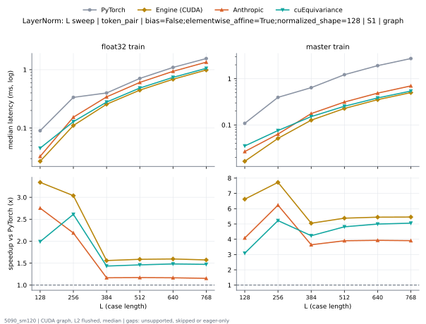

**float32 train** (median ms; x = speedup vs PyTorch)

| L | PyTorch | Engine (Triton) | Engine (CUDA) | Anthropic | cuEquivariance |
|---|---|---|---|---|---|
| 128 | 0.09011 | 0.03093 (2.91x) | 0.02698 (3.34x) | 0.03274 (2.75x) | 0.04528 (1.99x) |
| 256 | 0.3359 | 0.1126 (2.98x) | 0.1106 (3.04x) | 0.1536 (2.19x) | 0.1286 (2.61x) |
| 384 | 0.3994 | 0.258 (1.55x) | 0.2561 (1.56x) | 0.3421 (1.17x) | 0.2785 (1.43x) |
| 512 | 0.7087 | 0.4485 (1.58x) | 0.4464 (1.59x) | 0.6052 (1.17x) | 0.4851 (1.46x) |
| 640 | 1.095 | 0.6943 (1.58x) | 0.6861 (1.60x) | 0.9381 (1.17x) | 0.7391 (1.48x) |
| 768 | 1.553 | 1.003 (1.55x) | 0.9874 (1.57x) | 1.347 (1.15x) | 1.055 (1.47x) |

**master train** (median ms; x = speedup vs PyTorch)

| L | PyTorch | Engine (Triton) | Engine (CUDA) | Anthropic | cuEquivariance |
|---|---|---|---|---|---|
| 128 | 0.1085 | 0.01843 (5.89x) | 0.01638 (6.62x) | 0.02659 (4.08x) | 0.03515 (3.09x) |
| 256 | 0.3956 | 0.05325 (7.43x) | 0.05123 (7.72x) | 0.06349 (6.23x) | 0.07578 (5.22x) |
| 384 | 0.6411 | 0.1311 (4.89x) | 0.127 (5.05x) | 0.1761 (3.64x) | 0.1516 (4.23x) |
| 512 | 1.223 | 0.2295 (5.33x) | 0.2273 (5.38x) | 0.3134 (3.90x) | 0.2539 (4.82x) |
| 640 | 1.918 | 0.3584 (5.35x) | 0.3523 (5.44x) | 0.4881 (3.93x) | 0.384 (4.99x) |
| 768 | 2.733 | 0.5091 (5.37x) | 0.5012 (5.45x) | 0.6994 (3.91x) | 0.541 (5.05x) |

### L sweep: token_pair | bias=False;elementwise_affine=True;normalized_shape=128 | S5 | graph

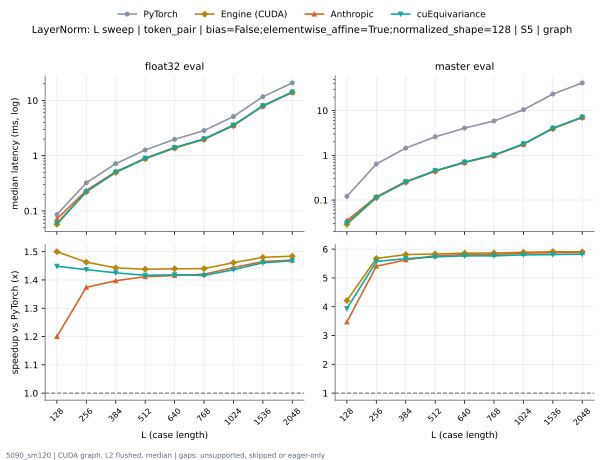

**float32 eval** (median ms; x = speedup vs PyTorch)

| L | PyTorch | Engine (Triton) | Engine (CUDA) | Anthropic | cuEquivariance |
|---|---|---|---|---|---|
| 128 | 0.08602 | 0.05939 (1.45x) | 0.05734 (1.50x) | 0.07168 (1.20x) | 0.05939 (1.45x) |
| 256 | 0.3236 | 0.2232 (1.45x) | 0.2212 (1.46x) | 0.2355 (1.37x) | 0.2253 (1.44x) |
| 384 | 0.718 | 0.502 (1.43x) | 0.4977 (1.44x) | 0.5139 (1.40x) | 0.5038 (1.43x) |
| 512 | 1.268 | 0.8919 (1.42x) | 0.8817 (1.44x) | 0.8981 (1.41x) | 0.895 (1.42x) |
| 640 | 1.979 | 1.392 (1.42x) | 1.375 (1.44x) | 1.398 (1.42x) | 1.396 (1.42x) |
| 768 | 2.846 | 1.996 (1.43x) | 1.976 (1.44x) | 2.004 (1.42x) | 2.01 (1.42x) |
| 1024 | 5.118 | 3.547 (1.44x) | 3.503 (1.46x) | 3.545 (1.44x) | 3.564 (1.44x) |
| 1536 | 11.66 | 7.979 (1.46x) | 7.879 (1.48x) | 7.959 (1.46x) | 7.982 (1.46x) |
| 2048 | 20.76 | 14.16 (1.47x) | 13.99 (1.48x) | 14.12 (1.47x) | 14.15 (1.47x) |

**master eval** (median ms; x = speedup vs PyTorch)

| L | PyTorch | Engine (Triton) | Engine (CUDA) | Anthropic | cuEquivariance |
|---|---|---|---|---|---|
| 128 | 0.1208 | 0.02867 (4.21x) | 0.02867 (4.21x) | 0.03482 (3.47x) | 0.03072 (3.93x) |
| 256 | 0.6394 | 0.1147 (5.58x) | 0.1126 (5.68x) | 0.1182 (5.41x) | 0.1148 (5.57x) |
| 384 | 1.452 | 0.254 (5.72x) | 0.2499 (5.81x) | 0.2581 (5.63x) | 0.256 (5.67x) |
| 512 | 2.588 | 0.4504 (5.75x) | 0.4439 (5.83x) | 0.4485 (5.77x) | 0.4517 (5.73x) |
| 640 | 4.057 | 0.7024 (5.78x) | 0.6922 (5.86x) | 0.6984 (5.81x) | 0.7035 (5.77x) |
| 768 | 5.845 | 1.012 (5.78x) | 0.9964 (5.87x) | 1.005 (5.82x) | 1.013 (5.77x) |
| 1024 | 10.4 | 1.793 (5.80x) | 1.766 (5.89x) | 1.775 (5.86x) | 1.793 (5.80x) |
| 1536 | 23.41 | 4.022 (5.82x) | 3.959 (5.91x) | 3.983 (5.88x) | 4.029 (5.81x) |
| 2048 | 41.58 | 7.134 (5.83x) | 7.042 (5.90x) | 7.061 (5.89x) | 7.138 (5.82x) |

### L sweep: token_pair | bias=False;elementwise_affine=True;normalized_shape=256 | S1 | graph

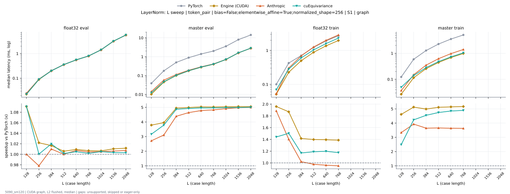

**float32 eval** (median ms; x = speedup vs PyTorch)

| L | PyTorch | Engine (Triton) | Engine (CUDA) | Anthropic | cuEquivariance |
|---|---|---|---|---|---|
| 128 | 0.02458 | 0.02254 (1.09x) | 0.02253 (1.09x) | 0.02458 (1.00x) | 0.02253 (1.09x) |
| 256 | 0.09014 | 0.09011 (1.00x) | 0.08821 (1.02x) | 0.09216 (0.98x) | 0.09011 (1.00x) |
| 384 | 0.2028 | 0.2008 (1.01x) | 0.1995 (1.02x) | 0.2007 (1.01x) | 0.1988 (1.02x) |
| 512 | 0.3564 | 0.3553 (1.00x) | 0.3543 (1.01x) | 0.3564 (1.00x) | 0.3558 (1.00x) |
| 640 | 0.5571 | 0.555 (1.00x) | 0.5519 (1.01x) | 0.553 (1.01x) | 0.5544 (1.00x) |
| 768 | 0.8001 | 0.7978 (1.00x) | 0.7946 (1.01x) | 0.7966 (1.00x) | 0.7987 (1.00x) |
| 1024 | 1.419 | 1.418 (1.00x) | 1.41 (1.01x) | 1.412 (1.01x) | 1.412 (1.01x) |
| 1536 | 3.19 | 3.181 (1.00x) | 3.157 (1.01x) | 3.17 (1.01x) | 3.18 (1.00x) |
| 2048 | 5.668 | 5.637 (1.01x) | 5.602 (1.01x) | 5.627 (1.01x) | 5.651 (1.00x) |

**master eval** (median ms; x = speedup vs PyTorch)

| L | PyTorch | Engine (Triton) | Engine (CUDA) | Anthropic | cuEquivariance |
|---|---|---|---|---|---|
| 128 | 0.03888 | 0.01229 (3.16x) | 0.01027 (3.79x) | 0.01434 (2.71x) | 0.01229 (3.16x) |
| 256 | 0.1782 | 0.04509 (3.95x) | 0.04506 (3.95x) | 0.05734 (3.11x) | 0.0471 (3.78x) |
| 384 | 0.4982 | 0.1024 (4.87x) | 0.1007 (4.95x) | 0.1135 (4.39x) | 0.1024 (4.87x) |
| 512 | 0.8888 | 0.1802 (4.93x) | 0.1782 (4.99x) | 0.1915 (4.64x) | 0.1805 (4.92x) |
| 640 | 1.391 | 0.2806 (4.96x) | 0.2765 (5.03x) | 0.2911 (4.78x) | 0.2806 (4.96x) |
| 768 | 2.002 | 0.4024 (4.98x) | 0.3983 (5.03x) | 0.4147 (4.83x) | 0.4035 (4.96x) |
| 1024 | 3.559 | 0.7131 (4.99x) | 0.7066 (5.04x) | 0.725 (4.91x) | 0.7148 (4.98x) |
| 1536 | 8.001 | 1.598 (5.01x) | 1.582 (5.06x) | 1.609 (4.97x) | 1.605 (4.99x) |
| 2048 | 14.21 | 2.837 (5.01x) | 2.814 (5.05x) | 2.842 (5.00x) | 2.838 (5.01x) |

**float32 train** (median ms; x = speedup vs PyTorch)

| L | PyTorch | Engine (Triton) | Engine (CUDA) | Anthropic | cuEquivariance |
|---|---|---|---|---|---|
| 128 | 0.1004 | 0.05566 (1.80x) | 0.0512 (1.96x) | 0.05322 (1.89x) | 0.06963 (1.44x) |
| 256 | 0.4251 | 0.2294 (1.85x) | 0.2273 (1.87x) | 0.3031 (1.40x) | 0.2826 (1.50x) |
| 384 | 0.7045 | 0.506 (1.39x) | 0.4977 (1.42x) | 0.6898 (1.02x) | 0.6028 (1.17x) |
| 512 | 1.232 | 0.8887 (1.39x) | 0.881 (1.40x) | 1.262 (0.98x) | 1.035 (1.19x) |
| 640 | 1.908 | 1.377 (1.39x) | 1.368 (1.39x) | 1.986 (0.96x) | 1.592 (1.20x) |
| 768 | 2.725 | 1.979 (1.38x) | 1.965 (1.39x) | 2.867 (0.95x) | 2.319 (1.18x) |
| 1024 |  |  |  |  |  |
| 1536 |  |  |  |  |  |
| 2048 |  |  |  |  |  |

**master train** (median ms; x = speedup vs PyTorch)

| L | PyTorch | Engine (Triton) | Engine (CUDA) | Anthropic | cuEquivariance |
|---|---|---|---|---|---|
| 128 | 0.1228 | 0.03478 (3.53x) | 0.02662 (4.61x) | 0.03683 (3.34x) | 0.04941 (2.49x) |
| 256 | 0.5877 | 0.1126 (5.22x) | 0.1147 (5.12x) | 0.1495 (3.93x) | 0.139 (4.23x) |
| 384 | 1.277 | 0.256 (4.99x) | 0.256 (4.99x) | 0.3502 (3.65x) | 0.2808 (4.55x) |
| 512 | 2.271 | 0.452 (5.03x) | 0.4444 (5.11x) | 0.6205 (3.66x) | 0.4786 (4.75x) |
| 640 | 3.537 | 0.701 (5.05x) | 0.6881 (5.14x) | 0.9718 (3.64x) | 0.7291 (4.85x) |
| 768 | 5.089 | 0.9994 (5.09x) | 0.9851 (5.17x) | 1.402 (3.63x) | 1.04 (4.89x) |
| 1024 |  |  |  |  |  |
| 1536 |  |  |  |  |  |
| 2048 |  |  |  |  |  |

### L sweep: token_pair | bias=False;elementwise_affine=True;normalized_shape=267 | S1 | graph

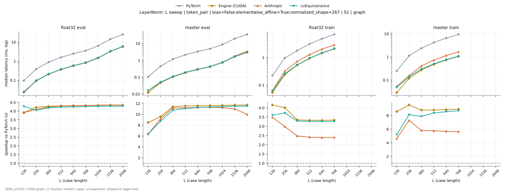

**float32 eval** (median ms; x = speedup vs PyTorch)

| L | PyTorch | Engine (Triton) | Engine (CUDA) | Anthropic | cuEquivariance |
|---|---|---|---|---|---|
| 128 | 0.09626 | 0.02458 (3.92x) | 0.02459 (3.91x) | 0.02461 (3.91x) | 0.02253 (4.27x) |
| 256 | 0.3895 | 0.09626 (4.05x) | 0.09242 (4.21x) | 0.09491 (4.10x) | 0.09629 (4.05x) |
| 384 | 0.8924 | 0.2111 (4.23x) | 0.2087 (4.28x) | 0.2109 (4.23x) | 0.213 (4.19x) |
| 512 | 1.593 | 0.3748 (4.25x) | 0.3707 (4.30x) | 0.3707 (4.30x) | 0.3768 (4.23x) |
| 640 | 2.494 | 0.5837 (4.27x) | 0.5776 (4.32x) | 0.5796 (4.30x) | 0.5878 (4.24x) |
| 768 | 3.593 | 0.8396 (4.28x) | 0.8315 (4.32x) | 0.8315 (4.32x) | 0.8438 (4.26x) |
| 1024 | 6.395 | 1.486 (4.30x) | 1.477 (4.33x) | 1.474 (4.34x) | 1.496 (4.27x) |
| 1536 | 14.4 | 3.331 (4.32x) | 3.315 (4.34x) | 3.311 (4.35x) | 3.363 (4.28x) |
| 2048 | 25.59 | 5.914 (4.33x) | 5.898 (4.34x) | 5.883 (4.35x) | 5.975 (4.28x) |

**master eval** (median ms; x = speedup vs PyTorch)

| L | PyTorch | Engine (Triton) | Engine (CUDA) | Anthropic | cuEquivariance |
|---|---|---|---|---|---|
| 128 | 0.1044 | 0.01638 (6.37x) | 0.01229 (8.50x) | 0.01638 (6.37x) | 0.01638 (6.37x) |
| 256 | 0.4507 | 0.0512 (8.80x) | 0.0471 (9.57x) | 0.04915 (9.17x) | 0.05158 (8.74x) |
| 384 | 1.191 | 0.1089 (10.94x) | 0.1044 (11.40x) | 0.1065 (11.18x) | 0.1106 (10.77x) |
| 512 | 2.133 | 0.1905 (11.20x) | 0.1847 (11.55x) | 0.1905 (11.20x) | 0.1925 (11.08x) |
| 640 | 3.353 | 0.2949 (11.37x) | 0.2891 (11.60x) | 0.2968 (11.30x) | 0.2978 (11.26x) |
| 768 | 4.837 | 0.4226 (11.45x) | 0.4157 (11.64x) | 0.4277 (11.31x) | 0.4261 (11.35x) |
| 1024 | 8.618 | 0.7496 (11.50x) | 0.7395 (11.65x) | 0.766 (11.25x) | 0.7538 (11.43x) |
| 1536 | 19.41 | 1.677 (11.57x) | 1.66 (11.70x) | 1.764 (11.01x) | 1.689 (11.50x) |
| 2048 | 34.52 | 2.977 (11.60x) | 2.946 (11.72x) | 3.456 (9.99x) | 2.994 (11.53x) |

**float32 train** (median ms; x = speedup vs PyTorch)

| L | PyTorch | Engine (Triton) | Engine (CUDA) | Anthropic | cuEquivariance |
|---|---|---|---|---|---|
| 128 | 0.2212 | 0.06758 (3.27x) | 0.05325 (4.15x) | 0.06349 (3.48x) | 0.06142 (3.60x) |
| 256 | 0.9605 | 0.2417 (3.97x) | 0.2396 (4.01x) | 0.3216 (2.99x) | 0.258 (3.72x) |
| 384 | 1.783 | 0.5317 (3.35x) | 0.5322 (3.35x) | 0.7201 (2.48x) | 0.5427 (3.28x) |
| 512 | 3.103 | 0.9343 (3.32x) | 0.9329 (3.33x) | 1.285 (2.41x) | 0.95 (3.27x) |
| 640 | 4.811 | 1.451 (3.32x) | 1.447 (3.32x) | 2.014 (2.39x) | 1.476 (3.26x) |
| 768 | 6.931 | 2.074 (3.34x) | 2.078 (3.34x) | 2.887 (2.40x) | 2.123 (3.27x) |
| 1024 |  |  |  |  |  |
| 1536 |  |  |  |  |  |
| 2048 |  |  |  |  |  |

**master train** (median ms; x = speedup vs PyTorch)

| L | PyTorch | Engine (Triton) | Engine (CUDA) | Anthropic | cuEquivariance |
|---|---|---|---|---|---|
| 128 | 0.2458 | 0.0471 (5.22x) | 0.02867 (8.57x) | 0.05326 (4.61x) | 0.04754 (5.17x) |
| 256 | 1.133 | 0.1372 (8.25x) | 0.1188 (9.53x) | 0.1556 (7.28x) | 0.1395 (8.12x) |
| 384 | 2.376 | 0.2929 (8.11x) | 0.2703 (8.79x) | 0.4096 (5.80x) | 0.302 (7.87x) |
| 512 | 4.18 | 0.4813 (8.69x) | 0.4751 (8.80x) | 0.726 (5.76x) | 0.4995 (8.37x) |
| 640 | 6.522 | 0.7434 (8.77x) | 0.7363 (8.86x) | 1.148 (5.68x) | 0.7623 (8.56x) |
| 768 | 9.402 | 1.065 (8.83x) | 1.053 (8.93x) | 1.668 (5.64x) | 1.08 (8.70x) |
| 1024 |  |  |  |  |  |
| 1536 |  |  |  |  |  |
| 2048 |  |  |  |  |  |

### L sweep: token_pair | bias=False;elementwise_affine=True;normalized_shape=384 | S1 | graph

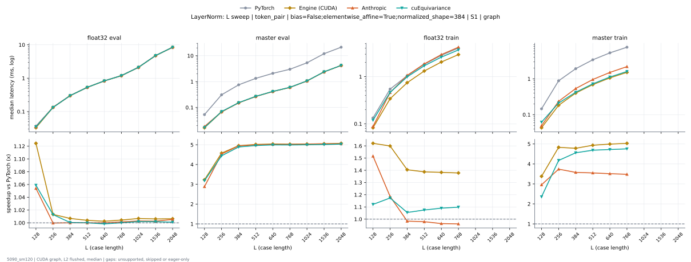

**float32 eval** (median ms; x = speedup vs PyTorch)

| L | PyTorch | Engine (Triton) | Engine (CUDA) | Anthropic | cuEquivariance |
|---|---|---|---|---|---|
| 128 | 0.03686 | 0.03277 (1.13x) | 0.03278 (1.12x) | 0.03498 (1.05x) | 0.03482 (1.06x) |
| 256 | 0.1352 | 0.1331 (1.02x) | 0.1335 (1.01x) | 0.1353 (1.00x) | 0.1335 (1.01x) |
| 384 | 0.3011 | 0.299 (1.01x) | 0.299 (1.01x) | 0.3011 (1.00x) | 0.3009 (1.00x) |
| 512 | 0.5325 | 0.5325 (1.00x) | 0.5304 (1.00x) | 0.5325 (1.00x) | 0.5325 (1.00x) |
| 640 | 0.8305 | 0.8311 (1.00x) | 0.8284 (1.00x) | 0.8305 (1.00x) | 0.8319 (1.00x) |
| 768 | 1.195 | 1.196 (1.00x) | 1.19 (1.00x) | 1.193 (1.00x) | 1.195 (1.00x) |
| 1024 | 2.123 | 2.117 (1.00x) | 2.108 (1.01x) | 2.117 (1.00x) | 2.119 (1.00x) |
| 1536 | 4.768 | 4.76 (1.00x) | 4.739 (1.01x) | 4.755 (1.00x) | 4.759 (1.00x) |
| 2048 | 8.475 | 8.46 (1.00x) | 8.421 (1.01x) | 8.431 (1.01x) | 8.466 (1.00x) |

**master eval** (median ms; x = speedup vs PyTorch)

| L | PyTorch | Engine (Triton) | Engine (CUDA) | Anthropic | cuEquivariance |
|---|---|---|---|---|---|
| 128 | 0.05322 | 0.01718 (3.10x) | 0.01648 (3.23x) | 0.01845 (2.88x) | 0.0167 (3.19x) |
| 256 | 0.3092 | 0.06963 (4.44x) | 0.06758 (4.58x) | 0.06827 (4.53x) | 0.06963 (4.44x) |
| 384 | 0.7506 | 0.1536 (4.89x) | 0.1516 (4.95x) | 0.1519 (4.94x) | 0.1536 (4.89x) |
| 512 | 1.335 | 0.2688 (4.97x) | 0.2663 (5.02x) | 0.2675 (4.99x) | 0.2693 (4.96x) |
| 640 | 2.086 | 0.4178 (4.99x) | 0.414 (5.04x) | 0.4157 (5.02x) | 0.4178 (4.99x) |
| 768 | 2.998 | 0.6004 (4.99x) | 0.5963 (5.03x) | 0.5973 (5.02x) | 0.6011 (4.99x) |
| 1024 | 5.332 | 1.067 (5.00x) | 1.059 (5.04x) | 1.06 (5.03x) | 1.067 (5.00x) |
| 1536 | 12 | 2.396 (5.01x) | 2.377 (5.05x) | 2.378 (5.05x) | 2.395 (5.01x) |
| 2048 | 21.32 | 4.241 (5.03x) | 4.205 (5.07x) | 4.221 (5.05x) | 4.237 (5.03x) |

**float32 train** (median ms; x = speedup vs PyTorch)

| L | PyTorch | Engine (Triton) | Engine (CUDA) | Anthropic | cuEquivariance |
|---|---|---|---|---|---|
| 128 | 0.1335 | 0.08192 (1.63x) | 0.08238 (1.62x) | 0.08806 (1.52x) | 0.1192 (1.12x) |
| 256 | 0.5448 | 0.34 (1.60x) | 0.3406 (1.60x) | 0.4595 (1.19x) | 0.4643 (1.17x) |
| 384 | 1.047 | 0.7516 (1.39x) | 0.7451 (1.40x) | 1.064 (0.98x) | 0.9923 (1.05x) |
| 512 | 1.83 | 1.328 (1.38x) | 1.319 (1.39x) | 1.869 (0.98x) | 1.703 (1.07x) |
| 640 | 2.834 | 2.068 (1.37x) | 2.049 (1.38x) | 2.941 (0.96x) | 2.6 (1.09x) |
| 768 | 4.055 | 2.973 (1.36x) | 2.942 (1.38x) | 4.219 (0.96x) | 3.692 (1.10x) |
| 1024 |  |  |  |  |  |
| 1536 |  |  |  |  |  |
| 2048 |  |  |  |  |  |

**master train** (median ms; x = speedup vs PyTorch)

| L | PyTorch | Engine (Triton) | Engine (CUDA) | Anthropic | cuEquivariance |
|---|---|---|---|---|---|
| 128 | 0.1454 | 0.04506 (3.23x) | 0.04301 (3.38x) | 0.04915 (2.96x) | 0.0617 (2.36x) |
| 256 | 0.8806 | 0.1763 (5.00x) | 0.1823 (4.83x) | 0.2355 (3.74x) | 0.2109 (4.18x) |
| 384 | 1.916 | 0.379 (5.06x) | 0.4005 (4.78x) | 0.5356 (3.58x) | 0.4203 (4.56x) |
| 512 | 3.396 | 0.6717 (5.06x) | 0.6882 (4.94x) | 0.9564 (3.55x) | 0.7246 (4.69x) |
| 640 | 5.297 | 1.036 (5.11x) | 1.061 (4.99x) | 1.508 (3.51x) | 1.122 (4.72x) |
| 768 | 7.62 | 1.502 (5.07x) | 1.515 (5.03x) | 2.188 (3.48x) | 1.602 (4.76x) |
| 1024 |  |  |  |  |  |
| 1536 |  |  |  |  |  |
| 2048 |  |  |  |  |  |

### L sweep: token_pair | bias=False;elementwise_affine=True;normalized_shape=512 | S1 | graph

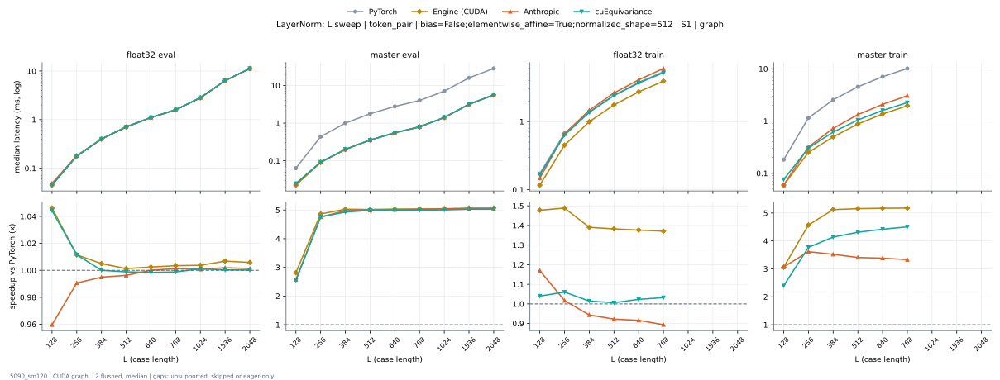

**float32 eval** (median ms; x = speedup vs PyTorch)

| L | PyTorch | Engine (Triton) | Engine (CUDA) | Anthropic | cuEquivariance |
|---|---|---|---|---|---|
| 128 | 0.04714 | 0.04506 (1.05x) | 0.04506 (1.05x) | 0.04912 (0.96x) | 0.04514 (1.04x) |
| 256 | 0.1802 | 0.1782 (1.01x) | 0.1782 (1.01x) | 0.1819 (0.99x) | 0.1782 (1.01x) |
| 384 | 0.3994 | 0.3993 (1.00x) | 0.3974 (1.00x) | 0.4014 (0.99x) | 0.3994 (1.00x) |
| 512 | 0.7078 | 0.7086 (1.00x) | 0.7069 (1.00x) | 0.7105 (1.00x) | 0.7086 (1.00x) |
| 640 | 1.106 | 1.106 (1.00x) | 1.103 (1.00x) | 1.106 (1.00x) | 1.107 (1.00x) |
| 768 | 1.592 | 1.595 (1.00x) | 1.587 (1.00x) | 1.59 (1.00x) | 1.594 (1.00x) |
| 1024 | 2.823 | 2.824 (1.00x) | 2.813 (1.00x) | 2.821 (1.00x) | 2.82 (1.00x) |
| 1536 | 6.352 | 6.359 (1.00x) | 6.309 (1.01x) | 6.34 (1.00x) | 6.35 (1.00x) |
| 2048 | 11.28 | 11.29 (1.00x) | 11.22 (1.01x) | 11.27 (1.00x) | 11.28 (1.00x) |

**master eval** (median ms; x = speedup vs PyTorch)

| L | PyTorch | Engine (Triton) | Engine (CUDA) | Anthropic | cuEquivariance |
|---|---|---|---|---|---|
| 128 | 0.06346 | 0.02451 (2.59x) | 0.02254 (2.81x) | 0.02461 (2.58x) | 0.02494 (2.54x) |
| 256 | 0.4383 | 0.09216 (4.76x) | 0.09011 (4.86x) | 0.09216 (4.76x) | 0.09205 (4.76x) |
| 384 | 0.9994 | 0.2014 (4.96x) | 0.1988 (5.03x) | 0.2007 (4.98x) | 0.2028 (4.93x) |
| 512 | 1.778 | 0.3567 (4.98x) | 0.3543 (5.02x) | 0.3564 (4.99x) | 0.3564 (4.99x) |
| 640 | 2.778 | 0.5571 (4.99x) | 0.5519 (5.03x) | 0.5544 (5.01x) | 0.5574 (4.98x) |
| 768 | 4 | 0.8008 (4.99x) | 0.7946 (5.03x) | 0.795 (5.03x) | 0.8 (5.00x) |
| 1024 | 7.106 | 1.421 (5.00x) | 1.408 (5.05x) | 1.411 (5.04x) | 1.42 (5.00x) |
| 1536 | 15.99 | 3.177 (5.03x) | 3.156 (5.07x) | 3.171 (5.04x) | 3.18 (5.03x) |
| 2048 | 28.41 | 5.647 (5.03x) | 5.607 (5.07x) | 5.631 (5.05x) | 5.649 (5.03x) |

**float32 train** (median ms; x = speedup vs PyTorch)

| L | PyTorch | Engine (Triton) | Engine (CUDA) | Anthropic | cuEquivariance |
|---|---|---|---|---|---|
| 128 | 0.1725 | 0.1127 (1.53x) | 0.1167 (1.48x) | 0.1474 (1.17x) | 0.1659 (1.04x) |
| 256 | 0.6707 | 0.4448 (1.51x) | 0.4506 (1.49x) | 0.6594 (1.02x) | 0.6326 (1.06x) |
| 384 | 1.383 | 0.9934 (1.39x) | 0.9943 (1.39x) | 1.465 (0.94x) | 1.363 (1.01x) |
| 512 | 2.422 | 1.756 (1.38x) | 1.752 (1.38x) | 2.626 (0.92x) | 2.408 (1.01x) |
| 640 | 3.756 | 2.735 (1.37x) | 2.728 (1.38x) | 4.099 (0.92x) | 3.67 (1.02x) |
| 768 | 5.375 | 3.932 (1.37x) | 3.92 (1.37x) | 6.014 (0.89x) | 5.208 (1.03x) |
| 1024 |  |  |  |  |  |
| 1536 |  |  |  |  |  |
| 2048 |  |  |  |  |  |

**master train** (median ms; x = speedup vs PyTorch)

| L | PyTorch | Engine (Triton) | Engine (CUDA) | Anthropic | cuEquivariance |
|---|---|---|---|---|---|
| 128 | 0.1822 | 0.05734 (3.18x) | 0.05957 (3.06x) | 0.05939 (3.07x) | 0.07603 (2.40x) |
| 256 | 1.148 | 0.2314 (4.96x) | 0.2512 (4.57x) | 0.3174 (3.62x) | 0.3044 (3.77x) |
| 384 | 2.551 | 0.5041 (5.06x) | 0.4982 (5.12x) | 0.7247 (3.52x) | 0.6163 (4.14x) |
| 512 | 4.521 | 0.8888 (5.09x) | 0.8771 (5.16x) | 1.327 (3.41x) | 1.049 (4.31x) |
| 640 | 7.057 | 1.381 (5.11x) | 1.365 (5.17x) | 2.086 (3.38x) | 1.596 (4.42x) |
| 768 | 10.15 | 1.992 (5.10x) | 1.961 (5.18x) | 3.048 (3.33x) | 2.254 (4.50x) |
| 1024 |  |  |  |  |  |
| 1536 |  |  |  |  |  |
| 2048 |  |  |  |  |  |

### L sweep: token_pair | bias=False;elementwise_affine=True;normalized_shape=651 | S1 | graph

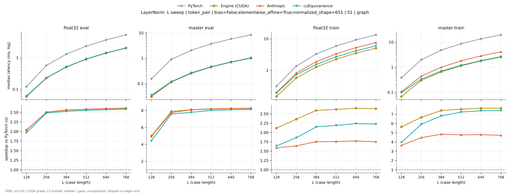

**float32 eval** (median ms; x = speedup vs PyTorch)

| L | PyTorch | Engine (Triton) | Engine (CUDA) | Anthropic | cuEquivariance |
|---|---|---|---|---|---|
| 128 | 0.1208 | 0.06352 (1.90x) | 0.05926 (2.04x) | 0.05939 (2.03x) | 0.06144 (1.97x) |
| 256 | 0.5694 | 0.2417 (2.36x) | 0.2273 (2.50x) | 0.2273 (2.50x) | 0.2294 (2.48x) |
| 384 | 1.297 | 0.5361 (2.42x) | 0.5069 (2.56x) | 0.5069 (2.56x) | 0.5134 (2.53x) |
| 512 | 2.322 | 0.9422 (2.46x) | 0.9005 (2.58x) | 0.8993 (2.58x) | 0.9095 (2.55x) |
| 640 | 3.65 | 1.465 (2.49x) | 1.406 (2.60x) | 1.404 (2.60x) | 1.42 (2.57x) |
| 768 | 5.273 | 2.1 (2.51x) | 2.022 (2.61x) | 2.021 (2.61x) | 2.041 (2.58x) |

**master eval** (median ms; x = speedup vs PyTorch)

| L | PyTorch | Engine (Triton) | Engine (CUDA) | Anthropic | cuEquivariance |
|---|---|---|---|---|---|
| 128 | 0.1536 | 0.03686 (4.17x) | 0.03072 (5.00x) | 0.03101 (4.95x) | 0.03482 (4.41x) |
| 256 | 0.9042 | 0.1208 (7.48x) | 0.1147 (7.88x) | 0.1167 (7.75x) | 0.1191 (7.59x) |
| 384 | 2.057 | 0.2621 (7.85x) | 0.254 (8.10x) | 0.2541 (8.10x) | 0.2642 (7.79x) |
| 512 | 3.694 | 0.4588 (8.05x) | 0.4525 (8.16x) | 0.4506 (8.20x) | 0.4608 (8.02x) |
| 640 | 5.786 | 0.711 (8.14x) | 0.7035 (8.22x) | 0.7015 (8.25x) | 0.7148 (8.09x) |
| 768 | 8.344 | 1.022 (8.16x) | 1.012 (8.25x) | 1.008 (8.28x) | 1.027 (8.13x) |

**float32 train** (median ms; x = speedup vs PyTorch)

| L | PyTorch | Engine (Triton) | Engine (CUDA) | Anthropic | cuEquivariance |
|---|---|---|---|---|---|
| 128 | 0.3123 | 0.1536 (2.03x) | 0.1475 (2.12x) | 0.1966 (1.59x) | 0.1905 (1.64x) |
| 256 | 1.351 | 0.8028 (1.68x) | 0.5733 (2.36x) | 0.823 (1.64x) | 0.7255 (1.86x) |
| 384 | 3.29 | 1.424 (2.31x) | 1.27 (2.59x) | 1.875 (1.75x) | 1.53 (2.15x) |
| 512 | 5.864 | 2.411 (2.43x) | 2.24 (2.62x) | 3.336 (1.76x) | 2.677 (2.19x) |
| 640 | 9.263 | 3.631 (2.55x) | 3.494 (2.65x) | 5.224 (1.77x) | 4.142 (2.24x) |
| 768 | 13.25 | 5.2 (2.55x) | 5.024 (2.64x) | 7.561 (1.75x) | 5.948 (2.23x) |

**master train** (median ms; x = speedup vs PyTorch)

| L | PyTorch | Engine (Triton) | Engine (CUDA) | Anthropic | cuEquivariance |
|---|---|---|---|---|---|
| 128 | 0.3809 | 0.09232 (4.13x) | 0.06755 (5.64x) | 0.1045 (3.65x) | 0.09619 (3.96x) |
| 256 | 1.979 | 0.3092 (6.40x) | 0.2969 (6.67x) | 0.4424 (4.47x) | 0.3338 (5.93x) |
| 384 | 4.794 | 0.6636 (7.23x) | 0.6472 (7.41x) | 0.9902 (4.84x) | 0.7024 (6.83x) |
| 512 | 8.567 | 1.169 (7.33x) | 1.135 (7.55x) | 1.794 (4.77x) | 1.184 (7.24x) |
| 640 | 13.49 | 1.824 (7.40x) | 1.764 (7.65x) | 2.814 (4.79x) | 1.828 (7.38x) |
| 768 | 19.35 | 2.643 (7.32x) | 2.528 (7.65x) | 4.096 (4.73x) | 2.616 (7.40x) |

### L sweep: token_pair | bias=True;elementwise_affine=True;normalized_shape=128 | S1 | graph

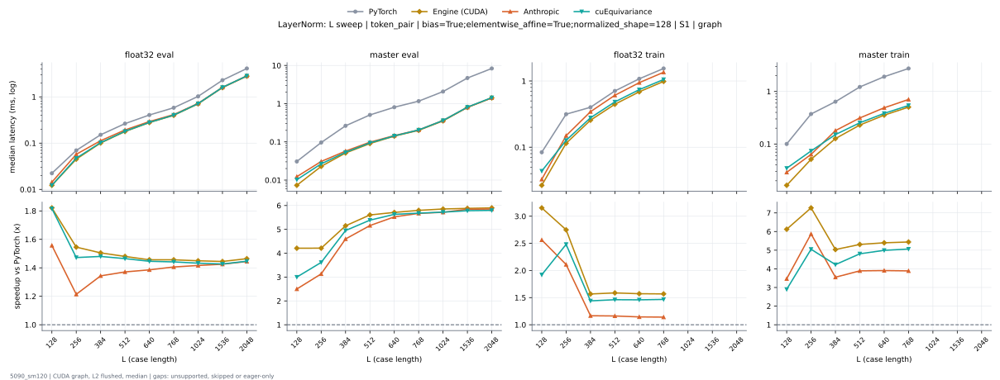

**float32 eval** (median ms; x = speedup vs PyTorch)

| L | PyTorch | Engine (Triton) | Engine (CUDA) | Anthropic | cuEquivariance |
|---|---|---|---|---|---|
| 128 | 0.02232 | 0.01229 (1.82x) | 0.01226 (1.82x) | 0.01434 (1.56x) | 0.01229 (1.82x) |
| 256 | 0.06963 | 0.04506 (1.55x) | 0.04506 (1.55x) | 0.05736 (1.21x) | 0.0473 (1.47x) |
| 384 | 0.1516 | 0.1004 (1.51x) | 0.1007 (1.50x) | 0.1128 (1.34x) | 0.1024 (1.48x) |
| 512 | 0.264 | 0.1802 (1.46x) | 0.1784 (1.48x) | 0.1925 (1.37x) | 0.1802 (1.46x) |
| 640 | 0.4057 | 0.2787 (1.46x) | 0.2785 (1.46x) | 0.2928 (1.39x) | 0.2806 (1.45x) |
| 768 | 0.5816 | 0.4014 (1.45x) | 0.3993 (1.46x) | 0.4137 (1.41x) | 0.4035 (1.44x) |
| 1024 | 1.024 | 0.7127 (1.44x) | 0.7065 (1.45x) | 0.7229 (1.42x) | 0.7148 (1.43x) |
| 1536 | 2.291 | 1.596 (1.44x) | 1.586 (1.44x) | 1.608 (1.43x) | 1.606 (1.43x) |
| 2048 | 4.109 | 2.84 (1.45x) | 2.806 (1.46x) | 2.844 (1.44x) | 2.841 (1.45x) |

**master eval** (median ms; x = speedup vs PyTorch)

| L | PyTorch | Engine (Triton) | Engine (CUDA) | Anthropic | cuEquivariance |
|---|---|---|---|---|---|
| 128 | 0.0307 | 0.008192 (3.75x) | 0.007296 (4.21x) | 0.01229 (2.50x) | 0.01024 (3.00x) |
| 256 | 0.09622 | 0.02458 (3.92x) | 0.02285 (4.21x) | 0.03072 (3.13x) | 0.02662 (3.61x) |
| 384 | 0.2636 | 0.0512 (5.15x) | 0.0512 (5.15x) | 0.05734 (4.60x) | 0.05325 (4.95x) |
| 512 | 0.5072 | 0.09011 (5.63x) | 0.0905 (5.61x) | 0.0983 (5.16x) | 0.09418 (5.39x) |
| 640 | 0.8069 | 0.1413 (5.71x) | 0.1413 (5.71x) | 0.1461 (5.52x) | 0.1434 (5.63x) |
| 768 | 1.163 | 0.2028 (5.74x) | 0.2007 (5.80x) | 0.2052 (5.67x) | 0.2048 (5.68x) |
| 1024 | 2.074 | 0.3604 (5.75x) | 0.3543 (5.85x) | 0.3628 (5.72x) | 0.3625 (5.72x) |
| 1536 | 4.69 | 0.8079 (5.81x) | 0.7977 (5.88x) | 0.8028 (5.84x) | 0.8113 (5.78x) |
| 2048 | 8.337 | 1.435 (5.81x) | 1.413 (5.90x) | 1.424 (5.85x) | 1.439 (5.80x) |

**float32 train** (median ms; x = speedup vs PyTorch)

| L | PyTorch | Engine (Triton) | Engine (CUDA) | Anthropic | cuEquivariance |
|---|---|---|---|---|---|
| 128 | 0.08397 | 0.03072 (2.73x) | 0.02662 (3.15x) | 0.03277 (2.56x) | 0.04371 (1.92x) |
| 256 | 0.3154 | 0.1167 (2.70x) | 0.1147 (2.75x) | 0.1495 (2.11x) | 0.1271 (2.48x) |
| 384 | 0.4012 | 0.258 (1.55x) | 0.256 (1.57x) | 0.3441 (1.17x) | 0.2786 (1.44x) |
| 512 | 0.7068 | 0.4464 (1.58x) | 0.4454 (1.59x) | 0.6084 (1.16x) | 0.4836 (1.46x) |
| 640 | 1.079 | 0.6984 (1.55x) | 0.6866 (1.57x) | 0.9431 (1.14x) | 0.7395 (1.46x) |
| 768 | 1.545 | 1.003 (1.54x) | 0.9851 (1.57x) | 1.355 (1.14x) | 1.053 (1.47x) |
| 1024 |  |  |  |  |  |
| 1536 |  |  |  |  |  |
| 2048 |  |  |  |  |  |

**master train** (median ms; x = speedup vs PyTorch)

| L | PyTorch | Engine (Triton) | Engine (CUDA) | Anthropic | cuEquivariance |
|---|---|---|---|---|---|
| 128 | 0.1003 | 0.01693 (5.93x) | 0.01638 (6.12x) | 0.02894 (3.47x) | 0.03459 (2.90x) |
| 256 | 0.3727 | 0.05736 (6.50x) | 0.05128 (7.27x) | 0.06349 (5.87x) | 0.07382 (5.05x) |
| 384 | 0.6393 | 0.1331 (4.80x) | 0.127 (5.03x) | 0.1801 (3.55x) | 0.1513 (4.23x) |
| 512 | 1.219 | 0.2253 (5.41x) | 0.2297 (5.31x) | 0.3133 (3.89x) | 0.2537 (4.81x) |
| 640 | 1.912 | 0.3524 (5.42x) | 0.3543 (5.40x) | 0.4895 (3.91x) | 0.383 (4.99x) |
| 768 | 2.74 | 0.5079 (5.40x) | 0.5038 (5.44x) | 0.7046 (3.89x) | 0.5414 (5.06x) |
| 1024 |  |  |  |  |  |
| 1536 |  |  |  |  |  |
| 2048 |  |  |  |  |  |

### L sweep: token_pair | bias=True;elementwise_affine=True;normalized_shape=256 | S1 | graph

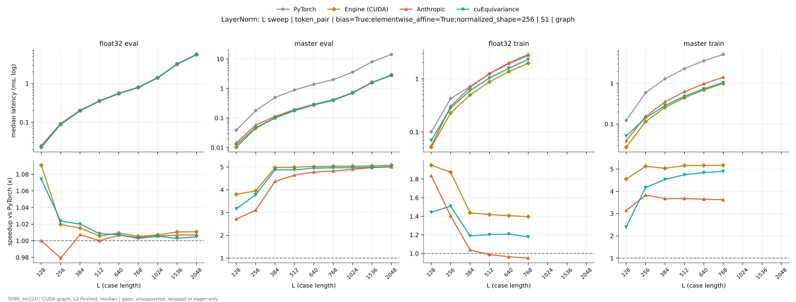

**float32 eval** (median ms; x = speedup vs PyTorch)

| L | PyTorch | Engine (Triton) | Engine (CUDA) | Anthropic | cuEquivariance |
|---|---|---|---|---|---|
| 128 | 0.02458 | 0.02253 (1.09x) | 0.02253 (1.09x) | 0.02458 (1.00x) | 0.02288 (1.07x) |
| 256 | 0.09014 | 0.08827 (1.02x) | 0.08842 (1.02x) | 0.09206 (0.98x) | 0.08806 (1.02x) |
| 384 | 0.2027 | 0.2007 (1.01x) | 0.1996 (1.02x) | 0.2012 (1.01x) | 0.1987 (1.02x) |
| 512 | 0.3564 | 0.3543 (1.01x) | 0.3543 (1.01x) | 0.3564 (1.00x) | 0.3533 (1.01x) |
| 640 | 0.5571 | 0.5548 (1.00x) | 0.5519 (1.01x) | 0.5533 (1.01x) | 0.553 (1.01x) |
| 768 | 0.7989 | 0.7977 (1.00x) | 0.7946 (1.01x) | 0.7958 (1.00x) | 0.7967 (1.00x) |
| 1024 | 1.42 | 1.416 (1.00x) | 1.41 (1.01x) | 1.412 (1.01x) | 1.412 (1.01x) |
| 1536 | 3.191 | 3.178 (1.00x) | 3.157 (1.01x) | 3.169 (1.01x) | 3.182 (1.00x) |
| 2048 | 5.669 | 5.631 (1.01x) | 5.609 (1.01x) | 5.628 (1.01x) | 5.641 (1.00x) |

**master eval** (median ms; x = speedup vs PyTorch)

| L | PyTorch | Engine (Triton) | Engine (CUDA) | Anthropic | cuEquivariance |
|---|---|---|---|---|---|
| 128 | 0.03891 | 0.01229 (3.17x) | 0.01024 (3.80x) | 0.01434 (2.71x) | 0.01229 (3.17x) |
| 256 | 0.1782 | 0.04506 (3.95x) | 0.04506 (3.95x) | 0.05738 (3.11x) | 0.0471 (3.78x) |
| 384 | 0.499 | 0.1021 (4.89x) | 0.1004 (4.97x) | 0.1142 (4.37x) | 0.1024 (4.87x) |
| 512 | 0.8892 | 0.1802 (4.93x) | 0.1782 (4.99x) | 0.1915 (4.64x) | 0.1823 (4.88x) |
| 640 | 1.39 | 0.2796 (4.97x) | 0.2769 (5.02x) | 0.2908 (4.78x) | 0.2809 (4.95x) |
| 768 | 2.004 | 0.4017 (4.99x) | 0.3983 (5.03x) | 0.4157 (4.82x) | 0.4036 (4.96x) |
| 1024 | 3.559 | 0.7127 (4.99x) | 0.7066 (5.04x) | 0.726 (4.90x) | 0.7161 (4.97x) |
| 1536 | 8.005 | 1.595 (5.02x) | 1.585 (5.05x) | 1.609 (4.97x) | 1.605 (4.99x) |
| 2048 | 14.23 | 2.835 (5.02x) | 2.803 (5.08x) | 2.844 (5.01x) | 2.838 (5.02x) |

**float32 train** (median ms; x = speedup vs PyTorch)

| L | PyTorch | Engine (Triton) | Engine (CUDA) | Anthropic | cuEquivariance |
|---|---|---|---|---|---|
| 128 | 0.1005 | 0.0553 (1.82x) | 0.05157 (1.95x) | 0.05475 (1.84x) | 0.0696 (1.44x) |
| 256 | 0.426 | 0.2294 (1.86x) | 0.2273 (1.87x) | 0.3033 (1.40x) | 0.2824 (1.51x) |
| 384 | 0.7158 | 0.5059 (1.41x) | 0.498 (1.44x) | 0.6897 (1.04x) | 0.6017 (1.19x) |
| 512 | 1.243 | 0.8858 (1.40x) | 0.8765 (1.42x) | 1.258 (0.99x) | 1.034 (1.20x) |
| 640 | 1.92 | 1.375 (1.40x) | 1.366 (1.41x) | 1.991 (0.96x) | 1.589 (1.21x) |
| 768 | 2.737 | 1.977 (1.38x) | 1.96 (1.40x) | 2.88 (0.95x) | 2.324 (1.18x) |
| 1024 |  |  |  |  |  |
| 1536 |  |  |  |  |  |
| 2048 |  |  |  |  |  |

**master train** (median ms; x = speedup vs PyTorch)

| L | PyTorch | Engine (Triton) | Engine (CUDA) | Anthropic | cuEquivariance |
|---|---|---|---|---|---|
| 128 | 0.1228 | 0.03478 (3.53x) | 0.02698 (4.55x) | 0.03917 (3.14x) | 0.0512 (2.40x) |
| 256 | 0.5881 | 0.1125 (5.23x) | 0.1147 (5.13x) | 0.1536 (3.83x) | 0.1411 (4.17x) |
| 384 | 1.289 | 0.256 (5.04x) | 0.256 (5.04x) | 0.3514 (3.67x) | 0.2842 (4.54x) |
| 512 | 2.282 | 0.4465 (5.11x) | 0.4423 (5.16x) | 0.6205 (3.68x) | 0.481 (4.74x) |
| 640 | 3.549 | 0.7035 (5.05x) | 0.6871 (5.17x) | 0.9734 (3.65x) | 0.7332 (4.84x) |
| 768 | 5.102 | 0.9994 (5.10x) | 0.9861 (5.17x) | 1.408 (3.62x) | 1.041 (4.90x) |
| 1024 |  |  |  |  |  |
| 1536 |  |  |  |  |  |
| 2048 |  |  |  |  |  |

### L sweep: token_pair | bias=True;elementwise_affine=True;normalized_shape=384 | S1 | graph

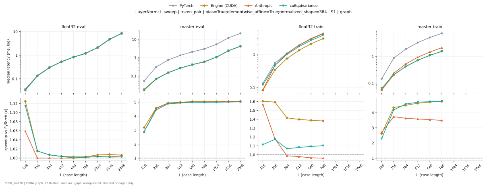

**float32 eval** (median ms; x = speedup vs PyTorch)

| L | PyTorch | Engine (Triton) | Engine (CUDA) | Anthropic | cuEquivariance |
|---|---|---|---|---|---|
| 128 | 0.03686 | 0.03277 (1.13x) | 0.03277 (1.13x) | 0.03482 (1.06x) | 0.03307 (1.11x) |
| 256 | 0.1352 | 0.1317 (1.03x) | 0.1331 (1.02x) | 0.1352 (1.00x) | 0.1331 (1.02x) |
| 384 | 0.3011 | 0.2977 (1.01x) | 0.299 (1.01x) | 0.3011 (1.00x) | 0.299 (1.01x) |
| 512 | 0.5325 | 0.5304 (1.00x) | 0.5305 (1.00x) | 0.5325 (1.00x) | 0.5308 (1.00x) |
| 640 | 0.8305 | 0.8298 (1.00x) | 0.8284 (1.00x) | 0.8306 (1.00x) | 0.8301 (1.00x) |
| 768 | 1.195 | 1.191 (1.00x) | 1.192 (1.00x) | 1.193 (1.00x) | 1.193 (1.00x) |
| 1024 | 2.123 | 2.117 (1.00x) | 2.109 (1.01x) | 2.115 (1.00x) | 2.117 (1.00x) |
| 1536 | 4.768 | 4.756 (1.00x) | 4.731 (1.01x) | 4.756 (1.00x) | 4.758 (1.00x) |
| 2048 | 8.476 | 8.466 (1.00x) | 8.423 (1.01x) | 8.435 (1.00x) | 8.456 (1.00x) |

**master eval** (median ms; x = speedup vs PyTorch)

| L | PyTorch | Engine (Triton) | Engine (CUDA) | Anthropic | cuEquivariance |
|---|---|---|---|---|---|
| 128 | 0.05322 | 0.01843 (2.89x) | 0.0167 (3.19x) | 0.01843 (2.89x) | 0.01843 (2.89x) |
| 256 | 0.3096 | 0.06762 (4.58x) | 0.06758 (4.58x) | 0.06813 (4.54x) | 0.06963 (4.45x) |
| 384 | 0.7496 | 0.1516 (4.94x) | 0.1516 (4.95x) | 0.1519 (4.93x) | 0.1536 (4.88x) |
| 512 | 1.334 | 0.2683 (4.97x) | 0.2672 (4.99x) | 0.2683 (4.97x) | 0.2703 (4.94x) |
| 640 | 2.086 | 0.4178 (4.99x) | 0.4137 (5.04x) | 0.4157 (5.02x) | 0.4182 (4.99x) |
| 768 | 3.002 | 0.6001 (5.00x) | 0.5963 (5.04x) | 0.598 (5.02x) | 0.6021 (4.99x) |
| 1024 | 5.331 | 1.066 (5.00x) | 1.059 (5.03x) | 1.06 (5.03x) | 1.068 (4.99x) |
| 1536 | 12 | 2.383 (5.04x) | 2.376 (5.05x) | 2.378 (5.05x) | 2.396 (5.01x) |
| 2048 | 21.32 | 4.235 (5.03x) | 4.207 (5.07x) | 4.221 (5.05x) | 4.241 (5.03x) |

**float32 train** (median ms; x = speedup vs PyTorch)

| L | PyTorch | Engine (Triton) | Engine (CUDA) | Anthropic | cuEquivariance |
|---|---|---|---|---|---|
| 128 | 0.1346 | 0.07987 (1.69x) | 0.08397 (1.60x) | 0.08597 (1.57x) | 0.1208 (1.11x) |
| 256 | 0.5448 | 0.3399 (1.60x) | 0.342 (1.59x) | 0.4617 (1.18x) | 0.4644 (1.17x) |
| 384 | 1.055 | 0.7506 (1.41x) | 0.7455 (1.42x) | 1.068 (0.99x) | 0.9888 (1.07x) |
| 512 | 1.84 | 1.327 (1.39x) | 1.316 (1.40x) | 1.879 (0.98x) | 1.699 (1.08x) |
| 640 | 2.844 | 2.066 (1.38x) | 2.049 (1.39x) | 2.945 (0.97x) | 2.601 (1.09x) |
| 768 | 4.065 | 2.969 (1.37x) | 2.943 (1.38x) | 4.224 (0.96x) | 3.688 (1.10x) |
| 1024 |  |  |  |  |  |
| 1536 |  |  |  |  |  |
| 2048 |  |  |  |  |  |

**master train** (median ms; x = speedup vs PyTorch)

| L | PyTorch | Engine (Triton) | Engine (CUDA) | Anthropic | cuEquivariance |
|---|---|---|---|---|---|
| 128 | 0.1454 | 0.04506 (3.23x) | 0.05568 (2.61x) | 0.0539 (2.70x) | 0.06352 (2.29x) |
| 256 | 0.8796 | 0.1762 (4.99x) | 0.2027 (4.34x) | 0.2355 (3.73x) | 0.21 (4.19x) |
| 384 | 1.929 | 0.3789 (5.09x) | 0.429 (4.50x) | 0.531 (3.63x) | 0.422 (4.57x) |
| 512 | 3.408 | 0.6697 (5.09x) | 0.7373 (4.62x) | 0.9514 (3.58x) | 0.7258 (4.70x) |
| 640 | 5.313 | 1.036 (5.13x) | 1.129 (4.70x) | 1.499 (3.54x) | 1.123 (4.73x) |
| 768 | 7.634 | 1.501 (5.09x) | 1.609 (4.75x) | 2.188 (3.49x) | 1.604 (4.76x) |
| 1024 |  |  |  |  |  |
| 1536 |  |  |  |  |  |
| 2048 |  |  |  |  |  |

### L sweep: token_pair | bias=True;elementwise_affine=True;normalized_shape=512 | S1 | graph

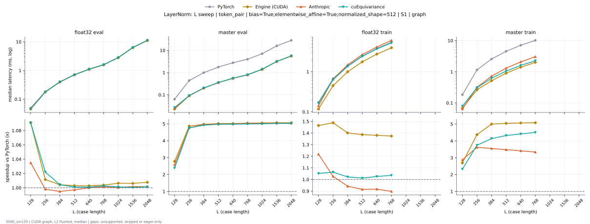

**float32 eval** (median ms; x = speedup vs PyTorch)

| L | PyTorch | Engine (Triton) | Engine (CUDA) | Anthropic | cuEquivariance |
|---|---|---|---|---|---|
| 128 | 0.04915 | 0.04336 (1.13x) | 0.04506 (1.09x) | 0.04749 (1.04x) | 0.04506 (1.09x) |
| 256 | 0.1802 | 0.1765 (1.02x) | 0.1782 (1.01x) | 0.1806 (1.00x) | 0.1763 (1.02x) |
| 384 | 0.3994 | 0.3973 (1.01x) | 0.3977 (1.00x) | 0.4014 (0.99x) | 0.3977 (1.00x) |
| 512 | 0.7086 | 0.7069 (1.00x) | 0.7066 (1.00x) | 0.7107 (1.00x) | 0.7079 (1.00x) |
| 640 | 1.106 | 1.103 (1.00x) | 1.103 (1.00x) | 1.106 (1.00x) | 1.105 (1.00x) |
| 768 | 1.592 | 1.588 (1.00x) | 1.586 (1.00x) | 1.59 (1.00x) | 1.588 (1.00x) |
| 1024 | 2.823 | 2.823 (1.00x) | 2.805 (1.01x) | 2.822 (1.00x) | 2.819 (1.00x) |
| 1536 | 6.352 | 6.354 (1.00x) | 6.313 (1.01x) | 6.342 (1.00x) | 6.35 (1.00x) |
| 2048 | 11.28 | 11.28 (1.00x) | 11.2 (1.01x) | 11.27 (1.00x) | 11.27 (1.00x) |

**master eval** (median ms; x = speedup vs PyTorch)

| L | PyTorch | Engine (Triton) | Engine (CUDA) | Anthropic | cuEquivariance |
|---|---|---|---|---|---|
| 128 | 0.06349 | 0.02458 (2.58x) | 0.02282 (2.78x) | 0.02458 (2.58x) | 0.02662 (2.38x) |
| 256 | 0.4386 | 0.09011 (4.87x) | 0.09011 (4.87x) | 0.09214 (4.76x) | 0.09216 (4.76x) |
| 384 | 0.9983 | 0.2007 (4.97x) | 0.2007 (4.98x) | 0.201 (4.97x) | 0.2028 (4.92x) |
| 512 | 1.777 | 0.3564 (4.99x) | 0.3543 (5.02x) | 0.3564 (4.99x) | 0.3572 (4.98x) |
| 640 | 2.774 | 0.5565 (4.98x) | 0.5529 (5.02x) | 0.554 (5.01x) | 0.5574 (4.98x) |
| 768 | 3.999 | 0.7995 (5.00x) | 0.7936 (5.04x) | 0.7956 (5.03x) | 0.8008 (4.99x) |
| 1024 | 7.103 | 1.412 (5.03x) | 1.406 (5.05x) | 1.411 (5.03x) | 1.42 (5.00x) |
| 1536 | 15.99 | 3.171 (5.04x) | 3.156 (5.07x) | 3.172 (5.04x) | 3.181 (5.03x) |
| 2048 | 28.41 | 5.647 (5.03x) | 5.61 (5.06x) | 5.629 (5.05x) | 5.655 (5.02x) |

**float32 train** (median ms; x = speedup vs PyTorch)

| L | PyTorch | Engine (Triton) | Engine (CUDA) | Anthropic | cuEquivariance |
|---|---|---|---|---|---|
| 128 | 0.1725 | 0.1126 (1.53x) | 0.1177 (1.46x) | 0.1416 (1.22x) | 0.164 (1.05x) |
| 256 | 0.6707 | 0.4444 (1.51x) | 0.4506 (1.49x) | 0.6533 (1.03x) | 0.6308 (1.06x) |
| 384 | 1.393 | 0.9933 (1.40x) | 0.9943 (1.40x) | 1.479 (0.94x) | 1.363 (1.02x) |
| 512 | 2.432 | 1.756 (1.38x) | 1.754 (1.39x) | 2.657 (0.92x) | 2.404 (1.01x) |
| 640 | 3.766 | 2.733 (1.38x) | 2.729 (1.38x) | 4.106 (0.92x) | 3.671 (1.03x) |
| 768 | 5.385 | 3.93 (1.37x) | 3.92 (1.37x) | 6.003 (0.90x) | 5.2 (1.04x) |
| 1024 |  |  |  |  |  |
| 1536 |  |  |  |  |  |
| 2048 |  |  |  |  |  |

**master train** (median ms; x = speedup vs PyTorch)

| L | PyTorch | Engine (Triton) | Engine (CUDA) | Anthropic | cuEquivariance |
|---|---|---|---|---|---|
| 128 | 0.1822 | 0.05734 (3.18x) | 0.06758 (2.70x) | 0.06336 (2.88x) | 0.0785 (2.32x) |
| 256 | 1.149 | 0.2314 (4.96x) | 0.2627 (4.37x) | 0.3174 (3.62x) | 0.3069 (3.74x) |
| 384 | 2.56 | 0.5038 (5.08x) | 0.512 (5.00x) | 0.7207 (3.55x) | 0.6185 (4.14x) |
| 512 | 4.531 | 0.8909 (5.09x) | 0.8983 (5.04x) | 1.302 (3.48x) | 1.049 (4.32x) |
| 640 | 7.062 | 1.385 (5.10x) | 1.394 (5.07x) | 2.07 (3.41x) | 1.599 (4.42x) |
| 768 | 10.16 | 1.994 (5.10x) | 2 (5.08x) | 3.044 (3.34x) | 2.255 (4.51x) |
| 1024 |  |  |  |  |  |
| 1536 |  |  |  |  |  |
| 2048 |  |  |  |  |  |

### L sweep: token_pair | bias=True;elementwise_affine=True;normalized_shape=64 | S1 | graph

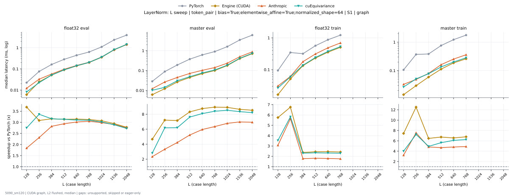

**float32 eval** (median ms; x = speedup vs PyTorch)

| L | PyTorch | Engine (Triton) | Engine (CUDA) | Anthropic | cuEquivariance |
|---|---|---|---|---|---|
| 128 | 0.02253 | 0.008192 (2.75x) | 0.006112 (3.69x) | 0.01226 (1.84x) | 0.008192 (2.75x) |
| 256 | 0.07578 | 0.02458 (3.08x) | 0.02458 (3.08x) | 0.03277 (2.31x) | 0.02253 (3.36x) |
| 384 | 0.1618 | 0.05147 (3.14x) | 0.0512 (3.16x) | 0.05736 (2.82x) | 0.0512 (3.16x) |
| 512 | 0.2826 | 0.09013 (3.14x) | 0.09011 (3.14x) | 0.09626 (2.94x) | 0.09011 (3.14x) |
| 640 | 0.4383 | 0.1413 (3.10x) | 0.1393 (3.15x) | 0.1454 (3.01x) | 0.1413 (3.10x) |
| 768 | 0.6277 | 0.2031 (3.09x) | 0.2007 (3.13x) | 0.2058 (3.05x) | 0.2028 (3.10x) |
| 1024 | 1.087 | 0.3584 (3.03x) | 0.3543 (3.07x) | 0.3642 (2.99x) | 0.3608 (3.01x) |
| 1536 | 2.338 | 0.8069 (2.90x) | 0.7946 (2.94x) | 0.8046 (2.91x) | 0.8089 (2.89x) |
| 2048 | 3.915 | 1.431 (2.74x) | 1.409 (2.78x) | 1.422 (2.75x) | 1.437 (2.72x) |

**master eval** (median ms; x = speedup vs PyTorch)

| L | PyTorch | Engine (Triton) | Engine (CUDA) | Anthropic | cuEquivariance |
|---|---|---|---|---|---|
| 128 | 0.02867 | 0.006144 (4.67x) | 0.006144 (4.67x) | 0.01226 (2.34x) | 0.01021 (2.81x) |
| 256 | 0.08867 | 0.01229 (7.22x) | 0.01229 (7.22x) | 0.02662 (3.33x) | 0.01434 (6.19x) |
| 384 | 0.1904 | 0.02869 (6.64x) | 0.02662 (7.15x) | 0.04506 (4.23x) | 0.0307 (6.20x) |
| 512 | 0.3748 | 0.04573 (8.20x) | 0.04506 (8.32x) | 0.07168 (5.23x) | 0.04915 (7.62x) |
| 640 | 0.6127 | 0.07198 (8.51x) | 0.07 (8.75x) | 0.1028 (5.96x) | 0.07578 (8.09x) |
| 768 | 0.8981 | 0.1044 (8.60x) | 0.1004 (8.95x) | 0.1413 (6.36x) | 0.1069 (8.40x) |
| 1024 | 1.589 | 0.1823 (8.72x) | 0.1782 (8.92x) | 0.2342 (6.78x) | 0.1864 (8.52x) |
| 1536 | 3.456 | 0.4121 (8.39x) | 0.3993 (8.65x) | 0.4956 (6.97x) | 0.4141 (8.35x) |
| 2048 | 6.03 | 0.7311 (8.25x) | 0.7066 (8.53x) | 0.8704 (6.93x) | 0.7342 (8.21x) |

**float32 train** (median ms; x = speedup vs PyTorch)

| L | PyTorch | Engine (Triton) | Engine (CUDA) | Anthropic | cuEquivariance |
|---|---|---|---|---|---|
| 128 | 0.09421 | 0.01843 (5.11x) | 0.01638 (5.75x) | 0.0307 (3.07x) | 0.02662 (3.54x) |
| 256 | 0.3461 | 0.0553 (6.26x) | 0.0512 (6.76x) | 0.06141 (5.64x) | 0.05942 (5.82x) |
| 384 | 0.3168 | 0.127 (2.50x) | 0.1334 (2.37x) | 0.1782 (1.78x) | 0.1374 (2.31x) |
| 512 | 0.5653 | 0.2253 (2.51x) | 0.2314 (2.44x) | 0.3117 (1.81x) | 0.2414 (2.34x) |
| 640 | 0.8701 | 0.3502 (2.48x) | 0.3543 (2.46x) | 0.4854 (1.79x) | 0.3748 (2.32x) |
| 768 | 1.218 | 0.5028 (2.42x) | 0.504 (2.42x) | 0.6922 (1.76x) | 0.5302 (2.30x) |
| 1024 |  |  |  |  |  |
| 1536 |  |  |  |  |  |
| 2048 |  |  |  |  |  |

**master train** (median ms; x = speedup vs PyTorch)

| L | PyTorch | Engine (Triton) | Engine (CUDA) | Anthropic | cuEquivariance |
|---|---|---|---|---|---|
| 128 | 0.1065 | 0.01229 (8.67x) | 0.01434 (7.43x) | 0.03302 (3.22x) | 0.02662 (4.00x) |
| 256 | 0.3707 | 0.03107 (11.93x) | 0.02962 (12.52x) | 0.04912 (7.55x) | 0.05123 (7.23x) |
| 384 | 0.384 | 0.06349 (6.05x) | 0.05939 (6.46x) | 0.07987 (4.81x) | 0.07792 (4.93x) |
| 512 | 0.7578 | 0.1126 (6.73x) | 0.1126 (6.73x) | 0.1618 (4.68x) | 0.1345 (5.63x) |
| 640 | 1.221 | 0.1782 (6.85x) | 0.1864 (6.55x) | 0.2543 (4.80x) | 0.2007 (6.09x) |
| 768 | 1.762 | 0.256 (6.88x) | 0.2601 (6.78x) | 0.3605 (4.89x) | 0.2824 (6.24x) |
| 1024 |  |  |  |  |  |
| 1536 |  |  |  |  |  |
| 2048 |  |  |  |  |  |

### L sweep: token_single | bias=False;elementwise_affine=True;normalized_shape=384 | S1 | graph

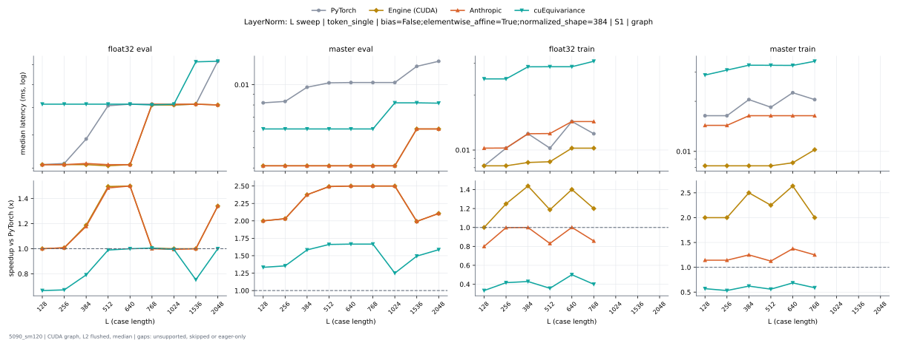

**float32 eval** (median ms; x = speedup vs PyTorch)

| L | PyTorch | Engine (Triton) | Engine (CUDA) | Anthropic | cuEquivariance |
|---|---|---|---|---|---|
| 128 | 0.004096 | 0.006144 (0.67x) | 0.004096 (1.00x) | 0.004096 (1.00x) | 0.006144 (0.67x) |
| 256 | 0.004128 | 0.006144 (0.67x) | 0.004096 (1.01x) | 0.004096 (1.01x) | 0.006144 (0.67x) |
| 384 | 0.004864 | 0.006144 (0.79x) | 0.004096 (1.19x) | 0.004128 (1.18x) | 0.006144 (0.79x) |
| 512 | 0.00608 | 0.00616 (0.99x) | 0.004064 (1.50x) | 0.004096 (1.48x) | 0.006144 (0.99x) |
| 640 | 0.006144 | 0.006144 (1.00x) | 0.004096 (1.50x) | 0.004096 (1.50x) | 0.006144 (1.00x) |
| 768 | 0.006144 | 0.006112 (1.01x) | 0.006112 (1.01x) | 0.006144 (1.00x) | 0.006112 (1.01x) |
| 1024 | 0.006112 | 0.006352 (0.96x) | 0.006112 (1.00x) | 0.006144 (0.99x) | 0.006144 (0.99x) |
| 1536 | 0.006144 | 0.00816 (0.75x) | 0.006144 (1.00x) | 0.006144 (1.00x) | 0.00816 (0.75x) |
| 2048 | 0.008192 | 0.00816 (1.00x) | 0.006112 (1.34x) | 0.006112 (1.34x) | 0.008192 (1.00x) |

**master eval** (median ms; x = speedup vs PyTorch)

| L | PyTorch | Engine (Triton) | Engine (CUDA) | Anthropic | cuEquivariance |
|---|---|---|---|---|---|
| 128 | 0.008192 | 0.00528 (1.55x) | 0.004096 (2.00x) | 0.004096 (2.00x) | 0.006144 (1.33x) |
| 256 | 0.00832 | 0.006048 (1.38x) | 0.004096 (2.03x) | 0.004096 (2.03x) | 0.006144 (1.35x) |
| 384 | 0.009728 | 0.006144 (1.58x) | 0.004096 (2.38x) | 0.004096 (2.38x) | 0.006144 (1.58x) |
| 512 | 0.01021 | 0.006144 (1.66x) | 0.004096 (2.49x) | 0.004096 (2.49x) | 0.006144 (1.66x) |
| 640 | 0.01024 | 0.006144 (1.67x) | 0.004096 (2.50x) | 0.004096 (2.50x) | 0.006144 (1.67x) |
| 768 | 0.01024 | 0.006144 (1.67x) | 0.004096 (2.50x) | 0.004096 (2.50x) | 0.006144 (1.67x) |
| 1024 | 0.01024 | 0.006144 (1.67x) | 0.004096 (2.50x) | 0.004096 (2.50x) | 0.008192 (1.25x) |
| 1536 | 0.01224 | 0.008192 (1.49x) | 0.006144 (1.99x) | 0.006144 (1.99x) | 0.008192 (1.49x) |
| 2048 | 0.01294 | 0.006112 (2.12x) | 0.006144 (2.11x) | 0.006144 (2.11x) | 0.00816 (1.59x) |

**float32 train** (median ms; x = speedup vs PyTorch)

| L | PyTorch | Engine (Triton) | Engine (CUDA) | Anthropic | cuEquivariance |
|---|---|---|---|---|---|
| 128 | 0.008192 | 0.01221 (0.67x) | 0.008192 (1.00x) | 0.01024 (0.80x) | 0.02458 (0.33x) |
| 256 | 0.01024 | 0.01024 (1.00x) | 0.008192 (1.25x) | 0.01026 (1.00x) | 0.02458 (0.42x) |
| 384 | 0.01229 | 0.01229 (1.00x) | 0.008544 (1.44x) | 0.01229 (1.00x) | 0.02864 (0.43x) |
| 512 | 0.01024 | 0.01229 (0.83x) | 0.008624 (1.19x) | 0.01232 (0.83x) | 0.02867 (0.36x) |
| 640 | 0.01435 | 0.01229 (1.17x) | 0.01024 (1.40x) | 0.01434 (1.00x) | 0.02867 (0.50x) |
| 768 | 0.01229 | 0.01434 (0.86x) | 0.01024 (1.20x) | 0.01434 (0.86x) | 0.03072 (0.40x) |
| 1024 |  |  |  |  |  |
| 1536 |  |  |  |  |  |
| 2048 |  |  |  |  |  |

**master train** (median ms; x = speedup vs PyTorch)

| L | PyTorch | Engine (Triton) | Engine (CUDA) | Anthropic | cuEquivariance |
|---|---|---|---|---|---|
| 128 | 0.01638 | 0.01024 (1.60x) | 0.008192 (2.00x) | 0.01434 (1.14x) | 0.02877 (0.57x) |
| 256 | 0.01638 | 0.01024 (1.60x) | 0.008192 (2.00x) | 0.01434 (1.14x) | 0.03082 (0.53x) |
| 384 | 0.02048 | 0.01229 (1.67x) | 0.008192 (2.50x) | 0.01638 (1.25x) | 0.03296 (0.62x) |
| 512 | 0.01843 | 0.01229 (1.50x) | 0.008192 (2.25x) | 0.01638 (1.13x) | 0.03293 (0.56x) |
| 640 | 0.02253 | 0.01229 (1.83x) | 0.008544 (2.64x) | 0.01638 (1.38x) | 0.03286 (0.69x) |
| 768 | 0.02048 | 0.01229 (1.67x) | 0.01024 (2.00x) | 0.01638 (1.25x) | 0.03482 (0.59x) |
| 1024 |  |  |  |  |  |
| 1536 |  |  |  |  |  |
| 2048 |  |  |  |  |  |

### L sweep: token_single | bias=False;elementwise_affine=True;normalized_shape=768 | S1 | graph

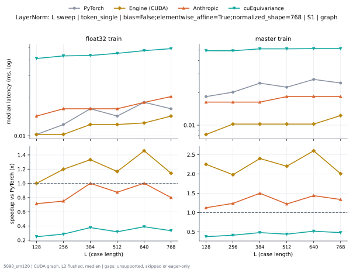

**float32 train** (median ms; x = speedup vs PyTorch)

| L | PyTorch | Engine (Triton) | Engine (CUDA) | Anthropic | cuEquivariance |
|---|---|---|---|---|---|
| 128 | 0.01024 | 0.01229 (0.83x) | 0.01024 (1.00x) | 0.01434 (0.71x) | 0.04102 (0.25x) |
| 256 | 0.01229 | 0.01434 (0.86x) | 0.01026 (1.20x) | 0.01638 (0.75x) | 0.04301 (0.29x) |
| 384 | 0.01638 | 0.01434 (1.14x) | 0.01229 (1.33x) | 0.01638 (1.00x) | 0.04336 (0.38x) |
| 512 | 0.01434 | 0.01638 (0.88x) | 0.01229 (1.17x) | 0.01638 (0.88x) | 0.04506 (0.32x) |
| 640 | 0.01843 | 0.0184 (1.00x) | 0.01264 (1.46x) | 0.0184 (1.00x) | 0.04733 (0.39x) |
| 768 | 0.01638 | 0.01843 (0.89x) | 0.01434 (1.14x) | 0.02048 (0.80x) | 0.04912 (0.33x) |

**master train** (median ms; x = speedup vs PyTorch)

| L | PyTorch | Engine (Triton) | Engine (CUDA) | Anthropic | cuEquivariance |
|---|---|---|---|---|---|
| 128 | 0.01843 | 0.01229 (1.50x) | 0.008192 (2.25x) | 0.01638 (1.13x) | 0.04918 (0.37x) |
| 256 | 0.02027 | 0.01434 (1.41x) | 0.01024 (1.98x) | 0.01638 (1.24x) | 0.04915 (0.41x) |
| 384 | 0.02458 | 0.01434 (1.71x) | 0.01024 (2.40x) | 0.01638 (1.50x) | 0.0512 (0.48x) |
| 512 | 0.02253 | 0.01434 (1.57x) | 0.01024 (2.20x) | 0.01843 (1.22x) | 0.0512 (0.44x) |
| 640 | 0.02662 | 0.01434 (1.86x) | 0.01024 (2.60x) | 0.01853 (1.44x) | 0.05146 (0.52x) |
| 768 | 0.02466 | 0.01638 (1.50x) | 0.01229 (2.01x) | 0.01843 (1.34x) | 0.05146 (0.48x) |

### L sweep: token_single | bias=False;elementwise_affine=True;normalized_shape=768 | S5 | graph

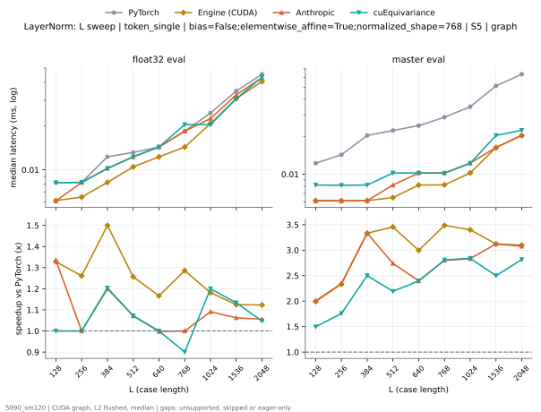

**float32 eval** (median ms; x = speedup vs PyTorch)

| L | PyTorch | Engine (Triton) | Engine (CUDA) | Anthropic | cuEquivariance |
|---|---|---|---|---|---|
| 128 | 0.00816 | 0.00816 (1.00x) | 0.006144 (1.33x) | 0.006112 (1.34x) | 0.00816 (1.00x) |
| 256 | 0.008192 | 0.01024 (0.80x) | 0.006496 (1.26x) | 0.008192 (1.00x) | 0.008192 (1.00x) |
| 384 | 0.01229 | 0.01027 (1.20x) | 0.008192 (1.50x) | 0.01024 (1.20x) | 0.01021 (1.20x) |
| 512 | 0.01317 | 0.01229 (1.07x) | 0.01048 (1.26x) | 0.01229 (1.07x) | 0.01229 (1.07x) |
| 640 | 0.01434 | 0.01638 (0.88x) | 0.01229 (1.17x) | 0.01437 (1.00x) | 0.01434 (1.00x) |
| 768 | 0.01843 | 0.02048 (0.90x) | 0.01434 (1.29x) | 0.01843 (1.00x) | 0.02048 (0.90x) |
| 1024 | 0.02458 | 0.02458 (1.00x) | 0.0208 (1.18x) | 0.02253 (1.09x) | 0.02048 (1.20x) |
| 1536 | 0.03482 | 0.03517 (0.99x) | 0.03096 (1.12x) | 0.03277 (1.06x) | 0.03072 (1.13x) |
| 2048 | 0.04541 | 0.04915 (0.92x) | 0.04043 (1.12x) | 0.04301 (1.06x) | 0.04336 (1.05x) |

**master eval** (median ms; x = speedup vs PyTorch)

| L | PyTorch | Engine (Triton) | Engine (CUDA) | Anthropic | cuEquivariance |
|---|---|---|---|---|---|
| 128 | 0.01226 | 0.006144 (1.99x) | 0.006144 (1.99x) | 0.006112 (2.01x) | 0.008192 (1.50x) |
| 256 | 0.01434 | 0.008192 (1.75x) | 0.006144 (2.33x) | 0.006112 (2.35x) | 0.00816 (1.76x) |
| 384 | 0.02048 | 0.01024 (2.00x) | 0.006144 (3.33x) | 0.006144 (3.33x) | 0.008192 (2.50x) |
| 512 | 0.02245 | 0.01021 (2.20x) | 0.006496 (3.46x) | 0.008192 (2.74x) | 0.01024 (2.19x) |
| 640 | 0.02454 | 0.01024 (2.40x) | 0.008192 (3.00x) | 0.01024 (2.40x) | 0.01024 (2.40x) |
| 768 | 0.02867 | 0.01021 (2.81x) | 0.008224 (3.49x) | 0.01024 (2.80x) | 0.01021 (2.81x) |
| 1024 | 0.03482 | 0.01229 (2.83x) | 0.01024 (3.40x) | 0.01229 (2.83x) | 0.01226 (2.84x) |
| 1536 | 0.05117 | 0.02253 (2.27x) | 0.01638 (3.12x) | 0.01638 (3.12x) | 0.02048 (2.50x) |
| 2048 | 0.06346 | 0.02458 (2.58x) | 0.02048 (3.10x) | 0.02062 (3.08x) | 0.02253 (2.82x) |

### L sweep: token_single | bias=False;elementwise_affine=True;normalized_shape=831 | S1 | graph

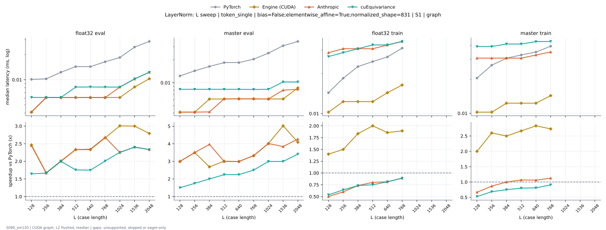

**float32 eval** (median ms; x = speedup vs PyTorch)

| L | PyTorch | Engine (Triton) | Engine (CUDA) | Anthropic | cuEquivariance |
|---|---|---|---|---|---|
| 128 | 0.0101 | 0.008192 (1.23x) | 0.004096 (2.46x) | 0.004128 (2.45x) | 0.006144 (1.64x) |
| 256 | 0.01024 | 0.008192 (1.25x) | 0.006112 (1.68x) | 0.006144 (1.67x) | 0.006144 (1.67x) |
| 384 | 0.01229 | 0.008192 (1.50x) | 0.006112 (2.01x) | 0.006144 (2.00x) | 0.006144 (2.00x) |
| 512 | 0.01434 | 0.008192 (1.75x) | 0.006144 (2.33x) | 0.006144 (2.33x) | 0.00816 (1.76x) |
| 640 | 0.01434 | 0.01024 (1.40x) | 0.006144 (2.33x) | 0.006112 (2.35x) | 0.008192 (1.75x) |
| 768 | 0.01638 | 0.01024 (1.60x) | 0.006144 (2.67x) | 0.006112 (2.68x) | 0.00816 (2.01x) |
| 1024 | 0.01843 | 0.01022 (1.80x) | 0.006128 (3.01x) | 0.008192 (2.25x) | 0.00816 (2.26x) |
| 1536 | 0.02458 | 0.01229 (2.00x) | 0.008192 (3.00x) | 0.01021 (2.41x) | 0.01024 (2.40x) |
| 2048 | 0.02867 | 0.01434 (2.00x) | 0.01027 (2.79x) | 0.01229 (2.33x) | 0.01229 (2.33x) |

**master eval** (median ms; x = speedup vs PyTorch)

| L | PyTorch | Engine (Triton) | Engine (CUDA) | Anthropic | cuEquivariance |
|---|---|---|---|---|---|
| 128 | 0.01229 | 0.008192 (1.50x) | 0.004096 (3.00x) | 0.004096 (3.00x) | 0.008192 (1.50x) |
| 256 | 0.01434 | 0.008192 (1.75x) | 0.004096 (3.50x) | 0.004096 (3.50x) | 0.008192 (1.75x) |
| 384 | 0.01638 | 0.008192 (2.00x) | 0.006096 (2.69x) | 0.004128 (3.97x) | 0.008192 (2.00x) |
| 512 | 0.0184 | 0.008192 (2.25x) | 0.006112 (3.01x) | 0.006144 (2.99x) | 0.008192 (2.25x) |
| 640 | 0.0184 | 0.008224 (2.24x) | 0.006144 (2.99x) | 0.006144 (2.99x) | 0.008192 (2.25x) |
| 768 | 0.02045 | 0.008192 (2.50x) | 0.006144 (3.33x) | 0.006144 (3.33x) | 0.00816 (2.51x) |
| 1024 | 0.02454 | 0.01019 (2.41x) | 0.006112 (4.02x) | 0.006112 (4.02x) | 0.008192 (3.00x) |
| 1536 | 0.03069 | 0.01024 (3.00x) | 0.006112 (5.02x) | 0.007984 (3.84x) | 0.01024 (3.00x) |
| 2048 | 0.03496 | 0.01226 (2.85x) | 0.008544 (4.09x) | 0.008192 (4.27x) | 0.01024 (3.41x) |

**float32 train** (median ms; x = speedup vs PyTorch)

| L | PyTorch | Engine (Triton) | Engine (CUDA) | Anthropic | cuEquivariance |
|---|---|---|---|---|---|
| 128 | 0.01434 | 0.01638 (0.88x) | 0.01024 (1.40x) | 0.02867 (0.50x) | 0.0268 (0.53x) |
| 256 | 0.01843 | 0.01843 (1.00x) | 0.01229 (1.50x) | 0.0307 (0.60x) | 0.0287 (0.64x) |
| 384 | 0.02253 | 0.01843 (1.22x) | 0.01229 (1.83x) | 0.03072 (0.73x) | 0.03072 (0.73x) |
| 512 | 0.02458 | 0.02048 (1.20x) | 0.01229 (2.00x) | 0.03069 (0.80x) | 0.03277 (0.75x) |
| 640 | 0.02662 | 0.02048 (1.30x) | 0.01434 (1.86x) | 0.03274 (0.81x) | 0.03277 (0.81x) |
| 768 | 0.03101 | 0.02253 (1.38x) | 0.01638 (1.89x) | 0.03482 (0.89x) | 0.03482 (0.89x) |
| 1024 |  |  |  |  |  |
| 1536 |  |  |  |  |  |
| 2048 |  |  |  |  |  |

**master train** (median ms; x = speedup vs PyTorch)

| L | PyTorch | Engine (Triton) | Engine (CUDA) | Anthropic | cuEquivariance |
|---|---|---|---|---|---|
| 128 | 0.02048 | 0.01638 (1.25x) | 0.01024 (2.00x) | 0.03072 (0.67x) | 0.03891 (0.53x) |
| 256 | 0.02662 | 0.01638 (1.62x) | 0.01024 (2.60x) | 0.03072 (0.87x) | 0.03891 (0.68x) |
| 384 | 0.03072 | 0.01638 (1.87x) | 0.01229 (2.50x) | 0.03072 (1.00x) | 0.04096 (0.75x) |
| 512 | 0.03277 | 0.01846 (1.77x) | 0.01229 (2.67x) | 0.03072 (1.07x) | 0.04096 (0.80x) |
| 640 | 0.0348 | 0.01843 (1.89x) | 0.01229 (2.83x) | 0.03277 (1.06x) | 0.04301 (0.81x) |
| 768 | 0.03917 | 0.02048 (1.91x) | 0.01434 (2.73x) | 0.03482 (1.12x) | 0.04317 (0.91x) |
| 1024 |  |  |  |  |  |
| 1536 |  |  |  |  |  |
| 2048 |  |  |  |  |  |

### L sweep: token_single | bias=False;elementwise_affine=True;normalized_shape=833 | S1 | graph

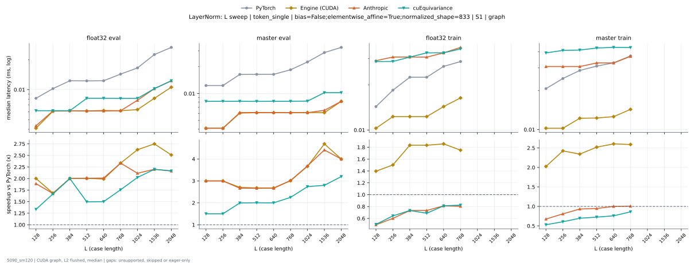

**float32 eval** (median ms; x = speedup vs PyTorch)

| L | PyTorch | Engine (Triton) | Engine (CUDA) | Anthropic | cuEquivariance |
|---|---|---|---|---|---|
| 128 | 0.008192 | 0.008192 (1.00x) | 0.004096 (2.00x) | 0.004336 (1.89x) | 0.006144 (1.33x) |
| 256 | 0.01024 | 0.008352 (1.23x) | 0.00608 (1.68x) | 0.006112 (1.68x) | 0.006144 (1.67x) |
| 384 | 0.01229 | 0.008192 (1.50x) | 0.006144 (2.00x) | 0.006144 (2.00x) | 0.006144 (2.00x) |
| 512 | 0.01226 | 0.00816 (1.50x) | 0.006112 (2.01x) | 0.006112 (2.01x) | 0.008192 (1.50x) |
| 640 | 0.01229 | 0.01024 (1.20x) | 0.006176 (1.99x) | 0.006112 (2.01x) | 0.008192 (1.50x) |
| 768 | 0.01434 | 0.01024 (1.40x) | 0.006144 (2.33x) | 0.006144 (2.33x) | 0.00816 (1.76x) |
| 1024 | 0.01654 | 0.01021 (1.62x) | 0.006304 (2.62x) | 0.007824 (2.11x) | 0.008176 (2.02x) |
| 1536 | 0.02253 | 0.01229 (1.83x) | 0.008192 (2.75x) | 0.01024 (2.20x) | 0.01024 (2.20x) |
| 2048 | 0.02659 | 0.01434 (1.85x) | 0.01059 (2.51x) | 0.01229 (2.16x) | 0.01229 (2.16x) |

**master eval** (median ms; x = speedup vs PyTorch)

| L | PyTorch | Engine (Triton) | Engine (CUDA) | Anthropic | cuEquivariance |
|---|---|---|---|---|---|
| 128 | 0.01229 | 0.008224 (1.49x) | 0.004096 (3.00x) | 0.004096 (3.00x) | 0.008192 (1.50x) |
| 256 | 0.01229 | 0.008192 (1.50x) | 0.004096 (3.00x) | 0.004096 (3.00x) | 0.008192 (1.50x) |
| 384 | 0.01635 | 0.008192 (2.00x) | 0.006048 (2.70x) | 0.006128 (2.67x) | 0.008192 (2.00x) |
| 512 | 0.01638 | 0.008192 (2.00x) | 0.006112 (2.68x) | 0.006144 (2.67x) | 0.008176 (2.00x) |
| 640 | 0.01638 | 0.008192 (2.00x) | 0.006112 (2.68x) | 0.006144 (2.67x) | 0.008192 (2.00x) |
| 768 | 0.01843 | 0.008544 (2.16x) | 0.006112 (3.02x) | 0.006112 (3.02x) | 0.008192 (2.25x) |
| 1024 | 0.02253 | 0.01021 (2.21x) | 0.006144 (3.67x) | 0.006112 (3.69x) | 0.008224 (2.74x) |
| 1536 | 0.02867 | 0.01024 (2.80x) | 0.006112 (4.69x) | 0.006496 (4.41x) | 0.01024 (2.80x) |
| 2048 | 0.03277 | 0.01024 (3.20x) | 0.008192 (4.00x) | 0.008192 (4.00x) | 0.01024 (3.20x) |

**float32 train** (median ms; x = speedup vs PyTorch)

| L | PyTorch | Engine (Triton) | Engine (CUDA) | Anthropic | cuEquivariance |
|---|---|---|---|---|---|
| 128 | 0.01434 | 0.01638 (0.88x) | 0.01027 (1.40x) | 0.02906 (0.49x) | 0.02867 (0.50x) |
| 256 | 0.01845 | 0.01843 (1.00x) | 0.01229 (1.50x) | 0.03072 (0.60x) | 0.0287 (0.64x) |
| 384 | 0.02253 | 0.01843 (1.22x) | 0.01229 (1.83x) | 0.03072 (0.73x) | 0.03072 (0.73x) |
| 512 | 0.02253 | 0.02048 (1.10x) | 0.01229 (1.83x) | 0.03069 (0.73x) | 0.03277 (0.69x) |
| 640 | 0.02661 | 0.02048 (1.30x) | 0.01434 (1.86x) | 0.03277 (0.81x) | 0.03278 (0.81x) |
| 768 | 0.02867 | 0.02253 (1.27x) | 0.01638 (1.75x) | 0.03565 (0.80x) | 0.03482 (0.82x) |
| 1024 |  |  |  |  |  |
| 1536 |  |  |  |  |  |
| 2048 |  |  |  |  |  |

**master train** (median ms; x = speedup vs PyTorch)

| L | PyTorch | Engine (Triton) | Engine (CUDA) | Anthropic | cuEquivariance |
|---|---|---|---|---|---|
| 128 | 0.02074 | 0.01638 (1.27x) | 0.01024 (2.03x) | 0.03072 (0.68x) | 0.0392 (0.53x) |
| 256 | 0.02483 | 0.01638 (1.52x) | 0.01024 (2.42x) | 0.03072 (0.81x) | 0.04096 (0.61x) |
| 384 | 0.02867 | 0.01642 (1.75x) | 0.01224 (2.34x) | 0.03072 (0.93x) | 0.04122 (0.70x) |
| 512 | 0.03098 | 0.01843 (1.68x) | 0.01229 (2.52x) | 0.03277 (0.95x) | 0.04275 (0.72x) |
| 640 | 0.0328 | 0.02022 (1.62x) | 0.01259 (2.60x) | 0.03277 (1.00x) | 0.04323 (0.76x) |
| 768 | 0.03712 | 0.02048 (1.81x) | 0.01434 (2.59x) | 0.03686 (1.01x) | 0.0431 (0.86x) |
| 1024 |  |  |  |  |  |
| 1536 |  |  |  |  |  |
| 2048 |  |  |  |  |  |

### L sweep: token_single | bias=True;elementwise_affine=True;normalized_shape=2560 | S1 | graph

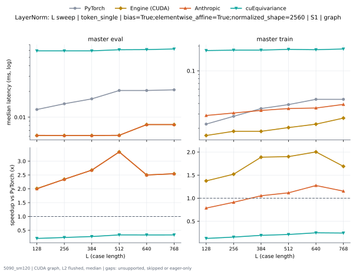

**master eval** (median ms; x = speedup vs PyTorch)

| L | PyTorch | Engine (Triton) | Engine (CUDA) | Anthropic | cuEquivariance |
|---|---|---|---|---|---|
| 128 | 0.01229 | 0.01229 (1.00x) | 0.006112 (2.01x) | 0.006144 (2.00x) | 0.05939 (0.21x) |
| 256 | 0.01434 | 0.01213 (1.18x) | 0.006112 (2.35x) | 0.006112 (2.35x) | 0.05939 (0.24x) |
| 384 | 0.01635 | 0.01229 (1.33x) | 0.006112 (2.68x) | 0.006112 (2.68x) | 0.05939 (0.28x) |
| 512 | 0.02048 | 0.01229 (1.67x) | 0.006144 (3.33x) | 0.006144 (3.33x) | 0.0612 (0.33x) |
| 640 | 0.02048 | 0.01229 (1.67x) | 0.008192 (2.50x) | 0.008192 (2.50x) | 0.06144 (0.33x) |
| 768 | 0.02085 | 0.01229 (1.70x) | 0.008192 (2.54x) | 0.008192 (2.54x) | 0.06245 (0.33x) |

**master train** (median ms; x = speedup vs PyTorch)

| L | PyTorch | Engine (Triton) | Engine (CUDA) | Anthropic | cuEquivariance |
|---|---|---|---|---|---|
| 128 | 0.02253 | 0.02253 (1.00x) | 0.01638 (1.38x) | 0.02867 (0.79x) | 0.1761 (0.13x) |
| 256 | 0.02802 | 0.02285 (1.23x) | 0.01843 (1.52x) | 0.03074 (0.91x) | 0.1782 (0.16x) |
| 384 | 0.03478 | 0.0265 (1.31x) | 0.01842 (1.89x) | 0.03302 (1.05x) | 0.1784 (0.19x) |
| 512 | 0.03888 | 0.02867 (1.36x) | 0.02045 (1.90x) | 0.03482 (1.12x) | 0.1821 (0.21x) |
| 640 | 0.04506 | 0.02867 (1.57x) | 0.0225 (2.00x) | 0.03534 (1.27x) | 0.1803 (0.25x) |
| 768 | 0.04506 | 0.03274 (1.38x) | 0.02666 (1.69x) | 0.03907 (1.15x) | 0.184 (0.24x) |

### L sweep: token_single | bias=True;elementwise_affine=True;normalized_shape=384 | S1 | graph

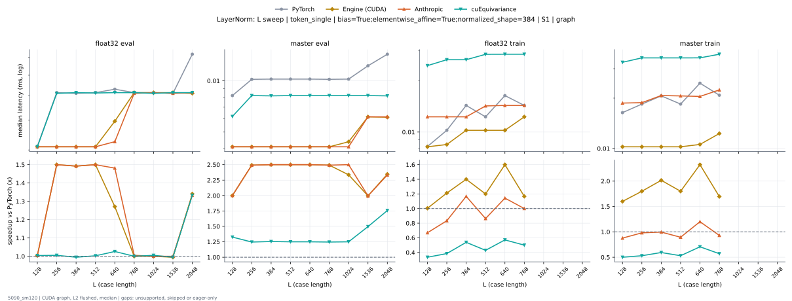

**float32 eval** (median ms; x = speedup vs PyTorch)

| L | PyTorch | Engine (Triton) | Engine (CUDA) | Anthropic | cuEquivariance |
|---|---|---|---|---|---|
| 128 | 0.004112 | 0.006144 (0.67x) | 0.004096 (1.00x) | 0.004096 (1.00x) | 0.004096 (1.00x) |
| 256 | 0.006144 | 0.006144 (1.00x) | 0.004096 (1.50x) | 0.004096 (1.50x) | 0.006112 (1.01x) |
| 384 | 0.006112 | 0.006144 (0.99x) | 0.004096 (1.49x) | 0.004096 (1.49x) | 0.006144 (0.99x) |
| 512 | 0.006144 | 0.006144 (1.00x) | 0.004096 (1.50x) | 0.004096 (1.50x) | 0.006128 (1.00x) |
| 640 | 0.006304 | 0.006144 (1.03x) | 0.00496 (1.27x) | 0.004256 (1.48x) | 0.006144 (1.03x) |
| 768 | 0.006144 | 0.006144 (1.00x) | 0.006144 (1.00x) | 0.006112 (1.01x) | 0.006144 (1.00x) |
| 1024 | 0.006144 | 0.006144 (1.00x) | 0.006144 (1.00x) | 0.006144 (1.00x) | 0.006112 (1.01x) |
| 1536 | 0.006112 | 0.008192 (0.75x) | 0.006144 (0.99x) | 0.006112 (1.00x) | 0.006144 (0.99x) |
| 2048 | 0.008192 | 0.00816 (1.00x) | 0.006112 (1.34x) | 0.006144 (1.33x) | 0.006144 (1.33x) |

**master eval** (median ms; x = speedup vs PyTorch)

| L | PyTorch | Engine (Triton) | Engine (CUDA) | Anthropic | cuEquivariance |
|---|---|---|---|---|---|
| 128 | 0.008192 | 0.004096 (2.00x) | 0.004096 (2.00x) | 0.004096 (2.00x) | 0.006176 (1.33x) |
| 256 | 0.01021 | 0.004096 (2.49x) | 0.004096 (2.49x) | 0.004096 (2.49x) | 0.008192 (1.25x) |
| 384 | 0.01024 | 0.004096 (2.50x) | 0.004096 (2.50x) | 0.004096 (2.50x) | 0.00816 (1.25x) |
| 512 | 0.01024 | 0.006144 (1.67x) | 0.004096 (2.50x) | 0.004096 (2.50x) | 0.008192 (1.25x) |
| 640 | 0.01024 | 0.006144 (1.67x) | 0.004096 (2.50x) | 0.004096 (2.50x) | 0.008192 (1.25x) |
| 768 | 0.01021 | 0.006144 (1.66x) | 0.004096 (2.49x) | 0.004096 (2.49x) | 0.008192 (1.25x) |
| 1024 | 0.01024 | 0.006176 (1.66x) | 0.004384 (2.34x) | 0.004096 (2.50x) | 0.008192 (1.25x) |
| 1536 | 0.01226 | 0.006144 (1.99x) | 0.006144 (1.99x) | 0.006144 (1.99x) | 0.008192 (1.50x) |
| 2048 | 0.01434 | 0.006144 (2.33x) | 0.006112 (2.35x) | 0.006144 (2.33x) | 0.00816 (1.76x) |

**float32 train** (median ms; x = speedup vs PyTorch)

| L | PyTorch | Engine (Triton) | Engine (CUDA) | Anthropic | cuEquivariance |
|---|---|---|---|---|---|
| 128 | 0.008224 | 0.01229 (0.67x) | 0.008192 (1.00x) | 0.01229 (0.67x) | 0.02458 (0.33x) |
| 256 | 0.01024 | 0.01024 (1.00x) | 0.008448 (1.21x) | 0.01229 (0.83x) | 0.02662 (0.38x) |
| 384 | 0.01434 | 0.01229 (1.17x) | 0.01024 (1.40x) | 0.01229 (1.17x) | 0.02662 (0.54x) |
| 512 | 0.01229 | 0.01046 (1.17x) | 0.01024 (1.20x) | 0.01424 (0.86x) | 0.02864 (0.43x) |
| 640 | 0.01638 | 0.01229 (1.33x) | 0.01024 (1.60x) | 0.01434 (1.14x) | 0.02867 (0.57x) |
| 768 | 0.01434 | 0.01434 (1.00x) | 0.01229 (1.17x) | 0.01434 (1.00x) | 0.02867 (0.50x) |
| 1024 |  |  |  |  |  |
| 1536 |  |  |  |  |  |
| 2048 |  |  |  |  |  |

**master train** (median ms; x = speedup vs PyTorch)

| L | PyTorch | Engine (Triton) | Engine (CUDA) | Anthropic | cuEquivariance |
|---|---|---|---|---|---|
| 128 | 0.01638 | 0.01024 (1.60x) | 0.01024 (1.60x) | 0.01869 (0.88x) | 0.03277 (0.50x) |
| 256 | 0.01843 | 0.01027 (1.79x) | 0.01024 (1.80x) | 0.0188 (0.98x) | 0.03482 (0.53x) |
| 384 | 0.02064 | 0.01024 (2.02x) | 0.01024 (2.02x) | 0.02074 (1.00x) | 0.03482 (0.59x) |
| 512 | 0.01843 | 0.01229 (1.50x) | 0.01024 (1.80x) | 0.02062 (0.89x) | 0.0348 (0.53x) |
| 640 | 0.02458 | 0.01229 (2.00x) | 0.01058 (2.32x) | 0.02048 (1.20x) | 0.03483 (0.71x) |
| 768 | 0.02083 | 0.01229 (1.70x) | 0.01229 (1.70x) | 0.0224 (0.93x) | 0.03661 (0.57x) |
| 1024 |  |  |  |  |  |
| 1536 |  |  |  |  |  |
| 2048 |  |  |  |  |  |

### L sweep: token_single | bias=True;elementwise_affine=True;normalized_shape=451 | S1 | graph

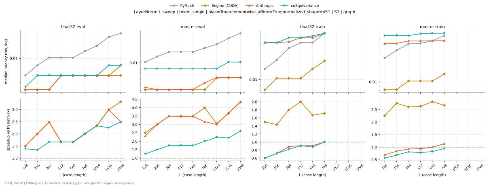

**float32 eval** (median ms; x = speedup vs PyTorch)

| L | PyTorch | Engine (Triton) | Engine (CUDA) | Anthropic | cuEquivariance |
|---|---|---|---|---|---|
| 128 | 0.006144 | 0.006144 (1.00x) | 0.004096 (1.50x) | 0.004096 (1.50x) | 0.004432 (1.39x) |
| 256 | 0.008192 | 0.006144 (1.33x) | 0.004096 (2.00x) | 0.004096 (2.00x) | 0.006144 (1.33x) |
| 384 | 0.01024 | 0.006144 (1.67x) | 0.004112 (2.49x) | 0.004128 (2.48x) | 0.006144 (1.67x) |
| 512 | 0.01024 | 0.006144 (1.67x) | 0.006144 (1.67x) | 0.006144 (1.67x) | 0.006144 (1.67x) |
| 640 | 0.01021 | 0.006144 (1.66x) | 0.006144 (1.66x) | 0.006112 (1.67x) | 0.006144 (1.66x) |
| 768 | 0.01229 | 0.006112 (2.01x) | 0.006144 (2.00x) | 0.006112 (2.01x) | 0.006112 (2.01x) |
| 1024 | 0.01434 | 0.008192 (1.75x) | 0.006112 (2.35x) | 0.006112 (2.35x) | 0.006144 (2.33x) |
| 1536 | 0.0184 | 0.008192 (2.25x) | 0.006144 (2.99x) | 0.006128 (3.00x) | 0.00816 (2.25x) |
| 2048 | 0.02045 | 0.008192 (2.50x) | 0.006144 (3.33x) | 0.008192 (2.50x) | 0.008192 (2.50x) |

**master eval** (median ms; x = speedup vs PyTorch)

| L | PyTorch | Engine (Triton) | Engine (CUDA) | Anthropic | cuEquivariance |
|---|---|---|---|---|---|
| 128 | 0.01024 | 0.006144 (1.67x) | 0.004096 (2.50x) | 0.004448 (2.30x) | 0.008192 (1.25x) |
| 256 | 0.01229 | 0.006176 (1.99x) | 0.004096 (3.00x) | 0.004096 (3.00x) | 0.008192 (1.50x) |
| 384 | 0.0143 | 0.006144 (2.33x) | 0.004096 (3.49x) | 0.004096 (3.49x) | 0.008192 (1.75x) |
| 512 | 0.01434 | 0.006144 (2.33x) | 0.004096 (3.50x) | 0.004128 (3.47x) | 0.008192 (1.75x) |
| 640 | 0.0143 | 0.006144 (2.33x) | 0.004096 (3.49x) | 0.004112 (3.48x) | 0.008192 (1.75x) |
| 768 | 0.01635 | 0.006176 (2.65x) | 0.004096 (3.99x) | 0.005168 (3.16x) | 0.008192 (2.00x) |
| 1024 | 0.01843 | 0.006144 (3.00x) | 0.006048 (3.05x) | 0.006144 (3.00x) | 0.008208 (2.25x) |
| 1536 | 0.02253 | 0.006128 (3.68x) | 0.006144 (3.67x) | 0.006112 (3.69x) | 0.01024 (2.20x) |
| 2048 | 0.02659 | 0.00816 (3.26x) | 0.006144 (4.33x) | 0.006112 (4.35x) | 0.01021 (2.61x) |

**float32 train** (median ms; x = speedup vs PyTorch)

| L | PyTorch | Engine (Triton) | Engine (CUDA) | Anthropic | cuEquivariance |
|---|---|---|---|---|---|
| 128 | 0.01229 | 0.01232 (1.00x) | 0.008192 (1.50x) | 0.02048 (0.60x) | 0.02048 (0.60x) |
| 256 | 0.01469 | 0.01418 (1.04x) | 0.01024 (1.43x) | 0.02051 (0.72x) | 0.02048 (0.72x) |
| 384 | 0.01843 | 0.01434 (1.29x) | 0.01024 (1.80x) | 0.02082 (0.89x) | 0.02253 (0.82x) |
| 512 | 0.02048 | 0.01434 (1.43x) | 0.01022 (2.00x) | 0.02253 (0.91x) | 0.02253 (0.91x) |
| 640 | 0.0205 | 0.01638 (1.25x) | 0.01229 (1.67x) | 0.02253 (0.91x) | 0.02339 (0.88x) |
| 768 | 0.02458 | 0.01434 (1.71x) | 0.01434 (1.71x) | 0.02458 (1.00x) | 0.02458 (1.00x) |
| 1024 |  |  |  |  |  |
| 1536 |  |  |  |  |  |
| 2048 |  |  |  |  |  |

**master train** (median ms; x = speedup vs PyTorch)

| L | PyTorch | Engine (Triton) | Engine (CUDA) | Anthropic | cuEquivariance |
|---|---|---|---|---|---|
| 128 | 0.01845 | 0.01229 (1.50x) | 0.008192 (2.25x) | 0.02672 (0.69x) | 0.03277 (0.56x) |
| 256 | 0.02253 | 0.01259 (1.79x) | 0.008192 (2.75x) | 0.02688 (0.84x) | 0.03302 (0.68x) |
| 384 | 0.02662 | 0.01229 (2.17x) | 0.01024 (2.60x) | 0.02867 (0.93x) | 0.03277 (0.81x) |
| 512 | 0.02688 | 0.01432 (1.88x) | 0.01024 (2.63x) | 0.02867 (0.94x) | 0.03443 (0.78x) |
| 640 | 0.02877 | 0.01638 (1.76x) | 0.01024 (2.81x) | 0.02877 (1.00x) | 0.03482 (0.83x) |
| 768 | 0.03277 | 0.01638 (2.00x) | 0.01229 (2.67x) | 0.0288 (1.14x) | 0.03482 (0.94x) |
| 1024 |  |  |  |  |  |
| 1536 |  |  |  |  |  |
| 2048 |  |  |  |  |  |

### L sweep: token_single | bias=True;elementwise_affine=True;normalized_shape=768 | S1 | graph

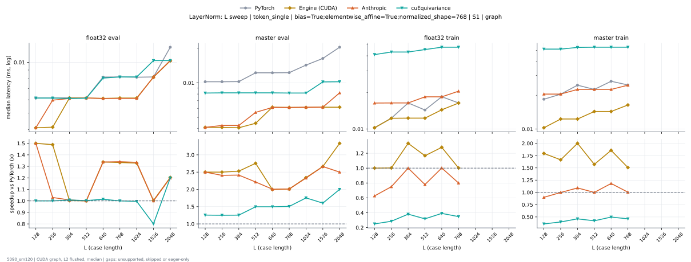

**float32 eval** (median ms; x = speedup vs PyTorch)

| L | PyTorch | Engine (Triton) | Engine (CUDA) | Anthropic | cuEquivariance |
|---|---|---|---|---|---|
| 128 | 0.006144 | 0.006144 (1.00x) | 0.004096 (1.50x) | 0.004096 (1.50x) | 0.006144 (1.00x) |
| 256 | 0.006144 | 0.006144 (1.00x) | 0.004128 (1.49x) | 0.005968 (1.03x) | 0.006144 (1.00x) |
| 384 | 0.00616 | 0.006144 (1.00x) | 0.006144 (1.00x) | 0.006112 (1.01x) | 0.006112 (1.01x) |
| 512 | 0.006144 | 0.00816 (0.75x) | 0.006144 (1.00x) | 0.006144 (1.00x) | 0.006128 (1.00x) |
| 640 | 0.008176 | 0.008192 (1.00x) | 0.006112 (1.34x) | 0.006112 (1.34x) | 0.008064 (1.01x) |
| 768 | 0.008192 | 0.00816 (1.00x) | 0.006144 (1.33x) | 0.006112 (1.34x) | 0.008192 (1.00x) |
| 1024 | 0.00816 | 0.00816 (1.00x) | 0.006144 (1.33x) | 0.006112 (1.34x) | 0.008192 (1.00x) |
| 1536 | 0.008192 | 0.01022 (0.80x) | 0.00816 (1.00x) | 0.008192 (1.00x) | 0.01024 (0.80x) |
| 2048 | 0.01229 | 0.01024 (1.20x) | 0.01021 (1.20x) | 0.01024 (1.20x) | 0.01024 (1.20x) |

**master eval** (median ms; x = speedup vs PyTorch)

| L | PyTorch | Engine (Triton) | Engine (CUDA) | Anthropic | cuEquivariance |
|---|---|---|---|---|---|
| 128 | 0.01024 | 0.006144 (1.67x) | 0.004096 (2.50x) | 0.004096 (2.50x) | 0.00816 (1.25x) |
| 256 | 0.01024 | 0.006144 (1.67x) | 0.004096 (2.50x) | 0.004256 (2.41x) | 0.008192 (1.25x) |
| 384 | 0.01027 | 0.006144 (1.67x) | 0.004064 (2.53x) | 0.004256 (2.41x) | 0.008192 (1.25x) |
| 512 | 0.01226 | 0.006144 (1.99x) | 0.004448 (2.76x) | 0.005536 (2.21x) | 0.008192 (1.50x) |
| 640 | 0.01226 | 0.006144 (1.99x) | 0.006144 (1.99x) | 0.006112 (2.01x) | 0.008192 (1.50x) |
| 768 | 0.01229 | 0.006144 (2.00x) | 0.006112 (2.01x) | 0.006112 (2.01x) | 0.00816 (1.51x) |
| 1024 | 0.0143 | 0.008192 (1.75x) | 0.006112 (2.34x) | 0.006144 (2.33x) | 0.00816 (1.75x) |
| 1536 | 0.01635 | 0.008192 (2.00x) | 0.006144 (2.66x) | 0.006144 (2.66x) | 0.01021 (1.60x) |
| 2048 | 0.02048 | 0.00816 (2.51x) | 0.006144 (3.33x) | 0.008192 (2.50x) | 0.01024 (2.00x) |

**float32 train** (median ms; x = speedup vs PyTorch)

| L | PyTorch | Engine (Triton) | Engine (CUDA) | Anthropic | cuEquivariance |
|---|---|---|---|---|---|
| 128 | 0.01024 | 0.01229 (0.83x) | 0.01024 (1.00x) | 0.01635 (0.63x) | 0.04096 (0.25x) |
| 256 | 0.01229 | 0.01226 (1.00x) | 0.01226 (1.00x) | 0.01638 (0.75x) | 0.04301 (0.29x) |
| 384 | 0.01638 | 0.01434 (1.14x) | 0.01229 (1.33x) | 0.01638 (1.00x) | 0.04301 (0.38x) |
| 512 | 0.01434 | 0.01472 (0.97x) | 0.01229 (1.17x) | 0.0184 (0.78x) | 0.04506 (0.32x) |
| 640 | 0.01843 | 0.01654 (1.11x) | 0.0144 (1.28x) | 0.0184 (1.00x) | 0.0471 (0.39x) |
| 768 | 0.01638 | 0.01843 (0.89x) | 0.01635 (1.00x) | 0.02048 (0.80x) | 0.0471 (0.35x) |
| 1024 |  |  |  |  |  |
| 1536 |  |  |  |  |  |
| 2048 |  |  |  |  |  |

**master train** (median ms; x = speedup vs PyTorch)

| L | PyTorch | Engine (Triton) | Engine (CUDA) | Anthropic | cuEquivariance |
|---|---|---|---|---|---|
| 128 | 0.01843 | 0.01229 (1.50x) | 0.01027 (1.79x) | 0.02048 (0.90x) | 0.05146 (0.36x) |
| 256 | 0.02045 | 0.01434 (1.43x) | 0.01229 (1.66x) | 0.02048 (1.00x) | 0.05146 (0.40x) |
| 384 | 0.02458 | 0.01434 (1.71x) | 0.01229 (2.00x) | 0.02253 (1.09x) | 0.05326 (0.46x) |
| 512 | 0.02253 | 0.01434 (1.57x) | 0.01434 (1.57x) | 0.02253 (1.00x) | 0.0535 (0.42x) |
| 640 | 0.02662 | 0.01434 (1.86x) | 0.01434 (1.86x) | 0.02253 (1.18x) | 0.0535 (0.50x) |
| 768 | 0.02469 | 0.01434 (1.72x) | 0.01638 (1.51x) | 0.02458 (1.00x) | 0.0535 (0.46x) |
| 1024 |  |  |  |  |  |
| 1536 |  |  |  |  |  |
| 2048 |  |  |  |  |  |

### L sweep: token_single | bias=True;elementwise_affine=True;normalized_shape=833 | S1 | graph

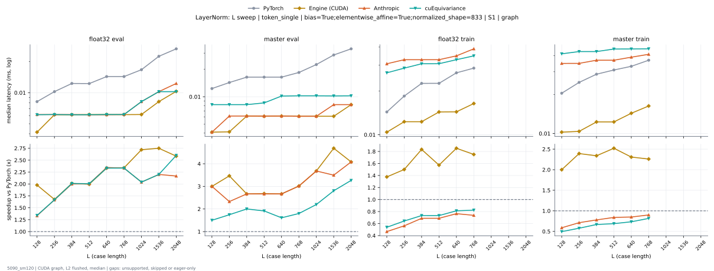

**float32 eval** (median ms; x = speedup vs PyTorch)

| L | PyTorch | Engine (Triton) | Engine (CUDA) | Anthropic | cuEquivariance |
|---|---|---|---|---|---|
| 128 | 0.008192 | 0.00816 (1.00x) | 0.004144 (1.98x) | 0.006144 (1.33x) | 0.006112 (1.34x) |
| 256 | 0.01024 | 0.008192 (1.25x) | 0.006112 (1.68x) | 0.006144 (1.67x) | 0.006144 (1.67x) |
| 384 | 0.01229 | 0.008192 (1.50x) | 0.006112 (2.01x) | 0.006144 (2.00x) | 0.006112 (2.01x) |
| 512 | 0.01226 | 0.008192 (1.50x) | 0.006144 (1.99x) | 0.006112 (2.01x) | 0.006112 (2.01x) |
| 640 | 0.01434 | 0.00816 (1.76x) | 0.006144 (2.33x) | 0.006112 (2.35x) | 0.006144 (2.33x) |
| 768 | 0.01434 | 0.00816 (1.76x) | 0.006128 (2.34x) | 0.006144 (2.33x) | 0.006144 (2.33x) |
| 1024 | 0.0167 | 0.01021 (1.64x) | 0.006144 (2.72x) | 0.008192 (2.04x) | 0.008192 (2.04x) |
| 1536 | 0.02253 | 0.01227 (1.84x) | 0.008192 (2.75x) | 0.01024 (2.20x) | 0.01024 (2.20x) |
| 2048 | 0.02662 | 0.01434 (1.86x) | 0.0103 (2.58x) | 0.01229 (2.17x) | 0.01024 (2.60x) |

**master eval** (median ms; x = speedup vs PyTorch)

| L | PyTorch | Engine (Triton) | Engine (CUDA) | Anthropic | cuEquivariance |
|---|---|---|---|---|---|
| 128 | 0.01229 | 0.008096 (1.52x) | 0.004096 (3.00x) | 0.004096 (3.00x) | 0.008192 (1.50x) |
| 256 | 0.0143 | 0.008176 (1.75x) | 0.004128 (3.47x) | 0.006144 (2.33x) | 0.008192 (1.75x) |
| 384 | 0.01638 | 0.00816 (2.01x) | 0.006144 (2.67x) | 0.006144 (2.67x) | 0.008192 (2.00x) |
| 512 | 0.01638 | 0.008192 (2.00x) | 0.006112 (2.68x) | 0.006144 (2.67x) | 0.00856 (1.91x) |
| 640 | 0.01638 | 0.008416 (1.95x) | 0.006144 (2.67x) | 0.006144 (2.67x) | 0.01018 (1.61x) |
| 768 | 0.01843 | 0.008192 (2.25x) | 0.006112 (3.02x) | 0.006112 (3.02x) | 0.01024 (1.80x) |
| 1024 | 0.0225 | 0.008176 (2.75x) | 0.006112 (3.68x) | 0.006112 (3.68x) | 0.01024 (2.20x) |
| 1536 | 0.02864 | 0.01024 (2.80x) | 0.006112 (4.69x) | 0.008192 (3.50x) | 0.01021 (2.81x) |
| 2048 | 0.03344 | 0.01024 (3.27x) | 0.008192 (4.08x) | 0.008192 (4.08x) | 0.01024 (3.27x) |

**float32 train** (median ms; x = speedup vs PyTorch)

| L | PyTorch | Engine (Triton) | Engine (CUDA) | Anthropic | cuEquivariance |
|---|---|---|---|---|---|
| 128 | 0.01434 | 0.01638 (0.88x) | 0.01042 (1.38x) | 0.03072 (0.47x) | 0.02662 (0.54x) |
| 256 | 0.01843 | 0.01843 (1.00x) | 0.01229 (1.50x) | 0.03277 (0.56x) | 0.02867 (0.64x) |
| 384 | 0.02253 | 0.01843 (1.22x) | 0.01229 (1.83x) | 0.03277 (0.69x) | 0.03072 (0.73x) |
| 512 | 0.02254 | 0.01843 (1.22x) | 0.01434 (1.57x) | 0.03277 (0.69x) | 0.03075 (0.73x) |
| 640 | 0.02662 | 0.02048 (1.30x) | 0.01437 (1.85x) | 0.03482 (0.76x) | 0.03277 (0.81x) |
| 768 | 0.02867 | 0.02253 (1.27x) | 0.01638 (1.75x) | 0.03891 (0.74x) | 0.03482 (0.82x) |
| 1024 |  |  |  |  |  |
| 1536 |  |  |  |  |  |
| 2048 |  |  |  |  |  |

**master train** (median ms; x = speedup vs PyTorch)

| L | PyTorch | Engine (Triton) | Engine (CUDA) | Anthropic | cuEquivariance |
|---|---|---|---|---|---|
| 128 | 0.02048 | 0.01443 (1.42x) | 0.01024 (2.00x) | 0.03482 (0.59x) | 0.04131 (0.50x) |
| 256 | 0.02483 | 0.01638 (1.52x) | 0.01038 (2.39x) | 0.03485 (0.71x) | 0.04301 (0.58x) |
| 384 | 0.02874 | 0.01638 (1.75x) | 0.01229 (2.34x) | 0.03686 (0.78x) | 0.04301 (0.67x) |
| 512 | 0.03098 | 0.01843 (1.68x) | 0.01229 (2.52x) | 0.03686 (0.84x) | 0.04499 (0.69x) |
| 640 | 0.03307 | 0.01843 (1.79x) | 0.01434 (2.31x) | 0.03891 (0.85x) | 0.04506 (0.73x) |
| 768 | 0.03686 | 0.02048 (1.80x) | 0.01632 (2.26x) | 0.04096 (0.90x) | 0.04515 (0.82x) |
| 1024 |  |  |  |  |  |
| 1536 |  |  |  |  |  |
| 2048 |  |  |  |  |  |

### normalized_shape sweep at L768: token_pair | bias=False;elementwise_affine=True | S1 | graph

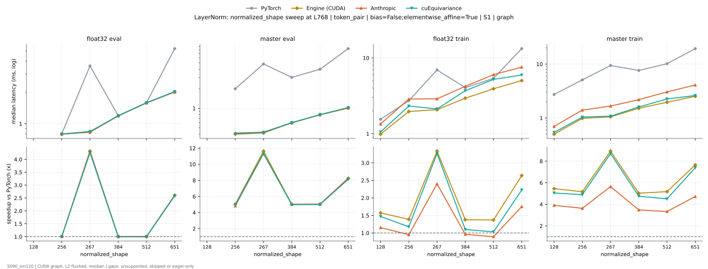

**float32 eval** (median ms; x = speedup vs PyTorch)

| normalized_shape | PyTorch | Engine (Triton) | Engine (CUDA) | Anthropic | cuEquivariance |
|---|---|---|---|---|---|
| 128 |  |  |  |  |  |
| 256 | 0.8001 | 0.7978 (1.00x) | 0.7946 (1.01x) | 0.7966 (1.00x) | 0.7987 (1.00x) |
| 267 | 3.593 | 0.8396 (4.28x) | 0.8315 (4.32x) | 0.8315 (4.32x) | 0.8438 (4.26x) |
| 384 | 1.195 | 1.196 (1.00x) | 1.19 (1.00x) | 1.193 (1.00x) | 1.195 (1.00x) |
| 512 | 1.592 | 1.595 (1.00x) | 1.587 (1.00x) | 1.59 (1.00x) | 1.594 (1.00x) |
| 651 | 5.273 | 2.1 (2.51x) | 2.022 (2.61x) | 2.021 (2.61x) | 2.041 (2.58x) |

**master eval** (median ms; x = speedup vs PyTorch)

| normalized_shape | PyTorch | Engine (Triton) | Engine (CUDA) | Anthropic | cuEquivariance |
|---|---|---|---|---|---|
| 128 |  |  |  |  |  |
| 256 | 2.002 | 0.4024 (4.98x) | 0.3983 (5.03x) | 0.4147 (4.83x) | 0.4035 (4.96x) |
| 267 | 4.837 | 0.4226 (11.45x) | 0.4157 (11.64x) | 0.4277 (11.31x) | 0.4261 (11.35x) |
| 384 | 2.998 | 0.6004 (4.99x) | 0.5963 (5.03x) | 0.5973 (5.02x) | 0.6011 (4.99x) |
| 512 | 4 | 0.8008 (4.99x) | 0.7946 (5.03x) | 0.795 (5.03x) | 0.8 (5.00x) |
| 651 | 8.344 | 1.022 (8.16x) | 1.012 (8.25x) | 1.008 (8.28x) | 1.027 (8.13x) |

**float32 train** (median ms; x = speedup vs PyTorch)

| normalized_shape | PyTorch | Engine (Triton) | Engine (CUDA) | Anthropic | cuEquivariance |
|---|---|---|---|---|---|
| 128 | 1.553 | 1.003 (1.55x) | 0.9874 (1.57x) | 1.347 (1.15x) | 1.055 (1.47x) |
| 256 | 2.725 | 1.979 (1.38x) | 1.965 (1.39x) | 2.867 (0.95x) | 2.319 (1.18x) |
| 267 | 6.931 | 2.074 (3.34x) | 2.078 (3.34x) | 2.887 (2.40x) | 2.123 (3.27x) |
| 384 | 4.055 | 2.973 (1.36x) | 2.942 (1.38x) | 4.219 (0.96x) | 3.692 (1.10x) |
| 512 | 5.375 | 3.932 (1.37x) | 3.92 (1.37x) | 6.014 (0.89x) | 5.208 (1.03x) |
| 651 | 13.25 | 5.2 (2.55x) | 5.024 (2.64x) | 7.561 (1.75x) | 5.948 (2.23x) |

**master train** (median ms; x = speedup vs PyTorch)

| normalized_shape | PyTorch | Engine (Triton) | Engine (CUDA) | Anthropic | cuEquivariance |
|---|---|---|---|---|---|
| 128 | 2.733 | 0.5091 (5.37x) | 0.5012 (5.45x) | 0.6994 (3.91x) | 0.541 (5.05x) |
| 256 | 5.089 | 0.9994 (5.09x) | 0.9851 (5.17x) | 1.402 (3.63x) | 1.04 (4.89x) |
| 267 | 9.402 | 1.065 (8.83x) | 1.053 (8.93x) | 1.668 (5.64x) | 1.08 (8.70x) |
| 384 | 7.62 | 1.502 (5.07x) | 1.515 (5.03x) | 2.188 (3.48x) | 1.602 (4.76x) |
| 512 | 10.15 | 1.992 (5.10x) | 1.961 (5.18x) | 3.048 (3.33x) | 2.254 (4.50x) |
| 651 | 19.35 | 2.643 (7.32x) | 2.528 (7.65x) | 4.096 (4.73x) | 2.616 (7.40x) |

### normalized_shape sweep at L2048: token_pair | bias=True;elementwise_affine=True | S1 | graph

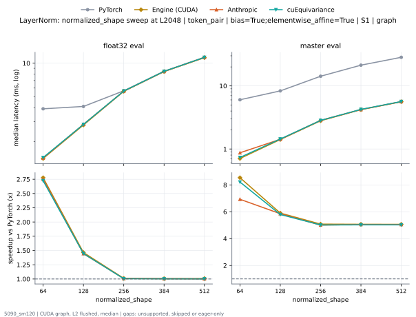

**float32 eval** (median ms; x = speedup vs PyTorch)

| normalized_shape | PyTorch | Engine (Triton) | Engine (CUDA) | Anthropic | cuEquivariance |
|---|---|---|---|---|---|
| 64 | 3.915 | 1.431 (2.74x) | 1.409 (2.78x) | 1.422 (2.75x) | 1.437 (2.72x) |
| 128 | 4.109 | 2.84 (1.45x) | 2.806 (1.46x) | 2.844 (1.44x) | 2.841 (1.45x) |
| 256 | 5.669 | 5.631 (1.01x) | 5.609 (1.01x) | 5.628 (1.01x) | 5.641 (1.00x) |
| 384 | 8.476 | 8.466 (1.00x) | 8.423 (1.01x) | 8.435 (1.00x) | 8.456 (1.00x) |
| 512 | 11.28 | 11.28 (1.00x) | 11.2 (1.01x) | 11.27 (1.00x) | 11.27 (1.00x) |

**master eval** (median ms; x = speedup vs PyTorch)

| normalized_shape | PyTorch | Engine (Triton) | Engine (CUDA) | Anthropic | cuEquivariance |
|---|---|---|---|---|---|
| 64 | 6.03 | 0.7311 (8.25x) | 0.7066 (8.53x) | 0.8704 (6.93x) | 0.7342 (8.21x) |
| 128 | 8.337 | 1.435 (5.81x) | 1.413 (5.90x) | 1.424 (5.85x) | 1.439 (5.80x) |
| 256 | 14.23 | 2.835 (5.02x) | 2.803 (5.08x) | 2.844 (5.01x) | 2.838 (5.02x) |
| 384 | 21.32 | 4.235 (5.03x) | 4.207 (5.07x) | 4.221 (5.05x) | 4.241 (5.03x) |
| 512 | 28.41 | 5.647 (5.03x) | 5.61 (5.06x) | 5.629 (5.05x) | 5.655 (5.02x) |

### normalized_shape sweep at L768: token_single | bias=False;elementwise_affine=True | S1 | graph

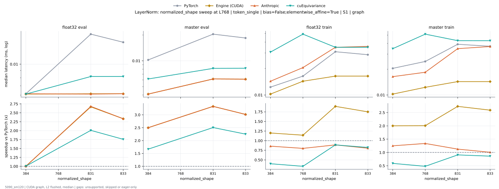

**float32 eval** (median ms; x = speedup vs PyTorch)

| normalized_shape | PyTorch | Engine (Triton) | Engine (CUDA) | Anthropic | cuEquivariance |
|---|---|---|---|---|---|
| 384 | 0.006144 | 0.006112 (1.01x) | 0.006112 (1.01x) | 0.006144 (1.00x) | 0.006112 (1.01x) |
| 768 |  |  |  |  |  |
| 831 | 0.01638 | 0.01024 (1.60x) | 0.006144 (2.67x) | 0.006112 (2.68x) | 0.00816 (2.01x) |
| 833 | 0.01434 | 0.01024 (1.40x) | 0.006144 (2.33x) | 0.006144 (2.33x) | 0.00816 (1.76x) |

**master eval** (median ms; x = speedup vs PyTorch)

| normalized_shape | PyTorch | Engine (Triton) | Engine (CUDA) | Anthropic | cuEquivariance |
|---|---|---|---|---|---|
| 384 | 0.01024 | 0.006144 (1.67x) | 0.004096 (2.50x) | 0.004096 (2.50x) | 0.006144 (1.67x) |
| 768 |  |  |  |  |  |
| 831 | 0.02045 | 0.008192 (2.50x) | 0.006144 (3.33x) | 0.006144 (3.33x) | 0.00816 (2.51x) |
| 833 | 0.01843 | 0.008544 (2.16x) | 0.006112 (3.02x) | 0.006112 (3.02x) | 0.008192 (2.25x) |

**float32 train** (median ms; x = speedup vs PyTorch)

| normalized_shape | PyTorch | Engine (Triton) | Engine (CUDA) | Anthropic | cuEquivariance |
|---|---|---|---|---|---|
| 384 | 0.01229 | 0.01434 (0.86x) | 0.01024 (1.20x) | 0.01434 (0.86x) | 0.03072 (0.40x) |
| 768 | 0.01638 | 0.01843 (0.89x) | 0.01434 (1.14x) | 0.02048 (0.80x) | 0.04912 (0.33x) |
| 831 | 0.03101 | 0.02253 (1.38x) | 0.01638 (1.89x) | 0.03482 (0.89x) | 0.03482 (0.89x) |
| 833 | 0.02867 | 0.02253 (1.27x) | 0.01638 (1.75x) | 0.03565 (0.80x) | 0.03482 (0.82x) |

**master train** (median ms; x = speedup vs PyTorch)

| normalized_shape | PyTorch | Engine (Triton) | Engine (CUDA) | Anthropic | cuEquivariance |
|---|---|---|---|---|---|
| 384 | 0.02048 | 0.01229 (1.67x) | 0.01024 (2.00x) | 0.01638 (1.25x) | 0.03482 (0.59x) |
| 768 | 0.02466 | 0.01638 (1.50x) | 0.01229 (2.01x) | 0.01843 (1.34x) | 0.05146 (0.48x) |
| 831 | 0.03917 | 0.02048 (1.91x) | 0.01434 (2.73x) | 0.03482 (1.12x) | 0.04317 (0.91x) |
| 833 | 0.03712 | 0.02048 (1.81x) | 0.01434 (2.59x) | 0.03686 (1.01x) | 0.0431 (0.86x) |

### normalized_shape sweep at L768: token_single | bias=True;elementwise_affine=True | S1 | graph

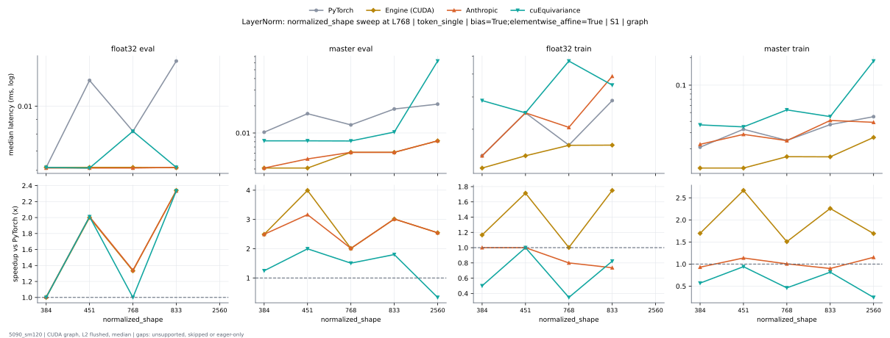

**float32 eval** (median ms; x = speedup vs PyTorch)

| normalized_shape | PyTorch | Engine (Triton) | Engine (CUDA) | Anthropic | cuEquivariance |
|---|---|---|---|---|---|
| 384 | 0.006144 | 0.006144 (1.00x) | 0.006144 (1.00x) | 0.006112 (1.01x) | 0.006144 (1.00x) |
| 451 | 0.01229 | 0.006112 (2.01x) | 0.006144 (2.00x) | 0.006112 (2.01x) | 0.006112 (2.01x) |
| 768 | 0.008192 | 0.00816 (1.00x) | 0.006144 (1.33x) | 0.006112 (1.34x) | 0.008192 (1.00x) |
| 833 | 0.01434 | 0.00816 (1.76x) | 0.006128 (2.34x) | 0.006144 (2.33x) | 0.006144 (2.33x) |
| 2560 |  |  |  |  |  |

**master eval** (median ms; x = speedup vs PyTorch)

| normalized_shape | PyTorch | Engine (Triton) | Engine (CUDA) | Anthropic | cuEquivariance |
|---|---|---|---|---|---|
| 384 | 0.01021 | 0.006144 (1.66x) | 0.004096 (2.49x) | 0.004096 (2.49x) | 0.008192 (1.25x) |
| 451 | 0.01635 | 0.006176 (2.65x) | 0.004096 (3.99x) | 0.005168 (3.16x) | 0.008192 (2.00x) |
| 768 | 0.01229 | 0.006144 (2.00x) | 0.006112 (2.01x) | 0.006112 (2.01x) | 0.00816 (1.51x) |
| 833 | 0.01843 | 0.008192 (2.25x) | 0.006112 (3.02x) | 0.006112 (3.02x) | 0.01024 (1.80x) |
| 2560 | 0.02085 | 0.01229 (1.70x) | 0.008192 (2.54x) | 0.008192 (2.54x) | 0.06245 (0.33x) |

**float32 train** (median ms; x = speedup vs PyTorch)

| normalized_shape | PyTorch | Engine (Triton) | Engine (CUDA) | Anthropic | cuEquivariance |
|---|---|---|---|---|---|
| 384 | 0.01434 | 0.01434 (1.00x) | 0.01229 (1.17x) | 0.01434 (1.00x) | 0.02867 (0.50x) |
| 451 | 0.02458 | 0.01434 (1.71x) | 0.01434 (1.71x) | 0.02458 (1.00x) | 0.02458 (1.00x) |
| 768 | 0.01638 | 0.01843 (0.89x) | 0.01635 (1.00x) | 0.02048 (0.80x) | 0.0471 (0.35x) |
| 833 | 0.02867 | 0.02253 (1.27x) | 0.01638 (1.75x) | 0.03891 (0.74x) | 0.03482 (0.82x) |
| 2560 |  |  |  |  |  |

**master train** (median ms; x = speedup vs PyTorch)

| normalized_shape | PyTorch | Engine (Triton) | Engine (CUDA) | Anthropic | cuEquivariance |
|---|---|---|---|---|---|
| 384 | 0.02083 | 0.01229 (1.70x) | 0.01229 (1.70x) | 0.0224 (0.93x) | 0.03661 (0.57x) |
| 451 | 0.03277 | 0.01638 (2.00x) | 0.01229 (2.67x) | 0.0288 (1.14x) | 0.03482 (0.94x) |
| 768 | 0.02469 | 0.01434 (1.72x) | 0.01638 (1.51x) | 0.02458 (1.00x) | 0.0535 (0.46x) |
| 833 | 0.03686 | 0.02048 (1.80x) | 0.01632 (2.26x) | 0.04096 (0.90x) | 0.04515 (0.82x) |
| 2560 | 0.04506 | 0.03274 (1.38x) | 0.02666 (1.69x) | 0.03907 (1.15x) | 0.184 (0.24x) |

### Single-length cases (no sweep)

- noise | bias=False;elementwise_affine=True;normalized_shape=256 | S1 | graph L1 float32 train anthropic: 0.01024 ms
- noise | bias=False;elementwise_affine=True;normalized_shape=256 | S1 | graph L1 float32 train cuda: 0.008192 ms
- noise | bias=False;elementwise_affine=True;normalized_shape=256 | S1 | graph L1 float32 train cueq: 0.01638 ms
- noise | bias=False;elementwise_affine=True;normalized_shape=256 | S1 | graph L1 float32 train pytorch: 0.008192 ms
- noise | bias=False;elementwise_affine=True;normalized_shape=256 | S1 | graph L1 float32 train triton: 0.008192 ms
- noise | bias=False;elementwise_affine=True;normalized_shape=256 | S1 | graph L1 master train anthropic: 0.01229 ms
- noise | bias=False;elementwise_affine=True;normalized_shape=256 | S1 | graph L1 master train cuda: 0.008192 ms
- noise | bias=False;elementwise_affine=True;normalized_shape=256 | S1 | graph L1 master train cueq: 0.02253 ms
- noise | bias=False;elementwise_affine=True;normalized_shape=256 | S1 | graph L1 master train pytorch: 0.01229 ms
- noise | bias=False;elementwise_affine=True;normalized_shape=256 | S1 | graph L1 master train triton: 0.008192 ms
- noise | bias=False;elementwise_affine=True;normalized_shape=256 | S5 | graph L1 float32 eval anthropic: 0.004096 ms
- noise | bias=False;elementwise_affine=True;normalized_shape=256 | S5 | graph L1 float32 eval cuda: 0.004128 ms
- noise | bias=False;elementwise_affine=True;normalized_shape=256 | S5 | graph L1 float32 eval cueq: 0.006096 ms
- noise | bias=False;elementwise_affine=True;normalized_shape=256 | S5 | graph L1 float32 eval pytorch: 0.004128 ms
- noise | bias=False;elementwise_affine=True;normalized_shape=256 | S5 | graph L1 float32 eval triton: 0.004096 ms
- noise | bias=False;elementwise_affine=True;normalized_shape=256 | S5 | graph L1 master eval anthropic: 0.008192 ms
- noise | bias=False;elementwise_affine=True;normalized_shape=256 | S5 | graph L1 master eval cuda: 0.004096 ms
- noise | bias=False;elementwise_affine=True;normalized_shape=256 | S5 | graph L1 master eval cueq: 0.006144 ms
- noise | bias=False;elementwise_affine=True;normalized_shape=256 | S5 | graph L1 master eval pytorch: 0.008192 ms
- noise | bias=False;elementwise_affine=True;normalized_shape=256 | S5 | graph L1 master eval triton: 0.004096 ms
- noise | bias=True;elementwise_affine=True;normalized_shape=256 | S1 | graph L1 float32 train anthropic: 0.01024 ms
- noise | bias=True;elementwise_affine=True;normalized_shape=256 | S1 | graph L1 float32 train cuda: 0.008192 ms
- noise | bias=True;elementwise_affine=True;normalized_shape=256 | S1 | graph L1 float32 train cueq: 0.01638 ms
- noise | bias=True;elementwise_affine=True;normalized_shape=256 | S1 | graph L1 float32 train pytorch: 0.008192 ms
- noise | bias=True;elementwise_affine=True;normalized_shape=256 | S1 | graph L1 float32 train triton: 0.008192 ms
- noise | bias=True;elementwise_affine=True;normalized_shape=256 | S1 | graph L1 master train anthropic: 0.01638 ms
- noise | bias=True;elementwise_affine=True;normalized_shape=256 | S1 | graph L1 master train cuda: 0.008208 ms
- noise | bias=True;elementwise_affine=True;normalized_shape=256 | S1 | graph L1 master train cueq: 0.02458 ms
- noise | bias=True;elementwise_affine=True;normalized_shape=256 | S1 | graph L1 master train pytorch: 0.01229 ms
- noise | bias=True;elementwise_affine=True;normalized_shape=256 | S1 | graph L1 master train triton: 0.008192 ms
- noise | bias=True;elementwise_affine=True;normalized_shape=256 | S5 | graph L1 float32 eval anthropic: 0.004096 ms
- noise | bias=True;elementwise_affine=True;normalized_shape=256 | S5 | graph L1 float32 eval cuda: 0.004096 ms
- noise | bias=True;elementwise_affine=True;normalized_shape=256 | S5 | graph L1 float32 eval cueq: 0.004096 ms
- noise | bias=True;elementwise_affine=True;normalized_shape=256 | S5 | graph L1 float32 eval pytorch: 0.004128 ms
- noise | bias=True;elementwise_affine=True;normalized_shape=256 | S5 | graph L1 float32 eval triton: 0.004096 ms
- noise | bias=True;elementwise_affine=True;normalized_shape=256 | S5 | graph L1 master eval anthropic: 0.008192 ms
- noise | bias=True;elementwise_affine=True;normalized_shape=256 | S5 | graph L1 master eval cuda: 0.004096 ms
- noise | bias=True;elementwise_affine=True;normalized_shape=256 | S5 | graph L1 master eval cueq: 0.006144 ms
- noise | bias=True;elementwise_affine=True;normalized_shape=256 | S5 | graph L1 master eval pytorch: 0.008192 ms
- noise | bias=True;elementwise_affine=True;normalized_shape=256 | S5 | graph L1 master eval triton: 0.004096 ms
