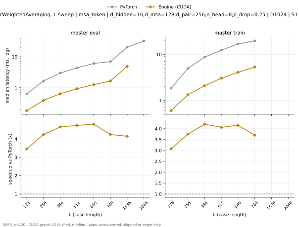
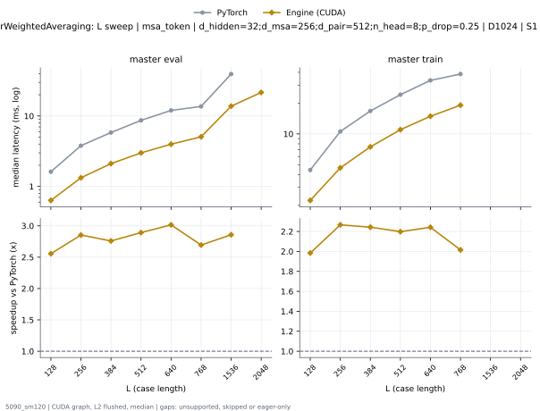
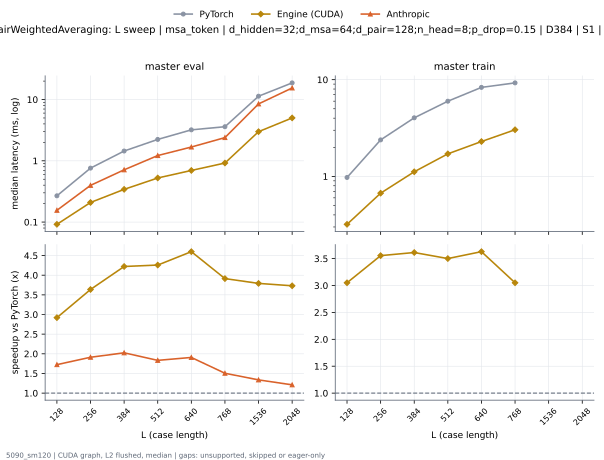
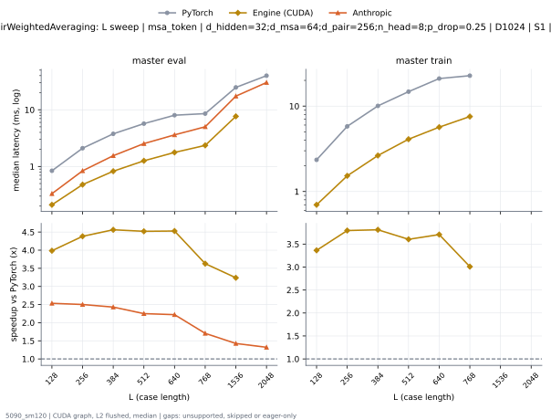
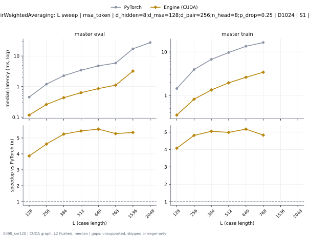
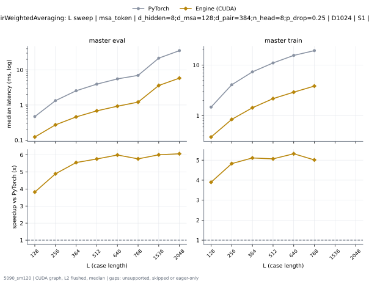
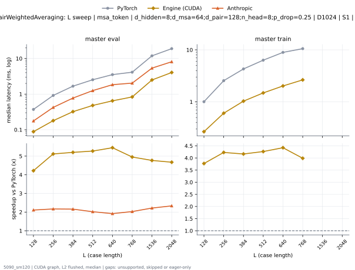
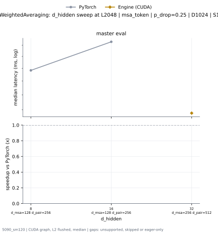
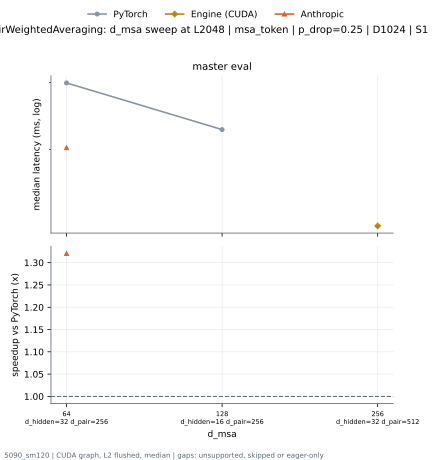
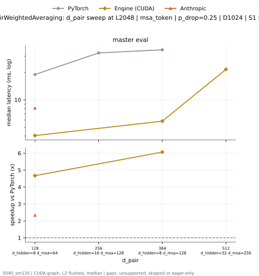

# MSAPairWeightedAveraging on 5090_sm120

Generated by `python -m foldjet_engine.measure.plot` from speed tokens `judge/tokens/5090_sm120/`; do not edit.

### L sweep: msa_token | d_hidden=16;d_msa=128;d_pair=256;n_head=8;p_drop=0.25 | D1024 | S1 | graph

**master eval** (median ms; x = speedup vs PyTorch)

| L | PyTorch | Engine (Triton) | Engine (CUDA) | Anthropic |
|---|---|---|---|---|
| 128 | 0.6298 | 0.1987 (3.17x) | 0.1823 (3.46x) | failed |
| 256 | 1.67 | 0.4917 (3.40x) | 0.3935 (4.25x) | failed |
| 384 | 2.989 | 0.8858 (3.37x) | 0.6427 (4.65x) | failed |
| 512 | 4.419 | 1.388 (3.18x) | 0.9325 (4.74x) | failed |
| 640 | 6.09 | 2.04 (2.99x) | 1.268 (4.80x) | failed |
| 768 | 7.005 | 1.811 (3.87x) | 1.652 (4.24x) | failed |
| 1536 | 20.45 | 6.193 (3.30x) | 4.932 (4.15x) | failed |
| 2048 | 32.66 | 10.28 (3.18x) | unsupported | failed |

**master train** (median ms; x = speedup vs PyTorch)

| L | PyTorch | Engine (Triton) | Engine (CUDA) | Anthropic |
|---|---|---|---|---|
| 128 | 1.826 | 0.9585 (1.90x) | 0.594 (3.07x) | unsupported |
| 256 | 4.946 | 2.309 (2.14x) | 1.318 (3.75x) | unsupported |
| 384 | 8.743 | 3.725 (2.35x) | 2.078 (4.21x) | unsupported |
| 512 | 12.35 | 5.492 (2.25x) | 3.039 (4.06x) | unsupported |
| 640 | 16.98 | 7.821 (2.17x) | 4.082 (4.16x) | unsupported |
| 768 | 19.74 | 7.885 (2.50x) | 5.332 (3.70x) | unsupported |
| 1536 |  |  |  |  |
| 2048 |  |  |  |  |

### L sweep: msa_token | d_hidden=32;d_msa=256;d_pair=512;n_head=8;p_drop=0.25 | D1024 | S1 | graph

**master eval** (median ms; x = speedup vs PyTorch)

| L | PyTorch | Engine (Triton) | Engine (CUDA) | Anthropic |
|---|---|---|---|---|
| 128 | 1.62 | 0.6141 (2.64x) | 0.6339 (2.56x) | unsupported |
| 256 | 3.789 | 1.398 (2.71x) | 1.328 (2.85x) | unsupported |
| 384 | 5.823 | 2.502 (2.33x) | 2.111 (2.76x) | unsupported |
| 512 | 8.669 | 3.838 (2.26x) | 2.997 (2.89x) | unsupported |
| 640 | 12 | 5.408 (2.22x) | 3.979 (3.02x) | unsupported |
| 768 | 13.65 | 5.138 (2.66x) | 5.069 (2.69x) | unsupported |
| 1536 | 39.35 | 14.97 (2.63x) | 13.77 (2.86x) | unsupported |
| 2048 | skipped | 24.08 | 21.58 | unsupported |

**master train** (median ms; x = speedup vs PyTorch)

| L | PyTorch | Engine (Triton) | Engine (CUDA) | Anthropic |
|---|---|---|---|---|
| 128 | 4.437 | 2.893 (1.53x) | 2.237 (1.98x) | unsupported |
| 256 | 10.55 | 5.807 (1.82x) | 4.657 (2.27x) | unsupported |
| 384 | 16.75 | 9.647 (1.74x) | 7.466 (2.24x) | unsupported |
| 512 | 24.16 | 13.75 (1.76x) | 10.99 (2.20x) | unsupported |
| 640 | 33.35 | 19.05 (1.75x) | 14.88 (2.24x) | unsupported |
| 768 | 38.45 | 19.84 (1.94x) | 19.08 (2.02x) | unsupported |
| 1536 |  |  |  |  |
| 2048 |  |  |  |  |

### L sweep: msa_token | d_hidden=32;d_msa=64;d_pair=128;n_head=8;p_drop=0.15 | D384 | S1 | graph

**master eval** (median ms; x = speedup vs PyTorch)

| L | PyTorch | Engine (Triton) | Engine (CUDA) | Anthropic |
|---|---|---|---|---|
| 128 | 0.2684 | 0.0983 (2.73x) | 0.0919 (2.92x) | 0.1556 (1.72x) |
| 256 | 0.7597 | 0.2786 (2.73x) | 0.2089 (3.64x) | 0.3973 (1.91x) |
| 384 | 1.444 | 0.522 (2.77x) | 0.342 (4.22x) | 0.7129 (2.03x) |
| 512 | 2.234 | 0.8233 (2.71x) | 0.5245 (4.26x) | 1.218 (1.83x) |
| 640 | 3.201 | 1.203 (2.66x) | 0.696 (4.60x) | 1.678 (1.91x) |
| 768 | 3.599 | 0.9789 (3.68x) | 0.9196 (3.91x) | 2.392 (1.50x) |
| 1536 | 11.33 | 3.628 (3.12x) | 2.989 (3.79x) | 8.483 (1.34x) |
| 2048 | 18.69 | 6.367 (2.94x) | 5.01 (3.73x) | 15.45 (1.21x) |

**master train** (median ms; x = speedup vs PyTorch)

| L | PyTorch | Engine (Triton) | Engine (CUDA) | Anthropic |
|---|---|---|---|---|
| 128 | 0.9749 | 0.4261 (2.29x) | 0.3196 (3.05x) | unsupported |
| 256 | 2.385 | 0.9974 (2.39x) | 0.6708 (3.56x) | unsupported |
| 384 | 4.035 | 1.836 (2.20x) | 1.117 (3.61x) | unsupported |
| 512 | 5.991 | 2.645 (2.27x) | 1.711 (3.50x) | unsupported |
| 640 | 8.326 | 4.072 (2.04x) | 2.294 (3.63x) | unsupported |
| 768 | 9.267 | 3.644 (2.54x) | 3.038 (3.05x) | unsupported |
| 1536 |  |  |  |  |
| 2048 |  |  |  |  |

### L sweep: msa_token | d_hidden=32;d_msa=64;d_pair=256;n_head=8;p_drop=0.25 | D1024 | S1 | graph

**master eval** (median ms; x = speedup vs PyTorch)

| L | PyTorch | Engine (Triton) | Engine (CUDA) | Anthropic |
|---|---|---|---|---|
| 128 | 0.8407 | 0.2398 (3.51x) | 0.211 (3.98x) | 0.3317 (2.53x) |
| 256 | 2.101 | 0.682 (3.08x) | 0.4792 (4.38x) | 0.8397 (2.50x) |
| 384 | 3.766 | 1.506 (2.50x) | 0.8254 (4.56x) | 1.55 (2.43x) |
| 512 | 5.697 | 2.517 (2.26x) | 1.26 (4.52x) | 2.532 (2.25x) |
| 640 | 8.019 | 3.589 (2.23x) | 1.771 (4.53x) | 3.611 (2.22x) |
| 768 | 8.549 | 2.675 (3.20x) | 2.356 (3.63x) | 5.014 (1.71x) |
| 1536 | 24.8 | 9.504 (2.61x) | 7.659 (3.24x) | 17.39 (1.43x) |
| 2048 | 39.92 | 16.06 (2.49x) | unsupported | 30.22 (1.32x) |

**master train** (median ms; x = speedup vs PyTorch)

| L | PyTorch | Engine (Triton) | Engine (CUDA) | Anthropic |
|---|---|---|---|---|
| 128 | 2.35 | 1.003 (2.34x) | 0.6987 (3.36x) | unsupported |
| 256 | 5.792 | 2.636 (2.20x) | 1.526 (3.80x) | unsupported |
| 384 | 10.06 | 5.22 (1.93x) | 2.639 (3.81x) | unsupported |
| 512 | 14.77 | 7.366 (2.01x) | 4.098 (3.60x) | unsupported |
| 640 | 21.03 | 10.8 (1.95x) | 5.672 (3.71x) | unsupported |
| 768 | 22.72 | 9.517 (2.39x) | 7.551 (3.01x) | unsupported |
| 1536 |  |  |  |  |
| 2048 |  |  |  |  |

### L sweep: msa_token | d_hidden=8;d_msa=128;d_pair=256;n_head=8;p_drop=0.25 | D1024 | S1 | graph

**master eval** (median ms; x = speedup vs PyTorch)

| L | PyTorch | Engine (Triton) | Engine (CUDA) | Anthropic |
|---|---|---|---|---|
| 128 | 0.4516 | 0.1516 (2.98x) | 0.1167 (3.87x) | failed |
| 256 | 1.202 | 0.3615 (3.32x) | 0.2601 (4.62x) | failed |
| 384 | 2.274 | 0.6387 (3.56x) | 0.4338 (5.24x) | failed |
| 512 | 3.43 | 0.9545 (3.59x) | 0.6308 (5.44x) | failed |
| 640 | 4.77 | 1.315 (3.63x) | 0.8584 (5.56x) | failed |
| 768 | 5.873 | 1.328 (4.42x) | 1.114 (5.27x) | failed |
| 1536 | 17.23 | 4.316 (3.99x) | 3.222 (5.35x) | failed |
| 2048 | 27.67 | 7.112 (3.89x) | unsupported | failed |

**master train** (median ms; x = speedup vs PyTorch)

| L | PyTorch | Engine (Triton) | Engine (CUDA) | Anthropic |
|---|---|---|---|---|
| 128 | 1.436 | 0.7117 (2.02x) | 0.3524 (4.08x) | unsupported |
| 256 | 3.93 | 1.783 (2.20x) | 0.8172 (4.81x) | unsupported |
| 384 | 6.733 | 2.977 (2.26x) | 1.334 (5.05x) | unsupported |
| 512 | 9.688 | 4.173 (2.32x) | 1.945 (4.98x) | unsupported |
| 640 | 13.49 | 5.83 (2.31x) | 2.608 (5.17x) | unsupported |
| 768 | 16.44 | 6.33 (2.60x) | 3.407 (4.82x) | unsupported |
| 1536 |  |  |  |  |
| 2048 |  |  |  |  |

### L sweep: msa_token | d_hidden=8;d_msa=128;d_pair=384;n_head=8;p_drop=0.25 | D1024 | S1 | graph

**master eval** (median ms; x = speedup vs PyTorch)

| L | PyTorch | Engine (Triton) | Engine (CUDA) | Anthropic |
|---|---|---|---|---|
| 128 | 0.4694 | 0.1597 (2.94x) | 0.1229 (3.82x) | unsupported |
| 256 | 1.333 | 0.3891 (3.43x) | 0.2726 (4.89x) | unsupported |
| 384 | 2.547 | 0.7089 (3.59x) | 0.4587 (5.55x) | unsupported |
| 512 | 3.933 | 1.086 (3.62x) | 0.6825 (5.76x) | unsupported |
| 640 | 5.549 | 1.5 (3.70x) | 0.9257 (5.99x) | unsupported |
| 768 | 6.983 | 1.603 (4.36x) | 1.211 (5.77x) | unsupported |
| 1536 | 21.61 | 5.349 (4.04x) | 3.599 (6.01x) | unsupported |
| 2048 | 35.39 | 8.972 (3.94x) | 5.833 (6.07x) | unsupported |

**master train** (median ms; x = speedup vs PyTorch)

| L | PyTorch | Engine (Triton) | Engine (CUDA) | Anthropic |
|---|---|---|---|---|
| 128 | 1.477 | 0.7517 (1.97x) | 0.3789 (3.90x) | unsupported |
| 256 | 4.08 | 1.902 (2.14x) | 0.8449 (4.83x) | unsupported |
| 384 | 7.325 | 3.389 (2.16x) | 1.433 (5.11x) | unsupported |
| 512 | 11 | 5.003 (2.20x) | 2.172 (5.06x) | unsupported |
| 640 | 15.5 | 6.917 (2.24x) | 2.914 (5.32x) | unsupported |
| 768 | 19.27 | 7.881 (2.45x) | 3.845 (5.01x) | unsupported |
| 1536 |  |  |  |  |
| 2048 |  |  |  |  |

### L sweep: msa_token | d_hidden=8;d_msa=64;d_pair=128;n_head=8;p_drop=0.25 | D1024 | S1 | graph

**master eval** (median ms; x = speedup vs PyTorch)

| L | PyTorch | Engine (Triton) | Engine (CUDA) | Anthropic |
|---|---|---|---|---|
| 128 | 0.3715 | 0.1065 (3.49x) | 0.08806 (4.22x) | 0.1761 (2.11x) |
| 256 | 0.9175 | 0.2499 (3.67x) | 0.1793 (5.12x) | 0.4233 (2.17x) |
| 384 | 1.672 | 0.4559 (3.67x) | 0.3216 (5.20x) | 0.7747 (2.16x) |
| 512 | 2.532 | 0.6924 (3.66x) | 0.4805 (5.27x) | 1.254 (2.02x) |
| 640 | 3.528 | 0.9638 (3.66x) | 0.6475 (5.45x) | 1.84 (1.92x) |
| 768 | 4.125 | 0.8376 (4.93x) | 0.8333 (4.95x) | 2.035 (2.03x) |
| 1536 | 11.91 | 2.79 (4.27x) | 2.497 (4.77x) | 5.374 (2.22x) |
| 2048 | 18.93 | 4.978 (3.80x) | 4.053 (4.67x) | 8.116 (2.33x) |

**master train** (median ms; x = speedup vs PyTorch)

| L | PyTorch | Engine (Triton) | Engine (CUDA) | Anthropic |
|---|---|---|---|---|
| 128 | 1.006 | 0.4554 (2.21x) | 0.2668 (3.77x) | unsupported |
| 256 | 2.555 | 1.032 (2.48x) | 0.6042 (4.23x) | unsupported |
| 384 | 4.296 | 1.74 (2.47x) | 1.032 (4.16x) | unsupported |
| 512 | 6.333 | 2.45 (2.58x) | 1.485 (4.27x) | unsupported |
| 640 | 8.944 | 3.702 (2.42x) | 2.022 (4.42x) | unsupported |
| 768 | 10.56 | 3.636 (2.90x) | 2.647 (3.99x) | unsupported |
| 1536 |  |  |  |  |
| 2048 |  |  |  |  |

### d_hidden sweep at L2048: msa_token | p_drop=0.25 | D1024 | S1 | graph

**master eval** (median ms; x = speedup vs PyTorch)

| d_hidden | PyTorch | Engine (Triton) | Engine (CUDA) | Anthropic |
|---|---|---|---|---|
| 8 d_msa=128 d_pair=256 | 27.67 | 7.112 (3.89x) | unsupported | failed |
| 16 d_msa=128 d_pair=256 | 32.66 | 10.28 (3.18x) | unsupported | failed |
| 32 d_msa=256 d_pair=512 | skipped | 24.08 | 21.58 | unsupported |

### d_msa sweep at L2048: msa_token | p_drop=0.25 | D1024 | S1 | graph

**master eval** (median ms; x = speedup vs PyTorch)

| d_msa | PyTorch | Engine (Triton) | Engine (CUDA) | Anthropic |
|---|---|---|---|---|
| 64 d_hidden=32 d_pair=256 | 39.92 | 16.06 (2.49x) | unsupported | 30.22 (1.32x) |
| 128 d_hidden=16 d_pair=256 | 32.66 | 10.28 (3.18x) | unsupported | failed |
| 256 d_hidden=32 d_pair=512 | skipped | 24.08 | 21.58 | unsupported |

### d_pair sweep at L2048: msa_token | p_drop=0.25 | D1024 | S1 | graph

**master eval** (median ms; x = speedup vs PyTorch)

| d_pair | PyTorch | Engine (Triton) | Engine (CUDA) | Anthropic |
|---|---|---|---|---|
| 128 d_hidden=8 d_msa=64 | 18.93 | 4.978 (3.80x) | 4.053 (4.67x) | 8.116 (2.33x) |
| 256 d_hidden=16 d_msa=128 | 32.66 | 10.28 (3.18x) | unsupported | failed |
| 384 d_hidden=8 d_msa=128 | 35.39 | 8.972 (3.94x) | 5.833 (6.07x) | unsupported |
| 512 d_hidden=32 d_msa=256 | skipped | 24.08 | 21.58 | unsupported |

