# OuterProductMean on 5090_sm120

Generated by `python -m foldjet_engine.measure.plot` from speed tokens `judge/tokens/5090_sm120/`; do not edit.

### L sweep: msa_token | count_offset=0.001;d_hidden=32;d_msa=128;d_pair=256;normalize_before_proj=False | D1024 | S1 | graph

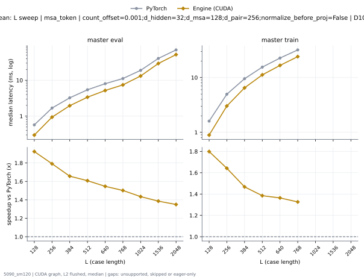

**master eval** (median ms; x = speedup vs PyTorch)

| L | PyTorch | Engine (Triton) | Engine (CUDA) | Anthropic |
|---|---|---|---|---|
| 128 | 0.5714 | 0.3031 (1.89x) | 0.297 (1.92x) | unsupported |
| 256 | 1.682 | 0.9646 (1.74x) | 0.939 (1.79x) | unsupported |
| 384 | 3.239 | 1.967 (1.65x) | 1.955 (1.66x) | unsupported |
| 512 | 5.429 | 3.44 (1.58x) | 3.377 (1.61x) | unsupported |
| 640 | 8.022 | 5.299 (1.51x) | 5.187 (1.55x) | unsupported |
| 768 | 11.17 | 7.549 (1.48x) | 7.438 (1.50x) | unsupported |
| 1024 | 18.88 | 13.24 (1.43x) | 13.16 (1.43x) | unsupported |
| 1536 | 40.6 | 29.51 (1.38x) | 29.3 (1.39x) | unsupported |
| 2048 | 70.01 | 52.36 (1.34x) | 51.87 (1.35x) | unsupported |

**master train** (median ms; x = speedup vs PyTorch)

| L | PyTorch | Engine (Triton) | Engine (CUDA) | Anthropic |
|---|---|---|---|---|
| 128 | 1.601 | 0.9718 (1.65x) | 0.8899 (1.80x) | unsupported |
| 256 | 4.964 | 3.209 (1.55x) | 3.023 (1.64x) | unsupported |
| 384 | 9.524 | 6.711 (1.42x) | 6.491 (1.47x) | unsupported |
| 512 | 15.5 | 11.72 (1.32x) | 11.19 (1.38x) | unsupported |
| 640 | 22.7 | 17.11 (1.33x) | 16.65 (1.36x) | unsupported |
| 768 | 31.95 | 24.66 (1.30x) | 24.09 (1.33x) | unsupported |
| 1024 |  |  |  |  |
| 1536 |  |  |  |  |
| 2048 |  |  |  |  |

### L sweep: msa_token | count_offset=0.001;d_hidden=32;d_msa=128;d_pair=384;normalize_before_proj=False | D1024 | S1 | graph

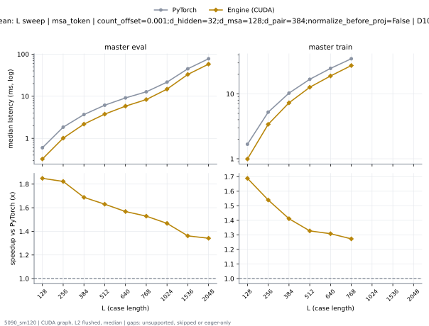

**master eval** (median ms; x = speedup vs PyTorch)

| L | PyTorch | Engine (Triton) | Engine (CUDA) | Anthropic |
|---|---|---|---|---|
| 128 | 0.5983 | 0.3256 (1.84x) | 0.3236 (1.85x) | unsupported |
| 256 | 1.844 | 1.018 (1.81x) | 1.012 (1.82x) | unsupported |
| 384 | 3.674 | 2.195 (1.67x) | 2.177 (1.69x) | unsupported |
| 512 | 6.129 | 3.825 (1.60x) | 3.76 (1.63x) | unsupported |
| 640 | 9.121 | 5.957 (1.53x) | 5.818 (1.57x) | unsupported |
| 768 | 12.74 | 8.45 (1.51x) | 8.336 (1.53x) | unsupported |
| 1024 | 21.65 | 14.79 (1.46x) | 14.75 (1.47x) | unsupported |
| 1536 | 44.87 | 33.2 (1.35x) | 32.95 (1.36x) | unsupported |
| 2048 | 77.72 | 58.31 (1.33x) | 57.93 (1.34x) | unsupported |

**master train** (median ms; x = speedup vs PyTorch)

| L | PyTorch | Engine (Triton) | Engine (CUDA) | Anthropic |
|---|---|---|---|---|
| 128 | 1.676 | 1.046 (1.60x) | 0.9928 (1.69x) | unsupported |
| 256 | 5.236 | 3.501 (1.50x) | 3.4 (1.54x) | unsupported |
| 384 | 10.28 | 7.467 (1.38x) | 7.281 (1.41x) | unsupported |
| 512 | 16.79 | 13.04 (1.29x) | 12.65 (1.33x) | unsupported |
| 640 | 24.71 | 19.16 (1.29x) | 18.89 (1.31x) | unsupported |
| 768 | 34.8 | 27.64 (1.26x) | 27.34 (1.27x) | unsupported |
| 1024 |  |  |  |  |
| 1536 |  |  |  |  |
| 2048 |  |  |  |  |

### L sweep: msa_token | count_offset=0.001;d_hidden=32;d_msa=256;d_pair=512;normalize_before_proj=False | D1024 | S1 | graph

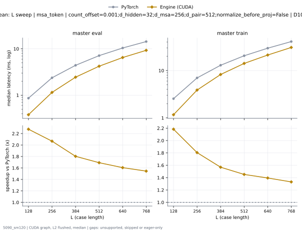

**master eval** (median ms; x = speedup vs PyTorch)

| L | PyTorch | Engine (Triton) | Engine (CUDA) | Anthropic |
|---|---|---|---|---|
| 128 | 0.8622 | 0.378 (2.28x) | 0.3789 (2.28x) | unsupported |
| 256 | 2.373 | 1.173 (2.02x) | 1.148 (2.07x) | unsupported |
| 384 | 4.41 | 2.482 (1.78x) | 2.446 (1.80x) | unsupported |
| 512 | 7.134 | 4.294 (1.66x) | 4.217 (1.69x) | unsupported |
| 640 | 10.42 | 6.641 (1.57x) | 6.492 (1.61x) | unsupported |
| 768 | 14.34 | 9.442 (1.52x) | 9.283 (1.55x) | unsupported |

**master train** (median ms; x = speedup vs PyTorch)

| L | PyTorch | Engine (Triton) | Engine (CUDA) | Anthropic |
|---|---|---|---|---|
| 128 | 2.549 | 1.521 (1.68x) | 1.167 (2.18x) | unsupported |
| 256 | 6.99 | 4.501 (1.55x) | 3.873 (1.80x) | unsupported |
| 384 | 12.94 | 9.032 (1.43x) | 8.249 (1.57x) | unsupported |
| 512 | 20.53 | 15.33 (1.34x) | 14.14 (1.45x) | unsupported |
| 640 | 29.64 | 22.46 (1.32x) | 21.26 (1.39x) | unsupported |
| 768 | 40.9 | 32.08 (1.28x) | 30.74 (1.33x) | unsupported |

### L sweep: msa_token | count_offset=0.001;d_hidden=32;d_msa=64;d_pair=128;normalize_before_proj=False | D1024 | S1 | graph

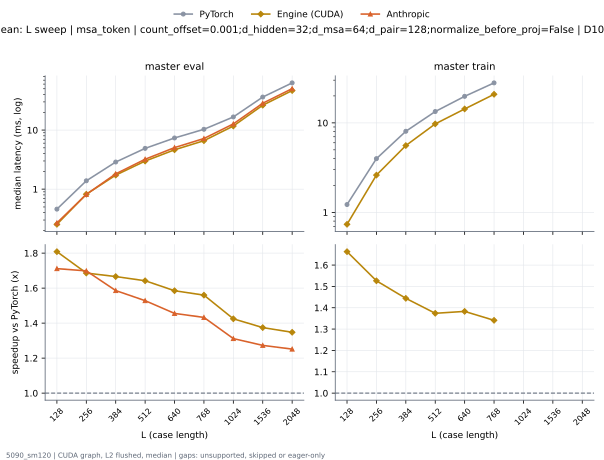

**master eval** (median ms; x = speedup vs PyTorch)

| L | PyTorch | Engine (Triton) | Engine (CUDA) | Anthropic |
|---|---|---|---|---|
| 128 | 0.4592 | 0.2624 (1.75x) | 0.254 (1.81x) | 0.2684 (1.71x) |
| 256 | 1.385 | 0.8169 (1.70x) | 0.8213 (1.69x) | 0.8153 (1.70x) |
| 384 | 2.88 | 1.732 (1.66x) | 1.729 (1.67x) | 1.816 (1.59x) |
| 512 | 4.906 | 2.989 (1.64x) | 2.988 (1.64x) | 3.21 (1.53x) |
| 640 | 7.352 | 4.641 (1.58x) | 4.639 (1.59x) | 5.052 (1.46x) |
| 768 | 10.32 | 6.592 (1.57x) | 6.614 (1.56x) | 7.202 (1.43x) |
| 1024 | 16.69 | 11.59 (1.44x) | 11.71 (1.42x) | 12.72 (1.31x) |
| 1536 | 36.23 | 26.12 (1.39x) | 26.36 (1.37x) | 28.47 (1.27x) |
| 2048 | 62.94 | 46.18 (1.36x) | 46.71 (1.35x) | 50.29 (1.25x) |

**master train** (median ms; x = speedup vs PyTorch)

| L | PyTorch | Engine (Triton) | Engine (CUDA) | Anthropic |
|---|---|---|---|---|
| 128 | 1.224 | 0.8038 (1.52x) | 0.7363 (1.66x) | unsupported |
| 256 | 3.985 | 2.712 (1.47x) | 2.611 (1.53x) | unsupported |
| 384 | 8.06 | 5.662 (1.42x) | 5.581 (1.44x) | unsupported |
| 512 | 13.39 | 10.25 (1.31x) | 9.743 (1.37x) | unsupported |
| 640 | 19.79 | 14.85 (1.33x) | 14.31 (1.38x) | unsupported |
| 768 | 27.97 | 21.46 (1.30x) | 20.86 (1.34x) | unsupported |
| 1024 |  |  |  |  |
| 1536 |  |  |  |  |
| 2048 |  |  |  |  |

### L sweep: msa_token | d_hidden=32;d_msa=128;d_pair=256;normalize_before_proj=False | D1024 | S1 | graph

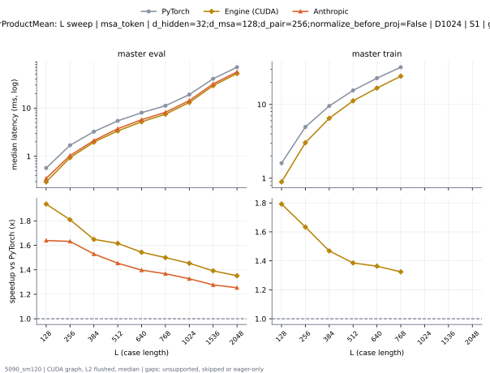

**master eval** (median ms; x = speedup vs PyTorch)

| L | PyTorch | Engine (Triton) | Engine (CUDA) | Anthropic |
|---|---|---|---|---|
| 128 | 0.5714 | 0.3023 (1.89x) | 0.2949 (1.94x) | 0.3485 (1.64x) |
| 256 | 1.693 | 0.9574 (1.77x) | 0.9354 (1.81x) | 1.037 (1.63x) |
| 384 | 3.243 | 1.963 (1.65x) | 1.967 (1.65x) | 2.121 (1.53x) |
| 512 | 5.425 | 3.41 (1.59x) | 3.357 (1.62x) | 3.732 (1.45x) |
| 640 | 8.019 | 5.273 (1.52x) | 5.194 (1.54x) | 5.738 (1.40x) |
| 768 | 11.17 | 7.561 (1.48x) | 7.449 (1.50x) | 8.167 (1.37x) |
| 1024 | 18.98 | 13.2 (1.44x) | 13.06 (1.45x) | 14.31 (1.33x) |
| 1536 | 40.49 | 29.7 (1.36x) | 29.09 (1.39x) | 31.71 (1.28x) |
| 2048 | 70.17 | 52.34 (1.34x) | 51.92 (1.35x) | 55.98 (1.25x) |

**master train** (median ms; x = speedup vs PyTorch)

| L | PyTorch | Engine (Triton) | Engine (CUDA) | Anthropic |
|---|---|---|---|---|
| 128 | 1.599 | 0.9711 (1.65x) | 0.8924 (1.79x) | unsupported |
| 256 | 4.95 | 3.211 (1.54x) | 3.03 (1.63x) | unsupported |
| 384 | 9.532 | 6.713 (1.42x) | 6.491 (1.47x) | unsupported |
| 512 | 15.49 | 11.72 (1.32x) | 11.18 (1.39x) | unsupported |
| 640 | 22.7 | 17.1 (1.33x) | 16.65 (1.36x) | unsupported |
| 768 | 31.94 | 24.82 (1.29x) | 24.12 (1.32x) | unsupported |
| 1024 |  |  |  |  |
| 1536 |  |  |  |  |
| 2048 |  |  |  |  |

### L sweep: msa_token | d_hidden=32;d_msa=128;d_pair=256;normalize_before_proj=True | D1024 | S1 | graph

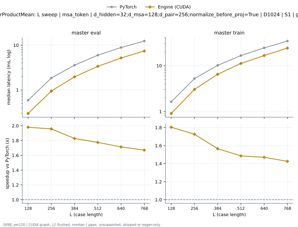

**master eval** (median ms; x = speedup vs PyTorch)

| L | PyTorch | Engine (Triton) | Engine (CUDA) | Anthropic |
|---|---|---|---|---|
| 128 | 0.5879 | 0.3031 (1.94x) | 0.297 (1.98x) | unsupported |
| 256 | 1.846 | 0.956 (1.93x) | 0.9432 (1.96x) | unsupported |
| 384 | 3.584 | 1.979 (1.81x) | 1.961 (1.83x) | unsupported |
| 512 | 5.985 | 3.438 (1.74x) | 3.373 (1.77x) | unsupported |
| 640 | 8.892 | 5.333 (1.67x) | 5.188 (1.71x) | unsupported |
| 768 | 12.42 | 7.586 (1.64x) | 7.437 (1.67x) | unsupported |

**master train** (median ms; x = speedup vs PyTorch)

| L | PyTorch | Engine (Triton) | Engine (CUDA) | Anthropic |
|---|---|---|---|---|
| 128 | 1.632 | 0.9852 (1.66x) | 0.9052 (1.80x) | unsupported |
| 256 | 5.232 | 3.198 (1.64x) | 3.032 (1.73x) | unsupported |
| 384 | 10.17 | 6.689 (1.52x) | 6.496 (1.57x) | unsupported |
| 512 | 16.61 | 11.71 (1.42x) | 11.18 (1.49x) | unsupported |
| 640 | 24.45 | 17.09 (1.43x) | 16.64 (1.47x) | unsupported |
| 768 | 34.44 | 24.67 (1.40x) | 24.16 (1.43x) | unsupported |

### L sweep: msa_token | d_hidden=32;d_msa=128;d_pair=384;normalize_before_proj=False | D1024 | S1 | graph

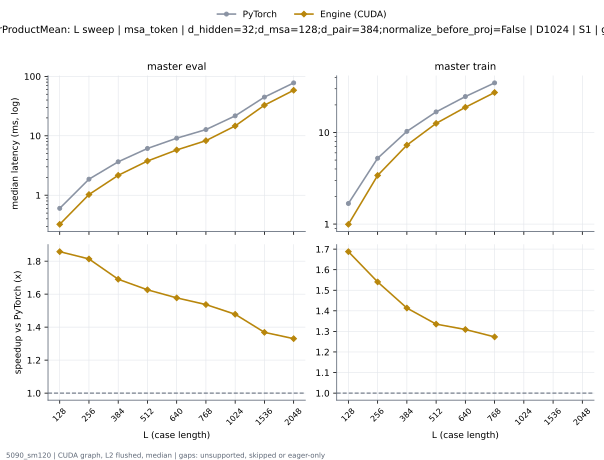

**master eval** (median ms; x = speedup vs PyTorch)

| L | PyTorch | Engine (Triton) | Engine (CUDA) | Anthropic |
|---|---|---|---|---|
| 128 | 0.6011 | 0.3254 (1.85x) | 0.3236 (1.86x) | unsupported |
| 256 | 1.861 | 1.017 (1.83x) | 1.026 (1.81x) | unsupported |
| 384 | 3.653 | 2.191 (1.67x) | 2.161 (1.69x) | unsupported |
| 512 | 6.118 | 3.822 (1.60x) | 3.762 (1.63x) | unsupported |
| 640 | 9.112 | 5.926 (1.54x) | 5.776 (1.58x) | unsupported |
| 768 | 12.72 | 8.487 (1.50x) | 8.278 (1.54x) | unsupported |
| 1024 | 21.66 | 14.69 (1.47x) | 14.65 (1.48x) | unsupported |
| 1536 | 44.78 | 33.05 (1.35x) | 32.72 (1.37x) | unsupported |
| 2048 | 77.72 | 58.32 (1.33x) | 58.43 (1.33x) | unsupported |

**master train** (median ms; x = speedup vs PyTorch)

| L | PyTorch | Engine (Triton) | Engine (CUDA) | Anthropic |
|---|---|---|---|---|
| 128 | 1.678 | 1.047 (1.60x) | 0.9943 (1.69x) | unsupported |
| 256 | 5.237 | 3.504 (1.49x) | 3.4 (1.54x) | unsupported |
| 384 | 10.29 | 7.468 (1.38x) | 7.279 (1.41x) | unsupported |
| 512 | 16.79 | 13.04 (1.29x) | 12.57 (1.34x) | unsupported |
| 640 | 24.68 | 19.16 (1.29x) | 18.85 (1.31x) | unsupported |
| 768 | 34.8 | 27.64 (1.26x) | 27.33 (1.27x) | unsupported |
| 1024 |  |  |  |  |
| 1536 |  |  |  |  |
| 2048 |  |  |  |  |

### L sweep: msa_token | d_hidden=32;d_msa=128;d_pair=384;normalize_before_proj=True | D1024 | S1 | graph

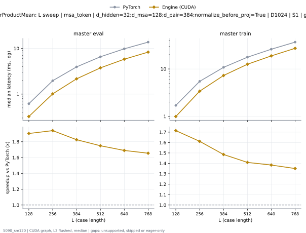

**master eval** (median ms; x = speedup vs PyTorch)

| L | PyTorch | Engine (Triton) | Engine (CUDA) | Anthropic |
|---|---|---|---|---|
| 128 | 0.6162 | 0.3256 (1.89x) | 0.3236 (1.90x) | unsupported |
| 256 | 1.965 | 1.027 (1.91x) | 1.013 (1.94x) | unsupported |
| 384 | 3.946 | 2.204 (1.79x) | 2.162 (1.83x) | unsupported |
| 512 | 6.573 | 3.798 (1.73x) | 3.759 (1.75x) | unsupported |
| 640 | 9.825 | 5.925 (1.66x) | 5.815 (1.69x) | unsupported |
| 768 | 13.76 | 8.4 (1.64x) | 8.314 (1.65x) | unsupported |

**master train** (median ms; x = speedup vs PyTorch)

| L | PyTorch | Engine (Triton) | Engine (CUDA) | Anthropic |
|---|---|---|---|---|
| 128 | 1.703 | 1.048 (1.62x) | 0.9933 (1.71x) | unsupported |
| 256 | 5.481 | 3.503 (1.56x) | 3.401 (1.61x) | unsupported |
| 384 | 10.81 | 7.456 (1.45x) | 7.28 (1.49x) | unsupported |
| 512 | 17.71 | 13.04 (1.36x) | 12.57 (1.41x) | unsupported |
| 640 | 26.11 | 19.16 (1.36x) | 18.87 (1.38x) | unsupported |
| 768 | 36.87 | 27.63 (1.33x) | 27.3 (1.35x) | unsupported |

### L sweep: msa_token | d_hidden=32;d_msa=256;d_pair=512;normalize_before_proj=False | D1024 | S1 | graph

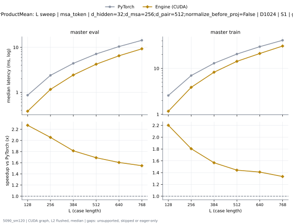

**master eval** (median ms; x = speedup vs PyTorch)

| L | PyTorch | Engine (Triton) | Engine (CUDA) | Anthropic |
|---|---|---|---|---|
| 128 | 0.8612 | 0.3785 (2.28x) | 0.3789 (2.27x) | unsupported |
| 256 | 2.383 | 1.173 (2.03x) | 1.159 (2.06x) | unsupported |
| 384 | 4.406 | 2.473 (1.78x) | 2.428 (1.81x) | unsupported |
| 512 | 7.134 | 4.274 (1.67x) | 4.219 (1.69x) | unsupported |
| 640 | 10.43 | 6.685 (1.56x) | 6.497 (1.61x) | unsupported |
| 768 | 14.36 | 9.49 (1.51x) | 9.283 (1.55x) | unsupported |

**master train** (median ms; x = speedup vs PyTorch)

| L | PyTorch | Engine (Triton) | Engine (CUDA) | Anthropic |
|---|---|---|---|---|
| 128 | 2.573 | 1.526 (1.69x) | 1.168 (2.20x) | unsupported |
| 256 | 6.989 | 4.501 (1.55x) | 3.872 (1.81x) | unsupported |
| 384 | 12.95 | 9.03 (1.43x) | 8.262 (1.57x) | unsupported |
| 512 | 20.54 | 15.38 (1.34x) | 14.25 (1.44x) | unsupported |
| 640 | 29.74 | 22.46 (1.32x) | 21.1 (1.41x) | unsupported |
| 768 | 40.93 | 32.06 (1.28x) | 30.69 (1.33x) | unsupported |

### L sweep: msa_token | d_hidden=32;d_msa=256;d_pair=512;normalize_before_proj=True | D1024 | S1 | graph

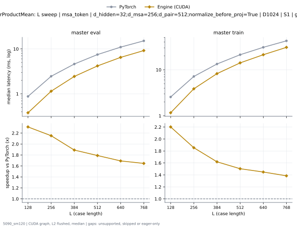

**master eval** (median ms; x = speedup vs PyTorch)

| L | PyTorch | Engine (Triton) | Engine (CUDA) | Anthropic |
|---|---|---|---|---|
| 128 | 0.8761 | 0.3788 (2.31x) | 0.3789 (2.31x) | unsupported |
| 256 | 2.463 | 1.181 (2.09x) | 1.145 (2.15x) | unsupported |
| 384 | 4.616 | 2.471 (1.87x) | 2.442 (1.89x) | unsupported |
| 512 | 7.493 | 4.266 (1.76x) | 4.185 (1.79x) | unsupported |
| 640 | 10.99 | 6.641 (1.65x) | 6.492 (1.69x) | unsupported |
| 768 | 15.15 | 9.427 (1.61x) | 9.202 (1.65x) | unsupported |

**master train** (median ms; x = speedup vs PyTorch)

| L | PyTorch | Engine (Triton) | Engine (CUDA) | Anthropic |
|---|---|---|---|---|
| 128 | 2.568 | 1.526 (1.68x) | 1.166 (2.20x) | unsupported |
| 256 | 7.167 | 4.481 (1.60x) | 3.865 (1.85x) | unsupported |
| 384 | 13.36 | 9.006 (1.48x) | 8.251 (1.62x) | unsupported |
| 512 | 21.25 | 15.3 (1.39x) | 14.13 (1.50x) | unsupported |
| 640 | 30.78 | 22.44 (1.37x) | 21.25 (1.45x) | unsupported |
| 768 | 42.55 | 32.04 (1.33x) | 30.72 (1.38x) | unsupported |

### L sweep: msa_token | d_hidden=32;d_msa=64;d_pair=128;normalize_before_proj=False | D1024 | S1 | graph

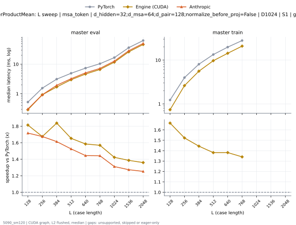

**master eval** (median ms; x = speedup vs PyTorch)

| L | PyTorch | Engine (Triton) | Engine (CUDA) | Anthropic |
|---|---|---|---|---|
| 128 | 0.5221 | 0.2954 (1.77x) | 0.2877 (1.81x) | 0.304 (1.72x) |
| 256 | 1.548 | 0.9054 (1.71x) | 0.9236 (1.68x) | 0.9236 (1.68x) |
| 384 | 3.118 | 1.713 (1.82x) | 1.696 (1.84x) | 1.932 (1.61x) |
| 512 | 4.924 | 3.005 (1.64x) | 2.979 (1.65x) | 3.228 (1.53x) |
| 640 | 7.346 | 4.635 (1.59x) | 4.635 (1.59x) | 5.086 (1.44x) |
| 768 | 10.37 | 6.59 (1.57x) | 6.608 (1.57x) | 7.189 (1.44x) |
| 1024 | 16.67 | 11.66 (1.43x) | 11.71 (1.42x) | 12.71 (1.31x) |
| 1536 | 36.27 | 26.11 (1.39x) | 26.16 (1.39x) | 28.48 (1.27x) |
| 2048 | 63.04 | 46.18 (1.36x) | 46.35 (1.36x) | 50.31 (1.25x) |

**master train** (median ms; x = speedup vs PyTorch)

| L | PyTorch | Engine (Triton) | Engine (CUDA) | Anthropic |
|---|---|---|---|---|
| 128 | 1.226 | 0.8028 (1.53x) | 0.7363 (1.67x) | unsupported |
| 256 | 3.985 | 2.711 (1.47x) | 2.617 (1.52x) | unsupported |
| 384 | 8.06 | 5.661 (1.42x) | 5.583 (1.44x) | unsupported |
| 512 | 13.39 | 10.23 (1.31x) | 9.691 (1.38x) | unsupported |
| 640 | 19.78 | 14.86 (1.33x) | 14.32 (1.38x) | unsupported |
| 768 | 27.95 | 21.44 (1.30x) | 20.85 (1.34x) | unsupported |
| 1024 |  |  |  |  |
| 1536 |  |  |  |  |
| 2048 |  |  |  |  |

### L sweep: msa_token | d_hidden=32;d_msa=64;d_pair=128;normalize_before_proj=False;projection_bias=True | D1024 | S1 | graph

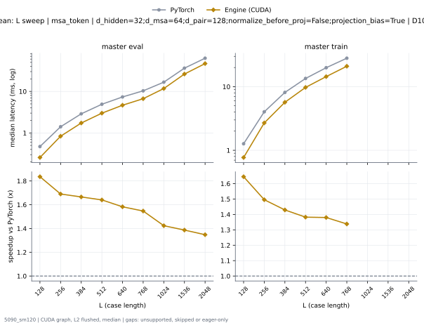

**master eval** (median ms; x = speedup vs PyTorch)

| L | PyTorch | Engine (Triton) | Engine (CUDA) | Anthropic |
|---|---|---|---|---|
| 128 | 0.47 | 0.2642 (1.78x) | 0.256 (1.84x) | unsupported |
| 256 | 1.409 | 0.8274 (1.70x) | 0.8336 (1.69x) | unsupported |
| 384 | 2.886 | 1.731 (1.67x) | 1.733 (1.67x) | unsupported |
| 512 | 4.908 | 3.012 (1.63x) | 2.992 (1.64x) | unsupported |
| 640 | 7.358 | 4.608 (1.60x) | 4.649 (1.58x) | unsupported |
| 768 | 10.32 | 6.601 (1.56x) | 6.673 (1.55x) | unsupported |
| 1024 | 16.7 | 11.68 (1.43x) | 11.73 (1.42x) | unsupported |
| 1536 | 36.31 | 26.12 (1.39x) | 26.18 (1.39x) | unsupported |
| 2048 | 63.03 | 46.21 (1.36x) | 46.77 (1.35x) | unsupported |

**master train** (median ms; x = speedup vs PyTorch)

| L | PyTorch | Engine (Triton) | Engine (CUDA) | Anthropic |
|---|---|---|---|---|
| 128 | 1.267 | 0.8171 (1.55x) | 0.7701 (1.65x) | unsupported |
| 256 | 4.028 | 2.739 (1.47x) | 2.693 (1.50x) | unsupported |
| 384 | 8.124 | 5.7 (1.43x) | 5.684 (1.43x) | unsupported |
| 512 | 13.46 | 10.23 (1.32x) | 9.739 (1.38x) | unsupported |
| 640 | 19.87 | 14.84 (1.34x) | 14.4 (1.38x) | unsupported |
| 768 | 28.04 | 21.53 (1.30x) | 20.96 (1.34x) | unsupported |
| 1024 |  |  |  |  |
| 1536 |  |  |  |  |
| 2048 |  |  |  |  |

### L sweep: msa_token | d_hidden=32;d_msa=64;d_pair=128;normalize_before_proj=True | D384 | S1 | graph

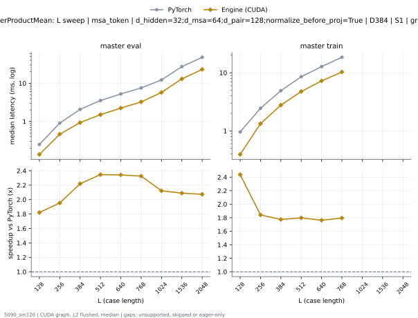

**master eval** (median ms; x = speedup vs PyTorch)

| L | PyTorch | Engine (Triton) | Engine (CUDA) | Anthropic |
|---|---|---|---|---|
| 128 | 0.2499 | 0.1352 (1.85x) | 0.1372 (1.82x) | failed |
| 256 | 0.908 | 0.4475 (2.03x) | 0.4649 (1.95x) | failed |
| 384 | 2.074 | 0.9277 (2.24x) | 0.9341 (2.22x) | failed |
| 512 | 3.535 | 1.477 (2.39x) | 1.507 (2.35x) | failed |
| 640 | 5.243 | 2.253 (2.33x) | 2.238 (2.34x) | failed |
| 768 | 7.559 | 3.259 (2.32x) | 3.25 (2.33x) | failed |
| 1024 | 12.22 | 5.736 (2.13x) | 5.757 (2.12x) | failed |
| 1536 | 27.16 | 12.91 (2.10x) | 13 (2.09x) | failed |
| 2048 | 47.83 | 22.77 (2.10x) | 23.07 (2.07x) | failed |

**master train** (median ms; x = speedup vs PyTorch)

| L | PyTorch | Engine (Triton) | Engine (CUDA) | Anthropic |
|---|---|---|---|---|
| 128 | 0.9581 | 0.5471 (1.75x) | 0.3931 (2.44x) | unsupported |
| 256 | 2.449 | 1.48 (1.66x) | 1.33 (1.84x) | unsupported |
| 384 | 4.912 | 2.959 (1.66x) | 2.769 (1.77x) | unsupported |
| 512 | 8.542 | 5.401 (1.58x) | 4.751 (1.80x) | unsupported |
| 640 | 12.76 | 7.679 (1.66x) | 7.238 (1.76x) | unsupported |
| 768 | 18.46 | 10.98 (1.68x) | 10.28 (1.80x) | unsupported |
| 1024 |  |  |  |  |
| 1536 |  |  |  |  |
| 2048 |  |  |  |  |

### L sweep: msa_token | d_hidden=32;d_msa=64;d_pair=128;normalize_before_proj=True;projection_bias=True | D1024 | S1 | graph

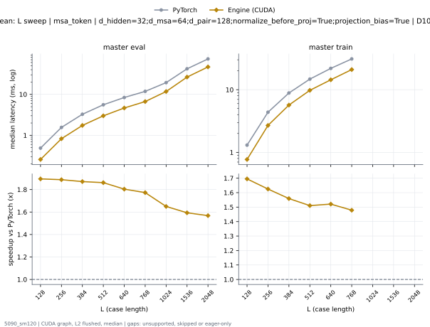

**master eval** (median ms; x = speedup vs PyTorch)

| L | PyTorch | Engine (Triton) | Engine (CUDA) | Anthropic |
|---|---|---|---|---|
| 128 | 0.4877 | 0.2642 (1.85x) | 0.2574 (1.89x) | failed |
| 256 | 1.56 | 0.8223 (1.90x) | 0.8265 (1.89x) | failed |
| 384 | 3.263 | 1.746 (1.87x) | 1.744 (1.87x) | failed |
| 512 | 5.571 | 3.015 (1.85x) | 2.993 (1.86x) | failed |
| 640 | 8.378 | 4.659 (1.80x) | 4.645 (1.80x) | failed |
| 768 | 11.83 | 6.645 (1.78x) | 6.673 (1.77x) | failed |
| 1024 | 19.34 | 11.68 (1.66x) | 11.72 (1.65x) | failed |
| 1536 | 42.06 | 26.15 (1.61x) | 26.4 (1.59x) | failed |
| 2048 | 73.27 | 46.2 (1.59x) | 46.73 (1.57x) | failed |

**master train** (median ms; x = speedup vs PyTorch)

| L | PyTorch | Engine (Triton) | Engine (CUDA) | Anthropic |
|---|---|---|---|---|
| 128 | 1.306 | 0.8171 (1.60x) | 0.7704 (1.70x) | unsupported |
| 256 | 4.373 | 2.736 (1.60x) | 2.691 (1.62x) | unsupported |
| 384 | 8.862 | 5.689 (1.56x) | 5.684 (1.56x) | unsupported |
| 512 | 14.76 | 10.29 (1.43x) | 9.774 (1.51x) | unsupported |
| 640 | 21.9 | 14.82 (1.48x) | 14.4 (1.52x) | unsupported |
| 768 | 30.99 | 21.52 (1.44x) | 20.96 (1.48x) | unsupported |
| 1024 |  |  |  |  |
| 1536 |  |  |  |  |
| 2048 |  |  |  |  |

### L sweep: msa_token | d_hidden=64;d_msa=64;d_pair=256;groups=8;normalize_before_proj=False | D1024 | S1 | graph

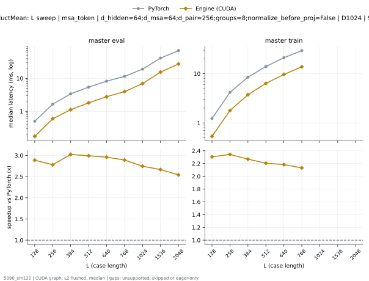

**master eval** (median ms; x = speedup vs PyTorch)

| L | PyTorch | Engine (Triton) | Engine (CUDA) | Anthropic |
|---|---|---|---|---|
| 128 | 0.5027 | 0.1618 (3.11x) | 0.1741 (2.89x) | unsupported |
| 256 | 1.652 | 0.6226 (2.65x) | 0.5943 (2.78x) | unsupported |
| 384 | 3.391 | 1.285 (2.64x) | 1.121 (3.02x) | unsupported |
| 512 | 5.415 | 2.211 (2.45x) | 1.81 (2.99x) | unsupported |
| 640 | 8.206 | 3.604 (2.28x) | 2.773 (2.96x) | unsupported |
| 768 | 11.47 | 5.19 (2.21x) | 3.967 (2.89x) | unsupported |
| 1024 | 19.03 | 8.852 (2.15x) | 6.931 (2.75x) | unsupported |
| 1536 | 41.21 | 20.49 (2.01x) | 15.46 (2.67x) | unsupported |
| 2048 | 69.41 | 35.3 (1.97x) | 27.31 (2.54x) | unsupported |

**master train** (median ms; x = speedup vs PyTorch)

| L | PyTorch | Engine (Triton) | Engine (CUDA) | Anthropic |
|---|---|---|---|---|
| 128 | 1.231 | 0.5243 (2.35x) | 0.5341 (2.30x) | unsupported |
| 256 | 4.176 | 1.84 (2.27x) | 1.783 (2.34x) | unsupported |
| 384 | 8.483 | 4.033 (2.10x) | 3.739 (2.27x) | unsupported |
| 512 | 13.97 | 6.912 (2.02x) | 6.335 (2.20x) | unsupported |
| 640 | 21.05 | 10.85 (1.94x) | 9.643 (2.18x) | unsupported |
| 768 | 29.38 | 15.4 (1.91x) | 13.78 (2.13x) | unsupported |
| 1024 |  |  |  |  |
| 1536 |  |  |  |  |
| 2048 |  |  |  |  |

### L sweep: msa_token | d_hidden=64;d_msa=64;d_pair=256;groups=8;normalize_before_proj=True | D1024 | S1 | graph

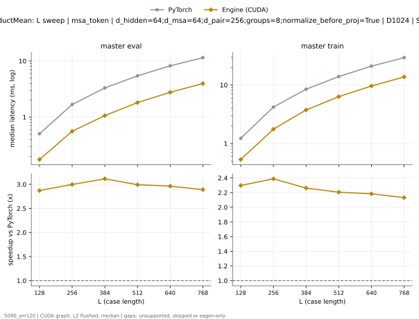

**master eval** (median ms; x = speedup vs PyTorch)

| L | PyTorch | Engine (Triton) | Engine (CUDA) | Anthropic |
|---|---|---|---|---|
| 128 | 0.5056 | 0.1641 (3.08x) | 0.1761 (2.87x) | unsupported |
| 256 | 1.681 | 0.5919 (2.84x) | 0.5607 (3.00x) | unsupported |
| 384 | 3.317 | 1.302 (2.55x) | 1.065 (3.11x) | unsupported |
| 512 | 5.441 | 2.231 (2.44x) | 1.819 (2.99x) | unsupported |
| 640 | 8.204 | 3.604 (2.28x) | 2.769 (2.96x) | unsupported |
| 768 | 11.46 | 5.142 (2.23x) | 3.967 (2.89x) | unsupported |

**master train** (median ms; x = speedup vs PyTorch)

| L | PyTorch | Engine (Triton) | Engine (CUDA) | Anthropic |
|---|---|---|---|---|
| 128 | 1.226 | 0.5222 (2.35x) | 0.5337 (2.30x) | unsupported |
| 256 | 4.204 | 1.82 (2.31x) | 1.76 (2.39x) | unsupported |
| 384 | 8.48 | 4.026 (2.11x) | 3.749 (2.26x) | unsupported |
| 512 | 13.96 | 6.902 (2.02x) | 6.329 (2.21x) | unsupported |
| 640 | 21.05 | 10.85 (1.94x) | 9.638 (2.18x) | unsupported |
| 768 | 29.37 | 15.39 (1.91x) | 13.78 (2.13x) | unsupported |

### d_msa sweep at L768: msa_token | count_offset=0.001;normalize_before_proj=False | D1024 | S1 | graph

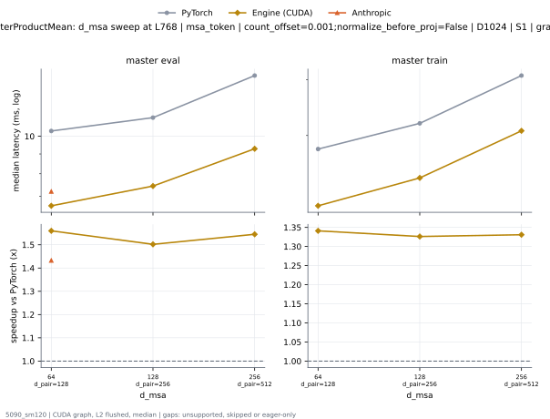

**master eval** (median ms; x = speedup vs PyTorch)

| d_msa | PyTorch | Engine (Triton) | Engine (CUDA) | Anthropic |
|---|---|---|---|---|
| 64 d_pair=128 | 10.32 | 6.592 (1.57x) | 6.614 (1.56x) | 7.202 (1.43x) |
| 128 d_pair=256 | 11.17 | 7.549 (1.48x) | 7.438 (1.50x) | unsupported |
| 256 d_pair=512 | 14.34 | 9.442 (1.52x) | 9.283 (1.55x) | unsupported |

**master train** (median ms; x = speedup vs PyTorch)

| d_msa | PyTorch | Engine (Triton) | Engine (CUDA) | Anthropic |
|---|---|---|---|---|
| 64 d_pair=128 | 27.97 | 21.46 (1.30x) | 20.86 (1.34x) | unsupported |
| 128 d_pair=256 | 31.95 | 24.66 (1.30x) | 24.09 (1.33x) | unsupported |
| 256 d_pair=512 | 40.9 | 32.08 (1.28x) | 30.74 (1.33x) | unsupported |

### d_msa sweep at L768: msa_token | normalize_before_proj=False | D1024 | S1 | graph

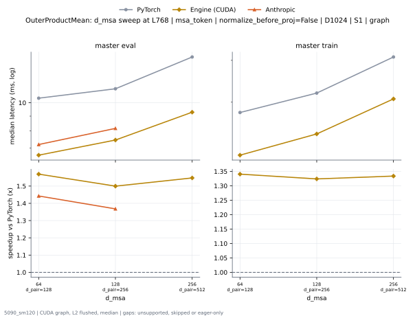

**master eval** (median ms; x = speedup vs PyTorch)

| d_msa | PyTorch | Engine (Triton) | Engine (CUDA) | Anthropic |
|---|---|---|---|---|
| 64 d_pair=128 | 10.37 | 6.59 (1.57x) | 6.608 (1.57x) | 7.189 (1.44x) |
| 128 d_pair=256 | 11.17 | 7.561 (1.48x) | 7.449 (1.50x) | 8.167 (1.37x) |
| 256 d_pair=512 | 14.36 | 9.49 (1.51x) | 9.283 (1.55x) | unsupported |

**master train** (median ms; x = speedup vs PyTorch)

| d_msa | PyTorch | Engine (Triton) | Engine (CUDA) | Anthropic |
|---|---|---|---|---|
| 64 d_pair=128 | 27.95 | 21.44 (1.30x) | 20.85 (1.34x) | unsupported |
| 128 d_pair=256 | 31.94 | 24.82 (1.29x) | 24.12 (1.32x) | unsupported |
| 256 d_pair=512 | 40.93 | 32.06 (1.28x) | 30.69 (1.33x) | unsupported |

### d_pair sweep at L768: msa_token | count_offset=0.001;normalize_before_proj=False | D1024 | S1 | graph

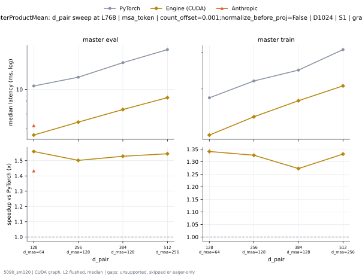

**master eval** (median ms; x = speedup vs PyTorch)

| d_pair | PyTorch | Engine (Triton) | Engine (CUDA) | Anthropic |
|---|---|---|---|---|
| 128 d_msa=64 | 10.32 | 6.592 (1.57x) | 6.614 (1.56x) | 7.202 (1.43x) |
| 256 d_msa=128 | 11.17 | 7.549 (1.48x) | 7.438 (1.50x) | unsupported |
| 384 d_msa=128 | 12.74 | 8.45 (1.51x) | 8.336 (1.53x) | unsupported |
| 512 d_msa=256 | 14.34 | 9.442 (1.52x) | 9.283 (1.55x) | unsupported |

**master train** (median ms; x = speedup vs PyTorch)

| d_pair | PyTorch | Engine (Triton) | Engine (CUDA) | Anthropic |
|---|---|---|---|---|
| 128 d_msa=64 | 27.97 | 21.46 (1.30x) | 20.86 (1.34x) | unsupported |
| 256 d_msa=128 | 31.95 | 24.66 (1.30x) | 24.09 (1.33x) | unsupported |
| 384 d_msa=128 | 34.8 | 27.64 (1.26x) | 27.34 (1.27x) | unsupported |
| 512 d_msa=256 | 40.9 | 32.08 (1.28x) | 30.74 (1.33x) | unsupported |

### d_pair sweep at L768: msa_token | normalize_before_proj=False | D1024 | S1 | graph

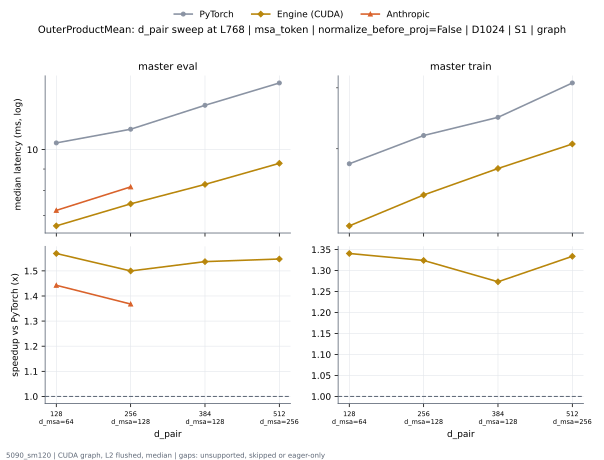

**master eval** (median ms; x = speedup vs PyTorch)

| d_pair | PyTorch | Engine (Triton) | Engine (CUDA) | Anthropic |
|---|---|---|---|---|
| 128 d_msa=64 | 10.37 | 6.59 (1.57x) | 6.608 (1.57x) | 7.189 (1.44x) |
| 256 d_msa=128 | 11.17 | 7.561 (1.48x) | 7.449 (1.50x) | 8.167 (1.37x) |
| 384 d_msa=128 | 12.72 | 8.487 (1.50x) | 8.278 (1.54x) | unsupported |
| 512 d_msa=256 | 14.36 | 9.49 (1.51x) | 9.283 (1.55x) | unsupported |

**master train** (median ms; x = speedup vs PyTorch)

| d_pair | PyTorch | Engine (Triton) | Engine (CUDA) | Anthropic |
|---|---|---|---|---|
| 128 d_msa=64 | 27.95 | 21.44 (1.30x) | 20.85 (1.34x) | unsupported |
| 256 d_msa=128 | 31.94 | 24.82 (1.29x) | 24.12 (1.32x) | unsupported |
| 384 d_msa=128 | 34.8 | 27.64 (1.26x) | 27.33 (1.27x) | unsupported |
| 512 d_msa=256 | 40.93 | 32.06 (1.28x) | 30.69 (1.33x) | unsupported |

### d_pair sweep at L768: msa_token | normalize_before_proj=True | D1024 | S1 | graph

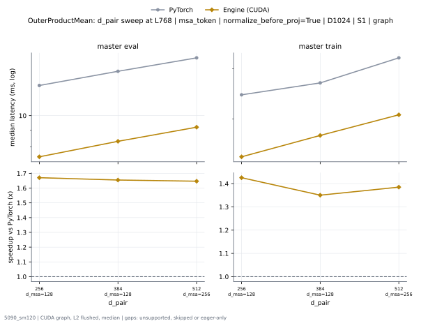

**master eval** (median ms; x = speedup vs PyTorch)

| d_pair | PyTorch | Engine (Triton) | Engine (CUDA) | Anthropic |
|---|---|---|---|---|
| 256 d_msa=128 | 12.42 | 7.586 (1.64x) | 7.437 (1.67x) | unsupported |
| 384 d_msa=128 | 13.76 | 8.4 (1.64x) | 8.314 (1.65x) | unsupported |
| 512 d_msa=256 | 15.15 | 9.427 (1.61x) | 9.202 (1.65x) | unsupported |

**master train** (median ms; x = speedup vs PyTorch)

| d_pair | PyTorch | Engine (Triton) | Engine (CUDA) | Anthropic |
|---|---|---|---|---|
| 256 d_msa=128 | 34.44 | 24.67 (1.40x) | 24.16 (1.43x) | unsupported |
| 384 d_msa=128 | 36.87 | 27.63 (1.33x) | 27.3 (1.35x) | unsupported |
| 512 d_msa=256 | 42.55 | 32.04 (1.33x) | 30.72 (1.38x) | unsupported |

