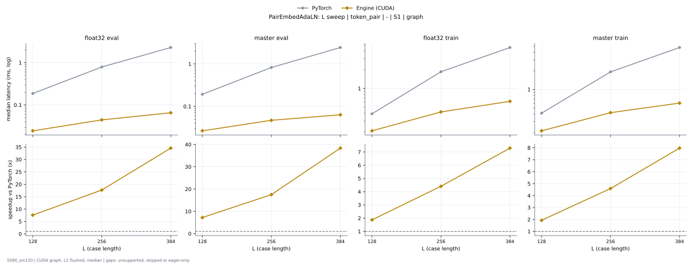

# PairEmbedAdaLN on 5090_sm120

Generated by `python -m miniworld_engine.measure.plot` from speed tokens `judge/tokens/5090_sm120/`; do not edit.

### L sweep: token_pair | - | S1 | graph

**float32 eval** (median ms; x = speedup vs PyTorch)

| L | PyTorch | Engine (Triton) | Engine (CUDA) |
|---|---|---|---|
| 128 | 0.1864 | 0.02458 (7.58x) | 0.02458 (7.58x) |
| 256 | 0.7871 | 0.0471 (16.71x) | 0.0445 (17.69x) |
| 384 | 2.266 | 0.08397 (26.99x) | 0.06554 (34.58x) |

**master eval** (median ms; x = speedup vs PyTorch)

| L | PyTorch | Engine (Triton) | Engine (CUDA) |
|---|---|---|---|
| 128 | 0.1925 | 0.02842 (6.77x) | 0.02662 (7.23x) |
| 256 | 0.8246 | 0.05094 (16.19x) | 0.0471 (17.51x) |
| 384 | 2.436 | 0.07987 (30.49x) | 0.06349 (38.36x) |

**float32 train** (median ms; x = speedup vs PyTorch)

| L | PyTorch | Engine (Triton) | Engine (CUDA) |
|---|---|---|---|
| 128 | 0.3911 | 0.3729 (1.05x) | 0.2089 (1.87x) |
| 256 | 1.85 | 0.7178 (2.58x) | 0.4196 (4.41x) |
| 384 | 4.526 | 1.076 (4.21x) | 0.6206 (7.29x) |

**master train** (median ms; x = speedup vs PyTorch)

| L | PyTorch | Engine (Triton) | Engine (CUDA) |
|---|---|---|---|
| 128 | 0.4116 | 0.3771 (1.09x) | 0.213 (1.93x) |
| 256 | 1.927 | 0.7171 (2.69x) | 0.4198 (4.59x) |
| 384 | 4.786 | 1.021 (4.69x) | 0.6003 (7.97x) |

