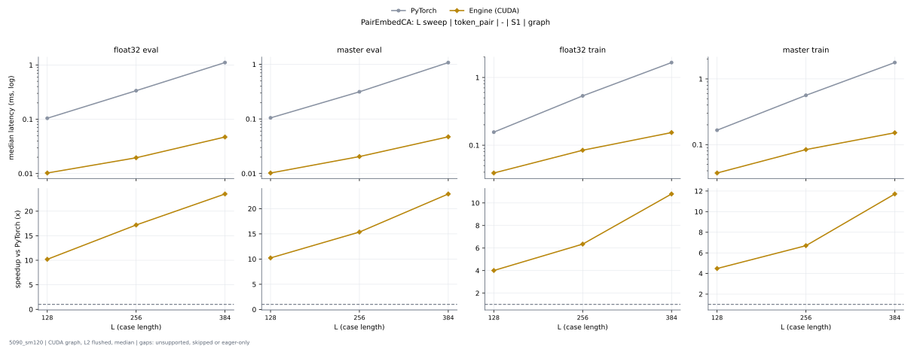
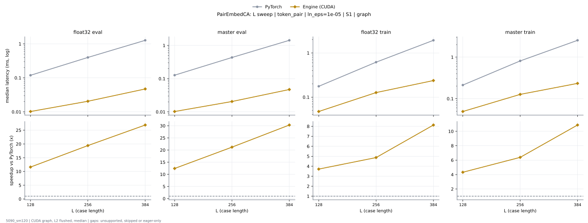

# PairEmbedCA on 5090_sm120

Generated by `python -m foldjet_engine.measure.plot` from speed tokens `judge/tokens/5090_sm120/`; do not edit.

### L sweep: token_pair | - | S1 | graph

**float32 eval** (median ms; x = speedup vs PyTorch)

| L | PyTorch | Engine (Triton) | Engine (CUDA) |
|---|---|---|---|
| 128 | 0.1044 | 0.01229 (8.50x) | 0.01024 (10.20x) |
| 256 | 0.3359 | 0.02362 (14.22x) | 0.01954 (17.19x) |
| 384 | 1.108 | 0.0512 (21.64x) | 0.04712 (23.51x) |

**master eval** (median ms; x = speedup vs PyTorch)

| L | PyTorch | Engine (Triton) | Engine (CUDA) |
|---|---|---|---|
| 128 | 0.1047 | 0.0123 (8.51x) | 0.01024 (10.23x) |
| 256 | 0.3146 | 0.02272 (13.85x) | 0.02048 (15.36x) |
| 384 | 1.08 | 0.0512 (21.10x) | 0.04714 (22.91x) |

**float32 train** (median ms; x = speedup vs PyTorch)

| L | PyTorch | Engine (Triton) | Engine (CUDA) |
|---|---|---|---|
| 128 | 0.1559 | 0.0543 (2.87x) | 0.0389 (4.01x) |
| 256 | 0.5351 | 0.1063 (5.03x) | 0.08427 (6.35x) |
| 384 | 1.66 | 0.1906 (8.71x) | 0.1537 (10.80x) |

**master train** (median ms; x = speedup vs PyTorch)

| L | PyTorch | Engine (Triton) | Engine (CUDA) |
|---|---|---|---|
| 128 | 0.1659 | 0.05419 (3.06x) | 0.03701 (4.48x) |
| 256 | 0.5632 | 0.1048 (5.38x) | 0.08406 (6.70x) |
| 384 | 1.775 | 0.1864 (9.53x) | 0.1516 (11.71x) |

### L sweep: token_pair | ln_eps=1e-05 | S1 | graph

**float32 eval** (median ms; x = speedup vs PyTorch)

| L | PyTorch | Engine (Triton) | Engine (CUDA) |
|---|---|---|---|
| 128 | 0.1188 | 0.01229 (9.67x) | 0.01024 (11.60x) |
| 256 | 0.3976 | 0.02662 (14.93x) | 0.02048 (19.41x) |
| 384 | 1.267 | 0.05325 (23.79x) | 0.0471 (26.89x) |

**master eval** (median ms; x = speedup vs PyTorch)

| L | PyTorch | Engine (Triton) | Engine (CUDA) |
|---|---|---|---|
| 128 | 0.1272 | 0.0123 (10.34x) | 0.01024 (12.42x) |
| 256 | 0.4341 | 0.02664 (16.30x) | 0.02048 (21.20x) |
| 384 | 1.428 | 0.0512 (27.88x) | 0.0471 (30.31x) |

**float32 train** (median ms; x = speedup vs PyTorch)

| L | PyTorch | Engine (Triton) | Engine (CUDA) |
|---|---|---|---|
| 128 | 0.176 | 0.05734 (3.07x) | 0.04736 (3.72x) |
| 256 | 0.6185 | 0.1495 (4.14x) | 0.127 (4.87x) |
| 384 | 1.932 | 0.2905 (6.65x) | 0.2376 (8.13x) |

**master train** (median ms; x = speedup vs PyTorch)

| L | PyTorch | Engine (Triton) | Engine (CUDA) |
|---|---|---|---|
| 128 | 0.2126 | 0.05944 (3.58x) | 0.04918 (4.32x) |
| 256 | 0.8112 | 0.1492 (5.44x) | 0.127 (6.39x) |
| 384 | 2.538 | 0.2857 (8.88x) | 0.2335 (10.87x) |

