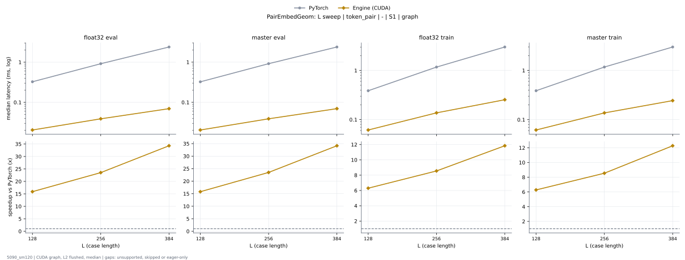
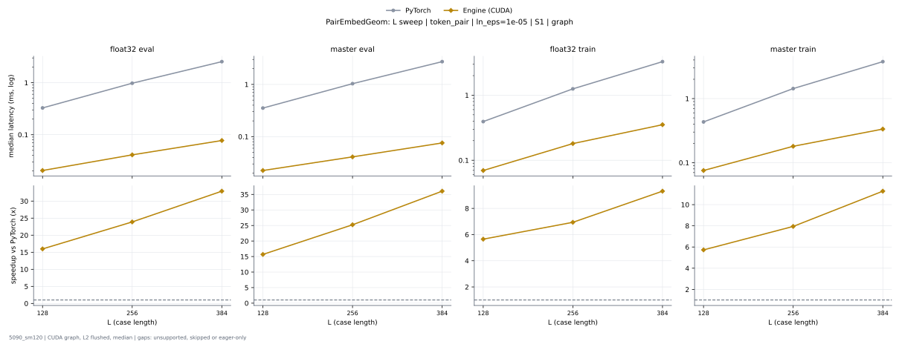

# PairEmbedGeom on 5090_sm120

Generated by `python -m foldjet_engine.measure.plot` from speed tokens `judge/tokens/5090_sm120/`; do not edit.

### L sweep: token_pair | - | S1 | graph

**float32 eval** (median ms; x = speedup vs PyTorch)

| L | PyTorch | Engine (Triton) | Engine (CUDA) |
|---|---|---|---|
| 128 | 0.3253 | 0.02662 (12.22x) | 0.02048 (15.88x) |
| 256 | 0.9155 | 0.04298 (21.30x) | 0.03891 (23.53x) |
| 384 | 2.388 | 0.07984 (29.92x) | 0.06963 (34.30x) |

**master eval** (median ms; x = speedup vs PyTorch)

| L | PyTorch | Engine (Triton) | Engine (CUDA) |
|---|---|---|---|
| 128 | 0.3236 | 0.02688 (12.04x) | 0.02048 (15.80x) |
| 256 | 0.9145 | 0.04326 (21.14x) | 0.03891 (23.50x) |
| 384 | 2.378 | 0.07594 (31.32x) | 0.06963 (34.15x) |

**float32 train** (median ms; x = speedup vs PyTorch)

| L | PyTorch | Engine (Triton) | Engine (CUDA) |
|---|---|---|---|
| 128 | 0.3871 | 0.09626 (4.02x) | 0.06144 (6.30x) |
| 256 | 1.174 | 0.1782 (6.59x) | 0.1372 (8.55x) |
| 384 | 3.009 | 0.3178 (9.47x) | 0.254 (11.84x) |

**master train** (median ms; x = speedup vs PyTorch)

| L | PyTorch | Engine (Triton) | Engine (CUDA) |
|---|---|---|---|
| 128 | 0.3871 | 0.09651 (4.01x) | 0.0617 (6.27x) |
| 256 | 1.173 | 0.1784 (6.57x) | 0.1372 (8.55x) |
| 384 | 2.993 | 0.3011 (9.94x) | 0.2439 (12.27x) |

### L sweep: token_pair | ln_eps=1e-05 | S1 | graph

**float32 eval** (median ms; x = speedup vs PyTorch)

| L | PyTorch | Engine (Triton) | Engine (CUDA) |
|---|---|---|---|
| 128 | 0.3274 | 0.02661 (12.30x) | 0.02048 (15.98x) |
| 256 | 0.9787 | 0.04707 (20.79x) | 0.04096 (23.89x) |
| 384 | 2.545 | 0.07782 (32.70x) | 0.07731 (32.91x) |

**master eval** (median ms; x = speedup vs PyTorch)

| L | PyTorch | Engine (Triton) | Engine (CUDA) |
|---|---|---|---|
| 128 | 0.3524 | 0.02858 (12.33x) | 0.02246 (15.69x) |
| 256 | 1.033 | 0.0471 (21.94x) | 0.04096 (25.23x) |
| 384 | 2.73 | 0.0739 (36.94x) | 0.07573 (36.05x) |

**float32 train** (median ms; x = speedup vs PyTorch)

| L | PyTorch | Engine (Triton) | Engine (CUDA) |
|---|---|---|---|
| 128 | 0.3934 | 0.1024 (3.84x) | 0.06963 (5.65x) |
| 256 | 1.252 | 0.2274 (5.51x) | 0.1805 (6.94x) |
| 384 | 3.282 | 0.4056 (8.09x) | 0.3523 (9.32x) |

**master train** (median ms; x = speedup vs PyTorch)

| L | PyTorch | Engine (Triton) | Engine (CUDA) |
|---|---|---|---|
| 128 | 0.4328 | 0.1066 (4.06x) | 0.07552 (5.73x) |
| 256 | 1.432 | 0.2276 (6.29x) | 0.1803 (7.94x) |
| 384 | 3.77 | 0.3932 (9.59x) | 0.3345 (11.27x) |

