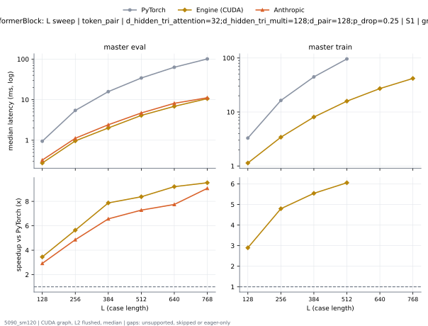
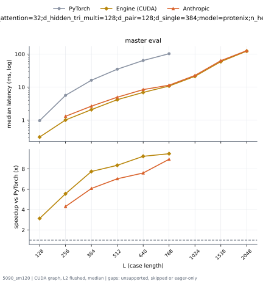

# PairformerBlock on 5090_sm120

Generated by `python -m foldjet_engine.measure.plot` from speed tokens `judge/tokens/5090_sm120/`; do not edit.

### L sweep: token_pair | d_hidden_tri_attention=32;d_hidden_tri_multi=128;d_pair=128;p_drop=0.25 | S1 | graph

**master eval** (median ms; x = speedup vs PyTorch)

| L | PyTorch | Engine (Triton) | Engine (CUDA) | Anthropic |
|---|---|---|---|---|
| 128 | 0.9462 | 0.4014 (2.36x) | 0.2744 (3.45x) | 0.3241 (2.92x) |
| 256 | 5.429 | 1.262 (4.30x) | 0.9625 (5.64x) | 1.118 (4.86x) |
| 384 | 15.81 | 3.064 (5.16x) | 2.008 (7.87x) | 2.407 (6.57x) |
| 512 | 34.27 | 6.397 (5.36x) | 4.091 (8.38x) | 4.705 (7.28x) |
| 640 | 63.07 | 11.06 (5.70x) | 6.853 (9.20x) | 8.143 (7.75x) |
| 768 | 101.1 | 14.66 (6.90x) | 10.62 (9.52x) | 11.16 (9.07x) |

**master train** (median ms; x = speedup vs PyTorch)

| L | PyTorch | Engine (Triton) | Engine (CUDA) | Anthropic |
|---|---|---|---|---|
| 128 | 3.29 | 1.427 (2.31x) | 1.136 (2.90x) | unsupported |
| 256 | 16.35 | 4.844 (3.38x) | 3.41 (4.79x) | unsupported |
| 384 | 44.67 | 12.11 (3.69x) | 8.061 (5.54x) | unsupported |
| 512 | 96.07 | 24.94 (3.85x) | 15.87 (6.05x) | unsupported |
| 640 | skipped | 43.96 | 27.15 | unsupported |
| 768 | skipped | 62.34 | 41.82 | unsupported |

### L sweep: protenix | token_pair | d_hidden_tri_attention=32;d_hidden_tri_multi=128;d_pair=128;d_single=384;model=protenix;n_head_single=16;n_head_tri_attention=4;p_drop=0.0 | S1 | graph

**master eval** (median ms; x = speedup vs PyTorch)

| L | PyTorch | Engine (Triton) | Engine (CUDA) | Anthropic |
|---|---|---|---|---|
| 128 | 0.9695 | 0.5 (1.94x) | 0.3092 (3.13x) | unsupported |
| 256 | 5.642 | 1.439 (3.92x) | 1.015 (5.56x) | 1.31 (4.31x) |
| 384 | 16.18 | 3.412 (4.74x) | 2.087 (7.75x) | 2.661 (6.08x) |
| 512 | 34.9 | 7.009 (4.98x) | 4.175 (8.36x) | 4.961 (7.03x) |
| 640 | 64.09 | 12.04 (5.32x) | 6.932 (9.25x) | 8.43 (7.60x) |
| 768 | 102.6 | 16.05 (6.39x) | 10.8 (9.50x) | 11.46 (8.95x) |
| 1024 | skipped | 31.16 | 21.25 | 22.61 |
| 1536 | skipped | 81.93 | 59.23 | 63.29 |
| 2048 | skipped | 166.6 | 123.1 | 127.3 |

