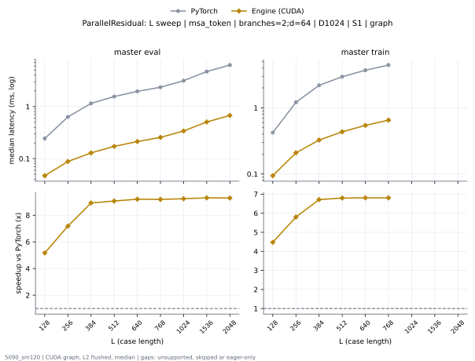
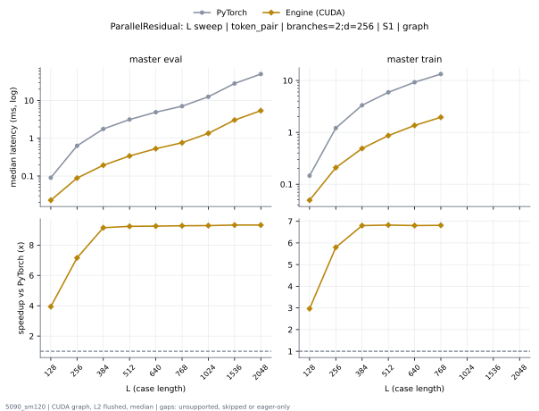
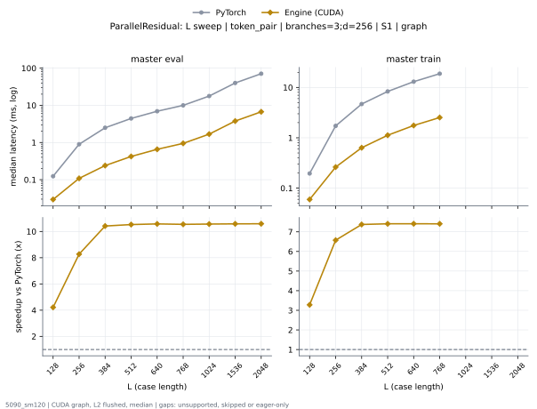

# ParallelResidual on 5090_sm120

Generated by `python -m miniworld_engine.measure.plot` from speed tokens `judge/tokens/5090_sm120/`; do not edit.

### L sweep: msa_token | branches=2;d=64 | D1024 | S1 | graph

**master eval** (median ms; x = speedup vs PyTorch)

| L | PyTorch | Engine (Triton) | Engine (CUDA) |
|---|---|---|---|
| 128 | 0.2435 | 0.04507 (5.40x) | 0.0471 (5.17x) |
| 256 | 0.6327 | 0.08806 (7.18x) | 0.0881 (7.18x) |
| 384 | 1.151 | 0.13 (8.85x) | 0.1291 (8.92x) |
| 512 | 1.559 | 0.172 (9.06x) | 0.172 (9.06x) |
| 640 | 1.96 | 0.2152 (9.11x) | 0.213 (9.20x) |
| 768 | 2.352 | 0.257 (9.15x) | 0.256 (9.19x) |
| 1024 | 3.14 | 0.342 (9.18x) | 0.3399 (9.24x) |
| 1536 | 4.71 | 0.5099 (9.24x) | 0.5064 (9.30x) |
| 2048 | 6.282 | 0.6779 (9.27x) | 0.676 (9.29x) |

**master train** (median ms; x = speedup vs PyTorch)

| L | PyTorch | Engine (Triton) | Engine (CUDA) |
|---|---|---|---|
| 128 | 0.4219 | 0.115 (3.67x) | 0.09426 (4.48x) |
| 256 | 1.211 | 0.2969 (4.08x) | 0.2088 (5.80x) |
| 384 | 2.187 | 0.5639 (3.88x) | 0.3256 (6.72x) |
| 512 | 2.951 | 0.783 (3.77x) | 0.4342 (6.80x) |
| 640 | 3.694 | 0.9861 (3.75x) | 0.5427 (6.81x) |
| 768 | 4.433 | 1.183 (3.75x) | 0.6513 (6.81x) |
| 1024 |  |  |  |
| 1536 |  |  |  |
| 2048 |  |  |  |

### L sweep: token_pair | branches=2;d=256 | S1 | graph

**master eval** (median ms; x = speedup vs PyTorch)

| L | PyTorch | Engine (Triton) | Engine (CUDA) |
|---|---|---|---|
| 128 | 0.09008 | 0.02458 (3.67x) | 0.02286 (3.94x) |
| 256 | 0.6315 | 0.08843 (7.14x) | 0.08822 (7.16x) |
| 384 | 1.764 | 0.1946 (9.07x) | 0.1929 (9.15x) |
| 512 | 3.14 | 0.342 (9.18x) | 0.34 (9.24x) |
| 640 | 4.908 | 0.5307 (9.25x) | 0.5304 (9.25x) |
| 768 | 7.065 | 0.7623 (9.27x) | 0.7617 (9.28x) |
| 1024 | 12.57 | 1.352 (9.30x) | 1.354 (9.28x) |
| 1536 | 28.26 | 3.028 (9.33x) | 3.032 (9.32x) |
| 2048 | 50.22 | 5.375 (9.34x) | 5.388 (9.32x) |

**master train** (median ms; x = speedup vs PyTorch)

| L | PyTorch | Engine (Triton) | Engine (CUDA) |
|---|---|---|---|
| 128 | 0.1457 | 0.06179 (2.36x) | 0.04915 (2.96x) |
| 256 | 1.211 | 0.2963 (4.09x) | 0.2089 (5.80x) |
| 384 | 3.325 | 0.8857 (3.75x) | 0.489 (6.80x) |
| 512 | 5.913 | 1.577 (3.75x) | 0.8663 (6.83x) |
| 640 | 9.236 | 2.463 (3.75x) | 1.358 (6.80x) |
| 768 | 13.3 | 3.547 (3.75x) | 1.953 (6.81x) |
| 1024 |  |  |  |
| 1536 |  |  |  |
| 2048 |  |  |  |

### L sweep: token_pair | branches=3;d=256 | S1 | graph

**master eval** (median ms; x = speedup vs PyTorch)

| L | PyTorch | Engine (Triton) | Engine (CUDA) |
|---|---|---|---|
| 128 | 0.1239 | 0.02894 (4.28x) | 0.02939 (4.21x) |
| 256 | 0.898 | 0.1106 (8.12x) | 0.1086 (8.27x) |
| 384 | 2.496 | 0.24 (10.40x) | 0.2396 (10.42x) |
| 512 | 4.441 | 0.4233 (10.49x) | 0.4219 (10.53x) |
| 640 | 6.943 | 0.6577 (10.56x) | 0.6564 (10.58x) |
| 768 | 9.998 | 0.9461 (10.57x) | 0.9482 (10.54x) |
| 1024 | 17.78 | 1.676 (10.60x) | 1.683 (10.56x) |
| 1536 | 39.98 | 3.746 (10.67x) | 3.778 (10.58x) |
| 2048 | 71.04 | 6.669 (10.65x) | 6.71 (10.59x) |

**master train** (median ms; x = speedup vs PyTorch)

| L | PyTorch | Engine (Triton) | Engine (CUDA) |
|---|---|---|---|
| 128 | 0.1957 | 0.06997 (2.80x) | 0.0597 (3.28x) |
| 256 | 1.723 | 0.3543 (4.86x) | 0.2621 (6.57x) |
| 384 | 4.682 | 1.03 (4.54x) | 0.6349 (7.37x) |
| 512 | 8.325 | 1.832 (4.54x) | 1.124 (7.41x) |
| 640 | 13.01 | 2.862 (4.55x) | 1.756 (7.41x) |
| 768 | 18.74 | 4.121 (4.55x) | 2.53 (7.41x) |
| 1024 |  |  |  |
| 1536 |  |  |  |
| 2048 |  |  |  |

