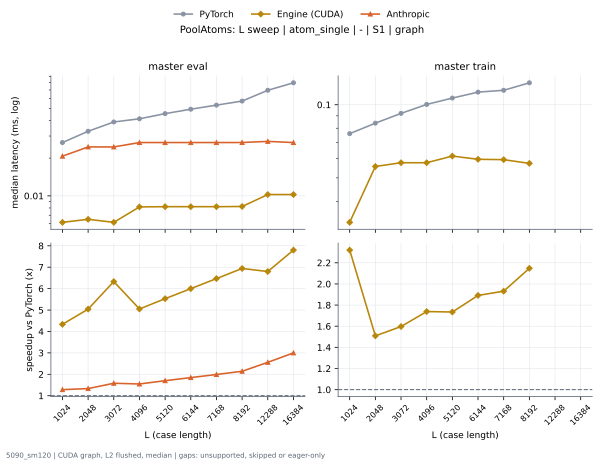

# PoolAtoms on 5090_sm120

Generated by `python -m foldjet_engine.measure.plot` from speed tokens `judge/tokens/5090_sm120/`; do not edit.

### L sweep: atom_single | - | S1 | graph

**master eval** (median ms; x = speedup vs PyTorch)

| L | PyTorch | Engine (Triton) | Engine (CUDA) | Anthropic |
|---|---|---|---|---|
| 1024 | 0.02662 | 0.00632 (4.21x) | 0.006144 (4.33x) | 0.02074 (1.28x) |
| 2048 | 0.03277 | 0.008192 (4.00x) | 0.006496 (5.04x) | 0.02458 (1.33x) |
| 3072 | 0.03888 | 0.008192 (4.75x) | 0.006144 (6.33x) | 0.02458 (1.58x) |
| 4096 | 0.04122 | 0.008192 (5.03x) | 0.00816 (5.05x) | 0.02662 (1.55x) |
| 5120 | 0.04531 | 0.008192 (5.53x) | 0.008192 (5.53x) | 0.02662 (1.70x) |
| 6144 | 0.04915 | 0.008192 (6.00x) | 0.008192 (6.00x) | 0.02662 (1.85x) |
| 7168 | 0.05299 | 0.00816 (6.49x) | 0.008192 (6.47x) | 0.02662 (1.99x) |
| 8192 | 0.05709 | 0.008544 (6.68x) | 0.008224 (6.94x) | 0.02666 (2.14x) |
| 12288 | 0.06962 | 0.01024 (6.80x) | 0.01024 (6.80x) | 0.0272 (2.56x) |
| 16384 | 0.07987 | 0.01024 (7.80x) | 0.01024 (7.80x) | 0.02662 (3.00x) |

**master train** (median ms; x = speedup vs PyTorch)

| L | PyTorch | Engine (Triton) | Engine (CUDA) | Anthropic |
|---|---|---|---|---|
| 1024 | 0.07603 | 0.0369 (2.06x) | 0.03277 (2.32x) | unsupported |
| 2048 | 0.08398 | 0.06072 (1.38x) | 0.05566 (1.51x) | unsupported |
| 3072 | 0.09214 | 0.06 (1.54x) | 0.0577 (1.60x) | unsupported |
| 4096 | 0.1003 | 0.06363 (1.58x) | 0.0577 (1.74x) | unsupported |
| 5120 | 0.1066 | 0.06589 (1.62x) | 0.06144 (1.73x) | unsupported |
| 6144 | 0.1127 | 0.06552 (1.72x) | 0.0596 (1.89x) | unsupported |
| 7168 | 0.1147 | 0.06758 (1.70x) | 0.05939 (1.93x) | unsupported |
| 8192 | 0.1232 | 0.06144 (2.00x) | 0.05734 (2.15x) | unsupported |
| 12288 |  |  |  |  |
| 16384 |  |  |  |  |

