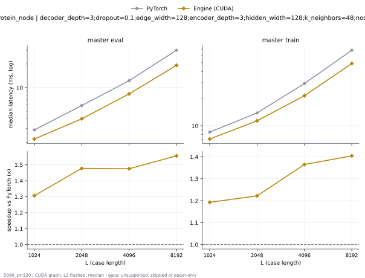

# ProteinMPNN on 5090_sm120

Generated by `python -m miniworld_engine.measure.plot` from speed tokens `judge/tokens/5090_sm120/`; do not edit.

### L sweep: protein_node | decoder_depth=3;dropout=0.1;edge_width=128;encoder_depth=3;hidden_width=128;k_neighbors=48;node_width=128 | S1 | graph

**master eval** (median ms; x = speedup vs PyTorch)

| L | PyTorch | Engine (Triton) | Engine (CUDA) |
|---|---|---|---|
| 1024 | 2.882 | 2.42 (1.19x) | 2.205 (1.31x) |
| 2048 | 5.897 | 4.385 (1.34x) | 3.992 (1.48x) |
| 4096 | 12.25 | 9.297 (1.32x) | 8.302 (1.48x) |
| 8192 | 29.96 | 21.38 (1.40x) | 19.25 (1.56x) |

**master train** (median ms; x = speedup vs PyTorch)

| L | PyTorch | Engine (Triton) | Engine (CUDA) |
|---|---|---|---|
| 1024 | 8.502 | 7.782 (1.09x) | 7.128 (1.19x) |
| 2048 | 13.87 | 12.43 (1.12x) | 11.35 (1.22x) |
| 4096 | 29.43 | 23.19 (1.27x) | 21.56 (1.36x) |
| 8192 | 68.87 | 52.35 (1.32x) | 49.04 (1.40x) |

