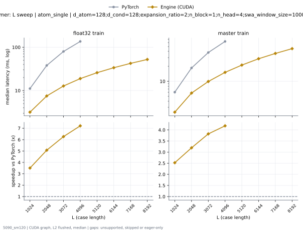
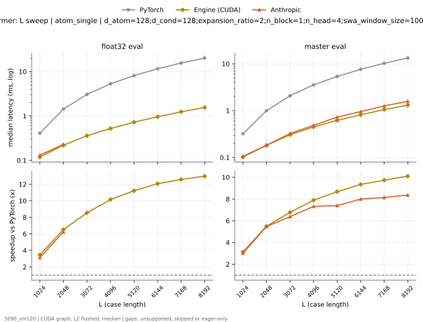
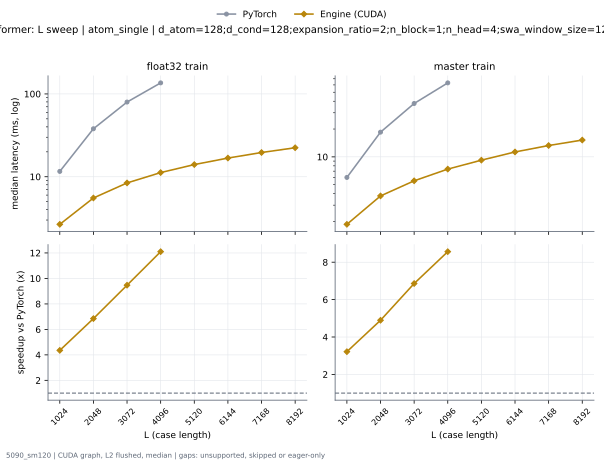
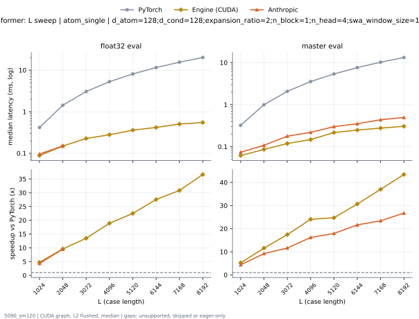
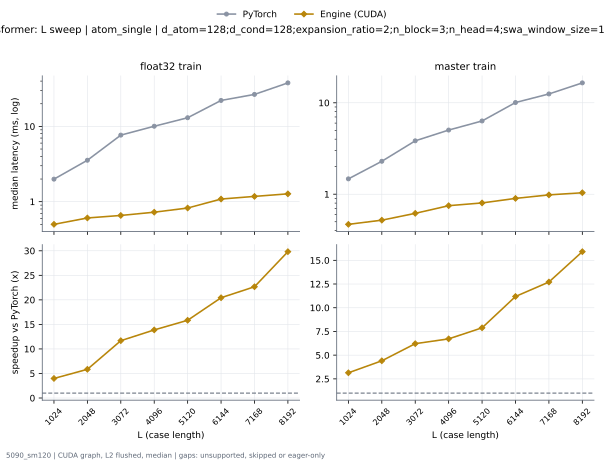
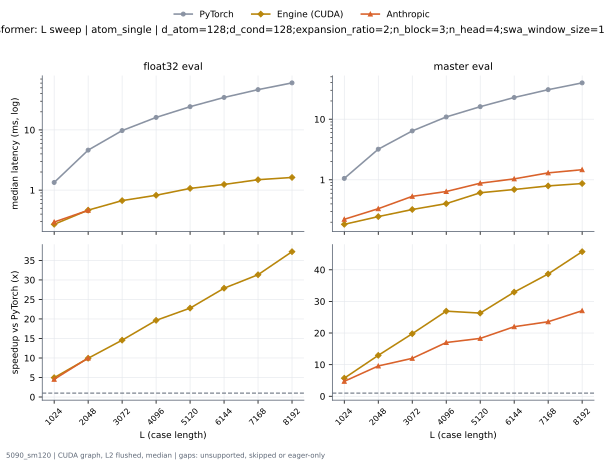

# SWAAtomTransformer on 5090_sm120

Generated by `python -m foldjet_engine.measure.plot` from speed tokens `judge/tokens/5090_sm120/`; do not edit.

### L sweep: atom_single | d_atom=128;d_cond=128;expansion_ratio=2;n_block=1;n_head=4;swa_window_size=1000000 | S48 | graph

**float32 train** (median ms; x = speedup vs PyTorch)

| L | PyTorch | Engine (Triton) | Engine (CUDA) | Anthropic |
|---|---|---|---|---|
| 1024 | 11.11 | 4.055 (2.74x) | 3.169 (3.51x) | 11.36 (eager) |
| 2048 | 38.01 | 7.719 (4.92x) | 7.494 (5.07x) | 38.61 (eager) |
| 3072 | 79.92 | 13.32 (6.00x) | 12.75 (6.27x) | 82.07 (eager) |
| 4096 | 136.3 | 19.69 (6.92x) | 18.89 (7.22x) | 138.7 (eager) |
| 5120 | skipped | 27.47 | 25.87 | failed |
| 6144 | skipped | 36.54 | 33.71 | skipped |
| 7168 | skipped | 46.68 | 42.48 | skipped |
| 8192 | skipped | 57.9 | 52.3 | skipped |

**master train** (median ms; x = speedup vs PyTorch)

| L | PyTorch | Engine (Triton) | Engine (CUDA) | Anthropic |
|---|---|---|---|---|
| 1024 | 6.052 | 2.323 (2.61x) | 2.399 (2.52x) | 6.227 (eager) |
| 2048 | 18.56 | 5.804 (3.20x) | 5.811 (3.19x) | 19.09 (eager) |
| 3072 | 37.91 | 10.54 (3.60x) | 9.924 (3.82x) | 40 (eager) |
| 4096 | 63.3 | 15.68 (4.04x) | 15.13 (4.18x) | 66.01 (eager) |
| 5120 | skipped | 22.58 | 21.19 | 103.5 (eager) |
| 6144 | skipped | 30.59 | 28.44 | failed |
| 7168 | skipped | 39.91 | 36.35 | failed |
| 8192 | skipped | 49.84 | 45.37 | skipped |

### L sweep: atom_single | d_atom=128;d_cond=128;expansion_ratio=2;n_block=1;n_head=4;swa_window_size=1000000 | S5 | graph

**float32 eval** (median ms; x = speedup vs PyTorch)

| L | PyTorch | Engine (Triton) | Engine (CUDA) | Anthropic |
|---|---|---|---|---|
| 1024 | 0.4108 | 0.1188 (3.46x) | 0.1189 (3.45x) | 0.1311 (3.13x) |
| 2048 | 1.429 | 0.2396 (5.96x) | 0.2192 (6.52x) | 0.2294 (6.23x) |
| 3072 | 3.066 | 0.3932 (7.80x) | 0.3587 (8.55x) | failed |
| 4096 | 5.303 | 0.5591 (9.49x) | 0.5222 (10.15x) | failed |
| 5120 | 8.132 | 0.775 (10.49x) | 0.725 (11.22x) | failed |
| 6144 | 11.58 | 1.03 (11.24x) | 0.9595 (12.07x) | failed |
| 7168 | 15.6 | 1.304 (11.96x) | 1.24 (12.58x) | failed |
| 8192 | 20.21 | 1.614 (12.53x) | 1.557 (12.98x) | failed |

**master eval** (median ms; x = speedup vs PyTorch)

| L | PyTorch | Engine (Triton) | Engine (CUDA) | Anthropic |
|---|---|---|---|---|
| 1024 | 0.3205 | 0.07782 (4.12x) | 0.1024 (3.13x) | 0.1064 (3.01x) |
| 2048 | 0.9984 | 0.1615 (6.18x) | 0.1817 (5.50x) | 0.1826 (5.47x) |
| 3072 | 2.076 | 0.2768 (7.50x) | 0.3066 (6.77x) | 0.3257 (6.37x) |
| 4096 | 3.556 | 0.4178 (8.51x) | 0.4506 (7.89x) | 0.4856 (7.32x) |
| 5120 | 5.374 | 0.5977 (8.99x) | 0.6195 (8.68x) | 0.727 (7.39x) |
| 6144 | 7.626 | 0.807 (9.45x) | 0.8165 (9.34x) | 0.9543 (7.99x) |
| 7168 | 10.26 | 1.06 (9.68x) | 1.055 (9.73x) | 1.26 (8.14x) |
| 8192 | 13.29 | 1.3 (10.23x) | 1.316 (10.10x) | 1.588 (8.37x) |

### L sweep: atom_single | d_atom=128;d_cond=128;expansion_ratio=2;n_block=1;n_head=4;swa_window_size=128 | S48 | graph

**float32 train** (median ms; x = speedup vs PyTorch)

| L | PyTorch | Engine (Triton) | Engine (CUDA) | Anthropic |
|---|---|---|---|---|
| 1024 | 11.6 | 3.559 (3.26x) | 2.665 (4.35x) | 11.33 (eager) |
| 2048 | 37.95 | 5.488 (6.91x) | 5.541 (6.85x) | 38.49 (eager) |
| 3072 | 79.74 | 8.28 (9.63x) | 8.421 (9.47x) | 63.97 (eager) |
| 4096 | 135.9 | 10.62 (12.79x) | 11.23 (12.10x) | 95.49 (eager) |
| 5120 | skipped | 13.3 | 14.03 | 120.8 (eager) |
| 6144 | skipped | 15.96 | 16.81 | 152.2 (eager) |
| 7168 | skipped | 18.63 | 19.61 | 178.1 (eager) |
| 8192 | skipped | 21.22 | 22.4 | 209.7 (eager) |

**master train** (median ms; x = speedup vs PyTorch)

| L | PyTorch | Engine (Triton) | Engine (CUDA) | Anthropic |
|---|---|---|---|---|
| 1024 | 5.989 | 1.895 (3.16x) | 1.863 (3.22x) | 6.237 (eager) |
| 2048 | 18.5 | 3.631 (5.10x) | 3.78 (4.90x) | 19.04 (eager) |
| 3072 | 37.79 | 5.516 (6.85x) | 5.508 (6.86x) | 31.79 (eager) |
| 4096 | 63.14 | 6.65 (9.50x) | 7.372 (8.57x) | 47.06 (eager) |
| 5120 | skipped | 8.309 | 9.214 | 60.29 (eager) |
| 6144 | skipped | 10.01 | 11.3 | 76.38 (eager) |
| 7168 | skipped | 11.77 | 13.26 | 89.95 (eager) |
| 8192 | skipped | 13.22 | 15.2 | 105.4 (eager) |

### L sweep: atom_single | d_atom=128;d_cond=128;expansion_ratio=2;n_block=1;n_head=4;swa_window_size=128 | S5 | graph

**float32 eval** (median ms; x = speedup vs PyTorch)

| L | PyTorch | Engine (Triton) | Engine (CUDA) | Anthropic |
|---|---|---|---|---|
| 1024 | 0.417 | 0.1085 (3.84x) | 0.08824 (4.73x) | 0.09629 (4.33x) |
| 2048 | 1.433 | 0.1843 (7.77x) | 0.1493 (9.60x) | 0.15 (9.55x) |
| 3072 | 3.063 | 0.2687 (11.40x) | 0.2273 (13.48x) | failed |
| 4096 | 5.286 | 0.3339 (15.83x) | 0.2796 (18.91x) | failed |
| 5120 | 8.104 | 0.4188 (19.35x) | 0.3604 (22.48x) | failed |
| 6144 | 11.53 | 0.5059 (22.79x) | 0.4186 (27.54x) | failed |
| 7168 | 15.56 | 0.586 (26.56x) | 0.505 (30.82x) | failed |
| 8192 | 20.17 | 0.6554 (30.78x) | 0.5509 (36.62x) | failed |

**master eval** (median ms; x = speedup vs PyTorch)

| L | PyTorch | Engine (Triton) | Engine (CUDA) | Anthropic |
|---|---|---|---|---|
| 1024 | 0.3215 | 0.06579 (4.89x) | 0.06142 (5.23x) | 0.07363 (4.37x) |
| 2048 | 0.9953 | 0.1085 (9.17x) | 0.08598 (11.57x) | 0.1079 (9.23x) |
| 3072 | 2.069 | 0.1539 (13.45x) | 0.1188 (17.42x) | 0.1779 (11.63x) |
| 4096 | 3.546 | 0.1925 (18.42x) | 0.1475 (24.05x) | 0.2191 (16.18x) |
| 5120 | 5.364 | 0.2417 (22.19x) | 0.2171 (24.70x) | 0.2993 (17.92x) |
| 6144 | 7.597 | 0.2869 (26.48x) | 0.2478 (30.66x) | 0.3512 (21.63x) |
| 7168 | 10.23 | 0.3359 (30.46x) | 0.2765 (37.00x) | 0.4369 (23.42x) |
| 8192 | 13.24 | 0.342 (38.73x) | 0.3052 (43.40x) | 0.4956 (26.73x) |

### L sweep: atom_single | d_atom=128;d_cond=128;expansion_ratio=2;n_block=3;n_head=4;swa_window_size=128 | S1 | graph

**float32 train** (median ms; x = speedup vs PyTorch)

| L | PyTorch | Engine (Triton) | Engine (CUDA) | Anthropic |
|---|---|---|---|---|
| 1024 | 1.992 | 0.5353 (3.72x) | 0.4999 (3.98x) | 3.368 (eager) |
| 2048 | 3.552 | 0.6173 (5.75x) | 0.6072 (5.85x) | 3.978 (eager) |
| 3072 | 7.662 | 0.8476 (9.04x) | 0.6558 (11.68x) | 5.37 (eager) |
| 4096 | 10.05 | 0.8889 (11.31x) | 0.7246 (13.88x) | 6.599 (eager) |
| 5120 | 13.04 | 0.9482 (13.75x) | 0.8233 (15.84x) | 9.798 (eager) |
| 6144 | 22.14 | 1.369 (16.17x) | 1.083 (20.44x) | 11.28 (eager) |
| 7168 | 26.63 | 1.421 (18.74x) | 1.175 (22.67x) | 14.51 (eager) |
| 8192 | 37.89 | 1.572 (24.11x) | 1.271 (29.82x) | 15.94 (eager) |

**master train** (median ms; x = speedup vs PyTorch)

| L | PyTorch | Engine (Triton) | Engine (CUDA) | Anthropic |
|---|---|---|---|---|
| 1024 | 1.472 | 0.4116 (3.58x) | 0.4685 (3.14x) | 3.85 (eager) |
| 2048 | 2.293 | 0.4587 (5.00x) | 0.5202 (4.41x) | 3.858 (eager) |
| 3072 | 3.838 | 0.6308 (6.08x) | 0.6178 (6.21x) | 4.76 (eager) |
| 4096 | 5.032 | 0.5976 (8.42x) | 0.7491 (6.72x) | 4.862 (eager) |
| 5120 | 6.329 | 0.6242 (10.14x) | 0.8028 (7.88x) | 5.679 (eager) |
| 6144 | 10.07 | 0.8016 (12.56x) | 0.9001 (11.19x) | 6.402 (eager) |
| 7168 | 12.5 | 0.8626 (14.49x) | 0.9832 (12.71x) | 7.556 (eager) |
| 8192 | 16.51 | 0.8708 (18.96x) | 1.038 (15.91x) | 8.456 (eager) |

### L sweep: atom_single | d_atom=128;d_cond=128;expansion_ratio=2;n_block=3;n_head=4;swa_window_size=128 | S5 | graph

**float32 eval** (median ms; x = speedup vs PyTorch)

| L | PyTorch | Engine (Triton) | Engine (CUDA) | Anthropic |
|---|---|---|---|---|
| 1024 | 1.341 | 0.3365 (3.98x) | 0.2703 (4.96x) | 0.2952 (4.54x) |
| 2048 | 4.618 | 0.6052 (7.63x) | 0.4651 (9.93x) | 0.4626 (9.98x) |
| 3072 | 9.754 | 0.8018 (12.17x) | 0.6697 (14.56x) | failed |
| 4096 | 16.14 | 0.9882 (16.33x) | 0.8214 (19.64x) | failed |
| 5120 | 24.32 | 1.23 (19.78x) | 1.068 (22.78x) | failed |
| 6144 | 34.63 | 1.488 (23.27x) | 1.242 (27.88x) | failed |
| 7168 | 46.69 | 1.727 (27.03x) | 1.49 (31.34x) | failed |
| 8192 | 60.46 | 1.934 (31.27x) | 1.623 (37.25x) | failed |

**master eval** (median ms; x = speedup vs PyTorch)

| L | PyTorch | Engine (Triton) | Engine (CUDA) | Anthropic |
|---|---|---|---|---|
| 1024 | 1.055 | 0.2051 (5.14x) | 0.1843 (5.72x) | 0.2232 (4.73x) |
| 2048 | 3.199 | 0.3482 (9.19x) | 0.2472 (12.94x) | 0.3338 (9.58x) |
| 3072 | 6.401 | 0.4617 (13.86x) | 0.3236 (19.78x) | 0.5336 (12.00x) |
| 4096 | 10.89 | 0.5571 (19.55x) | 0.4047 (26.91x) | 0.6408 (17.00x) |
| 5120 | 16.08 | 0.7076 (22.73x) | 0.6113 (26.30x) | 0.8788 (18.30x) |
| 6144 | 22.8 | 0.8512 (26.78x) | 0.692 (32.95x) | 1.036 (22.00x) |
| 7168 | 30.67 | 0.992 (30.92x) | 0.7929 (38.68x) | 1.301 (23.57x) |
| 8192 | 39.71 | 1.001 (39.66x) | 0.8684 (45.73x) | 1.468 (27.06x) |

