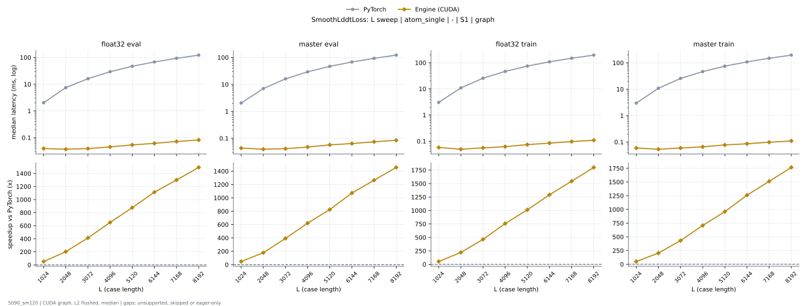

# SmoothLddtLoss on 5090_sm120

Generated by `python -m foldjet_engine.measure.plot` from speed tokens `judge/tokens/5090_sm120/`; do not edit.

### L sweep: atom_single | - | S1 | graph

**float32 eval** (median ms; x = speedup vs PyTorch)

| L | PyTorch | Engine (Triton) | Engine (CUDA) |
|---|---|---|---|
| 1024 | 2.029 | 0.04506 (45.02x) | 0.03917 (51.79x) |
| 2048 | 7.45 | 0.06219 (119.79x) | 0.03688 (202.01x) |
| 3072 | 16.08 | 0.08397 (191.46x) | 0.03891 (413.16x) |
| 4096 | 29.28 | 0.1047 (279.61x) | 0.04506 (649.76x) |
| 5120 | 46.88 | 0.1288 (364.06x) | 0.0535 (876.19x) |
| 6144 | 68.09 | 0.1659 (410.44x) | 0.06118 (1112.82x) |
| 7168 | 93.18 | 0.1964 (474.45x) | 0.07168 (1299.96x) |
| 8192 | 122.3 | 0.2272 (538.06x) | 0.08192 (1492.39x) |

**master eval** (median ms; x = speedup vs PyTorch)

| L | PyTorch | Engine (Triton) | Engine (CUDA) |
|---|---|---|---|
| 1024 | 2.033 | 0.0431 (47.16x) | 0.04301 (47.26x) |
| 2048 | 7.008 | 0.05939 (117.99x) | 0.03917 (178.92x) |
| 3072 | 16.08 | 0.07987 (201.37x) | 0.04096 (392.67x) |
| 4096 | 29.28 | 0.1004 (291.78x) | 0.0471 (621.61x) |
| 5120 | 46.87 | 0.1229 (381.44x) | 0.05678 (825.44x) |
| 6144 | 68.08 | 0.1639 (415.44x) | 0.06349 (1072.33x) |
| 7168 | 93.19 | 0.1929 (483.20x) | 0.07373 (1263.99x) |
| 8192 | 122.2 | 0.2284 (535.25x) | 0.08397 (1455.71x) |

**float32 train** (median ms; x = speedup vs PyTorch)

| L | PyTorch | Engine (Triton) | Engine (CUDA) |
|---|---|---|---|
| 1024 | 3.036 | 0.08806 (34.48x) | 0.05734 (52.95x) |
| 2048 | 10.88 | 0.131 (83.04x) | 0.04915 (221.30x) |
| 3072 | 25.66 | 0.1843 (139.20x) | 0.0553 (464.00x) |
| 4096 | 46.6 | 0.2377 (196.05x) | 0.06157 (756.85x) |
| 5120 | 74.62 | 0.2952 (252.80x) | 0.07373 (1012.06x) |
| 6144 | 108.4 | 0.4512 (240.26x) | 0.0839 (1291.90x) |
| 7168 | 148.6 | 0.5273 (281.85x) | 0.0963 (1543.36x) |
| 8192 | 195.4 | 0.6055 (322.70x) | 0.1085 (1800.04x) |

**master train** (median ms; x = speedup vs PyTorch)

| L | PyTorch | Engine (Triton) | Engine (CUDA) |
|---|---|---|---|
| 1024 | 2.979 | 0.08806 (33.83x) | 0.05939 (50.16x) |
| 2048 | 10.86 | 0.133 (81.67x) | 0.0535 (203.06x) |
| 3072 | 25.68 | 0.1865 (137.68x) | 0.05939 (432.30x) |
| 4096 | 46.54 | 0.2417 (192.56x) | 0.06579 (707.41x) |
| 5120 | 74.7 | 0.299 (249.82x) | 0.07782 (959.83x) |
| 6144 | 108.4 | 0.4468 (242.69x) | 0.08603 (1260.28x) |
| 7168 | 148.7 | 0.5243 (283.58x) | 0.09832 (1512.16x) |
| 8192 | 195.4 | 0.6042 (323.43x) | 0.1106 (1766.56x) |

