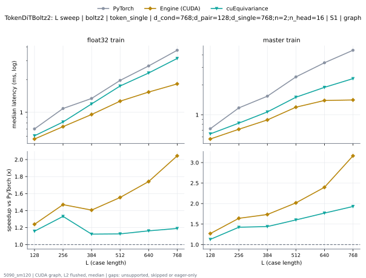
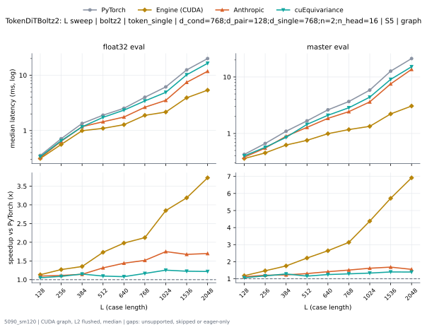
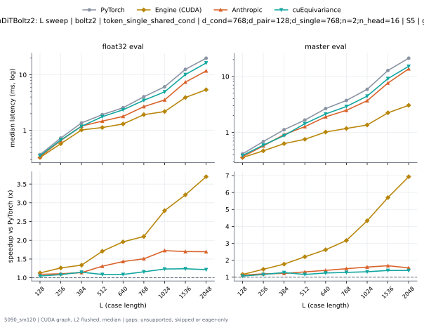

# TokenDiTBoltz2 on 5090_sm120

Generated by `python -m miniworld_engine.measure.plot` from speed tokens `judge/tokens/5090_sm120/`; do not edit.

### L sweep: boltz2 | token_single | d_cond=768;d_pair=128;d_single=768;n=2;n_head=16 | S1 | graph

**float32 train** (median ms; x = speedup vs PyTorch)

| L | PyTorch | Engine (Triton) | Engine (CUDA) | Anthropic | cuEquivariance |
|---|---|---|---|---|---|
| 128 | 0.7029 | 0.7045 (1.00x) | 0.5673 (1.24x) | unsupported | 0.6072 (1.16x) |
| 256 | 1.084 | 1.093 (0.99x) | 0.7376 (1.47x) | unsupported | 0.8141 (1.33x) |
| 384 | 1.342 | 1.341 (1.00x) | 0.9547 (1.41x) | unsupported | 1.195 (1.12x) |
| 512 | 1.969 | 1.973 (1.00x) | 1.267 (1.55x) | unsupported | 1.749 (1.13x) |
| 640 | 2.678 | 2.657 (1.01x) | 1.538 (1.74x) | unsupported | 2.305 (1.16x) |
| 768 | 3.736 | 3.558 (1.05x) | 1.828 (2.04x) | unsupported | 3.14 (1.19x) |

**master train** (median ms; x = speedup vs PyTorch)

| L | PyTorch | Engine (Triton) | Engine (CUDA) | Anthropic | cuEquivariance |
|---|---|---|---|---|---|
| 128 | 0.7236 | 0.7126 (1.02x) | 0.5703 (1.27x) | unsupported | 0.642 (1.13x) |
| 256 | 1.173 | 1.149 (1.02x) | 0.7147 (1.64x) | unsupported | 0.824 (1.42x) |
| 384 | 1.538 | 1.492 (1.03x) | 0.8873 (1.73x) | unsupported | 1.068 (1.44x) |
| 512 | 2.405 | 2.33 (1.03x) | 1.192 (2.02x) | unsupported | 1.502 (1.60x) |
| 640 | 3.337 | 3.201 (1.04x) | 1.392 (2.40x) | unsupported | 1.888 (1.77x) |
| 768 | 4.46 | 4.178 (1.07x) | 1.41 (3.16x) | unsupported | 2.312 (1.93x) |

### L sweep: boltz2 | token_single | d_cond=768;d_pair=128;d_single=768;n=2;n_head=16 | S5 | graph

**float32 eval** (median ms; x = speedup vs PyTorch)

| L | PyTorch | Engine (Triton) | Engine (CUDA) | Anthropic | cuEquivariance |
|---|---|---|---|---|---|
| 128 | 0.3543 | 0.3297 (1.07x) | 0.3129 (1.13x) | 0.3232 (1.10x) | 0.3371 (1.05x) |
| 256 | 0.713 | 0.6451 (1.11x) | 0.5616 (1.27x) | 0.641 (1.11x) | 0.6553 (1.09x) |
| 384 | 1.344 | 1.195 (1.13x) | 0.9946 (1.35x) | 1.176 (1.14x) | 1.169 (1.15x) |
| 512 | 1.897 | 1.374 (1.38x) | 1.096 (1.73x) | 1.443 (1.32x) | 1.732 (1.10x) |
| 640 | 2.526 | 1.682 (1.50x) | 1.277 (1.98x) | 1.754 (1.44x) | 2.339 (1.08x) |
| 768 | 3.999 | 2.514 (1.59x) | 1.883 (2.12x) | 2.639 (1.52x) | 3.432 (1.17x) |
| 1024 | 6.15 | 3.363 (1.83x) | 2.16 (2.85x) | 3.514 (1.75x) | 4.905 (1.25x) |
| 1536 | 12.47 | 7.322 (1.70x) | 3.912 (3.19x) | 7.442 (1.68x) | 10.18 (1.23x) |
| 2048 | 19.99 | 11.43 (1.75x) | 5.368 (3.72x) | 11.77 (1.70x) | 16.41 (1.22x) |

**master eval** (median ms; x = speedup vs PyTorch)

| L | PyTorch | Engine (Triton) | Engine (CUDA) | Anthropic | cuEquivariance |
|---|---|---|---|---|---|
| 128 | 0.4257 | 0.3953 (1.08x) | 0.3607 (1.18x) | 0.3813 (1.12x) | 0.4014 (1.06x) |
| 256 | 0.6652 | 0.5836 (1.14x) | 0.4529 (1.47x) | 0.5509 (1.21x) | 0.5693 (1.17x) |
| 384 | 1.095 | 0.942 (1.16x) | 0.6246 (1.75x) | 0.8929 (1.23x) | 0.8536 (1.28x) |
| 512 | 1.674 | 1.285 (1.30x) | 0.7557 (2.22x) | 1.283 (1.31x) | 1.449 (1.16x) |
| 640 | 2.621 | 1.852 (1.41x) | 0.9909 (2.64x) | 1.852 (1.41x) | 2.1 (1.25x) |
| 768 | 3.676 | 2.397 (1.53x) | 1.172 (3.13x) | 2.434 (1.51x) | 2.852 (1.29x) |
| 1024 | 5.858 | 3.582 (1.64x) | 1.337 (4.38x) | 3.621 (1.62x) | 4.395 (1.33x) |
| 1536 | 12.69 | 7.268 (1.75x) | 2.219 (5.72x) | 7.539 (1.68x) | 9.062 (1.40x) |
| 2048 | 21.18 | 12.92 (1.64x) | 3.061 (6.92x) | 13.65 (1.55x) | 15.18 (1.40x) |

### L sweep: boltz2 | token_single_shared_cond | d_cond=768;d_pair=128;d_single=768;n=2;n_head=16 | S5 | graph

**float32 eval** (median ms; x = speedup vs PyTorch)

| L | PyTorch | Engine (Triton) | Engine (CUDA) | Anthropic | cuEquivariance |
|---|---|---|---|---|---|
| 128 | 0.3666 | 0.3423 (1.07x) | 0.3247 (1.13x) | 0.3358 (1.09x) | 0.3502 (1.05x) |
| 256 | 0.7267 | 0.6594 (1.10x) | 0.5756 (1.26x) | 0.6566 (1.11x) | 0.6703 (1.08x) |
| 384 | 1.363 | 1.214 (1.12x) | 1.019 (1.34x) | 1.197 (1.14x) | 1.186 (1.15x) |
| 512 | 1.922 | 1.399 (1.37x) | 1.125 (1.71x) | 1.469 (1.31x) | 1.766 (1.09x) |
| 640 | 2.558 | 1.695 (1.51x) | 1.306 (1.96x) | 1.785 (1.43x) | 2.35 (1.09x) |
| 768 | 4.036 | 2.559 (1.58x) | 1.92 (2.10x) | 2.68 (1.51x) | 3.482 (1.16x) |
| 1024 | 6.096 | 3.387 (1.80x) | 2.184 (2.79x) | 3.534 (1.72x) | 4.941 (1.23x) |
| 1536 | 12.57 | 7.283 (1.73x) | 3.912 (3.21x) | 7.397 (1.70x) | 10.13 (1.24x) |
| 2048 | 19.95 | 11.44 (1.74x) | 5.398 (3.70x) | 11.77 (1.70x) | 16.4 (1.22x) |

**master eval** (median ms; x = speedup vs PyTorch)

| L | PyTorch | Engine (Triton) | Engine (CUDA) | Anthropic | cuEquivariance |
|---|---|---|---|---|---|
| 128 | 0.4137 | 0.3826 (1.08x) | 0.3563 (1.16x) | 0.3686 (1.12x) | 0.387 (1.07x) |
| 256 | 0.6881 | 0.6062 (1.14x) | 0.469 (1.47x) | 0.5744 (1.20x) | 0.5932 (1.16x) |
| 384 | 1.118 | 0.9624 (1.16x) | 0.6309 (1.77x) | 0.914 (1.22x) | 0.8775 (1.27x) |
| 512 | 1.664 | 1.27 (1.31x) | 0.7541 (2.21x) | 1.269 (1.31x) | 1.433 (1.16x) |
| 640 | 2.663 | 1.885 (1.41x) | 1.016 (2.62x) | 1.897 (1.40x) | 2.135 (1.25x) |
| 768 | 3.725 | 2.444 (1.52x) | 1.176 (3.17x) | 2.481 (1.50x) | 2.901 (1.28x) |
| 1024 | 5.88 | 3.633 (1.62x) | 1.358 (4.33x) | 3.68 (1.60x) | 4.45 (1.32x) |
| 1536 | 12.77 | 7.338 (1.74x) | 2.239 (5.70x) | 7.615 (1.68x) | 9.138 (1.40x) |
| 2048 | 21.15 | 12.92 (1.64x) | 3.05 (6.93x) | 13.64 (1.55x) | 15.17 (1.39x) |

