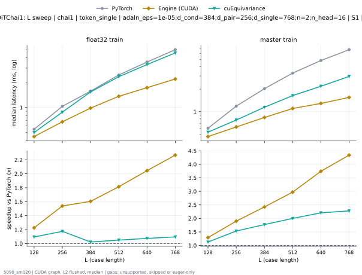
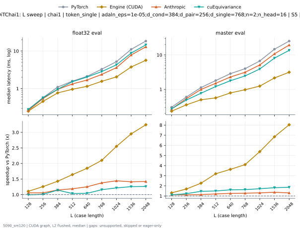
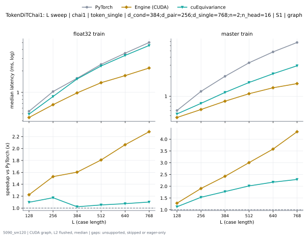
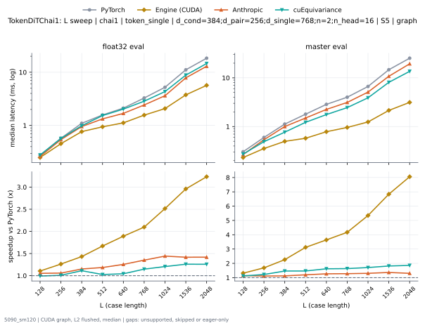
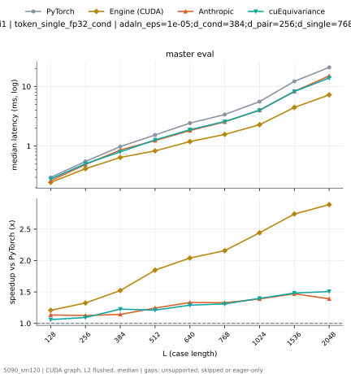
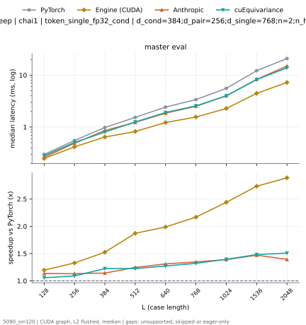
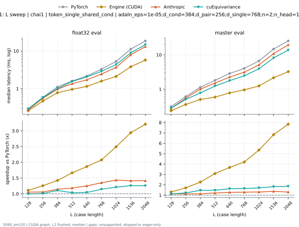

# TokenDiTChai1 on 5090_sm120

Generated by `python -m miniworld_engine.measure.plot` from speed tokens `judge/tokens/5090_sm120/`; do not edit.

### L sweep: chai1 | token_single | adaln_eps=1e-05;d_cond=384;d_pair=256;d_single=768;n=2;n_head=16 | S1 | graph

**float32 train** (median ms; x = speedup vs PyTorch)

| L | PyTorch | Engine (Triton) | Engine (CUDA) | Anthropic | cuEquivariance |
|---|---|---|---|---|---|
| 128 | 0.5448 | 0.5529 (0.99x) | 0.4444 (1.23x) | unsupported | 0.4977 (1.09x) |
| 256 | 1.032 | 1.056 (0.98x) | 0.671 (1.54x) | unsupported | 0.8785 (1.18x) |
| 384 | 1.578 | 1.605 (0.98x) | 0.9834 (1.60x) | unsupported | 1.544 (1.02x) |
| 512 | 2.477 | 2.475 (1.00x) | 1.366 (1.81x) | unsupported | 2.361 (1.05x) |
| 640 | 3.555 | 3.545 (1.00x) | 1.739 (2.04x) | unsupported | 3.311 (1.07x) |
| 768 | 5.017 | 4.96 (1.01x) | 2.213 (2.27x) | unsupported | 4.582 (1.10x) |

**master train** (median ms; x = speedup vs PyTorch)

| L | PyTorch | Engine (Triton) | Engine (CUDA) | Anthropic | cuEquivariance |
|---|---|---|---|---|---|
| 128 | 0.6 | 0.5959 (1.01x) | 0.4649 (1.29x) | unsupported | 0.5325 (1.13x) |
| 256 | 1.185 | 1.183 (1.00x) | 0.6243 (1.90x) | unsupported | 0.7729 (1.53x) |
| 384 | 2.029 | 2.006 (1.01x) | 0.8366 (2.42x) | unsupported | 1.146 (1.77x) |
| 512 | 3.279 | 3.22 (1.02x) | 1.103 (2.97x) | unsupported | 1.639 (2.00x) |
| 640 | 4.824 | 4.702 (1.03x) | 1.289 (3.74x) | unsupported | 2.187 (2.21x) |
| 768 | 6.737 | 6.512 (1.03x) | 1.552 (4.34x) | unsupported | 2.957 (2.28x) |

### L sweep: chai1 | token_single | adaln_eps=1e-05;d_cond=384;d_pair=256;d_single=768;n=2;n_head=16 | S5 | graph

**float32 eval** (median ms; x = speedup vs PyTorch)

| L | PyTorch | Engine (Triton) | Engine (CUDA) | Anthropic | cuEquivariance |
|---|---|---|---|---|---|
| 128 | 0.2768 | 0.26 (1.06x) | 0.2501 (1.11x) | 0.2622 (1.06x) | 0.2789 (0.99x) |
| 256 | 0.5734 | 0.526 (1.09x) | 0.4563 (1.26x) | 0.5427 (1.06x) | 0.5686 (1.01x) |
| 384 | 1.098 | 0.9871 (1.11x) | 0.7677 (1.43x) | 0.9554 (1.15x) | 0.9591 (1.14x) |
| 512 | 1.576 | 1.272 (1.24x) | 0.9599 (1.64x) | 1.328 (1.19x) | 1.525 (1.03x) |
| 640 | 2.117 | 1.651 (1.28x) | 1.147 (1.85x) | 1.691 (1.25x) | 2.033 (1.04x) |
| 768 | 3.286 | 2.437 (1.35x) | 1.564 (2.10x) | 2.385 (1.38x) | 2.838 (1.16x) |
| 1024 | 5.216 | 3.622 (1.44x) | 2.046 (2.55x) | 3.615 (1.44x) | 4.291 (1.22x) |
| 1536 | 11.08 | 8.128 (1.36x) | 3.756 (2.95x) | 7.845 (1.41x) | 8.823 (1.26x) |
| 2048 | 18.4 | 13.32 (1.38x) | 5.671 (3.24x) | 12.95 (1.42x) | 14.59 (1.26x) |

**master eval** (median ms; x = speedup vs PyTorch)

| L | PyTorch | Engine (Triton) | Engine (CUDA) | Anthropic | cuEquivariance |
|---|---|---|---|---|---|
| 128 | 0.3031 | 0.2785 (1.09x) | 0.2317 (1.31x) | 0.2694 (1.12x) | 0.2727 (1.11x) |
| 256 | 0.598 | 0.5324 (1.12x) | 0.3543 (1.69x) | 0.5365 (1.11x) | 0.4886 (1.22x) |
| 384 | 1.128 | 1.001 (1.13x) | 0.498 (2.26x) | 0.9939 (1.13x) | 0.7707 (1.46x) |
| 512 | 1.801 | 1.461 (1.23x) | 0.5635 (3.20x) | 1.499 (1.20x) | 1.206 (1.49x) |
| 640 | 2.86 | 2.211 (1.29x) | 0.7874 (3.63x) | 2.282 (1.25x) | 1.779 (1.61x) |
| 768 | 3.991 | 3.027 (1.32x) | 0.9738 (4.10x) | 3.131 (1.27x) | 2.454 (1.63x) |
| 1024 | 6.688 | 4.928 (1.36x) | 1.242 (5.38x) | 5.12 (1.31x) | 3.903 (1.71x) |
| 1536 | 14.68 | 10.45 (1.41x) | 2.143 (6.85x) | 10.76 (1.36x) | 8.082 (1.82x) |
| 2048 | 25.27 | 18.81 (1.34x) | 3.143 (8.04x) | 19.39 (1.30x) | 13.6 (1.86x) |

### L sweep: chai1 | token_single | d_cond=384;d_pair=256;d_single=768;n=2;n_head=16 | S1 | graph

**float32 train** (median ms; x = speedup vs PyTorch)

| L | PyTorch | Engine (Triton) | Engine (CUDA) | Anthropic | cuEquivariance |
|---|---|---|---|---|---|
| 128 | 0.5439 | 0.5519 (0.99x) | 0.4444 (1.22x) | unsupported | 0.4956 (1.10x) |
| 256 | 1.028 | 1.055 (0.97x) | 0.6725 (1.53x) | unsupported | 0.8756 (1.17x) |
| 384 | 1.577 | 1.607 (0.98x) | 0.984 (1.60x) | unsupported | 1.543 (1.02x) |
| 512 | 2.473 | 2.494 (0.99x) | 1.368 (1.81x) | unsupported | 2.348 (1.05x) |
| 640 | 3.549 | 3.53 (1.01x) | 1.72 (2.06x) | unsupported | 3.304 (1.07x) |
| 768 | 5.017 | 4.952 (1.01x) | 2.199 (2.28x) | unsupported | 4.555 (1.10x) |

**master train** (median ms; x = speedup vs PyTorch)

| L | PyTorch | Engine (Triton) | Engine (CUDA) | Anthropic | cuEquivariance |
|---|---|---|---|---|---|
| 128 | 0.6011 | 0.596 (1.01x) | 0.469 (1.28x) | unsupported | 0.5321 (1.13x) |
| 256 | 1.188 | 1.177 (1.01x) | 0.6232 (1.91x) | unsupported | 0.7752 (1.53x) |
| 384 | 2.031 | 2.006 (1.01x) | 0.8376 (2.42x) | unsupported | 1.144 (1.77x) |
| 512 | 3.283 | 3.226 (1.02x) | 1.093 (3.01x) | unsupported | 1.629 (2.02x) |
| 640 | 4.835 | 4.703 (1.03x) | 1.35 (3.58x) | unsupported | 2.223 (2.17x) |
| 768 | 6.76 | 6.512 (1.04x) | 1.566 (4.32x) | unsupported | 2.952 (2.29x) |

### L sweep: chai1 | token_single | d_cond=384;d_pair=256;d_single=768;n=2;n_head=16 | S5 | graph

**float32 eval** (median ms; x = speedup vs PyTorch)

| L | PyTorch | Engine (Triton) | Engine (CUDA) | Anthropic | cuEquivariance |
|---|---|---|---|---|---|
| 128 | 0.2765 | 0.2602 (1.06x) | 0.2501 (1.11x) | 0.2624 (1.05x) | 0.2787 (0.99x) |
| 256 | 0.5744 | 0.5263 (1.09x) | 0.4549 (1.26x) | 0.5427 (1.06x) | 0.5695 (1.01x) |
| 384 | 1.099 | 0.9984 (1.10x) | 0.7677 (1.43x) | 0.9549 (1.15x) | 0.9881 (1.11x) |
| 512 | 1.576 | 1.264 (1.25x) | 0.9441 (1.67x) | 1.331 (1.18x) | 1.536 (1.03x) |
| 640 | 2.119 | 1.629 (1.30x) | 1.12 (1.89x) | 1.688 (1.25x) | 2.031 (1.04x) |
| 768 | 3.283 | 2.451 (1.34x) | 1.566 (2.10x) | 2.43 (1.35x) | 2.86 (1.15x) |
| 1024 | 5.226 | 3.615 (1.45x) | 2.077 (2.52x) | 3.624 (1.44x) | 4.334 (1.21x) |
| 1536 | 11.12 | 8.09 (1.37x) | 3.759 (2.96x) | 7.85 (1.42x) | 8.831 (1.26x) |
| 2048 | 18.37 | 13.31 (1.38x) | 5.678 (3.23x) | 12.95 (1.42x) | 14.61 (1.26x) |

**master eval** (median ms; x = speedup vs PyTorch)

| L | PyTorch | Engine (Triton) | Engine (CUDA) | Anthropic | cuEquivariance |
|---|---|---|---|---|---|
| 128 | 0.3046 | 0.2775 (1.10x) | 0.2318 (1.31x) | 0.2665 (1.14x) | 0.2724 (1.12x) |
| 256 | 0.598 | 0.5328 (1.12x) | 0.3546 (1.69x) | 0.5365 (1.11x) | 0.4896 (1.22x) |
| 384 | 1.125 | 1 (1.12x) | 0.4976 (2.26x) | 1.001 (1.12x) | 0.768 (1.46x) |
| 512 | 1.795 | 1.456 (1.23x) | 0.5755 (3.12x) | 1.498 (1.20x) | 1.223 (1.47x) |
| 640 | 2.855 | 2.211 (1.29x) | 0.7844 (3.64x) | 2.25 (1.27x) | 1.762 (1.62x) |
| 768 | 4.004 | 3.028 (1.32x) | 0.9595 (4.17x) | 3.13 (1.28x) | 2.45 (1.63x) |
| 1024 | 6.651 | 4.926 (1.35x) | 1.244 (5.35x) | 5.099 (1.30x) | 3.896 (1.71x) |
| 1536 | 14.68 | 10.46 (1.40x) | 2.147 (6.84x) | 10.76 (1.36x) | 8.086 (1.82x) |
| 2048 | 25.28 | 18.83 (1.34x) | 3.137 (8.06x) | 19.39 (1.30x) | 13.6 (1.86x) |

### L sweep: chai1 | token_single_fp32_cond | adaln_eps=1e-05;d_cond=384;d_pair=256;d_single=768;n=2;n_head=16 | S5 | graph

**master eval** (median ms; x = speedup vs PyTorch)

| L | PyTorch | Engine (Triton) | Engine (CUDA) | Anthropic | cuEquivariance |
|---|---|---|---|---|---|
| 128 | 0.2973 | 0.2744 (1.08x) | 0.246 (1.21x) | 0.2623 (1.13x) | 0.2806 (1.06x) |
| 256 | 0.553 | 0.4864 (1.14x) | 0.4175 (1.32x) | 0.4915 (1.13x) | 0.5058 (1.09x) |
| 384 | 0.981 | 0.8503 (1.15x) | 0.6442 (1.52x) | 0.8591 (1.14x) | 0.7997 (1.23x) |
| 512 | 1.536 | 1.202 (1.28x) | 0.832 (1.85x) | 1.236 (1.24x) | 1.269 (1.21x) |
| 640 | 2.43 | 1.779 (1.37x) | 1.191 (2.04x) | 1.824 (1.33x) | 1.884 (1.29x) |
| 768 | 3.383 | 2.421 (1.40x) | 1.569 (2.16x) | 2.547 (1.33x) | 2.585 (1.31x) |
| 1024 | 5.574 | 3.832 (1.45x) | 2.282 (2.44x) | 4.014 (1.39x) | 3.988 (1.40x) |
| 1536 | 12.21 | 7.973 (1.53x) | 4.457 (2.74x) | 8.303 (1.47x) | 8.237 (1.48x) |
| 2048 | 20.9 | 14.43 (1.45x) | 7.234 (2.89x) | 15.03 (1.39x) | 13.87 (1.51x) |

### L sweep: chai1 | token_single_fp32_cond | d_cond=384;d_pair=256;d_single=768;n=2;n_head=16 | S5 | graph

**master eval** (median ms; x = speedup vs PyTorch)

| L | PyTorch | Engine (Triton) | Engine (CUDA) | Anthropic | cuEquivariance |
|---|---|---|---|---|---|
| 128 | 0.297 | 0.2744 (1.08x) | 0.2481 (1.20x) | 0.262 (1.13x) | 0.281 (1.06x) |
| 256 | 0.5521 | 0.4865 (1.13x) | 0.4159 (1.33x) | 0.4881 (1.13x) | 0.5062 (1.09x) |
| 384 | 0.9813 | 0.8524 (1.15x) | 0.6433 (1.53x) | 0.8584 (1.14x) | 0.8012 (1.22x) |
| 512 | 1.537 | 1.189 (1.29x) | 0.8214 (1.87x) | 1.234 (1.25x) | 1.255 (1.22x) |
| 640 | 2.43 | 1.784 (1.36x) | 1.223 (1.99x) | 1.854 (1.31x) | 1.91 (1.27x) |
| 768 | 3.385 | 2.416 (1.40x) | 1.562 (2.17x) | 2.514 (1.35x) | 2.562 (1.32x) |
| 1024 | 5.569 | 3.829 (1.45x) | 2.282 (2.44x) | 4.01 (1.39x) | 3.992 (1.40x) |
| 1536 | 12.2 | 7.965 (1.53x) | 4.463 (2.73x) | 8.297 (1.47x) | 8.236 (1.48x) |
| 2048 | 20.91 | 14.42 (1.45x) | 7.238 (2.89x) | 15.01 (1.39x) | 13.86 (1.51x) |

### L sweep: chai1 | token_single_shared_cond | adaln_eps=1e-05;d_cond=384;d_pair=256;d_single=768;n=2;n_head=16 | S5 | graph

**float32 eval** (median ms; x = speedup vs PyTorch)

| L | PyTorch | Engine (Triton) | Engine (CUDA) | Anthropic | cuEquivariance |
|---|---|---|---|---|---|
| 128 | 0.2911 | 0.2744 (1.06x) | 0.2621 (1.11x) | 0.2768 (1.05x) | 0.2928 (0.99x) |
| 256 | 0.5918 | 0.5447 (1.09x) | 0.471 (1.26x) | 0.5595 (1.06x) | 0.5861 (1.01x) |
| 384 | 1.118 | 1.032 (1.08x) | 0.7854 (1.42x) | 0.9779 (1.14x) | 1.012 (1.10x) |
| 512 | 1.607 | 1.293 (1.24x) | 0.9646 (1.67x) | 1.357 (1.18x) | 1.555 (1.03x) |
| 640 | 2.151 | 1.664 (1.29x) | 1.154 (1.86x) | 1.721 (1.25x) | 2.065 (1.04x) |
| 768 | 3.301 | 2.468 (1.34x) | 1.593 (2.07x) | 2.444 (1.35x) | 2.884 (1.14x) |
| 1024 | 5.274 | 3.658 (1.44x) | 2.117 (2.49x) | 3.678 (1.43x) | 4.36 (1.21x) |
| 1536 | 11.19 | 8.2 (1.36x) | 3.809 (2.94x) | 7.916 (1.41x) | 8.899 (1.26x) |
| 2048 | 18.45 | 13.4 (1.38x) | 5.748 (3.21x) | 13.04 (1.41x) | 14.68 (1.26x) |

**master eval** (median ms; x = speedup vs PyTorch)

| L | PyTorch | Engine (Triton) | Engine (CUDA) | Anthropic | cuEquivariance |
|---|---|---|---|---|---|
| 128 | 0.3113 | 0.2867 (1.09x) | 0.2375 (1.31x) | 0.2767 (1.12x) | 0.2805 (1.11x) |
| 256 | 0.6118 | 0.5451 (1.12x) | 0.3607 (1.70x) | 0.5488 (1.11x) | 0.5038 (1.21x) |
| 384 | 1.14 | 1.012 (1.13x) | 0.5041 (2.26x) | 1.009 (1.13x) | 0.7795 (1.46x) |
| 512 | 1.812 | 1.467 (1.23x) | 0.5886 (3.08x) | 1.507 (1.20x) | 1.235 (1.47x) |
| 640 | 2.868 | 2.213 (1.30x) | 0.7813 (3.67x) | 2.259 (1.27x) | 1.771 (1.62x) |
| 768 | 4.023 | 3.043 (1.32x) | 0.9582 (4.20x) | 3.138 (1.28x) | 2.459 (1.64x) |
| 1024 | 6.65 | 4.953 (1.34x) | 1.244 (5.34x) | 5.11 (1.30x) | 3.921 (1.70x) |
| 1536 | 14.71 | 10.49 (1.40x) | 2.153 (6.83x) | 10.8 (1.36x) | 8.126 (1.81x) |
| 2048 | 25.38 | 18.94 (1.34x) | 3.236 (7.84x) | 19.5 (1.30x) | 13.71 (1.85x) |

### L sweep: chai1 | token_single_shared_cond | d_cond=384;d_pair=256;d_single=768;n=2;n_head=16 | S5 | graph

**float32 eval** (median ms; x = speedup vs PyTorch)

| L | PyTorch | Engine (Triton) | Engine (CUDA) | Anthropic | cuEquivariance |
|---|---|---|---|---|---|
| 128 | 0.2909 | 0.2734 (1.06x) | 0.2621 (1.11x) | 0.2768 (1.05x) | 0.294 (0.99x) |
| 256 | 0.5912 | 0.5432 (1.09x) | 0.4708 (1.26x) | 0.5604 (1.05x) | 0.586 (1.01x) |
| 384 | 1.119 | 1.018 (1.10x) | 0.7864 (1.42x) | 0.9786 (1.14x) | 1.01 (1.11x) |
| 512 | 1.608 | 1.296 (1.24x) | 0.97 (1.66x) | 1.356 (1.19x) | 1.57 (1.02x) |
| 640 | 2.153 | 1.663 (1.29x) | 1.139 (1.89x) | 1.695 (1.27x) | 2.026 (1.06x) |
| 768 | 3.305 | 2.481 (1.33x) | 1.589 (2.08x) | 2.41 (1.37x) | 2.857 (1.16x) |
| 1024 | 5.26 | 3.662 (1.44x) | 2.08 (2.53x) | 3.687 (1.43x) | 4.332 (1.21x) |
| 1536 | 11.16 | 8.182 (1.36x) | 3.805 (2.93x) | 7.912 (1.41x) | 8.899 (1.25x) |
| 2048 | 18.46 | 13.35 (1.38x) | 5.751 (3.21x) | 13.05 (1.41x) | 14.69 (1.26x) |

**master eval** (median ms; x = speedup vs PyTorch)

| L | PyTorch | Engine (Triton) | Engine (CUDA) | Anthropic | cuEquivariance |
|---|---|---|---|---|---|
| 128 | 0.3113 | 0.2867 (1.09x) | 0.2378 (1.31x) | 0.2768 (1.12x) | 0.2806 (1.11x) |
| 256 | 0.612 | 0.5468 (1.12x) | 0.3625 (1.69x) | 0.5485 (1.12x) | 0.5017 (1.22x) |
| 384 | 1.14 | 1.009 (1.13x) | 0.5033 (2.26x) | 1.016 (1.12x) | 0.784 (1.45x) |
| 512 | 1.816 | 1.492 (1.22x) | 0.5915 (3.07x) | 1.514 (1.20x) | 1.238 (1.47x) |
| 640 | 2.868 | 2.211 (1.30x) | 0.781 (3.67x) | 2.26 (1.27x) | 1.765 (1.63x) |
| 768 | 4.016 | 3.042 (1.32x) | 0.9585 (4.19x) | 3.131 (1.28x) | 2.453 (1.64x) |
| 1024 | 6.721 | 4.953 (1.36x) | 1.254 (5.36x) | 5.141 (1.31x) | 3.928 (1.71x) |
| 1536 | 14.71 | 10.49 (1.40x) | 2.15 (6.84x) | 10.8 (1.36x) | 8.127 (1.81x) |
| 2048 | 25.39 | 18.94 (1.34x) | 3.235 (7.85x) | 19.5 (1.30x) | 13.71 (1.85x) |

