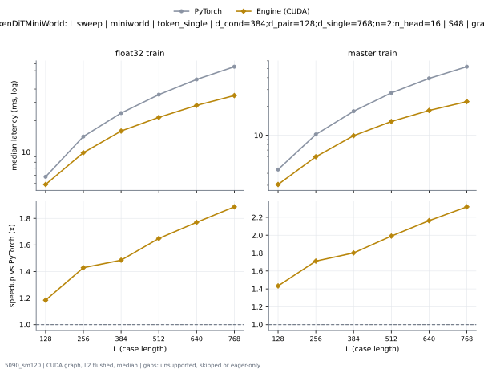
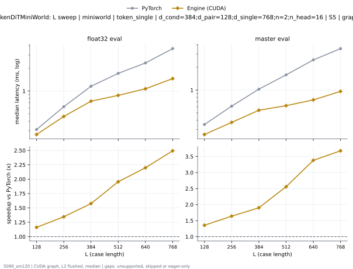

# TokenDiTMiniWorld on 5090_sm120

Generated by `python -m miniworld_engine.measure.plot` from speed tokens `judge/tokens/5090_sm120/`; do not edit.

### L sweep: miniworld | token_single | d_cond=384;d_pair=128;d_single=768;n=2;n_head=16 | S48 | graph

**float32 train** (median ms; x = speedup vs PyTorch)

| L | PyTorch | Engine (Triton) | Engine (CUDA) |
|---|---|---|---|
| 128 | 5.801 | 5.268 (1.10x) | 4.898 (1.18x) |
| 256 | 14.09 | 11.14 (1.26x) | 9.859 (1.43x) |
| 384 | 23.6 | 17.63 (1.34x) | 15.89 (1.49x) |
| 512 | 35.4 | 25.01 (1.42x) | 21.47 (1.65x) |
| 640 | 49.48 | 33.48 (1.48x) | 27.95 (1.77x) |
| 768 | 65.47 | 41.88 (1.56x) | 34.7 (1.89x) |

**master train** (median ms; x = speedup vs PyTorch)

| L | PyTorch | Engine (Triton) | Engine (CUDA) |
|---|---|---|---|
| 128 | 4.381 | 4.059 (1.08x) | 3.057 (1.43x) |
| 256 | 10.19 | 7.575 (1.35x) | 5.957 (1.71x) |
| 384 | 17.83 | 12.57 (1.42x) | 9.896 (1.80x) |
| 512 | 27.72 | 18.77 (1.48x) | 13.93 (1.99x) |
| 640 | 39.3 | 25.54 (1.54x) | 18.17 (2.16x) |
| 768 | 52.11 | 32.74 (1.59x) | 22.49 (2.32x) |

### L sweep: miniworld | token_single | d_cond=384;d_pair=128;d_single=768;n=2;n_head=16 | S5 | graph

**float32 eval** (median ms; x = speedup vs PyTorch)

| L | PyTorch | Engine (Triton) | Engine (CUDA) |
|---|---|---|---|
| 128 | 0.3092 | 0.2829 (1.09x) | 0.2662 (1.16x) |
| 256 | 0.6208 | 0.5519 (1.12x) | 0.4612 (1.35x) |
| 384 | 1.158 | 1.029 (1.13x) | 0.7349 (1.58x) |
| 512 | 1.716 | 1.262 (1.36x) | 0.8775 (1.96x) |
| 640 | 2.357 | 1.547 (1.52x) | 1.072 (2.20x) |
| 768 | 3.649 | 2.302 (1.58x) | 1.463 (2.49x) |

**master eval** (median ms; x = speedup vs PyTorch)

| L | PyTorch | Engine (Triton) | Engine (CUDA) |
|---|---|---|---|
| 128 | 0.3502 | 0.3256 (1.08x) | 0.2583 (1.36x) |
| 256 | 0.6125 | 0.5478 (1.12x) | 0.3735 (1.64x) |
| 384 | 1.028 | 0.9038 (1.14x) | 0.5408 (1.90x) |
| 512 | 1.589 | 1.277 (1.25x) | 0.6216 (2.56x) |
| 640 | 2.506 | 1.873 (1.34x) | 0.7413 (3.38x) |
| 768 | 3.535 | 2.454 (1.44x) | 0.9612 (3.68x) |

