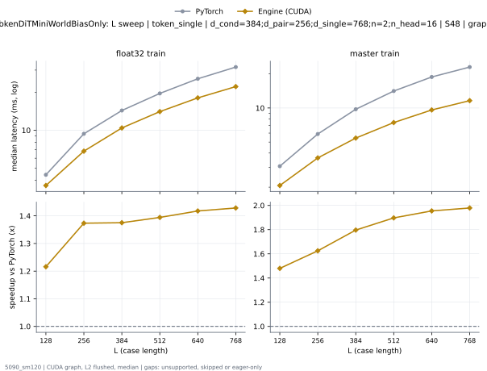
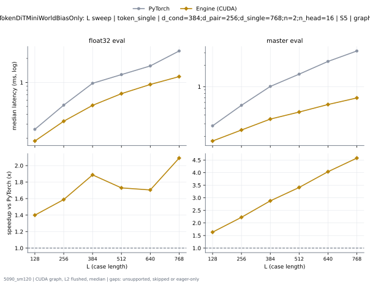
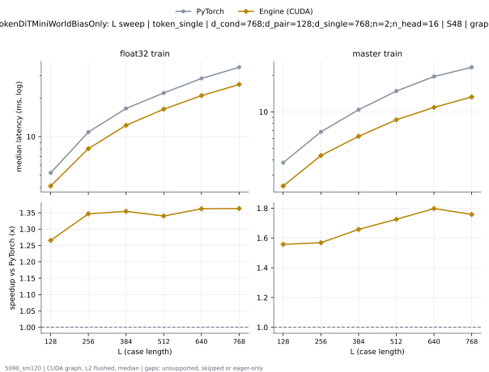
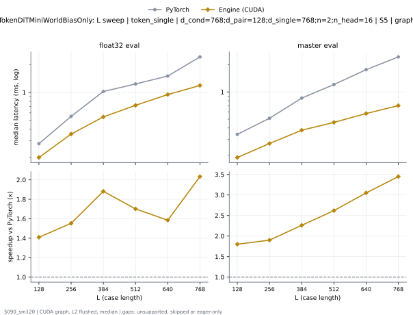
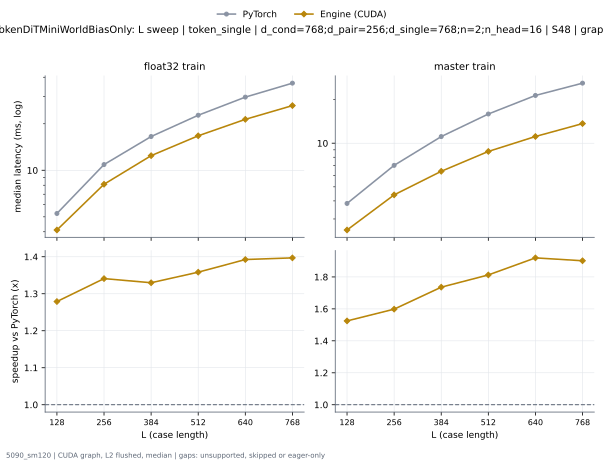
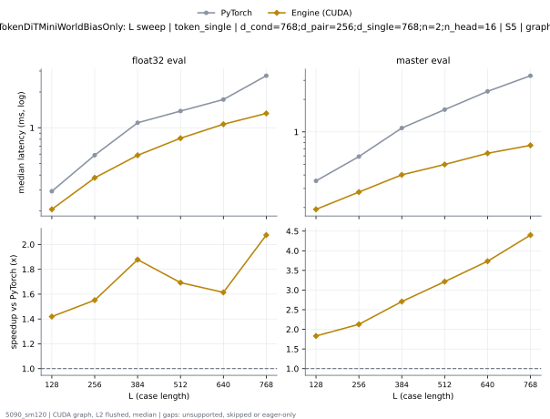
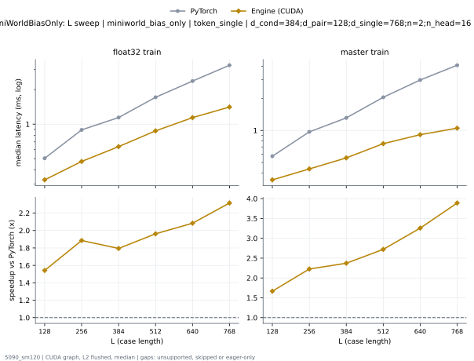
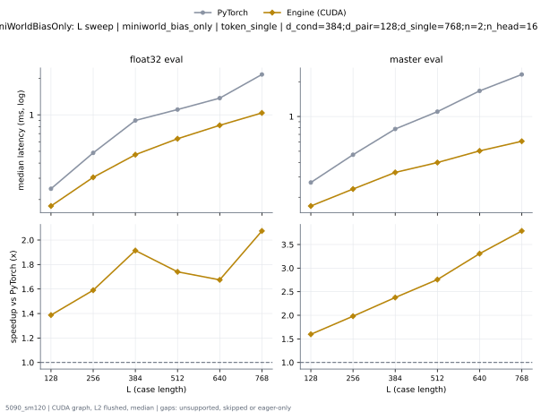

# TokenDiTMiniWorldBiasOnly on 5090_sm120

Generated by `python -m foldjet_engine.measure.plot` from speed tokens `judge/tokens/5090_sm120/`; do not edit.

### L sweep: token_single | d_cond=384;d_pair=256;d_single=768;n=2;n_head=16 | S48 | graph

**float32 train** (median ms; x = speedup vs PyTorch)

| L | PyTorch | Engine (Triton) | Engine (CUDA) |
|---|---|---|---|
| 128 | 4.433 | 3.802 (1.17x) | 3.645 (1.22x) |
| 256 | 9.375 | 7.306 (1.28x) | 6.826 (1.37x) |
| 384 | 14.35 | 11.21 (1.28x) | 10.43 (1.38x) |
| 512 | 19.6 | 14.98 (1.31x) | 14.06 (1.39x) |
| 640 | 25.61 | 19.26 (1.33x) | 18.06 (1.42x) |
| 768 | 31.72 | 23.85 (1.33x) | 22.2 (1.43x) |

**master train** (median ms; x = speedup vs PyTorch)

| L | PyTorch | Engine (Triton) | Engine (CUDA) |
|---|---|---|---|
| 128 | 3.063 | 2.131 (1.44x) | 2.07 (1.48x) |
| 256 | 5.892 | 3.787 (1.56x) | 3.626 (1.63x) |
| 384 | 9.746 | 5.992 (1.63x) | 5.425 (1.80x) |
| 512 | 14.11 | 8.307 (1.70x) | 7.439 (1.90x) |
| 640 | 18.78 | 10.89 (1.72x) | 9.609 (1.95x) |
| 768 | 22.97 | 11.82 (1.94x) | 11.61 (1.98x) |

### L sweep: token_single | d_cond=384;d_pair=256;d_single=768;n=2;n_head=16 | S5 | graph

**float32 eval** (median ms; x = speedup vs PyTorch)

| L | PyTorch | Engine (Triton) | Engine (CUDA) |
|---|---|---|---|
| 128 | 0.2594 | 0.2127 (1.22x) | 0.1853 (1.40x) |
| 256 | 0.5204 | 0.3811 (1.37x) | 0.3276 (1.59x) |
| 384 | 0.9758 | 0.6237 (1.56x) | 0.5171 (1.89x) |
| 512 | 1.253 | 0.759 (1.65x) | 0.7242 (1.73x) |
| 640 | 1.608 | 0.9682 (1.66x) | 0.943 (1.70x) |
| 768 | 2.473 | 1.31 (1.89x) | 1.183 (2.09x) |

**master eval** (median ms; x = speedup vs PyTorch)

| L | PyTorch | Engine (Triton) | Engine (CUDA) |
|---|---|---|---|
| 128 | 0.2813 | 0.1784 (1.58x) | 0.172 (1.63x) |
| 256 | 0.5464 | 0.2808 (1.95x) | 0.2456 (2.22x) |
| 384 | 1.008 | 0.3871 (2.60x) | 0.35 (2.88x) |
| 512 | 1.5 | 0.4812 (3.12x) | 0.4396 (3.41x) |
| 640 | 2.266 | 0.665 (3.41x) | 0.5612 (4.04x) |
| 768 | 3.178 | 0.8914 (3.56x) | 0.6939 (4.58x) |

### L sweep: token_single | d_cond=768;d_pair=128;d_single=768;n=2;n_head=16 | S48 | graph

**float32 train** (median ms; x = speedup vs PyTorch)

| L | PyTorch | Engine (Triton) | Engine (CUDA) |
|---|---|---|---|
| 128 | 5.209 | 4.574 (1.14x) | 4.117 (1.27x) |
| 256 | 10.86 | 8.75 (1.24x) | 8.061 (1.35x) |
| 384 | 16.61 | 13.19 (1.26x) | 12.26 (1.35x) |
| 512 | 21.97 | 17.4 (1.26x) | 16.4 (1.34x) |
| 640 | 28.51 | 22.27 (1.28x) | 20.93 (1.36x) |
| 768 | 34.87 | 27.39 (1.27x) | 25.59 (1.36x) |

**master train** (median ms; x = speedup vs PyTorch)

| L | PyTorch | Engine (Triton) | Engine (CUDA) |
|---|---|---|---|
| 128 | 3.8 | 2.507 (1.52x) | 2.44 (1.56x) |
| 256 | 6.825 | 4.614 (1.48x) | 4.352 (1.57x) |
| 384 | 10.41 | 6.93 (1.50x) | 6.276 (1.66x) |
| 512 | 14.83 | 9.56 (1.55x) | 8.592 (1.73x) |
| 640 | 19.55 | 12.41 (1.58x) | 10.87 (1.80x) |
| 768 | 23.33 | 13.57 (1.72x) | 13.27 (1.76x) |

### L sweep: token_single | d_cond=768;d_pair=128;d_single=768;n=2;n_head=16 | S5 | graph

**float32 eval** (median ms; x = speedup vs PyTorch)

| L | PyTorch | Engine (Triton) | Engine (CUDA) |
|---|---|---|---|
| 128 | 0.2787 | 0.2396 (1.16x) | 0.1977 (1.41x) |
| 256 | 0.5504 | 0.4239 (1.30x) | 0.3543 (1.55x) |
| 384 | 1.021 | 0.681 (1.50x) | 0.5427 (1.88x) |
| 512 | 1.232 | 0.7702 (1.60x) | 0.724 (1.70x) |
| 640 | 1.501 | 0.9676 (1.55x) | 0.9471 (1.58x) |
| 768 | 2.414 | 1.314 (1.84x) | 1.187 (2.03x) |

**master eval** (median ms; x = speedup vs PyTorch)

| L | PyTorch | Engine (Triton) | Engine (CUDA) |
|---|---|---|---|
| 128 | 0.3399 | 0.2092 (1.62x) | 0.1887 (1.80x) |
| 256 | 0.512 | 0.3052 (1.68x) | 0.2693 (1.90x) |
| 384 | 0.8547 | 0.4179 (2.05x) | 0.3779 (2.26x) |
| 512 | 1.207 | 0.4987 (2.42x) | 0.4608 (2.62x) |
| 640 | 1.762 | 0.6656 (2.65x) | 0.5776 (3.05x) |
| 768 | 2.436 | 0.8817 (2.76x) | 0.7066 (3.45x) |

### L sweep: token_single | d_cond=768;d_pair=256;d_single=768;n=2;n_head=16 | S48 | graph

**float32 train** (median ms; x = speedup vs PyTorch)

| L | PyTorch | Engine (Triton) | Engine (CUDA) |
|---|---|---|---|
| 128 | 5.254 | 4.52 (1.16x) | 4.108 (1.28x) |
| 256 | 10.89 | 8.826 (1.23x) | 8.122 (1.34x) |
| 384 | 16.54 | 13.36 (1.24x) | 12.44 (1.33x) |
| 512 | 22.71 | 17.67 (1.29x) | 16.72 (1.36x) |
| 640 | 29.75 | 22.69 (1.31x) | 21.36 (1.39x) |
| 768 | 36.63 | 27.96 (1.31x) | 26.22 (1.40x) |

**master train** (median ms; x = speedup vs PyTorch)

| L | PyTorch | Engine (Triton) | Engine (CUDA) |
|---|---|---|---|
| 128 | 3.84 | 2.543 (1.51x) | 2.519 (1.52x) |
| 256 | 7.035 | 4.607 (1.53x) | 4.401 (1.60x) |
| 384 | 11.11 | 7.005 (1.59x) | 6.402 (1.74x) |
| 512 | 15.91 | 9.71 (1.64x) | 8.776 (1.81x) |
| 640 | 21.36 | 12.6 (1.70x) | 11.13 (1.92x) |
| 768 | 25.97 | 13.87 (1.87x) | 13.66 (1.90x) |

### L sweep: token_single | d_cond=768;d_pair=256;d_single=768;n=2;n_head=16 | S5 | graph

**float32 eval** (median ms; x = speedup vs PyTorch)

| L | PyTorch | Engine (Triton) | Engine (CUDA) |
|---|---|---|---|
| 128 | 0.292 | 0.2458 (1.19x) | 0.2057 (1.42x) |
| 256 | 0.5877 | 0.4485 (1.31x) | 0.3789 (1.55x) |
| 384 | 1.101 | 0.7287 (1.51x) | 0.5863 (1.88x) |
| 512 | 1.381 | 0.8693 (1.59x) | 0.8162 (1.69x) |
| 640 | 1.728 | 1.08 (1.60x) | 1.07 (1.61x) |
| 768 | 2.74 | 1.49 (1.84x) | 1.32 (2.08x) |

**master eval** (median ms; x = speedup vs PyTorch)

| L | PyTorch | Engine (Triton) | Engine (CUDA) |
|---|---|---|---|
| 128 | 0.3526 | 0.213 (1.66x) | 0.1925 (1.83x) |
| 256 | 0.5918 | 0.319 (1.86x) | 0.278 (2.13x) |
| 384 | 1.086 | 0.4424 (2.46x) | 0.4012 (2.71x) |
| 512 | 1.608 | 0.5389 (2.98x) | 0.5001 (3.21x) |
| 640 | 2.371 | 0.7383 (3.21x) | 0.6349 (3.73x) |
| 768 | 3.307 | 0.9423 (3.51x) | 0.7515 (4.40x) |

### L sweep: miniworld_bias_only | token_single | d_cond=384;d_pair=128;d_single=768;n=2;n_head=16 | S1 | graph

**float32 train** (median ms; x = speedup vs PyTorch)

| L | PyTorch | Engine (Triton) | Engine (CUDA) |
|---|---|---|---|
| 128 | 0.5038 | 0.4407 (1.14x) | 0.3268 (1.54x) |
| 256 | 0.8919 | 0.555 (1.61x) | 0.4731 (1.89x) |
| 384 | 1.143 | 0.727 (1.57x) | 0.6371 (1.79x) |
| 512 | 1.716 | 1.009 (1.70x) | 0.8745 (1.96x) |
| 640 | 2.377 | 1.259 (1.89x) | 1.141 (2.08x) |
| 768 | 3.268 | 1.643 (1.99x) | 1.411 (2.32x) |

**master train** (median ms; x = speedup vs PyTorch)

| L | PyTorch | Engine (Triton) | Engine (CUDA) |
|---|---|---|---|
| 128 | 0.5734 | 0.4055 (1.41x) | 0.344 (1.67x) |
| 256 | 0.9698 | 0.4465 (2.17x) | 0.4356 (2.23x) |
| 384 | 1.311 | 0.5779 (2.27x) | 0.5528 (2.37x) |
| 512 | 2.045 | 0.7672 (2.67x) | 0.7516 (2.72x) |
| 640 | 2.971 | 0.939 (3.16x) | 0.9123 (3.26x) |
| 768 | 4.086 | 1.148 (3.56x) | 1.051 (3.89x) |

### L sweep: miniworld_bias_only | token_single | d_cond=384;d_pair=128;d_single=768;n=2;n_head=16 | S5 | graph

**float32 eval** (median ms; x = speedup vs PyTorch)

| L | PyTorch | Engine (Triton) | Engine (CUDA) |
|---|---|---|---|
| 128 | 0.2457 | 0.205 (1.20x) | 0.1771 (1.39x) |
| 256 | 0.4853 | 0.3585 (1.35x) | 0.3052 (1.59x) |
| 384 | 0.898 | 0.576 (1.56x) | 0.4691 (1.91x) |
| 512 | 1.105 | 0.6632 (1.67x) | 0.6348 (1.74x) |
| 640 | 1.372 | 0.8357 (1.64x) | 0.819 (1.67x) |
| 768 | 2.149 | 1.148 (1.87x) | 1.036 (2.07x) |

**master eval** (median ms; x = speedup vs PyTorch)

| L | PyTorch | Engine (Triton) | Engine (CUDA) |
|---|---|---|---|
| 128 | 0.2683 | 0.1764 (1.52x) | 0.1679 (1.60x) |
| 256 | 0.4666 | 0.2683 (1.74x) | 0.2355 (1.98x) |
| 384 | 0.7794 | 0.3625 (2.15x) | 0.328 (2.38x) |
| 512 | 1.101 | 0.439 (2.51x) | 0.3994 (2.76x) |
| 640 | 1.666 | 0.6001 (2.78x) | 0.5039 (3.31x) |
| 768 | 2.311 | 0.7967 (2.90x) | 0.6103 (3.79x) |

