# TokenDiTProtenix on 5090_sm120

Generated by `python -m foldjet_engine.measure.plot` from speed tokens `judge/tokens/5090_sm120/`; do not edit.

### L sweep: token_single | d_cond=384;d_pair=128;d_single=1024;n=2;n_head=16 | S1 | graph

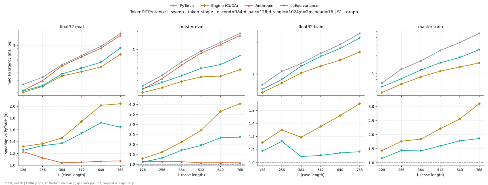

**float32 eval** (median ms; x = speedup vs PyTorch)

| L | PyTorch | Engine (Triton) | Engine (CUDA) | Anthropic | cuEquivariance |
|---|---|---|---|---|---|
| 128 | 0.2644 | 0.2563 (1.03x) | 0.2007 (1.32x) | 0.215 (1.23x) | 0.2111 (1.25x) |
| 256 | 0.3384 | 0.3256 (1.04x) | 0.2481 (1.36x) | 0.301 (1.12x) | 0.254 (1.33x) |
| 384 | 0.5184 | 0.5 (1.04x) | 0.3544 (1.46x) | 0.4983 (1.04x) | 0.3788 (1.37x) |
| 512 | 0.7096 | 0.6779 (1.05x) | 0.4078 (1.74x) | 0.6758 (1.05x) | 0.4608 (1.54x) |
| 640 | 0.9708 | 0.9125 (1.06x) | 0.4812 (2.02x) | 0.9107 (1.07x) | 0.5644 (1.72x) |
| 768 | 1.509 | 1.383 (1.09x) | 0.7379 (2.04x) | 1.408 (1.07x) | 0.9178 (1.64x) |

**master eval** (median ms; x = speedup vs PyTorch)

| L | PyTorch | Engine (Triton) | Engine (CUDA) | Anthropic | cuEquivariance |
|---|---|---|---|---|---|
| 128 | 0.2461 | 0.2343 (1.05x) | 0.1907 (1.29x) | 0.2162 (1.14x) | 0.2212 (1.11x) |
| 256 | 0.3707 | 0.3543 (1.05x) | 0.2297 (1.61x) | 0.3266 (1.13x) | 0.281 (1.32x) |
| 384 | 0.6205 | 0.5921 (1.05x) | 0.2931 (2.12x) | 0.5473 (1.13x) | 0.3645 (1.70x) |
| 512 | 0.9411 | 0.8936 (1.05x) | 0.3484 (2.70x) | 0.8717 (1.08x) | 0.4833 (1.95x) |
| 640 | 1.309 | 1.24 (1.06x) | 0.3584 (3.65x) | 1.208 (1.08x) | 0.5607 (2.33x) |
| 768 | 1.857 | 1.723 (1.08x) | 0.4608 (4.03x) | 1.72 (1.08x) | 0.7864 (2.36x) |

**float32 train** (median ms; x = speedup vs PyTorch)

| L | PyTorch | Engine (Triton) | Engine (CUDA) | Anthropic | cuEquivariance |
|---|---|---|---|---|---|
| 128 | 0.6881 | 0.6932 (0.99x) | 0.5258 (1.31x) | unsupported | 0.5855 (1.18x) |
| 256 | 1.097 | 1.104 (0.99x) | 0.7311 (1.50x) | unsupported | 0.8264 (1.33x) |
| 384 | 1.441 | 1.439 (1.00x) | 1.036 (1.39x) | unsupported | 1.316 (1.09x) |
| 512 | 2.05 | 2.031 (1.01x) | 1.318 (1.56x) | unsupported | 1.842 (1.11x) |
| 640 | 2.785 | 2.718 (1.02x) | 1.618 (1.72x) | unsupported | 2.421 (1.15x) |
| 768 | 4.088 | 3.88 (1.05x) | 2.149 (1.90x) | unsupported | 3.496 (1.17x) |

**master train** (median ms; x = speedup vs PyTorch)

| L | PyTorch | Engine (Triton) | Engine (CUDA) | Anthropic | cuEquivariance |
|---|---|---|---|---|---|
| 128 | 0.6956 | 0.6779 (1.03x) | 0.4853 (1.43x) | unsupported | 0.6024 (1.15x) |
| 256 | 1.183 | 1.163 (1.02x) | 0.6699 (1.77x) | unsupported | 0.8234 (1.44x) |
| 384 | 1.631 | 1.583 (1.03x) | 0.8858 (1.84x) | unsupported | 1.148 (1.42x) |
| 512 | 2.436 | 2.351 (1.04x) | 1.101 (2.21x) | unsupported | 1.521 (1.60x) |
| 640 | 3.308 | 3.198 (1.03x) | 1.293 (2.56x) | unsupported | 1.859 (1.78x) |
| 768 | 4.678 | 4.376 (1.07x) | 1.509 (3.10x) | unsupported | 2.512 (1.86x) |

### L sweep: token_single | d_cond=384;d_pair=128;d_single=768;n=2;n_head=12 | S1 | graph

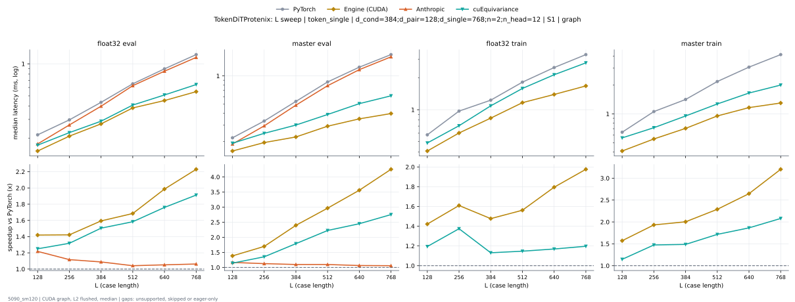

**float32 eval** (median ms; x = speedup vs PyTorch)

| L | PyTorch | Engine (Triton) | Engine (CUDA) | Anthropic | cuEquivariance |
|---|---|---|---|---|---|
| 128 | 0.215 | 0.2068 (1.04x) | 0.1515 (1.42x) | 0.1766 (1.22x) | 0.172 (1.25x) |
| 256 | 0.2972 | 0.2847 (1.04x) | 0.209 (1.42x) | 0.2662 (1.12x) | 0.2255 (1.32x) |
| 384 | 0.4344 | 0.4168 (1.04x) | 0.2726 (1.59x) | 0.3993 (1.09x) | 0.2888 (1.50x) |
| 512 | 0.6486 | 0.6246 (1.04x) | 0.3849 (1.69x) | 0.6229 (1.04x) | 0.4096 (1.58x) |
| 640 | 0.8967 | 0.8543 (1.05x) | 0.4515 (1.99x) | 0.8522 (1.05x) | 0.5095 (1.76x) |
| 768 | 1.221 | 1.152 (1.06x) | 0.5474 (2.23x) | 1.149 (1.06x) | 0.6382 (1.91x) |

**master eval** (median ms; x = speedup vs PyTorch)

| L | PyTorch | Engine (Triton) | Engine (CUDA) | Anthropic | cuEquivariance |
|---|---|---|---|---|---|
| 128 | 0.2188 | 0.2068 (1.06x) | 0.1581 (1.38x) | 0.1877 (1.17x) | 0.1915 (1.14x) |
| 256 | 0.3301 | 0.3135 (1.05x) | 0.1946 (1.70x) | 0.2931 (1.13x) | 0.2441 (1.35x) |
| 384 | 0.5349 | 0.512 (1.04x) | 0.2232 (2.40x) | 0.4874 (1.10x) | 0.299 (1.79x) |
| 512 | 0.8626 | 0.8276 (1.04x) | 0.2908 (2.97x) | 0.7864 (1.10x) | 0.3876 (2.23x) |
| 640 | 1.24 | 1.19 (1.04x) | 0.3483 (3.56x) | 1.167 (1.06x) | 0.5062 (2.45x) |
| 768 | 1.689 | 1.605 (1.05x) | 0.3969 (4.25x) | 1.598 (1.06x) | 0.6134 (2.75x) |

**float32 train** (median ms; x = speedup vs PyTorch)

| L | PyTorch | Engine (Triton) | Engine (CUDA) | Anthropic | cuEquivariance |
|---|---|---|---|---|---|
| 128 | 0.5796 | 0.5837 (0.99x) | 0.4077 (1.42x) | unsupported | 0.4853 (1.19x) |
| 256 | 0.9707 | 0.9789 (0.99x) | 0.6031 (1.61x) | unsupported | 0.7062 (1.37x) |
| 384 | 1.231 | 1.232 (1.00x) | 0.8335 (1.48x) | unsupported | 1.088 (1.13x) |
| 512 | 1.822 | 1.834 (0.99x) | 1.166 (1.56x) | unsupported | 1.588 (1.15x) |
| 640 | 2.501 | 2.508 (1.00x) | 1.394 (1.79x) | unsupported | 2.139 (1.17x) |
| 768 | 3.315 | 3.248 (1.02x) | 1.677 (1.98x) | unsupported | 2.77 (1.20x) |

**master train** (median ms; x = speedup vs PyTorch)

| L | PyTorch | Engine (Triton) | Engine (CUDA) | Anthropic | cuEquivariance |
|---|---|---|---|---|---|
| 128 | 0.6435 | 0.6298 (1.02x) | 0.4096 (1.57x) | unsupported | 0.5615 (1.15x) |
| 256 | 1.057 | 1.038 (1.02x) | 0.5471 (1.93x) | unsupported | 0.7171 (1.47x) |
| 384 | 1.414 | 1.384 (1.02x) | 0.7055 (2.00x) | unsupported | 0.9506 (1.49x) |
| 512 | 2.177 | 2.119 (1.03x) | 0.9511 (2.29x) | unsupported | 1.269 (1.72x) |
| 640 | 3.077 | 2.997 (1.03x) | 1.163 (2.65x) | unsupported | 1.65 (1.86x) |
| 768 | 4.16 | 3.99 (1.04x) | 1.299 (3.20x) | unsupported | 2 (2.08x) |

### L sweep: token_single | d_cond=384;d_pair=128;d_single=768;n=2;n_head=24 | S1 | graph

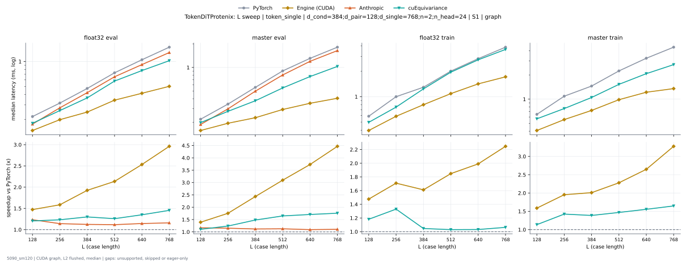

**float32 eval** (median ms; x = speedup vs PyTorch)

| L | PyTorch | Engine (Triton) | Engine (CUDA) | Anthropic | cuEquivariance |
|---|---|---|---|---|---|
| 128 | 0.2171 | 0.2089 (1.04x) | 0.1475 (1.47x) | 0.176 (1.23x) | 0.1802 (1.20x) |
| 256 | 0.3155 | 0.2973 (1.06x) | 0.1991 (1.58x) | 0.2765 (1.14x) | 0.2561 (1.23x) |
| 384 | 0.4731 | 0.4424 (1.07x) | 0.2458 (1.93x) | 0.4212 (1.12x) | 0.3641 (1.30x) |
| 512 | 0.7304 | 0.6554 (1.11x) | 0.342 (2.14x) | 0.654 (1.12x) | 0.5806 (1.26x) |
| 640 | 1.049 | 0.9083 (1.15x) | 0.414 (2.53x) | 0.9168 (1.14x) | 0.7768 (1.35x) |
| 768 | 1.486 | 1.236 (1.20x) | 0.5018 (2.96x) | 1.281 (1.16x) | 1.022 (1.45x) |

**master eval** (median ms; x = speedup vs PyTorch)

| L | PyTorch | Engine (Triton) | Engine (CUDA) | Anthropic | cuEquivariance |
|---|---|---|---|---|---|
| 128 | 0.2195 | 0.2058 (1.07x) | 0.1577 (1.39x) | 0.1884 (1.17x) | 0.1987 (1.10x) |
| 256 | 0.342 | 0.3195 (1.07x) | 0.195 (1.75x) | 0.2973 (1.15x) | 0.2765 (1.24x) |
| 384 | 0.5581 | 0.5202 (1.07x) | 0.2294 (2.43x) | 0.4991 (1.12x) | 0.3768 (1.48x) |
| 512 | 0.9036 | 0.8397 (1.08x) | 0.2919 (3.10x) | 0.8028 (1.13x) | 0.5488 (1.65x) |
| 640 | 1.307 | 1.212 (1.08x) | 0.3502 (3.73x) | 1.197 (1.09x) | 0.7661 (1.71x) |
| 768 | 1.812 | 1.623 (1.12x) | 0.4055 (4.47x) | 1.64 (1.10x) | 1.031 (1.76x) |

**float32 train** (median ms; x = speedup vs PyTorch)

| L | PyTorch | Engine (Triton) | Engine (CUDA) | Anthropic | cuEquivariance |
|---|---|---|---|---|---|
| 128 | 0.5857 | 0.5825 (1.01x) | 0.3968 (1.48x) | unsupported | 0.4957 (1.18x) |
| 256 | 0.9995 | 0.9851 (1.01x) | 0.5848 (1.71x) | unsupported | 0.7516 (1.33x) |
| 384 | 1.293 | 1.272 (1.02x) | 0.8026 (1.61x) | unsupported | 1.236 (1.05x) |
| 512 | 2.008 | 1.859 (1.08x) | 1.086 (1.85x) | unsupported | 1.95 (1.03x) |
| 640 | 2.822 | 2.617 (1.08x) | 1.417 (1.99x) | unsupported | 2.735 (1.03x) |
| 768 | 3.862 | 3.402 (1.14x) | 1.718 (2.25x) | unsupported | 3.633 (1.06x) |

**master train** (median ms; x = speedup vs PyTorch)

| L | PyTorch | Engine (Triton) | Engine (CUDA) | Anthropic | cuEquivariance |
|---|---|---|---|---|---|
| 128 | 0.6471 | 0.6328 (1.02x) | 0.4076 (1.59x) | unsupported | 0.5695 (1.14x) |
| 256 | 1.089 | 1.051 (1.04x) | 0.5572 (1.95x) | unsupported | 0.7642 (1.42x) |
| 384 | 1.455 | 1.377 (1.06x) | 0.7241 (2.01x) | unsupported | 1.049 (1.39x) |
| 512 | 2.246 | 2.134 (1.05x) | 0.9851 (2.28x) | unsupported | 1.528 (1.47x) |
| 640 | 3.229 | 3.039 (1.06x) | 1.22 (2.65x) | unsupported | 2.076 (1.56x) |
| 768 | 4.432 | 4.139 (1.07x) | 1.353 (3.28x) | unsupported | 2.69 (1.65x) |

### L sweep: af3|opendde|openfold3|openfold3_preview2|protenix | token_single | d_cond=384;d_pair=128;d_single=768;n=2;n_head=16 | S1 | graph

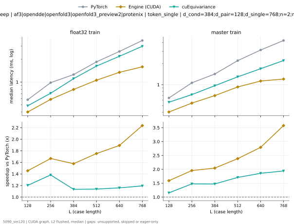

**float32 train** (median ms; x = speedup vs PyTorch)

| L | PyTorch | Engine (Triton) | Engine (CUDA) | Anthropic | cuEquivariance |
|---|---|---|---|---|---|
| 128 | 0.5816 | 0.5821 (1.00x) | 0.3997 (1.46x) | unsupported | 0.4837 (1.20x) |
| 256 | 0.98 | 0.9882 (0.99x) | 0.5878 (1.67x) | unsupported | 0.7086 (1.38x) |
| 384 | 1.256 | 1.246 (1.01x) | 0.7963 (1.58x) | unsupported | 1.107 (1.13x) |
| 512 | 1.852 | 1.848 (1.00x) | 1.057 (1.75x) | unsupported | 1.628 (1.14x) |
| 640 | 2.547 | 2.529 (1.01x) | 1.346 (1.89x) | unsupported | 2.197 (1.16x) |
| 768 | 3.559 | 3.421 (1.04x) | 1.591 (2.24x) | unsupported | 2.983 (1.19x) |

**master train** (median ms; x = speedup vs PyTorch)

| L | PyTorch | Engine (Triton) | Engine (CUDA) | Anthropic | cuEquivariance |
|---|---|---|---|---|---|
| 128 | 0.6454 | 0.6312 (1.02x) | 0.4055 (1.59x) | unsupported | 0.5601 (1.15x) |
| 256 | 1.064 | 1.046 (1.02x) | 0.5442 (1.96x) | unsupported | 0.7207 (1.48x) |
| 384 | 1.423 | 1.397 (1.02x) | 0.6966 (2.04x) | unsupported | 0.9666 (1.47x) |
| 512 | 2.215 | 2.135 (1.04x) | 0.9288 (2.38x) | unsupported | 1.296 (1.71x) |
| 640 | 3.149 | 3.039 (1.04x) | 1.128 (2.79x) | unsupported | 1.696 (1.86x) |
| 768 | 4.311 | 4.069 (1.06x) | 1.206 (3.58x) | unsupported | 2.221 (1.94x) |

### L sweep: af3|opendde|openfold3|openfold3_preview2|protenix | token_single | d_cond=384;d_pair=128;d_single=768;n=2;n_head=16 | S5 | graph

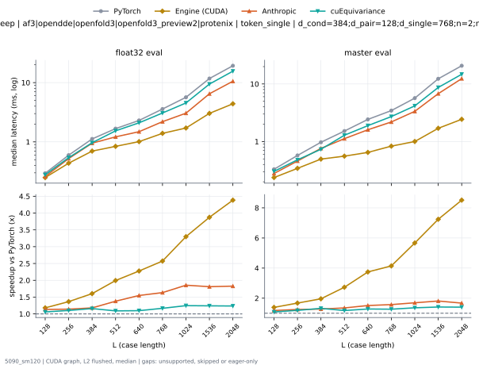

**float32 eval** (median ms; x = speedup vs PyTorch)

| L | PyTorch | Engine (Triton) | Engine (CUDA) | Anthropic | cuEquivariance |
|---|---|---|---|---|---|
| 128 | 0.2949 | 0.2686 (1.10x) | 0.2499 (1.18x) | 0.2601 (1.13x) | 0.2785 (1.06x) |
| 256 | 0.5961 | 0.5277 (1.13x) | 0.4365 (1.37x) | 0.5224 (1.14x) | 0.5406 (1.10x) |
| 384 | 1.12 | 0.9953 (1.13x) | 0.6986 (1.60x) | 0.9502 (1.18x) | 0.9668 (1.16x) |
| 512 | 1.674 | 1.199 (1.40x) | 0.8398 (1.99x) | 1.214 (1.38x) | 1.535 (1.09x) |
| 640 | 2.299 | 1.465 (1.57x) | 1.01 (2.28x) | 1.485 (1.55x) | 2.096 (1.10x) |
| 768 | 3.582 | 2.185 (1.64x) | 1.392 (2.57x) | 2.192 (1.63x) | 3.071 (1.17x) |
| 1024 | 5.651 | 2.987 (1.89x) | 1.713 (3.30x) | 3.047 (1.85x) | 4.535 (1.25x) |
| 1536 | 11.72 | 6.608 (1.77x) | 3.025 (3.87x) | 6.476 (1.81x) | 9.445 (1.24x) |
| 2048 | 19.26 | 10.62 (1.81x) | 4.392 (4.38x) | 10.54 (1.83x) | 15.59 (1.24x) |

**master eval** (median ms; x = speedup vs PyTorch)

| L | PyTorch | Engine (Triton) | Engine (CUDA) | Anthropic | cuEquivariance |
|---|---|---|---|---|---|
| 128 | 0.3297 | 0.299 (1.10x) | 0.2369 (1.39x) | 0.2785 (1.18x) | 0.3031 (1.09x) |
| 256 | 0.5739 | 0.4939 (1.16x) | 0.3423 (1.68x) | 0.4587 (1.25x) | 0.4814 (1.19x) |
| 384 | 0.9718 | 0.8171 (1.19x) | 0.4956 (1.96x) | 0.7598 (1.28x) | 0.7342 (1.32x) |
| 512 | 1.521 | 1.143 (1.33x) | 0.5575 (2.73x) | 1.123 (1.35x) | 1.287 (1.18x) |
| 640 | 2.424 | 1.654 (1.47x) | 0.6474 (3.74x) | 1.601 (1.51x) | 1.889 (1.28x) |
| 768 | 3.448 | 2.303 (1.50x) | 0.8317 (4.15x) | 2.188 (1.58x) | 2.715 (1.27x) |
| 1024 | 5.675 | 3.353 (1.69x) | 1.001 (5.67x) | 3.347 (1.70x) | 4.164 (1.36x) |
| 1536 | 12.3 | 6.888 (1.79x) | 1.699 (7.24x) | 6.783 (1.81x) | 8.696 (1.41x) |
| 2048 | 20.72 | 12.49 (1.66x) | 2.434 (8.51x) | 12.38 (1.67x) | 14.74 (1.41x) |

### L sweep: af3|opendde|openfold3|openfold3_preview2|protenix | token_single_shared_cond | d_cond=384;d_pair=128;d_single=768;n=2;n_head=16 | S5 | graph

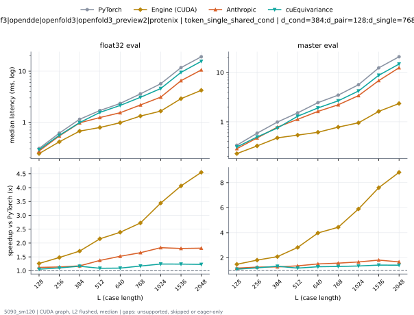

**float32 eval** (median ms; x = speedup vs PyTorch)

| L | PyTorch | Engine (Triton) | Engine (CUDA) | Anthropic | cuEquivariance |
|---|---|---|---|---|---|
| 128 | 0.3048 | 0.2805 (1.09x) | 0.2416 (1.26x) | 0.272 (1.12x) | 0.2888 (1.06x) |
| 256 | 0.6096 | 0.5419 (1.12x) | 0.4123 (1.48x) | 0.5369 (1.14x) | 0.5529 (1.10x) |
| 384 | 1.141 | 1.011 (1.13x) | 0.6676 (1.71x) | 0.9705 (1.18x) | 0.9812 (1.16x) |
| 512 | 1.693 | 1.217 (1.39x) | 0.7864 (2.15x) | 1.234 (1.37x) | 1.555 (1.09x) |
| 640 | 2.332 | 1.505 (1.55x) | 0.9761 (2.39x) | 1.532 (1.52x) | 2.131 (1.09x) |
| 768 | 3.595 | 2.19 (1.64x) | 1.319 (2.73x) | 2.177 (1.65x) | 3.076 (1.17x) |
| 1024 | 5.678 | 3.011 (1.89x) | 1.649 (3.44x) | 3.099 (1.83x) | 4.573 (1.24x) |
| 1536 | 11.75 | 6.637 (1.77x) | 2.893 (4.06x) | 6.515 (1.80x) | 9.482 (1.24x) |
| 2048 | 19.2 | 10.65 (1.80x) | 4.217 (4.55x) | 10.59 (1.81x) | 15.63 (1.23x) |

**master eval** (median ms; x = speedup vs PyTorch)

| L | PyTorch | Engine (Triton) | Engine (CUDA) | Anthropic | cuEquivariance |
|---|---|---|---|---|---|
| 128 | 0.336 | 0.3059 (1.10x) | 0.2275 (1.48x) | 0.2867 (1.17x) | 0.3096 (1.09x) |
| 256 | 0.5898 | 0.5083 (1.16x) | 0.3256 (1.81x) | 0.4717 (1.25x) | 0.4951 (1.19x) |
| 384 | 0.9902 | 0.8369 (1.18x) | 0.4741 (2.09x) | 0.7811 (1.27x) | 0.7496 (1.32x) |
| 512 | 1.521 | 1.155 (1.32x) | 0.5386 (2.82x) | 1.125 (1.35x) | 1.299 (1.17x) |
| 640 | 2.446 | 1.682 (1.45x) | 0.6147 (3.98x) | 1.625 (1.51x) | 1.91 (1.28x) |
| 768 | 3.472 | 2.21 (1.57x) | 0.7823 (4.44x) | 2.213 (1.57x) | 2.665 (1.30x) |
| 1024 | 5.637 | 3.385 (1.67x) | 0.9554 (5.90x) | 3.389 (1.66x) | 4.205 (1.34x) |
| 1536 | 12.38 | 6.938 (1.78x) | 1.628 (7.60x) | 6.828 (1.81x) | 8.751 (1.41x) |
| 2048 | 20.74 | 12.52 (1.66x) | 2.349 (8.83x) | 12.43 (1.67x) | 14.75 (1.41x) |

### L sweep: af3|opendde|openfold3|openfold3_preview2|protenix | token_single_shared_cond | d_cond=384;d_pair=128;d_single=768;n=2;n_head=16 | S8 | graph

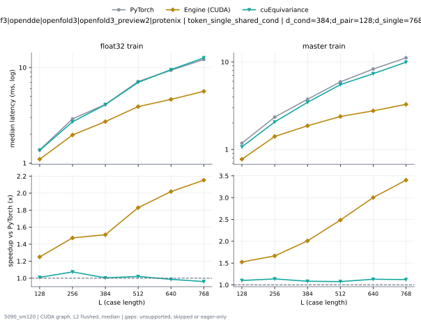

**float32 train** (median ms; x = speedup vs PyTorch)

| L | PyTorch | Engine (Triton) | Engine (CUDA) | Anthropic | cuEquivariance |
|---|---|---|---|---|---|
| 128 | 1.371 | 1.325 (1.03x) | 1.097 (1.25x) | unsupported | 1.358 (1.01x) |
| 256 | 2.9 | 2.712 (1.07x) | 1.967 (1.47x) | unsupported | 2.699 (1.07x) |
| 384 | 4.106 | 3.307 (1.24x) | 2.717 (1.51x) | unsupported | 4.089 (1.00x) |
| 512 | 7.13 | 5.086 (1.40x) | 3.897 (1.83x) | unsupported | 6.987 (1.02x) |
| 640 | 9.368 | 6.405 (1.46x) | 4.641 (2.02x) | unsupported | 9.497 (0.99x) |
| 768 | 12.14 | 8.18 (1.48x) | 5.637 (2.15x) | unsupported | 12.64 (0.96x) |

**master train** (median ms; x = speedup vs PyTorch)

| L | PyTorch | Engine (Triton) | Engine (CUDA) | Anthropic | cuEquivariance |
|---|---|---|---|---|---|
| 128 | 1.179 | 1.094 (1.08x) | 0.7733 (1.52x) | unsupported | 1.07 (1.10x) |
| 256 | 2.344 | 2.088 (1.12x) | 1.408 (1.66x) | unsupported | 2.062 (1.14x) |
| 384 | 3.746 | 3.052 (1.23x) | 1.865 (2.01x) | unsupported | 3.457 (1.08x) |
| 512 | 5.92 | 4.262 (1.39x) | 2.381 (2.49x) | unsupported | 5.503 (1.08x) |
| 640 | 8.293 | 5.48 (1.51x) | 2.762 (3.00x) | unsupported | 7.345 (1.13x) |
| 768 | 11.14 | 7.16 (1.56x) | 3.276 (3.40x) | unsupported | 9.929 (1.12x) |

### L sweep: esmfold2 | token_single | d_cond=768;d_pair=256;d_single=768;n=2;n_head=16 | S48 | graph

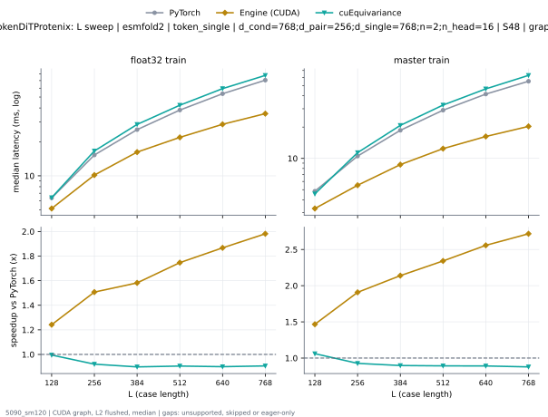

**float32 train** (median ms; x = speedup vs PyTorch)

| L | PyTorch | Engine (Triton) | Engine (CUDA) | Anthropic | cuEquivariance |
|---|---|---|---|---|---|
| 128 | 6.368 | 5.38 (1.18x) | 5.128 (1.24x) | unsupported | 6.399 (1.00x) |
| 256 | 15.3 | 12.32 (1.24x) | 10.15 (1.51x) | unsupported | 16.61 (0.92x) |
| 384 | 25.69 | 19.75 (1.30x) | 16.24 (1.58x) | unsupported | 28.58 (0.90x) |
| 512 | 38.32 | 27.9 (1.37x) | 21.94 (1.75x) | unsupported | 42.32 (0.91x) |
| 640 | 53.49 | 37.47 (1.43x) | 28.65 (1.87x) | unsupported | 59.4 (0.90x) |
| 768 | 70.59 | 46.84 (1.51x) | 35.62 (1.98x) | unsupported | 77.85 (0.91x) |

**master train** (median ms; x = speedup vs PyTorch)

| L | PyTorch | Engine (Triton) | Engine (CUDA) | Anthropic | cuEquivariance |
|---|---|---|---|---|---|
| 128 | 4.834 | 4.217 (1.15x) | 3.296 (1.47x) | unsupported | 4.558 (1.06x) |
| 256 | 10.52 | 7.563 (1.39x) | 5.515 (1.91x) | unsupported | 11.35 (0.93x) |
| 384 | 18.62 | 12.74 (1.46x) | 8.709 (2.14x) | unsupported | 20.77 (0.90x) |
| 512 | 29.07 | 19.05 (1.53x) | 12.42 (2.34x) | unsupported | 32.58 (0.89x) |
| 640 | 41.53 | 26.25 (1.58x) | 16.24 (2.56x) | unsupported | 46.61 (0.89x) |
| 768 | 55.18 | 33.78 (1.63x) | 20.31 (2.72x) | unsupported | 62.85 (0.88x) |

### L sweep: esmfold2 | token_single | d_cond=768;d_pair=256;d_single=768;n=2;n_head=16 | S5 | graph

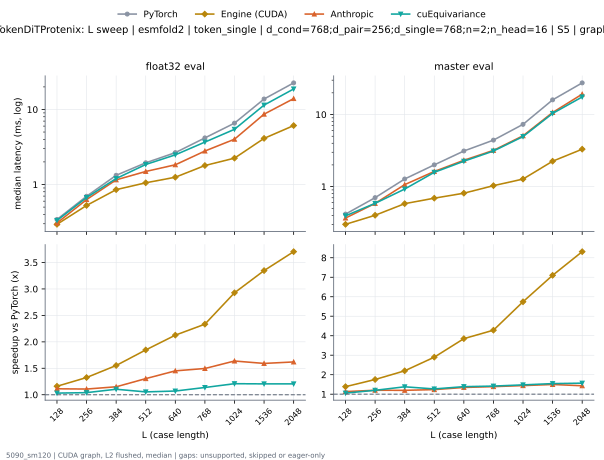

**float32 eval** (median ms; x = speedup vs PyTorch)

| L | PyTorch | Engine (Triton) | Engine (CUDA) | Anthropic | cuEquivariance |
|---|---|---|---|---|---|
| 128 | 0.342 | 0.3174 (1.08x) | 0.2947 (1.16x) | 0.3075 (1.11x) | 0.3318 (1.03x) |
| 256 | 0.6971 | 0.6301 (1.11x) | 0.526 (1.33x) | 0.6295 (1.11x) | 0.6707 (1.04x) |
| 384 | 1.327 | 1.18 (1.12x) | 0.8543 (1.55x) | 1.153 (1.15x) | 1.202 (1.10x) |
| 512 | 1.947 | 1.464 (1.33x) | 1.054 (1.85x) | 1.492 (1.30x) | 1.848 (1.05x) |
| 640 | 2.659 | 1.797 (1.48x) | 1.251 (2.13x) | 1.832 (1.45x) | 2.485 (1.07x) |
| 768 | 4.18 | 2.796 (1.49x) | 1.791 (2.33x) | 2.794 (1.50x) | 3.676 (1.14x) |
| 1024 | 6.573 | 3.975 (1.65x) | 2.246 (2.93x) | 4.014 (1.64x) | 5.439 (1.21x) |
| 1536 | 13.78 | 8.782 (1.57x) | 4.119 (3.35x) | 8.659 (1.59x) | 11.44 (1.21x) |
| 2048 | 22.61 | 13.96 (1.62x) | 6.102 (3.70x) | 13.96 (1.62x) | 18.76 (1.20x) |

**master eval** (median ms; x = speedup vs PyTorch)

| L | PyTorch | Engine (Triton) | Engine (CUDA) | Anthropic | cuEquivariance |
|---|---|---|---|---|---|
| 128 | 0.4154 | 0.3853 (1.08x) | 0.2997 (1.39x) | 0.3666 (1.13x) | 0.3934 (1.06x) |
| 256 | 0.7024 | 0.6205 (1.13x) | 0.4004 (1.75x) | 0.5844 (1.20x) | 0.5859 (1.20x) |
| 384 | 1.276 | 1.119 (1.14x) | 0.5799 (2.20x) | 1.065 (1.20x) | 0.925 (1.38x) |
| 512 | 2.004 | 1.623 (1.23x) | 0.6912 (2.90x) | 1.623 (1.23x) | 1.578 (1.27x) |
| 640 | 3.12 | 2.362 (1.32x) | 0.8102 (3.85x) | 2.319 (1.35x) | 2.25 (1.39x) |
| 768 | 4.415 | 3.191 (1.38x) | 1.031 (4.28x) | 3.182 (1.39x) | 3.118 (1.42x) |
| 1024 | 7.308 | 5.154 (1.42x) | 1.273 (5.74x) | 5.074 (1.44x) | 4.947 (1.48x) |
| 1536 | 15.99 | 10.8 (1.48x) | 2.252 (7.10x) | 10.67 (1.50x) | 10.36 (1.54x) |
| 2048 | 27.49 | 19.28 (1.43x) | 3.307 (8.31x) | 19.19 (1.43x) | 17.55 (1.57x) |

### L sweep: esmfold2 | token_single_shared_cond | d_cond=768;d_pair=256;d_single=768;n=2;n_head=16 | S5 | graph

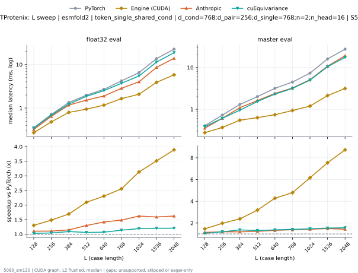

**float32 eval** (median ms; x = speedup vs PyTorch)

| L | PyTorch | Engine (Triton) | Engine (CUDA) | Anthropic | cuEquivariance |
|---|---|---|---|---|---|
| 128 | 0.3546 | 0.33 (1.07x) | 0.2722 (1.30x) | 0.3213 (1.10x) | 0.3444 (1.03x) |
| 256 | 0.7133 | 0.6451 (1.11x) | 0.4812 (1.48x) | 0.6451 (1.11x) | 0.6852 (1.04x) |
| 384 | 1.346 | 1.21 (1.11x) | 0.7956 (1.69x) | 1.174 (1.15x) | 1.236 (1.09x) |
| 512 | 1.975 | 1.463 (1.35x) | 0.9438 (2.09x) | 1.521 (1.30x) | 1.863 (1.06x) |
| 640 | 2.688 | 1.85 (1.45x) | 1.166 (2.30x) | 1.896 (1.42x) | 2.516 (1.07x) |
| 768 | 4.217 | 2.827 (1.49x) | 1.65 (2.56x) | 2.845 (1.48x) | 3.71 (1.14x) |
| 1024 | 6.514 | 4.026 (1.62x) | 2.08 (3.13x) | 4.017 (1.62x) | 5.471 (1.19x) |
| 1536 | 13.7 | 8.749 (1.57x) | 3.9 (3.51x) | 8.616 (1.59x) | 11.39 (1.20x) |
| 2048 | 22.59 | 14.03 (1.61x) | 5.807 (3.89x) | 13.94 (1.62x) | 18.74 (1.21x) |

**master eval** (median ms; x = speedup vs PyTorch)

| L | PyTorch | Engine (Triton) | Engine (CUDA) | Anthropic | cuEquivariance |
|---|---|---|---|---|---|
| 128 | 0.4038 | 0.3728 (1.08x) | 0.2756 (1.47x) | 0.3525 (1.15x) | 0.382 (1.06x) |
| 256 | 0.726 | 0.6441 (1.13x) | 0.3669 (1.98x) | 0.6074 (1.20x) | 0.6082 (1.19x) |
| 384 | 1.305 | 1.15 (1.14x) | 0.5471 (2.39x) | 1.093 (1.19x) | 0.9511 (1.37x) |
| 512 | 2.009 | 1.6 (1.26x) | 0.6298 (3.19x) | 1.617 (1.24x) | 1.536 (1.31x) |
| 640 | 3.175 | 2.414 (1.32x) | 0.7404 (4.29x) | 2.395 (1.33x) | 2.309 (1.38x) |
| 768 | 4.486 | 3.248 (1.38x) | 0.936 (4.79x) | 3.232 (1.39x) | 3.159 (1.42x) |
| 1024 | 7.342 | 5.204 (1.41x) | 1.191 (6.17x) | 5.118 (1.43x) | 4.995 (1.47x) |
| 1536 | 16.05 | 10.86 (1.48x) | 2.127 (7.55x) | 10.75 (1.49x) | 10.43 (1.54x) |
| 2048 | 27.48 | 19.27 (1.43x) | 3.146 (8.73x) | 19.16 (1.43x) | 17.54 (1.57x) |

### L sweep: intellifold2 | token_single | d_cond=384;d_pair=512;d_single=768;n=2;n_head=16 | S1 | graph

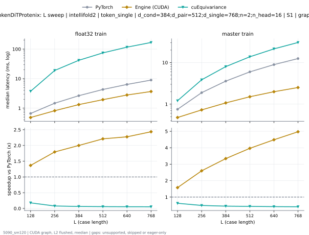

**float32 train** (median ms; x = speedup vs PyTorch)

| L | PyTorch | Engine (Triton) | Engine (CUDA) | Anthropic | cuEquivariance |
|---|---|---|---|---|---|
| 128 | 0.6615 | 0.6534 (1.01x) | 0.484 (1.37x) | unsupported | 3.738 (0.18x) |
| 256 | 1.473 | 1.386 (1.06x) | 0.8206 (1.79x) | unsupported | 18.88 (0.08x) |
| 384 | 2.645 | 2.558 (1.03x) | 1.322 (2.00x) | unsupported | 41.68 (0.06x) |
| 512 | 4.296 | 4.194 (1.02x) | 1.943 (2.21x) | unsupported | 74.33 (0.06x) |
| 640 | 6.354 | 6.225 (1.02x) | 2.793 (2.28x) | unsupported | 116.1 (0.05x) |
| 768 | 8.933 | 8.81 (1.01x) | 3.667 (2.44x) | unsupported | 167.1 (0.05x) |

**master train** (median ms; x = speedup vs PyTorch)

| L | PyTorch | Engine (Triton) | Engine (CUDA) | Anthropic | cuEquivariance |
|---|---|---|---|---|---|
| 128 | 0.752 | 0.7372 (1.02x) | 0.4775 (1.57x) | unsupported | 1.209 (0.62x) |
| 256 | 1.889 | 1.865 (1.01x) | 0.727 (2.60x) | unsupported | 3.853 (0.49x) |
| 384 | 3.578 | 3.482 (1.03x) | 1.071 (3.34x) | unsupported | 7.988 (0.45x) |
| 512 | 5.973 | 5.774 (1.03x) | 1.506 (3.97x) | unsupported | 13.77 (0.43x) |
| 640 | 8.925 | 8.688 (1.03x) | 1.99 (4.49x) | unsupported | 21.32 (0.42x) |
| 768 | 12.48 | 12.22 (1.02x) | 2.51 (4.97x) | unsupported | 30.41 (0.41x) |

### L sweep: intellifold2 | token_single | d_cond=384;d_pair=512;d_single=768;n=2;n_head=16 | S5 | graph

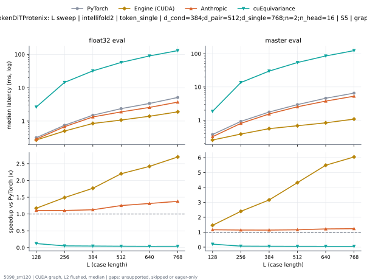

**float32 eval** (median ms; x = speedup vs PyTorch)

| L | PyTorch | Engine (Triton) | Engine (CUDA) | Anthropic | cuEquivariance |
|---|---|---|---|---|---|
| 128 | 0.3174 | 0.2918 (1.09x) | 0.2706 (1.17x) | 0.2867 (1.11x) | 2.634 (0.12x) |
| 256 | 0.7495 | 0.6205 (1.21x) | 0.5028 (1.49x) | 0.6781 (1.11x) | 14.44 (0.05x) |
| 384 | 1.498 | 1.279 (1.17x) | 0.8478 (1.77x) | 1.329 (1.13x) | 31.97 (0.05x) |
| 512 | 2.36 | 1.809 (1.30x) | 1.072 (2.20x) | 1.883 (1.25x) | 57.33 (0.04x) |
| 640 | 3.372 | 2.487 (1.36x) | 1.394 (2.42x) | 2.566 (1.31x) | 89.66 (0.04x) |
| 768 | 5.102 | 3.709 (1.38x) | 1.89 (2.70x) | 3.701 (1.38x) | 129.4 (0.04x) |

**master eval** (median ms; x = speedup vs PyTorch)

| L | PyTorch | Engine (Triton) | Engine (CUDA) | Anthropic | cuEquivariance |
|---|---|---|---|---|---|
| 128 | 0.3716 | 0.338 (1.10x) | 0.254 (1.46x) | 0.3191 (1.16x) | 1.844 (0.20x) |
| 256 | 0.9195 | 0.7929 (1.16x) | 0.3831 (2.40x) | 0.8028 (1.15x) | 13.59 (0.07x) |
| 384 | 1.763 | 1.549 (1.14x) | 0.5573 (3.16x) | 1.542 (1.14x) | 30 (0.06x) |
| 512 | 2.948 | 2.496 (1.18x) | 0.682 (4.32x) | 2.537 (1.16x) | 54.33 (0.05x) |
| 640 | 4.58 | 3.796 (1.21x) | 0.8342 (5.49x) | 3.754 (1.22x) | 85.56 (0.05x) |
| 768 | 6.522 | 5.296 (1.23x) | 1.079 (6.04x) | 5.273 (1.24x) | 123.9 (0.05x) |

### L sweep: intellifold2 | token_single_shared_cond | d_cond=384;d_pair=512;d_single=768;n=2;n_head=16 | S5 | graph

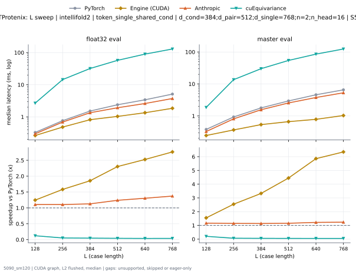

**float32 eval** (median ms; x = speedup vs PyTorch)

| L | PyTorch | Engine (Triton) | Engine (CUDA) | Anthropic | cuEquivariance |
|---|---|---|---|---|---|
| 128 | 0.3279 | 0.3036 (1.08x) | 0.2633 (1.25x) | 0.2966 (1.11x) | 2.676 (0.12x) |
| 256 | 0.7619 | 0.6338 (1.20x) | 0.4814 (1.58x) | 0.6891 (1.11x) | 14.45 (0.05x) |
| 384 | 1.517 | 1.292 (1.17x) | 0.8171 (1.86x) | 1.345 (1.13x) | 31.99 (0.05x) |
| 512 | 2.383 | 1.83 (1.30x) | 1.035 (2.30x) | 1.922 (1.24x) | 57.34 (0.04x) |
| 640 | 3.396 | 2.513 (1.35x) | 1.344 (2.53x) | 2.604 (1.30x) | 89.7 (0.04x) |
| 768 | 5.113 | 3.716 (1.38x) | 1.85 (2.76x) | 3.725 (1.37x) | 129.4 (0.04x) |

**master eval** (median ms; x = speedup vs PyTorch)

| L | PyTorch | Engine (Triton) | Engine (CUDA) | Anthropic | cuEquivariance |
|---|---|---|---|---|---|
| 128 | 0.3796 | 0.3461 (1.10x) | 0.245 (1.55x) | 0.326 (1.16x) | 1.85 (0.21x) |
| 256 | 0.9298 | 0.8063 (1.15x) | 0.3656 (2.54x) | 0.811 (1.15x) | 13.63 (0.07x) |
| 384 | 1.785 | 1.571 (1.14x) | 0.5366 (3.33x) | 1.564 (1.14x) | 30.02 (0.06x) |
| 512 | 2.951 | 2.495 (1.18x) | 0.6635 (4.45x) | 2.553 (1.16x) | 54.35 (0.05x) |
| 640 | 4.596 | 3.819 (1.20x) | 0.7847 (5.86x) | 3.771 (1.22x) | 85.58 (0.05x) |
| 768 | 6.55 | 5.325 (1.23x) | 1.032 (6.35x) | 5.3 (1.24x) | 123.9 (0.05x) |

### L sweep: protenix | token_folds | d_cond=384;d_pair=128;d_single=768;n=2;n_head=16 | D5 | S5 | graph

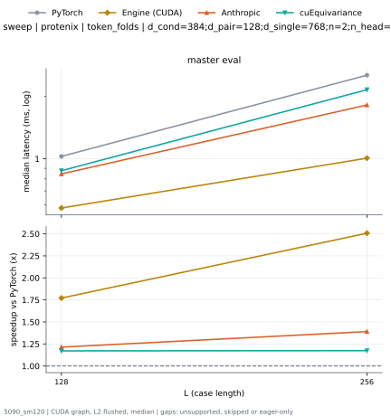

**master eval** (median ms; x = speedup vs PyTorch)

| L | PyTorch | Engine (Triton) | Engine (CUDA) | Anthropic | cuEquivariance |
|---|---|---|---|---|---|
| 128 | 1.027 | 0.9195 (1.12x) | 0.5798 (1.77x) | 0.8458 (1.21x) | 0.8765 (1.17x) |
| 256 | 2.524 | 1.9 (1.33x) | 1.007 (2.51x) | 1.815 (1.39x) | 2.149 (1.17x) |

### L sweep: protenix | token_folds_shared_cond | d_cond=384;d_pair=128;d_single=768;n=2;n_head=16 | D5 | S5 | graph

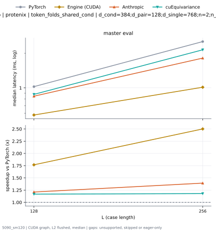

**master eval** (median ms; x = speedup vs PyTorch)

| L | PyTorch | Engine (Triton) | Engine (CUDA) | Anthropic | cuEquivariance |
|---|---|---|---|---|---|
| 128 | 1.025 | 0.9211 (1.11x) | 0.5799 (1.77x) | 0.8462 (1.21x) | 0.8775 (1.17x) |
| 256 | 2.532 | 1.899 (1.33x) | 1.013 (2.50x) | 1.818 (1.39x) | 2.147 (1.18x) |

### L sweep: protenix_v2 | token_single | d_cond=384;d_pair=256;d_single=768;n=2;n_head=16 | S1 | graph

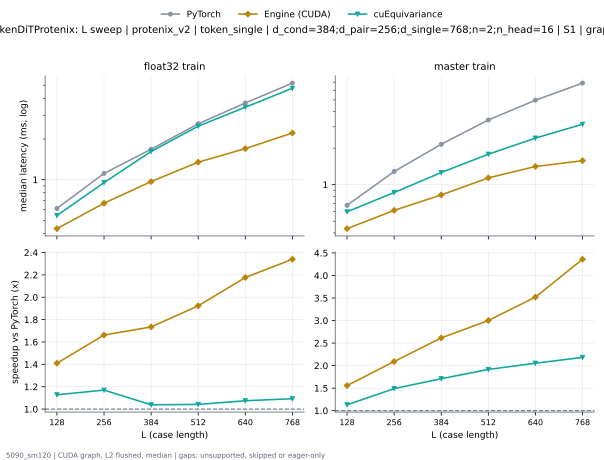

**float32 train** (median ms; x = speedup vs PyTorch)

| L | PyTorch | Engine (Triton) | Engine (CUDA) | Anthropic | cuEquivariance |
|---|---|---|---|---|---|
| 128 | 0.6124 | 0.6128 (1.00x) | 0.4342 (1.41x) | unsupported | 0.5427 (1.13x) |
| 256 | 1.113 | 1.124 (0.99x) | 0.6697 (1.66x) | unsupported | 0.9515 (1.17x) |
| 384 | 1.681 | 1.69 (0.99x) | 0.9687 (1.73x) | unsupported | 1.618 (1.04x) |
| 512 | 2.594 | 2.59 (1.00x) | 1.349 (1.92x) | unsupported | 2.49 (1.04x) |
| 640 | 3.699 | 3.623 (1.02x) | 1.699 (2.18x) | unsupported | 3.442 (1.07x) |
| 768 | 5.188 | 5.047 (1.03x) | 2.217 (2.34x) | unsupported | 4.748 (1.09x) |

**master train** (median ms; x = speedup vs PyTorch)

| L | PyTorch | Engine (Triton) | Engine (CUDA) | Anthropic | cuEquivariance |
|---|---|---|---|---|---|
| 128 | 0.6761 | 0.6618 (1.02x) | 0.4342 (1.56x) | unsupported | 0.598 (1.13x) |
| 256 | 1.285 | 1.268 (1.01x) | 0.6144 (2.09x) | unsupported | 0.8621 (1.49x) |
| 384 | 2.154 | 2.113 (1.02x) | 0.8236 (2.61x) | unsupported | 1.26 (1.71x) |
| 512 | 3.416 | 3.338 (1.02x) | 1.138 (3.00x) | unsupported | 1.784 (1.92x) |
| 640 | 4.973 | 4.836 (1.03x) | 1.412 (3.52x) | unsupported | 2.421 (2.05x) |
| 768 | 6.877 | 6.613 (1.04x) | 1.577 (4.36x) | unsupported | 3.151 (2.18x) |

### L sweep: protenix_v2 | token_single | d_cond=384;d_pair=256;d_single=768;n=2;n_head=16 | S5 | graph

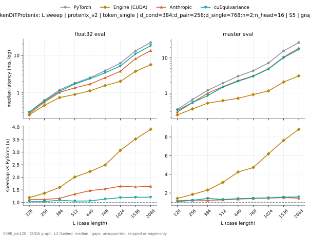

**float32 eval** (median ms; x = speedup vs PyTorch)

| L | PyTorch | Engine (Triton) | Engine (CUDA) | Anthropic | cuEquivariance |
|---|---|---|---|---|---|
| 128 | 0.3072 | 0.2827 (1.09x) | 0.2571 (1.19x) | 0.2747 (1.12x) | 0.2972 (1.03x) |
| 256 | 0.631 | 0.5641 (1.12x) | 0.4609 (1.37x) | 0.5632 (1.12x) | 0.6065 (1.04x) |
| 384 | 1.198 | 1.064 (1.13x) | 0.7477 (1.60x) | 1.027 (1.17x) | 1.098 (1.09x) |
| 512 | 1.818 | 1.319 (1.38x) | 0.9032 (2.01x) | 1.363 (1.33x) | 1.719 (1.06x) |
| 640 | 2.528 | 1.689 (1.50x) | 1.133 (2.23x) | 1.715 (1.47x) | 2.377 (1.06x) |
| 768 | 3.906 | 2.561 (1.52x) | 1.568 (2.49x) | 2.533 (1.54x) | 3.435 (1.14x) |
| 1024 | 6.215 | 3.801 (1.64x) | 2.023 (3.07x) | 3.77 (1.65x) | 5.211 (1.19x) |
| 1536 | 13.24 | 8.302 (1.59x) | 3.757 (3.52x) | 8.18 (1.62x) | 10.96 (1.21x) |
| 2048 | 22.11 | 13.53 (1.63x) | 5.659 (3.91x) | 13.45 (1.64x) | 18.26 (1.21x) |

**master eval** (median ms; x = speedup vs PyTorch)

| L | PyTorch | Engine (Triton) | Engine (CUDA) | Anthropic | cuEquivariance |
|---|---|---|---|---|---|
| 128 | 0.342 | 0.3115 (1.10x) | 0.2413 (1.42x) | 0.291 (1.18x) | 0.321 (1.07x) |
| 256 | 0.6574 | 0.5742 (1.14x) | 0.3563 (1.84x) | 0.5386 (1.22x) | 0.541 (1.22x) |
| 384 | 1.204 | 1.051 (1.15x) | 0.5202 (2.32x) | 0.9926 (1.21x) | 0.8468 (1.42x) |
| 512 | 1.918 | 1.546 (1.24x) | 0.6104 (3.14x) | 1.527 (1.26x) | 1.479 (1.30x) |
| 640 | 3.021 | 2.276 (1.33x) | 0.7116 (4.24x) | 2.25 (1.34x) | 2.168 (1.39x) |
| 768 | 4.315 | 3.097 (1.39x) | 0.9126 (4.73x) | 3.073 (1.40x) | 3.009 (1.43x) |
| 1024 | 7.137 | 5.015 (1.42x) | 1.152 (6.20x) | 4.93 (1.45x) | 4.812 (1.48x) |
| 1536 | 15.77 | 10.57 (1.49x) | 2.065 (7.64x) | 10.47 (1.51x) | 10.15 (1.55x) |
| 2048 | 27.22 | 19.02 (1.43x) | 3.086 (8.82x) | 18.91 (1.44x) | 17.3 (1.57x) |

### L sweep: protenix_v2 | token_single_shared_cond | d_cond=384;d_pair=256;d_single=768;n=2;n_head=16 | S5 | graph

**float32 eval** (median ms; x = speedup vs PyTorch)

| L | PyTorch | Engine (Triton) | Engine (CUDA) | Anthropic | cuEquivariance |
|---|---|---|---|---|---|
| 128 | 0.3176 | 0.2931 (1.08x) | 0.2488 (1.28x) | 0.285 (1.11x) | 0.3092 (1.03x) |
| 256 | 0.6451 | 0.5775 (1.12x) | 0.4382 (1.47x) | 0.5755 (1.12x) | 0.6174 (1.04x) |
| 384 | 1.218 | 1.09 (1.12x) | 0.7171 (1.70x) | 1.047 (1.16x) | 1.115 (1.09x) |
| 512 | 1.84 | 1.362 (1.35x) | 0.885 (2.08x) | 1.385 (1.33x) | 1.746 (1.05x) |
| 640 | 2.559 | 1.726 (1.48x) | 1.104 (2.32x) | 1.762 (1.45x) | 2.438 (1.05x) |
| 768 | 3.92 | 2.573 (1.52x) | 1.538 (2.55x) | 2.564 (1.53x) | 3.485 (1.12x) |
| 1024 | 6.262 | 3.767 (1.66x) | 1.986 (3.15x) | 3.802 (1.65x) | 5.239 (1.20x) |
| 1536 | 13.29 | 8.335 (1.59x) | 3.611 (3.68x) | 8.215 (1.62x) | 10.99 (1.21x) |
| 2048 | 22.15 | 13.56 (1.63x) | 5.494 (4.03x) | 13.51 (1.64x) | 18.3 (1.21x) |

**master eval** (median ms; x = speedup vs PyTorch)

| L | PyTorch | Engine (Triton) | Engine (CUDA) | Anthropic | cuEquivariance |
|---|---|---|---|---|---|
| 128 | 0.3498 | 0.3195 (1.10x) | 0.2337 (1.50x) | 0.301 (1.16x) | 0.3297 (1.06x) |
| 256 | 0.6697 | 0.5888 (1.14x) | 0.3386 (1.98x) | 0.5512 (1.21x) | 0.555 (1.21x) |
| 384 | 1.214 | 1.061 (1.14x) | 0.5014 (2.42x) | 1.011 (1.20x) | 0.8656 (1.40x) |
| 512 | 1.922 | 1.529 (1.26x) | 0.565 (3.40x) | 1.53 (1.26x) | 1.463 (1.31x) |
| 640 | 3.04 | 2.297 (1.32x) | 0.6758 (4.50x) | 2.246 (1.35x) | 2.18 (1.39x) |
| 768 | 4.351 | 3.128 (1.39x) | 0.8891 (4.89x) | 3.116 (1.40x) | 3.046 (1.43x) |
| 1024 | 7.248 | 5.048 (1.44x) | 1.112 (6.52x) | 4.993 (1.45x) | 4.849 (1.49x) |
| 1536 | 15.83 | 10.62 (1.49x) | 1.99 (7.96x) | 10.52 (1.50x) | 10.2 (1.55x) |
| 2048 | 27.26 | 19.04 (1.43x) | 2.995 (9.10x) | 18.95 (1.44x) | 17.31 (1.57x) |

### d_pair sweep at L768: token_single | n=2 | S1 | graph

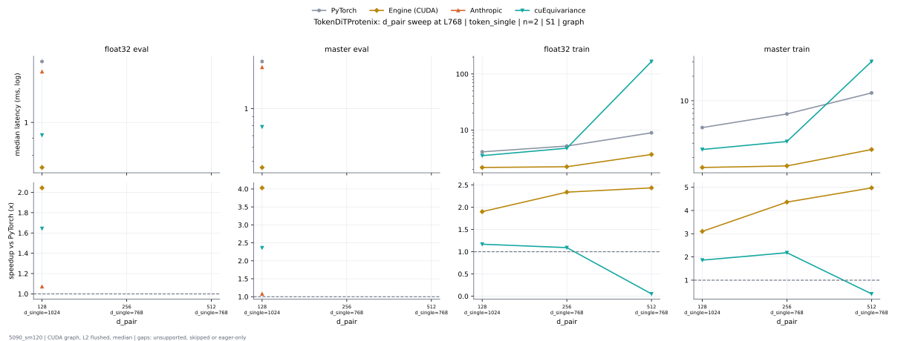

**float32 eval** (median ms; x = speedup vs PyTorch)

| d_pair | PyTorch | Engine (Triton) | Engine (CUDA) | Anthropic | cuEquivariance |
|---|---|---|---|---|---|
| 128 d_single=1024 | 1.509 | 1.383 (1.09x) | 0.7379 (2.04x) | 1.408 (1.07x) | 0.9178 (1.64x) |
| 256 d_single=768 |  |  |  |  |  |
| 512 d_single=768 |  |  |  |  |  |

**master eval** (median ms; x = speedup vs PyTorch)

| d_pair | PyTorch | Engine (Triton) | Engine (CUDA) | Anthropic | cuEquivariance |
|---|---|---|---|---|---|
| 128 d_single=1024 | 1.857 | 1.723 (1.08x) | 0.4608 (4.03x) | 1.72 (1.08x) | 0.7864 (2.36x) |
| 256 d_single=768 |  |  |  |  |  |
| 512 d_single=768 |  |  |  |  |  |

**float32 train** (median ms; x = speedup vs PyTorch)

| d_pair | PyTorch | Engine (Triton) | Engine (CUDA) | Anthropic | cuEquivariance |
|---|---|---|---|---|---|
| 128 d_single=1024 | 4.088 | 3.88 (1.05x) | 2.149 (1.90x) | unsupported | 3.496 (1.17x) |
| 256 d_single=768 | 5.188 | 5.047 (1.03x) | 2.217 (2.34x) | unsupported | 4.748 (1.09x) |
| 512 d_single=768 | 8.933 | 8.81 (1.01x) | 3.667 (2.44x) | unsupported | 167.1 (0.05x) |

**master train** (median ms; x = speedup vs PyTorch)

| d_pair | PyTorch | Engine (Triton) | Engine (CUDA) | Anthropic | cuEquivariance |
|---|---|---|---|---|---|
| 128 d_single=1024 | 4.678 | 4.376 (1.07x) | 1.509 (3.10x) | unsupported | 2.512 (1.86x) |
| 256 d_single=768 | 6.877 | 6.613 (1.04x) | 1.577 (4.36x) | unsupported | 3.151 (2.18x) |
| 512 d_single=768 | 12.48 | 12.22 (1.02x) | 2.51 (4.97x) | unsupported | 30.41 (0.41x) |

### d_pair sweep at L768: token_single | n=2 | S5 | graph

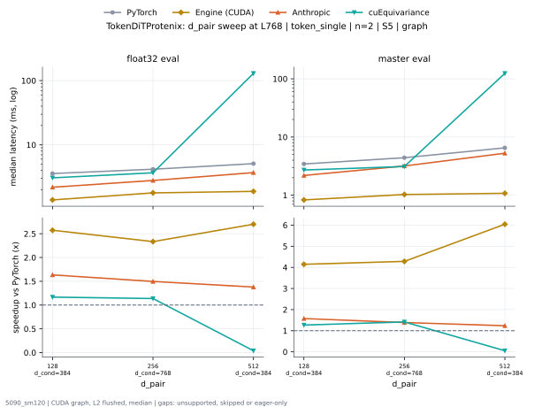

**float32 eval** (median ms; x = speedup vs PyTorch)

| d_pair | PyTorch | Engine (Triton) | Engine (CUDA) | Anthropic | cuEquivariance |
|---|---|---|---|---|---|
| 128 d_cond=384 | 3.582 | 2.185 (1.64x) | 1.392 (2.57x) | 2.192 (1.63x) | 3.071 (1.17x) |
| 256 d_cond=768 | 4.18 | 2.796 (1.49x) | 1.791 (2.33x) | 2.794 (1.50x) | 3.676 (1.14x) |
| 512 d_cond=384 | 5.102 | 3.709 (1.38x) | 1.89 (2.70x) | 3.701 (1.38x) | 129.4 (0.04x) |

**master eval** (median ms; x = speedup vs PyTorch)

| d_pair | PyTorch | Engine (Triton) | Engine (CUDA) | Anthropic | cuEquivariance |
|---|---|---|---|---|---|
| 128 d_cond=384 | 3.448 | 2.303 (1.50x) | 0.8317 (4.15x) | 2.188 (1.58x) | 2.715 (1.27x) |
| 256 d_cond=768 | 4.415 | 3.191 (1.38x) | 1.031 (4.28x) | 3.182 (1.39x) | 3.118 (1.42x) |
| 512 d_cond=384 | 6.522 | 5.296 (1.23x) | 1.079 (6.04x) | 5.273 (1.24x) | 123.9 (0.05x) |

### d_pair sweep at L768: token_single_shared_cond | n=2 | S5 | graph

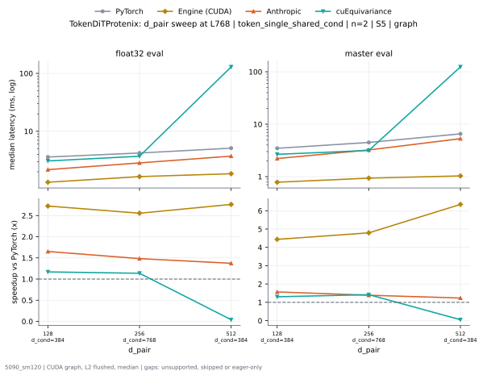

**float32 eval** (median ms; x = speedup vs PyTorch)

| d_pair | PyTorch | Engine (Triton) | Engine (CUDA) | Anthropic | cuEquivariance |
|---|---|---|---|---|---|
| 128 d_cond=384 | 3.595 | 2.19 (1.64x) | 1.319 (2.73x) | 2.177 (1.65x) | 3.076 (1.17x) |
| 256 d_cond=768 | 4.217 | 2.827 (1.49x) | 1.65 (2.56x) | 2.845 (1.48x) | 3.71 (1.14x) |
| 512 d_cond=384 | 5.113 | 3.716 (1.38x) | 1.85 (2.76x) | 3.725 (1.37x) | 129.4 (0.04x) |

**master eval** (median ms; x = speedup vs PyTorch)

| d_pair | PyTorch | Engine (Triton) | Engine (CUDA) | Anthropic | cuEquivariance |
|---|---|---|---|---|---|
| 128 d_cond=384 | 3.472 | 2.21 (1.57x) | 0.7823 (4.44x) | 2.213 (1.57x) | 2.665 (1.30x) |
| 256 d_cond=768 | 4.486 | 3.248 (1.38x) | 0.936 (4.79x) | 3.232 (1.39x) | 3.159 (1.42x) |
| 512 d_cond=384 | 6.55 | 5.325 (1.23x) | 1.032 (6.35x) | 5.3 (1.24x) | 123.9 (0.05x) |

### n_head sweep at L768: token_single | n=2 | S1 | graph

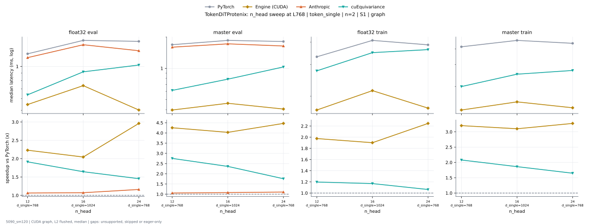

**float32 eval** (median ms; x = speedup vs PyTorch)

| n_head | PyTorch | Engine (Triton) | Engine (CUDA) | Anthropic | cuEquivariance |
|---|---|---|---|---|---|
| 12 d_single=768 | 1.221 | 1.152 (1.06x) | 0.5474 (2.23x) | 1.149 (1.06x) | 0.6382 (1.91x) |
| 16 d_single=1024 | 1.509 | 1.383 (1.09x) | 0.7379 (2.04x) | 1.408 (1.07x) | 0.9178 (1.64x) |
| 24 d_single=768 | 1.486 | 1.236 (1.20x) | 0.5018 (2.96x) | 1.281 (1.16x) | 1.022 (1.45x) |

**master eval** (median ms; x = speedup vs PyTorch)

| n_head | PyTorch | Engine (Triton) | Engine (CUDA) | Anthropic | cuEquivariance |
|---|---|---|---|---|---|
| 12 d_single=768 | 1.689 | 1.605 (1.05x) | 0.3969 (4.25x) | 1.598 (1.06x) | 0.6134 (2.75x) |
| 16 d_single=1024 | 1.857 | 1.723 (1.08x) | 0.4608 (4.03x) | 1.72 (1.08x) | 0.7864 (2.36x) |
| 24 d_single=768 | 1.812 | 1.623 (1.12x) | 0.4055 (4.47x) | 1.64 (1.10x) | 1.031 (1.76x) |

**float32 train** (median ms; x = speedup vs PyTorch)

| n_head | PyTorch | Engine (Triton) | Engine (CUDA) | Anthropic | cuEquivariance |
|---|---|---|---|---|---|
| 12 d_single=768 | 3.315 | 3.248 (1.02x) | 1.677 (1.98x) | unsupported | 2.77 (1.20x) |
| 16 d_single=1024 | 4.088 | 3.88 (1.05x) | 2.149 (1.90x) | unsupported | 3.496 (1.17x) |
| 24 d_single=768 | 3.862 | 3.402 (1.14x) | 1.718 (2.25x) | unsupported | 3.633 (1.06x) |

**master train** (median ms; x = speedup vs PyTorch)

| n_head | PyTorch | Engine (Triton) | Engine (CUDA) | Anthropic | cuEquivariance |
|---|---|---|---|---|---|
| 12 d_single=768 | 4.16 | 3.99 (1.04x) | 1.299 (3.20x) | unsupported | 2 (2.08x) |
| 16 d_single=1024 | 4.678 | 4.376 (1.07x) | 1.509 (3.10x) | unsupported | 2.512 (1.86x) |
| 24 d_single=768 | 4.432 | 4.139 (1.07x) | 1.353 (3.28x) | unsupported | 2.69 (1.65x) |

