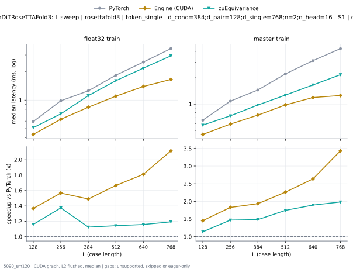
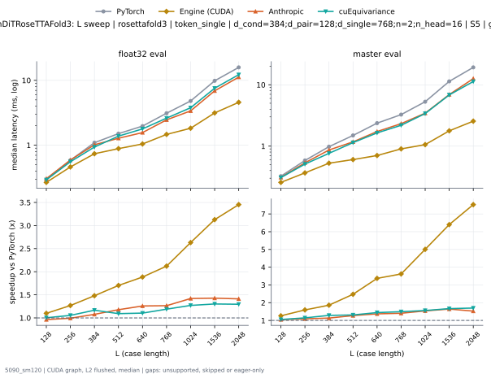
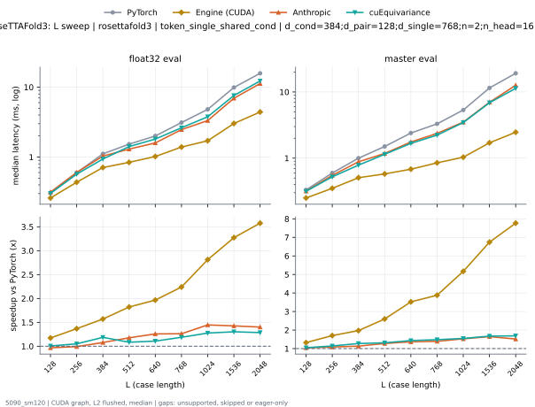

# TokenDiTRoseTTAFold3 on 5090_sm120

Generated by `python -m foldjet_engine.measure.plot` from speed tokens `judge/tokens/5090_sm120/`; do not edit.

### L sweep: rosettafold3 | token_single | d_cond=384;d_pair=128;d_single=768;n=2;n_head=16 | S1 | graph

**float32 train** (median ms; x = speedup vs PyTorch)

| L | PyTorch | Engine (Triton) | Engine (CUDA) | Anthropic | cuEquivariance |
|---|---|---|---|---|---|
| 128 | 0.5936 | 0.5929 (1.00x) | 0.4342 (1.37x) | unsupported | 0.512 (1.16x) |
| 256 | 0.984 | 0.9984 (0.99x) | 0.6279 (1.57x) | unsupported | 0.716 (1.37x) |
| 384 | 1.254 | 1.266 (0.99x) | 0.8419 (1.49x) | unsupported | 1.115 (1.12x) |
| 512 | 1.834 | 1.86 (0.99x) | 1.101 (1.67x) | unsupported | 1.605 (1.14x) |
| 640 | 2.524 | 2.55 (0.99x) | 1.394 (1.81x) | unsupported | 2.179 (1.16x) |
| 768 | 3.503 | 3.43 (1.02x) | 1.656 (2.12x) | unsupported | 2.936 (1.19x) |

**master train** (median ms; x = speedup vs PyTorch)

| L | PyTorch | Engine (Triton) | Engine (CUDA) | Anthropic | cuEquivariance |
|---|---|---|---|---|---|
| 128 | 0.6556 | 0.6516 (1.01x) | 0.4506 (1.46x) | unsupported | 0.5755 (1.14x) |
| 256 | 1.081 | 1.068 (1.01x) | 0.591 (1.83x) | unsupported | 0.7352 (1.47x) |
| 384 | 1.45 | 1.412 (1.03x) | 0.7489 (1.94x) | unsupported | 0.9771 (1.48x) |
| 512 | 2.213 | 2.141 (1.03x) | 0.9786 (2.26x) | unsupported | 1.268 (1.75x) |
| 640 | 3.135 | 3.052 (1.03x) | 1.189 (2.64x) | unsupported | 1.654 (1.90x) |
| 768 | 4.303 | 4.114 (1.05x) | 1.254 (3.43x) | unsupported | 2.17 (1.98x) |

### L sweep: rosettafold3 | token_single | d_cond=384;d_pair=128;d_single=768;n=2;n_head=16 | S5 | graph

**float32 eval** (median ms; x = speedup vs PyTorch)

| L | PyTorch | Engine (Triton) | Engine (CUDA) | Anthropic | cuEquivariance |
|---|---|---|---|---|---|
| 128 | 0.294 | 0.2756 (1.07x) | 0.2674 (1.10x) | 0.3051 (0.96x) | 0.2928 (1.00x) |
| 256 | 0.5864 | 0.5365 (1.09x) | 0.4622 (1.27x) | 0.5901 (0.99x) | 0.556 (1.05x) |
| 384 | 1.094 | 1.008 (1.09x) | 0.739 (1.48x) | 1.016 (1.08x) | 0.9375 (1.17x) |
| 512 | 1.509 | 1.218 (1.24x) | 0.8863 (1.70x) | 1.281 (1.18x) | 1.381 (1.09x) |
| 640 | 1.971 | 1.465 (1.35x) | 1.045 (1.89x) | 1.566 (1.26x) | 1.785 (1.10x) |
| 768 | 3.113 | 2.219 (1.40x) | 1.467 (2.12x) | 2.461 (1.26x) | 2.616 (1.19x) |
| 1024 | 4.807 | 3.039 (1.58x) | 1.827 (2.63x) | 3.384 (1.42x) | 3.783 (1.27x) |
| 1536 | 9.843 | 6.634 (1.48x) | 3.147 (3.13x) | 6.891 (1.43x) | 7.559 (1.30x) |
| 2048 | 15.84 | 10.71 (1.48x) | 4.586 (3.45x) | 11.21 (1.41x) | 12.22 (1.30x) |

**master eval** (median ms; x = speedup vs PyTorch)

| L | PyTorch | Engine (Triton) | Engine (CUDA) | Anthropic | cuEquivariance |
|---|---|---|---|---|---|
| 128 | 0.3236 | 0.2982 (1.09x) | 0.2566 (1.26x) | 0.3092 (1.05x) | 0.3074 (1.05x) |
| 256 | 0.5836 | 0.5156 (1.13x) | 0.3666 (1.59x) | 0.5345 (1.09x) | 0.5099 (1.14x) |
| 384 | 0.9806 | 0.853 (1.15x) | 0.5273 (1.86x) | 0.8657 (1.13x) | 0.7632 (1.28x) |
| 512 | 1.495 | 1.171 (1.28x) | 0.6041 (2.47x) | 1.174 (1.27x) | 1.142 (1.31x) |
| 640 | 2.371 | 1.716 (1.38x) | 0.7035 (3.37x) | 1.73 (1.37x) | 1.643 (1.44x) |
| 768 | 3.266 | 2.273 (1.44x) | 0.9025 (3.62x) | 2.326 (1.40x) | 2.188 (1.49x) |
| 1024 | 5.297 | 3.426 (1.55x) | 1.058 (5.01x) | 3.446 (1.54x) | 3.399 (1.56x) |
| 1536 | 11.37 | 7.016 (1.62x) | 1.776 (6.40x) | 6.925 (1.64x) | 6.829 (1.66x) |
| 2048 | 19.21 | 12.61 (1.52x) | 2.552 (7.53x) | 12.59 (1.53x) | 11.31 (1.70x) |

### L sweep: rosettafold3 | token_single_shared_cond | d_cond=384;d_pair=128;d_single=768;n=2;n_head=16 | S5 | graph

**float32 eval** (median ms; x = speedup vs PyTorch)

| L | PyTorch | Engine (Triton) | Engine (CUDA) | Anthropic | cuEquivariance |
|---|---|---|---|---|---|
| 128 | 0.3048 | 0.2867 (1.06x) | 0.2599 (1.17x) | 0.3154 (0.97x) | 0.3031 (1.01x) |
| 256 | 0.5976 | 0.5468 (1.09x) | 0.437 (1.37x) | 0.6024 (0.99x) | 0.5693 (1.05x) |
| 384 | 1.112 | 1.008 (1.10x) | 0.7087 (1.57x) | 1.032 (1.08x) | 0.938 (1.19x) |
| 512 | 1.531 | 1.231 (1.24x) | 0.8407 (1.82x) | 1.301 (1.18x) | 1.413 (1.08x) |
| 640 | 2.004 | 1.504 (1.33x) | 1.019 (1.97x) | 1.593 (1.26x) | 1.809 (1.11x) |
| 768 | 3.117 | 2.278 (1.37x) | 1.392 (2.24x) | 2.471 (1.26x) | 2.626 (1.19x) |
| 1024 | 4.811 | 3.042 (1.58x) | 1.711 (2.81x) | 3.327 (1.45x) | 3.771 (1.28x) |
| 1536 | 9.893 | 6.673 (1.48x) | 3.023 (3.27x) | 6.937 (1.43x) | 7.596 (1.30x) |
| 2048 | 15.77 | 10.75 (1.47x) | 4.411 (3.58x) | 11.26 (1.40x) | 12.27 (1.29x) |

**master eval** (median ms; x = speedup vs PyTorch)

| L | PyTorch | Engine (Triton) | Engine (CUDA) | Anthropic | cuEquivariance |
|---|---|---|---|---|---|
| 128 | 0.3304 | 0.3068 (1.08x) | 0.2499 (1.32x) | 0.3174 (1.04x) | 0.3156 (1.05x) |
| 256 | 0.5959 | 0.5287 (1.13x) | 0.35 (1.70x) | 0.5483 (1.09x) | 0.5223 (1.14x) |
| 384 | 0.9977 | 0.8685 (1.15x) | 0.5061 (1.97x) | 0.8811 (1.13x) | 0.7833 (1.27x) |
| 512 | 1.5 | 1.164 (1.29x) | 0.5775 (2.60x) | 1.175 (1.28x) | 1.144 (1.31x) |
| 640 | 2.395 | 1.768 (1.35x) | 0.6802 (3.52x) | 1.755 (1.36x) | 1.672 (1.43x) |
| 768 | 3.295 | 2.305 (1.43x) | 0.8495 (3.88x) | 2.366 (1.39x) | 2.226 (1.48x) |
| 1024 | 5.34 | 3.47 (1.54x) | 1.033 (5.17x) | 3.5 (1.53x) | 3.45 (1.55x) |
| 1536 | 11.5 | 7.076 (1.62x) | 1.705 (6.74x) | 6.983 (1.65x) | 6.874 (1.67x) |
| 2048 | 19.13 | 12.64 (1.51x) | 2.463 (7.77x) | 12.62 (1.52x) | 11.34 (1.69x) |

