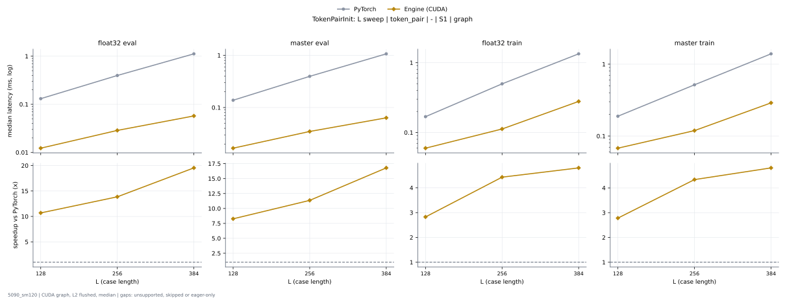

# TokenPairInit on 5090_sm120

Generated by `python -m foldjet_engine.measure.plot` from speed tokens `judge/tokens/5090_sm120/`; do not edit.

### L sweep: token_pair | - | S1 | graph

**float32 eval** (median ms; x = speedup vs PyTorch)

| L | PyTorch | Engine (Triton) | Engine (CUDA) |
|---|---|---|---|
| 128 | 0.131 | 0.01635 (8.01x) | 0.01226 (10.69x) |
| 256 | 0.3973 | 0.02866 (13.86x) | 0.02867 (13.86x) |
| 384 | 1.121 | 0.0535 (20.94x) | 0.05734 (19.54x) |

**master eval** (median ms; x = speedup vs PyTorch)

| L | PyTorch | Engine (Triton) | Engine (CUDA) |
|---|---|---|---|
| 128 | 0.1378 | 0.02251 (6.12x) | 0.01667 (8.27x) |
| 256 | 0.3953 | 0.03267 (12.10x) | 0.03482 (11.35x) |
| 384 | 1.066 | 0.05952 (17.91x) | 0.06349 (16.79x) |

**float32 train** (median ms; x = speedup vs PyTorch)

| L | PyTorch | Engine (Triton) | Engine (CUDA) |
|---|---|---|---|
| 128 | 0.1686 | 0.06989 (2.41x) | 0.05968 (2.82x) |
| 256 | 0.4977 | 0.1734 (2.87x) | 0.1124 (4.43x) |
| 384 | 1.339 | 0.3574 (3.75x) | 0.2788 (4.80x) |

**master train** (median ms; x = speedup vs PyTorch)

| L | PyTorch | Engine (Triton) | Engine (CUDA) |
|---|---|---|---|
| 128 | 0.1887 | 0.07782 (2.42x) | 0.06784 (2.78x) |
| 256 | 0.5161 | 0.1802 (2.86x) | 0.119 (4.34x) |
| 384 | 1.392 | 0.3706 (3.76x) | 0.2895 (4.81x) |

