# Transition on 5090_sm120

Generated by `python -m miniworld_engine.measure.plot` from speed tokens `judge/tokens/5090_sm120/`; do not edit.

### L sweep: msa_token | d_hidden=128;n=4 | D1024 | S1 | graph

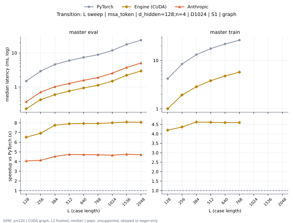

**master eval** (median ms; x = speedup vs PyTorch)

| L | PyTorch | Engine (Triton) | Engine (CUDA) | Anthropic |
|---|---|---|---|---|
| 128 | 1.483 | 0.3284 (4.52x) | 0.2273 (6.52x) | 0.3645 (4.07x) |
| 256 | 2.908 | 0.6943 (4.19x) | 0.4199 (6.93x) | 0.7035 (4.13x) |
| 384 | 4.583 | 1.012 (4.53x) | 0.5902 (7.77x) | 1.012 (4.53x) |
| 512 | 5.97 | 1.32 (4.52x) | 0.755 (7.91x) | 1.26 (4.74x) |
| 640 | 7.391 | 1.659 (4.45x) | 0.931 (7.94x) | 1.566 (4.72x) |
| 768 | 8.87 | 2.007 (4.42x) | 1.117 (7.94x) | 1.885 (4.71x) |
| 1024 | 11.84 | 2.693 (4.40x) | 1.479 (8.01x) | 2.543 (4.66x) |
| 1536 | 17.79 | 4.107 (4.33x) | 2.199 (8.09x) | 3.739 (4.76x) |
| 2048 | 23.72 | 5.494 (4.32x) | 2.943 (8.06x) | 5.042 (4.70x) |

**master train** (median ms; x = speedup vs PyTorch)

| L | PyTorch | Engine (Triton) | Engine (CUDA) | Anthropic |
|---|---|---|---|---|
| 128 | 4.199 | 1.629 (2.58x) | 1.001 (4.19x) | unsupported |
| 256 | 8.411 | 3.247 (2.59x) | 1.928 (4.36x) | unsupported |
| 384 | 13.19 | 4.921 (2.68x) | 2.851 (4.62x) | unsupported |
| 512 | 17.53 | 6.527 (2.69x) | 3.804 (4.61x) | unsupported |
| 640 | 21.88 | 8.119 (2.70x) | 4.764 (4.59x) | unsupported |
| 768 | 26.23 | 9.76 (2.69x) | 5.711 (4.59x) | unsupported |
| 1024 |  |  |  |  |
| 1536 |  |  |  |  |
| 2048 |  |  |  |  |

### L sweep: msa_token | d_hidden=256;n=4 | D1024 | S1 | graph

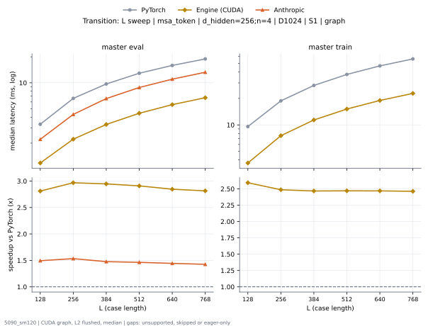

**master eval** (median ms; x = speedup vs PyTorch)

| L | PyTorch | Engine (Triton) | Engine (CUDA) | Anthropic |
|---|---|---|---|---|
| 128 | 3.31 | 1.08 (3.06x) | 1.178 (2.81x) | 2.215 (1.49x) |
| 256 | 6.598 | 2.125 (3.11x) | 2.223 (2.97x) | 4.304 (1.53x) |
| 384 | 9.694 | 3.248 (2.99x) | 3.291 (2.95x) | 6.567 (1.48x) |
| 512 | 12.91 | 4.37 (2.95x) | 4.438 (2.91x) | 8.823 (1.46x) |
| 640 | 15.9 | 5.468 (2.91x) | 5.587 (2.85x) | 11.02 (1.44x) |
| 768 | 18.9 | 6.569 (2.88x) | 6.716 (2.81x) | 13.26 (1.43x) |

**master train** (median ms; x = speedup vs PyTorch)

| L | PyTorch | Engine (Triton) | Engine (CUDA) | Anthropic |
|---|---|---|---|---|
| 128 | 9.58 | 3.709 (2.58x) | 3.694 (2.59x) | unsupported |
| 256 | 18.75 | 7.437 (2.52x) | 7.542 (2.49x) | unsupported |
| 384 | 28.07 | 11.14 (2.52x) | 11.38 (2.47x) | unsupported |
| 512 | 37.42 | 14.88 (2.51x) | 15.15 (2.47x) | unsupported |
| 640 | 46.8 | 18.66 (2.51x) | 18.95 (2.47x) | unsupported |
| 768 | 56.13 | 22.35 (2.51x) | 22.79 (2.46x) | unsupported |

### L sweep: msa_token | d_hidden=64;n=4 | D384 | S1 | graph

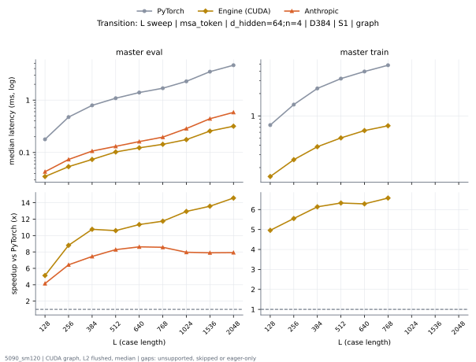

**master eval** (median ms; x = speedup vs PyTorch)

| L | PyTorch | Engine (Triton) | Engine (CUDA) | Anthropic |
|---|---|---|---|---|
| 128 | 0.1784 | 0.05325 (3.35x) | 0.03482 (5.13x) | 0.04301 (4.15x) |
| 256 | 0.4739 | 0.08397 (5.64x) | 0.05379 (8.81x) | 0.0737 (6.43x) |
| 384 | 0.7934 | 0.1249 (6.35x) | 0.07373 (10.76x) | 0.1065 (7.45x) |
| 512 | 1.085 | 0.1884 (5.76x) | 0.1024 (10.60x) | 0.1311 (8.28x) |
| 640 | 1.394 | 0.2345 (5.94x) | 0.1229 (11.34x) | 0.1616 (8.62x) |
| 768 | 1.685 | 0.2888 (5.83x) | 0.1434 (11.75x) | 0.1966 (8.57x) |
| 1024 | 2.279 | 0.4096 (5.56x) | 0.1761 (12.94x) | 0.2863 (7.96x) |
| 1536 | 3.485 | 0.6151 (5.67x) | 0.2567 (13.58x) | 0.4413 (7.90x) |
| 2048 | 4.624 | 0.8336 (5.55x) | 0.3174 (14.57x) | 0.5837 (7.92x) |

**master train** (median ms; x = speedup vs PyTorch)

| L | PyTorch | Engine (Triton) | Engine (CUDA) | Anthropic |
|---|---|---|---|---|
| 128 | 0.7516 | 0.2295 (3.28x) | 0.1516 (4.96x) | unsupported |
| 256 | 1.421 | 0.6011 (2.36x) | 0.256 (5.55x) | unsupported |
| 384 | 2.35 | 0.7797 (3.01x) | 0.3829 (6.14x) | unsupported |
| 512 | 3.188 | 1.081 (2.95x) | 0.5038 (6.33x) | unsupported |
| 640 | 3.977 | 1.325 (3.00x) | 0.6328 (6.29x) | unsupported |
| 768 | 4.835 | 1.541 (3.14x) | 0.7352 (6.58x) | unsupported |
| 1024 |  |  |  |  |
| 1536 |  |  |  |  |
| 2048 |  |  |  |  |

### L sweep: token_pair | d_hidden=128;n=2 | S1 | graph

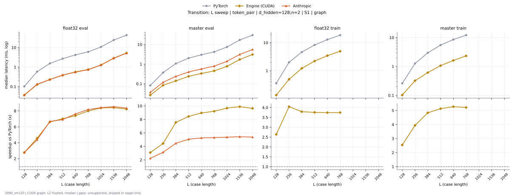

**float32 eval** (median ms; x = speedup vs PyTorch)

| L | PyTorch | Engine (Triton) | Engine (CUDA) | Anthropic |
|---|---|---|---|---|
| 128 | 0.1024 | 0.05325 (1.92x) | 0.03683 (2.78x) | 0.0369 (2.77x) |
| 256 | 0.5816 | 0.2007 (2.90x) | 0.1273 (4.57x) | 0.1331 (4.37x) |
| 384 | 1.532 | 0.4884 (3.14x) | 0.2317 (6.61x) | 0.2294 (6.68x) |
| 512 | 2.696 | 0.8438 (3.20x) | 0.3843 (7.02x) | 0.39 (6.91x) |
| 640 | 4.198 | 1.31 (3.21x) | 0.5673 (7.40x) | 0.5509 (7.62x) |
| 768 | 6.006 | 1.881 (3.19x) | 0.7518 (7.99x) | 0.7346 (8.18x) |
| 1024 | 10.69 | 3.39 (3.15x) | 1.276 (8.37x) | 1.271 (8.41x) |
| 1536 | 24.16 | 7.774 (3.11x) | 2.874 (8.41x) | 2.832 (8.53x) |
| 2048 | 43.03 | 13.92 (3.09x) | 5.233 (8.22x) | 5.146 (8.36x) |

**master eval** (median ms; x = speedup vs PyTorch)

| L | PyTorch | Engine (Triton) | Engine (CUDA) | Anthropic |
|---|---|---|---|---|
| 128 | 0.08218 | 0.03482 (2.36x) | 0.02659 (3.09x) | 0.03686 (2.23x) |
| 256 | 0.3721 | 0.1024 (3.63x) | 0.08397 (4.43x) | 0.1188 (3.13x) |
| 384 | 1.069 | 0.2355 (4.54x) | 0.1413 (7.56x) | 0.2396 (4.46x) |
| 512 | 2.023 | 0.4301 (4.70x) | 0.2396 (8.44x) | 0.3994 (5.07x) |
| 640 | 2.992 | 0.6499 (4.60x) | 0.3338 (8.96x) | 0.5693 (5.26x) |
| 768 | 4.188 | 0.9339 (4.48x) | 0.4548 (9.21x) | 0.7895 (5.30x) |
| 1024 | 7.457 | 1.679 (4.44x) | 0.7704 (9.68x) | 1.39 (5.36x) |
| 1536 | 16.94 | 3.86 (4.39x) | 1.713 (9.89x) | 3.114 (5.44x) |
| 2048 | 29.79 | 6.941 (4.29x) | 3.091 (9.64x) | 5.541 (5.38x) |

**float32 train** (median ms; x = speedup vs PyTorch)

| L | PyTorch | Engine (Triton) | Engine (CUDA) | Anthropic |
|---|---|---|---|---|
| 128 | 0.3563 | 0.1802 (1.98x) | 0.1352 (2.64x) | unsupported |
| 256 | 2.003 | 0.7335 (2.73x) | 0.4952 (4.05x) | unsupported |
| 384 | 4.624 | 1.698 (2.72x) | 1.22 (3.79x) | unsupported |
| 512 | 8.282 | 3.017 (2.74x) | 2.205 (3.76x) | unsupported |
| 640 | 12.91 | 4.718 (2.74x) | 3.449 (3.74x) | unsupported |
| 768 | 18.6 | 6.804 (2.73x) | 4.964 (3.75x) | unsupported |
| 1024 |  |  |  |  |
| 1536 |  |  |  |  |
| 2048 |  |  |  |  |

**master train** (median ms; x = speedup vs PyTorch)

| L | PyTorch | Engine (Triton) | Engine (CUDA) | Anthropic |
|---|---|---|---|---|
| 128 | 0.2604 | 0.1024 (2.54x) | 0.1024 (2.54x) | unsupported |
| 256 | 1.266 | 0.484 (2.62x) | 0.3215 (3.94x) | unsupported |
| 384 | 2.967 | 0.9277 (3.20x) | 0.6134 (4.84x) | unsupported |
| 512 | 5.49 | 1.668 (3.29x) | 1.07 (5.13x) | unsupported |
| 640 | 8.524 | 2.779 (3.07x) | 1.617 (5.27x) | unsupported |
| 768 | 12.13 | 4.047 (3.00x) | 2.326 (5.21x) | unsupported |
| 1024 |  |  |  |  |
| 1536 |  |  |  |  |
| 2048 |  |  |  |  |

### L sweep: token_pair | d_hidden=128;n=4 | S1 | graph

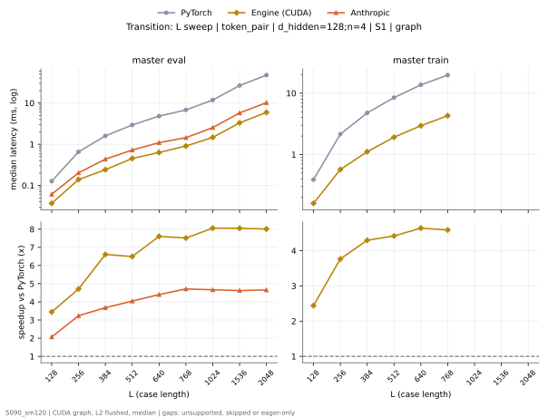

**master eval** (median ms; x = speedup vs PyTorch)

| L | PyTorch | Engine (Triton) | Engine (CUDA) | Anthropic |
|---|---|---|---|---|
| 128 | 0.127 | 0.0495 (2.56x) | 0.03686 (3.44x) | 0.06144 (2.07x) |
| 256 | 0.6564 | 0.1638 (4.01x) | 0.1395 (4.71x) | 0.2028 (3.24x) |
| 384 | 1.597 | 0.4098 (3.90x) | 0.2417 (6.61x) | 0.4342 (3.68x) |
| 512 | 2.939 | 0.7025 (4.18x) | 0.4526 (6.49x) | 0.727 (4.04x) |
| 640 | 4.813 | 1.052 (4.58x) | 0.6328 (7.61x) | 1.094 (4.40x) |
| 768 | 6.815 | 1.494 (4.56x) | 0.9072 (7.51x) | 1.447 (4.71x) |
| 1024 | 11.84 | 2.691 (4.40x) | 1.469 (8.06x) | 2.539 (4.66x) |
| 1536 | 26.59 | 6.193 (4.29x) | 3.303 (8.05x) | 5.755 (4.62x) |
| 2048 | 47.55 | 11.17 (4.26x) | 5.938 (8.01x) | 10.22 (4.65x) |

**master train** (median ms; x = speedup vs PyTorch)

| L | PyTorch | Engine (Triton) | Engine (CUDA) | Anthropic |
|---|---|---|---|---|
| 128 | 0.3899 | 0.1618 (2.41x) | 0.1598 (2.44x) | unsupported |
| 256 | 2.144 | 0.8722 (2.46x) | 0.5693 (3.77x) | unsupported |
| 384 | 4.767 | 1.848 (2.58x) | 1.11 (4.29x) | unsupported |
| 512 | 8.468 | 3.24 (2.61x) | 1.917 (4.42x) | unsupported |
| 640 | 13.69 | 5.087 (2.69x) | 2.95 (4.64x) | unsupported |
| 768 | 19.71 | 7.322 (2.69x) | 4.297 (4.59x) | unsupported |
| 1024 |  |  |  |  |
| 1536 |  |  |  |  |
| 2048 |  |  |  |  |

### L sweep: token_pair | d_hidden=256;n=2 | S1 | graph

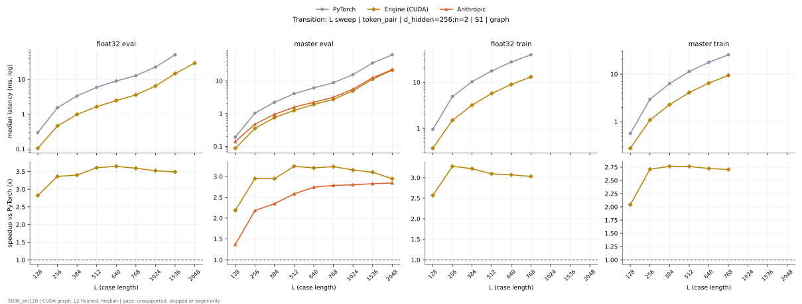

**float32 eval** (median ms; x = speedup vs PyTorch)

| L | PyTorch | Engine (Triton) | Engine (CUDA) | Anthropic |
|---|---|---|---|---|
| 128 | 0.2949 | 0.1659 (1.78x) | 0.1045 (2.82x) | unsupported |
| 256 | 1.539 | 0.6532 (2.36x) | 0.4577 (3.36x) | unsupported |
| 384 | 3.346 | 1.367 (2.45x) | 0.9844 (3.40x) | unsupported |
| 512 | 5.914 | 2.355 (2.51x) | 1.639 (3.61x) | unsupported |
| 640 | 9.024 | 3.656 (2.47x) | 2.474 (3.65x) | unsupported |
| 768 | 12.92 | 5.341 (2.42x) | 3.596 (3.59x) | unsupported |
| 1024 | 22.81 | 9.54 (2.39x) | 6.475 (3.52x) | unsupported |
| 1536 | 51.41 | 21.54 (2.39x) | 14.74 (3.49x) | unsupported |
| 2048 | skipped | 38.49 | 29.71 | unsupported |

**master eval** (median ms; x = speedup vs PyTorch)

| L | PyTorch | Engine (Triton) | Engine (CUDA) | Anthropic |
|---|---|---|---|---|
| 128 | 0.1905 | 0.09011 (2.11x) | 0.0872 (2.18x) | 0.1392 (1.37x) |
| 256 | 1.032 | 0.3455 (2.99x) | 0.3502 (2.95x) | 0.4735 (2.18x) |
| 384 | 2.225 | 0.7052 (3.16x) | 0.7557 (2.94x) | 0.9482 (2.35x) |
| 512 | 4.037 | 1.184 (3.41x) | 1.245 (3.24x) | 1.564 (2.58x) |
| 640 | 6.052 | 1.807 (3.35x) | 1.889 (3.20x) | 2.209 (2.74x) |
| 768 | 8.741 | 2.622 (3.33x) | 2.703 (3.23x) | 3.14 (2.78x) |
| 1024 | 15.47 | 4.766 (3.25x) | 4.907 (3.15x) | 5.529 (2.80x) |
| 1536 | 34.92 | 10.8 (3.23x) | 11.26 (3.10x) | 12.36 (2.82x) |
| 2048 | 62.19 | 19.23 (3.23x) | 21.12 (2.94x) | 21.89 (2.84x) |

**float32 train** (median ms; x = speedup vs PyTorch)

| L | PyTorch | Engine (Triton) | Engine (CUDA) | Anthropic |
|---|---|---|---|---|
| 128 | 0.9482 | 0.516 (1.84x) | 0.3692 (2.57x) | unsupported |
| 256 | 4.895 | 2.057 (2.38x) | 1.494 (3.28x) | unsupported |
| 384 | 10.26 | 4.351 (2.36x) | 3.189 (3.22x) | unsupported |
| 512 | 17.67 | 7.827 (2.26x) | 5.712 (3.09x) | unsupported |
| 640 | 27.53 | 12.36 (2.23x) | 8.972 (3.07x) | unsupported |
| 768 | 39.51 | 17.48 (2.26x) | 13.03 (3.03x) | unsupported |
| 1024 |  |  |  |  |
| 1536 |  |  |  |  |
| 2048 |  |  |  |  |

**master train** (median ms; x = speedup vs PyTorch)

| L | PyTorch | Engine (Triton) | Engine (CUDA) | Anthropic |
|---|---|---|---|---|
| 128 | 0.5683 | 0.303 (1.88x) | 0.2786 (2.04x) | unsupported |
| 256 | 2.945 | 1.116 (2.64x) | 1.087 (2.71x) | unsupported |
| 384 | 6.314 | 2.2 (2.87x) | 2.283 (2.77x) | unsupported |
| 512 | 11.3 | 4.023 (2.81x) | 4.09 (2.76x) | unsupported |
| 640 | 17.61 | 6.269 (2.81x) | 6.464 (2.72x) | unsupported |
| 768 | 25.34 | 9.125 (2.78x) | 9.365 (2.71x) | unsupported |
| 1024 |  |  |  |  |
| 1536 |  |  |  |  |
| 2048 |  |  |  |  |

### L sweep: token_pair | d_hidden=256;n=4 | S1 | graph

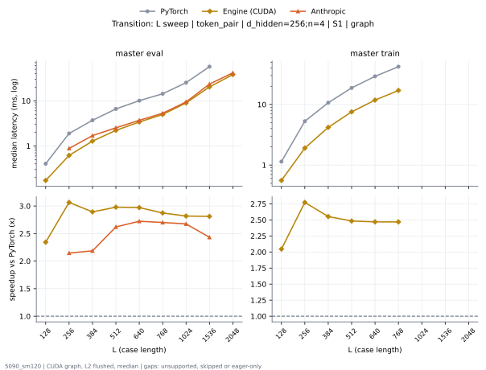

**master eval** (median ms; x = speedup vs PyTorch)

| L | PyTorch | Engine (Triton) | Engine (CUDA) | Anthropic |
|---|---|---|---|---|
| 128 | 0.4032 | 0.1802 (2.24x) | 0.172 (2.34x) | unsupported |
| 256 | 1.89 | 0.5847 (3.23x) | 0.6165 (3.07x) | 0.8806 (2.15x) |
| 384 | 3.7 | 1.217 (3.04x) | 1.279 (2.89x) | 1.693 (2.19x) |
| 512 | 6.604 | 2.121 (3.11x) | 2.217 (2.98x) | 2.52 (2.62x) |
| 640 | 10.07 | 3.405 (2.96x) | 3.388 (2.97x) | 3.697 (2.72x) |
| 768 | 14.32 | 4.918 (2.91x) | 4.982 (2.87x) | 5.301 (2.70x) |
| 1024 | 25.24 | 8.768 (2.88x) | 8.957 (2.82x) | 9.434 (2.68x) |
| 1536 | 57.04 | 19.79 (2.88x) | 20.29 (2.81x) | 23.45 (2.43x) |
| 2048 | skipped | 35.27 | 38.11 | 41.64 |

**master train** (median ms; x = speedup vs PyTorch)

| L | PyTorch | Engine (Triton) | Engine (CUDA) | Anthropic |
|---|---|---|---|---|
| 128 | 1.14 | 0.5689 (2.00x) | 0.5571 (2.05x) | unsupported |
| 256 | 5.283 | 1.943 (2.72x) | 1.906 (2.77x) | unsupported |
| 384 | 10.69 | 4.151 (2.58x) | 4.189 (2.55x) | unsupported |
| 512 | 18.77 | 7.456 (2.52x) | 7.559 (2.48x) | unsupported |
| 640 | 29.17 | 11.59 (2.52x) | 11.81 (2.47x) | unsupported |
| 768 | 42.11 | 16.79 (2.51x) | 17.06 (2.47x) | unsupported |
| 1024 |  |  |  |  |
| 1536 |  |  |  |  |
| 2048 |  |  |  |  |

### L sweep: token_pair | d_hidden=384;n=2 | S1 | graph

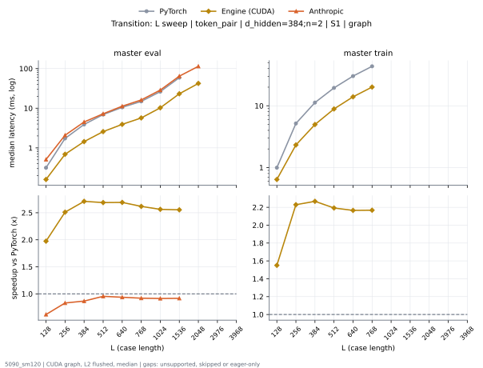

**master eval** (median ms; x = speedup vs PyTorch)

| L | PyTorch | Engine (Triton) | Engine (CUDA) | Anthropic |
|---|---|---|---|---|
| 128 | 0.3154 | 0.1679 (1.88x) | 0.1597 (1.97x) | 0.5099 (0.62x) |
| 256 | 1.732 | 0.683 (2.54x) | 0.6897 (2.51x) | 2.084 (0.83x) |
| 384 | 3.903 | 1.377 (2.83x) | 1.44 (2.71x) | 4.506 (0.87x) |
| 512 | 6.92 | 2.431 (2.85x) | 2.574 (2.69x) | 7.248 (0.95x) |
| 640 | 10.55 | 3.916 (2.69x) | 3.919 (2.69x) | 11.25 (0.94x) |
| 768 | 14.89 | 5.56 (2.68x) | 5.69 (2.62x) | 16.19 (0.92x) |
| 1024 | 26.27 | 9.913 (2.65x) | 10.25 (2.56x) | 28.73 (0.91x) |
| 1536 | 59.13 | 22.31 (2.65x) | 23.15 (2.55x) | 64.46 (0.92x) |
| 2048 | skipped | 39.67 | 42.24 | 114.2 |
| 2976 | skipped | skipped | skipped | skipped |
| 3968 | skipped | skipped | skipped | skipped |

**master train** (median ms; x = speedup vs PyTorch)

| L | PyTorch | Engine (Triton) | Engine (CUDA) | Anthropic |
|---|---|---|---|---|
| 128 | 0.9939 | 0.6641 (1.50x) | 0.6411 (1.55x) | unsupported |
| 256 | 5.171 | 2.225 (2.32x) | 2.319 (2.23x) | unsupported |
| 384 | 11.27 | 4.913 (2.29x) | 4.97 (2.27x) | unsupported |
| 512 | 19.48 | 8.797 (2.21x) | 8.883 (2.19x) | unsupported |
| 640 | 30.25 | 13.61 (2.22x) | 13.97 (2.17x) | unsupported |
| 768 | 43.56 | 19.69 (2.21x) | 20.09 (2.17x) | unsupported |
| 1024 |  |  |  |  |
| 1536 |  |  |  |  |
| 2048 |  |  |  |  |
| 2976 |  |  |  |  |
| 3968 |  |  |  |  |

### L sweep: token_pair | d_hidden=384;n=4 | S1 | graph

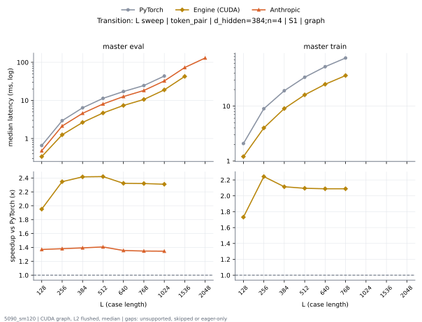

**master eval** (median ms; x = speedup vs PyTorch)

| L | PyTorch | Engine (Triton) | Engine (CUDA) | Anthropic |
|---|---|---|---|---|
| 128 | 0.6554 | 0.34 (1.93x) | 0.3359 (1.95x) | 0.4782 (1.37x) |
| 256 | 2.945 | 1.172 (2.51x) | 1.255 (2.35x) | 2.131 (1.38x) |
| 384 | 6.401 | 2.56 (2.50x) | 2.649 (2.42x) | 4.594 (1.39x) |
| 512 | 11.35 | 4.614 (2.46x) | 4.689 (2.42x) | 8.067 (1.41x) |
| 640 | 17.14 | 7.191 (2.38x) | 7.376 (2.32x) | 12.64 (1.36x) |
| 768 | 24.61 | 12.04 (2.04x) | 10.61 (2.32x) | 18.26 (1.35x) |
| 1024 | 43.68 | 21.24 (2.06x) | 18.91 (2.31x) | 32.46 (1.35x) |
| 1536 | skipped | 47.82 | 42.69 | 73.05 |
| 2048 | skipped | 85.06 | skipped | 129.9 |

**master train** (median ms; x = speedup vs PyTorch)

| L | PyTorch | Engine (Triton) | Engine (CUDA) | Anthropic |
|---|---|---|---|---|
| 128 | 2.082 | 1.207 (1.72x) | 1.202 (1.73x) | unsupported |
| 256 | 8.977 | 4.018 (2.23x) | 4.003 (2.24x) | unsupported |
| 384 | 19.1 | 8.864 (2.15x) | 9.033 (2.11x) | unsupported |
| 512 | 33.64 | 15.8 (2.13x) | 16.06 (2.10x) | unsupported |
| 640 | 52.33 | 25.76 (2.03x) | 25.05 (2.09x) | unsupported |
| 768 | 75.4 | 36.81 (2.05x) | 36.1 (2.09x) | unsupported |
| 1024 |  |  |  |  |
| 1536 |  |  |  |  |
| 2048 |  |  |  |  |

### L sweep: token_pair | d_hidden=512;n=2 | S1 | graph

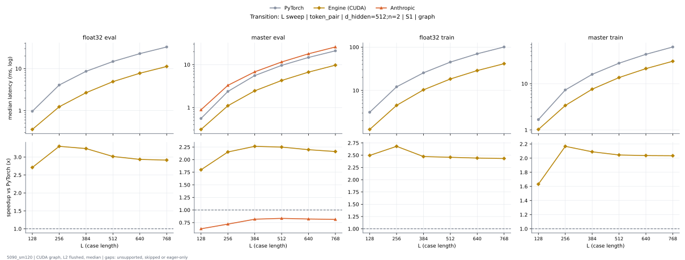

**float32 eval** (median ms; x = speedup vs PyTorch)

| L | PyTorch | Engine (Triton) | Engine (CUDA) | Anthropic |
|---|---|---|---|---|
| 128 | 0.9631 | 0.6021 (1.60x) | 0.3553 (2.71x) | unsupported |
| 256 | 4.066 | 2.176 (1.87x) | 1.232 (3.30x) | unsupported |
| 384 | 8.632 | 4.667 (1.85x) | 2.666 (3.24x) | unsupported |
| 512 | 14.78 | 8.293 (1.78x) | 4.9 (3.02x) | unsupported |
| 640 | 22.79 | 12.98 (1.76x) | 7.763 (2.94x) | unsupported |
| 768 | 32.82 | 18.71 (1.75x) | 11.25 (2.92x) | unsupported |

**master eval** (median ms; x = speedup vs PyTorch)

| L | PyTorch | Engine (Triton) | Engine (CUDA) | Anthropic |
|---|---|---|---|---|
| 128 | 0.5562 | 0.3174 (1.75x) | 0.3093 (1.80x) | 0.8861 (0.63x) |
| 256 | 2.371 | 1.094 (2.17x) | 1.102 (2.15x) | 3.29 (0.72x) |
| 384 | 5.553 | 2.325 (2.39x) | 2.453 (2.26x) | 6.791 (0.82x) |
| 512 | 9.606 | 4.189 (2.29x) | 4.272 (2.25x) | 11.51 (0.83x) |
| 640 | 14.68 | 6.548 (2.24x) | 6.684 (2.20x) | 17.87 (0.82x) |
| 768 | 20.96 | 9.428 (2.22x) | 9.701 (2.16x) | 25.74 (0.81x) |

**float32 train** (median ms; x = speedup vs PyTorch)

| L | PyTorch | Engine (Triton) | Engine (CUDA) | Anthropic |
|---|---|---|---|---|
| 128 | 3.137 | 2.031 (1.54x) | 1.257 (2.50x) | unsupported |
| 256 | 12.12 | 6.703 (1.81x) | 4.519 (2.68x) | unsupported |
| 384 | 25.51 | 14.56 (1.75x) | 10.32 (2.47x) | unsupported |
| 512 | 45.16 | 25.73 (1.75x) | 18.37 (2.46x) | unsupported |
| 640 | 70.21 | 40.65 (1.73x) | 28.76 (2.44x) | unsupported |
| 768 | 100.8 | 60.38 (1.67x) | 41.45 (2.43x) | unsupported |

**master train** (median ms; x = speedup vs PyTorch)

| L | PyTorch | Engine (Triton) | Engine (CUDA) | Anthropic |
|---|---|---|---|---|
| 128 | 1.676 | 1.032 (1.62x) | 1.027 (1.63x) | unsupported |
| 256 | 7.323 | 3.427 (2.14x) | 3.378 (2.17x) | unsupported |
| 384 | 15.9 | 7.477 (2.13x) | 7.608 (2.09x) | unsupported |
| 512 | 27.72 | 13.2 (2.10x) | 13.55 (2.04x) | unsupported |
| 640 | 43.12 | 20.89 (2.06x) | 21.17 (2.04x) | unsupported |
| 768 | 62.1 | 30.73 (2.02x) | 30.53 (2.03x) | unsupported |

### L sweep: token_pair | d_hidden=512;n=4 | S1 | graph

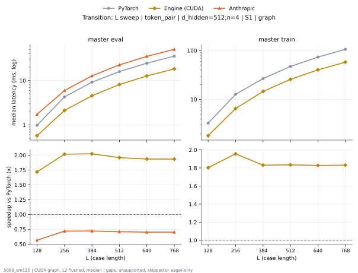

**master eval** (median ms; x = speedup vs PyTorch)

| L | PyTorch | Engine (Triton) | Engine (CUDA) | Anthropic |
|---|---|---|---|---|
| 128 | 0.9844 | 0.5612 (1.75x) | 0.5734 (1.72x) | 1.742 (0.57x) |
| 256 | 4.28 | 1.97 (2.17x) | 2.123 (2.02x) | 5.95 (0.72x) |
| 384 | 9.178 | 4.477 (2.05x) | 4.538 (2.02x) | 12.72 (0.72x) |
| 512 | 15.9 | 7.938 (2.00x) | 8.118 (1.96x) | 22.43 (0.71x) |
| 640 | 24.51 | 13.91 (1.76x) | 12.67 (1.93x) | 34.94 (0.70x) |
| 768 | 35.32 | 17.82 (1.98x) | 18.27 (1.93x) | 50.32 (0.70x) |

**master train** (median ms; x = speedup vs PyTorch)

| L | PyTorch | Engine (Triton) | Engine (CUDA) | Anthropic |
|---|---|---|---|---|
| 128 | 3.255 | 1.895 (1.72x) | 1.806 (1.80x) | unsupported |
| 256 | 12.71 | 6.492 (1.96x) | 6.496 (1.96x) | unsupported |
| 384 | 26.62 | 14.21 (1.87x) | 14.54 (1.83x) | unsupported |
| 512 | 47.19 | 25.59 (1.84x) | 25.73 (1.83x) | unsupported |
| 640 | 73.41 | 40.75 (1.80x) | 40.15 (1.83x) | unsupported |
| 768 | 105.7 | 56.63 (1.87x) | 57.73 (1.83x) | unsupported |

### L sweep: token_pair | d_hidden=64;n=2 | S1 | graph

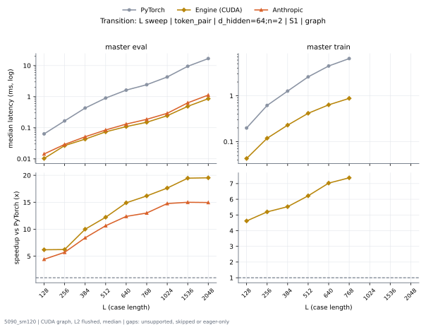

**master eval** (median ms; x = speedup vs PyTorch)

| L | PyTorch | Engine (Triton) | Engine (CUDA) | Anthropic |
|---|---|---|---|---|
| 128 | 0.06339 | 0.02253 (2.81x) | 0.01024 (6.19x) | 0.01434 (4.42x) |
| 256 | 0.1659 | 0.04299 (3.86x) | 0.02662 (6.23x) | 0.02902 (5.72x) |
| 384 | 0.4302 | 0.07782 (5.53x) | 0.04301 (10.00x) | 0.05122 (8.40x) |
| 512 | 0.9012 | 0.1434 (6.29x) | 0.07373 (12.22x) | 0.08462 (10.65x) |
| 640 | 1.622 | 0.2703 (6.00x) | 0.1089 (14.90x) | 0.1311 (12.38x) |
| 768 | 2.424 | 0.425 (5.70x) | 0.1499 (16.18x) | 0.1864 (13.00x) |
| 1024 | 4.297 | 0.7721 (5.57x) | 0.2437 (17.63x) | 0.2911 (14.76x) |
| 1536 | 9.489 | 1.759 (5.39x) | 0.4874 (19.47x) | 0.6328 (14.99x) |
| 2048 | 16.81 | 3.142 (5.35x) | 0.8604 (19.54x) | 1.124 (14.95x) |

**master train** (median ms; x = speedup vs PyTorch)

| L | PyTorch | Engine (Triton) | Engine (CUDA) | Anthropic |
|---|---|---|---|---|
| 128 | 0.1987 | 0.07168 (2.77x) | 0.04301 (4.62x) | unsupported |
| 256 | 0.6171 | 0.1905 (3.24x) | 0.1188 (5.20x) | unsupported |
| 384 | 1.268 | 0.4844 (2.62x) | 0.2293 (5.53x) | unsupported |
| 512 | 2.586 | 0.8594 (3.01x) | 0.4157 (6.22x) | unsupported |
| 640 | 4.465 | 1.351 (3.31x) | 0.635 (7.03x) | unsupported |
| 768 | 6.481 | 1.953 (3.32x) | 0.8796 (7.37x) | unsupported |
| 1024 |  |  |  |  |
| 1536 |  |  |  |  |
| 2048 |  |  |  |  |

### L sweep: token_pair | d_hidden=64;n=4 | S1 | graph

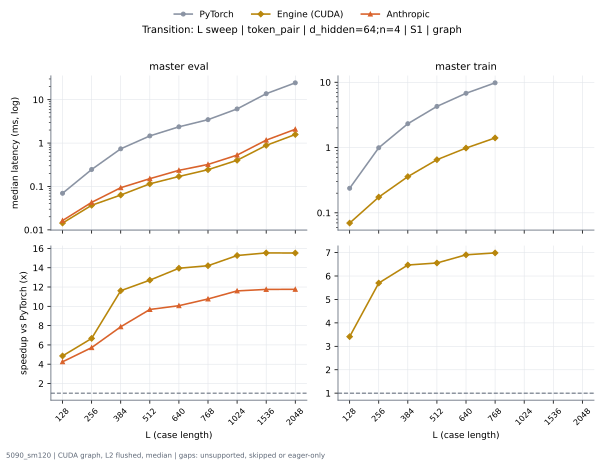

**master eval** (median ms; x = speedup vs PyTorch)

| L | PyTorch | Engine (Triton) | Engine (CUDA) | Anthropic |
|---|---|---|---|---|
| 128 | 0.06963 | 0.02458 (2.83x) | 0.01434 (4.86x) | 0.01638 (4.25x) |
| 256 | 0.246 | 0.0553 (4.45x) | 0.03686 (6.67x) | 0.04301 (5.72x) |
| 384 | 0.7372 | 0.1167 (6.32x) | 0.06346 (11.62x) | 0.09357 (7.88x) |
| 512 | 1.462 | 0.2437 (6.00x) | 0.115 (12.71x) | 0.1512 (9.67x) |
| 640 | 2.371 | 0.4137 (5.73x) | 0.17 (13.95x) | 0.2355 (10.07x) |
| 768 | 3.463 | 0.6164 (5.62x) | 0.2437 (14.21x) | 0.3217 (10.76x) |
| 1024 | 6.128 | 1.121 (5.47x) | 0.4014 (15.27x) | 0.5284 (11.60x) |
| 1536 | 13.74 | 2.55 (5.39x) | 0.8847 (15.53x) | 1.169 (11.75x) |
| 2048 | 24.47 | 4.554 (5.37x) | 1.576 (15.52x) | 2.081 (11.76x) |

**master train** (median ms; x = speedup vs PyTorch)

| L | PyTorch | Engine (Triton) | Engine (CUDA) | Anthropic |
|---|---|---|---|---|
| 128 | 0.2376 | 0.1004 (2.37x) | 0.06963 (3.41x) | unsupported |
| 256 | 0.9923 | 0.3338 (2.97x) | 0.1741 (5.70x) | unsupported |
| 384 | 2.319 | 0.7803 (2.97x) | 0.3584 (6.47x) | unsupported |
| 512 | 4.27 | 1.413 (3.02x) | 0.6513 (6.56x) | unsupported |
| 640 | 6.781 | 2.149 (3.15x) | 0.9819 (6.91x) | unsupported |
| 768 | 9.81 | 3.145 (3.12x) | 1.404 (6.99x) | unsupported |
| 1024 |  |  |  |  |
| 1536 |  |  |  |  |
| 2048 |  |  |  |  |

### L sweep: token_single | d_hidden=384;n=2 | S1 | graph

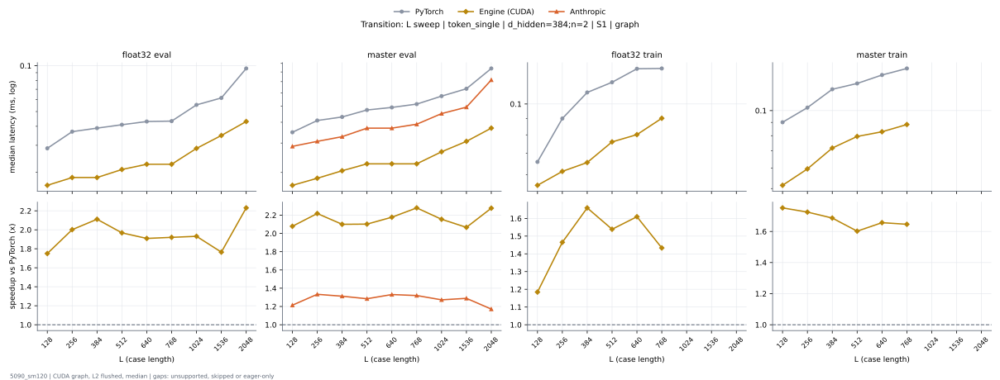

**float32 eval** (median ms; x = speedup vs PyTorch)

| L | PyTorch | Engine (Triton) | Engine (CUDA) | Anthropic |
|---|---|---|---|---|
| 128 | 0.02867 | 0.02867 (1.00x) | 0.01638 (1.75x) | unsupported |
| 256 | 0.0369 | 0.03277 (1.13x) | 0.01843 (2.00x) | unsupported |
| 384 | 0.03891 | 0.03277 (1.19x) | 0.01843 (2.11x) | unsupported |
| 512 | 0.04096 | 0.03371 (1.21x) | 0.02082 (1.97x) | unsupported |
| 640 | 0.04301 | 0.03685 (1.17x) | 0.02253 (1.91x) | unsupported |
| 768 | 0.04326 | 0.03698 (1.17x) | 0.02253 (1.92x) | unsupported |
| 1024 | 0.05531 | 0.04915 (1.13x) | 0.02864 (1.93x) | unsupported |
| 1536 | 0.06144 | 0.0512 (1.20x) | 0.03482 (1.76x) | unsupported |
| 2048 | 0.09594 | 0.07392 (1.30x) | 0.04301 (2.23x) | unsupported |

**master eval** (median ms; x = speedup vs PyTorch)

| L | PyTorch | Engine (Triton) | Engine (CUDA) | Anthropic |
|---|---|---|---|---|
| 128 | 0.03482 | 0.02867 (1.21x) | 0.01675 (2.08x) | 0.02867 (1.21x) |
| 256 | 0.04096 | 0.02973 (1.38x) | 0.01846 (2.22x) | 0.03072 (1.33x) |
| 384 | 0.04301 | 0.03058 (1.41x) | 0.02048 (2.10x) | 0.03277 (1.31x) |
| 512 | 0.04736 | 0.03224 (1.47x) | 0.02253 (2.10x) | 0.03686 (1.28x) |
| 640 | 0.04906 | 0.03251 (1.51x) | 0.02253 (2.18x) | 0.03686 (1.33x) |
| 768 | 0.05136 | 0.03277 (1.57x) | 0.02253 (2.28x) | 0.03891 (1.32x) |
| 1024 | 0.05734 | 0.03888 (1.47x) | 0.02661 (2.16x) | 0.04506 (1.27x) |
| 1536 | 0.06349 | 0.04096 (1.55x) | 0.03072 (2.07x) | 0.04925 (1.29x) |
| 2048 | 0.08397 | 0.04915 (1.71x) | 0.03688 (2.28x) | 0.07168 (1.17x) |

**float32 train** (median ms; x = speedup vs PyTorch)

| L | PyTorch | Engine (Triton) | Engine (CUDA) | Anthropic |
|---|---|---|---|---|
| 128 | 0.06579 | 0.07258 (0.91x) | 0.05555 (1.18x) | unsupported |
| 256 | 0.09002 | 0.07782 (1.16x) | 0.06144 (1.47x) | unsupported |
| 384 | 0.1087 | 0.09242 (1.18x) | 0.0655 (1.66x) | unsupported |
| 512 | 0.117 | 0.0983 (1.19x) | 0.07603 (1.54x) | unsupported |
| 640 | 0.129 | 0.1044 (1.23x) | 0.08013 (1.61x) | unsupported |
| 768 | 0.1292 | 0.1088 (1.19x) | 0.09018 (1.43x) | unsupported |
| 1024 |  |  |  |  |
| 1536 |  |  |  |  |
| 2048 |  |  |  |  |

**master train** (median ms; x = speedup vs PyTorch)

| L | PyTorch | Engine (Triton) | Engine (CUDA) | Anthropic |
|---|---|---|---|---|
| 128 | 0.09013 | 0.06952 (1.30x) | 0.05146 (1.75x) | unsupported |
| 256 | 0.1027 | 0.07574 (1.36x) | 0.05954 (1.72x) | unsupported |
| 384 | 0.1209 | 0.08485 (1.42x) | 0.07168 (1.69x) | unsupported |
| 512 | 0.1273 | 0.08611 (1.48x) | 0.07946 (1.60x) | unsupported |
| 640 | 0.1372 | 0.09011 (1.52x) | 0.08283 (1.66x) | unsupported |
| 768 | 0.1454 | 0.09421 (1.54x) | 0.08834 (1.65x) | unsupported |
| 1024 |  |  |  |  |
| 1536 |  |  |  |  |
| 2048 |  |  |  |  |

### L sweep: token_single | d_hidden=384;n=4 | S1 | graph

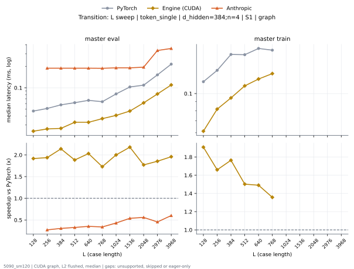

**master eval** (median ms; x = speedup vs PyTorch)

| L | PyTorch | Engine (Triton) | Engine (CUDA) | Anthropic |
|---|---|---|---|---|
| 128 | 0.0471 | 0.03459 (1.36x) | 0.02458 (1.92x) | unsupported |
| 256 | 0.0512 | 0.03478 (1.47x) | 0.02642 (1.94x) | 0.1884 (0.27x) |
| 384 | 0.0576 | 0.03482 (1.65x) | 0.02691 (2.14x) | 0.1884 (0.31x) |
| 512 | 0.06173 | 0.04326 (1.43x) | 0.03277 (1.88x) | 0.1884 (0.33x) |
| 640 | 0.06658 | 0.04301 (1.55x) | 0.03277 (2.03x) | 0.1884 (0.35x) |
| 768 | 0.06374 | 0.04493 (1.42x) | 0.03686 (1.73x) | 0.1878 (0.34x) |
| 1024 | 0.08194 | 0.05526 (1.48x) | 0.04096 (2.00x) | 0.1905 (0.43x) |
| 1536 | 0.1027 | 0.0617 (1.66x) | 0.0471 (2.18x) | 0.1905 (0.54x) |
| 2048 | 0.1088 | 0.07574 (1.44x) | 0.06144 (1.77x) | 0.1946 (0.56x) |
| 2976 | 0.1518 | 0.08806 (1.72x) | 0.08186 (1.85x) | 0.3338 (0.45x) |
| 3968 | 0.2146 | 0.1229 (1.75x) | 0.1096 (1.96x) | 0.3564 (0.60x) |

**master train** (median ms; x = speedup vs PyTorch)

| L | PyTorch | Engine (Triton) | Engine (CUDA) | Anthropic |
|---|---|---|---|---|
| 128 | 0.1168 | 0.08794 (1.33x) | 0.06118 (1.91x) | unsupported |
| 256 | 0.1355 | 0.09626 (1.41x) | 0.08162 (1.66x) | unsupported |
| 384 | 0.1667 | 0.1147 (1.45x) | 0.09448 (1.76x) | unsupported |
| 512 | 0.1661 | 0.1291 (1.29x) | 0.1106 (1.50x) | unsupported |
| 640 | 0.1802 | 0.1371 (1.31x) | 0.1209 (1.49x) | unsupported |
| 768 | 0.1762 | 0.1434 (1.23x) | 0.1298 (1.36x) | unsupported |
| 1024 |  |  |  |  |
| 1536 |  |  |  |  |
| 2048 |  |  |  |  |
| 2976 |  |  |  |  |
| 3968 |  |  |  |  |

### L sweep: token_single | d_hidden=768;n=2 | S1 | graph

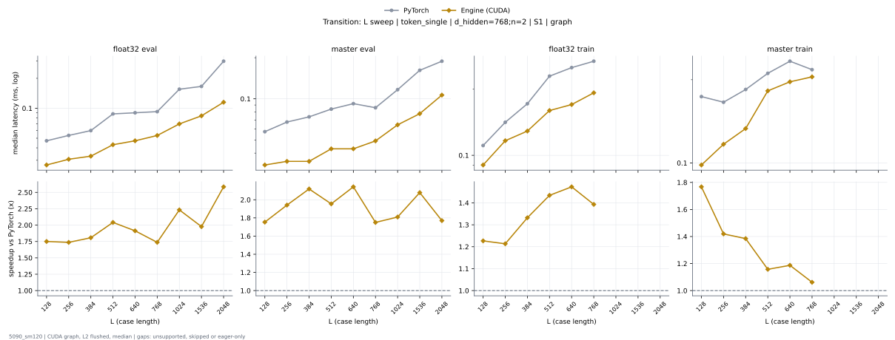

**float32 eval** (median ms; x = speedup vs PyTorch)

| L | PyTorch | Engine (Triton) | Engine (CUDA) | Anthropic |
|---|---|---|---|---|
| 128 | 0.0471 | 0.04915 (0.96x) | 0.02691 (1.75x) | unsupported |
| 256 | 0.05334 | 0.0512 (1.04x) | 0.03072 (1.74x) | unsupported |
| 384 | 0.05965 | 0.0512 (1.17x) | 0.03301 (1.81x) | unsupported |
| 512 | 0.08781 | 0.08206 (1.07x) | 0.04302 (2.04x) | unsupported |
| 640 | 0.0901 | 0.08397 (1.07x) | 0.0471 (1.91x) | unsupported |
| 768 | 0.09251 | 0.08802 (1.05x) | 0.05326 (1.74x) | unsupported |
| 1024 | 0.1554 | 0.131 (1.19x) | 0.06963 (2.23x) | unsupported |
| 1536 | 0.166 | 0.1546 (1.07x) | 0.08397 (1.98x) | unsupported |
| 2048 | 0.2972 | 0.2099 (1.42x) | 0.115 (2.58x) | unsupported |

**master eval** (median ms; x = speedup vs PyTorch)

| L | PyTorch | Engine (Triton) | Engine (CUDA) | Anthropic |
|---|---|---|---|---|
| 128 | 0.05744 | 0.0471 (1.22x) | 0.03275 (1.75x) | failed |
| 256 | 0.06758 | 0.04922 (1.37x) | 0.03482 (1.94x) | failed |
| 384 | 0.07376 | 0.0512 (1.44x) | 0.03482 (2.12x) | failed |
| 512 | 0.08406 | 0.06581 (1.28x) | 0.04301 (1.95x) | failed |
| 640 | 0.09216 | 0.06554 (1.41x) | 0.04302 (2.14x) | failed |
| 768 | 0.08603 | 0.06755 (1.27x) | 0.04915 (1.75x) | failed |
| 1024 | 0.1167 | 0.08842 (1.32x) | 0.06448 (1.81x) | failed |
| 1536 | 0.1618 | 0.1004 (1.61x) | 0.07782 (2.08x) | failed |
| 2048 | 0.1885 | 0.1249 (1.51x) | 0.1065 (1.77x) | failed |

**float32 train** (median ms; x = speedup vs PyTorch)

| L | PyTorch | Engine (Triton) | Engine (CUDA) | Anthropic |
|---|---|---|---|---|
| 128 | 0.1108 | 0.1103 (1.00x) | 0.09037 (1.23x) | unsupported |
| 256 | 0.1414 | 0.129 (1.10x) | 0.1165 (1.21x) | unsupported |
| 384 | 0.1718 | 0.1485 (1.16x) | 0.129 (1.33x) | unsupported |
| 512 | 0.2294 | 0.2153 (1.07x) | 0.16 (1.43x) | unsupported |
| 640 | 0.2509 | 0.2307 (1.09x) | 0.1703 (1.47x) | unsupported |
| 768 | 0.2683 | 0.2437 (1.10x) | 0.1926 (1.39x) | unsupported |
| 1024 |  |  |  |  |
| 1536 |  |  |  |  |
| 2048 |  |  |  |  |

**master train** (median ms; x = speedup vs PyTorch)

| L | PyTorch | Engine (Triton) | Engine (CUDA) | Anthropic |
|---|---|---|---|---|
| 128 | 0.1737 | 0.1247 (1.39x) | 0.0983 (1.77x) | unsupported |
| 256 | 0.1658 | 0.1334 (1.24x) | 0.1168 (1.42x) | unsupported |
| 384 | 0.1844 | 0.1477 (1.25x) | 0.1332 (1.38x) | unsupported |
| 512 | 0.2109 | 0.1912 (1.10x) | 0.1823 (1.16x) | unsupported |
| 640 | 0.2333 | 0.2023 (1.15x) | 0.1965 (1.19x) | unsupported |
| 768 | 0.2174 | 0.2051 (1.06x) | 0.2048 (1.06x) | unsupported |
| 1024 |  |  |  |  |
| 1536 |  |  |  |  |
| 2048 |  |  |  |  |

### d_hidden sweep at L768: token_pair | n=2 | S1 | graph

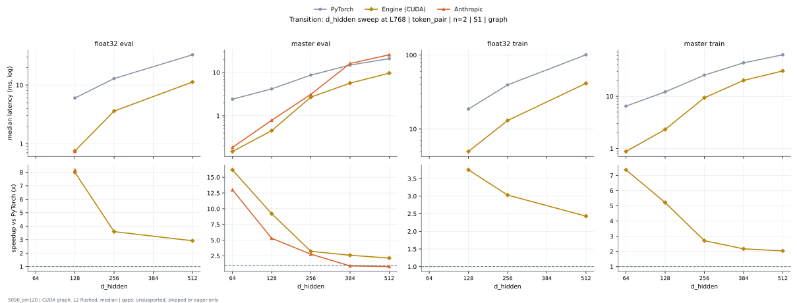

**float32 eval** (median ms; x = speedup vs PyTorch)

| d_hidden | PyTorch | Engine (Triton) | Engine (CUDA) | Anthropic |
|---|---|---|---|---|
| 64 |  |  |  |  |
| 128 | 6.006 | 1.881 (3.19x) | 0.7518 (7.99x) | 0.7346 (8.18x) |
| 256 | 12.92 | 5.341 (2.42x) | 3.596 (3.59x) | unsupported |
| 384 |  |  |  |  |
| 512 | 32.82 | 18.71 (1.75x) | 11.25 (2.92x) | unsupported |

**master eval** (median ms; x = speedup vs PyTorch)

| d_hidden | PyTorch | Engine (Triton) | Engine (CUDA) | Anthropic |
|---|---|---|---|---|
| 64 | 2.424 | 0.425 (5.70x) | 0.1499 (16.18x) | 0.1864 (13.00x) |
| 128 | 4.188 | 0.9339 (4.48x) | 0.4548 (9.21x) | 0.7895 (5.30x) |
| 256 | 8.741 | 2.622 (3.33x) | 2.703 (3.23x) | 3.14 (2.78x) |
| 384 | 14.89 | 5.56 (2.68x) | 5.69 (2.62x) | 16.19 (0.92x) |
| 512 | 20.96 | 9.428 (2.22x) | 9.701 (2.16x) | 25.74 (0.81x) |

**float32 train** (median ms; x = speedup vs PyTorch)

| d_hidden | PyTorch | Engine (Triton) | Engine (CUDA) | Anthropic |
|---|---|---|---|---|
| 64 |  |  |  |  |
| 128 | 18.6 | 6.804 (2.73x) | 4.964 (3.75x) | unsupported |
| 256 | 39.51 | 17.48 (2.26x) | 13.03 (3.03x) | unsupported |
| 384 |  |  |  |  |
| 512 | 100.8 | 60.38 (1.67x) | 41.45 (2.43x) | unsupported |

**master train** (median ms; x = speedup vs PyTorch)

| d_hidden | PyTorch | Engine (Triton) | Engine (CUDA) | Anthropic |
|---|---|---|---|---|
| 64 | 6.481 | 1.953 (3.32x) | 0.8796 (7.37x) | unsupported |
| 128 | 12.13 | 4.047 (3.00x) | 2.326 (5.21x) | unsupported |
| 256 | 25.34 | 9.125 (2.78x) | 9.365 (2.71x) | unsupported |
| 384 | 43.56 | 19.69 (2.21x) | 20.09 (2.17x) | unsupported |
| 512 | 62.1 | 30.73 (2.02x) | 30.53 (2.03x) | unsupported |

### d_hidden sweep at L768: token_pair | n=4 | S1 | graph

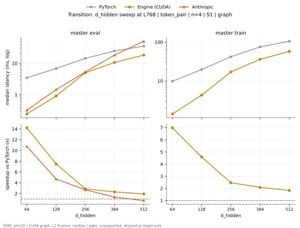

**master eval** (median ms; x = speedup vs PyTorch)

| d_hidden | PyTorch | Engine (Triton) | Engine (CUDA) | Anthropic |
|---|---|---|---|---|
| 64 | 3.463 | 0.6164 (5.62x) | 0.2437 (14.21x) | 0.3217 (10.76x) |
| 128 | 6.815 | 1.494 (4.56x) | 0.9072 (7.51x) | 1.447 (4.71x) |
| 256 | 14.32 | 4.918 (2.91x) | 4.982 (2.87x) | 5.301 (2.70x) |
| 384 | 24.61 | 12.04 (2.04x) | 10.61 (2.32x) | 18.26 (1.35x) |
| 512 | 35.32 | 17.82 (1.98x) | 18.27 (1.93x) | 50.32 (0.70x) |

**master train** (median ms; x = speedup vs PyTorch)

| d_hidden | PyTorch | Engine (Triton) | Engine (CUDA) | Anthropic |
|---|---|---|---|---|
| 64 | 9.81 | 3.145 (3.12x) | 1.404 (6.99x) | unsupported |
| 128 | 19.71 | 7.322 (2.69x) | 4.297 (4.59x) | unsupported |
| 256 | 42.11 | 16.79 (2.51x) | 17.06 (2.47x) | unsupported |
| 384 | 75.4 | 36.81 (2.05x) | 36.1 (2.09x) | unsupported |
| 512 | 105.7 | 56.63 (1.87x) | 57.73 (1.83x) | unsupported |

