# TriangleAttention on 5090_sm120

Generated by `python -m foldjet_engine.measure.plot` from speed tokens `judge/tokens/5090_sm120/`; do not edit.

### L sweep: token_pair | d_pair=128;n_head=4;p_drop=0.25;starting=False;use_self_attention=False | S1 | graph

**master eval** (median ms; x = speedup vs PyTorch)

| L | PyTorch | Engine (Triton) | Engine (CUDA) | Anthropic | cuEquivariance |
|---|---|---|---|---|---|
| 128 | 0.09626 | 0.07387 (1.30x) | 0.06114 (1.57x) | unsupported | unsupported |
| 256 | 0.3402 | 0.2375 (1.43x) | 0.2191 (1.55x) | unsupported | unsupported |
| 384 | 0.882 | 0.6064 (1.45x) | 0.5673 (1.55x) | unsupported | unsupported |
| 512 | 1.896 | 1.233 (1.54x) | 1.017 (1.86x) | unsupported | unsupported |
| 640 | 3.216 | 2.151 (1.49x) | 1.742 (1.85x) | unsupported | unsupported |
| 768 | 4.049 | 2.613 (1.55x) | 1.977 (2.05x) | unsupported | unsupported |

**master train** (median ms; x = speedup vs PyTorch)

| L | PyTorch | Engine (Triton) | Engine (CUDA) | Anthropic | cuEquivariance |
|---|---|---|---|---|---|
| 128 | 0.34 | 0.2398 (1.42x) | 0.2205 (1.54x) | unsupported | unsupported |
| 256 | 1.094 | 0.7527 (1.45x) | 0.6677 (1.64x) | unsupported | unsupported |
| 384 | 2.628 | 2.133 (1.23x) | 1.658 (1.59x) | unsupported | unsupported |
| 512 | 5.112 | 3.91 (1.31x) | 3.218 (1.59x) | unsupported | unsupported |
| 640 | 8.718 | 6.657 (1.31x) | 5.703 (1.53x) | unsupported | unsupported |
| 768 | 11.13 | 8.338 (1.33x) | 6.775 (1.64x) | unsupported | unsupported |

### L sweep: token_pair | d_pair=128;n_head=4;p_drop=0.25;starting=True;use_self_attention=False | S1 | graph

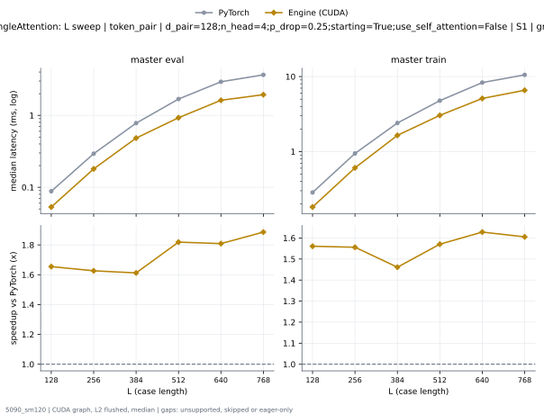

**master eval** (median ms; x = speedup vs PyTorch)

| L | PyTorch | Engine (Triton) | Engine (CUDA) | Anthropic | cuEquivariance |
|---|---|---|---|---|---|
| 128 | 0.0881 | 0.05949 (1.48x) | 0.05325 (1.65x) | unsupported | unsupported |
| 256 | 0.2933 | 0.1884 (1.56x) | 0.1803 (1.63x) | unsupported | unsupported |
| 384 | 0.7793 | 0.5287 (1.47x) | 0.4833 (1.61x) | unsupported | unsupported |
| 512 | 1.687 | 1.07 (1.58x) | 0.9276 (1.82x) | unsupported | unsupported |
| 640 | 2.933 | 1.878 (1.56x) | 1.621 (1.81x) | unsupported | unsupported |
| 768 | 3.66 | 2.211 (1.66x) | 1.94 (1.89x) | unsupported | unsupported |

**master train** (median ms; x = speedup vs PyTorch)

| L | PyTorch | Engine (Triton) | Engine (CUDA) | Anthropic | cuEquivariance |
|---|---|---|---|---|---|
| 128 | 0.2847 | 0.1926 (1.48x) | 0.1824 (1.56x) | unsupported | unsupported |
| 256 | 0.9439 | 0.6839 (1.38x) | 0.6066 (1.56x) | unsupported | unsupported |
| 384 | 2.403 | 2.002 (1.20x) | 1.645 (1.46x) | unsupported | unsupported |
| 512 | 4.772 | 3.638 (1.31x) | 3.038 (1.57x) | unsupported | unsupported |
| 640 | 8.311 | 6.236 (1.33x) | 5.105 (1.63x) | unsupported | unsupported |
| 768 | 10.54 | 7.716 (1.37x) | 6.565 (1.61x) | unsupported | unsupported |

### L sweep: boltz2|openfold3_preview2|protenix | token_pair | d_pair=128;n_head=4;p_drop=0.25;starting=False | S1 | graph

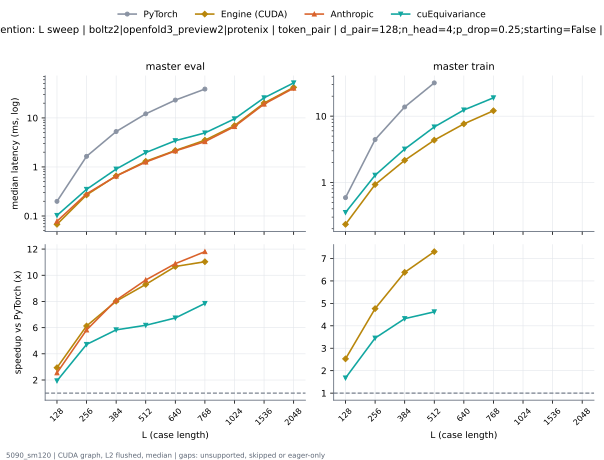

**master eval** (median ms; x = speedup vs PyTorch)

| L | PyTorch | Engine (Triton) | Engine (CUDA) | Anthropic | cuEquivariance |
|---|---|---|---|---|---|
| 128 | 0.1987 | 0.1019 (1.95x) | 0.06755 (2.94x) | 0.07803 (2.55x) | 0.1026 (1.94x) |
| 256 | 1.639 | 0.3533 (4.64x) | 0.2662 (6.16x) | 0.2827 (5.80x) | 0.3489 (4.70x) |
| 384 | 5.262 | 0.934 (5.63x) | 0.6434 (8.18x) | 0.6513 (8.08x) | 0.9042 (5.82x) |
| 512 | 12.11 | 2.05 (5.91x) | 1.192 (10.16x) | 1.258 (9.63x) | 1.962 (6.17x) |
| 640 | 23.09 | 3.546 (6.51x) | 2.047 (11.28x) | 2.123 (10.88x) | 3.43 (6.73x) |
| 768 | 38.73 | 5.11 (7.58x) | 3.182 (12.17x) | 3.284 (11.79x) | 4.94 (7.84x) |
| 1024 | skipped | 10.04 | 6.511 | 6.659 | 9.566 |
| 1536 | skipped | 26.98 | 18.61 | 19.14 | 25.69 |
| 2048 | skipped | 55.42 | 38.66 | 40.46 | 51.84 |

**master train** (median ms; x = speedup vs PyTorch)

| L | PyTorch | Engine (Triton) | Engine (CUDA) | Anthropic | cuEquivariance |
|---|---|---|---|---|---|
| 128 | 0.5893 | 0.34 (1.73x) | 0.2315 (2.55x) | unsupported | 0.3523 (1.67x) |
| 256 | 4.409 | 1.354 (3.26x) | 0.9244 (4.77x) | unsupported | 1.283 (3.44x) |
| 384 | 13.77 | 3.373 (4.08x) | 2.147 (6.41x) | unsupported | 3.186 (4.32x) |
| 512 | 31.74 | 7.239 (4.39x) | 4.324 (7.34x) | unsupported | 6.871 (4.62x) |
| 640 | 60.72 | 12.92 (4.70x) | 7.623 (7.96x) | unsupported | 12.4 (4.90x) |
| 768 | skipped | 19.84 | 12.09 | unsupported | 18.91 |
| 1024 |  |  |  |  |  |
| 1536 |  |  |  |  |  |
| 2048 |  |  |  |  |  |

### L sweep: boltz2|openfold3_preview2|protenix | token_pair | d_pair=128;n_head=4;p_drop=0.25;starting=True | S1 | graph

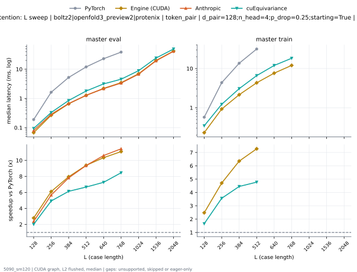

**master eval** (median ms; x = speedup vs PyTorch)

| L | PyTorch | Engine (Triton) | Engine (CUDA) | Anthropic | cuEquivariance |
|---|---|---|---|---|---|
| 128 | 0.1887 | 0.09222 (2.05x) | 0.06758 (2.79x) | 0.07984 (2.36x) | 0.09421 (2.00x) |
| 256 | 1.617 | 0.3338 (4.85x) | 0.2601 (6.22x) | 0.2867 (5.64x) | 0.3297 (4.91x) |
| 384 | 5.204 | 0.8765 (5.94x) | 0.641 (8.12x) | 0.6676 (7.79x) | 0.8502 (6.12x) |
| 512 | 11.96 | 1.882 (6.36x) | 1.199 (9.97x) | 1.278 (9.36x) | 1.793 (6.67x) |
| 640 | 22.81 | 3.281 (6.95x) | 1.992 (11.45x) | 2.153 (10.59x) | 3.145 (7.25x) |
| 768 | 38.35 | 4.719 (8.13x) | 3.129 (12.26x) | 3.354 (11.43x) | 4.539 (8.45x) |
| 1024 | skipped | 9.356 | 6.443 | 6.757 | 8.897 |
| 1536 | skipped | 25.38 | 18.32 | 19.37 | 24.1 |
| 2048 | skipped | 52.48 | 38.74 | 40.93 | 48.93 |

**master train** (median ms; x = speedup vs PyTorch)

| L | PyTorch | Engine (Triton) | Engine (CUDA) | Anthropic | cuEquivariance |
|---|---|---|---|---|---|
| 128 | 0.574 | 0.3349 (1.71x) | 0.2315 (2.48x) | unsupported | 0.3462 (1.66x) |
| 256 | 4.363 | 1.293 (3.37x) | 0.9215 (4.73x) | unsupported | 1.225 (3.56x) |
| 384 | 13.65 | 3.249 (4.20x) | 2.139 (6.38x) | unsupported | 3.069 (4.45x) |
| 512 | 31.5 | 6.971 (4.52x) | 4.31 (7.31x) | unsupported | 6.596 (4.78x) |
| 640 | 60.32 | 12.49 (4.83x) | 7.6 (7.94x) | unsupported | 11.98 (5.04x) |
| 768 | skipped | 19.2 | 12.03 | unsupported | 18.3 |
| 1024 |  |  |  |  |  |
| 1536 |  |  |  |  |  |
| 2048 |  |  |  |  |  |

### L sweep: boltz2|protenix | token_pair | d_hidden=128;d_pair=64;n_head=4;p_drop=0.25;starting=False | S1 | graph

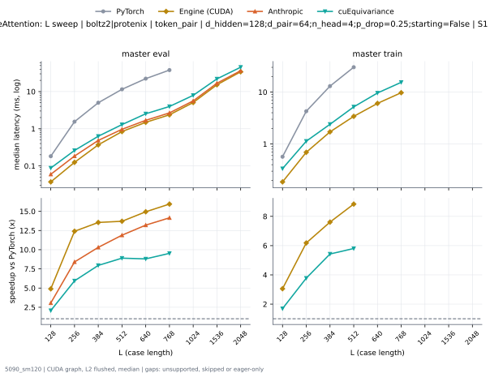

**master eval** (median ms; x = speedup vs PyTorch)

| L | PyTorch | Engine (Triton) | Engine (CUDA) | Anthropic | cuEquivariance |
|---|---|---|---|---|---|
| 128 | 0.1803 | 0.08594 (2.10x) | 0.0369 (4.89x) | 0.05963 (3.02x) | 0.08797 (2.05x) |
| 256 | 1.544 | 0.2661 (5.80x) | 0.1229 (12.57x) | 0.1844 (8.38x) | 0.2608 (5.92x) |
| 384 | 4.98 | 0.6492 (7.67x) | 0.3686 (13.51x) | 0.4854 (10.26x) | 0.6289 (7.92x) |
| 512 | 11.49 | 1.391 (8.26x) | 0.7608 (15.10x) | 0.9677 (11.87x) | 1.293 (8.88x) |
| 640 | 22.22 | 2.66 (8.35x) | 1.356 (16.39x) | 1.685 (13.19x) | 2.528 (8.79x) |
| 768 | 37.75 | 4.171 (9.05x) | 2.156 (17.51x) | 2.67 (14.13x) | 3.968 (9.51x) |
| 1024 | skipped | 8.372 | 4.577 | 5.616 | 7.915 |
| 1536 | skipped | 23.18 | 13.94 | 16.76 | 21.93 |
| 2048 | skipped | 48.75 | 30.95 | 36.37 | 45.17 |

**master train** (median ms; x = speedup vs PyTorch)

| L | PyTorch | Engine (Triton) | Engine (CUDA) | Anthropic | cuEquivariance |
|---|---|---|---|---|---|
| 128 | 0.5697 | 0.322 (1.77x) | 0.1882 (3.03x) | unsupported | 0.3359 (1.70x) |
| 256 | 4.241 | 1.194 (3.55x) | 0.6825 (6.21x) | unsupported | 1.134 (3.74x) |
| 384 | 13.03 | 2.594 (5.02x) | 1.736 (7.51x) | unsupported | 2.401 (5.42x) |
| 512 | 30.1 | 5.583 (5.39x) | 3.468 (8.68x) | unsupported | 5.194 (5.79x) |
| 640 | 57.88 | 10.2 (5.68x) | 6.125 (9.45x) | unsupported | 9.611 (6.02x) |
| 768 | skipped | 16.39 | 9.867 | unsupported | 15.43 |
| 1024 |  |  |  |  |  |
| 1536 |  |  |  |  |  |
| 2048 |  |  |  |  |  |

### L sweep: boltz2|protenix | token_pair | d_hidden=128;d_pair=64;n_head=4;p_drop=0.25;starting=True | S1 | graph

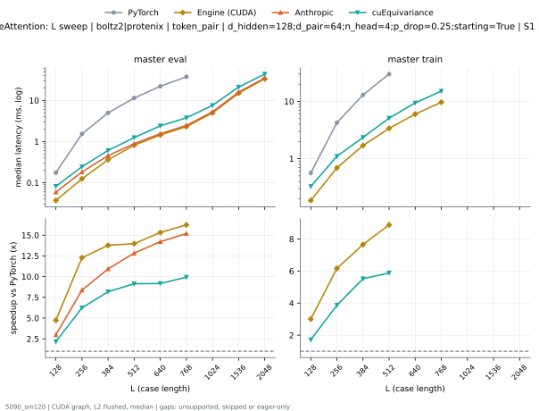

**master eval** (median ms; x = speedup vs PyTorch)

| L | PyTorch | Engine (Triton) | Engine (CUDA) | Anthropic | cuEquivariance |
|---|---|---|---|---|---|
| 128 | 0.1761 | 0.07989 (2.20x) | 0.03688 (4.78x) | 0.05923 (2.97x) | 0.08179 (2.15x) |
| 256 | 1.531 | 0.2519 (6.08x) | 0.1209 (12.66x) | 0.1833 (8.35x) | 0.246 (6.22x) |
| 384 | 4.961 | 0.6267 (7.92x) | 0.3584 (13.84x) | 0.4567 (10.86x) | 0.6101 (8.13x) |
| 512 | 11.42 | 1.342 (8.51x) | 0.7414 (15.41x) | 0.8919 (12.81x) | 1.252 (9.12x) |
| 640 | 22.11 | 2.546 (8.69x) | 1.311 (16.87x) | 1.557 (14.20x) | 2.413 (9.16x) |
| 768 | 37.57 | 3.977 (9.45x) | 2.092 (17.96x) | 2.474 (15.19x) | 3.787 (9.92x) |
| 1024 | skipped | 8.032 | 4.487 | 5.293 | 7.581 |
| 1536 | skipped | 22.4 | 13.75 | 15.97 | 21.16 |
| 2048 | skipped | 47.35 | 30.7 | 34.97 | 43.82 |

**master train** (median ms; x = speedup vs PyTorch)

| L | PyTorch | Engine (Triton) | Engine (CUDA) | Anthropic | cuEquivariance |
|---|---|---|---|---|---|
| 128 | 0.5612 | 0.3134 (1.79x) | 0.1865 (3.01x) | unsupported | 0.3267 (1.72x) |
| 256 | 4.213 | 1.156 (3.64x) | 0.68 (6.20x) | unsupported | 1.099 (3.83x) |
| 384 | 12.98 | 2.546 (5.10x) | 1.722 (7.54x) | unsupported | 2.353 (5.52x) |
| 512 | 30.03 | 5.48 (5.48x) | 3.443 (8.72x) | unsupported | 5.107 (5.88x) |
| 640 | 57.69 | 10 (5.77x) | 6.086 (9.48x) | unsupported | 9.425 (6.12x) |
| 768 | skipped | 16.09 | 9.819 | unsupported | 15.12 |
| 1024 |  |  |  |  |  |
| 1536 |  |  |  |  |  |
| 2048 |  |  |  |  |  |

### L sweep: opendde | token_pair | d_pair=384;n_head=12;p_drop=0.25;starting=False | S1 | graph

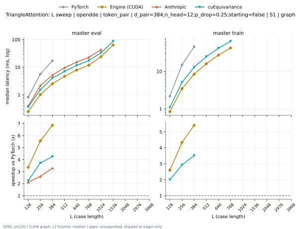

**master eval** (median ms; x = speedup vs PyTorch)

| L | PyTorch | Engine (Triton) | Engine (CUDA) | Anthropic | cuEquivariance |
|---|---|---|---|---|---|
| 128 | 0.8193 | 0.3606 (2.27x) | 0.2458 (3.33x) | 0.3828 (2.14x) | 0.3604 (2.27x) |
| 256 | 5.579 | 1.529 (3.65x) | 1.002 (5.56x) | 2.148 (2.60x) | 1.506 (3.70x) |
| 384 | 17.05 | 3.926 (4.34x) | 2.297 (7.42x) | 5.2 (3.28x) | 4.021 (4.24x) |
| 512 | skipped | 7.188 | 4.42 | 9.534 | 7.022 |
| 640 | skipped | 11.78 | 7.415 | 15.34 | 11.56 |
| 768 | skipped | 17.8 | 11.78 | 22.82 | 17.36 |
| 1024 | skipped | 34.44 | 22.56 | 43.09 | 33.23 |
| 1536 | skipped | 90.55 | skipped | skipped | 87.11 |
| 2048 | skipped | skipped | skipped | skipped | skipped |
| 2976 | skipped | skipped | skipped | skipped | skipped |
| 3968 | skipped | skipped | skipped | skipped | skipped |

**master train** (median ms; x = speedup vs PyTorch)

| L | PyTorch | Engine (Triton) | Engine (CUDA) | Anthropic | cuEquivariance |
|---|---|---|---|---|---|
| 128 | 2.185 | 1.115 (1.96x) | 0.8397 (2.60x) | unsupported | 1.089 (2.01x) |
| 256 | 14.94 | 5.447 (2.74x) | 3.451 (4.33x) | unsupported | 5.106 (2.93x) |
| 384 | 45.37 | 13.75 (3.30x) | 8.414 (5.39x) | unsupported | 12.92 (3.51x) |
| 512 | skipped | 26.22 | 15.99 | unsupported | 24.66 |
| 640 | skipped | 43.95 | 27.11 | unsupported | 41.32 |
| 768 | skipped | 67.5 | 42.05 | unsupported | 63.39 |
| 1024 |  |  |  |  |  |
| 1536 |  |  |  |  |  |
| 2048 |  |  |  |  |  |
| 2976 |  |  |  |  |  |
| 3968 |  |  |  |  |  |

### L sweep: opendde | token_pair | d_pair=384;n_head=12;p_drop=0.25;starting=True | S1 | graph

**master eval** (median ms; x = speedup vs PyTorch)

| L | PyTorch | Engine (Triton) | Engine (CUDA) | Anthropic | cuEquivariance |
|---|---|---|---|---|---|
| 128 | 0.7803 | 0.3727 (2.09x) | 0.2236 (3.49x) | 0.3799 (2.05x) | 0.3711 (2.10x) |
| 256 | 5.55 | 1.458 (3.81x) | 1.006 (5.52x) | 2.018 (2.75x) | 1.434 (3.87x) |
| 384 | 16.75 | 3.551 (4.72x) | 2.182 (7.68x) | 4.9 (3.42x) | 3.479 (4.81x) |
| 512 | skipped | 6.669 | 4.057 | 8.988 | 6.499 |
| 640 | skipped | 10.93 | 6.802 | 14.5 | 10.72 |
| 768 | skipped | 16.58 | 10.81 | 21.6 | 16.13 |
| 1024 | skipped | 32.27 | 20.86 | 40.92 | 31.02 |
| 1536 | skipped | skipped | skipped | skipped | skipped |
| 2048 | skipped | skipped | skipped | skipped | skipped |
| 2976 | skipped | skipped | skipped | skipped | skipped |
| 3968 | skipped | skipped | skipped | skipped | skipped |

**master train** (median ms; x = speedup vs PyTorch)

| L | PyTorch | Engine (Triton) | Engine (CUDA) | Anthropic | cuEquivariance |
|---|---|---|---|---|---|
| 128 | 2.143 | 1.075 (1.99x) | 0.8373 (2.56x) | unsupported | 1.052 (2.04x) |
| 256 | 14.77 | 5.251 (2.81x) | 3.435 (4.30x) | unsupported | 4.91 (3.01x) |
| 384 | 44.96 | 13.29 (3.38x) | 8.393 (5.36x) | unsupported | 12.46 (3.61x) |
| 512 | skipped | 25.39 | 15.96 | unsupported | 23.82 |
| 640 | skipped | 42.67 | 27.07 | unsupported | 40.04 |
| 768 | skipped | skipped | 42 | unsupported | 61.51 |
| 1024 |  |  |  |  |  |
| 1536 |  |  |  |  |  |
| 2048 |  |  |  |  |  |
| 2976 |  |  |  |  |  |
| 3968 |  |  |  |  |  |

### L sweep: opendde|protenix | token_pair | d_pair=64;n_head=2;p_drop=0.25;starting=False | S1 | graph

**master eval** (median ms; x = speedup vs PyTorch)

| L | PyTorch | Engine (Triton) | Engine (CUDA) | Anthropic | cuEquivariance |
|---|---|---|---|---|---|
| 128 | 0.1331 | 0.07992 (1.67x) | 0.02864 (4.65x) | 0.03277 (4.06x) | 0.08192 (1.62x) |
| 256 | 0.8256 | 0.2212 (3.73x) | 0.08413 (9.81x) | 0.09419 (8.77x) | 0.2153 (3.83x) |
| 384 | 2.668 | 0.5135 (5.20x) | 0.2068 (12.90x) | 0.2236 (11.93x) | 0.5066 (5.27x) |
| 512 | 6.011 | 0.9904 (6.07x) | 0.426 (14.11x) | 0.4444 (13.53x) | 0.9413 (6.39x) |
| 640 | 11.44 | 1.687 (6.78x) | 0.7117 (16.07x) | 0.7649 (14.95x) | 1.633 (7.00x) |
| 768 | 19.49 | 2.784 (7.00x) | 1.137 (17.15x) | 1.228 (15.87x) | 2.664 (7.32x) |
| 1024 | 44.75 | 5.508 (8.12x) | 2.379 (18.81x) | 2.541 (17.61x) | 5.259 (8.51x) |
| 1536 | skipped | 14.59 | 7.256 | 7.848 | 13.96 |
| 2048 | skipped | 29.76 | 15.62 | 17.28 | 27.95 |

**master train** (median ms; x = speedup vs PyTorch)

| L | PyTorch | Engine (Triton) | Engine (CUDA) | Anthropic | cuEquivariance |
|---|---|---|---|---|---|
| 128 | 0.3646 | 0.267 (1.37x) | 0.1312 (2.78x) | unsupported | 0.2718 (1.34x) |
| 256 | 2.272 | 0.9366 (2.43x) | 0.3687 (6.16x) | unsupported | 0.9131 (2.49x) |
| 384 | 6.694 | 1.613 (4.15x) | 0.9134 (7.33x) | unsupported | 1.552 (4.31x) |
| 512 | 15.4 | 3.392 (4.54x) | 1.83 (8.42x) | unsupported | 3.182 (4.84x) |
| 640 | 29.7 | 6.166 (4.82x) | 3.169 (9.37x) | unsupported | 5.855 (5.07x) |
| 768 | 50.63 | 10.05 (5.04x) | 5.034 (10.06x) | unsupported | 9.553 (5.30x) |
| 1024 |  |  |  |  |  |
| 1536 |  |  |  |  |  |
| 2048 |  |  |  |  |  |

### L sweep: opendde|protenix | token_pair | d_pair=64;n_head=2;p_drop=0.25;starting=True | S1 | graph

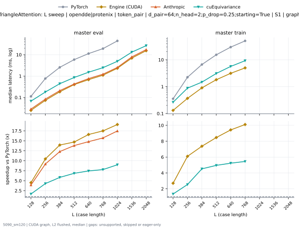

**master eval** (median ms; x = speedup vs PyTorch)

| L | PyTorch | Engine (Triton) | Engine (CUDA) | Anthropic | cuEquivariance |
|---|---|---|---|---|---|
| 128 | 0.1126 | 0.0655 (1.72x) | 0.02496 (4.51x) | 0.02867 (3.93x) | 0.06758 (1.67x) |
| 256 | 0.7709 | 0.1843 (4.18x) | 0.0737 (10.46x) | 0.08397 (9.18x) | 0.1802 (4.28x) |
| 384 | 2.57 | 0.4485 (5.73x) | 0.1843 (13.94x) | 0.2089 (12.30x) | 0.441 (5.83x) |
| 512 | 5.896 | 0.8887 (6.63x) | 0.4013 (14.69x) | 0.427 (13.81x) | 0.8605 (6.85x) |
| 640 | 11.31 | 1.573 (7.19x) | 0.6821 (16.59x) | 0.7649 (14.79x) | 1.52 (7.44x) |
| 768 | 19.3 | 2.599 (7.42x) | 1.104 (17.48x) | 1.228 (15.72x) | 2.479 (7.79x) |
| 1024 | 44.41 | 5.184 (8.57x) | 2.328 (19.08x) | 2.543 (17.46x) | 4.936 (9.00x) |
| 1536 | skipped | 13.82 | 6.96 | 7.868 | 13.18 |
| 2048 | skipped | 28.37 | 15.44 | 17.35 | 26.56 |

**master train** (median ms; x = speedup vs PyTorch)

| L | PyTorch | Engine (Triton) | Engine (CUDA) | Anthropic | cuEquivariance |
|---|---|---|---|---|---|
| 128 | 0.3544 | 0.2561 (1.38x) | 0.1312 (2.70x) | unsupported | 0.2634 (1.35x) |
| 256 | 2.235 | 0.9002 (2.48x) | 0.3667 (6.10x) | unsupported | 0.8801 (2.54x) |
| 384 | 6.648 | 1.549 (4.29x) | 0.9024 (7.37x) | unsupported | 1.472 (4.52x) |
| 512 | 15.32 | 3.281 (4.67x) | 1.81 (8.46x) | unsupported | 3.092 (4.95x) |
| 640 | 29.51 | 5.954 (4.96x) | 3.132 (9.42x) | unsupported | 5.645 (5.23x) |
| 768 | 50.35 | 9.733 (5.17x) | 4.984 (10.10x) | unsupported | 9.242 (5.45x) |
| 1024 |  |  |  |  |  |
| 1536 |  |  |  |  |  |
| 2048 |  |  |  |  |  |

### L sweep: openfold3_preview2 | token_pair | d_pair=64;n_head=4;p_drop=0.25;starting=False | S1 | graph

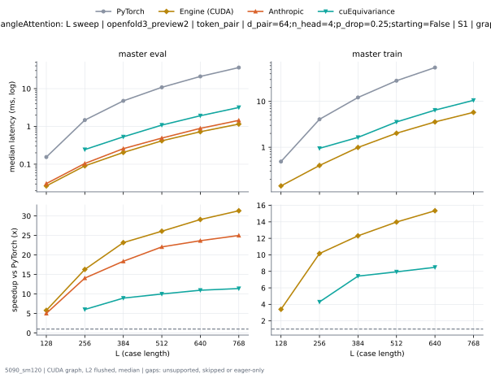

**master eval** (median ms; x = speedup vs PyTorch)

| L | PyTorch | Engine (Triton) | Engine (CUDA) | Anthropic | cuEquivariance |
|---|---|---|---|---|---|
| 128 | 0.1546 | 0.07173 (2.16x) | 0.02662 (5.81x) | 0.03072 (5.03x) | unsupported |
| 256 | 1.471 | 0.2253 (6.53x) | 0.0903 (16.29x) | 0.1045 (14.08x) | 0.244 (6.03x) |
| 384 | 4.746 | 0.5161 (9.20x) | 0.2048 (23.18x) | 0.258 (18.39x) | 0.5307 (8.94x) |
| 512 | 10.85 | 1.016 (10.67x) | 0.4157 (26.09x) | 0.4915 (22.07x) | 1.084 (10.00x) |
| 640 | 21.03 | 1.877 (11.20x) | 0.7229 (29.09x) | 0.8888 (23.66x) | 1.918 (10.96x) |
| 768 | 36.13 | 3.111 (11.61x) | 1.153 (31.34x) | 1.445 (25.00x) | 3.171 (11.40x) |

**master train** (median ms; x = speedup vs PyTorch)

| L | PyTorch | Engine (Triton) | Engine (CUDA) | Anthropic | cuEquivariance |
|---|---|---|---|---|---|
| 128 | 0.4875 | 0.2933 (1.66x) | 0.1434 (3.40x) | unsupported | unsupported |
| 256 | 4.069 | 1.084 (3.75x) | 0.4004 (10.16x) | unsupported | 0.9473 (4.30x) |
| 384 | 12.18 | 1.963 (6.21x) | 0.9901 (12.31x) | unsupported | 1.641 (7.42x) |
| 512 | 28.27 | 4.255 (6.64x) | 2.023 (13.98x) | unsupported | 3.56 (7.94x) |
| 640 | 54.73 | 7.79 (7.03x) | 3.567 (15.34x) | unsupported | 6.447 (8.49x) |
| 768 | skipped | 12.84 | 5.774 | unsupported | 10.55 |

### L sweep: openfold3_preview2 | token_pair | d_pair=64;n_head=4;p_drop=0.25;starting=True | S1 | graph

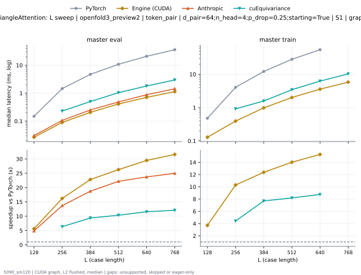

**master eval** (median ms; x = speedup vs PyTorch)

| L | PyTorch | Engine (Triton) | Engine (CUDA) | Anthropic | cuEquivariance |
|---|---|---|---|---|---|
| 128 | 0.1495 | 0.06758 (2.21x) | 0.02662 (5.62x) | 0.03072 (4.87x) | unsupported |
| 256 | 1.433 | 0.2092 (6.85x) | 0.07984 (17.94x) | 0.1065 (13.45x) | 0.2296 (6.24x) |
| 384 | 4.673 | 0.4894 (9.55x) | 0.1946 (24.02x) | 0.2519 (18.55x) | 0.5036 (9.28x) |
| 512 | 10.82 | 0.9756 (11.09x) | 0.4055 (26.68x) | 0.4874 (22.19x) | 1.046 (10.34x) |
| 640 | 20.93 | 1.767 (11.84x) | 0.6957 (30.08x) | 0.8827 (23.71x) | 1.812 (11.55x) |
| 768 | 35.95 | 2.911 (12.35x) | 1.118 (32.15x) | 1.441 (24.95x) | 2.984 (12.05x) |

**master train** (median ms; x = speedup vs PyTorch)

| L | PyTorch | Engine (Triton) | Engine (CUDA) | Anthropic | cuEquivariance |
|---|---|---|---|---|---|
| 128 | 0.4806 | 0.2663 (1.80x) | 0.1291 (3.72x) | unsupported | unsupported |
| 256 | 3.947 | 1.008 (3.91x) | 0.3729 (10.58x) | unsupported | 0.9176 (4.30x) |
| 384 | 12.13 | 1.893 (6.41x) | 0.98 (12.38x) | unsupported | 1.576 (7.70x) |
| 512 | 28.17 | 4.145 (6.80x) | 2.004 (14.06x) | unsupported | 3.441 (8.19x) |
| 640 | 54.54 | 7.583 (7.19x) | 3.539 (15.41x) | unsupported | 6.234 (8.75x) |
| 768 | skipped | 12.55 | 5.738 | unsupported | 10.25 |

### L sweep: protenix | token_pair | d_pair=256;n_head=8;p_drop=0.25;starting=False | S1 | graph

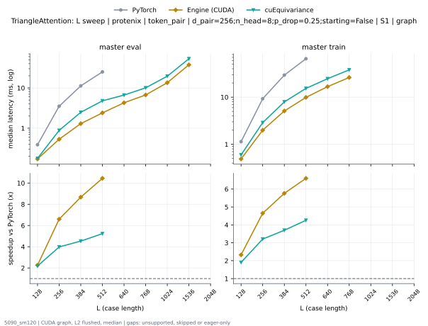

**master eval** (median ms; x = speedup vs PyTorch)

| L | PyTorch | Engine (Triton) | Engine (CUDA) | Anthropic | cuEquivariance |
|---|---|---|---|---|---|
| 128 | 0.3891 | 0.1782 (2.18x) | 0.172 (2.26x) | failed | 0.1781 (2.18x) |
| 256 | 3.515 | 0.9009 (3.90x) | 0.5325 (6.60x) | failed | 0.8829 (3.98x) |
| 384 | 11.26 | 2.559 (4.40x) | 1.298 (8.67x) | failed | 2.484 (4.53x) |
| 512 | 25.06 | 4.907 (5.11x) | 2.4 (10.44x) | failed | 4.789 (5.23x) |
| 640 | skipped | 6.817 | 4.284 | failed | 6.655 |
| 768 | skipped | 10.38 | 6.707 | failed | 10.07 |
| 1024 | skipped | 20.44 | 13.5 | failed | 19.6 |
| 1536 | skipped | 55.42 | 37.63 | failed | 53.15 |
| 2048 | skipped | skipped | skipped | failed | skipped |

**master train** (median ms; x = speedup vs PyTorch)

| L | PyTorch | Engine (Triton) | Engine (CUDA) | Anthropic | cuEquivariance |
|---|---|---|---|---|---|
| 128 | 1.138 | 0.6015 (1.89x) | 0.4896 (2.33x) | unsupported | 0.5976 (1.90x) |
| 256 | 9.269 | 3.05 (3.04x) | 1.994 (4.65x) | unsupported | 2.889 (3.21x) |
| 384 | 29.38 | 8.303 (3.54x) | 5.099 (5.76x) | unsupported | 7.942 (3.70x) |
| 512 | 65.32 | 16.05 (4.07x) | 9.898 (6.60x) | unsupported | 15.35 (4.26x) |
| 640 | skipped | 25.71 | 16.74 | unsupported | 24.66 |
| 768 | skipped | 39.83 | 26.16 | unsupported | 37.99 |
| 1024 |  |  |  |  |  |
| 1536 |  |  |  |  |  |
| 2048 |  |  |  |  |  |

### L sweep: protenix | token_pair | d_pair=256;n_head=8;p_drop=0.25;starting=True | S1 | graph

**master eval** (median ms; x = speedup vs PyTorch)

| L | PyTorch | Engine (Triton) | Engine (CUDA) | Anthropic | cuEquivariance |
|---|---|---|---|---|---|
| 128 | 0.375 | 0.1784 (2.10x) | 0.17 (2.21x) | failed | 0.1764 (2.13x) |
| 256 | 3.467 | 0.8604 (4.03x) | 0.5263 (6.59x) | failed | 0.8438 (4.11x) |
| 384 | 11.07 | 2.372 (4.67x) | 1.277 (8.67x) | failed | 2.307 (4.80x) |
| 512 | 24.74 | 4.583 (5.40x) | 2.401 (10.31x) | failed | 4.453 (5.56x) |
| 640 | skipped | 6.273 | 3.993 | failed | 6.124 |
| 768 | skipped | 9.592 | 6.26 | failed | 9.273 |
| 1024 | skipped | 19.01 | 12.76 | failed | 18.16 |
| 1536 | skipped | 52.18 | 35.88 | failed | 50.04 |
| 2048 | skipped | skipped | skipped | failed | skipped |

**master train** (median ms; x = speedup vs PyTorch)

| L | PyTorch | Engine (Triton) | Engine (CUDA) | Anthropic | cuEquivariance |
|---|---|---|---|---|---|
| 128 | 1.105 | 0.5811 (1.90x) | 0.4855 (2.28x) | unsupported | 0.5674 (1.95x) |
| 256 | 9.175 | 2.951 (3.11x) | 1.991 (4.61x) | unsupported | 2.789 (3.29x) |
| 384 | 29.09 | 8.004 (3.63x) | 5.088 (5.72x) | unsupported | 7.655 (3.80x) |
| 512 | 64.82 | 15.51 (4.18x) | 9.892 (6.55x) | unsupported | 14.81 (4.38x) |
| 640 | skipped | 24.83 | 16.72 | unsupported | 23.79 |
| 768 | skipped | 38.62 | 26.17 | unsupported | 36.77 |
| 1024 |  |  |  |  |  |
| 1536 |  |  |  |  |  |
| 2048 |  |  |  |  |  |

### d_pair sweep at L2048: token_pair | p_drop=0.25;starting=False | S1 | graph

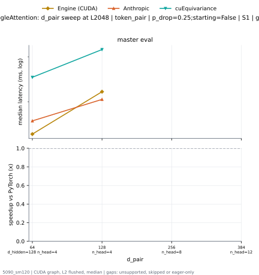

**master eval** (median ms; x = speedup vs PyTorch)

| d_pair | PyTorch | Engine (Triton) | Engine (CUDA) | Anthropic | cuEquivariance |
|---|---|---|---|---|---|
| 64 d_hidden=128 n_head=4 | skipped | 48.75 | 30.95 | 36.37 | 45.17 |
| 128 n_head=4 | skipped | 55.42 | 38.66 | 40.46 | 51.84 |
| 256 n_head=8 | skipped | skipped | skipped | failed | skipped |
| 384 n_head=12 | skipped | skipped | skipped | skipped | skipped |

### d_pair sweep at L2048: token_pair | p_drop=0.25;starting=True | S1 | graph

**master eval** (median ms; x = speedup vs PyTorch)

| d_pair | PyTorch | Engine (Triton) | Engine (CUDA) | Anthropic | cuEquivariance |
|---|---|---|---|---|---|
| 64 d_hidden=128 n_head=4 | skipped | 47.35 | 30.7 | 34.97 | 43.82 |
| 128 n_head=4 | skipped | 52.48 | 38.74 | 40.93 | 48.93 |
| 256 n_head=8 | skipped | skipped | skipped | failed | skipped |
| 384 n_head=12 | skipped | skipped | skipped | skipped | skipped |

### n_head sweep at L2048: token_pair | p_drop=0.25;starting=False | S1 | graph

**master eval** (median ms; x = speedup vs PyTorch)

| n_head | PyTorch | Engine (Triton) | Engine (CUDA) | Anthropic | cuEquivariance |
|---|---|---|---|---|---|
| 2 d_pair=64 | skipped | 29.76 | 15.62 | 17.28 | 27.95 |
| 4 d_pair=128 | skipped | 55.42 | 38.66 | 40.46 | 51.84 |
| 8 d_pair=256 | skipped | skipped | skipped | failed | skipped |
| 12 d_pair=384 | skipped | skipped | skipped | skipped | skipped |

### n_head sweep at L2048: token_pair | p_drop=0.25;starting=True | S1 | graph

**master eval** (median ms; x = speedup vs PyTorch)

| n_head | PyTorch | Engine (Triton) | Engine (CUDA) | Anthropic | cuEquivariance |
|---|---|---|---|---|---|
| 2 d_pair=64 | skipped | 28.37 | 15.44 | 17.35 | 26.56 |
| 4 d_pair=128 | skipped | 52.48 | 38.74 | 40.93 | 48.93 |
| 8 d_pair=256 | skipped | skipped | skipped | failed | skipped |
| 12 d_pair=384 | skipped | skipped | skipped | skipped | skipped |

