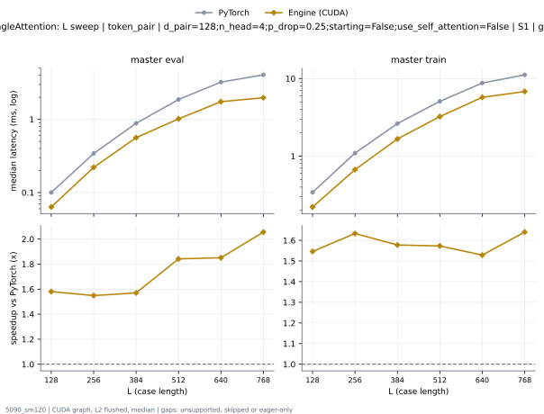
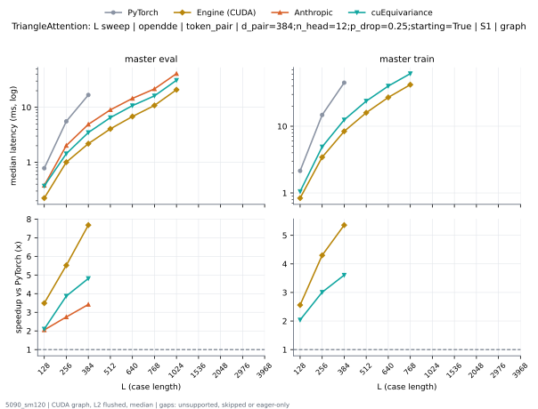
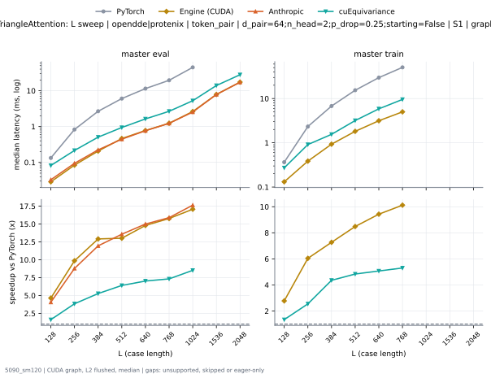
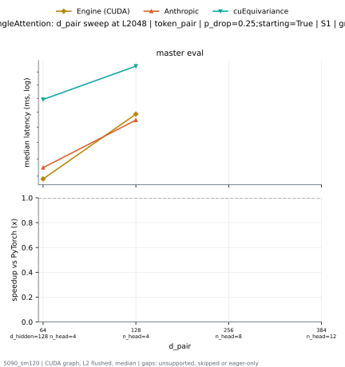
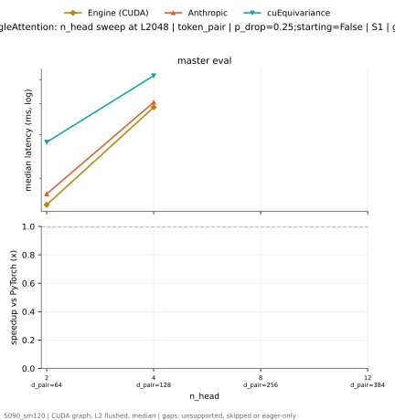
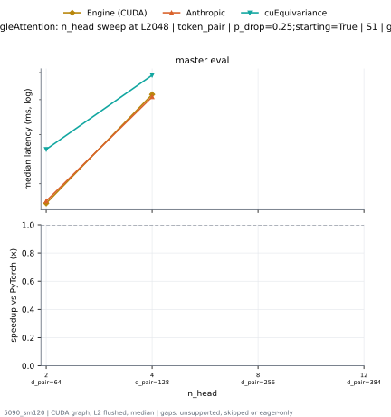

# TriangleAttention on 5090_sm120

Generated by `python -m miniworld_engine.measure.plot` from speed tokens `judge/tokens/5090_sm120/`; do not edit.

### L sweep: token_pair | d_pair=128;n_head=4;p_drop=0.25;starting=False;use_self_attention=False | S1 | graph

**master eval** (median ms; x = speedup vs PyTorch)

| L | PyTorch | Engine (Triton) | Engine (CUDA) | Anthropic | cuEquivariance |
|---|---|---|---|---|---|
| 128 | 0.1004 | 0.07387 (1.36x) | 0.06349 (1.58x) | unsupported | unsupported |
| 256 | 0.3422 | 0.2375 (1.44x) | 0.2209 (1.55x) | unsupported | unsupported |
| 384 | 0.8843 | 0.6064 (1.46x) | 0.5632 (1.57x) | unsupported | unsupported |
| 512 | 1.871 | 1.233 (1.52x) | 1.016 (1.84x) | unsupported | unsupported |
| 640 | 3.236 | 2.151 (1.50x) | 1.748 (1.85x) | unsupported | unsupported |
| 768 | 4.065 | 2.613 (1.56x) | 1.977 (2.06x) | unsupported | unsupported |

**master train** (median ms; x = speedup vs PyTorch)

| L | PyTorch | Engine (Triton) | Engine (CUDA) | Anthropic | cuEquivariance |
|---|---|---|---|---|---|
| 128 | 0.3421 | 0.2398 (1.43x) | 0.2212 (1.55x) | unsupported | unsupported |
| 256 | 1.094 | 0.7527 (1.45x) | 0.6698 (1.63x) | unsupported | unsupported |
| 384 | 2.629 | 2.133 (1.23x) | 1.666 (1.58x) | unsupported | unsupported |
| 512 | 5.087 | 3.91 (1.30x) | 3.234 (1.57x) | unsupported | unsupported |
| 640 | 8.753 | 6.657 (1.31x) | 5.726 (1.53x) | unsupported | unsupported |
| 768 | 11.16 | 8.338 (1.34x) | 6.807 (1.64x) | unsupported | unsupported |

### L sweep: token_pair | d_pair=128;n_head=4;p_drop=0.25;starting=True;use_self_attention=False | S1 | graph

**master eval** (median ms; x = speedup vs PyTorch)

| L | PyTorch | Engine (Triton) | Engine (CUDA) | Anthropic | cuEquivariance |
|---|---|---|---|---|---|
| 128 | 0.08806 | 0.05949 (1.48x) | 0.05325 (1.65x) | unsupported | unsupported |
| 256 | 0.2948 | 0.1884 (1.57x) | 0.1923 (1.53x) | unsupported | unsupported |
| 384 | 0.8268 | 0.5287 (1.56x) | 0.5205 (1.59x) | unsupported | unsupported |
| 512 | 1.711 | 1.07 (1.60x) | 0.9339 (1.83x) | unsupported | unsupported |
| 640 | 2.953 | 1.878 (1.57x) | 1.629 (1.81x) | unsupported | unsupported |
| 768 | 3.673 | 2.211 (1.66x) | 1.945 (1.89x) | unsupported | unsupported |

**master train** (median ms; x = speedup vs PyTorch)

| L | PyTorch | Engine (Triton) | Engine (CUDA) | Anthropic | cuEquivariance |
|---|---|---|---|---|---|
| 128 | 0.2847 | 0.1926 (1.48x) | 0.1824 (1.56x) | unsupported | unsupported |
| 256 | 0.9994 | 0.6839 (1.46x) | 0.6268 (1.59x) | unsupported | unsupported |
| 384 | 2.485 | 2.002 (1.24x) | 1.715 (1.45x) | unsupported | unsupported |
| 512 | 4.84 | 3.638 (1.33x) | 3.048 (1.59x) | unsupported | unsupported |
| 640 | 8.34 | 6.236 (1.34x) | 5.126 (1.63x) | unsupported | unsupported |
| 768 | 10.57 | 7.716 (1.37x) | 6.585 (1.60x) | unsupported | unsupported |

### L sweep: boltz2|openfold3_preview2|protenix | token_pair | d_pair=128;n_head=4;p_drop=0.25;starting=False | S1 | graph

**master eval** (median ms; x = speedup vs PyTorch)

| L | PyTorch | Engine (Triton) | Engine (CUDA) | Anthropic | cuEquivariance |
|---|---|---|---|---|---|
| 128 | 0.1987 | 0.1019 (1.95x) | 0.06755 (2.94x) | 0.07803 (2.55x) | 0.1026 (1.94x) |
| 256 | 1.646 | 0.3533 (4.66x) | 0.2686 (6.13x) | 0.2827 (5.82x) | 0.3489 (4.72x) |
| 384 | 5.272 | 0.934 (5.64x) | 0.6574 (8.02x) | 0.6513 (8.09x) | 0.9042 (5.83x) |
| 512 | 12.12 | 2.05 (5.92x) | 1.304 (9.30x) | 1.258 (9.64x) | 1.962 (6.18x) |
| 640 | 23.11 | 3.546 (6.52x) | 2.166 (10.67x) | 2.123 (10.89x) | 3.43 (6.74x) |
| 768 | 38.77 | 5.11 (7.59x) | 3.513 (11.03x) | 3.284 (11.80x) | 4.94 (7.85x) |
| 1024 | skipped | 10.04 | 6.968 | 6.659 | 9.566 |
| 1536 | skipped | 26.98 | 20.09 | 19.14 | 25.69 |
| 2048 | skipped | 55.42 | 42.04 | 40.46 | 51.84 |

**master train** (median ms; x = speedup vs PyTorch)

| L | PyTorch | Engine (Triton) | Engine (CUDA) | Anthropic | cuEquivariance |
|---|---|---|---|---|---|
| 128 | 0.5898 | 0.34 (1.73x) | 0.2334 (2.53x) | unsupported | 0.3523 (1.67x) |
| 256 | 4.432 | 1.354 (3.27x) | 0.9299 (4.77x) | unsupported | 1.283 (3.45x) |
| 384 | 13.76 | 3.373 (4.08x) | 2.156 (6.38x) | unsupported | 3.186 (4.32x) |
| 512 | 31.76 | 7.239 (4.39x) | 4.348 (7.30x) | unsupported | 6.871 (4.62x) |
| 640 | skipped | 12.92 | 7.65 | unsupported | 12.4 |
| 768 | skipped | 19.84 | 12.07 | unsupported | 18.91 |
| 1024 |  |  |  |  |  |
| 1536 |  |  |  |  |  |
| 2048 |  |  |  |  |  |

### L sweep: boltz2|openfold3_preview2|protenix | token_pair | d_pair=128;n_head=4;p_drop=0.25;starting=True | S1 | graph

**master eval** (median ms; x = speedup vs PyTorch)

| L | PyTorch | Engine (Triton) | Engine (CUDA) | Anthropic | cuEquivariance |
|---|---|---|---|---|---|
| 128 | 0.1896 | 0.09222 (2.06x) | 0.06758 (2.81x) | 0.07984 (2.37x) | 0.09421 (2.01x) |
| 256 | 1.625 | 0.3338 (4.87x) | 0.2662 (6.10x) | 0.2867 (5.67x) | 0.3297 (4.93x) |
| 384 | 5.215 | 0.8765 (5.95x) | 0.6559 (7.95x) | 0.6676 (7.81x) | 0.8502 (6.13x) |
| 512 | 11.96 | 1.882 (6.36x) | 1.275 (9.38x) | 1.278 (9.36x) | 1.793 (6.67x) |
| 640 | 22.84 | 3.281 (6.96x) | 2.209 (10.34x) | 2.153 (10.60x) | 3.145 (7.26x) |
| 768 | 38.37 | 4.719 (8.13x) | 3.458 (11.10x) | 3.354 (11.44x) | 4.539 (8.45x) |
| 1024 | skipped | 9.356 | 6.976 | 6.757 | 8.897 |
| 1536 | skipped | 25.38 | 19.88 | 19.37 | 24.1 |
| 2048 | skipped | 52.48 | 41.74 | 40.93 | 48.93 |

**master train** (median ms; x = speedup vs PyTorch)

| L | PyTorch | Engine (Triton) | Engine (CUDA) | Anthropic | cuEquivariance |
|---|---|---|---|---|---|
| 128 | 0.5736 | 0.3349 (1.71x) | 0.2315 (2.48x) | unsupported | 0.3462 (1.66x) |
| 256 | 4.367 | 1.293 (3.38x) | 0.9278 (4.71x) | unsupported | 1.225 (3.57x) |
| 384 | 13.66 | 3.249 (4.20x) | 2.149 (6.35x) | unsupported | 3.069 (4.45x) |
| 512 | 31.5 | 6.971 (4.52x) | 4.329 (7.28x) | unsupported | 6.596 (4.78x) |
| 640 | skipped | 12.49 | 7.624 | unsupported | 11.98 |
| 768 | skipped | 19.2 | 12.04 | unsupported | 18.3 |
| 1024 |  |  |  |  |  |
| 1536 |  |  |  |  |  |
| 2048 |  |  |  |  |  |

### L sweep: boltz2|protenix | token_pair | d_hidden=128;d_pair=64;n_head=4;p_drop=0.25;starting=False | S1 | graph

**master eval** (median ms; x = speedup vs PyTorch)

| L | PyTorch | Engine (Triton) | Engine (CUDA) | Anthropic | cuEquivariance |
|---|---|---|---|---|---|
| 128 | 0.1823 | 0.08594 (2.12x) | 0.03722 (4.90x) | 0.05963 (3.06x) | 0.08797 (2.07x) |
| 256 | 1.55 | 0.2661 (5.82x) | 0.1249 (12.40x) | 0.1844 (8.41x) | 0.2608 (5.94x) |
| 384 | 5.003 | 0.6492 (7.71x) | 0.3692 (13.55x) | 0.4854 (10.31x) | 0.6289 (7.96x) |
| 512 | 11.51 | 1.391 (8.28x) | 0.8397 (13.71x) | 0.9677 (11.89x) | 1.293 (8.90x) |
| 640 | 22.25 | 2.66 (8.37x) | 1.489 (14.95x) | 1.685 (13.21x) | 2.528 (8.80x) |
| 768 | 37.81 | 4.171 (9.07x) | 2.371 (15.95x) | 2.67 (14.16x) | 3.968 (9.53x) |
| 1024 | skipped | 8.372 | 5.073 | 5.616 | 7.915 |
| 1536 | skipped | 23.18 | 15.23 | 16.76 | 21.93 |
| 2048 | skipped | 48.75 | 34.05 | 36.37 | 45.17 |

**master train** (median ms; x = speedup vs PyTorch)

| L | PyTorch | Engine (Triton) | Engine (CUDA) | Anthropic | cuEquivariance |
|---|---|---|---|---|---|
| 128 | 0.5694 | 0.322 (1.77x) | 0.1864 (3.05x) | unsupported | 0.3359 (1.69x) |
| 256 | 4.282 | 1.194 (3.59x) | 0.6927 (6.18x) | unsupported | 1.134 (3.78x) |
| 384 | 13.03 | 2.594 (5.02x) | 1.713 (7.61x) | unsupported | 2.401 (5.43x) |
| 512 | 30.15 | 5.583 (5.40x) | 3.41 (8.84x) | unsupported | 5.194 (5.80x) |
| 640 | skipped | 10.2 | 6.06 | unsupported | 9.611 |
| 768 | skipped | 16.39 | 9.739 | unsupported | 15.43 |
| 1024 |  |  |  |  |  |
| 1536 |  |  |  |  |  |
| 2048 |  |  |  |  |  |

### L sweep: boltz2|protenix | token_pair | d_hidden=128;d_pair=64;n_head=4;p_drop=0.25;starting=True | S1 | graph

**master eval** (median ms; x = speedup vs PyTorch)

| L | PyTorch | Engine (Triton) | Engine (CUDA) | Anthropic | cuEquivariance |
|---|---|---|---|---|---|
| 128 | 0.1759 | 0.07989 (2.20x) | 0.03718 (4.73x) | 0.05923 (2.97x) | 0.08179 (2.15x) |
| 256 | 1.535 | 0.2519 (6.09x) | 0.1249 (12.29x) | 0.1833 (8.37x) | 0.246 (6.24x) |
| 384 | 4.992 | 0.6267 (7.97x) | 0.3625 (13.77x) | 0.4567 (10.93x) | 0.6101 (8.18x) |
| 512 | 11.45 | 1.342 (8.54x) | 0.8192 (13.98x) | 0.8919 (12.84x) | 1.252 (9.15x) |
| 640 | 22.13 | 2.546 (8.69x) | 1.444 (15.33x) | 1.557 (14.22x) | 2.413 (9.17x) |
| 768 | 37.62 | 3.977 (9.46x) | 2.315 (16.25x) | 2.474 (15.20x) | 3.787 (9.93x) |
| 1024 | skipped | 8.032 | 4.987 | 5.293 | 7.581 |
| 1536 | skipped | 22.4 | 15.04 | 15.97 | 21.16 |
| 2048 | skipped | 47.35 | 33.69 | 34.97 | 43.82 |

**master train** (median ms; x = speedup vs PyTorch)

| L | PyTorch | Engine (Triton) | Engine (CUDA) | Anthropic | cuEquivariance |
|---|---|---|---|---|---|
| 128 | 0.5602 | 0.3134 (1.79x) | 0.1864 (3.00x) | unsupported | 0.3267 (1.71x) |
| 256 | 4.249 | 1.156 (3.67x) | 0.6895 (6.16x) | unsupported | 1.099 (3.87x) |
| 384 | 12.99 | 2.546 (5.10x) | 1.697 (7.65x) | unsupported | 2.353 (5.52x) |
| 512 | 30.05 | 5.48 (5.48x) | 3.383 (8.88x) | unsupported | 5.107 (5.88x) |
| 640 | skipped | 10 | 6 | unsupported | 9.425 |
| 768 | skipped | 16.09 | 9.678 | unsupported | 15.12 |
| 1024 |  |  |  |  |  |
| 1536 |  |  |  |  |  |
| 2048 |  |  |  |  |  |

### L sweep: opendde | token_pair | d_pair=384;n_head=12;p_drop=0.25;starting=False | S1 | graph

**master eval** (median ms; x = speedup vs PyTorch)

| L | PyTorch | Engine (Triton) | Engine (CUDA) | Anthropic | cuEquivariance |
|---|---|---|---|---|---|
| 128 | 0.8114 | 0.3606 (2.25x) | 0.242 (3.35x) | 0.3828 (2.12x) | 0.3604 (2.25x) |
| 256 | 5.599 | 1.529 (3.66x) | 1.008 (5.56x) | 2.148 (2.61x) | 1.506 (3.72x) |
| 384 | 17.08 | 3.926 (4.35x) | 2.492 (6.85x) | 5.2 (3.28x) | 4.021 (4.25x) |
| 512 | skipped | 7.188 | 4.652 | 9.534 | 7.022 |
| 640 | skipped | 11.78 | 7.84 | 15.34 | 11.56 |
| 768 | skipped | 17.8 | 11.79 | 22.82 | 17.36 |
| 1024 | skipped | 34.44 | 24 | 43.09 | 33.23 |
| 1536 | skipped | 90.55 | 63.67 | skipped | 87.11 |
| 2048 | skipped | skipped | skipped | skipped | skipped |
| 2976 | skipped | skipped | skipped | skipped | skipped |
| 3968 | skipped | skipped | skipped | skipped | skipped |

**master train** (median ms; x = speedup vs PyTorch)

| L | PyTorch | Engine (Triton) | Engine (CUDA) | Anthropic | cuEquivariance |
|---|---|---|---|---|---|
| 128 | 2.182 | 1.115 (1.96x) | 0.8412 (2.59x) | unsupported | 1.089 (2.00x) |
| 256 | 14.95 | 5.447 (2.74x) | 3.452 (4.33x) | unsupported | 5.106 (2.93x) |
| 384 | 45.42 | 13.75 (3.30x) | 8.398 (5.41x) | unsupported | 12.92 (3.52x) |
| 512 | skipped | 26.22 | 15.98 | unsupported | 24.66 |
| 640 | skipped | 43.95 | 27.08 | unsupported | 41.32 |
| 768 | skipped | 67.5 | 42 | unsupported | 63.39 |
| 1024 |  |  |  |  |  |
| 1536 |  |  |  |  |  |
| 2048 |  |  |  |  |  |
| 2976 |  |  |  |  |  |
| 3968 |  |  |  |  |  |

### L sweep: opendde | token_pair | d_pair=384;n_head=12;p_drop=0.25;starting=True | S1 | graph

**master eval** (median ms; x = speedup vs PyTorch)

| L | PyTorch | Engine (Triton) | Engine (CUDA) | Anthropic | cuEquivariance |
|---|---|---|---|---|---|
| 128 | 0.8481 | 0.3727 (2.28x) | 0.256 (3.31x) | 0.3799 (2.23x) | 0.3711 (2.29x) |
| 256 | 5.581 | 1.458 (3.83x) | 0.9994 (5.58x) | 2.018 (2.77x) | 1.434 (3.89x) |
| 384 | 16.76 | 3.551 (4.72x) | 2.189 (7.66x) | 4.9 (3.42x) | 3.479 (4.82x) |
| 512 | skipped | 6.669 | 4.3 | 8.988 | 6.499 |
| 640 | skipped | 10.93 | 7.216 | 14.5 | 10.72 |
| 768 | skipped | 16.58 | 10.81 | 21.6 | 16.13 |
| 1024 | skipped | 32.27 | 22.29 | 40.92 | 31.02 |
| 1536 | skipped | skipped | skipped | skipped | skipped |
| 2048 | skipped | skipped | skipped | skipped | skipped |
| 2976 | skipped | skipped | skipped | skipped | skipped |
| 3968 | skipped | skipped | skipped | skipped | skipped |

**master train** (median ms; x = speedup vs PyTorch)

| L | PyTorch | Engine (Triton) | Engine (CUDA) | Anthropic | cuEquivariance |
|---|---|---|---|---|---|
| 128 | 2.141 | 1.075 (1.99x) | 0.8397 (2.55x) | unsupported | 1.052 (2.04x) |
| 256 | 14.77 | 5.251 (2.81x) | 3.438 (4.30x) | unsupported | 4.91 (3.01x) |
| 384 | 44.98 | 13.29 (3.38x) | 8.377 (5.37x) | unsupported | 12.46 (3.61x) |
| 512 | skipped | 25.39 | 15.93 | unsupported | 23.82 |
| 640 | skipped | 42.67 | 27.03 | unsupported | 40.04 |
| 768 | skipped | skipped | 41.96 | unsupported | 61.51 |
| 1024 |  |  |  |  |  |
| 1536 |  |  |  |  |  |
| 2048 |  |  |  |  |  |
| 2976 |  |  |  |  |  |
| 3968 |  |  |  |  |  |

### L sweep: opendde|protenix | token_pair | d_pair=64;n_head=2;p_drop=0.25;starting=False | S1 | graph

**master eval** (median ms; x = speedup vs PyTorch)

| L | PyTorch | Engine (Triton) | Engine (CUDA) | Anthropic | cuEquivariance |
|---|---|---|---|---|---|
| 128 | 0.133 | 0.07992 (1.66x) | 0.02867 (4.64x) | 0.03277 (4.06x) | 0.08192 (1.62x) |
| 256 | 0.8276 | 0.2212 (3.74x) | 0.08394 (9.86x) | 0.09419 (8.79x) | 0.2153 (3.84x) |
| 384 | 2.672 | 0.5135 (5.20x) | 0.2068 (12.92x) | 0.2236 (11.95x) | 0.5066 (5.28x) |
| 512 | 6.034 | 0.9904 (6.09x) | 0.4635 (13.02x) | 0.4444 (13.58x) | 0.9413 (6.41x) |
| 640 | 11.48 | 1.687 (6.80x) | 0.7752 (14.80x) | 0.7649 (15.00x) | 1.633 (7.03x) |
| 768 | 19.52 | 2.784 (7.01x) | 1.237 (15.78x) | 1.228 (15.90x) | 2.664 (7.33x) |
| 1024 | 44.83 | 5.508 (8.14x) | 2.626 (17.08x) | 2.541 (17.65x) | 5.259 (8.52x) |
| 1536 | skipped | 14.59 | 7.867 | 7.848 | 13.96 |
| 2048 | skipped | 29.76 | 17.36 | 17.28 | 27.95 |

**master train** (median ms; x = speedup vs PyTorch)

| L | PyTorch | Engine (Triton) | Engine (CUDA) | Anthropic | cuEquivariance |
|---|---|---|---|---|---|
| 128 | 0.3646 | 0.267 (1.37x) | 0.1311 (2.78x) | unsupported | 0.2718 (1.34x) |
| 256 | 2.33 | 0.9366 (2.49x) | 0.3855 (6.04x) | unsupported | 0.9131 (2.55x) |
| 384 | 6.766 | 1.613 (4.19x) | 0.9303 (7.27x) | unsupported | 1.552 (4.36x) |
| 512 | 15.41 | 3.392 (4.54x) | 1.816 (8.48x) | unsupported | 3.182 (4.84x) |
| 640 | 29.7 | 6.166 (4.82x) | 3.15 (9.43x) | unsupported | 5.855 (5.07x) |
| 768 | 50.67 | 10.05 (5.04x) | 5.006 (10.12x) | unsupported | 9.553 (5.30x) |
| 1024 |  |  |  |  |  |
| 1536 |  |  |  |  |  |
| 2048 |  |  |  |  |  |

### L sweep: opendde|protenix | token_pair | d_pair=64;n_head=2;p_drop=0.25;starting=True | S1 | graph

**master eval** (median ms; x = speedup vs PyTorch)

| L | PyTorch | Engine (Triton) | Engine (CUDA) | Anthropic | cuEquivariance |
|---|---|---|---|---|---|
| 128 | 0.1144 | 0.0655 (1.75x) | 0.02662 (4.30x) | 0.02867 (3.99x) | 0.06758 (1.69x) |
| 256 | 0.7722 | 0.1843 (4.19x) | 0.07165 (10.78x) | 0.08397 (9.20x) | 0.1802 (4.28x) |
| 384 | 2.588 | 0.4485 (5.77x) | 0.1884 (13.74x) | 0.2089 (12.39x) | 0.441 (5.87x) |
| 512 | 5.918 | 0.8887 (6.66x) | 0.4379 (13.51x) | 0.427 (13.86x) | 0.8605 (6.88x) |
| 640 | 11.32 | 1.573 (7.20x) | 0.748 (15.14x) | 0.7649 (14.80x) | 1.52 (7.45x) |
| 768 | 19.34 | 2.599 (7.44x) | 1.208 (16.01x) | 1.228 (15.76x) | 2.479 (7.80x) |
| 1024 | 44.51 | 5.184 (8.59x) | 2.586 (17.21x) | 2.543 (17.50x) | 4.936 (9.02x) |
| 1536 | skipped | 13.82 | 7.745 | 7.868 | 13.18 |
| 2048 | skipped | 28.37 | 17.03 | 17.35 | 26.56 |

**master train** (median ms; x = speedup vs PyTorch)

| L | PyTorch | Engine (Triton) | Engine (CUDA) | Anthropic | cuEquivariance |
|---|---|---|---|---|---|
| 128 | 0.3565 | 0.2561 (1.39x) | 0.1311 (2.72x) | unsupported | 0.2634 (1.35x) |
| 256 | 2.281 | 0.9002 (2.53x) | 0.381 (5.99x) | unsupported | 0.8801 (2.59x) |
| 384 | 6.698 | 1.549 (4.32x) | 0.9222 (7.26x) | unsupported | 1.472 (4.55x) |
| 512 | 15.31 | 3.281 (4.67x) | 1.797 (8.52x) | unsupported | 3.092 (4.95x) |
| 640 | 29.51 | 5.954 (4.96x) | 3.114 (9.48x) | unsupported | 5.645 (5.23x) |
| 768 | 50.35 | 9.733 (5.17x) | 4.968 (10.14x) | unsupported | 9.242 (5.45x) |
| 1024 |  |  |  |  |  |
| 1536 |  |  |  |  |  |
| 2048 |  |  |  |  |  |

### L sweep: openfold3_preview2 | token_pair | d_pair=64;n_head=4;p_drop=0.25;starting=False | S1 | graph

**master eval** (median ms; x = speedup vs PyTorch)

| L | PyTorch | Engine (Triton) | Engine (CUDA) | Anthropic | cuEquivariance |
|---|---|---|---|---|---|
| 128 | 0.1554 | 0.07173 (2.17x) | 0.02662 (5.84x) | 0.03072 (5.06x) | unsupported |
| 256 | 1.473 | 0.2253 (6.54x) | 0.09213 (15.98x) | 0.1045 (14.09x) | 0.244 (6.04x) |
| 384 | 4.759 | 0.5161 (9.22x) | 0.2109 (22.56x) | 0.258 (18.44x) | 0.5307 (8.97x) |
| 512 | 10.86 | 1.016 (10.69x) | 0.4242 (25.61x) | 0.4915 (22.10x) | 1.084 (10.02x) |
| 640 | 21.07 | 1.877 (11.23x) | 0.7434 (28.35x) | 0.8888 (23.71x) | 1.918 (10.99x) |
| 768 | 36.2 | 3.111 (11.63x) | 1.175 (30.80x) | 1.445 (25.05x) | 3.171 (11.42x) |

**master train** (median ms; x = speedup vs PyTorch)

| L | PyTorch | Engine (Triton) | Engine (CUDA) | Anthropic | cuEquivariance |
|---|---|---|---|---|---|
| 128 | 0.51 | 0.2933 (1.74x) | 0.1352 (3.77x) | unsupported | unsupported |
| 256 | 4.079 | 1.084 (3.76x) | 0.3957 (10.31x) | unsupported | 0.9473 (4.31x) |
| 384 | 12.18 | 1.963 (6.20x) | 0.9913 (12.28x) | unsupported | 1.641 (7.42x) |
| 512 | 28.29 | 4.255 (6.65x) | 2.028 (13.95x) | unsupported | 3.56 (7.95x) |
| 640 | 54.79 | 7.79 (7.03x) | 3.607 (15.19x) | unsupported | 6.447 (8.50x) |
| 768 | skipped | 12.84 | 5.844 | unsupported | 10.55 |

### L sweep: openfold3_preview2 | token_pair | d_pair=64;n_head=4;p_drop=0.25;starting=True | S1 | graph

**master eval** (median ms; x = speedup vs PyTorch)

| L | PyTorch | Engine (Triton) | Engine (CUDA) | Anthropic | cuEquivariance |
|---|---|---|---|---|---|
| 128 | 0.1495 | 0.06758 (2.21x) | 0.02662 (5.62x) | 0.03072 (4.87x) | unsupported |
| 256 | 1.459 | 0.2092 (6.98x) | 0.09 (16.21x) | 0.1065 (13.70x) | 0.2296 (6.35x) |
| 384 | 4.72 | 0.4894 (9.64x) | 0.2069 (22.82x) | 0.2519 (18.74x) | 0.5036 (9.37x) |
| 512 | 10.82 | 0.9756 (11.09x) | 0.4117 (26.28x) | 0.4874 (22.20x) | 1.046 (10.35x) |
| 640 | 20.96 | 1.767 (11.86x) | 0.7105 (29.50x) | 0.8827 (23.74x) | 1.812 (11.56x) |
| 768 | 36 | 2.911 (12.37x) | 1.14 (31.59x) | 1.441 (24.99x) | 2.984 (12.07x) |

**master train** (median ms; x = speedup vs PyTorch)

| L | PyTorch | Engine (Triton) | Engine (CUDA) | Anthropic | cuEquivariance |
|---|---|---|---|---|---|
| 128 | 0.4793 | 0.2663 (1.80x) | 0.1291 (3.71x) | unsupported | unsupported |
| 256 | 4.051 | 1.008 (4.02x) | 0.3934 (10.30x) | unsupported | 0.9176 (4.41x) |
| 384 | 12.14 | 1.893 (6.41x) | 0.9809 (12.37x) | unsupported | 1.576 (7.70x) |
| 512 | 28.17 | 4.145 (6.80x) | 2.01 (14.02x) | unsupported | 3.441 (8.19x) |
| 640 | 54.58 | 7.583 (7.20x) | 3.571 (15.28x) | unsupported | 6.234 (8.76x) |
| 768 | skipped | 12.55 | 5.802 | unsupported | 10.25 |

### L sweep: protenix | token_pair | d_pair=256;n_head=8;p_drop=0.25;starting=False | S1 | graph

**master eval** (median ms; x = speedup vs PyTorch)

| L | PyTorch | Engine (Triton) | Engine (CUDA) | Anthropic | cuEquivariance |
|---|---|---|---|---|---|
| 128 | 0.3891 | 0.1782 (2.18x) | 0.172 (2.26x) | failed | 0.1781 (2.18x) |
| 256 | 3.516 | 0.9009 (3.90x) | 0.5386 (6.53x) | failed | 0.8829 (3.98x) |
| 384 | 11.28 | 2.559 (4.41x) | 1.295 (8.71x) | failed | 2.484 (4.54x) |
| 512 | 25.09 | 4.907 (5.11x) | 2.544 (9.86x) | failed | 4.789 (5.24x) |
| 640 | 46.12 | 6.817 (6.77x) | 4.575 (10.08x) | failed | 6.655 (6.93x) |
| 768 | skipped | 10.38 | 7.142 | failed | 10.07 |
| 1024 | skipped | 20.44 | 14.51 | failed | 19.6 |
| 1536 | skipped | 55.42 | 40.39 | failed | 53.15 |
| 2048 | skipped | skipped | skipped | failed | skipped |

**master train** (median ms; x = speedup vs PyTorch)

| L | PyTorch | Engine (Triton) | Engine (CUDA) | Anthropic | cuEquivariance |
|---|---|---|---|---|---|
| 128 | 1.14 | 0.6015 (1.89x) | 0.4916 (2.32x) | unsupported | 0.5976 (1.91x) |
| 256 | 9.266 | 3.05 (3.04x) | 1.991 (4.65x) | unsupported | 2.889 (3.21x) |
| 384 | 29.4 | 8.303 (3.54x) | 5.101 (5.76x) | unsupported | 7.942 (3.70x) |
| 512 | skipped | 16.05 | 9.904 | unsupported | 15.35 |
| 640 | skipped | 25.71 | 16.73 | unsupported | 24.66 |
| 768 | skipped | 39.83 | 26.17 | unsupported | 37.99 |
| 1024 |  |  |  |  |  |
| 1536 |  |  |  |  |  |
| 2048 |  |  |  |  |  |

### L sweep: protenix | token_pair | d_pair=256;n_head=8;p_drop=0.25;starting=True | S1 | graph

**master eval** (median ms; x = speedup vs PyTorch)

| L | PyTorch | Engine (Triton) | Engine (CUDA) | Anthropic | cuEquivariance |
|---|---|---|---|---|---|
| 128 | 0.395 | 0.1784 (2.21x) | 0.2004 (1.97x) | failed | 0.1764 (2.24x) |
| 256 | 3.534 | 0.8604 (4.11x) | 0.5407 (6.54x) | failed | 0.8438 (4.19x) |
| 384 | 11.1 | 2.372 (4.68x) | 1.302 (8.52x) | failed | 2.307 (4.81x) |
| 512 | 24.77 | 4.583 (5.41x) | 2.547 (9.73x) | failed | 4.453 (5.56x) |
| 640 | skipped | 6.273 | 4.288 | failed | 6.124 |
| 768 | skipped | 9.592 | 6.736 | failed | 9.273 |
| 1024 | skipped | 19.01 | 13.71 | failed | 18.16 |
| 1536 | skipped | 52.18 | 38.61 | failed | 50.04 |
| 2048 | skipped | skipped | skipped | failed | skipped |

**master train** (median ms; x = speedup vs PyTorch)

| L | PyTorch | Engine (Triton) | Engine (CUDA) | Anthropic | cuEquivariance |
|---|---|---|---|---|---|
| 128 | 1.109 | 0.5811 (1.91x) | 0.4875 (2.28x) | unsupported | 0.5674 (1.95x) |
| 256 | 9.182 | 2.951 (3.11x) | 1.986 (4.62x) | unsupported | 2.789 (3.29x) |
| 384 | 29.12 | 8.004 (3.64x) | 5.086 (5.73x) | unsupported | 7.655 (3.80x) |
| 512 | skipped | 15.51 | 9.885 | unsupported | 14.81 |
| 640 | skipped | 24.83 | 16.68 | unsupported | 23.79 |
| 768 | skipped | 38.62 | 26.13 | unsupported | 36.77 |
| 1024 |  |  |  |  |  |
| 1536 |  |  |  |  |  |
| 2048 |  |  |  |  |  |

### d_pair sweep at L2048: token_pair | p_drop=0.25;starting=False | S1 | graph

**master eval** (median ms; x = speedup vs PyTorch)

| d_pair | PyTorch | Engine (Triton) | Engine (CUDA) | Anthropic | cuEquivariance |
|---|---|---|---|---|---|
| 64 d_hidden=128 n_head=4 | skipped | 48.75 | 34.05 | 36.37 | 45.17 |
| 128 n_head=4 | skipped | 55.42 | 42.04 | 40.46 | 51.84 |
| 256 n_head=8 | skipped | skipped | skipped | failed | skipped |
| 384 n_head=12 | skipped | skipped | skipped | skipped | skipped |

### d_pair sweep at L2048: token_pair | p_drop=0.25;starting=True | S1 | graph

**master eval** (median ms; x = speedup vs PyTorch)

| d_pair | PyTorch | Engine (Triton) | Engine (CUDA) | Anthropic | cuEquivariance |
|---|---|---|---|---|---|
| 64 d_hidden=128 n_head=4 | skipped | 47.35 | 33.69 | 34.97 | 43.82 |
| 128 n_head=4 | skipped | 52.48 | 41.74 | 40.93 | 48.93 |
| 256 n_head=8 | skipped | skipped | skipped | failed | skipped |
| 384 n_head=12 | skipped | skipped | skipped | skipped | skipped |

### n_head sweep at L2048: token_pair | p_drop=0.25;starting=False | S1 | graph

**master eval** (median ms; x = speedup vs PyTorch)

| n_head | PyTorch | Engine (Triton) | Engine (CUDA) | Anthropic | cuEquivariance |
|---|---|---|---|---|---|
| 2 d_pair=64 | skipped | 29.76 | 17.36 | 17.28 | 27.95 |
| 4 d_pair=128 | skipped | 55.42 | 42.04 | 40.46 | 51.84 |
| 8 d_pair=256 | skipped | skipped | skipped | failed | skipped |
| 12 d_pair=384 | skipped | skipped | skipped | skipped | skipped |

### n_head sweep at L2048: token_pair | p_drop=0.25;starting=True | S1 | graph

**master eval** (median ms; x = speedup vs PyTorch)

| n_head | PyTorch | Engine (Triton) | Engine (CUDA) | Anthropic | cuEquivariance |
|---|---|---|---|---|---|
| 2 d_pair=64 | skipped | 28.37 | 17.03 | 17.35 | 26.56 |
| 4 d_pair=128 | skipped | 52.48 | 41.74 | 40.93 | 48.93 |
| 8 d_pair=256 | skipped | skipped | skipped | failed | skipped |
| 12 d_pair=384 | skipped | skipped | skipped | skipped | skipped |

