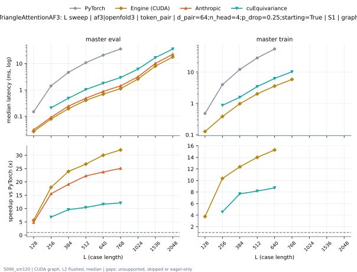
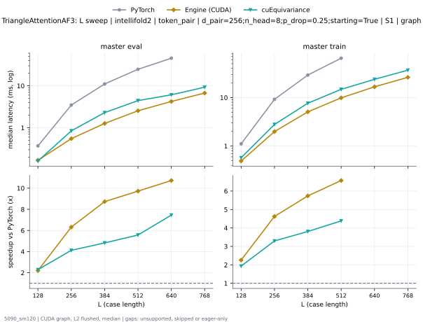
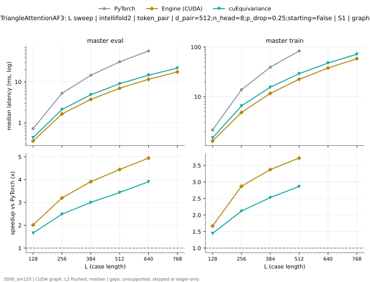
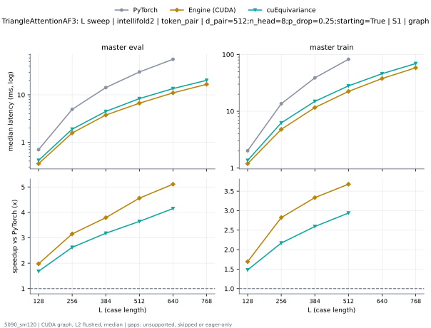
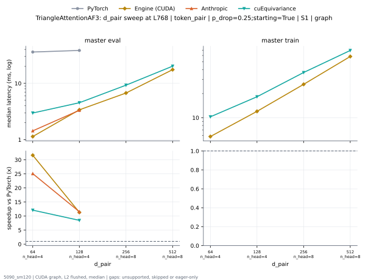

# TriangleAttentionAF3 on 5090_sm120

Generated by `python -m miniworld_engine.measure.plot` from speed tokens `judge/tokens/5090_sm120/`; do not edit.

### L sweep: af3|openfold3 | token_pair | d_pair=128;n_head=4;p_drop=0.25;starting=False | S1 | graph

**master eval** (median ms; x = speedup vs PyTorch)

| L | PyTorch | Engine (Triton) | Engine (CUDA) | Anthropic | cuEquivariance |
|---|---|---|---|---|---|
| 128 | 0.1996 | 0.1104 (1.81x) | 0.06755 (2.95x) | 0.07984 (2.50x) | 0.1024 (1.95x) |
| 256 | 1.656 | 0.3807 (4.35x) | 0.2886 (5.74x) | 0.2908 (5.69x) | 0.3752 (4.41x) |
| 384 | 5.349 | 0.9499 (5.63x) | 0.6616 (8.09x) | 0.681 (7.86x) | 0.933 (5.73x) |
| 512 | 12.13 | 2.041 (5.94x) | 1.315 (9.23x) | 1.267 (9.58x) | 1.95 (6.22x) |
| 640 | 23.11 | 3.541 (6.53x) | 2.211 (10.46x) | 2.127 (10.87x) | 3.421 (6.76x) |
| 768 | 38.74 | 5.111 (7.58x) | 3.44 (11.26x) | 3.29 (11.78x) | 4.936 (7.85x) |
| 1024 | skipped | 10.04 | 7.049 | 6.721 | 9.565 |
| 1536 | skipped | 27 | 20.04 | 19.09 | 25.66 |
| 2048 | skipped | 55.36 | 42.56 | 40.28 | 51.72 |

**master train** (median ms; x = speedup vs PyTorch)

| L | PyTorch | Engine (Triton) | Engine (CUDA) | Anthropic | cuEquivariance |
|---|---|---|---|---|---|
| 128 | 0.5934 | 0.3441 (1.72x) | 0.2373 (2.50x) | unsupported | 0.3561 (1.67x) |
| 256 | 4.434 | 1.343 (3.30x) | 0.9329 (4.75x) | unsupported | 1.287 (3.44x) |
| 384 | 13.76 | 3.376 (4.08x) | 2.175 (6.33x) | unsupported | 3.186 (4.32x) |
| 512 | 31.77 | 7.248 (4.38x) | 4.491 (7.07x) | unsupported | 6.884 (4.62x) |
| 640 | 60.73 | 12.94 (4.70x) | 7.912 (7.68x) | unsupported | 12.41 (4.89x) |
| 768 | skipped | 19.87 | 12.46 | unsupported | 18.9 |
| 1024 |  |  |  |  |  |
| 1536 |  |  |  |  |  |
| 2048 |  |  |  |  |  |

### L sweep: af3|openfold3 | token_pair | d_pair=128;n_head=4;p_drop=0.25;starting=True | S1 | graph

**master eval** (median ms; x = speedup vs PyTorch)

| L | PyTorch | Engine (Triton) | Engine (CUDA) | Anthropic | cuEquivariance |
|---|---|---|---|---|---|
| 128 | 0.1905 | 0.0923 (2.06x) | 0.06555 (2.91x) | 0.07987 (2.38x) | 0.09421 (2.02x) |
| 256 | 1.621 | 0.3317 (4.89x) | 0.2622 (6.18x) | 0.2867 (5.65x) | 0.3276 (4.95x) |
| 384 | 5.215 | 0.8747 (5.96x) | 0.6249 (8.34x) | 0.6656 (7.83x) | 0.848 (6.15x) |
| 512 | 11.96 | 1.871 (6.39x) | 1.285 (9.30x) | 1.275 (9.38x) | 1.78 (6.72x) |
| 640 | 22.83 | 3.27 (6.98x) | 2.203 (10.36x) | 2.143 (10.65x) | 3.139 (7.27x) |
| 768 | 38.36 | 4.711 (8.14x) | 3.39 (11.31x) | 3.327 (11.53x) | 4.531 (8.47x) |
| 1024 | skipped | 9.351 | 6.928 | 6.798 | 8.866 |
| 1536 | skipped | 25.36 | 19.58 | 19.28 | 24.05 |
| 2048 | skipped | 52.43 | 41.71 | 40.64 | 48.88 |

**master train** (median ms; x = speedup vs PyTorch)

| L | PyTorch | Engine (Triton) | Engine (CUDA) | Anthropic | cuEquivariance |
|---|---|---|---|---|---|
| 128 | 0.5735 | 0.3257 (1.76x) | 0.2315 (2.48x) | unsupported | 0.336 (1.71x) |
| 256 | 4.393 | 1.308 (3.36x) | 0.9408 (4.67x) | unsupported | 1.251 (3.51x) |
| 384 | 13.65 | 3.244 (4.21x) | 2.147 (6.36x) | unsupported | 3.064 (4.45x) |
| 512 | 31.5 | 6.968 (4.52x) | 4.326 (7.28x) | unsupported | 6.602 (4.77x) |
| 640 | 60.31 | 12.49 (4.83x) | 7.627 (7.91x) | unsupported | 11.98 (5.04x) |
| 768 | skipped | 19.21 | 12.01 | unsupported | 18.28 |
| 1024 |  |  |  |  |  |
| 1536 |  |  |  |  |  |
| 2048 |  |  |  |  |  |

### L sweep: af3|openfold3 | token_pair | d_pair=64;n_head=4;p_drop=0.25;starting=False | S1 | graph

**master eval** (median ms; x = speedup vs PyTorch)

| L | PyTorch | Engine (Triton) | Engine (CUDA) | Anthropic | cuEquivariance |
|---|---|---|---|---|---|
| 128 | 0.172 | 0.08192 (2.10x) | 0.03072 (5.60x) | 0.03482 (4.94x) | unsupported |
| 256 | 1.475 | 0.227 (6.49x) | 0.09213 (16.01x) | 0.1065 (13.85x) | 0.2457 (6.00x) |
| 384 | 4.788 | 0.523 (9.16x) | 0.2109 (22.70x) | 0.2499 (19.16x) | 0.5366 (8.92x) |
| 512 | 10.9 | 1.016 (10.73x) | 0.4239 (25.71x) | 0.4874 (22.36x) | 1.086 (10.04x) |
| 640 | 21.07 | 1.87 (11.27x) | 0.7393 (28.49x) | 0.8827 (23.87x) | 1.918 (10.98x) |
| 768 | 36.18 | 3.093 (11.70x) | 1.168 (30.96x) | 1.436 (25.19x) | 3.162 (11.44x) |
| 1024 | skipped | 6.264 | 2.646 | 3.109 | 6.531 |
| 1536 | skipped | 17.15 | 8.067 | 10.14 | 17.7 |
| 2048 | skipped | 35.7 | 17.83 | 22.65 | 37.21 |

**master train** (median ms; x = speedup vs PyTorch)

| L | PyTorch | Engine (Triton) | Engine (CUDA) | Anthropic | cuEquivariance |
|---|---|---|---|---|---|
| 128 | 0.4916 | 0.2786 (1.76x) | 0.1927 (2.55x) | unsupported | unsupported |
| 256 | 4.049 | 1.026 (3.94x) | 0.7005 (5.78x) | unsupported | 0.9466 (4.28x) |
| 384 | 12.19 | 2.102 (5.80x) | 1.914 (6.37x) | unsupported | 1.799 (6.77x) |
| 512 | 28.31 | 4.29 (6.60x) | 3.646 (7.76x) | unsupported | 3.604 (7.85x) |
| 640 | 54.83 | 7.823 (7.01x) | 6.554 (8.37x) | unsupported | 6.484 (8.46x) |
| 768 | skipped | 12.88 | 10.6 | unsupported | 10.58 |
| 1024 |  |  |  |  |  |
| 1536 |  |  |  |  |  |
| 2048 |  |  |  |  |  |

### L sweep: af3|openfold3 | token_pair | d_pair=64;n_head=4;p_drop=0.25;starting=True | S1 | graph

**master eval** (median ms; x = speedup vs PyTorch)

| L | PyTorch | Engine (Triton) | Engine (CUDA) | Anthropic | cuEquivariance |
|---|---|---|---|---|---|
| 128 | 0.1492 | 0.06755 (2.21x) | 0.02662 (5.61x) | 0.03098 (4.82x) | unsupported |
| 256 | 1.432 | 0.1922 (7.45x) | 0.08006 (17.89x) | 0.09216 (15.54x) | 0.2111 (6.79x) |
| 384 | 4.692 | 0.4659 (10.07x) | 0.1987 (23.62x) | 0.2437 (19.25x) | 0.4854 (9.67x) |
| 512 | 10.83 | 0.971 (11.16x) | 0.4116 (26.32x) | 0.4868 (22.26x) | 1.042 (10.39x) |
| 640 | 20.93 | 1.745 (12.00x) | 0.7089 (29.53x) | 0.8827 (23.72x) | 1.799 (11.63x) |
| 768 | 35.98 | 2.899 (12.41x) | 1.138 (31.63x) | 1.435 (25.08x) | 2.975 (12.09x) |
| 1024 | skipped | 5.915 | 2.6 | 3.183 | 6.187 |
| 1536 | skipped | 16.35 | 7.953 | 10.2 | 16.87 |
| 2048 | skipped | 34.31 | 17.64 | 22.69 | 35.82 |

**master train** (median ms; x = speedup vs PyTorch)

| L | PyTorch | Engine (Triton) | Engine (CUDA) | Anthropic | cuEquivariance |
|---|---|---|---|---|---|
| 128 | 0.4783 | 0.2663 (1.80x) | 0.1291 (3.71x) | unsupported | unsupported |
| 256 | 3.965 | 0.9749 (4.07x) | 0.381 (10.41x) | unsupported | 0.8694 (4.56x) |
| 384 | 12.14 | 1.897 (6.40x) | 0.9853 (12.32x) | unsupported | 1.578 (7.69x) |
| 512 | 28.2 | 4.151 (6.79x) | 2.018 (13.98x) | unsupported | 3.454 (8.16x) |
| 640 | 54.61 | 7.611 (7.17x) | 3.584 (15.24x) | unsupported | 6.26 (8.72x) |
| 768 | skipped | 12.54 | 5.814 | unsupported | 10.26 |
| 1024 |  |  |  |  |  |
| 1536 |  |  |  |  |  |
| 2048 |  |  |  |  |  |

### L sweep: intellifold2 | token_pair | d_pair=256;n_head=8;p_drop=0.25;starting=False | S1 | graph

**master eval** (median ms; x = speedup vs PyTorch)

| L | PyTorch | Engine (Triton) | Engine (CUDA) | Anthropic | cuEquivariance |
|---|---|---|---|---|---|
| 128 | 0.3853 | 0.1822 (2.11x) | 0.1823 (2.11x) | failed | 0.1805 (2.13x) |
| 256 | 3.578 | 0.9055 (3.95x) | 0.556 (6.43x) | failed | 0.8908 (4.02x) |
| 384 | 11.29 | 2.567 (4.40x) | 1.319 (8.56x) | failed | 2.501 (4.51x) |
| 512 | 25.09 | 4.907 (5.11x) | 2.594 (9.67x) | failed | 4.788 (5.24x) |
| 640 | 46.14 | 6.826 (6.76x) | 4.579 (10.08x) | failed | 6.66 (6.93x) |
| 768 | skipped | 10.39 | 7.17 | failed | 10.07 |

**master train** (median ms; x = speedup vs PyTorch)

| L | PyTorch | Engine (Triton) | Engine (CUDA) | Anthropic | cuEquivariance |
|---|---|---|---|---|---|
| 128 | 1.157 | 0.6718 (1.72x) | 0.559 (2.07x) | unsupported | 0.6677 (1.73x) |
| 256 | 9.279 | 3.055 (3.04x) | 1.99 (4.66x) | unsupported | 2.904 (3.20x) |
| 384 | 29.42 | 8.328 (3.53x) | 5.149 (5.71x) | unsupported | 7.957 (3.70x) |
| 512 | 65.31 | 16.05 (4.07x) | 10.16 (6.43x) | unsupported | 15.34 (4.26x) |
| 640 | skipped | 25.73 | 17.2 | unsupported | 24.65 |
| 768 | skipped | 39.88 | 26.91 | unsupported | 38.07 |

### L sweep: intellifold2 | token_pair | d_pair=256;n_head=8;p_drop=0.25;starting=True | S1 | graph

**master eval** (median ms; x = speedup vs PyTorch)

| L | PyTorch | Engine (Triton) | Engine (CUDA) | Anthropic | cuEquivariance |
|---|---|---|---|---|---|
| 128 | 0.3709 | 0.1638 (2.26x) | 0.1682 (2.20x) | failed | 0.1618 (2.29x) |
| 256 | 3.485 | 0.8589 (4.06x) | 0.5516 (6.32x) | failed | 0.846 (4.12x) |
| 384 | 11.09 | 2.37 (4.68x) | 1.271 (8.73x) | failed | 2.299 (4.82x) |
| 512 | 24.77 | 4.57 (5.42x) | 2.548 (9.72x) | failed | 4.448 (5.57x) |
| 640 | 45.55 | 6.264 (7.27x) | 4.247 (10.72x) | failed | 6.109 (7.46x) |
| 768 | skipped | 9.585 | 6.736 | failed | 9.28 |

**master train** (median ms; x = speedup vs PyTorch)

| L | PyTorch | Engine (Triton) | Engine (CUDA) | Anthropic | cuEquivariance |
|---|---|---|---|---|---|
| 128 | 1.11 | 0.5936 (1.87x) | 0.4916 (2.26x) | unsupported | 0.574 (1.93x) |
| 256 | 9.183 | 2.947 (3.12x) | 1.986 (4.62x) | unsupported | 2.787 (3.30x) |
| 384 | 29.11 | 8.005 (3.64x) | 5.074 (5.74x) | unsupported | 7.644 (3.81x) |
| 512 | 64.82 | 15.49 (4.19x) | 9.865 (6.57x) | unsupported | 14.79 (4.38x) |
| 640 | skipped | 24.84 | 16.68 | unsupported | 23.78 |
| 768 | skipped | 38.56 | 26.13 | unsupported | 36.74 |

### L sweep: intellifold2 | token_pair | d_pair=512;n_head=8;p_drop=0.25;starting=False | S1 | graph

**master eval** (median ms; x = speedup vs PyTorch)

| L | PyTorch | Engine (Triton) | Engine (CUDA) | Anthropic | cuEquivariance |
|---|---|---|---|---|---|
| 128 | 0.7188 | 0.4355 (1.65x) | 0.3564 (2.02x) | unsupported | 0.4321 (1.66x) |
| 256 | 5.243 | 2.098 (2.50x) | 1.639 (3.20x) | unsupported | 2.106 (2.49x) |
| 384 | 14.57 | 4.94 (2.95x) | 3.726 (3.91x) | unsupported | 4.854 (3.00x) |
| 512 | 31.04 | 9.224 (3.36x) | 6.983 (4.44x) | unsupported | 9.029 (3.44x) |
| 640 | 57.23 | 15.01 (3.81x) | 11.58 (4.94x) | unsupported | 14.64 (3.91x) |
| 768 | skipped | 22.46 | 17.59 | unsupported | 21.79 |

**master train** (median ms; x = speedup vs PyTorch)

| L | PyTorch | Engine (Triton) | Engine (CUDA) | Anthropic | cuEquivariance |
|---|---|---|---|---|---|
| 128 | 2.135 | 1.517 (1.41x) | 1.279 (1.67x) | unsupported | 1.478 (1.44x) |
| 256 | 13.82 | 6.822 (2.03x) | 4.811 (2.87x) | unsupported | 6.516 (2.12x) |
| 384 | 39.35 | 16.42 (2.40x) | 11.66 (3.38x) | unsupported | 15.56 (2.53x) |
| 512 | 83.45 | 35.39 (2.36x) | 22.41 (3.72x) | unsupported | 29.13 (2.86x) |
| 640 | skipped | 59.39 | 37.81 | unsupported | 47.69 |
| 768 | skipped | 84.46 | 58.41 | unsupported | 71.94 |

### L sweep: intellifold2 | token_pair | d_pair=512;n_head=8;p_drop=0.25;starting=True | S1 | graph

**master eval** (median ms; x = speedup vs PyTorch)

| L | PyTorch | Engine (Triton) | Engine (CUDA) | Anthropic | cuEquivariance |
|---|---|---|---|---|---|
| 128 | 0.6953 | 0.4259 (1.63x) | 0.3525 (1.97x) | unsupported | 0.414 (1.68x) |
| 256 | 4.97 | 1.904 (2.61x) | 1.539 (3.23x) | unsupported | 1.881 (2.64x) |
| 384 | 14.18 | 4.548 (3.12x) | 3.694 (3.84x) | unsupported | 4.459 (3.18x) |
| 512 | 30.32 | 8.508 (3.56x) | 6.938 (4.37x) | unsupported | 8.314 (3.65x) |
| 640 | 56.12 | 13.89 (4.04x) | 11.51 (4.88x) | unsupported | 13.52 (4.15x) |
| 768 | skipped | 20.85 | 17.5 | unsupported | 20.18 |

**master train** (median ms; x = speedup vs PyTorch)

| L | PyTorch | Engine (Triton) | Engine (CUDA) | Anthropic | cuEquivariance |
|---|---|---|---|---|---|
| 128 | 2.06 | 1.404 (1.47x) | 1.226 (1.68x) | unsupported | 1.365 (1.51x) |
| 256 | 13.58 | 6.559 (2.07x) | 4.778 (2.84x) | unsupported | 6.254 (2.17x) |
| 384 | 38.76 | 15.8 (2.45x) | 11.6 (3.34x) | unsupported | 14.95 (2.59x) |
| 512 | 82.36 | 34.28 (2.40x) | 22.32 (3.69x) | unsupported | 28.01 (2.94x) |
| 640 | skipped | 57.54 | 37.71 | unsupported | 45.91 |
| 768 | skipped | 81.83 | 58.26 | unsupported | 69.3 |

### d_pair sweep at L768: token_pair | p_drop=0.25;starting=False | S1 | graph

**master eval** (median ms; x = speedup vs PyTorch)

| d_pair | PyTorch | Engine (Triton) | Engine (CUDA) | Anthropic | cuEquivariance |
|---|---|---|---|---|---|
| 64 n_head=4 | 36.18 | 3.093 (11.70x) | 1.168 (30.96x) | 1.436 (25.19x) | 3.162 (11.44x) |
| 128 n_head=4 | 38.74 | 5.111 (7.58x) | 3.44 (11.26x) | 3.29 (11.78x) | 4.936 (7.85x) |
| 256 n_head=8 | skipped | 10.39 | 7.17 | failed | 10.07 |
| 512 n_head=8 | skipped | 22.46 | 17.59 | unsupported | 21.79 |

**master train** (median ms; x = speedup vs PyTorch)

| d_pair | PyTorch | Engine (Triton) | Engine (CUDA) | Anthropic | cuEquivariance |
|---|---|---|---|---|---|
| 64 n_head=4 | skipped | 12.88 | 10.6 | unsupported | 10.58 |
| 128 n_head=4 | skipped | 19.87 | 12.46 | unsupported | 18.9 |
| 256 n_head=8 | skipped | 39.88 | 26.91 | unsupported | 38.07 |
| 512 n_head=8 | skipped | 84.46 | 58.41 | unsupported | 71.94 |

### d_pair sweep at L768: token_pair | p_drop=0.25;starting=True | S1 | graph

**master eval** (median ms; x = speedup vs PyTorch)

| d_pair | PyTorch | Engine (Triton) | Engine (CUDA) | Anthropic | cuEquivariance |
|---|---|---|---|---|---|
| 64 n_head=4 | 35.98 | 2.899 (12.41x) | 1.138 (31.63x) | 1.435 (25.08x) | 2.975 (12.09x) |
| 128 n_head=4 | 38.36 | 4.711 (8.14x) | 3.39 (11.31x) | 3.327 (11.53x) | 4.531 (8.47x) |
| 256 n_head=8 | skipped | 9.585 | 6.736 | failed | 9.28 |
| 512 n_head=8 | skipped | 20.85 | 17.5 | unsupported | 20.18 |

**master train** (median ms; x = speedup vs PyTorch)

| d_pair | PyTorch | Engine (Triton) | Engine (CUDA) | Anthropic | cuEquivariance |
|---|---|---|---|---|---|
| 64 n_head=4 | skipped | 12.54 | 5.814 | unsupported | 10.26 |
| 128 n_head=4 | skipped | 19.21 | 12.01 | unsupported | 18.28 |
| 256 n_head=8 | skipped | 38.56 | 26.13 | unsupported | 36.74 |
| 512 n_head=8 | skipped | 81.83 | 58.26 | unsupported | 69.3 |

