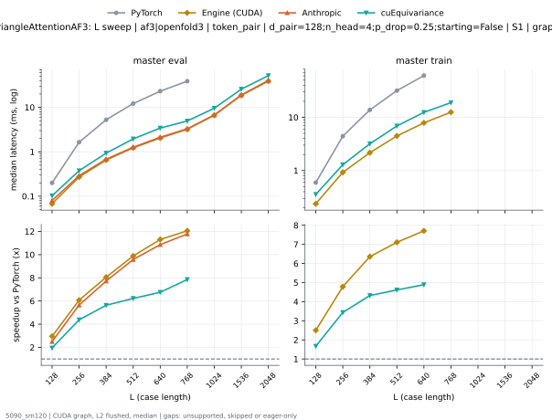
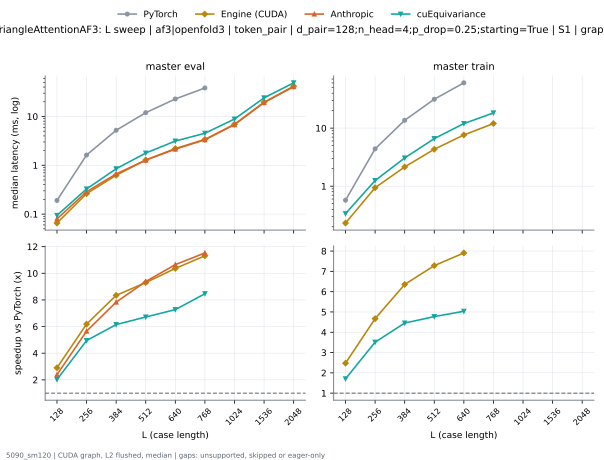
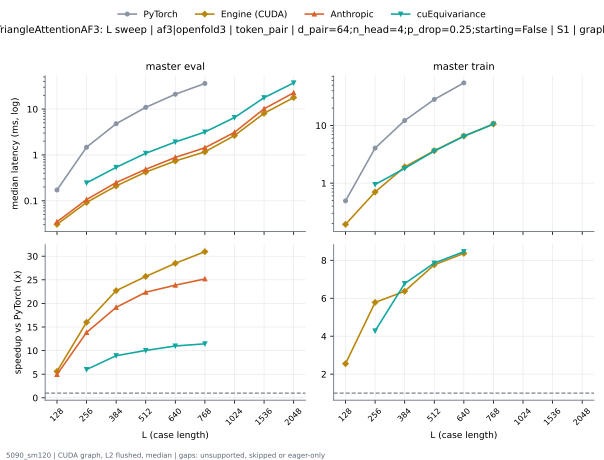
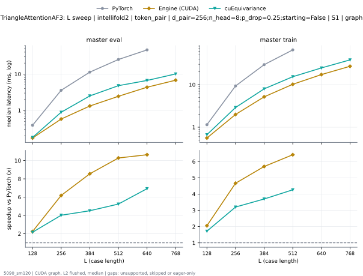
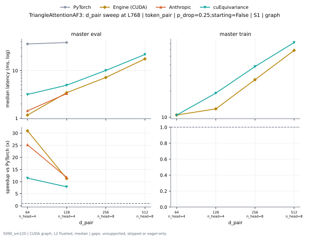

# TriangleAttentionAF3 on 5090_sm120

Generated by `python -m foldjet_engine.measure.plot` from speed tokens `judge/tokens/5090_sm120/`; do not edit.

### L sweep: af3|openfold3 | token_pair | d_pair=128;n_head=4;p_drop=0.25;starting=False | S1 | graph

**master eval** (median ms; x = speedup vs PyTorch)

| L | PyTorch | Engine (Triton) | Engine (CUDA) | Anthropic | cuEquivariance |
|---|---|---|---|---|---|
| 128 | 0.1997 | 0.1104 (1.81x) | 0.06762 (2.95x) | 0.07984 (2.50x) | 0.1024 (1.95x) |
| 256 | 1.644 | 0.3807 (4.32x) | 0.2707 (6.07x) | 0.2908 (5.65x) | 0.3752 (4.38x) |
| 384 | 5.258 | 0.9499 (5.54x) | 0.6525 (8.06x) | 0.681 (7.72x) | 0.933 (5.64x) |
| 512 | 12.14 | 2.041 (5.95x) | 1.228 (9.89x) | 1.267 (9.58x) | 1.95 (6.22x) |
| 640 | 23.11 | 3.541 (6.53x) | 2.043 (11.31x) | 2.127 (10.86x) | 3.421 (6.76x) |
| 768 | 38.78 | 5.111 (7.59x) | 3.216 (12.06x) | 3.29 (11.79x) | 4.936 (7.86x) |
| 1024 | skipped | 10.04 | 6.669 | 6.721 | 9.565 |
| 1536 | skipped | 27 | 18.64 | 19.09 | 25.66 |
| 2048 | skipped | 55.36 | 38.91 | 40.28 | 51.72 |

**master train** (median ms; x = speedup vs PyTorch)

| L | PyTorch | Engine (Triton) | Engine (CUDA) | Anthropic | cuEquivariance |
|---|---|---|---|---|---|
| 128 | 0.594 | 0.3441 (1.73x) | 0.2376 (2.50x) | unsupported | 0.3561 (1.67x) |
| 256 | 4.424 | 1.343 (3.30x) | 0.9248 (4.78x) | unsupported | 1.287 (3.44x) |
| 384 | 13.77 | 3.376 (4.08x) | 2.166 (6.36x) | unsupported | 3.186 (4.32x) |
| 512 | 31.77 | 7.248 (4.38x) | 4.468 (7.11x) | unsupported | 6.884 (4.61x) |
| 640 | 60.72 | 12.94 (4.69x) | 7.874 (7.71x) | unsupported | 12.41 (4.89x) |
| 768 | skipped | 19.87 | 12.5 | unsupported | 18.9 |
| 1024 |  |  |  |  |  |
| 1536 |  |  |  |  |  |
| 2048 |  |  |  |  |  |

### L sweep: af3|openfold3 | token_pair | d_pair=128;n_head=4;p_drop=0.25;starting=True | S1 | graph

**master eval** (median ms; x = speedup vs PyTorch)

| L | PyTorch | Engine (Triton) | Engine (CUDA) | Anthropic | cuEquivariance |
|---|---|---|---|---|---|
| 128 | 0.1887 | 0.0923 (2.04x) | 0.06758 (2.79x) | 0.07987 (2.36x) | 0.09421 (2.00x) |
| 256 | 1.623 | 0.3317 (4.89x) | 0.2604 (6.23x) | 0.2867 (5.66x) | 0.3276 (4.96x) |
| 384 | 5.21 | 0.8747 (5.96x) | 0.6329 (8.23x) | 0.6656 (7.83x) | 0.848 (6.14x) |
| 512 | 11.97 | 1.871 (6.40x) | 1.22 (9.81x) | 1.275 (9.39x) | 1.78 (6.73x) |
| 640 | 22.83 | 3.27 (6.98x) | 2.004 (11.39x) | 2.143 (10.65x) | 3.139 (7.27x) |
| 768 | 38.34 | 4.711 (8.14x) | 3.213 (11.93x) | 3.327 (11.52x) | 4.531 (8.46x) |
| 1024 | skipped | 9.351 | 6.455 | 6.798 | 8.866 |
| 1536 | skipped | 25.36 | 18.21 | 19.28 | 24.05 |
| 2048 | skipped | 52.43 | 39.28 | 40.64 | 48.88 |

**master train** (median ms; x = speedup vs PyTorch)

| L | PyTorch | Engine (Triton) | Engine (CUDA) | Anthropic | cuEquivariance |
|---|---|---|---|---|---|
| 128 | 0.5745 | 0.3257 (1.76x) | 0.2316 (2.48x) | unsupported | 0.336 (1.71x) |
| 256 | 4.366 | 1.308 (3.34x) | 0.9206 (4.74x) | unsupported | 1.251 (3.49x) |
| 384 | 13.65 | 3.244 (4.21x) | 2.145 (6.36x) | unsupported | 3.064 (4.46x) |
| 512 | 31.49 | 6.968 (4.52x) | 4.325 (7.28x) | unsupported | 6.602 (4.77x) |
| 640 | 60.34 | 12.49 (4.83x) | 7.651 (7.89x) | unsupported | 11.98 (5.04x) |
| 768 | skipped | 19.21 | 12.07 | unsupported | 18.28 |
| 1024 |  |  |  |  |  |
| 1536 |  |  |  |  |  |
| 2048 |  |  |  |  |  |

### L sweep: af3|openfold3 | token_pair | d_pair=64;n_head=4;p_drop=0.25;starting=False | S1 | graph

**master eval** (median ms; x = speedup vs PyTorch)

| L | PyTorch | Engine (Triton) | Engine (CUDA) | Anthropic | cuEquivariance |
|---|---|---|---|---|---|
| 128 | 0.172 | 0.08192 (2.10x) | 0.03072 (5.60x) | 0.03482 (4.94x) | unsupported |
| 256 | 1.475 | 0.227 (6.50x) | 0.09213 (16.02x) | 0.1065 (13.85x) | 0.2457 (6.00x) |
| 384 | 4.77 | 0.523 (9.12x) | 0.2058 (23.18x) | 0.2499 (19.09x) | 0.5366 (8.89x) |
| 512 | 10.89 | 1.016 (10.72x) | 0.4178 (26.08x) | 0.4874 (22.35x) | 1.086 (10.03x) |
| 640 | 21.08 | 1.87 (11.27x) | 0.7311 (28.83x) | 0.8827 (23.88x) | 1.918 (10.99x) |
| 768 | 36.21 | 3.093 (11.71x) | 1.166 (31.05x) | 1.436 (25.22x) | 3.162 (11.45x) |
| 1024 | skipped | 6.264 | 2.658 | 3.109 | 6.531 |
| 1536 | skipped | 17.15 | 8.15 | 10.14 | 17.7 |
| 2048 | skipped | 35.7 | 18.15 | 22.65 | 37.21 |

**master train** (median ms; x = speedup vs PyTorch)

| L | PyTorch | Engine (Triton) | Engine (CUDA) | Anthropic | cuEquivariance |
|---|---|---|---|---|---|
| 128 | 0.4957 | 0.2786 (1.78x) | 0.1926 (2.57x) | unsupported | unsupported |
| 256 | 4.014 | 1.026 (3.91x) | 0.6698 (5.99x) | unsupported | 0.9466 (4.24x) |
| 384 | 12.19 | 2.102 (5.80x) | 1.798 (6.78x) | unsupported | 1.799 (6.77x) |
| 512 | 28.31 | 4.29 (6.60x) | 3.655 (7.75x) | unsupported | 3.604 (7.85x) |
| 640 | 54.8 | 7.823 (7.01x) | 6.566 (8.35x) | unsupported | 6.484 (8.45x) |
| 768 | skipped | 12.88 | 10.61 | unsupported | 10.58 |
| 1024 |  |  |  |  |  |
| 1536 |  |  |  |  |  |
| 2048 |  |  |  |  |  |

### L sweep: af3|openfold3 | token_pair | d_pair=64;n_head=4;p_drop=0.25;starting=True | S1 | graph

**master eval** (median ms; x = speedup vs PyTorch)

| L | PyTorch | Engine (Triton) | Engine (CUDA) | Anthropic | cuEquivariance |
|---|---|---|---|---|---|
| 128 | 0.1495 | 0.06755 (2.21x) | 0.02662 (5.62x) | 0.03098 (4.83x) | unsupported |
| 256 | 1.433 | 0.1922 (7.46x) | 0.07984 (17.95x) | 0.09216 (15.55x) | 0.2111 (6.79x) |
| 384 | 4.658 | 0.4659 (10.00x) | 0.1946 (23.94x) | 0.2437 (19.11x) | 0.4854 (9.60x) |
| 512 | 10.83 | 0.971 (11.16x) | 0.4057 (26.71x) | 0.4868 (22.26x) | 1.042 (10.39x) |
| 640 | 20.95 | 1.745 (12.01x) | 0.6973 (30.04x) | 0.8827 (23.73x) | 1.799 (11.64x) |
| 768 | 36.01 | 2.899 (12.42x) | 1.124 (32.03x) | 1.435 (25.10x) | 2.975 (12.10x) |
| 1024 | skipped | 5.915 | 2.607 | 3.183 | 6.187 |
| 1536 | skipped | 16.35 | 8.019 | 10.2 | 16.87 |
| 2048 | skipped | 34.31 | 17.89 | 22.69 | 35.82 |

**master train** (median ms; x = speedup vs PyTorch)

| L | PyTorch | Engine (Triton) | Engine (CUDA) | Anthropic | cuEquivariance |
|---|---|---|---|---|---|
| 128 | 0.4793 | 0.2663 (1.80x) | 0.1275 (3.76x) | unsupported | unsupported |
| 256 | 3.965 | 0.9749 (4.07x) | 0.383 (10.35x) | unsupported | 0.8694 (4.56x) |
| 384 | 12.14 | 1.897 (6.40x) | 0.9812 (12.37x) | unsupported | 1.578 (7.69x) |
| 512 | 28.2 | 4.151 (6.79x) | 2.015 (14.00x) | unsupported | 3.454 (8.16x) |
| 640 | 54.61 | 7.611 (7.18x) | 3.572 (15.29x) | unsupported | 6.26 (8.72x) |
| 768 | skipped | 12.54 | 5.829 | unsupported | 10.26 |
| 1024 |  |  |  |  |  |
| 1536 |  |  |  |  |  |
| 2048 |  |  |  |  |  |

### L sweep: intellifold2 | token_pair | d_pair=256;n_head=8;p_drop=0.25;starting=False | S1 | graph

**master eval** (median ms; x = speedup vs PyTorch)

| L | PyTorch | Engine (Triton) | Engine (CUDA) | Anthropic | cuEquivariance |
|---|---|---|---|---|---|
| 128 | 0.3901 | 0.1822 (2.14x) | 0.1741 (2.24x) | failed | 0.1805 (2.16x) |
| 256 | 3.579 | 0.9055 (3.95x) | 0.5786 (6.19x) | failed | 0.8908 (4.02x) |
| 384 | 11.29 | 2.567 (4.40x) | 1.32 (8.55x) | failed | 2.501 (4.51x) |
| 512 | 25.11 | 4.907 (5.12x) | 2.442 (10.28x) | failed | 4.788 (5.24x) |
| 640 | 46.13 | 6.826 (6.76x) | 4.337 (10.64x) | failed | 6.66 (6.93x) |
| 768 | skipped | 10.39 | 6.769 | failed | 10.07 |

**master train** (median ms; x = speedup vs PyTorch)

| L | PyTorch | Engine (Triton) | Engine (CUDA) | Anthropic | cuEquivariance |
|---|---|---|---|---|---|
| 128 | 1.146 | 0.6718 (1.71x) | 0.5584 (2.05x) | unsupported | 0.6677 (1.72x) |
| 256 | 9.293 | 3.055 (3.04x) | 1.993 (4.66x) | unsupported | 2.904 (3.20x) |
| 384 | 29.4 | 8.328 (3.53x) | 5.165 (5.69x) | unsupported | 7.957 (3.70x) |
| 512 | 65.34 | 16.05 (4.07x) | 10.18 (6.42x) | unsupported | 15.34 (4.26x) |
| 640 | skipped | 25.73 | 17.21 | unsupported | 24.65 |
| 768 | skipped | 39.88 | 26.95 | unsupported | 38.07 |

### L sweep: intellifold2 | token_pair | d_pair=256;n_head=8;p_drop=0.25;starting=True | S1 | graph

**master eval** (median ms; x = speedup vs PyTorch)

| L | PyTorch | Engine (Triton) | Engine (CUDA) | Anthropic | cuEquivariance |
|---|---|---|---|---|---|
| 128 | 0.3748 | 0.1638 (2.29x) | 0.17 (2.20x) | failed | 0.1618 (2.32x) |
| 256 | 3.461 | 0.8589 (4.03x) | 0.5222 (6.63x) | failed | 0.846 (4.09x) |
| 384 | 11.1 | 2.37 (4.68x) | 1.275 (8.70x) | failed | 2.299 (4.83x) |
| 512 | 24.74 | 4.57 (5.41x) | 2.4 (10.31x) | failed | 4.448 (5.56x) |
| 640 | 45.54 | 6.264 (7.27x) | 3.982 (11.44x) | failed | 6.109 (7.45x) |
| 768 | skipped | 9.585 | 6.336 | failed | 9.28 |

**master train** (median ms; x = speedup vs PyTorch)

| L | PyTorch | Engine (Triton) | Engine (CUDA) | Anthropic | cuEquivariance |
|---|---|---|---|---|---|
| 128 | 1.113 | 0.5936 (1.88x) | 0.4933 (2.26x) | unsupported | 0.574 (1.94x) |
| 256 | 9.17 | 2.947 (3.11x) | 1.987 (4.61x) | unsupported | 2.787 (3.29x) |
| 384 | 29.1 | 8.005 (3.64x) | 5.081 (5.73x) | unsupported | 7.644 (3.81x) |
| 512 | 64.83 | 15.49 (4.19x) | 9.905 (6.55x) | unsupported | 14.79 (4.38x) |
| 640 | skipped | 24.84 | 16.73 | unsupported | 23.78 |
| 768 | skipped | 38.56 | 26.17 | unsupported | 36.74 |

### L sweep: intellifold2 | token_pair | d_pair=512;n_head=8;p_drop=0.25;starting=False | S1 | graph

**master eval** (median ms; x = speedup vs PyTorch)

| L | PyTorch | Engine (Triton) | Engine (CUDA) | Anthropic | cuEquivariance |
|---|---|---|---|---|---|
| 128 | 0.7838 | 0.4355 (1.80x) | 0.4009 (1.96x) | unsupported | 0.4321 (1.81x) |
| 256 | 5.211 | 2.098 (2.48x) | 1.661 (3.14x) | unsupported | 2.106 (2.47x) |
| 384 | 14.56 | 4.94 (2.95x) | 3.772 (3.86x) | unsupported | 4.854 (3.00x) |
| 512 | 31.01 | 9.224 (3.36x) | 6.687 (4.64x) | unsupported | 9.029 (3.43x) |
| 640 | 57.21 | 15.01 (3.81x) | 11.06 (5.17x) | unsupported | 14.64 (3.91x) |
| 768 | skipped | 22.46 | 16.74 | unsupported | 21.79 |

**master train** (median ms; x = speedup vs PyTorch)

| L | PyTorch | Engine (Triton) | Engine (CUDA) | Anthropic | cuEquivariance |
|---|---|---|---|---|---|
| 128 | 2.245 | 1.517 (1.48x) | 1.32 (1.70x) | unsupported | 1.478 (1.52x) |
| 256 | 13.84 | 6.822 (2.03x) | 4.832 (2.86x) | unsupported | 6.516 (2.12x) |
| 384 | 39.33 | 16.42 (2.39x) | 11.67 (3.37x) | unsupported | 15.56 (2.53x) |
| 512 | 83.4 | 35.39 (2.36x) | 22.44 (3.72x) | unsupported | 29.13 (2.86x) |
| 640 | skipped | 59.39 | 37.86 | unsupported | 47.69 |
| 768 | skipped | 84.46 | 58.43 | unsupported | 71.94 |

### L sweep: intellifold2 | token_pair | d_pair=512;n_head=8;p_drop=0.25;starting=True | S1 | graph

**master eval** (median ms; x = speedup vs PyTorch)

| L | PyTorch | Engine (Triton) | Engine (CUDA) | Anthropic | cuEquivariance |
|---|---|---|---|---|---|
| 128 | 0.6964 | 0.4259 (1.64x) | 0.3523 (1.98x) | unsupported | 0.414 (1.68x) |
| 256 | 4.936 | 1.904 (2.59x) | 1.565 (3.15x) | unsupported | 1.881 (2.62x) |
| 384 | 14.17 | 4.548 (3.12x) | 3.738 (3.79x) | unsupported | 4.459 (3.18x) |
| 512 | 30.31 | 8.508 (3.56x) | 6.647 (4.56x) | unsupported | 8.314 (3.65x) |
| 640 | 56.12 | 13.89 (4.04x) | 10.99 (5.11x) | unsupported | 13.52 (4.15x) |
| 768 | skipped | 20.85 | 16.65 | unsupported | 20.18 |

**master train** (median ms; x = speedup vs PyTorch)

| L | PyTorch | Engine (Triton) | Engine (CUDA) | Anthropic | cuEquivariance |
|---|---|---|---|---|---|
| 128 | 2.02 | 1.404 (1.44x) | 1.195 (1.69x) | unsupported | 1.365 (1.48x) |
| 256 | 13.57 | 6.559 (2.07x) | 4.807 (2.82x) | unsupported | 6.254 (2.17x) |
| 384 | 38.76 | 15.8 (2.45x) | 11.62 (3.33x) | unsupported | 14.95 (2.59x) |
| 512 | 82.33 | 34.28 (2.40x) | 22.38 (3.68x) | unsupported | 28.01 (2.94x) |
| 640 | skipped | 57.54 | 37.77 | unsupported | 45.91 |
| 768 | skipped | 81.83 | 58.32 | unsupported | 69.3 |

### d_pair sweep at L768: token_pair | p_drop=0.25;starting=False | S1 | graph

**master eval** (median ms; x = speedup vs PyTorch)

| d_pair | PyTorch | Engine (Triton) | Engine (CUDA) | Anthropic | cuEquivariance |
|---|---|---|---|---|---|
| 64 n_head=4 | 36.21 | 3.093 (11.71x) | 1.166 (31.05x) | 1.436 (25.22x) | 3.162 (11.45x) |
| 128 n_head=4 | 38.78 | 5.111 (7.59x) | 3.216 (12.06x) | 3.29 (11.79x) | 4.936 (7.86x) |
| 256 n_head=8 | skipped | 10.39 | 6.769 | failed | 10.07 |
| 512 n_head=8 | skipped | 22.46 | 16.74 | unsupported | 21.79 |

**master train** (median ms; x = speedup vs PyTorch)

| d_pair | PyTorch | Engine (Triton) | Engine (CUDA) | Anthropic | cuEquivariance |
|---|---|---|---|---|---|
| 64 n_head=4 | skipped | 12.88 | 10.61 | unsupported | 10.58 |
| 128 n_head=4 | skipped | 19.87 | 12.5 | unsupported | 18.9 |
| 256 n_head=8 | skipped | 39.88 | 26.95 | unsupported | 38.07 |
| 512 n_head=8 | skipped | 84.46 | 58.43 | unsupported | 71.94 |

### d_pair sweep at L768: token_pair | p_drop=0.25;starting=True | S1 | graph

**master eval** (median ms; x = speedup vs PyTorch)

| d_pair | PyTorch | Engine (Triton) | Engine (CUDA) | Anthropic | cuEquivariance |
|---|---|---|---|---|---|
| 64 n_head=4 | 36.01 | 2.899 (12.42x) | 1.124 (32.03x) | 1.435 (25.10x) | 2.975 (12.10x) |
| 128 n_head=4 | 38.34 | 4.711 (8.14x) | 3.213 (11.93x) | 3.327 (11.52x) | 4.531 (8.46x) |
| 256 n_head=8 | skipped | 9.585 | 6.336 | failed | 9.28 |
| 512 n_head=8 | skipped | 20.85 | 16.65 | unsupported | 20.18 |

**master train** (median ms; x = speedup vs PyTorch)

| d_pair | PyTorch | Engine (Triton) | Engine (CUDA) | Anthropic | cuEquivariance |
|---|---|---|---|---|---|
| 64 n_head=4 | skipped | 12.54 | 5.829 | unsupported | 10.26 |
| 128 n_head=4 | skipped | 19.21 | 12.07 | unsupported | 18.28 |
| 256 n_head=8 | skipped | 38.56 | 26.17 | unsupported | 36.74 |
| 512 n_head=8 | skipped | 81.83 | 58.32 | unsupported | 69.3 |

