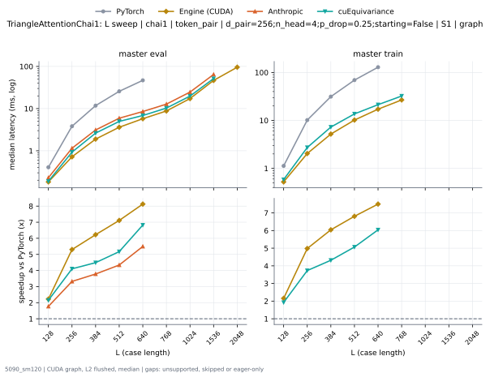

# TriangleAttentionChai1 on 5090_sm120

Generated by `python -m miniworld_engine.measure.plot` from speed tokens `judge/tokens/5090_sm120/`; do not edit.

### L sweep: chai1 | token_pair | d_hidden=128;d_pair=64;n_head=4;p_drop=0.25;starting=False | S1 | graph

**master eval** (median ms; x = speedup vs PyTorch)

| L | PyTorch | Engine (Triton) | Engine (CUDA) | Anthropic | cuEquivariance |
|---|---|---|---|---|---|
| 128 | 0.2735 | 0.1004 (2.73x) | 0.06144 (4.45x) | 0.1231 (2.22x) | 0.1027 (2.66x) |
| 256 | 2.775 | 0.3031 (9.16x) | 0.2332 (11.90x) | 0.3648 (7.61x) | 0.297 (9.34x) |
| 384 | 9.033 | 0.6932 (13.03x) | 0.4997 (18.08x) | 0.852 (10.60x) | 0.671 (13.46x) |
| 512 | 20.74 | 1.489 (13.93x) | 1.041 (19.91x) | 1.709 (12.13x) | 1.4 (14.82x) |
| 640 | 39.97 | 2.764 (14.46x) | 1.869 (21.39x) | 3.114 (12.83x) | 2.654 (15.06x) |
| 768 | 67.99 | 4.323 (15.73x) | 2.976 (22.85x) | 4.806 (14.15x) | 4.138 (16.43x) |
| 1024 | skipped | 8.7 | 6.231 | 9.438 | 8.233 |
| 1536 | skipped | 23.95 | 17.47 | 25.27 | 22.71 |
| 2048 | skipped | 49.99 | 37.49 | 51.22 | 46.55 |

**master train** (median ms; x = speedup vs PyTorch)

| L | PyTorch | Engine (Triton) | Engine (CUDA) | Anthropic | cuEquivariance |
|---|---|---|---|---|---|
| 128 | 0.7773 | 0.3728 (2.09x) | 0.2234 (3.48x) | unsupported | 0.3842 (2.02x) |
| 256 | 7.866 | 1.214 (6.48x) | 0.7199 (10.93x) | unsupported | 1.123 (7.00x) |
| 384 | 24.98 | 2.632 (9.49x) | 1.825 (13.68x) | unsupported | 2.442 (10.23x) |
| 512 | 57.72 | 5.626 (10.26x) | 3.737 (15.45x) | unsupported | 5.252 (10.99x) |
| 640 | skipped | 10.29 | 6.754 | unsupported | 9.721 |
| 768 | skipped | 16.47 | 10.93 | unsupported | 15.5 |
| 1024 |  |  |  |  |  |
| 1536 |  |  |  |  |  |
| 2048 |  |  |  |  |  |

### L sweep: chai1 | token_pair | d_hidden=128;d_pair=64;n_head=4;p_drop=0.25;starting=True | S1 | graph

**master eval** (median ms; x = speedup vs PyTorch)

| L | PyTorch | Engine (Triton) | Engine (CUDA) | Anthropic | cuEquivariance |
|---|---|---|---|---|---|
| 128 | 0.2437 | 0.0799 (3.05x) | 0.03715 (6.56x) | 0.1004 (2.43x) | 0.08178 (2.98x) |
| 256 | 2.708 | 0.2478 (10.93x) | 0.1208 (22.41x) | 0.2993 (9.05x) | 0.2418 (11.20x) |
| 384 | 8.933 | 0.6206 (14.40x) | 0.3604 (24.78x) | 0.7841 (11.39x) | 0.6003 (14.88x) |
| 512 | 20.62 | 1.355 (15.22x) | 0.7433 (27.75x) | 1.589 (12.98x) | 1.257 (16.41x) |
| 640 | 39.68 | 2.51 (15.81x) | 1.313 (30.23x) | 2.842 (13.96x) | 2.389 (16.61x) |
| 768 | skipped | 3.924 | 2.098 | 4.402 | 3.732 |
| 1024 | skipped | 7.998 | 4.575 | 8.741 | 7.54 |
| 1536 | skipped | 22.33 | 13.85 | 23.62 | 21.1 |
| 2048 | skipped | 47.27 | 31 | 48.45 | 43.7 |

**master train** (median ms; x = speedup vs PyTorch)

| L | PyTorch | Engine (Triton) | Engine (CUDA) | Anthropic | cuEquivariance |
|---|---|---|---|---|---|
| 128 | 0.7669 | 0.3134 (2.45x) | 0.1864 (4.11x) | unsupported | 0.324 (2.37x) |
| 256 | 7.732 | 1.131 (6.84x) | 0.6728 (11.49x) | unsupported | 1.06 (7.29x) |
| 384 | 24.89 | 2.547 (9.77x) | 1.711 (14.54x) | unsupported | 2.354 (10.57x) |
| 512 | 57.6 | 5.467 (10.54x) | 3.416 (16.86x) | unsupported | 5.083 (11.33x) |
| 640 | 111 | 9.971 (11.14x) | 6.062 (18.32x) | unsupported | 9.409 (11.80x) |
| 768 | skipped | 16.01 | 9.806 | unsupported | 15.07 |
| 1024 |  |  |  |  |  |
| 1536 |  |  |  |  |  |
| 2048 |  |  |  |  |  |

### L sweep: chai1 | token_pair | d_pair=256;n_head=4;p_drop=0.25;starting=False | S1 | graph

**master eval** (median ms; x = speedup vs PyTorch)

| L | PyTorch | Engine (Triton) | Engine (CUDA) | Anthropic | cuEquivariance |
|---|---|---|---|---|---|
| 128 | 0.4058 | 0.1884 (2.15x) | 0.183 (2.22x) | 0.2293 (1.77x) | 0.1887 (2.15x) |
| 256 | 3.795 | 0.939 (4.04x) | 0.727 (5.22x) | 1.148 (3.31x) | 0.9288 (4.09x) |
| 384 | 11.76 | 2.66 (4.42x) | 1.878 (6.26x) | 3.11 (3.78x) | 2.621 (4.49x) |
| 512 | 25.67 | 5.067 (5.07x) | 3.364 (7.63x) | 5.918 (4.34x) | 4.966 (5.17x) |
| 640 | 46.77 | 7.053 (6.63x) | 5.367 (8.71x) | 8.517 (5.49x) | 6.857 (6.82x) |
| 768 | skipped | 10.64 | 8.183 | 12.77 | 10.29 |
| 1024 | skipped | 20.61 | 16.21 | 24.63 | 19.79 |
| 1536 | skipped | 54.49 | 43.47 | 64.51 | 51.58 |
| 2048 | skipped | skipped | skipped | skipped | skipped |

**master train** (median ms; x = speedup vs PyTorch)

| L | PyTorch | Engine (Triton) | Engine (CUDA) | Anthropic | cuEquivariance |
|---|---|---|---|---|---|
| 128 | 1.129 | 0.5933 (1.90x) | 0.5223 (2.16x) | unsupported | 0.5848 (1.93x) |
| 256 | 10.12 | 2.87 (3.53x) | 2.049 (4.94x) | unsupported | 2.722 (3.72x) |
| 384 | 31.38 | 7.669 (4.09x) | 5.201 (6.03x) | unsupported | 7.268 (4.32x) |
| 512 | 69.28 | 16.62 (4.17x) | 10.21 (6.78x) | unsupported | 13.68 (5.06x) |
| 640 | 128.8 | 26.91 (4.78x) | 17.17 (7.50x) | unsupported | 21.31 (6.04x) |
| 768 | skipped | 38.57 | 26.8 | unsupported | 32.31 |
| 1024 |  |  |  |  |  |
| 1536 |  |  |  |  |  |
| 2048 |  |  |  |  |  |

### L sweep: chai1 | token_pair | d_pair=256;n_head=4;p_drop=0.25;starting=True | S1 | graph

**master eval** (median ms; x = speedup vs PyTorch)

| L | PyTorch | Engine (Triton) | Engine (CUDA) | Anthropic | cuEquivariance |
|---|---|---|---|---|---|
| 128 | 0.3785 | 0.1641 (2.31x) | 0.1823 (2.08x) | 0.2048 (1.85x) | 0.1638 (2.31x) |
| 256 | 3.676 | 0.8343 (4.41x) | 0.7261 (5.06x) | 1.03 (3.57x) | 0.8195 (4.49x) |
| 384 | 11.39 | 2.286 (4.98x) | 1.859 (6.12x) | 2.731 (4.17x) | 2.246 (5.07x) |
| 512 | 25.01 | 4.396 (5.69x) | 3.346 (7.48x) | 5.224 (4.79x) | 4.283 (5.84x) |
| 640 | 45.68 | 5.974 (7.65x) | 5.341 (8.55x) | 7.425 (6.15x) | 5.772 (7.91x) |
| 768 | skipped | 9.07 | 8.176 | 11.18 | 8.691 |
| 1024 | skipped | 17.76 | 16.12 | 21.77 | 16.92 |
| 1536 | skipped | 48.11 | 43.17 | 58.19 | 45.16 |
| 2048 | skipped | skipped | skipped | skipped | skipped |

**master train** (median ms; x = speedup vs PyTorch)

| L | PyTorch | Engine (Triton) | Engine (CUDA) | Anthropic | cuEquivariance |
|---|---|---|---|---|---|
| 128 | 1.092 | 0.5668 (1.93x) | 0.5022 (2.18x) | unsupported | 0.5612 (1.95x) |
| 256 | 9.984 | 2.69 (3.71x) | 1.987 (5.02x) | unsupported | 2.548 (3.92x) |
| 384 | 30.97 | 7.28 (4.25x) | 5.057 (6.12x) | unsupported | 6.87 (4.51x) |
| 512 | 68.65 | 15.93 (4.31x) | 9.973 (6.88x) | unsupported | 13 (5.28x) |
| 640 | 127.7 | 25.78 (4.95x) | 16.83 (7.59x) | unsupported | 20.21 (6.32x) |
| 768 | skipped | 36.95 | 26.29 | unsupported | 30.69 |
| 1024 |  |  |  |  |  |
| 1536 |  |  |  |  |  |
| 2048 |  |  |  |  |  |

