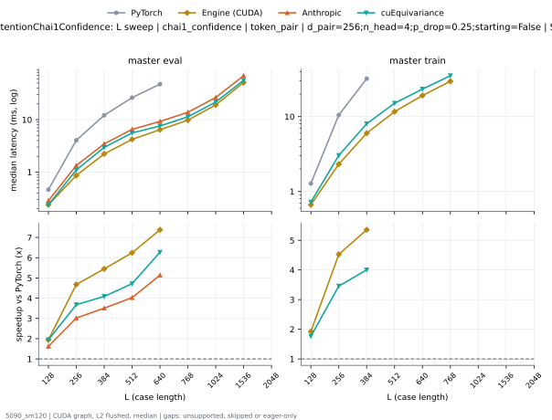
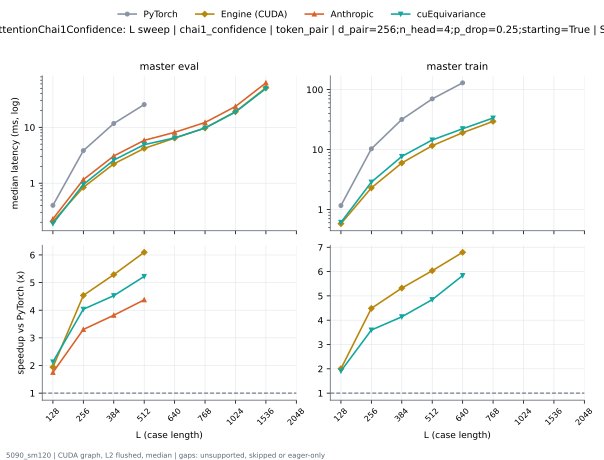

# TriangleAttentionChai1Confidence on 5090_sm120

Generated by `python -m miniworld_engine.measure.plot` from speed tokens `judge/tokens/5090_sm120/`; do not edit.

### L sweep: chai1_confidence | token_pair | d_pair=256;n_head=4;p_drop=0.25;starting=False | S1 | graph

**master eval** (median ms; x = speedup vs PyTorch)

| L | PyTorch | Engine (Triton) | Engine (CUDA) | Anthropic | cuEquivariance |
|---|---|---|---|---|---|
| 128 | 0.4618 | 0.2355 (1.96x) | 0.2377 (1.94x) | 0.2847 (1.62x) | 0.2376 (1.94x) |
| 256 | 4.033 | 1.095 (3.68x) | 0.8622 (4.68x) | 1.335 (3.02x) | 1.096 (3.68x) |
| 384 | 12.11 | 2.999 (4.04x) | 2.223 (5.45x) | 3.453 (3.51x) | 2.963 (4.09x) |
| 512 | 26.26 | 5.677 (4.63x) | 4.208 (6.24x) | 6.525 (4.02x) | 5.57 (4.72x) |
| 640 | 47.48 | 7.762 (6.12x) | 6.434 (7.38x) | 9.242 (5.14x) | 7.57 (6.27x) |
| 768 | skipped | 11.68 | 9.764 | 13.81 | 11.33 |
| 1024 | skipped | 22.49 | 19.08 | 26.48 | 21.65 |
| 1536 | skipped | 59.07 | 51.01 | 68.91 | 56.27 |
| 2048 | skipped | skipped | skipped | skipped | skipped |

**master train** (median ms; x = speedup vs PyTorch)

| L | PyTorch | Engine (Triton) | Engine (CUDA) | Anthropic | cuEquivariance |
|---|---|---|---|---|---|
| 128 | 1.277 | 0.7254 (1.76x) | 0.6636 (1.92x) | unsupported | 0.723 (1.77x) |
| 256 | 10.5 | 3.166 (3.32x) | 2.319 (4.53x) | unsupported | 3.038 (3.46x) |
| 384 | 32.15 | 8.482 (3.79x) | 6.004 (5.35x) | unsupported | 8.026 (4.01x) |
| 512 | skipped | 18.08 | 11.65 | unsupported | 15.12 |
| 640 | skipped | 29.03 | 19.17 | unsupported | 23.35 |
| 768 | skipped | 41.81 | 29.65 | unsupported | 35.25 |
| 1024 |  |  |  |  |  |
| 1536 |  |  |  |  |  |
| 2048 |  |  |  |  |  |

### L sweep: chai1_confidence | token_pair | d_pair=256;n_head=4;p_drop=0.25;starting=True | S1 | graph

**master eval** (median ms; x = speedup vs PyTorch)

| L | PyTorch | Engine (Triton) | Engine (CUDA) | Anthropic | cuEquivariance |
|---|---|---|---|---|---|
| 128 | 0.4014 | 0.1887 (2.13x) | 0.2068 (1.94x) | 0.2293 (1.75x) | 0.1885 (2.13x) |
| 256 | 3.828 | 0.9636 (3.97x) | 0.8438 (4.54x) | 1.158 (3.30x) | 0.9482 (4.04x) |
| 384 | 11.72 | 2.628 (4.46x) | 2.217 (5.29x) | 3.07 (3.82x) | 2.59 (4.53x) |
| 512 | 25.62 | 5.007 (5.12x) | 4.202 (6.10x) | 5.853 (4.38x) | 4.904 (5.22x) |
| 640 | skipped | 6.682 | 6.416 | 8.138 | 6.469 |
| 768 | skipped | 10.1 | 9.743 | 12.23 | 9.734 |
| 1024 | skipped | 19.63 | 19.08 | 23.67 | 18.8 |
| 1536 | skipped | 52.54 | 51.07 | 62.62 | 49.65 |
| 2048 | skipped | skipped | skipped | skipped | skipped |

**master train** (median ms; x = speedup vs PyTorch)

| L | PyTorch | Engine (Triton) | Engine (CUDA) | Anthropic | cuEquivariance |
|---|---|---|---|---|---|
| 128 | 1.161 | 0.6288 (1.85x) | 0.5792 (2.01x) | unsupported | 0.6083 (1.91x) |
| 256 | 10.29 | 2.989 (3.44x) | 2.293 (4.49x) | unsupported | 2.86 (3.60x) |
| 384 | 31.78 | 8.087 (3.93x) | 5.973 (5.32x) | unsupported | 7.677 (4.14x) |
| 512 | 70.04 | 17.43 (4.02x) | 11.61 (6.03x) | unsupported | 14.46 (4.84x) |
| 640 | 129.7 | 27.9 (4.65x) | 19.1 (6.79x) | unsupported | 22.23 (5.84x) |
| 768 | skipped | 40.13 | 29.54 | unsupported | 33.6 |
| 1024 |  |  |  |  |  |
| 1536 |  |  |  |  |  |
| 2048 |  |  |  |  |  |

