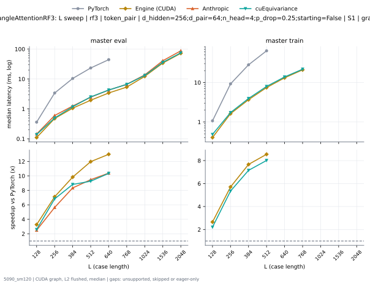

# TriangleAttentionRF3 on 5090_sm120

Generated by `python -m miniworld_engine.measure.plot` from speed tokens `judge/tokens/5090_sm120/`; do not edit.

### L sweep: rf3 | token_pair | d_hidden=256;d_pair=64;n_head=4;p_drop=0.25;starting=False | S1 | graph

**master eval** (median ms; x = speedup vs PyTorch)

| L | PyTorch | Engine (Triton) | Engine (CUDA) | Anthropic | cuEquivariance |
|---|---|---|---|---|---|
| 128 | 0.3604 | 0.1375 (2.62x) | 0.1087 (3.31x) | 0.1452 (2.48x) | 0.1392 (2.59x) |
| 256 | 3.395 | 0.5082 (6.68x) | 0.4669 (7.27x) | 0.6025 (5.63x) | 0.4978 (6.82x) |
| 384 | 10.47 | 1.211 (8.64x) | 1.042 (10.05x) | 1.248 (8.39x) | 1.18 (8.88x) |
| 512 | 23.33 | 2.627 (8.88x) | 2.102 (11.10x) | 2.463 (9.47x) | 2.52 (9.26x) |
| 640 | 44.24 | 4.457 (9.93x) | 3.701 (11.95x) | 4.265 (10.37x) | 4.279 (10.34x) |
| 768 | skipped | 6.925 | 5.84 | 6.64 | 6.6 |
| 1024 | skipped | 13.97 | 13.17 | 13.72 | 13.16 |
| 1536 | skipped | 38.94 | 36.92 | 40.72 | 35.98 |
| 2048 | skipped | 81.8 | 78.68 | 87.4 | 74.95 |

**master train** (median ms; x = speedup vs PyTorch)

| L | PyTorch | Engine (Triton) | Engine (CUDA) | Anthropic | cuEquivariance |
|---|---|---|---|---|---|
| 128 | 1.036 | 0.51 (2.03x) | 0.3812 (2.72x) | unsupported | 0.4834 (2.14x) |
| 256 | 9.23 | 1.859 (4.97x) | 1.599 (5.77x) | unsupported | 1.727 (5.34x) |
| 384 | 28.16 | 4.373 (6.44x) | 3.648 (7.72x) | unsupported | 3.935 (7.16x) |
| 512 | 63.74 | 10.98 (5.81x) | 7.42 (8.59x) | unsupported | 7.953 (8.01x) |
| 640 | 121.5 | 19.71 (6.16x) | 13.12 (9.26x) | unsupported | 13.84 (8.78x) |
| 768 | skipped | 28.35 | 20.93 | unsupported | 21.78 |
| 1024 |  |  |  |  |  |
| 1536 |  |  |  |  |  |
| 2048 |  |  |  |  |  |

### L sweep: rf3 | token_pair | d_hidden=256;d_pair=64;n_head=4;p_drop=0.25;starting=True | S1 | graph

**master eval** (median ms; x = speedup vs PyTorch)

| L | PyTorch | Engine (Triton) | Engine (CUDA) | Anthropic | cuEquivariance |
|---|---|---|---|---|---|
| 128 | 0.3157 | 0.1052 (3.00x) | 0.09037 (3.49x) | 0.1208 (2.61x) | 0.1065 (2.96x) |
| 256 | 3.29 | 0.4157 (7.91x) | 0.414 (7.95x) | 0.5468 (6.02x) | 0.4076 (8.07x) |
| 384 | 10.26 | 1.123 (9.13x) | 1.025 (10.01x) | 1.238 (8.29x) | 1.079 (9.51x) |
| 512 | 23.05 | 2.346 (9.83x) | 2.088 (11.04x) | 2.466 (9.35x) | 2.238 (10.30x) |
| 640 | 43.71 | 3.891 (11.23x) | 3.679 (11.88x) | 4.277 (10.22x) | 3.72 (11.75x) |
| 768 | skipped | 6.132 | 5.821 | 6.668 | 5.807 |
| 1024 | skipped | 12.57 | 13.16 | 13.75 | 11.76 |
| 1536 | skipped | 35.6 | 36.93 | 40.81 | 32.76 |
| 2048 | skipped | 76.76 | 78.73 | 87.55 | 69.84 |

**master train** (median ms; x = speedup vs PyTorch)

| L | PyTorch | Engine (Triton) | Engine (CUDA) | Anthropic | cuEquivariance |
|---|---|---|---|---|---|
| 128 | 0.9708 | 0.442 (2.20x) | 0.3483 (2.79x) | unsupported | 0.4249 (2.28x) |
| 256 | 9.113 | 1.771 (5.15x) | 1.562 (5.83x) | unsupported | 1.635 (5.57x) |
| 384 | 28.03 | 4.237 (6.62x) | 3.629 (7.72x) | unsupported | 3.798 (7.38x) |
| 512 | 63.4 | 10.7 (5.93x) | 7.384 (8.59x) | unsupported | 7.642 (8.30x) |
| 640 | 120.9 | 19.05 (6.35x) | 13.07 (9.25x) | unsupported | 13.21 (9.16x) |
| 768 | skipped | 27.46 | 20.86 | unsupported | 20.89 |
| 1024 |  |  |  |  |  |
| 1536 |  |  |  |  |  |
| 2048 |  |  |  |  |  |

### L sweep: rf3 | token_pair | d_pair=128;n_head=4;p_drop=0.25;starting=False | S1 | graph

**master eval** (median ms; x = speedup vs PyTorch)

| L | PyTorch | Engine (Triton) | Engine (CUDA) | Anthropic | cuEquivariance |
|---|---|---|---|---|---|
| 128 | 0.2847 | 0.1167 (2.44x) | 0.07578 (3.76x) | 0.08192 (3.47x) | 0.1189 (2.39x) |
| 256 | 2.887 | 0.414 (6.97x) | 0.311 (9.28x) | 0.3126 (9.24x) | 0.4115 (7.02x) |
| 384 | 9.42 | 1.107 (8.51x) | 0.6739 (13.98x) | 0.6817 (13.82x) | 1.074 (8.77x) |
| 512 | 21.5 | 2.271 (9.47x) | 1.474 (14.59x) | 1.357 (15.85x) | 2.176 (9.88x) |
| 640 | 41.08 | 3.982 (10.32x) | 2.541 (16.17x) | 2.327 (17.66x) | 3.854 (10.66x) |
| 768 | skipped | 5.725 | 3.898 | 3.575 | 5.544 |
| 1024 | skipped | 11.13 | 7.688 | 7.307 | 10.68 |
| 1536 | skipped | 29.49 | 21.32 | 20.36 | 28.26 |
| 2048 | skipped | 59.74 | 45.21 | 42.88 | 56.31 |

**master train** (median ms; x = speedup vs PyTorch)

| L | PyTorch | Engine (Triton) | Engine (CUDA) | Anthropic | cuEquivariance |
|---|---|---|---|---|---|
| 128 | 0.8501 | 0.3921 (2.17x) | 0.2787 (3.05x) | unsupported | 0.4034 (2.11x) |
| 256 | 8.169 | 1.529 (5.34x) | 1.066 (7.66x) | unsupported | 1.452 (5.63x) |
| 384 | 25.98 | 3.692 (7.04x) | 2.385 (10.89x) | unsupported | 3.498 (7.43x) |
| 512 | 59.78 | 7.646 (7.82x) | 4.698 (12.72x) | unsupported | 7.27 (8.22x) |
| 640 | 114.7 | 13.53 (8.48x) | 8.132 (14.10x) | unsupported | 13.02 (8.80x) |
| 768 | skipped | 20.74 | 12.71 | unsupported | 19.82 |
| 1024 |  |  |  |  |  |
| 1536 |  |  |  |  |  |
| 2048 |  |  |  |  |  |

### L sweep: rf3 | token_pair | d_pair=128;n_head=4;p_drop=0.25;starting=True | S1 | graph

**master eval** (median ms; x = speedup vs PyTorch)

| L | PyTorch | Engine (Triton) | Engine (CUDA) | Anthropic | cuEquivariance |
|---|---|---|---|---|---|
| 128 | 0.2601 | 0.09821 (2.65x) | 0.0753 (3.45x) | 0.08189 (3.18x) | 0.09851 (2.64x) |
| 256 | 2.806 | 0.346 (8.11x) | 0.3034 (9.25x) | 0.3091 (9.08x) | 0.3401 (8.25x) |
| 384 | 9.207 | 0.8863 (10.39x) | 0.65 (14.16x) | 0.679 (13.56x) | 0.8595 (10.71x) |
| 512 | 21.1 | 1.879 (11.23x) | 1.431 (14.75x) | 1.364 (15.47x) | 1.787 (11.81x) |
| 640 | 40.43 | 3.27 (12.36x) | 2.459 (16.44x) | 2.327 (17.37x) | 3.15 (12.83x) |
| 768 | skipped | 4.695 | 3.867 | 3.577 | 4.505 |
| 1024 | skipped | 9.337 | 7.786 | 7.313 | 8.869 |
| 1536 | skipped | 25.36 | 21.44 | 20.36 | 24.08 |
| 2048 | skipped | 52.46 | 44.84 | 42.84 | 48.89 |

**master train** (median ms; x = speedup vs PyTorch)

| L | PyTorch | Engine (Triton) | Engine (CUDA) | Anthropic | cuEquivariance |
|---|---|---|---|---|---|
| 128 | 0.8192 | 0.3677 (2.23x) | 0.2786 (2.94x) | unsupported | 0.3786 (2.16x) |
| 256 | 8.051 | 1.398 (5.76x) | 1.052 (7.65x) | unsupported | 1.334 (6.04x) |
| 384 | 25.75 | 3.447 (7.47x) | 2.368 (10.87x) | unsupported | 3.262 (7.89x) |
| 512 | 59.3 | 7.193 (8.24x) | 4.651 (12.75x) | unsupported | 6.816 (8.70x) |
| 640 | 113.9 | 12.71 (8.96x) | 8.083 (14.09x) | unsupported | 12.22 (9.32x) |
| 768 | skipped | 19.47 | 12.63 | unsupported | 18.53 |
| 1024 |  |  |  |  |  |
| 1536 |  |  |  |  |  |
| 2048 |  |  |  |  |  |

