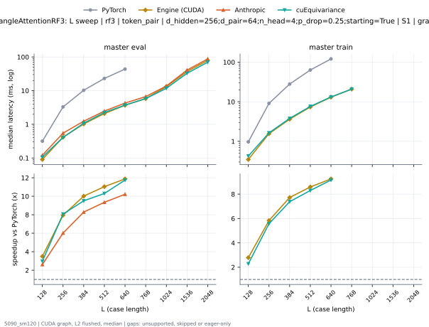
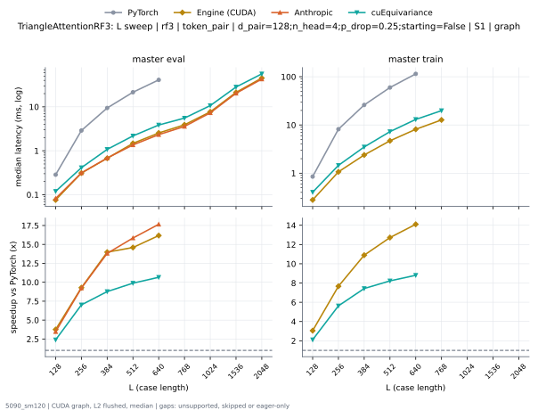
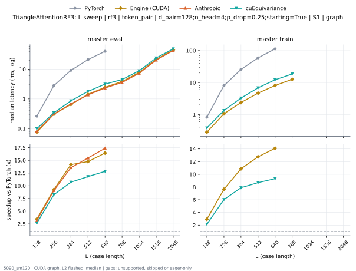

# TriangleAttentionRF3 on 5090_sm120

Generated by `python -m foldjet_engine.measure.plot` from speed tokens `judge/tokens/5090_sm120/`; do not edit.

### L sweep: rf3 | token_pair | d_hidden=256;d_pair=64;n_head=4;p_drop=0.25;starting=False | S1 | graph

**master eval** (median ms; x = speedup vs PyTorch)

| L | PyTorch | Engine (Triton) | Engine (CUDA) | Anthropic | cuEquivariance |
|---|---|---|---|---|---|
| 128 | 0.361 | 0.1375 (2.63x) | 0.1106 (3.26x) | 0.1452 (2.49x) | 0.1392 (2.59x) |
| 256 | 3.396 | 0.5082 (6.68x) | 0.4774 (7.11x) | 0.6025 (5.64x) | 0.4978 (6.82x) |
| 384 | 10.4 | 1.211 (8.59x) | 1.058 (9.83x) | 1.248 (8.34x) | 1.18 (8.82x) |
| 512 | 23.34 | 2.627 (8.89x) | 1.95 (11.97x) | 2.463 (9.48x) | 2.52 (9.26x) |
| 640 | 44.29 | 4.457 (9.94x) | 3.41 (12.99x) | 4.265 (10.38x) | 4.279 (10.35x) |
| 768 | skipped | 6.925 | 5.363 | 6.64 | 6.6 |
| 1024 | skipped | 13.97 | 12.26 | 13.72 | 13.16 |
| 1536 | skipped | 38.94 | 34.07 | 40.72 | 35.98 |
| 2048 | skipped | 81.8 | 72.19 | 87.4 | 74.95 |

**master train** (median ms; x = speedup vs PyTorch)

| L | PyTorch | Engine (Triton) | Engine (CUDA) | Anthropic | cuEquivariance |
|---|---|---|---|---|---|
| 128 | 1.068 | 0.51 (2.09x) | 0.4025 (2.65x) | unsupported | 0.4834 (2.21x) |
| 256 | 9.236 | 1.859 (4.97x) | 1.619 (5.70x) | unsupported | 1.727 (5.35x) |
| 384 | 28.13 | 4.373 (6.43x) | 3.67 (7.67x) | unsupported | 3.935 (7.15x) |
| 512 | 63.72 | 10.98 (5.81x) | 7.454 (8.55x) | unsupported | 7.953 (8.01x) |
| 640 | skipped | 19.71 | 13.16 | unsupported | 13.84 |
| 768 | skipped | 28.35 | 21 | unsupported | 21.78 |
| 1024 |  |  |  |  |  |
| 1536 |  |  |  |  |  |
| 2048 |  |  |  |  |  |

### L sweep: rf3 | token_pair | d_hidden=256;d_pair=64;n_head=4;p_drop=0.25;starting=True | S1 | graph

**master eval** (median ms; x = speedup vs PyTorch)

| L | PyTorch | Engine (Triton) | Engine (CUDA) | Anthropic | cuEquivariance |
|---|---|---|---|---|---|
| 128 | 0.3164 | 0.1052 (3.01x) | 0.09011 (3.51x) | 0.1208 (2.62x) | 0.1065 (2.97x) |
| 256 | 3.26 | 0.4157 (7.84x) | 0.4178 (7.80x) | 0.5468 (5.96x) | 0.4076 (8.00x) |
| 384 | 10.26 | 1.123 (9.13x) | 1.048 (9.79x) | 1.238 (8.29x) | 1.079 (9.51x) |
| 512 | 23.05 | 2.346 (9.83x) | 1.927 (11.96x) | 2.466 (9.35x) | 2.238 (10.30x) |
| 640 | 43.71 | 3.891 (11.23x) | 3.372 (12.97x) | 4.277 (10.22x) | 3.72 (11.75x) |
| 768 | skipped | 6.132 | 5.337 | 6.668 | 5.807 |
| 1024 | skipped | 12.57 | 12.22 | 13.75 | 11.76 |
| 1536 | skipped | 35.6 | 33.95 | 40.81 | 32.76 |
| 2048 | skipped | 76.76 | 72.02 | 87.55 | 69.84 |

**master train** (median ms; x = speedup vs PyTorch)

| L | PyTorch | Engine (Triton) | Engine (CUDA) | Anthropic | cuEquivariance |
|---|---|---|---|---|---|
| 128 | 0.9667 | 0.442 (2.19x) | 0.3482 (2.78x) | unsupported | 0.4249 (2.28x) |
| 256 | 9.087 | 1.771 (5.13x) | 1.591 (5.71x) | unsupported | 1.635 (5.56x) |
| 384 | 28.02 | 4.237 (6.61x) | 3.643 (7.69x) | unsupported | 3.798 (7.38x) |
| 512 | 63.44 | 10.7 (5.93x) | 7.414 (8.56x) | unsupported | 7.642 (8.30x) |
| 640 | 120.9 | 19.05 (6.35x) | 13.09 (9.24x) | unsupported | 13.21 (9.16x) |
| 768 | skipped | 27.46 | 20.93 | unsupported | 20.89 |
| 1024 |  |  |  |  |  |
| 1536 |  |  |  |  |  |
| 2048 |  |  |  |  |  |

### L sweep: rf3 | token_pair | d_pair=128;n_head=4;p_drop=0.25;starting=False | S1 | graph

**master eval** (median ms; x = speedup vs PyTorch)

| L | PyTorch | Engine (Triton) | Engine (CUDA) | Anthropic | cuEquivariance |
|---|---|---|---|---|---|
| 128 | 0.2829 | 0.1167 (2.42x) | 0.07582 (3.73x) | 0.08192 (3.45x) | 0.1189 (2.38x) |
| 256 | 2.885 | 0.414 (6.97x) | 0.2971 (9.71x) | 0.3126 (9.23x) | 0.4115 (7.01x) |
| 384 | 9.41 | 1.107 (8.50x) | 0.6842 (13.75x) | 0.6817 (13.80x) | 1.074 (8.76x) |
| 512 | 21.5 | 2.271 (9.47x) | 1.427 (15.06x) | 1.357 (15.85x) | 2.176 (9.88x) |
| 640 | 41.09 | 3.982 (10.32x) | 2.407 (17.07x) | 2.327 (17.66x) | 3.854 (10.66x) |
| 768 | skipped | 5.725 | 3.672 | 3.575 | 5.544 |
| 1024 | skipped | 11.13 | 7.312 | 7.307 | 10.68 |
| 1536 | skipped | 29.49 | 20.13 | 20.36 | 28.26 |
| 2048 | skipped | 59.74 | 42.45 | 42.88 | 56.31 |

**master train** (median ms; x = speedup vs PyTorch)

| L | PyTorch | Engine (Triton) | Engine (CUDA) | Anthropic | cuEquivariance |
|---|---|---|---|---|---|
| 128 | 0.849 | 0.3921 (2.17x) | 0.2807 (3.02x) | unsupported | 0.4034 (2.10x) |
| 256 | 8.119 | 1.529 (5.31x) | 1.044 (7.78x) | unsupported | 1.452 (5.59x) |
| 384 | 26 | 3.692 (7.04x) | 2.379 (10.93x) | unsupported | 3.498 (7.43x) |
| 512 | 59.76 | 7.646 (7.82x) | 4.675 (12.78x) | unsupported | 7.27 (8.22x) |
| 640 | 114.7 | 13.53 (8.48x) | 8.105 (14.15x) | unsupported | 13.02 (8.81x) |
| 768 | skipped | 20.74 | 12.76 | unsupported | 19.82 |
| 1024 |  |  |  |  |  |
| 1536 |  |  |  |  |  |
| 2048 |  |  |  |  |  |

### L sweep: rf3 | token_pair | d_pair=128;n_head=4;p_drop=0.25;starting=True | S1 | graph

**master eval** (median ms; x = speedup vs PyTorch)

| L | PyTorch | Engine (Triton) | Engine (CUDA) | Anthropic | cuEquivariance |
|---|---|---|---|---|---|
| 128 | 0.2601 | 0.09821 (2.65x) | 0.0755 (3.44x) | 0.08189 (3.18x) | 0.09851 (2.64x) |
| 256 | 2.8 | 0.346 (8.09x) | 0.2887 (9.70x) | 0.3091 (9.06x) | 0.3401 (8.23x) |
| 384 | 9.197 | 0.8863 (10.38x) | 0.6717 (13.69x) | 0.679 (13.55x) | 0.8595 (10.70x) |
| 512 | 21.13 | 1.879 (11.24x) | 1.398 (15.11x) | 1.364 (15.48x) | 1.787 (11.82x) |
| 640 | 40.41 | 3.27 (12.36x) | 2.362 (17.11x) | 2.327 (17.36x) | 3.15 (12.83x) |
| 768 | skipped | 4.695 | 3.606 | 3.577 | 4.505 |
| 1024 | skipped | 9.337 | 7.252 | 7.313 | 8.869 |
| 1536 | skipped | 25.36 | 19.91 | 20.36 | 24.08 |
| 2048 | skipped | 52.46 | 42.25 | 42.84 | 48.89 |

**master train** (median ms; x = speedup vs PyTorch)

| L | PyTorch | Engine (Triton) | Engine (CUDA) | Anthropic | cuEquivariance |
|---|---|---|---|---|---|
| 128 | 0.821 | 0.3677 (2.23x) | 0.2765 (2.97x) | unsupported | 0.3786 (2.17x) |
| 256 | 8.017 | 1.398 (5.73x) | 1.035 (7.75x) | unsupported | 1.334 (6.01x) |
| 384 | 25.73 | 3.447 (7.47x) | 2.355 (10.93x) | unsupported | 3.262 (7.89x) |
| 512 | 59.31 | 7.193 (8.25x) | 4.631 (12.81x) | unsupported | 6.816 (8.70x) |
| 640 | 113.9 | 12.71 (8.96x) | 8.042 (14.16x) | unsupported | 12.22 (9.32x) |
| 768 | skipped | 19.47 | 12.68 | unsupported | 18.53 |
| 1024 |  |  |  |  |  |
| 1536 |  |  |  |  |  |
| 2048 |  |  |  |  |  |

