# TriangleMultiplication on 5090_sm120

Generated by `python -m foldjet_engine.measure.plot` from speed tokens `judge/tokens/5090_sm120/`; do not edit.

### L sweep: af3|boltz2|chai1|opendde|openfold3|openfold3_preview2|protenix | token_pair | d_pair=64;outgoing=False;p_drop=0.25 | S1 | graph

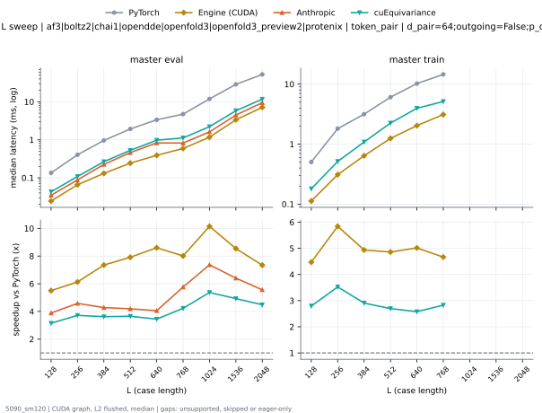

**master eval** (median ms; x = speedup vs PyTorch)

| L | PyTorch | Engine (Triton) | Engine (CUDA) | Anthropic | cuEquivariance |
|---|---|---|---|---|---|
| 128 | 0.1352 | 0.04918 (2.75x) | 0.02458 (5.50x) | 0.03482 (3.88x) | 0.04298 (3.15x) |
| 256 | 0.4036 | 0.1042 (3.87x) | 0.06584 (6.13x) | 0.08806 (4.58x) | 0.1086 (3.71x) |
| 384 | 0.9636 | 0.2355 (4.09x) | 0.1311 (7.35x) | 0.2253 (4.28x) | 0.2662 (3.62x) |
| 512 | 1.928 | 0.4497 (4.29x) | 0.2437 (7.91x) | 0.4603 (4.19x) | 0.528 (3.65x) |
| 640 | 3.365 | 0.8061 (4.17x) | 0.3912 (8.60x) | 0.8305 (4.05x) | 0.9769 (3.44x) |
| 768 | 4.739 | 0.7451 (6.36x) | 0.5919 (8.01x) | 0.8225 (5.76x) | 1.122 (4.22x) |
| 1024 | 11.91 | 1.482 (8.04x) | 1.174 (10.15x) | 1.617 (7.36x) | 2.217 (5.37x) |
| 1536 | 28.71 | 4.189 (6.85x) | 3.361 (8.54x) | 4.482 (6.41x) | 5.828 (4.93x) |
| 2048 | 52.54 | 8.825 (5.95x) | 7.161 (7.34x) | 9.451 (5.56x) | 11.73 (4.48x) |

**master train** (median ms; x = speedup vs PyTorch)

| L | PyTorch | Engine (Triton) | Engine (CUDA) | Anthropic | cuEquivariance |
|---|---|---|---|---|---|
| 128 | 0.5039 | 0.1455 (3.46x) | 0.1127 (4.47x) | unsupported | 0.1803 (2.79x) |
| 256 | 1.812 | 0.4097 (4.42x) | 0.3101 (5.84x) | unsupported | 0.5141 (3.52x) |
| 384 | 3.156 | 0.9464 (3.33x) | 0.639 (4.94x) | unsupported | 1.085 (2.91x) |
| 512 | 6.059 | 1.795 (3.38x) | 1.247 (4.86x) | unsupported | 2.248 (2.70x) |
| 640 | 10.21 | 3.137 (3.25x) | 2.035 (5.02x) | unsupported | 3.959 (2.58x) |
| 768 | 14.52 | 3.791 (3.83x) | 3.113 (4.67x) | unsupported | 5.136 (2.83x) |
| 1024 |  |  |  |  |  |
| 1536 |  |  |  |  |  |
| 2048 |  |  |  |  |  |

### L sweep: af3|boltz2|chai1|opendde|openfold3|openfold3_preview2|protenix | token_pair | d_pair=64;outgoing=True;p_drop=0.25 | S1 | graph

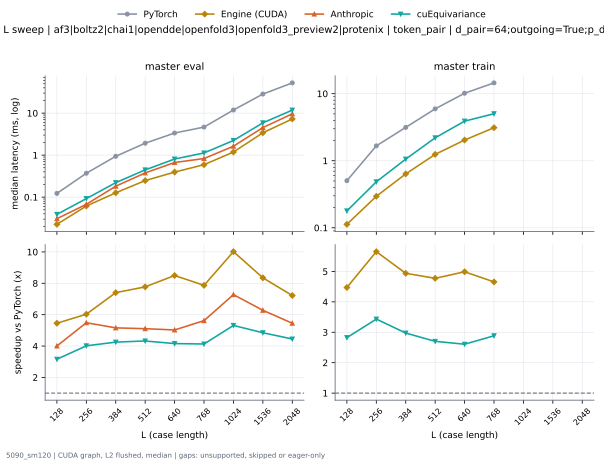

**master eval** (median ms; x = speedup vs PyTorch)

| L | PyTorch | Engine (Triton) | Engine (CUDA) | Anthropic | cuEquivariance |
|---|---|---|---|---|---|
| 128 | 0.1229 | 0.04326 (2.84x) | 0.02253 (5.45x) | 0.03069 (4.00x) | 0.03888 (3.16x) |
| 256 | 0.3706 | 0.08027 (4.62x) | 0.06146 (6.03x) | 0.06755 (5.49x) | 0.0923 (4.01x) |
| 384 | 0.94 | 0.1904 (4.94x) | 0.1269 (7.41x) | 0.1822 (5.16x) | 0.2212 (4.25x) |
| 512 | 1.926 | 0.3769 (5.11x) | 0.2478 (7.77x) | 0.3772 (5.11x) | 0.4456 (4.32x) |
| 640 | 3.359 | 0.6369 (5.27x) | 0.3953 (8.50x) | 0.6683 (5.03x) | 0.8079 (4.16x) |
| 768 | 4.661 | 0.7461 (6.25x) | 0.5924 (7.87x) | 0.8294 (5.62x) | 1.128 (4.13x) |
| 1024 | 11.88 | 1.504 (7.90x) | 1.186 (10.02x) | 1.632 (7.28x) | 2.235 (5.31x) |
| 1536 | 28.48 | 4.255 (6.69x) | 3.411 (8.35x) | 4.536 (6.28x) | 5.876 (4.85x) |
| 2048 | 52.52 | 9.006 (5.83x) | 7.274 (7.22x) | 9.629 (5.45x) | 11.81 (4.45x) |

**master train** (median ms; x = speedup vs PyTorch)

| L | PyTorch | Engine (Triton) | Engine (CUDA) | Anthropic | cuEquivariance |
|---|---|---|---|---|---|
| 128 | 0.5042 | 0.1454 (3.47x) | 0.1127 (4.47x) | unsupported | 0.1786 (2.82x) |
| 256 | 1.667 | 0.3916 (4.26x) | 0.295 (5.65x) | unsupported | 0.4854 (3.43x) |
| 384 | 3.146 | 0.9147 (3.44x) | 0.637 (4.94x) | unsupported | 1.058 (2.97x) |
| 512 | 5.94 | 1.779 (3.34x) | 1.244 (4.77x) | unsupported | 2.199 (2.70x) |
| 640 | 10.16 | 3.143 (3.23x) | 2.037 (4.99x) | unsupported | 3.897 (2.61x) |
| 768 | 14.49 | 3.789 (3.82x) | 3.113 (4.66x) | unsupported | 5.025 (2.88x) |
| 1024 |  |  |  |  |  |
| 1536 |  |  |  |  |  |
| 2048 |  |  |  |  |  |

### L sweep: af3|boltz2|openfold3|openfold3_preview2|protenix | token_pair | d_pair=128;outgoing=False;p_drop=0.25 | S1 | graph

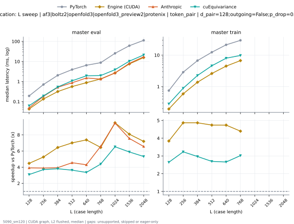

**master eval** (median ms; x = speedup vs PyTorch)

| L | PyTorch | Engine (Triton) | Engine (CUDA) | Anthropic | cuEquivariance |
|---|---|---|---|---|---|
| 128 | 0.1925 | 0.06962 (2.76x) | 0.04301 (4.48x) | 0.04915 (3.92x) | 0.06232 (3.09x) |
| 256 | 0.7107 | 0.2209 (3.22x) | 0.1352 (5.26x) | 0.1828 (3.89x) | 0.1922 (3.70x) |
| 384 | 2.043 | 0.5222 (3.91x) | 0.3174 (6.44x) | 0.5181 (3.94x) | 0.5366 (3.81x) |
| 512 | 3.946 | 0.99 (3.99x) | 0.5632 (7.01x) | 0.8667 (4.55x) | 1.086 (3.63x) |
| 640 | 6.477 | 1.685 (3.84x) | 0.8779 (7.38x) | 1.507 (4.30x) | 1.933 (3.35x) |
| 768 | 8.72 | 1.613 (5.40x) | 1.353 (6.45x) | 1.324 (6.59x) | 1.988 (4.39x) |
| 1024 | 25.47 | 3.253 (7.83x) | 2.683 (9.49x) | 2.692 (9.46x) | 3.901 (6.53x) |
| 1536 | 60.98 | 8.935 (6.82x) | 7.547 (8.08x) | 8.072 (7.55x) | 10.37 (5.88x) |
| 2048 | 112.7 | 18.57 (6.07x) | 15.67 (7.19x) | 17.17 (6.56x) | 21.17 (5.32x) |

**master train** (median ms; x = speedup vs PyTorch)

| L | PyTorch | Engine (Triton) | Engine (CUDA) | Anthropic | cuEquivariance |
|---|---|---|---|---|---|
| 128 | 0.7476 | 0.21 (3.56x) | 0.1946 (3.84x) | unsupported | 0.2827 (2.64x) |
| 256 | 2.869 | 0.768 (3.74x) | 0.5894 (4.87x) | unsupported | 0.8879 (3.23x) |
| 384 | 6.695 | 1.922 (3.48x) | 1.376 (4.87x) | unsupported | 2.256 (2.97x) |
| 512 | 12.35 | 3.772 (3.27x) | 2.605 (4.74x) | unsupported | 4.585 (2.69x) |
| 640 | 21.22 | 6.689 (3.17x) | 4.479 (4.74x) | unsupported | 7.98 (2.66x) |
| 768 | 29.43 | 7.908 (3.72x) | 6.694 (4.40x) | unsupported | 9.747 (3.02x) |
| 1024 |  |  |  |  |  |
| 1536 |  |  |  |  |  |
| 2048 |  |  |  |  |  |

### L sweep: af3|boltz2|openfold3|openfold3_preview2|protenix | token_pair | d_pair=128;outgoing=True;p_drop=0.25 | S1 | graph

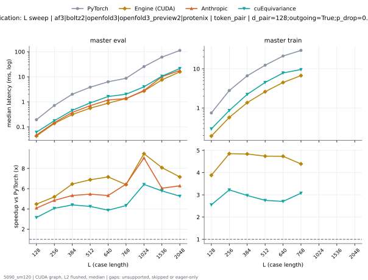

**master eval** (median ms; x = speedup vs PyTorch)

| L | PyTorch | Engine (Triton) | Engine (CUDA) | Anthropic | cuEquivariance |
|---|---|---|---|---|---|
| 128 | 0.1925 | 0.06758 (2.85x) | 0.04301 (4.48x) | 0.0471 (4.09x) | 0.06104 (3.15x) |
| 256 | 0.7145 | 0.1803 (3.96x) | 0.1376 (5.19x) | 0.1475 (4.85x) | 0.176 (4.06x) |
| 384 | 2.008 | 0.4402 (4.56x) | 0.311 (6.46x) | 0.3769 (5.33x) | 0.4566 (4.40x) |
| 512 | 3.834 | 0.81 (4.73x) | 0.5571 (6.88x) | 0.7025 (5.46x) | 0.9024 (4.25x) |
| 640 | 6.307 | 1.381 (4.57x) | 0.8808 (7.16x) | 1.184 (5.33x) | 1.628 (3.87x) |
| 768 | 8.702 | 1.65 (5.27x) | 1.359 (6.40x) | 1.349 (6.45x) | 2.008 (4.33x) |
| 1024 | 25.52 | 3.327 (7.67x) | 2.699 (9.46x) | 2.824 (9.04x) | 3.976 (6.42x) |
| 1536 | 60.87 | 9.229 (6.60x) | 7.535 (8.08x) | 10.06 (6.05x) | 10.53 (5.78x) |
| 2048 | 112.7 | 19.14 (5.89x) | 15.74 (7.16x) | 17.93 (6.28x) | 21.42 (5.26x) |

**master train** (median ms; x = speedup vs PyTorch)

| L | PyTorch | Engine (Triton) | Engine (CUDA) | Anthropic | cuEquivariance |
|---|---|---|---|---|---|
| 128 | 0.7476 | 0.2172 (3.44x) | 0.1926 (3.88x) | unsupported | 0.2929 (2.55x) |
| 256 | 2.788 | 0.7687 (3.63x) | 0.5748 (4.85x) | unsupported | 0.8653 (3.22x) |
| 384 | 6.621 | 1.912 (3.46x) | 1.368 (4.84x) | unsupported | 2.227 (2.97x) |
| 512 | 12.35 | 3.768 (3.28x) | 2.604 (4.74x) | unsupported | 4.487 (2.75x) |
| 640 | 21.19 | 6.683 (3.17x) | 4.476 (4.73x) | unsupported | 7.837 (2.70x) |
| 768 | 29.43 | 7.92 (3.72x) | 6.704 (4.39x) | unsupported | 9.567 (3.08x) |
| 1024 |  |  |  |  |  |
| 1536 |  |  |  |  |  |
| 2048 |  |  |  |  |  |

### L sweep: chai1|esmfold2|intellifold2|protenix | token_pair | d_pair=256;outgoing=False;p_drop=0.25 | S1 | graph

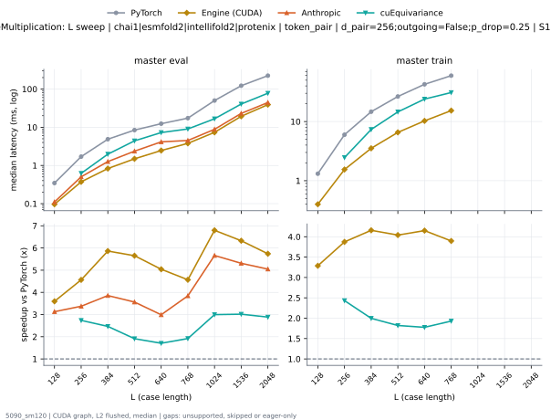

**master eval** (median ms; x = speedup vs PyTorch)

| L | PyTorch | Engine (Triton) | Engine (CUDA) | Anthropic | cuEquivariance |
|---|---|---|---|---|---|
| 128 | 0.3461 | 0.1495 (2.32x) | 0.09626 (3.60x) | 0.1106 (3.13x) | unsupported |
| 256 | 1.701 | 0.5797 (2.93x) | 0.3727 (4.56x) | 0.5041 (3.37x) | 0.6214 (2.74x) |
| 384 | 4.868 | 1.253 (3.88x) | 0.8305 (5.86x) | 1.263 (3.86x) | 1.973 (2.47x) |
| 512 | 8.434 | 2.385 (3.54x) | 1.492 (5.65x) | 2.366 (3.56x) | 4.411 (1.91x) |
| 640 | 12.4 | 4.082 (3.04x) | 2.459 (5.04x) | 4.145 (2.99x) | 7.262 (1.71x) |
| 768 | 17.32 | 4.428 (3.91x) | 3.792 (4.57x) | 4.506 (3.84x) | 9.023 (1.92x) |
| 1024 | 50.01 | 8.546 (5.85x) | 7.359 (6.80x) | 8.834 (5.66x) | 16.69 (3.00x) |
| 1536 | 122.4 | 22.29 (5.49x) | 19.35 (6.33x) | 23.05 (5.31x) | 40.58 (3.02x) |
| 2048 | 224.5 | 45 (4.99x) | 39.11 (5.74x) | 44.47 (5.05x) | 77.8 (2.89x) |

**master train** (median ms; x = speedup vs PyTorch)

| L | PyTorch | Engine (Triton) | Engine (CUDA) | Anthropic | cuEquivariance |
|---|---|---|---|---|---|
| 128 | 1.313 | 0.4383 (3.00x) | 0.3994 (3.29x) | unsupported | unsupported |
| 256 | 5.983 | 1.865 (3.21x) | 1.545 (3.87x) | unsupported | 2.46 (2.43x) |
| 384 | 14.66 | 4.532 (3.24x) | 3.527 (4.16x) | unsupported | 7.343 (2.00x) |
| 512 | 26.5 | 8.685 (3.05x) | 6.559 (4.04x) | unsupported | 14.55 (1.82x) |
| 640 | 42.56 | 14.69 (2.90x) | 10.26 (4.15x) | unsupported | 23.96 (1.78x) |
| 768 | 59.63 | 17.65 (3.38x) | 15.31 (3.90x) | unsupported | 30.9 (1.93x) |
| 1024 |  |  |  |  |  |
| 1536 |  |  |  |  |  |
| 2048 |  |  |  |  |  |

### L sweep: chai1|esmfold2|intellifold2|protenix | token_pair | d_pair=256;outgoing=True;p_drop=0.25 | S1 | graph

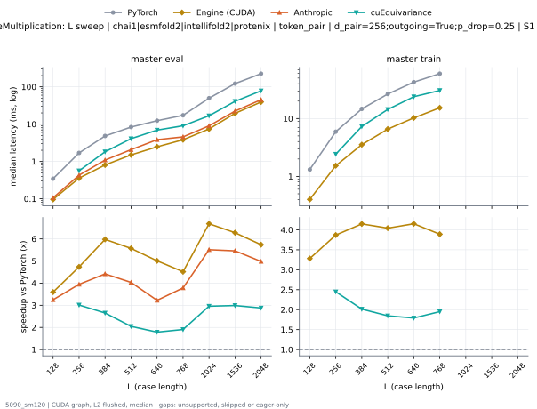

**master eval** (median ms; x = speedup vs PyTorch)

| L | PyTorch | Engine (Triton) | Engine (CUDA) | Anthropic | cuEquivariance |
|---|---|---|---|---|---|
| 128 | 0.346 | 0.1516 (2.28x) | 0.09626 (3.60x) | 0.1065 (3.25x) | unsupported |
| 256 | 1.696 | 0.5059 (3.35x) | 0.3584 (4.73x) | 0.4299 (3.95x) | 0.5632 (3.01x) |
| 384 | 4.823 | 1.101 (4.38x) | 0.8069 (5.98x) | 1.092 (4.42x) | 1.82 (2.65x) |
| 512 | 8.363 | 2.085 (4.01x) | 1.502 (5.57x) | 2.074 (4.03x) | 4.086 (2.05x) |
| 640 | 12.38 | 3.773 (3.28x) | 2.473 (5.01x) | 3.842 (3.22x) | 6.925 (1.79x) |
| 768 | 17.27 | 4.492 (3.84x) | 3.825 (4.52x) | 4.564 (3.78x) | 9.062 (1.91x) |
| 1024 | 49.67 | 8.741 (5.68x) | 7.434 (6.68x) | 9.015 (5.51x) | 16.8 (2.96x) |
| 1536 | 122.3 | 22.84 (5.35x) | 19.48 (6.28x) | 22.4 (5.46x) | 40.92 (2.99x) |
| 2048 | 225.4 | 46.09 (4.89x) | 39.29 (5.74x) | 45.26 (4.98x) | 78.32 (2.88x) |

**master train** (median ms; x = speedup vs PyTorch)

| L | PyTorch | Engine (Triton) | Engine (CUDA) | Anthropic | cuEquivariance |
|---|---|---|---|---|---|
| 128 | 1.312 | 0.4536 (2.89x) | 0.3998 (3.28x) | unsupported | unsupported |
| 256 | 5.923 | 1.822 (3.25x) | 1.531 (3.87x) | unsupported | 2.42 (2.45x) |
| 384 | 14.67 | 4.532 (3.24x) | 3.536 (4.15x) | unsupported | 7.287 (2.01x) |
| 512 | 26.53 | 8.682 (3.06x) | 6.564 (4.04x) | unsupported | 14.38 (1.85x) |
| 640 | 42.6 | 14.67 (2.90x) | 10.26 (4.15x) | unsupported | 23.8 (1.79x) |
| 768 | 59.6 | 17.65 (3.38x) | 15.32 (3.89x) | unsupported | 30.55 (1.95x) |
| 1024 |  |  |  |  |  |
| 1536 |  |  |  |  |  |
| 2048 |  |  |  |  |  |

### L sweep: intellifold2 | token_pair | d_pair=512;outgoing=False;p_drop=0.25 | S1 | graph

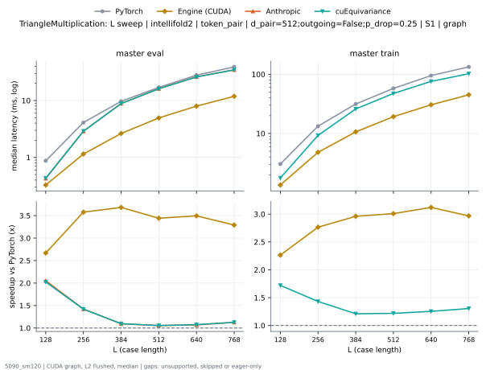

**master eval** (median ms; x = speedup vs PyTorch)

| L | PyTorch | Engine (Triton) | Engine (CUDA) | Anthropic | cuEquivariance |
|---|---|---|---|---|---|
| 128 | 0.8744 | 0.4956 (1.76x) | 0.3277 (2.67x) | 0.4262 (2.05x) | 0.432 (2.02x) |
| 256 | 4.107 | 1.641 (2.50x) | 1.148 (3.58x) | 2.887 (1.42x) | 2.894 (1.42x) |
| 384 | 9.7 | 3.628 (2.67x) | 2.635 (3.68x) | 8.859 (1.09x) | 8.843 (1.10x) |
| 512 | 17.01 | 6.822 (2.49x) | 4.943 (3.44x) | 16.12 (1.06x) | 16.12 (1.06x) |
| 640 | 27.87 | 11.2 (2.49x) | 7.976 (3.49x) | 26.07 (1.07x) | 25.93 (1.08x) |
| 768 | 39.01 | 13.34 (2.92x) | 11.86 (3.29x) | 34.59 (1.13x) | 34.63 (1.13x) |

**master train** (median ms; x = speedup vs PyTorch)

| L | PyTorch | Engine (Triton) | Engine (CUDA) | Anthropic | cuEquivariance |
|---|---|---|---|---|---|
| 128 | 3.042 | 1.427 (2.13x) | 1.343 (2.26x) | unsupported | 1.768 (1.72x) |
| 256 | 13.28 | 5.076 (2.62x) | 4.802 (2.76x) | unsupported | 9.269 (1.43x) |
| 384 | 31.48 | 12.19 (2.58x) | 10.63 (2.96x) | unsupported | 25.99 (1.21x) |
| 512 | 57.84 | 22.79 (2.54x) | 19.23 (3.01x) | unsupported | 47.46 (1.22x) |
| 640 | 95.41 | 39.83 (2.40x) | 30.58 (3.12x) | unsupported | 76.06 (1.25x) |
| 768 | 133.8 | 50.91 (2.63x) | 45.08 (2.97x) | unsupported | 102.5 (1.31x) |

### L sweep: intellifold2 | token_pair | d_pair=512;outgoing=True;p_drop=0.25 | S1 | graph

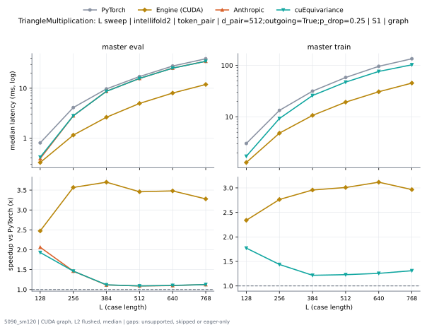

**master eval** (median ms; x = speedup vs PyTorch)

| L | PyTorch | Engine (Triton) | Engine (CUDA) | Anthropic | cuEquivariance |
|---|---|---|---|---|---|
| 128 | 0.8029 | 0.4851 (1.66x) | 0.3246 (2.47x) | 0.3893 (2.06x) | 0.4158 (1.93x) |
| 256 | 4.102 | 1.564 (2.62x) | 1.15 (3.57x) | 2.806 (1.46x) | 2.806 (1.46x) |
| 384 | 9.698 | 3.475 (2.79x) | 2.622 (3.70x) | 8.704 (1.11x) | 8.674 (1.12x) |
| 512 | 17.16 | 6.489 (2.64x) | 4.962 (3.46x) | 15.73 (1.09x) | 15.75 (1.09x) |
| 640 | 27.89 | 10.57 (2.64x) | 8.014 (3.48x) | 25.37 (1.10x) | 25.28 (1.10x) |
| 768 | 39.02 | 13.46 (2.90x) | 11.9 (3.28x) | 34.73 (1.12x) | 34.69 (1.12x) |

**master train** (median ms; x = speedup vs PyTorch)

| L | PyTorch | Engine (Triton) | Engine (CUDA) | Anthropic | cuEquivariance |
|---|---|---|---|---|---|
| 128 | 3.035 | 1.349 (2.25x) | 1.297 (2.34x) | unsupported | 1.713 (1.77x) |
| 256 | 13.32 | 5.098 (2.61x) | 4.818 (2.76x) | unsupported | 9.259 (1.44x) |
| 384 | 31.49 | 12.22 (2.58x) | 10.65 (2.96x) | unsupported | 25.87 (1.22x) |
| 512 | 57.91 | 22.79 (2.54x) | 19.25 (3.01x) | unsupported | 47.09 (1.23x) |
| 640 | 95.44 | 39.9 (2.39x) | 30.63 (3.12x) | unsupported | 75.95 (1.26x) |
| 768 | 133.8 | 50.91 (2.63x) | 45.11 (2.97x) | unsupported | 102.1 (1.31x) |

### L sweep: opendde | token_pair | d_pair=384;outgoing=False;p_drop=0.25 | S1 | graph

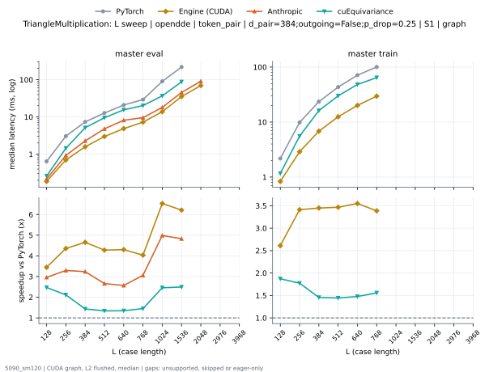

**master eval** (median ms; x = speedup vs PyTorch)

| L | PyTorch | Engine (Triton) | Engine (CUDA) | Anthropic | cuEquivariance |
|---|---|---|---|---|---|
| 128 | 0.6425 | 0.2844 (2.26x) | 0.1864 (3.45x) | 0.2171 (2.96x) | 0.2601 (2.47x) |
| 256 | 3.057 | 1.042 (2.93x) | 0.7014 (4.36x) | 0.9277 (3.29x) | 1.447 (2.11x) |
| 384 | 7.376 | 2.226 (3.31x) | 1.584 (4.66x) | 2.279 (3.24x) | 5.144 (1.43x) |
| 512 | 12.79 | 4.318 (2.96x) | 2.991 (4.28x) | 4.81 (2.66x) | 9.554 (1.34x) |
| 640 | 20.94 | 7.19 (2.91x) | 4.868 (4.30x) | 8.153 (2.57x) | 15.54 (1.35x) |
| 768 | 29.31 | 8.188 (3.58x) | 7.267 (4.03x) | 9.579 (3.06x) | 20.24 (1.45x) |
| 1024 | 90.47 | 15.47 (5.85x) | 13.85 (6.53x) | 18.15 (4.99x) | 36.82 (2.46x) |
| 1536 | 219.1 | 39.27 (5.58x) | 35.27 (6.21x) | 45.38 (4.83x) | 87.88 (2.49x) |
| 2048 | skipped | 77.76 | 69.75 | 90.97 | skipped |
| 2976 | skipped | skipped | skipped | skipped | skipped |
| 3968 | skipped | skipped | skipped | skipped | skipped |

**master train** (median ms; x = speedup vs PyTorch)

| L | PyTorch | Engine (Triton) | Engine (CUDA) | Anthropic | cuEquivariance |
|---|---|---|---|---|---|
| 128 | 2.176 | 0.9073 (2.40x) | 0.8336 (2.61x) | unsupported | 1.163 (1.87x) |
| 256 | 9.84 | 3.316 (2.97x) | 2.884 (3.41x) | unsupported | 5.546 (1.77x) |
| 384 | 23.54 | 8.06 (2.92x) | 6.828 (3.45x) | unsupported | 16.16 (1.46x) |
| 512 | 43.31 | 15.48 (2.80x) | 12.5 (3.47x) | unsupported | 30.01 (1.44x) |
| 640 | 71.34 | 26.34 (2.71x) | 20.1 (3.55x) | unsupported | 48.32 (1.48x) |
| 768 | 100.3 | 34.03 (2.95x) | 29.62 (3.39x) | unsupported | 64.36 (1.56x) |
| 1024 |  |  |  |  |  |
| 1536 |  |  |  |  |  |
| 2048 |  |  |  |  |  |
| 2976 |  |  |  |  |  |
| 3968 |  |  |  |  |  |

### L sweep: opendde | token_pair | d_pair=384;outgoing=True;p_drop=0.25 | S1 | graph

**master eval** (median ms; x = speedup vs PyTorch)

| L | PyTorch | Engine (Triton) | Engine (CUDA) | Anthropic | cuEquivariance |
|---|---|---|---|---|---|
| 128 | 0.684 | 0.3024 (2.26x) | 0.2031 (3.37x) | 0.2575 (2.66x) | 0.2643 (2.59x) |
| 256 | 3.06 | 1.007 (3.04x) | 0.727 (4.21x) | 0.9923 (3.08x) | 1.385 (2.21x) |
| 384 | 7.274 | 2.024 (3.59x) | 1.574 (4.62x) | 2.266 (3.21x) | 4.925 (1.48x) |
| 512 | 12.8 | 4.073 (3.14x) | 2.977 (4.30x) | 4.56 (2.81x) | 9.268 (1.38x) |
| 640 | 20.93 | 6.718 (3.12x) | 4.983 (4.20x) | 7.698 (2.72x) | 15.05 (1.39x) |
| 768 | 29.3 | 8.266 (3.54x) | 7.321 (4.00x) | 9.673 (3.03x) | 20.34 (1.44x) |
| 1024 | 90.47 | 15.71 (5.76x) | 13.94 (6.49x) | 18.38 (4.92x) | 36.99 (2.45x) |
| 1536 | 218.7 | 39.88 (5.49x) | 35.37 (6.18x) | 46.26 (4.73x) | 88.14 (2.48x) |
| 2048 | skipped | skipped | 69.98 | skipped | skipped |
| 2976 | skipped | skipped | skipped | skipped | skipped |
| 3968 | skipped | skipped | skipped | skipped | skipped |

**master train** (median ms; x = speedup vs PyTorch)

| L | PyTorch | Engine (Triton) | Engine (CUDA) | Anthropic | cuEquivariance |
|---|---|---|---|---|---|
| 128 | 2.179 | 0.8609 (2.53x) | 0.8284 (2.63x) | unsupported | 1.158 (1.88x) |
| 256 | 9.833 | 3.328 (2.95x) | 2.878 (3.42x) | unsupported | 5.591 (1.76x) |
| 384 | 23.55 | 8.059 (2.92x) | 6.83 (3.45x) | unsupported | 16.09 (1.46x) |
| 512 | 43.33 | 15.5 (2.80x) | 12.48 (3.47x) | unsupported | 29.73 (1.46x) |
| 640 | 71.34 | 26.38 (2.70x) | 20.14 (3.54x) | unsupported | 48.19 (1.48x) |
| 768 | 100.3 | 34.07 (2.94x) | 29.61 (3.39x) | unsupported | 63.97 (1.57x) |
| 1024 |  |  |  |  |  |
| 1536 |  |  |  |  |  |
| 2048 |  |  |  |  |  |
| 2976 |  |  |  |  |  |
| 3968 |  |  |  |  |  |

### L sweep: protenix | token_pair | d_hidden=128;d_pair=64;outgoing=False;p_drop=0.25 | S1 | graph

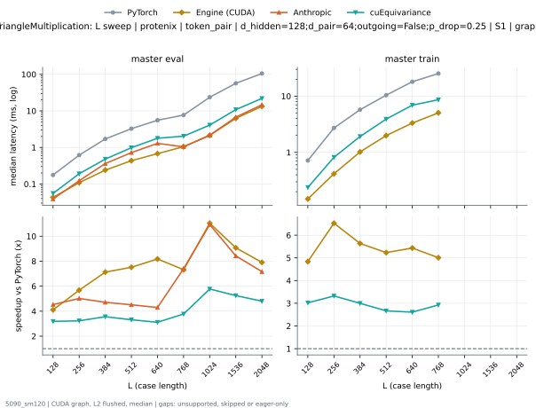

**master eval** (median ms; x = speedup vs PyTorch)

| L | PyTorch | Engine (Triton) | Engine (CUDA) | Anthropic | cuEquivariance |
|---|---|---|---|---|---|
| 128 | 0.1762 | 0.0576 (3.06x) | 0.04294 (4.10x) | 0.03891 (4.53x) | 0.05539 (3.18x) |
| 256 | 0.6165 | 0.1495 (4.12x) | 0.1086 (5.68x) | 0.1229 (5.02x) | 0.1908 (3.23x) |
| 384 | 1.707 | 0.4099 (4.16x) | 0.2396 (7.12x) | 0.3625 (4.71x) | 0.4797 (3.56x) |
| 512 | 3.262 | 0.8032 (4.06x) | 0.4342 (7.51x) | 0.7229 (4.51x) | 0.9846 (3.31x) |
| 640 | 5.544 | 1.418 (3.91x) | 0.6781 (8.18x) | 1.291 (4.29x) | 1.782 (3.11x) |
| 768 | 7.682 | 1.22 (6.30x) | 1.049 (7.32x) | 1.038 (7.40x) | 2.035 (3.78x) |
| 1024 | 23.64 | 2.51 (9.42x) | 2.141 (11.04x) | 2.163 (10.93x) | 4.096 (5.77x) |
| 1536 | 56.79 | 7.319 (7.76x) | 6.261 (9.07x) | 6.742 (8.42x) | 10.82 (5.25x) |
| 2048 | 105.3 | 15.72 (6.70x) | 13.33 (7.90x) | 14.71 (7.16x) | 21.96 (4.80x) |

**master train** (median ms; x = speedup vs PyTorch)

| L | PyTorch | Engine (Triton) | Engine (CUDA) | Anthropic | cuEquivariance |
|---|---|---|---|---|---|
| 128 | 0.7179 | 0.1864 (3.85x) | 0.1484 (4.84x) | unsupported | 0.2377 (3.02x) |
| 256 | 2.716 | 0.6653 (4.08x) | 0.416 (6.53x) | unsupported | 0.8173 (3.32x) |
| 384 | 5.742 | 1.603 (3.58x) | 1.019 (5.64x) | unsupported | 1.915 (3.00x) |
| 512 | 10.41 | 3.15 (3.31x) | 1.99 (5.23x) | unsupported | 3.907 (2.67x) |
| 640 | 18.06 | 5.607 (3.22x) | 3.324 (5.43x) | unsupported | 6.92 (2.61x) |
| 768 | 25.28 | 6.377 (3.96x) | 5.049 (5.01x) | unsupported | 8.64 (2.93x) |
| 1024 |  |  |  |  |  |
| 1536 |  |  |  |  |  |
| 2048 |  |  |  |  |  |

### L sweep: protenix | token_pair | d_hidden=128;d_pair=64;outgoing=True;p_drop=0.25 | S1 | graph

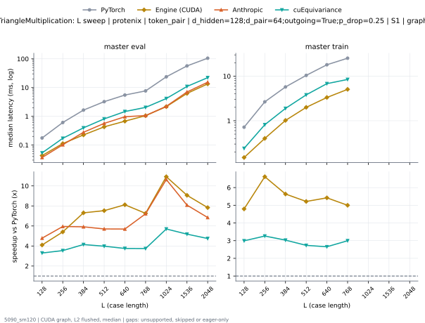

**master eval** (median ms; x = speedup vs PyTorch)

| L | PyTorch | Engine (Triton) | Engine (CUDA) | Anthropic | cuEquivariance |
|---|---|---|---|---|---|
| 128 | 0.1762 | 0.05325 (3.31x) | 0.04299 (4.10x) | 0.03686 (4.78x) | 0.05339 (3.30x) |
| 256 | 0.609 | 0.1311 (4.65x) | 0.1126 (5.41x) | 0.1024 (5.95x) | 0.172 (3.54x) |
| 384 | 1.648 | 0.3298 (5.00x) | 0.2253 (7.31x) | 0.2785 (5.92x) | 0.3974 (4.15x) |
| 512 | 3.238 | 0.6418 (5.05x) | 0.4301 (7.53x) | 0.5679 (5.70x) | 0.8141 (3.98x) |
| 640 | 5.502 | 1.109 (4.96x) | 0.6779 (8.12x) | 0.9666 (5.69x) | 1.466 (3.75x) |
| 768 | 7.657 | 1.242 (6.16x) | 1.055 (7.26x) | 1.061 (7.21x) | 2.045 (3.74x) |
| 1024 | 23.69 | 2.581 (9.18x) | 2.17 (10.92x) | 2.227 (10.64x) | 4.157 (5.70x) |
| 1536 | 56.75 | 7.578 (7.49x) | 6.263 (9.06x) | 7.022 (8.08x) | 10.95 (5.18x) |
| 2048 | 105.3 | 16.19 (6.50x) | 13.44 (7.83x) | 15.39 (6.84x) | 22.18 (4.75x) |

**master train** (median ms; x = speedup vs PyTorch)

| L | PyTorch | Engine (Triton) | Engine (CUDA) | Anthropic | cuEquivariance |
|---|---|---|---|---|---|
| 128 | 0.7169 | 0.1865 (3.84x) | 0.1496 (4.79x) | unsupported | 0.2397 (2.99x) |
| 256 | 2.656 | 0.6572 (4.04x) | 0.4015 (6.61x) | unsupported | 0.8143 (3.26x) |
| 384 | 5.73 | 1.605 (3.57x) | 1.017 (5.64x) | unsupported | 1.892 (3.03x) |
| 512 | 10.42 | 3.163 (3.29x) | 1.997 (5.22x) | unsupported | 3.81 (2.73x) |
| 640 | 18.03 | 5.607 (3.22x) | 3.326 (5.42x) | unsupported | 6.792 (2.65x) |
| 768 | 25.3 | 6.39 (3.96x) | 5.061 (5.00x) | unsupported | 8.444 (3.00x) |
| 1024 |  |  |  |  |  |
| 1536 |  |  |  |  |  |
| 2048 |  |  |  |  |  |

### d_pair sweep at L768: token_pair | outgoing=False;p_drop=0.25 | S1 | graph

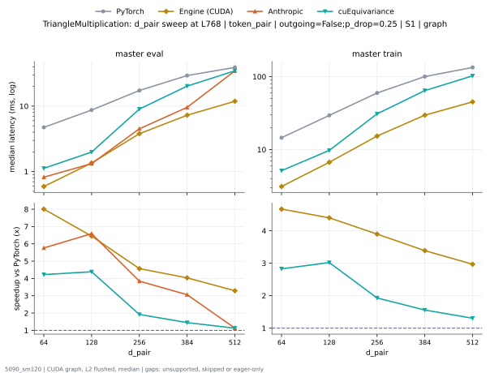

**master eval** (median ms; x = speedup vs PyTorch)

| d_pair | PyTorch | Engine (Triton) | Engine (CUDA) | Anthropic | cuEquivariance |
|---|---|---|---|---|---|
| 64 | 4.739 | 0.7451 (6.36x) | 0.5919 (8.01x) | 0.8225 (5.76x) | 1.122 (4.22x) |
| 128 | 8.72 | 1.613 (5.40x) | 1.353 (6.45x) | 1.324 (6.59x) | 1.988 (4.39x) |
| 256 | 17.32 | 4.428 (3.91x) | 3.792 (4.57x) | 4.506 (3.84x) | 9.023 (1.92x) |
| 384 | 29.31 | 8.188 (3.58x) | 7.267 (4.03x) | 9.579 (3.06x) | 20.24 (1.45x) |
| 512 | 39.01 | 13.34 (2.92x) | 11.86 (3.29x) | 34.59 (1.13x) | 34.63 (1.13x) |

**master train** (median ms; x = speedup vs PyTorch)

| d_pair | PyTorch | Engine (Triton) | Engine (CUDA) | Anthropic | cuEquivariance |
|---|---|---|---|---|---|
| 64 | 14.52 | 3.791 (3.83x) | 3.113 (4.67x) | unsupported | 5.136 (2.83x) |
| 128 | 29.43 | 7.908 (3.72x) | 6.694 (4.40x) | unsupported | 9.747 (3.02x) |
| 256 | 59.63 | 17.65 (3.38x) | 15.31 (3.90x) | unsupported | 30.9 (1.93x) |
| 384 | 100.3 | 34.03 (2.95x) | 29.62 (3.39x) | unsupported | 64.36 (1.56x) |
| 512 | 133.8 | 50.91 (2.63x) | 45.08 (2.97x) | unsupported | 102.5 (1.31x) |

### d_pair sweep at L768: token_pair | outgoing=True;p_drop=0.25 | S1 | graph

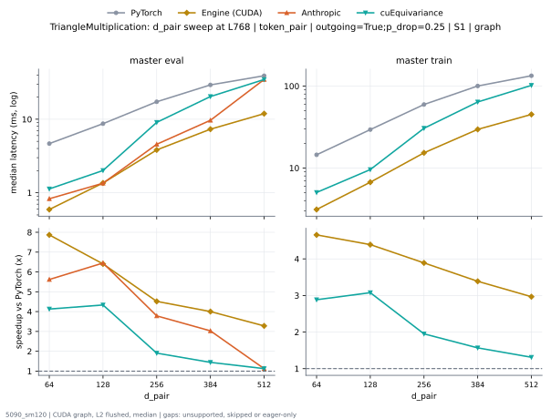

**master eval** (median ms; x = speedup vs PyTorch)

| d_pair | PyTorch | Engine (Triton) | Engine (CUDA) | Anthropic | cuEquivariance |
|---|---|---|---|---|---|
| 64 | 4.661 | 0.7461 (6.25x) | 0.5924 (7.87x) | 0.8294 (5.62x) | 1.128 (4.13x) |
| 128 | 8.702 | 1.65 (5.27x) | 1.359 (6.40x) | 1.349 (6.45x) | 2.008 (4.33x) |
| 256 | 17.27 | 4.492 (3.84x) | 3.825 (4.52x) | 4.564 (3.78x) | 9.062 (1.91x) |
| 384 | 29.3 | 8.266 (3.54x) | 7.321 (4.00x) | 9.673 (3.03x) | 20.34 (1.44x) |
| 512 | 39.02 | 13.46 (2.90x) | 11.9 (3.28x) | 34.73 (1.12x) | 34.69 (1.12x) |

**master train** (median ms; x = speedup vs PyTorch)

| d_pair | PyTorch | Engine (Triton) | Engine (CUDA) | Anthropic | cuEquivariance |
|---|---|---|---|---|---|
| 64 | 14.49 | 3.789 (3.82x) | 3.113 (4.66x) | unsupported | 5.025 (2.88x) |
| 128 | 29.43 | 7.92 (3.72x) | 6.704 (4.39x) | unsupported | 9.567 (3.08x) |
| 256 | 59.6 | 17.65 (3.38x) | 15.32 (3.89x) | unsupported | 30.55 (1.95x) |
| 384 | 100.3 | 34.07 (2.94x) | 29.61 (3.39x) | unsupported | 63.97 (1.57x) |
| 512 | 133.8 | 50.91 (2.63x) | 45.11 (2.97x) | unsupported | 102.1 (1.31x) |

