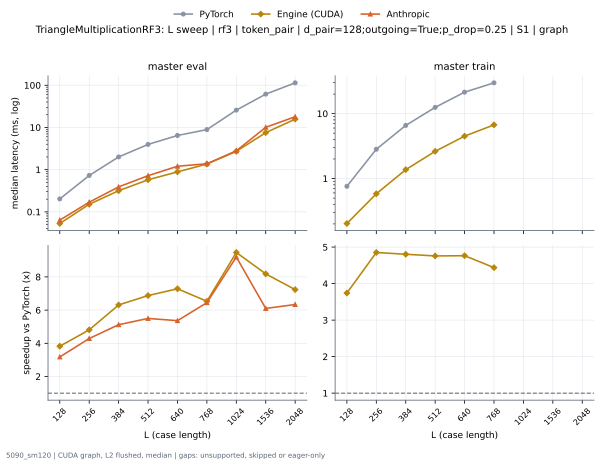
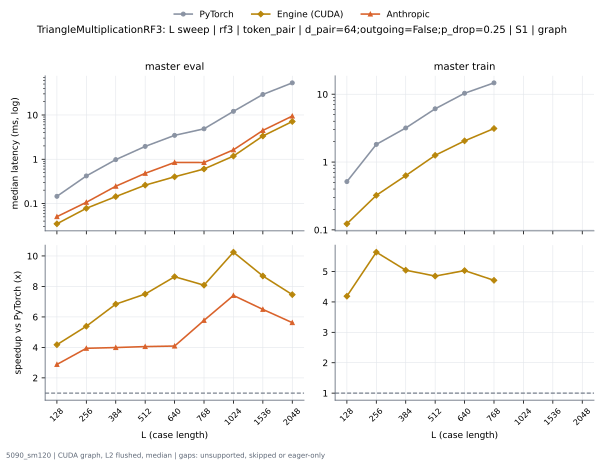
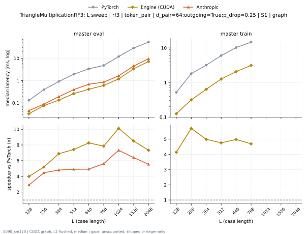

# TriangleMultiplicationRF3 on 5090_sm120

Generated by `python -m miniworld_engine.measure.plot` from speed tokens `judge/tokens/5090_sm120/`; do not edit.

### L sweep: rf3 | token_pair | d_pair=128;outgoing=False;p_drop=0.25 | S1 | graph

**master eval** (median ms; x = speedup vs PyTorch)

| L | PyTorch | Engine (Triton) | Engine (CUDA) | Anthropic |
|---|---|---|---|---|
| 128 | 0.2027 | 0.07782 (2.60x) | 0.05325 (3.81x) | 0.06349 (3.19x) |
| 256 | 0.7284 | 0.2233 (3.26x) | 0.1559 (4.67x) | 0.1905 (3.82x) |
| 384 | 2.042 | 0.5343 (3.82x) | 0.3316 (6.16x) | 0.5348 (3.82x) |
| 512 | 4.03 | 1.009 (3.99x) | 0.5846 (6.89x) | 0.897 (4.49x) |
| 640 | 6.669 | 1.694 (3.94x) | 0.906 (7.36x) | 1.545 (4.32x) |
| 768 | 8.937 | 1.626 (5.49x) | 1.353 (6.61x) | 1.341 (6.66x) |
| 1024 | 25.82 | 3.281 (7.87x) | 2.673 (9.66x) | 2.724 (9.48x) |
| 1536 | 61.73 | 8.949 (6.90x) | 7.531 (8.20x) | 8.053 (7.67x) |
| 2048 | 114.1 | 18.63 (6.12x) | 15.75 (7.24x) | 17.24 (6.62x) |

**master train** (median ms; x = speedup vs PyTorch)

| L | PyTorch | Engine (Triton) | Engine (CUDA) | Anthropic |
|---|---|---|---|---|
| 128 | 0.7583 | 0.2244 (3.38x) | 0.2028 (3.74x) | unsupported |
| 256 | 2.877 | 0.7414 (3.88x) | 0.5878 (4.89x) | unsupported |
| 384 | 6.626 | 1.931 (3.43x) | 1.38 (4.80x) | unsupported |
| 512 | 12.48 | 3.754 (3.32x) | 2.621 (4.76x) | unsupported |
| 640 | 21.47 | 6.711 (3.20x) | 4.496 (4.78x) | unsupported |
| 768 | 29.81 | 7.962 (3.74x) | 6.713 (4.44x) | unsupported |
| 1024 |  |  |  |  |
| 1536 |  |  |  |  |
| 2048 |  |  |  |  |

### L sweep: rf3 | token_pair | d_pair=128;outgoing=True;p_drop=0.25 | S1 | graph

**master eval** (median ms; x = speedup vs PyTorch)

| L | PyTorch | Engine (Triton) | Engine (CUDA) | Anthropic |
|---|---|---|---|---|
| 128 | 0.2027 | 0.07578 (2.68x) | 0.05299 (3.83x) | 0.06374 (3.18x) |
| 256 | 0.7293 | 0.1946 (3.75x) | 0.1516 (4.81x) | 0.17 (4.29x) |
| 384 | 2.002 | 0.4465 (4.48x) | 0.3172 (6.31x) | 0.3908 (5.12x) |
| 512 | 3.965 | 0.8294 (4.78x) | 0.5766 (6.88x) | 0.7212 (5.50x) |
| 640 | 6.461 | 1.387 (4.66x) | 0.8869 (7.29x) | 1.205 (5.36x) |
| 768 | 8.897 | 1.647 (5.40x) | 1.362 (6.53x) | 1.379 (6.45x) |
| 1024 | 25.75 | 3.38 (7.62x) | 2.718 (9.47x) | 2.799 (9.20x) |
| 1536 | 61.62 | 9.286 (6.64x) | 7.531 (8.18x) | 10.1 (6.10x) |
| 2048 | 114 | 19.28 (5.91x) | 15.76 (7.23x) | 17.99 (6.34x) |

**master train** (median ms; x = speedup vs PyTorch)

| L | PyTorch | Engine (Triton) | Engine (CUDA) | Anthropic |
|---|---|---|---|---|
| 128 | 0.7588 | 0.2202 (3.45x) | 0.2028 (3.74x) | unsupported |
| 256 | 2.828 | 0.7356 (3.84x) | 0.5827 (4.85x) | unsupported |
| 384 | 6.584 | 1.914 (3.44x) | 1.371 (4.80x) | unsupported |
| 512 | 12.49 | 3.763 (3.32x) | 2.626 (4.76x) | unsupported |
| 640 | 21.44 | 6.716 (3.19x) | 4.5 (4.76x) | unsupported |
| 768 | 29.81 | 7.946 (3.75x) | 6.719 (4.44x) | unsupported |
| 1024 |  |  |  |  |
| 1536 |  |  |  |  |
| 2048 |  |  |  |  |

### L sweep: rf3 | token_pair | d_pair=64;outgoing=False;p_drop=0.25 | S1 | graph

**master eval** (median ms; x = speedup vs PyTorch)

| L | PyTorch | Engine (Triton) | Engine (CUDA) | Anthropic |
|---|---|---|---|---|
| 128 | 0.1454 | 0.05925 (2.45x) | 0.0348 (4.18x) | 0.05043 (2.88x) |
| 256 | 0.4199 | 0.1144 (3.67x) | 0.07792 (5.39x) | 0.1065 (3.94x) |
| 384 | 0.9808 | 0.2458 (3.99x) | 0.1434 (6.84x) | 0.2458 (3.99x) |
| 512 | 1.951 | 0.4689 (4.16x) | 0.2601 (7.50x) | 0.4812 (4.05x) |
| 640 | 3.467 | 0.8163 (4.25x) | 0.4014 (8.64x) | 0.8479 (4.09x) |
| 768 | 4.872 | 0.7659 (6.36x) | 0.6028 (8.08x) | 0.8438 (5.77x) |
| 1024 | 12.09 | 1.492 (8.11x) | 1.18 (10.25x) | 1.633 (7.41x) |
| 1536 | 29.11 | 4.191 (6.95x) | 3.352 (8.69x) | 4.483 (6.49x) |
| 2048 | 53.2 | 8.838 (6.02x) | 7.129 (7.46x) | 9.46 (5.62x) |

**master train** (median ms; x = speedup vs PyTorch)

| L | PyTorch | Engine (Triton) | Engine (CUDA) | Anthropic |
|---|---|---|---|---|
| 128 | 0.5149 | 0.1534 (3.36x) | 0.123 (4.19x) | unsupported |
| 256 | 1.822 | 0.4259 (4.28x) | 0.3233 (5.64x) | unsupported |
| 384 | 3.181 | 0.9323 (3.41x) | 0.6309 (5.04x) | unsupported |
| 512 | 6.099 | 1.807 (3.37x) | 1.258 (4.85x) | unsupported |
| 640 | 10.33 | 3.133 (3.30x) | 2.054 (5.03x) | unsupported |
| 768 | 14.71 | 3.804 (3.87x) | 3.123 (4.71x) | unsupported |
| 1024 |  |  |  |  |
| 1536 |  |  |  |  |
| 2048 |  |  |  |  |

### L sweep: rf3 | token_pair | d_pair=64;outgoing=True;p_drop=0.25 | S1 | graph

**master eval** (median ms; x = speedup vs PyTorch)

| L | PyTorch | Engine (Triton) | Engine (CUDA) | Anthropic |
|---|---|---|---|---|
| 128 | 0.1311 | 0.0513 (2.56x) | 0.03277 (4.00x) | 0.04506 (2.91x) |
| 256 | 0.3935 | 0.09395 (4.19x) | 0.07582 (5.19x) | 0.08816 (4.46x) |
| 384 | 0.9175 | 0.2069 (4.43x) | 0.1331 (6.89x) | 0.1907 (4.81x) |
| 512 | 1.94 | 0.3872 (5.01x) | 0.2611 (7.43x) | 0.3955 (4.90x) |
| 640 | 3.387 | 0.6553 (5.17x) | 0.4097 (8.27x) | 0.6882 (4.92x) |
| 768 | 4.779 | 0.7721 (6.19x) | 0.6083 (7.86x) | 0.8503 (5.62x) |
| 1024 | 12.06 | 1.514 (7.97x) | 1.193 (10.11x) | 1.646 (7.33x) |
| 1536 | 28.89 | 4.284 (6.74x) | 3.394 (8.51x) | 4.516 (6.40x) |
| 2048 | 53.2 | 9.025 (5.89x) | 7.258 (7.33x) | 9.604 (5.54x) |

**master train** (median ms; x = speedup vs PyTorch)

| L | PyTorch | Engine (Triton) | Engine (CUDA) | Anthropic |
|---|---|---|---|---|
| 128 | 0.5182 | 0.1537 (3.37x) | 0.125 (4.15x) | unsupported |
| 256 | 1.804 | 0.4184 (4.31x) | 0.3159 (5.71x) | unsupported |
| 384 | 3.171 | 0.9365 (3.39x) | 0.6353 (4.99x) | unsupported |
| 512 | 5.993 | 1.807 (3.32x) | 1.258 (4.76x) | unsupported |
| 640 | 10.25 | 3.13 (3.27x) | 2.056 (4.98x) | unsupported |
| 768 | 14.67 | 3.795 (3.87x) | 3.124 (4.70x) | unsupported |
| 1024 |  |  |  |  |
| 1536 |  |  |  |  |
| 2048 |  |  |  |  |

