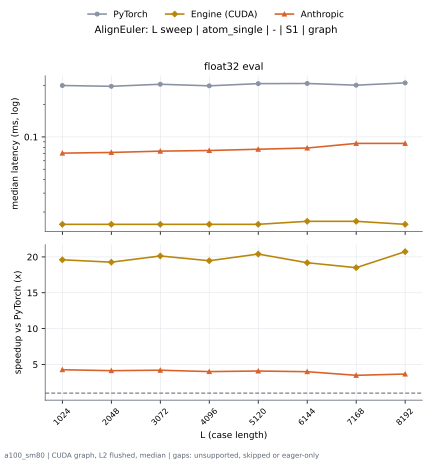

# AlignEuler on a100_sm80

Generated by `python -m miniworld_engine.measure.plot` from speed tokens `judge/tokens/a100_sm80/`; do not edit.

### L sweep: atom_single | - | S1 | graph

**float32 eval** (median ms; x = speedup vs PyTorch)

| L | PyTorch | Engine (Triton) | Engine (CUDA) | Anthropic |
|---|---|---|---|---|
| 1024 | 0.3011 | 0.01946 (15.47x) | 0.01536 (19.60x) | 0.07066 (4.26x) |
| 2048 | 0.2959 | 0.0215 (13.76x) | 0.01536 (19.27x) | 0.07168 (4.13x) |
| 3072 | 0.3092 | 0.02253 (13.73x) | 0.01536 (20.13x) | 0.07373 (4.19x) |
| 4096 | 0.299 | 0.02253 (13.27x) | 0.01536 (19.47x) | 0.07475 (4.00x) |
| 5120 | 0.3133 | 0.02253 (13.91x) | 0.01536 (20.40x) | 0.0768 (4.08x) |
| 6144 | 0.3144 | 0.02253 (13.95x) | 0.01638 (19.19x) | 0.07885 (3.99x) |
| 7168 | 0.3031 | 0.02355 (12.87x) | 0.01638 (18.50x) | 0.08704 (3.48x) |
| 8192 | 0.3185 | 0.02253 (14.14x) | 0.01536 (20.73x) | 0.08704 (3.66x) |

