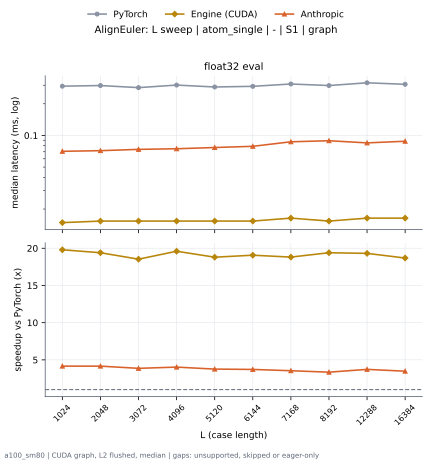

# AlignEuler on a100_sm80

Generated by `python -m foldjet_engine.measure.plot` from speed tokens `judge/tokens/a100_sm80/`; do not edit.

### L sweep: atom_single | - | S1 | graph

**float32 eval** (median ms; x = speedup vs PyTorch)

| L | PyTorch | Engine (Triton) | Engine (CUDA) | Anthropic |
|---|---|---|---|---|
| 1024 | 0.2939 | 0.01946 (15.11x) | 0.01485 (19.79x) | 0.07066 (4.16x) |
| 2048 | 0.298 | 0.0215 (13.86x) | 0.01536 (19.40x) | 0.07168 (4.16x) |
| 3072 | 0.2847 | 0.02253 (12.64x) | 0.01536 (18.53x) | 0.07373 (3.86x) |
| 4096 | 0.3011 | 0.02253 (13.36x) | 0.01536 (19.60x) | 0.07475 (4.03x) |
| 5120 | 0.2888 | 0.02253 (12.82x) | 0.01536 (18.80x) | 0.0768 (3.76x) |
| 6144 | 0.2929 | 0.02253 (13.00x) | 0.01536 (19.07x) | 0.07885 (3.71x) |
| 7168 | 0.3082 | 0.02253 (13.68x) | 0.01638 (18.81x) | 0.08704 (3.54x) |
| 8192 | 0.298 | 0.0215 (13.86x) | 0.01536 (19.40x) | 0.08909 (3.34x) |
| 12288 | 0.3164 | 0.0256 (12.36x) | 0.01638 (19.31x) | 0.08499 (3.72x) |
| 16384 | 0.3062 | 0.0256 (11.96x) | 0.01638 (18.69x) | 0.08806 (3.48x) |

