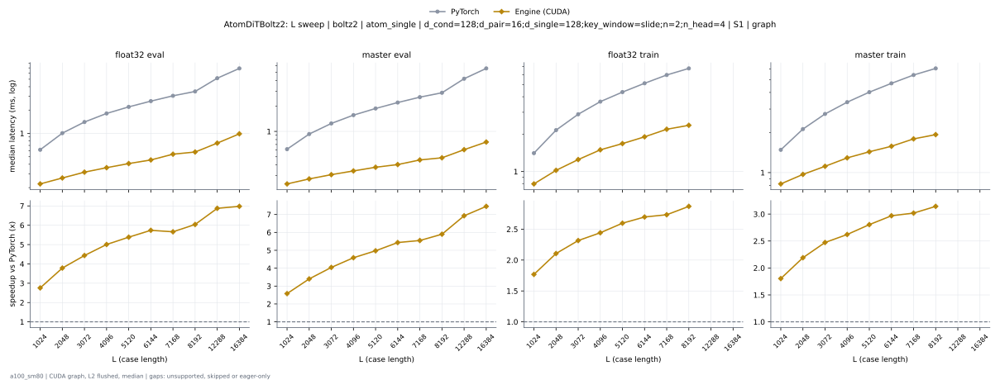
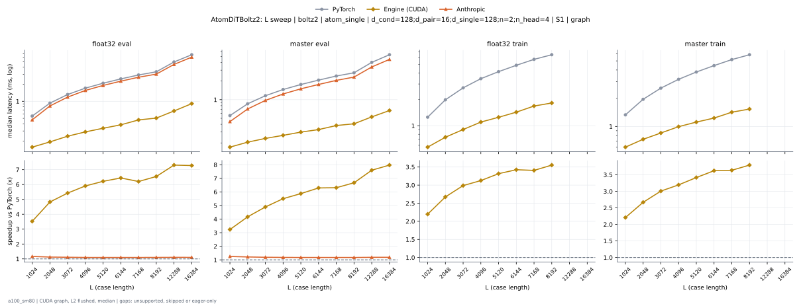
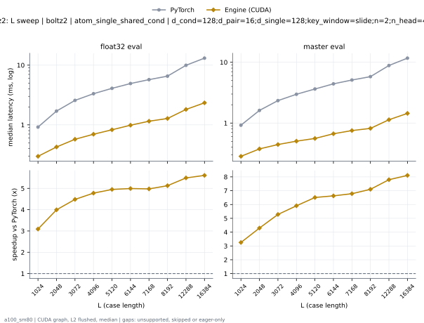
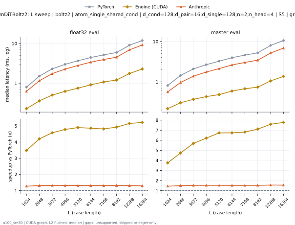

# AtomDiTBoltz2 on a100_sm80

Generated by `python -m foldjet_engine.measure.plot` from speed tokens `judge/tokens/a100_sm80/`; do not edit.

### L sweep: boltz2 | atom_single | d_cond=128;d_pair=16;d_single=128;key_window=slide;n=2;n_head=4 | S1 | graph

**float32 eval** (median ms; x = speedup vs PyTorch)

| L | PyTorch | Engine (Triton) | Engine (CUDA) | Anthropic |
|---|---|---|---|---|
| 1024 | 0.6154 | 0.5048 (1.22x) | 0.2232 (2.76x) | unsupported |
| 2048 | 1.008 | 0.8581 (1.17x) | 0.2662 (3.78x) | unsupported |
| 3072 | 1.403 | 1.22 (1.15x) | 0.3164 (4.43x) | unsupported |
| 4096 | 1.809 | 1.589 (1.14x) | 0.3615 (5.01x) | unsupported |
| 5120 | 2.2 | 1.94 (1.13x) | 0.4086 (5.38x) | unsupported |
| 6144 | 2.609 | 2.3 (1.13x) | 0.4547 (5.74x) | unsupported |
| 7168 | 3.056 | 2.698 (1.13x) | 0.5396 (5.66x) | unsupported |
| 8192 | 3.476 | 3.059 (1.14x) | 0.5755 (6.04x) | unsupported |
| 12288 | 5.154 | 4.508 (1.14x) | 0.7496 (6.88x) | unsupported |
| 16384 | 6.896 | 6.056 (1.14x) | 0.9882 (6.98x) | unsupported |

**master eval** (median ms; x = speedup vs PyTorch)

| L | PyTorch | Engine (Triton) | Engine (CUDA) | Anthropic |
|---|---|---|---|---|
| 1024 | 0.6154 | 0.4966 (1.24x) | 0.2386 (2.58x) | unsupported |
| 2048 | 0.9298 | 0.768 (1.21x) | 0.2734 (3.40x) | unsupported |
| 3072 | 1.242 | 1.038 (1.20x) | 0.3072 (4.04x) | unsupported |
| 4096 | 1.559 | 1.308 (1.19x) | 0.34 (4.58x) | unsupported |
| 5120 | 1.869 | 1.574 (1.19x) | 0.3758 (4.97x) | unsupported |
| 6144 | 2.198 | 1.839 (1.19x) | 0.4045 (5.43x) | unsupported |
| 7168 | 2.545 | 2.142 (1.19x) | 0.4588 (5.55x) | unsupported |
| 8192 | 2.869 | 2.415 (1.19x) | 0.4864 (5.90x) | unsupported |
| 12288 | 4.207 | 3.496 (1.20x) | 0.6072 (6.93x) | unsupported |
| 16384 | 5.577 | 4.623 (1.21x) | 0.748 (7.46x) | unsupported |

**float32 train** (median ms; x = speedup vs PyTorch)

| L | PyTorch | Engine (Triton) | Engine (CUDA) | Anthropic |
|---|---|---|---|---|
| 1024 | 1.407 | 1.153 (1.22x) | 0.7956 (1.77x) | unsupported |
| 2048 | 2.154 | 1.822 (1.18x) | 1.023 (2.11x) | unsupported |
| 3072 | 2.892 | 2.494 (1.16x) | 1.249 (2.32x) | unsupported |
| 4096 | 3.654 | 3.206 (1.14x) | 1.496 (2.44x) | unsupported |
| 5120 | 4.361 | 3.853 (1.13x) | 1.679 (2.60x) | unsupported |
| 6144 | 5.134 | 4.521 (1.14x) | 1.904 (2.70x) | unsupported |
| 7168 | 5.987 | 5.283 (1.13x) | 2.19 (2.73x) | unsupported |
| 8192 | 6.764 | 5.962 (1.13x) | 2.357 (2.87x) | unsupported |
| 12288 |  |  |  |  |
| 16384 |  |  |  |  |

**master train** (median ms; x = speedup vs PyTorch)

| L | PyTorch | Engine (Triton) | Engine (CUDA) | Anthropic |
|---|---|---|---|---|
| 1024 | 1.483 | 1.22 (1.22x) | 0.8223 (1.80x) | unsupported |
| 2048 | 2.123 | 1.78 (1.19x) | 0.9692 (2.19x) | unsupported |
| 3072 | 2.758 | 2.351 (1.17x) | 1.115 (2.47x) | unsupported |
| 4096 | 3.381 | 2.91 (1.16x) | 1.29 (2.62x) | unsupported |
| 5120 | 4.02 | 3.468 (1.16x) | 1.434 (2.80x) | unsupported |
| 6144 | 4.682 | 4.038 (1.16x) | 1.577 (2.97x) | unsupported |
| 7168 | 5.407 | 4.675 (1.16x) | 1.791 (3.02x) | unsupported |
| 8192 | 6.062 | 5.208 (1.16x) | 1.929 (3.14x) | unsupported |
| 12288 |  |  |  |  |
| 16384 |  |  |  |  |

### L sweep: boltz2 | atom_single | d_cond=128;d_pair=16;d_single=128;n=2;n_head=4 | S1 | graph

**float32 eval** (median ms; x = speedup vs PyTorch)

| L | PyTorch | Engine (Triton) | Engine (CUDA) | Anthropic |
|---|---|---|---|---|
| 1024 | 0.5489 | 0.4874 (1.13x) | 0.1556 (3.53x) | 0.471 (1.17x) |
| 2048 | 0.9288 | 0.8407 (1.10x) | 0.1925 (4.82x) | 0.8274 (1.12x) |
| 3072 | 1.317 | 1.203 (1.09x) | 0.2427 (5.43x) | 1.186 (1.11x) |
| 4096 | 1.705 | 1.571 (1.09x) | 0.2888 (5.90x) | 1.553 (1.10x) |
| 5120 | 2.082 | 1.921 (1.08x) | 0.3348 (6.22x) | 1.903 (1.09x) |
| 6144 | 2.48 | 2.282 (1.09x) | 0.385 (6.44x) | 2.263 (1.10x) |
| 7168 | 2.909 | 2.681 (1.09x) | 0.469 (6.20x) | 2.654 (1.10x) |
| 8192 | 3.309 | 3.04 (1.09x) | 0.5059 (6.54x) | 3.012 (1.10x) |
| 12288 | 4.931 | 4.49 (1.10x) | 0.6748 (7.31x) | 4.465 (1.10x) |
| 16384 | 6.616 | 6.039 (1.10x) | 0.9093 (7.28x) | 6.004 (1.10x) |

**master eval** (median ms; x = speedup vs PyTorch)

| L | PyTorch | Engine (Triton) | Engine (CUDA) | Anthropic |
|---|---|---|---|---|
| 1024 | 0.553 | 0.4813 (1.15x) | 0.171 (3.23x) | 0.4424 (1.25x) |
| 2048 | 0.8581 | 0.7506 (1.14x) | 0.2058 (4.17x) | 0.7076 (1.21x) |
| 3072 | 1.158 | 1.021 (1.13x) | 0.2365 (4.90x) | 0.9728 (1.19x) |
| 4096 | 1.46 | 1.292 (1.13x) | 0.2652 (5.51x) | 1.237 (1.18x) |
| 5120 | 1.758 | 1.555 (1.13x) | 0.299 (5.88x) | 1.498 (1.17x) |
| 6144 | 2.07 | 1.823 (1.14x) | 0.3287 (6.30x) | 1.761 (1.18x) |
| 7168 | 2.412 | 2.126 (1.13x) | 0.382 (6.31x) | 2.05 (1.18x) |
| 8192 | 2.721 | 2.398 (1.13x) | 0.4076 (6.68x) | 2.317 (1.17x) |
| 12288 | 4.009 | 3.48 (1.15x) | 0.5274 (7.60x) | 3.38 (1.19x) |
| 16384 | 5.327 | 4.603 (1.16x) | 0.6676 (7.98x) | 4.478 (1.19x) |

**float32 train** (median ms; x = speedup vs PyTorch)

| L | PyTorch | Engine (Triton) | Engine (CUDA) | Anthropic |
|---|---|---|---|---|
| 1024 | 1.255 | 1.136 (1.11x) | 0.5714 (2.20x) | unsupported |
| 2048 | 1.982 | 1.804 (1.10x) | 0.7414 (2.67x) | unsupported |
| 3072 | 2.711 | 2.479 (1.09x) | 0.9073 (2.99x) | unsupported |
| 4096 | 3.451 | 3.186 (1.08x) | 1.104 (3.13x) | unsupported |
| 5120 | 4.15 | 3.834 (1.08x) | 1.251 (3.32x) | unsupported |
| 6144 | 4.904 | 4.504 (1.09x) | 1.432 (3.43x) | unsupported |
| 7168 | 5.731 | 5.266 (1.09x) | 1.682 (3.41x) | unsupported |
| 8192 | 6.474 | 5.942 (1.09x) | 1.822 (3.55x) | unsupported |
| 12288 |  |  |  |  |
| 16384 |  |  |  |  |

**master train** (median ms; x = speedup vs PyTorch)

| L | PyTorch | Engine (Triton) | Engine (CUDA) | Anthropic |
|---|---|---|---|---|
| 1024 | 1.33 | 1.202 (1.11x) | 0.6021 (2.21x) | unsupported |
| 2048 | 1.949 | 1.759 (1.11x) | 0.7301 (2.67x) | unsupported |
| 3072 | 2.563 | 2.327 (1.10x) | 0.852 (3.01x) | unsupported |
| 4096 | 3.182 | 2.888 (1.10x) | 0.9953 (3.20x) | unsupported |
| 5120 | 3.805 | 3.455 (1.10x) | 1.113 (3.42x) | unsupported |
| 6144 | 4.454 | 4.017 (1.11x) | 1.229 (3.62x) | unsupported |
| 7168 | 5.163 | 4.655 (1.11x) | 1.419 (3.64x) | unsupported |
| 8192 | 5.817 | 5.192 (1.12x) | 1.533 (3.79x) | unsupported |
| 12288 |  |  |  |  |
| 16384 |  |  |  |  |

### L sweep: boltz2 | atom_single_shared_cond | d_cond=128;d_pair=16;d_single=128;key_window=slide;n=2;n_head=4 | S5 | graph

**float32 eval** (median ms; x = speedup vs PyTorch)

| L | PyTorch | Engine (Triton) | Engine (CUDA) | Anthropic |
|---|---|---|---|---|
| 1024 | 0.9175 | 0.6564 (1.40x) | 0.297 (3.09x) | unsupported |
| 2048 | 1.701 | 1.185 (1.44x) | 0.426 (3.99x) | unsupported |
| 3072 | 2.57 | 1.793 (1.43x) | 0.5734 (4.48x) | unsupported |
| 4096 | 3.326 | 2.314 (1.44x) | 0.6963 (4.78x) | unsupported |
| 5120 | 4.092 | 2.843 (1.44x) | 0.8269 (4.95x) | unsupported |
| 6144 | 4.924 | 3.446 (1.43x) | 0.9866 (4.99x) | unsupported |
| 7168 | 5.725 | 4.01 (1.43x) | 1.151 (4.97x) | unsupported |
| 8192 | 6.546 | 4.573 (1.43x) | 1.277 (5.12x) | unsupported |
| 12288 | 9.953 | 6.953 (1.43x) | 1.813 (5.49x) | unsupported |
| 16384 | 13.12 | 9.236 (1.42x) | 2.339 (5.61x) | unsupported |

**master eval** (median ms; x = speedup vs PyTorch)

| L | PyTorch | Engine (Triton) | Engine (CUDA) | Anthropic |
|---|---|---|---|---|
| 1024 | 0.9226 | 0.6328 (1.46x) | 0.2836 (3.25x) | unsupported |
| 2048 | 1.614 | 1.062 (1.52x) | 0.3758 (4.29x) | unsupported |
| 3072 | 2.341 | 1.519 (1.54x) | 0.4434 (5.28x) | unsupported |
| 4096 | 2.976 | 1.9 (1.57x) | 0.5038 (5.91x) | unsupported |
| 5120 | 3.632 | 2.306 (1.58x) | 0.5581 (6.51x) | unsupported |
| 6144 | 4.417 | 2.833 (1.56x) | 0.6666 (6.63x) | unsupported |
| 7168 | 5.105 | 3.279 (1.56x) | 0.7526 (6.78x) | unsupported |
| 8192 | 5.802 | 3.702 (1.57x) | 0.8172 (7.10x) | unsupported |
| 12288 | 8.845 | 5.559 (1.59x) | 1.135 (7.80x) | unsupported |
| 16384 | 11.69 | 7.351 (1.59x) | 1.442 (8.11x) | unsupported |

### L sweep: boltz2 | atom_single_shared_cond | d_cond=128;d_pair=16;d_single=128;n=2;n_head=4 | S5 | graph

**float32 eval** (median ms; x = speedup vs PyTorch)

| L | PyTorch | Engine (Triton) | Engine (CUDA) | Anthropic |
|---|---|---|---|---|
| 1024 | 0.7946 | 0.639 (1.24x) | 0.2284 (3.48x) | 0.6246 (1.27x) |
| 2048 | 1.504 | 1.167 (1.29x) | 0.3584 (4.20x) | 1.149 (1.31x) |
| 3072 | 2.296 | 1.776 (1.29x) | 0.5018 (4.58x) | 1.741 (1.32x) |
| 4096 | 2.98 | 2.295 (1.30x) | 0.6236 (4.78x) | 2.264 (1.32x) |
| 5120 | 3.67 | 2.823 (1.30x) | 0.7496 (4.90x) | 2.791 (1.31x) |
| 6144 | 4.432 | 3.427 (1.29x) | 0.9124 (4.86x) | 3.385 (1.31x) |
| 7168 | 5.164 | 3.992 (1.29x) | 1.073 (4.81x) | 3.939 (1.31x) |
| 8192 | 5.913 | 4.555 (1.30x) | 1.201 (4.92x) | 4.51 (1.31x) |
| 12288 | 9.026 | 6.931 (1.30x) | 1.753 (5.15x) | 6.888 (1.31x) |
| 16384 | 11.87 | 9.217 (1.29x) | 2.276 (5.22x) | 9.194 (1.29x) |

**master eval** (median ms; x = speedup vs PyTorch)

| L | PyTorch | Engine (Triton) | Engine (CUDA) | Anthropic |
|---|---|---|---|---|
| 1024 | 0.811 | 0.6164 (1.32x) | 0.2161 (3.75x) | 0.5632 (1.44x) |
| 2048 | 1.436 | 1.046 (1.37x) | 0.3031 (4.74x) | 0.9656 (1.49x) |
| 3072 | 2.097 | 1.501 (1.40x) | 0.3686 (5.69x) | 1.381 (1.52x) |
| 4096 | 2.672 | 1.881 (1.42x) | 0.4301 (6.21x) | 1.754 (1.52x) |
| 5120 | 3.255 | 2.287 (1.42x) | 0.4833 (6.74x) | 2.136 (1.52x) |
| 6144 | 3.981 | 2.815 (1.41x) | 0.5908 (6.74x) | 2.628 (1.52x) |
| 7168 | 4.606 | 3.26 (1.41x) | 0.6758 (6.82x) | 3.033 (1.52x) |
| 8192 | 5.247 | 3.684 (1.42x) | 0.7383 (7.11x) | 3.448 (1.52x) |
| 12288 | 8.021 | 5.543 (1.45x) | 1.056 (7.60x) | 5.186 (1.55x) |
| 16384 | 10.62 | 7.331 (1.45x) | 1.366 (7.78x) | 6.882 (1.54x) |

