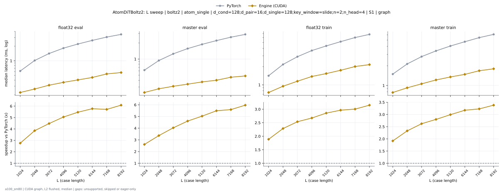
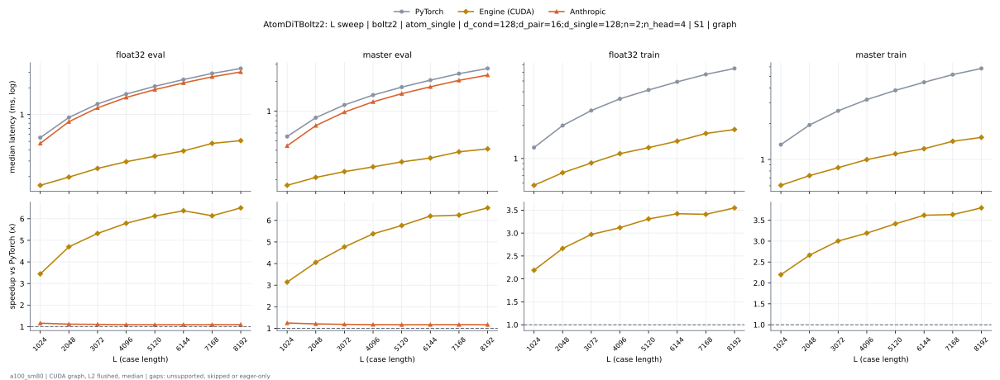

# AtomDiTBoltz2 on a100_sm80

Generated by `python -m miniworld_engine.measure.plot` from speed tokens `judge/tokens/a100_sm80/`; do not edit.

### L sweep: boltz2 | atom_single | d_cond=128;d_pair=16;d_single=128;key_window=slide;n=2;n_head=4 | S1 | graph

**float32 eval** (median ms; x = speedup vs PyTorch)

| L | PyTorch | Engine (Triton) | Engine (CUDA) | Anthropic |
|---|---|---|---|---|
| 1024 | 0.6164 | 0.5069 (1.22x) | 0.2232 (2.76x) | unsupported |
| 2048 | 1.014 | 0.8622 (1.18x) | 0.2632 (3.85x) | unsupported |
| 3072 | 1.412 | 1.225 (1.15x) | 0.3154 (4.48x) | unsupported |
| 4096 | 1.82 | 1.595 (1.14x) | 0.3604 (5.05x) | unsupported |
| 5120 | 2.212 | 1.949 (1.14x) | 0.4045 (5.47x) | unsupported |
| 6144 | 2.626 | 2.309 (1.14x) | 0.4547 (5.77x) | unsupported |
| 7168 | 3.073 | 2.708 (1.13x) | 0.5376 (5.72x) | unsupported |
| 8192 | 3.49 | 3.07 (1.14x) | 0.5734 (6.09x) | unsupported |

**master eval** (median ms; x = speedup vs PyTorch)

| L | PyTorch | Engine (Triton) | Engine (CUDA) | Anthropic |
|---|---|---|---|---|
| 1024 | 0.6205 | 0.4997 (1.24x) | 0.2376 (2.61x) | unsupported |
| 2048 | 0.938 | 0.7726 (1.21x) | 0.2785 (3.37x) | unsupported |
| 3072 | 1.251 | 1.043 (1.20x) | 0.3103 (4.03x) | unsupported |
| 4096 | 1.568 | 1.313 (1.19x) | 0.34 (4.61x) | unsupported |
| 5120 | 1.881 | 1.579 (1.19x) | 0.3738 (5.03x) | unsupported |
| 6144 | 2.211 | 1.845 (1.20x) | 0.4024 (5.49x) | unsupported |
| 7168 | 2.56 | 2.149 (1.19x) | 0.4577 (5.59x) | unsupported |
| 8192 | 2.887 | 2.425 (1.19x) | 0.4833 (5.97x) | unsupported |

**float32 train** (median ms; x = speedup vs PyTorch)

| L | PyTorch | Engine (Triton) | Engine (CUDA) | Anthropic |
|---|---|---|---|---|
| 1024 | 1.413 | 1.16 (1.22x) | 0.7485 (1.89x) | unsupported |
| 2048 | 2.17 | 1.833 (1.18x) | 0.9492 (2.29x) | unsupported |
| 3072 | 2.912 | 2.511 (1.16x) | 1.148 (2.54x) | unsupported |
| 4096 | 3.676 | 3.225 (1.14x) | 1.374 (2.68x) | unsupported |
| 5120 | 4.385 | 3.874 (1.13x) | 1.535 (2.86x) | unsupported |
| 6144 | 5.158 | 4.543 (1.14x) | 1.74 (2.96x) | unsupported |
| 7168 | 6.024 | 5.312 (1.13x) | 2.005 (3.00x) | unsupported |
| 8192 | 6.794 | 5.978 (1.14x) | 2.157 (3.15x) | unsupported |

**master train** (median ms; x = speedup vs PyTorch)

| L | PyTorch | Engine (Triton) | Engine (CUDA) | Anthropic |
|---|---|---|---|---|
| 1024 | 1.495 | 1.229 (1.22x) | 0.7803 (1.92x) | unsupported |
| 2048 | 2.143 | 1.791 (1.20x) | 0.9206 (2.33x) | unsupported |
| 3072 | 2.778 | 2.364 (1.17x) | 1.06 (2.62x) | unsupported |
| 4096 | 3.403 | 2.93 (1.16x) | 1.216 (2.80x) | unsupported |
| 5120 | 4.045 | 3.494 (1.16x) | 1.352 (2.99x) | unsupported |
| 6144 | 4.705 | 4.055 (1.16x) | 1.483 (3.17x) | unsupported |
| 7168 | 5.439 | 4.693 (1.16x) | 1.684 (3.23x) | unsupported |
| 8192 | 6.102 | 5.233 (1.17x) | 1.804 (3.38x) | unsupported |

### L sweep: boltz2 | atom_single | d_cond=128;d_pair=16;d_single=128;n=2;n_head=4 | S1 | graph

**float32 eval** (median ms; x = speedup vs PyTorch)

| L | PyTorch | Engine (Triton) | Engine (CUDA) | Anthropic |
|---|---|---|---|---|
| 1024 | 0.5499 | 0.4905 (1.12x) | 0.1597 (3.44x) | 0.4741 (1.16x) |
| 2048 | 0.9288 | 0.8458 (1.10x) | 0.1976 (4.70x) | 0.8325 (1.12x) |
| 3072 | 1.318 | 1.207 (1.09x) | 0.2478 (5.32x) | 1.192 (1.11x) |
| 4096 | 1.705 | 1.579 (1.08x) | 0.2944 (5.79x) | 1.562 (1.09x) |
| 5120 | 2.083 | 1.93 (1.08x) | 0.34 (6.13x) | 1.913 (1.09x) |
| 6144 | 2.482 | 2.291 (1.08x) | 0.3896 (6.37x) | 2.276 (1.09x) |
| 7168 | 2.91 | 2.689 (1.08x) | 0.4741 (6.14x) | 2.665 (1.09x) |
| 8192 | 3.31 | 3.05 (1.08x) | 0.5089 (6.50x) | 3.023 (1.09x) |

**master eval** (median ms; x = speedup vs PyTorch)

| L | PyTorch | Engine (Triton) | Engine (CUDA) | Anthropic |
|---|---|---|---|---|
| 1024 | 0.553 | 0.4833 (1.14x) | 0.1761 (3.14x) | 0.4444 (1.24x) |
| 2048 | 0.8591 | 0.7547 (1.14x) | 0.212 (4.05x) | 0.7137 (1.20x) |
| 3072 | 1.158 | 1.025 (1.13x) | 0.2427 (4.77x) | 0.9789 (1.18x) |
| 4096 | 1.459 | 1.296 (1.13x) | 0.2714 (5.38x) | 1.246 (1.17x) |
| 5120 | 1.758 | 1.561 (1.13x) | 0.3052 (5.76x) | 1.508 (1.17x) |
| 6144 | 2.07 | 1.827 (1.13x) | 0.3338 (6.20x) | 1.772 (1.17x) |
| 7168 | 2.41 | 2.13 (1.13x) | 0.386 (6.24x) | 2.061 (1.17x) |
| 8192 | 2.722 | 2.405 (1.13x) | 0.4137 (6.58x) | 2.331 (1.17x) |

**float32 train** (median ms; x = speedup vs PyTorch)

| L | PyTorch | Engine (Triton) | Engine (CUDA) | Anthropic |
|---|---|---|---|---|
| 1024 | 1.255 | 1.141 (1.10x) | 0.5734 (2.19x) | unsupported |
| 2048 | 1.983 | 1.817 (1.09x) | 0.7444 (2.66x) | unsupported |
| 3072 | 2.706 | 2.491 (1.09x) | 0.9114 (2.97x) | unsupported |
| 4096 | 3.451 | 3.201 (1.08x) | 1.107 (3.12x) | unsupported |
| 5120 | 4.146 | 3.852 (1.08x) | 1.253 (3.31x) | unsupported |
| 6144 | 4.909 | 4.519 (1.09x) | 1.435 (3.42x) | unsupported |
| 7168 | 5.733 | 5.288 (1.08x) | 1.682 (3.41x) | unsupported |
| 8192 | 6.48 | 5.965 (1.09x) | 1.826 (3.55x) | unsupported |

**master train** (median ms; x = speedup vs PyTorch)

| L | PyTorch | Engine (Triton) | Engine (CUDA) | Anthropic |
|---|---|---|---|---|
| 1024 | 1.332 | 1.21 (1.10x) | 0.6062 (2.20x) | unsupported |
| 2048 | 1.948 | 1.777 (1.10x) | 0.7311 (2.66x) | unsupported |
| 3072 | 2.562 | 2.344 (1.09x) | 0.853 (3.00x) | unsupported |
| 4096 | 3.183 | 2.91 (1.09x) | 0.9974 (3.19x) | unsupported |
| 5120 | 3.808 | 3.471 (1.10x) | 1.115 (3.42x) | unsupported |
| 6144 | 4.454 | 4.044 (1.10x) | 1.231 (3.62x) | unsupported |
| 7168 | 5.168 | 4.675 (1.11x) | 1.421 (3.64x) | unsupported |
| 8192 | 5.818 | 5.215 (1.12x) | 1.533 (3.80x) | unsupported |

