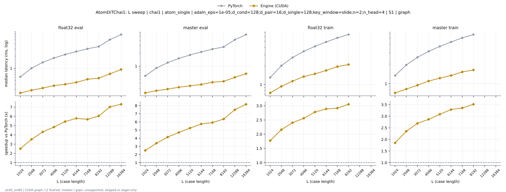
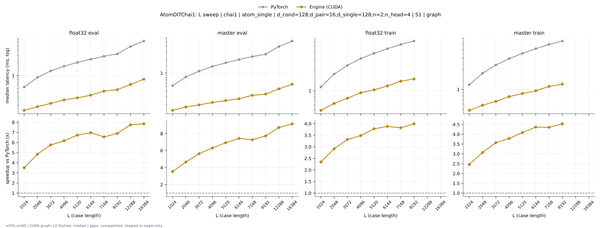
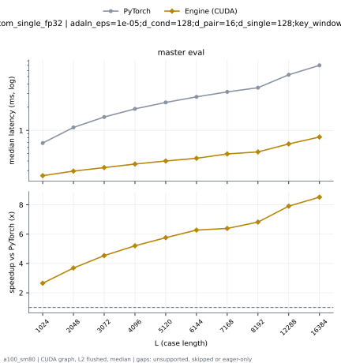
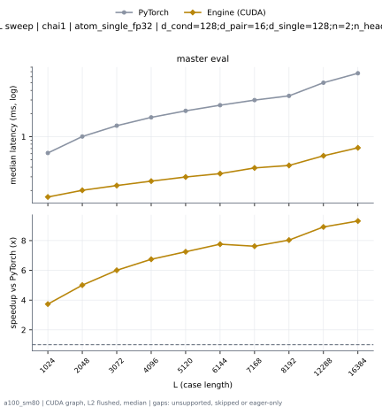
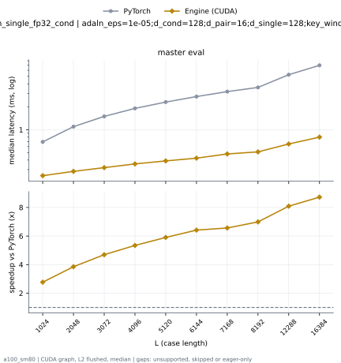
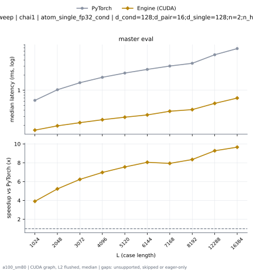
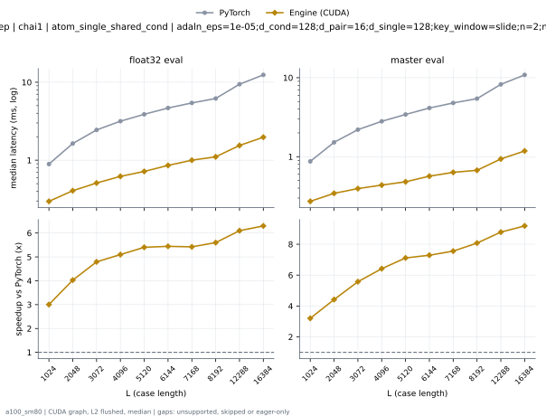
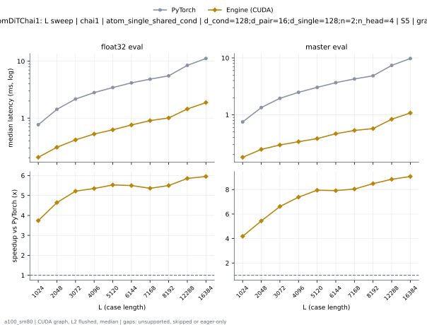

# AtomDiTChai1 on a100_sm80

Generated by `python -m miniworld_engine.measure.plot` from speed tokens `judge/tokens/a100_sm80/`; do not edit.

### L sweep: chai1 | atom_single | adaln_eps=1e-05;d_cond=128;d_pair=16;d_single=128;key_window=slide;n=2;n_head=4 | S1 | graph

**float32 eval** (median ms; x = speedup vs PyTorch)

| L | PyTorch | Engine (Triton) | Engine (CUDA) |
|---|---|---|---|
| 1024 | 0.6124 | 0.4782 (1.28x) | 0.2447 (2.50x) |
| 2048 | 1.001 | 0.8233 (1.22x) | 0.2847 (3.52x) |
| 3072 | 1.394 | 1.176 (1.19x) | 0.3226 (4.32x) |
| 4096 | 1.79 | 1.538 (1.16x) | 0.3697 (4.84x) |
| 5120 | 2.179 | 1.882 (1.16x) | 0.4004 (5.44x) |
| 6144 | 2.584 | 2.232 (1.16x) | 0.4465 (5.79x) |
| 7168 | 3.023 | 2.617 (1.15x) | 0.5325 (5.68x) |
| 8192 | 3.432 | 2.972 (1.15x) | 0.5683 (6.04x) |
| 12288 | 5.094 | 4.397 (1.16x) | 0.725 (7.03x) |
| 16384 | 6.795 | 5.894 (1.15x) | 0.9298 (7.31x) |

**master eval** (median ms; x = speedup vs PyTorch)

| L | PyTorch | Engine (Triton) | Engine (CUDA) |
|---|---|---|---|
| 1024 | 0.5949 | 0.4521 (1.32x) | 0.2386 (2.49x) |
| 2048 | 0.9073 | 0.7137 (1.27x) | 0.2683 (3.38x) |
| 3072 | 1.212 | 0.9743 (1.24x) | 0.2929 (4.14x) |
| 4096 | 1.523 | 1.236 (1.23x) | 0.3236 (4.71x) |
| 5120 | 1.831 | 1.496 (1.22x) | 0.3492 (5.24x) |
| 6144 | 2.154 | 1.753 (1.23x) | 0.3748 (5.75x) |
| 7168 | 2.504 | 2.048 (1.22x) | 0.4229 (5.92x) |
| 8192 | 2.821 | 2.314 (1.22x) | 0.4444 (6.35x) |
| 12288 | 4.133 | 3.357 (1.23x) | 0.5509 (7.50x) |
| 16384 | 5.47 | 4.444 (1.23x) | 0.6697 (8.17x) |

**float32 train** (median ms; x = speedup vs PyTorch)

| L | PyTorch | Engine (Triton) | Engine (CUDA) |
|---|---|---|---|
| 1024 | 1.296 | 1.031 (1.26x) | 0.7311 (1.77x) |
| 2048 | 2.013 | 1.669 (1.21x) | 0.9329 (2.16x) |
| 3072 | 2.726 | 2.307 (1.18x) | 1.134 (2.40x) |
| 4096 | 3.439 | 2.986 (1.15x) | 1.343 (2.56x) |
| 5120 | 4.132 | 3.607 (1.15x) | 1.487 (2.78x) |
| 6144 | 4.867 | 4.249 (1.15x) | 1.686 (2.89x) |
| 7168 | 5.671 | 4.957 (1.14x) | 1.946 (2.91x) |
| 8192 | 6.412 | 5.601 (1.14x) | 2.101 (3.05x) |
| 12288 |  |  |  |
| 16384 |  |  |  |

**master train** (median ms; x = speedup vs PyTorch)

| L | PyTorch | Engine (Triton) | Engine (CUDA) |
|---|---|---|---|
| 1024 | 1.333 | 1.054 (1.27x) | 0.7209 (1.85x) |
| 2048 | 1.944 | 1.59 (1.22x) | 0.8264 (2.35x) |
| 3072 | 2.55 | 2.125 (1.20x) | 0.9472 (2.69x) |
| 4096 | 3.149 | 2.665 (1.18x) | 1.099 (2.87x) |
| 5120 | 3.758 | 3.194 (1.18x) | 1.218 (3.09x) |
| 6144 | 4.392 | 3.734 (1.18x) | 1.336 (3.29x) |
| 7168 | 5.084 | 4.333 (1.17x) | 1.516 (3.35x) |
| 8192 | 5.712 | 4.84 (1.18x) | 1.625 (3.51x) |
| 12288 |  |  |  |
| 16384 |  |  |  |

### L sweep: chai1 | atom_single | d_cond=128;d_pair=16;d_single=128;n=2;n_head=4 | S1 | graph

**float32 eval** (median ms; x = speedup vs PyTorch)

| L | PyTorch | Engine (Triton) | Engine (CUDA) |
|---|---|---|---|
| 1024 | 0.5386 | 0.4608 (1.17x) | 0.1536 (3.51x) |
| 2048 | 0.9083 | 0.8059 (1.13x) | 0.1874 (4.85x) |
| 3072 | 1.287 | 1.158 (1.11x) | 0.2232 (5.77x) |
| 4096 | 1.663 | 1.52 (1.09x) | 0.2693 (6.17x) |
| 5120 | 2.033 | 1.862 (1.09x) | 0.3021 (6.73x) |
| 6144 | 2.421 | 2.213 (1.09x) | 0.3471 (6.97x) |
| 7168 | 2.839 | 2.597 (1.09x) | 0.4332 (6.55x) |
| 8192 | 3.228 | 2.951 (1.09x) | 0.468 (6.90x) |
| 12288 | 4.819 | 4.382 (1.10x) | 0.6216 (7.75x) |
| 16384 | 6.455 | 5.873 (1.10x) | 0.8223 (7.85x) |

**master eval** (median ms; x = speedup vs PyTorch)

| L | PyTorch | Engine (Triton) | Engine (CUDA) |
|---|---|---|---|
| 1024 | 0.5243 | 0.4357 (1.20x) | 0.1485 (3.53x) |
| 2048 | 0.8202 | 0.6963 (1.18x) | 0.1761 (4.66x) |
| 3072 | 1.108 | 0.9554 (1.16x) | 0.1966 (5.64x) |
| 4096 | 1.403 | 1.219 (1.15x) | 0.2222 (6.31x) |
| 5120 | 1.696 | 1.477 (1.15x) | 0.2447 (6.93x) |
| 6144 | 2.002 | 1.734 (1.15x) | 0.2693 (7.43x) |
| 7168 | 2.332 | 2.03 (1.15x) | 0.3205 (7.27x) |
| 8192 | 2.636 | 2.295 (1.15x) | 0.341 (7.73x) |
| 12288 | 3.892 | 3.336 (1.17x) | 0.4465 (8.72x) |
| 16384 | 5.164 | 4.425 (1.17x) | 0.5642 (9.15x) |

**float32 train** (median ms; x = speedup vs PyTorch)

| L | PyTorch | Engine (Triton) | Engine (CUDA) |
|---|---|---|---|
| 1024 | 1.148 | 1.013 (1.13x) | 0.4895 (2.35x) |
| 2048 | 1.841 | 1.648 (1.12x) | 0.6308 (2.92x) |
| 3072 | 2.536 | 2.289 (1.11x) | 0.7639 (3.32x) |
| 4096 | 3.241 | 2.969 (1.09x) | 0.9298 (3.49x) |
| 5120 | 3.918 | 3.589 (1.09x) | 1.036 (3.78x) |
| 6144 | 4.637 | 4.228 (1.10x) | 1.194 (3.88x) |
| 7168 | 5.416 | 4.941 (1.10x) | 1.416 (3.82x) |
| 8192 | 6.141 | 5.587 (1.10x) | 1.537 (4.00x) |
| 12288 |  |  |  |
| 16384 |  |  |  |

**master train** (median ms; x = speedup vs PyTorch)

| L | PyTorch | Engine (Triton) | Engine (CUDA) |
|---|---|---|---|
| 1024 | 1.183 | 1.036 (1.14x) | 0.4813 (2.46x) |
| 2048 | 1.766 | 1.572 (1.12x) | 0.5755 (3.07x) |
| 3072 | 2.354 | 2.108 (1.12x) | 0.6589 (3.57x) |
| 4096 | 2.948 | 2.646 (1.11x) | 0.7793 (3.78x) |
| 5120 | 3.547 | 3.174 (1.12x) | 0.8684 (4.08x) |
| 6144 | 4.171 | 3.719 (1.12x) | 0.9554 (4.37x) |
| 7168 | 4.849 | 4.315 (1.12x) | 1.114 (4.35x) |
| 8192 | 5.462 | 4.822 (1.13x) | 1.205 (4.53x) |
| 12288 |  |  |  |
| 16384 |  |  |  |

### L sweep: chai1 | atom_single_fp32 | adaln_eps=1e-05;d_cond=128;d_pair=16;d_single=128;key_window=slide;n=2;n_head=4 | S1 | graph

**master eval** (median ms; x = speedup vs PyTorch)

| L | PyTorch | Engine (Triton) | Engine (CUDA) |
|---|---|---|---|
| 1024 | 0.6851 | 0.5427 (1.26x) | 0.258 (2.65x) |
| 2048 | 1.093 | 0.8991 (1.22x) | 0.2959 (3.69x) |
| 3072 | 1.492 | 1.256 (1.19x) | 0.3287 (4.54x) |
| 4096 | 1.904 | 1.616 (1.18x) | 0.3656 (5.21x) |
| 5120 | 2.307 | 1.969 (1.17x) | 0.4004 (5.76x) |
| 6144 | 2.726 | 2.322 (1.17x) | 0.4342 (6.28x) |
| 7168 | 3.161 | 2.704 (1.17x) | 0.4946 (6.39x) |
| 8192 | 3.585 | 3.069 (1.17x) | 0.5253 (6.82x) |
| 12288 | 5.275 | 4.489 (1.17x) | 0.6666 (7.91x) |
| 16384 | 6.994 | 5.959 (1.17x) | 0.8202 (8.53x) |

### L sweep: chai1 | atom_single_fp32 | d_cond=128;d_pair=16;d_single=128;n=2;n_head=4 | S1 | graph

**master eval** (median ms; x = speedup vs PyTorch)

| L | PyTorch | Engine (Triton) | Engine (CUDA) |
|---|---|---|---|
| 1024 | 0.6134 | 0.5263 (1.17x) | 0.1644 (3.73x) |
| 2048 | 1.005 | 0.8806 (1.14x) | 0.2007 (5.01x) |
| 3072 | 1.39 | 1.24 (1.12x) | 0.2314 (6.00x) |
| 4096 | 1.782 | 1.599 (1.11x) | 0.2642 (6.74x) |
| 5120 | 2.168 | 1.95 (1.11x) | 0.299 (7.25x) |
| 6144 | 2.566 | 2.303 (1.11x) | 0.3308 (7.76x) |
| 7168 | 2.989 | 2.688 (1.11x) | 0.3922 (7.62x) |
| 8192 | 3.394 | 3.05 (1.11x) | 0.4224 (8.03x) |
| 12288 | 5.031 | 4.469 (1.13x) | 0.5642 (8.92x) |
| 16384 | 6.678 | 5.937 (1.12x) | 0.7168 (9.32x) |

### L sweep: chai1 | atom_single_fp32_cond | adaln_eps=1e-05;d_cond=128;d_pair=16;d_single=128;key_window=slide;n=2;n_head=4 | S1 | graph

**master eval** (median ms; x = speedup vs PyTorch)

| L | PyTorch | Engine (Triton) | Engine (CUDA) |
|---|---|---|---|
| 1024 | 0.6922 | 0.554 (1.25x) | 0.2499 (2.77x) |
| 2048 | 1.097 | 0.9103 (1.20x) | 0.2847 (3.85x) |
| 3072 | 1.495 | 1.269 (1.18x) | 0.3185 (4.69x) |
| 4096 | 1.904 | 1.628 (1.17x) | 0.3564 (5.34x) |
| 5120 | 2.303 | 1.981 (1.16x) | 0.3901 (5.90x) |
| 6144 | 2.72 | 2.337 (1.16x) | 0.4239 (6.42x) |
| 7168 | 3.159 | 2.725 (1.16x) | 0.4813 (6.56x) |
| 8192 | 3.582 | 3.088 (1.16x) | 0.5125 (6.99x) |
| 12288 | 5.261 | 4.511 (1.17x) | 0.6502 (8.09x) |
| 16384 | 6.977 | 5.988 (1.17x) | 0.7997 (8.72x) |

### L sweep: chai1 | atom_single_fp32_cond | d_cond=128;d_pair=16;d_single=128;n=2;n_head=4 | S1 | graph

**master eval** (median ms; x = speedup vs PyTorch)

| L | PyTorch | Engine (Triton) | Engine (CUDA) |
|---|---|---|---|
| 1024 | 0.6287 | 0.5386 (1.17x) | 0.1608 (3.91x) |
| 2048 | 1.022 | 0.894 (1.14x) | 0.1956 (5.23x) |
| 3072 | 1.411 | 1.251 (1.13x) | 0.2263 (6.24x) |
| 4096 | 1.806 | 1.611 (1.12x) | 0.2591 (6.97x) |
| 5120 | 2.196 | 1.963 (1.12x) | 0.2908 (7.55x) |
| 6144 | 2.597 | 2.316 (1.12x) | 0.3226 (8.05x) |
| 7168 | 3.03 | 2.705 (1.12x) | 0.382 (7.93x) |
| 8192 | 3.434 | 3.07 (1.12x) | 0.4116 (8.34x) |
| 12288 | 5.08 | 4.489 (1.13x) | 0.5478 (9.27x) |
| 16384 | 6.743 | 5.965 (1.13x) | 0.6984 (9.65x) |

### L sweep: chai1 | atom_single_shared_cond | adaln_eps=1e-05;d_cond=128;d_pair=16;d_single=128;key_window=slide;n=2;n_head=4 | S5 | graph

**float32 eval** (median ms; x = speedup vs PyTorch)

| L | PyTorch | Engine (Triton) | Engine (CUDA) |
|---|---|---|---|
| 1024 | 0.8919 | 0.6113 (1.46x) | 0.297 (3.00x) |
| 2048 | 1.637 | 1.091 (1.50x) | 0.4065 (4.03x) |
| 3072 | 2.444 | 1.647 (1.48x) | 0.51 (4.79x) |
| 4096 | 3.163 | 2.128 (1.49x) | 0.6205 (5.10x) |
| 5120 | 3.878 | 2.629 (1.48x) | 0.7178 (5.40x) |
| 6144 | 4.67 | 3.182 (1.47x) | 0.8581 (5.44x) |
| 7168 | 5.424 | 3.703 (1.46x) | 1 (5.42x) |
| 8192 | 6.186 | 4.206 (1.47x) | 1.105 (5.60x) |
| 12288 | 9.423 | 6.439 (1.46x) | 1.545 (6.10x) |
| 16384 | 12.42 | 8.54 (1.45x) | 1.971 (6.30x) |

**master eval** (median ms; x = speedup vs PyTorch)

| L | PyTorch | Engine (Triton) | Engine (CUDA) |
|---|---|---|---|
| 1024 | 0.8724 | 0.553 (1.58x) | 0.2724 (3.20x) |
| 2048 | 1.521 | 0.9411 (1.62x) | 0.3441 (4.42x) |
| 3072 | 2.2 | 1.342 (1.64x) | 0.3948 (5.57x) |
| 4096 | 2.806 | 1.694 (1.66x) | 0.4372 (6.42x) |
| 5120 | 3.423 | 2.058 (1.66x) | 0.4813 (7.11x) |
| 6144 | 4.134 | 2.519 (1.64x) | 0.5673 (7.29x) |
| 7168 | 4.788 | 2.925 (1.64x) | 0.6339 (7.55x) |
| 8192 | 5.432 | 3.301 (1.65x) | 0.6728 (8.07x) |
| 12288 | 8.23 | 4.91 (1.68x) | 0.937 (8.78x) |
| 16384 | 10.85 | 6.475 (1.68x) | 1.182 (9.19x) |

### L sweep: chai1 | atom_single_shared_cond | d_cond=128;d_pair=16;d_single=128;n=2;n_head=4 | S5 | graph

**float32 eval** (median ms; x = speedup vs PyTorch)

| L | PyTorch | Engine (Triton) | Engine (CUDA) |
|---|---|---|---|
| 1024 | 0.766 | 0.5934 (1.29x) | 0.2048 (3.74x) |
| 2048 | 1.426 | 1.074 (1.33x) | 0.3072 (4.64x) |
| 3072 | 2.164 | 1.629 (1.33x) | 0.4147 (5.22x) |
| 4096 | 2.81 | 2.109 (1.33x) | 0.5253 (5.35x) |
| 5120 | 3.442 | 2.61 (1.32x) | 0.6226 (5.53x) |
| 6144 | 4.167 | 3.164 (1.32x) | 0.7578 (5.50x) |
| 7168 | 4.84 | 3.684 (1.31x) | 0.9032 (5.36x) |
| 8192 | 5.534 | 4.187 (1.32x) | 1.007 (5.50x) |
| 12288 | 8.465 | 6.418 (1.32x) | 1.446 (5.85x) |
| 16384 | 11.17 | 8.517 (1.31x) | 1.876 (5.95x) |

**master eval** (median ms; x = speedup vs PyTorch)

| L | PyTorch | Engine (Triton) | Engine (CUDA) |
|---|---|---|---|
| 1024 | 0.7496 | 0.5356 (1.40x) | 0.1792 (4.18x) |
| 2048 | 1.341 | 0.9236 (1.45x) | 0.2468 (5.44x) |
| 3072 | 1.951 | 1.326 (1.47x) | 0.2949 (6.61x) |
| 4096 | 2.486 | 1.675 (1.48x) | 0.3369 (7.38x) |
| 5120 | 3.035 | 2.039 (1.49x) | 0.382 (7.95x) |
| 6144 | 3.679 | 2.501 (1.47x) | 0.4649 (7.91x) |
| 7168 | 4.273 | 2.905 (1.47x) | 0.5315 (8.04x) |
| 8192 | 4.856 | 3.283 (1.48x) | 0.5724 (8.48x) |
| 12288 | 7.394 | 4.893 (1.51x) | 0.8366 (8.84x) |
| 16384 | 9.776 | 6.457 (1.51x) | 1.078 (9.07x) |

